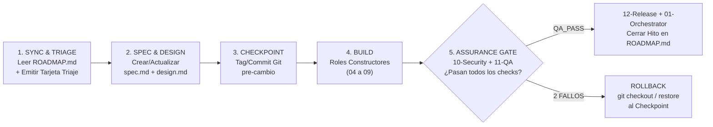

# AGENTS.md — Sistema Operativo de Agentes de Ingeniería (Datalaria SDD + Helix Squad)

> **Compatibilidad Universal:** Este documento es el punto de entrada obligatorio y fuente de verdad operativa para **cualquier agente de IA** que trabaje en este repositorio (incluyendo **Google Antigravity con Gemini 4 Argon / Flash**, **Claude Code / Agentes Anthropic**, Cursor o GitHub Copilot).

---

## 1. PROTOCOLO DE ARRANQUE OBLIGATORIO (BOOT SEQUENCE)

**ANTES de responder a una tarea de implementación, proponer un plan o modificar cualquier archivo de código**, todo agente DEBE ejecutar en lectura los siguientes 3 pasos en orden:

1. **Leer el Estado del Ecosistema y Memoria:**
   - Leer [`/specs/ROADMAP.md`](file:///c:/Users/dalae/OneDrive/Emprendiendo/datalaria/specs/ROADMAP.md) para identificar en qué Fase, Hito y Tarea exacta nos encontramos, y cuál fue el último checkpoint verificado.
2. **Leer las Reglas Inmutables del Sistema:**
   - Leer [`/specs/_constitution.md`](file:///c:/Users/dalae/OneDrive/Emprendiendo/datalaria/specs/_constitution.md) (`v1.1.0`, Artículos 1 a 9) para asegurar el cumplimiento estricto de las invariantes de seguridad, topología de directorios, aislamiento de datos, patrón Dual-Mode y separación Construcción/Verificación.
3. **Leer la Especificación del Módulo Afectado y Emitir Triaje:**
   - Si la tarea afecta a una aplicación (`<app>`), leer `/specs/apps/<app>/spec.md` (y `/specs/apps/<app>/design.md` si se toca UI).
   - Aplicar la rúbrica de triaje de [`/specs/squad/triage-rubric.md`](file:///c:/Users/dalae/OneDrive/Emprendiendo/datalaria/specs/squad/triage-rubric.md) y cargar en contexto **únicamente** las fichas `/specs/squad/<rol>.md` de los agentes convocados (§5).
   - **REGLA DE BLOQUEO SDD:** Está **TERMINANTEMENTE PROHIBIDO** crear o modificar código de producción en `/apps/`, `/layouts/` o `/scripts/` si no existe primero una especificación aprobada en `/specs/` que describa el cambio y sus criterios de verificación.

---

## 2. MAPA TOPOLÓGICO DEL REPOSITORIO

| Directorio | Propósito | Regla de Acceso para Agentes |
| :--- | :--- | :--- |
| **`/specs/`** | **El Corazón SDD (Fuente Única de Verdad).** Contiene `_constitution.md`, `ROADMAP.md`, `DECISIONS.md` (ADRs), `_templates/`, `audit/`, `squad/` (las 12 fichas `AGENT_SPEC` de Helix) y las especificaciones por app (`/specs/apps/<slug>/spec.md`). | **Lectura obligatoria.** Todo cambio arquitectónico o funcional empieza aquí. |
| **`/specs/squad/`** | **Escuadrón Canónico Datalaria Helix (12 Agentes).** Contiene `README.md`, `triage-rubric.md` y las 12 fichas `01-orchestrator.md` a `12-release-devops.md`. | **Carga bajo demanda (`INV-HELIX-2`).** Prohibido editar a mano los adaptadores compilados en `.agents/`, `.claude/` o `.cursor/`. |
| **`/apps/`** | **Código Fuente de Aplicaciones.** Contiene frontends (React/Vite/TS) y backends/motores cuantitativos (FastAPI/Python). | Solo modificar bajo cobertura de un `spec.md` activo y tests automatizados. |
| **`/static/`** | **Assets Públicos de Hugo.** Todo archivo aquí se copia literalmente a `public/` y es accesible por Internet en `https://datalaria.com/*`. | **PROHIBIDO** alojar archivos `.py`, `.sql`, `.env` o código backend aquí. Solo bundles compilados, imágenes y apps estáticas congeladas. |
| **`/content/`, `/layouts/`** | **Portal Editorial Hugo y Catálogo B2B (Lemon Squeezy).** Contenido bilingüe (`/es/`, `/en/`) y plantillas Go HTML. Las fichas de App viven en `/content/{es,en}/apps/<slug>/`. | Preservar paridad estricta bilingüe ES/EN y telemetría GA4 / Lemon Squeezy. |
| **`/data/apps/`** | **Metadatos públicos de cada App** (objetivos, diseño, tecnologías, posts, versiones). Fuente única para fichas, tarjetas y shortcode `app-ref`. | Toda release de una App actualiza su YAML y el changelog de su `spec.md` en el mismo commit (Constitución Art. 8). |
| **`/ops/`** | **Automatización Interna y Fábrica de Productos (`ops/pulse/`, `ops/helix/`, `scripts/`).** Indexadores, compiladores de adaptadores, generadores de Kits ZIP/Excel/PDF y suites `pytest`. | Código interno de build/CI; nunca exponer en el runtime del navegador. |

---

## 3. FLUJO DE TRABAJO SPEC-DRIVEN DEVELOPMENT (EL BUCLE SDD)

Para garantizar **cero pérdida de contexto entre sesiones** y **capacidad de rollback inmediato**, todo trabajo sigue este ciclo atómico de 5 pasos:



### Reglas de Ejecución Paso a Paso:
1. **Un Hito a la vez:** Nunca mezcles en un mismo turno la refactorización de dos aplicaciones distintas ni combines mudanzas de directorios con cambios en lógica de negocio.
2. **Verificación Determinista (Veto de `11-qa-verifier`):** Ninguna tarea se marca como `[x]` en `ROADMAP.md` por inspección visual subjetiva. Debe superar los comandos de validación definidos en su `spec.md`:
   - **Hugo Portal:** `hugo --gc --minify` o `hugo --renderToMemory` (código de salida `0`).
   - **Frontend Apps (JS/TS):** `npm run lint` (`oxlint`) + `npm run build` (código de salida `0`).
   - **Backend / Motores Cuantitativos (Python):** `python -m pytest` + validación de esquemas Pydantic v2.
   - **Gobernanza Editorial Automatizada (Datalaria Pulse):** Toda creación o edición de artículos en `content/**`, apps en `data/apps/` o kits en `data/pulse/` DEBE ejecutar `python -m ops.pulse.build_index` y `python -m ops.pulse.publish_public`.
   - **Sincronización de Adaptadores Helix:** Toda edición en `specs/squad/*.md` DEBE ejecutar `python -m ops.helix.build_adapters` y `python -m pytest ops/helix/tests -v`.
3. **Protocolo de Marcha Atrás (Rollback — `INV-HELIX-7`):**
   - Si una migración rompe el build de Hugo, expone rutas rotas o falla los tests en 2 intentos consecutivos, el agente debe detenerse, restaurar el estado limpio y documentar el bloqueo en `specs/ROADMAP.md` bajo la sección `REGISTRO DE BLOQUEOS Y ROLLBACKS (AUDIT LOG)`.

---

## 4. ACTUALIZACIÓN DE MEMORIA AL FINALIZAR CADA TURNO

Antes de dar por concluida cualquier intervención que modifique el estado del proyecto, el agente DEBE:
1. Actualizar el estado de la tarea en [`/specs/ROADMAP.md`](file:///c:/Users/dalae/OneDrive/Emprendiendo/datalaria/specs/ROADMAP.md) (`[ ]` → `[~]` en progreso o `[x]` completado) junto con la fecha y el comando de verificación ejecutado.
2. Si se tomó una nueva decisión arquitectónica o se descartó una alternativa, registrarla en [`/specs/DECISIONS.md`](file:///c:/Users/dalae/OneDrive/Emprendiendo/datalaria/specs/DECISIONS.md).

---

## 5. ESCUADRÓN DATALARIA HELIX Y TRIAJE BAJO DEMANDA (`ADR-018`)

El desarrollo y auditoría de todas las aplicaciones, artículos y Kits de Datalaria está gobernado por el **Escuadrón de 12 Agentes Datalaria Helix** definido en [`/specs/squad/`](file:///c:/Users/dalae/OneDrive/Emprendiendo/datalaria/specs/squad/README.md):

### 5.1 Regla de Carga Bajo Demanda (`INV-HELIX-2`) y Tarjeta de Triaje
1. **Prohibición de Carga Masiva:** Jamás cargues las 12 fichas `specs/squad/*.md` a la vez en tareas `XS`, `S` o `M`.
2. **Emisión de la Tarjeta de Triaje (6 líneas):** Al iniciar un hito o tarea de implementación, el agente asume primero el rol [`01-orchestrator`](file:///c:/Users/dalae/OneDrive/Emprendiendo/datalaria/specs/squad/01-orchestrator.md), evalúa [`specs/squad/triage-rubric.md`](file:///c:/Users/dalae/OneDrive/Emprendiendo/datalaria/specs/squad/triage-rubric.md), emite el bloque `TRIAGE HELIX` de 6 líneas y lee **exclusivamente** las fichas de los roles activados:

```text
TRIAGE HELIX · Hito <ID> · Talla: <XS|S|M|L|XL>
Superficies afectadas: <docs | ui | frontend | backend | data_sql | apis | media_i18n | monetization | auth_security>
Roles activados (<N> de 12): <iconos e IDs de los agentes convocados>
Roles en banquillo: <agentes no requeridos>
Verification Gate: <comandos exactos con código de salida 0>
Presupuesto y Gobernanza: Máx. 2 intentos por gate · Checkpoint <tag Git> · Aprobación humana previa: <SÍ|NO>
```

### 5.2 Mapa Rápido de las 4 Células y Disparadores Automáticos (`INV-HELIX-3`)

| Célula | Agente (`specs/squad/<id>.md`) | Cuándo se convoca obligatoriamente |
| :--- | :--- | :--- |
| **1. Dirección** | 🎯 [`01-orchestrator`](file:///c:/Users/dalae/OneDrive/Emprendiendo/datalaria/specs/squad/01-orchestrator.md) · 🧭 [`02-product-analyst`](file:///c:/Users/dalae/OneDrive/Emprendiendo/datalaria/specs/squad/02-product-analyst.md) · 🏛️ [`03-architect`](file:///c:/Users/dalae/OneDrive/Emprendiendo/datalaria/specs/squad/03-architect.md) | `01` en toda tarea; `02` en tallas `L`/`XL` y auditorías de producto; `03` en tallas `M`/`L`/`XL`, specs y ADRs. |
| **2. Construcción** | 🎨 [`04-ux-ui`](file:///c:/Users/dalae/OneDrive/Emprendiendo/datalaria/specs/squad/04-ux-ui.md) · ⚡ [`05-frontend`](file:///c:/Users/dalae/OneDrive/Emprendiendo/datalaria/specs/squad/05-frontend.md) · 🗄️ [`06-backend-data`](file:///c:/Users/dalae/OneDrive/Emprendiendo/datalaria/specs/squad/06-backend-data.md) · 🔌 [`07-apis-integrations`](file:///c:/Users/dalae/OneDrive/Emprendiendo/datalaria/specs/squad/07-apis-integrations.md) · 🎬 [`08-media-i18n`](file:///c:/Users/dalae/OneDrive/Emprendiendo/datalaria/specs/squad/08-media-i18n.md) · 💳 [`09-monetization`](file:///c:/Users/dalae/OneDrive/Emprendiendo/datalaria/specs/squad/09-monetization.md) | Según superficie: `TRG-UX` → `04`; UI código → `05`; Python/SQL/Excel → `06`; APIs/Serverless/M → `07`; `TRG-I18N` → `08`; `TRG-MON` → `09`. |
| **3. Garantía (Veto)** | 🛡️ [`10-security-privacy`](file:///c:/Users/dalae/OneDrive/Emprendiendo/datalaria/specs/squad/10-security-privacy.md) · ✅ [`11-qa-verifier`](file:///c:/Users/dalae/OneDrive/Emprendiendo/datalaria/specs/squad/11-qa-verifier.md) | `TRG-SEC` (auth, RLS, `.env`, serverless, `static/`) → `10` con veto; `TRG-QA` (toda tarea) → `11` con veto. **Nadie verifica su propio trabajo (`INV-HELIX-1`).** |
| **4. Entrega** | 🚀 [`12-release-devops`](file:///c:/Users/dalae/OneDrive/Emprendiendo/datalaria/specs/squad/12-release-devops.md) | Checkpoints `sdd-checkpoint-*`, empaquetado `.zip`, versionado SemVer (`data/apps/*.yaml`) y ejecución de Rollback. |
