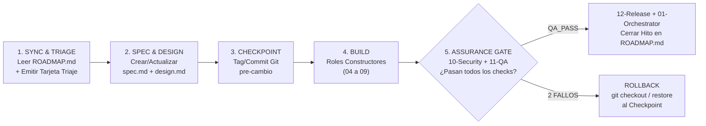

# AGENTS.md — Sistema Operativo de Agentes de Ingeniería (Datalaria SDD + Helix Squad)

> **Compatibilidad Universal:** Este documento es el punto de entrada obligatorio y fuente de verdad operativa para **cualquier agente de IA** que trabaje en este repositorio (incluyendo **Google Antigravity con Gemini 4 Argon / Flash**, **Claude Code / Agentes Anthropic**, Cursor o GitHub Copilot).

---

## 1. PROTOCOLO DE ARRANQUE OBLIGATORIO (BOOT SEQUENCE)

**ANTES de responder a una tarea de implementación, proponer un plan o modificar cualquier archivo de código**, todo agente DEBE ejecutar en lectura los siguientes 3 pasos en orden:

1. **Leer el Estado del Ecosistema y Memoria:**
   - Leer [`/specs/ROADMAP.md`](file:///c:/Users/dalae/OneDrive/Emprendiendo/datalaria/specs/ROADMAP.md) para identificar en qué Fase, Hito y Tarea exacta nos encontramos, y cuál fue el último checkpoint verificado.
2. **Leer las Reglas Inmutables del Sistema:**
   - Leer [`/specs/_constitution.md`](file:///c:/Users/dalae/OneDrive/Emprendiendo/datalaria/specs/_constitution.md) (`v1.2.0`, Artículos 1 a 10) para asegurar el cumplimiento estricto de las invariantes de seguridad, topología de directorios, aislamiento de datos, patrón Dual-Mode, separación Construcción/Verificación y federación `Datalaria OS`.
3. **Leer la Especificación del Módulo Afectado y Emitir Triaje:**
   - Si la tarea afecta a una aplicación (`<app>`), leer `/specs/apps/<app>/spec.md` (y `/specs/apps/<app>/design.md` si se toca UI).
   - Aplicar la rúbrica de triaje de [`/specs/squad/triage-rubric.md`](file:///c:/Users/dalae/OneDrive/Emprendiendo/datalaria/specs/squad/triage-rubric.md) y cargar en contexto **únicamente** las fichas `/specs/squad/<rol>.md` de los agentes convocados (§5).
   - **REGLA DE BLOQUEO SDD:** Está **TERMINANTEMENTE PROHIBIDO** crear o modificar código de producción en `/apps/`, `/layouts/` o `/scripts/` si no existe primero una especificación aprobada en `/specs/` que describa el cambio y sus criterios de verificación.

---

## 2. MAPA TOPOLÓGICO DEL REPOSITORIO

| Directorio | Propósito | Regla de Acceso para Agentes |
| :--- | :--- | :--- |
| **`/specs/`** | **El Corazón SDD (Fuente Única de Verdad).** Contiene `_constitution.md`, `ROADMAP.md`, `DECISIONS.md` (ADRs), `_templates/`, `audit/`, `squad/` (las 12 fichas `AGENT_SPEC` de Helix) y las especificaciones por app (`/specs/apps/<slug>/spec.md`). | **Lectura obligatoria.** Todo cambio arquitectónico o funcional empieza aquí. |
| **`/specs/squad/`** | **Escuadrón Canónico Datalaria Helix (12 Agentes).** Contiene `README.md`, `triage-rubric.md` y las 12 fichas `01-orchestrator.md` a `12-release-devops.md`. | **Carga bajo demanda (`INV-HELIX-2`).** Prohibido editar a mano los adaptadores compilados en `.agents/`, `.claude/` o `.cursor/`. |
| **`/specs/squad-editorial/`** | **Escuadrón Canónico Datalaria Scriba (8 Agentes).** Contiene `README.md`, `triage-editorial-rubric.md` y las 8 fichas `E01-editorial-orchestrator.md` a `E08-autopilot-dispatcher.md`. | **Carga bajo demanda (`INV-SCRIBA-2`).** Prohibido editar a mano los adaptadores compilados en `.agents/squad-editorial/`, `.claude/` o `.cursor/`. |
| **`/specs/squad-os/`** | **Capa 0 — Datalaria OS (`ADR-034`/`ADR-035`).** Contiene `00-chief-orchestrator.md` (custodio de `specs/STRATEGY.md` y `specs/_brand.md`) y `00B-board-advisor.md` (Consultor Directivo / Business Angel *Red-Team*, tarjeta `BOARD BRIEF` sin veto bloqueante), con bypass coste 0 en tareas mono-dominio. | **Solo en tareas multi-escuadrón/estratégicas o auditorías de foco (`INV-OS-1`).** |
| **`/specs/squad-mercator/`** | **Escuadrón Canónico Datalaria Mercator (4 Agentes Estadio 1).** Contiene `README.md`, `triage-mercator-rubric.md` y `M01`–`M04` (CRO/Pricing, Lifecycle Brevo, Distribución Externa). | **Carga bajo demanda (`INV-OS-2`).** Reutiliza vetos `10`/`11`/`E07`; prohibido editar `.agents/squad-mercator/` a mano. |
| **`/apps/`** | **Código Fuente de Aplicaciones.** Contiene frontends (React/Vite/TS) y backends/motores cuantitativos (FastAPI/Python). | Solo modificar bajo cobertura de un `spec.md` activo y tests automatizados. |
| **`/static/`** | **Assets Públicos de Hugo.** Todo archivo aquí se copia literalmente a `public/` y es accesible por Internet en `https://datalaria.com/*`. | **PROHIBIDO** alojar archivos `.py`, `.sql`, `.env` o código backend aquí. Solo bundles compilados, imágenes y apps estáticas congeladas. |
| **`/content/`, `/layouts/`** | **Portal Editorial Hugo y Catálogo B2B (Lemon Squeezy).** Contenido bilingüe (`/es/`, `/en/`) y plantillas Go HTML. Las fichas de App viven en `/content/{es,en}/apps/<slug>/`. | Preservar paridad estricta bilingüe ES/EN y telemetría GA4 / Lemon Squeezy. |
| **`/data/apps/`** | **Metadatos públicos de cada App** (objetivos, diseño, tecnologías, posts, versiones). Fuente única para fichas, tarjetas y shortcode `app-ref`. | Toda release de una App actualiza su YAML y el changelog de su `spec.md` en el mismo commit (Constitución Art. 8). |
| **`/ops/`** | **Automatización Interna y Fábrica de Productos (`ops/pulse/`, `ops/helix/`, `scripts/`).** Indexadores, compiladores de adaptadores, generadores de Kits ZIP/Excel/PDF y suites `pytest`. | Código interno de build/CI; nunca exponer en el runtime del navegador. |

---

## 3. FLUJO DE TRABAJO SPEC-DRIVEN DEVELOPMENT (EL BUCLE SDD)

Para garantizar **cero pérdida de contexto entre sesiones** y **capacidad de rollback inmediato**, todo trabajo sigue este ciclo atómico de 5 pasos:



### Reglas de Ejecución Paso a Paso:
1. **Un Hito a la vez:** Nunca mezcles en un mismo turno la refactorización de dos aplicaciones distintas ni combines mudanzas de directorios con cambios en lógica de negocio.
2. **Verificación Determinista (Veto de `11-qa-verifier`):** Ninguna tarea se marca como `[x]` en `ROADMAP.md` por inspección visual subjetiva. Debe superar los comandos de validación definidos en su `spec.md`:
   - **Hugo Portal:** `hugo --gc --minify` o `hugo --renderToMemory` (código de salida `0`).
   - **Frontend Apps (JS/TS):** `npm run lint` (`oxlint`) + `npm run build` (código de salida `0`).
   - **Backend / Motores Cuantitativos (Python):** `python -m pytest` + validación de esquemas Pydantic v2.
   - **Gobernanza Editorial Automatizada (Datalaria Pulse):** Toda creación o edición de artículos en `content/**`, apps en `data/apps/` o kits en `data/pulse/` DEBE ejecutar `python -m ops.pulse.build_index` y `python -m ops.pulse.publish_public`.
   - **Sincronización de Adaptadores Helix:** Toda edición en `specs/squad/*.md` DEBE ejecutar `python -m ops.helix.build_adapters` y `python -m pytest ops/helix/tests -v`.
3. **Protocolo de Marcha Atrás (Rollback — `INV-HELIX-7`):**
   - Si una migración rompe el build de Hugo, expone rutas rotas o falla los tests en 2 intentos consecutivos, el agente debe detenerse, restaurar el estado limpio y documentar el bloqueo en `specs/ROADMAP.md` bajo la sección `REGISTRO DE BLOQUEOS Y ROLLBACKS (AUDIT LOG)`.

---

## 4. ACTUALIZACIÓN DE MEMORIA AL FINALIZAR CADA TURNO

Antes de dar por concluida cualquier intervención que modifique el estado del proyecto, el agente DEBE:
1. Actualizar el estado de la tarea en [`/specs/ROADMAP.md`](file:///c:/Users/dalae/OneDrive/Emprendiendo/datalaria/specs/ROADMAP.md) (`[ ]` → `[~]` en progreso o `[x]` completado) junto con la fecha y el comando de verificación ejecutado.
2. Si se tomó una nueva decisión arquitectónica o se descartó una alternativa, registrarla en [`/specs/DECISIONS.md`](file:///c:/Users/dalae/OneDrive/Emprendiendo/datalaria/specs/DECISIONS.md).

---

## 5. ESCUADRÓN DATALARIA HELIX Y TRIAJE BAJO DEMANDA (`ADR-018`)

El desarrollo y auditoría de todas las aplicaciones, artículos y Kits de Datalaria está gobernado por el **Escuadrón de 12 Agentes Datalaria Helix** definido en [`/specs/squad/`](file:///c:/Users/dalae/OneDrive/Emprendiendo/datalaria/specs/squad/README.md):

### 5.1 Regla de Carga Bajo Demanda (`INV-HELIX-2`) y Tarjeta de Triaje
1. **Prohibición de Carga Masiva:** Jamás cargues las 12 fichas `specs/squad/*.md` a la vez en tareas `XS`, `S` o `M`.
2. **Emisión de la Tarjeta de Triaje (6 líneas):** Al iniciar un hito o tarea de implementación, el agente asume primero el rol [`01-orchestrator`](file:///c:/Users/dalae/OneDrive/Emprendiendo/datalaria/specs/squad/01-orchestrator.md), evalúa [`specs/squad/triage-rubric.md`](file:///c:/Users/dalae/OneDrive/Emprendiendo/datalaria/specs/squad/triage-rubric.md), emite el bloque `TRIAGE HELIX` de 6 líneas y lee **exclusivamente** las fichas de los roles activados:

```text
TRIAGE HELIX · Hito <ID> · Talla: <XS|S|M|L|XL>
Superficies afectadas: <docs | ui | frontend | backend | data_sql | apis | media_i18n | monetization | auth_security>
Roles activados (<N> de 12): <iconos e IDs de los agentes convocados>
Roles en banquillo: <agentes no requeridos>
Verification Gate: <comandos exactos con código de salida 0>
Presupuesto y Gobernanza: Máx. 2 intentos por gate · Checkpoint <tag Git> · Aprobación humana previa: <SÍ|NO>
```

### 5.2 Mapa Rápido de las 4 Células y Disparadores Automáticos (`INV-HELIX-3`)

| Célula | Agente (`specs/squad/<id>.md`) | Cuándo se convoca obligatoriamente |
| :--- | :--- | :--- |
| **1. Dirección** | 🎯 [`01-orchestrator`](file:///c:/Users/dalae/OneDrive/Emprendiendo/datalaria/specs/squad/01-orchestrator.md) · 🧭 [`02-product-analyst`](file:///c:/Users/dalae/OneDrive/Emprendiendo/datalaria/specs/squad/02-product-analyst.md) · 🏛️ [`03-architect`](file:///c:/Users/dalae/OneDrive/Emprendiendo/datalaria/specs/squad/03-architect.md) | `01` en toda tarea; `02` en tallas `L`/`XL` y auditorías de producto; `03` en tallas `M`/`L`/`XL`, specs y ADRs. |
| **2. Construcción** | 🎨 [`04-ux-ui`](file:///c:/Users/dalae/OneDrive/Emprendiendo/datalaria/specs/squad/04-ux-ui.md) · ⚡ [`05-frontend`](file:///c:/Users/dalae/OneDrive/Emprendiendo/datalaria/specs/squad/05-frontend.md) · 🗄️ [`06-backend-data`](file:///c:/Users/dalae/OneDrive/Emprendiendo/datalaria/specs/squad/06-backend-data.md) · 🔌 [`07-apis-integrations`](file:///c:/Users/dalae/OneDrive/Emprendiendo/datalaria/specs/squad/07-apis-integrations.md) · 🎬 [`08-media-i18n`](file:///c:/Users/dalae/OneDrive/Emprendiendo/datalaria/specs/squad/08-media-i18n.md) · 💳 [`09-monetization`](file:///c:/Users/dalae/OneDrive/Emprendiendo/datalaria/specs/squad/09-monetization.md) | Según superficie: `TRG-UX` → `04`; UI código → `05`; Python/SQL/Excel → `06`; APIs/Serverless/M → `07`; `TRG-I18N` → `08`; `TRG-MON` → `09`. |
| **3. Garantía (Veto)** | 🛡️ [`10-security-privacy`](file:///c:/Users/dalae/OneDrive/Emprendiendo/datalaria/specs/squad/10-security-privacy.md) · ✅ [`11-qa-verifier`](file:///c:/Users/dalae/OneDrive/Emprendiendo/datalaria/specs/squad/11-qa-verifier.md) | `TRG-SEC` (auth, RLS, `.env`, serverless, `static/`) → `10` con veto; `TRG-QA` (toda tarea) → `11` con veto. **Nadie verifica su propio trabajo (`INV-HELIX-1`).** |
| **4. Entrega** | 🚀 [`12-release-devops`](file:///c:/Users/dalae/OneDrive/Emprendiendo/datalaria/specs/squad/12-release-devops.md) | Checkpoints `sdd-checkpoint-*`, empaquetado `.zip`, versionado SemVer (`data/apps/*.yaml`) y ejecución de Rollback. |


### 5.3 Higiene de Contexto (`INV-HELIX-8`), Lecciones de Fricción Real (`[USER-FIX]`) y Cierre `DEBRIEF HELIX` (`ADR-019`)

Para garantizar que el escuadrón aprenda de forma acumulativa sin degradar la ventana de contexto, todo agente y especialmente el Coordinador (`01-orchestrator`) DEBE aplicar estas tres reglas:

1. **Control Anti-Bloat y Carga Selectiva del Radar (`INV-HELIX-8`):**
   - Las fichas canónicas en `specs/squad/*.md` tienen un **tope duro de $\le 85$ líneas** y un máximo de **6 reglas en su Sección §6**.
   - Los archivos de radar [`specs/squad/TECH_RADAR.yaml`](file:///c:/Users/dalae/OneDrive/Emprendiendo/datalaria/specs/squad/TECH_RADAR.yaml) y [`specs/squad/OPPORTUNITY_BACKLOG.md`](file:///c:/Users/dalae/OneDrive/Emprendiendo/datalaria/specs/squad/OPPORTUNITY_BACKLOG.md) pertenecen a la *Memoria Templada*: **está prohibido cargarlos en tareas rutinarias `XS`, `S`, `M` o `L`**. Solo se consultan o actualizan cuando el usuario lo solicita explícitamente o en hitos estratégicos `XL`.
2. **Criterio de Lección Aprendida (`User-Correction & Friction First`):**
   - En la Sección `## 6` de cada agente **solo** se registran reglas originadas por **correcciones explícitas del usuario vía nuevos prompts (`[USER-FIX]`)** o **errores empíricos de ejecución/entorno (`[ENV-FIX]`)**. Jamás se añade teoría general o conocimientos estándar de IA.
   - Cuando se alcanza el tope de 6 reglas en una ficha, el Coordinador aplica reemplazo FIFO o fusiona reglas relacionadas y ejecuta `python -m ops.helix.build_adapters`.
3. **Tarjeta de Cierre `DEBRIEF HELIX`:**
   - Al finalizar cualquier tarea de desarrollo o auditoría (`M`, `L` o `XL`), el Coordinador emite obligatoriamente antes de despedirse el bloque `DEBRIEF HELIX` (1. Participación por rol convocado, 2. Conclusiones y ajustes destilados, 3. Riesgos y mitigación, 4. Propuestas proactivas de alto ROI).

---

## 6. ESCUADRÓN EDITORIAL DATALARIA SCRIBA Y PROTOCOLO DEL SUPEREQUIPO (`ADR-020`)

La gestión del blog, estrategia SEO/GA4, redacción bilingüe (`ES ⇔ EN`), campañas de Brevo Newsletter 2.0 y sindicación omnicanal automatizada (X/Twitter, LinkedIn, Dev.to, CoderLegion) está gobernada por el **Escuadrón de 8 Agentes Datalaria Scriba** definido en [`/specs/squad-editorial/`](file:///c:/Users/dalae/OneDrive/Emprendiendo/datalaria/specs/squad-editorial/README.md):

### 6.1 Protocolo de Federación del Superequipo (`01-orchestrator` ⇔ `E01-editorial-orchestrator`)
- **Tareas de Ingeniería, Código y Kits B2B (`/apps/`, `/ops/helix/`, `.zip`):** Toma el mando [`01-orchestrator`](file:///c:/Users/dalae/OneDrive/Emprendiendo/datalaria/specs/squad/01-orchestrator.md) aplicando [`specs/squad/triage-rubric.md`](file:///c:/Users/dalae/OneDrive/Emprendiendo/datalaria/specs/squad/triage-rubric.md).
- **Tareas de Blog, Contenido, Redes y Métricas (`content/**`, `autopilot/`, Brevo, GA4/GSC):** Toma el mando [`E01-editorial-orchestrator`](file:///c:/Users/dalae/OneDrive/Emprendiendo/datalaria/specs/squad-editorial/E01-editorial-orchestrator.md) aplicando [`specs/squad-editorial/triage-editorial-rubric.md`](file:///c:/Users/dalae/OneDrive/Emprendiendo/datalaria/specs/squad-editorial/triage-editorial-rubric.md).
- **Protocolo de Relevo (Handoff):** Al concluir una App o Kit (`QA_PASS`), `01-orchestrator` transfiere el contexto y las URLs a `E01-editorial-orchestrator` para activar la producción de posts y la campaña de distribución.

### 6.2 Tarjeta de Triaje Editorial (`TRIAGE SCRIBA`)
Al iniciar una tarea de contenido o sindicación, el agente emite la tarjeta canónica de 6 líneas:

```text
TRIAGE SCRIBA · Tarea <ID> · Talla: <XS|S|M|L|XL>
Superficies afectadas: <content_es | content_en | seo_metadata | newsletter_brevo | social_syndication | pulse_index>
Roles activados (<N> de 8): <iconos e IDs de los agentes convocados>
Roles en banquillo: <agentes no requeridos>
Verification Gate: <comandos exactos con código de salida 0>
Presupuesto y Gobernanza: Máx. 2 intentos por gate · Checkpoint <tag Git> · Aprobación humana previa: <SÍ|NO>
```

### 6.3 Mapa de las 4 Células de Datalaria Scriba

| Célula | Agente (`specs/squad-editorial/<id>.md`) | Cuándo se convoca obligatoriamente |
| :--- | :--- | :--- |
| **1. Dirección** | 🗞️ [`E01-editorial-orchestrator`](file:///c:/Users/dalae/OneDrive/Emprendiendo/datalaria/specs/squad-editorial/E01-editorial-orchestrator.md) · 📈 [`E02-seo-impact-strategist`](file:///c:/Users/dalae/OneDrive/Emprendiendo/datalaria/specs/squad-editorial/E02-seo-impact-strategist.md) | `E01` en toda tarea editorial; `E02` en `TRG-SEO`, auditorías de impacto GA4/GSC y tallas `L`/`XL`. |
| **2. Creación** | ✍️ [`E03-technical-writer`](file:///c:/Users/dalae/OneDrive/Emprendiendo/datalaria/specs/squad-editorial/E03-technical-writer.md) · 🌐 [`E04-bilingual-seo-editor`](file:///c:/Users/dalae/OneDrive/Emprendiendo/datalaria/specs/squad-editorial/E04-bilingual-seo-editor.md) · 💰 [`E05-content-monetizer`](file:///c:/Users/dalae/OneDrive/Emprendiendo/datalaria/specs/squad-editorial/E05-content-monetizer.md) | `E03` en redacción de posts; `E04` en `TRG-I18N-POST` (paridad ES/EN y SEO); `E05` en `TRG-BREVO` y CTAs. |
| **3. Sindicación** | 📣 [`E06-social-syndicator`](file:///c:/Users/dalae/OneDrive/Emprendiendo/datalaria/specs/squad-editorial/E06-social-syndicator.md) | `TRG-SOCIAL` (LinkedIn, hilos X coste 0€, Dev.to y CoderLegion con `canonical_url`). |
| **4. Garantía** | ✅ [`E07-editorial-qa`](file:///c:/Users/dalae/OneDrive/Emprendiendo/datalaria/specs/squad-editorial/E07-editorial-qa.md) · 🤖 [`E08-autopilot-dispatcher`](file:///c:/Users/dalae/OneDrive/Emprendiendo/datalaria/specs/squad-editorial/E08-autopilot-dispatcher.md) | `TRG-EDIT-QA` (toda tarea editorial) → `E07` con veto vinculante (`INV-SCRIBA-1`). `E08` para publicación tras `EDITORIAL_QA_PASS`. |

---

## 7. DATALARIA OS (CAPA 0) Y ESCUADRÓN DATALARIA MERCATOR (`ADR-034` / `ADR-035`)

La estrategia común de marca (`specs/_brand.md`), la regla `70/20/10` + reinversión *cash-positive* (`specs/STRATEGY.md`) y la coordinación entre **Helix**, **Scriba** y el escuadrón comercial **Datalaria Mercator** ([`/specs/squad-mercator/`](file:///c:/Users/dalae/OneDrive/Emprendiendo/datalaria/specs/squad-mercator/README.md)) se gobiernan mediante **Datalaria OS** en 3 capas:

### 7.1 Capa 0, Consultor Directivo (`00B`) y Regla de Bypass de Coste 0 (`INV-OS-1`)
- **Tareas mono-dominio (`XS`, `S`, o `M` acotadas):** Bypass directo a `01-orchestrator` (Helix), `E01-editorial-orchestrator` (Scriba) o `M01-revenue-orchestrator` (Mercator) con `0` tokens extra.
- **Iniciativas multi-escuadrón, lanzamientos comerciales y revisiones de foco (`L`/`XL`):** Toma el mando [`00-chief-orchestrator`](file:///c:/Users/dalae/OneDrive/Emprendiendo/datalaria/specs/squad-os/00-chief-orchestrator.md), dialogando **exclusivamente** con los 3 orquestadores (`01`, `E01`, `M01`) sobre la realidad compartida de `ops/pulse/`.
- **Desafío Red-Team bajo demanda (`ADR-035`):** Ante propuestas de nuevos contenidos, apps, pricing o cambios operativos, [`00B-board-advisor`](file:///c:/Users/dalae/OneDrive/Emprendiendo/datalaria/specs/squad-os/00B-board-advisor.md) emite la tarjeta consultiva **`BOARD BRIEF`** (ROI, cuota `70/20/10`, coste de oportunidad y Tráfico Externo Neto) **sin veto bloqueante** (la decisión final es siempre del fundador).
- **Integridad de Helix Kit y Veto Reutilizado (`INV-OS-2`):** El escuadrón Helix (`specs/squad/01..12`) permanece 100 % intacto para su comercialización. Ni Capa 0 ni Mercator duplican QA ni Seguridad: toda entrega pasa por `10-security-privacy`, `11-qa-verifier` y/o `E07-editorial-qa`.

### 7.2 Tarjeta de Triaje Comercial (`TRIAGE MERCATOR`) y Mapa de Roles (Estadio 1)

```text
TRIAGE MERCATOR · Campaña <ID> · Talla: <XS|S|M|L|XL>
Superficies afectadas: <cro_pricing | lifecycle_brevo | external_dist | brand_positioning | revenue_telemetry>
Roles activados (<N> de 4): <iconos y nombres Mercator> + Veto: <10-security-privacy | 11-qa-verifier | E07-editorial-qa>
Roles en banquillo: <agentes Mercator no requeridos>
Verification Gate: <comandos exactos con código de salida 0>
Presupuesto y Gobernanza: Máx. 2 intentos por gate · Checkpoint <tag Git> · Aprobación humana previa: <SÍ|NO>
```

| Agente (`specs/squad-mercator/<id>.md`) | Disparador (`triage-mercator-rubric.md`) |
| :--- | :--- |
| 💰 [`M01-revenue-orchestrator`](file:///c:/Users/dalae/OneDrive/Emprendiendo/datalaria/specs/squad-mercator/M01-revenue-orchestrator.md) | Toda tarea comercial; custodia temporal de `specs/_brand.md` (Estadio 1) y relevo Anti-Releases Silenciosas (`INV-OS-3`). |
| 💎 [`M02-cro-pricing-revops`](file:///c:/Users/dalae/OneDrive/Emprendiendo/datalaria/specs/squad-mercator/M02-cro-pricing-revops.md) | `TRG-CRO` (CRO `/recursos/`, pricing/bundles/licencias B2B, Lemon Squeezy sin PII `INV-PULSE-13`). |
| 🔁 [`M03-lifecycle-retention`](file:///c:/Users/dalae/OneDrive/Emprendiendo/datalaria/specs/squad-mercator/M03-lifecycle-retention.md) | `TRG-LIFECYCLE` (secuencias Brevo evergreen coste `0 €`: bienvenida, waitlist, post-compra + cross-sell). |
| 🚀 [`M04-distribution-marketplaces`](file:///c:/Users/dalae/OneDrive/Emprendiendo/datalaria/specs/squad-mercator/M04-distribution-marketplaces.md) | `TRG-EXT-DIST` (Product Hunt, Show HN, Reddit nicho, directorios IA, marketplaces y crecimiento LinkedIn Empresa). |
