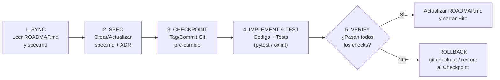

# AGENTS.md — Sistema Operativo de Agentes de Ingeniería (Datalaria SDD)

> **Compatibilidad Universal:** Este documento es el punto de entrada obligatorio y fuente de verdad operativa para **cualquier agente de IA** que trabaje en este repositorio (incluyendo **Google Antigravity con Gemini 4 Argon**, **Claude Code / Agentes Anthropic**, Cursor o GitHub Copilot).

---

## 1. PROTOCOLO DE ARRANQUE OBLIGATORIO (BOOT SEQUENCE)

**ANTES de responder a una tarea de implementación, proponer un plan o modificar cualquier archivo de código**, todo agente DEBE ejecutar en lectura los siguientes 3 pasos en orden:

1. **Leer el Estado del Ecosistema y Memoria:**
   - Leer [`/specs/ROADMAP.md`](file:///c:/Users/dalae/OneDrive/Emprendiendo/datalaria/specs/ROADMAP.md) para identificar en qué Fase, Hito y Tarea exacta nos encontramos, y cuál fue el último checkpoint verificado.
2. **Leer las Reglas Inmutables del Sistema:**
   - Leer [`/specs/_constitution.md`](file:///c:/Users/dalae/OneDrive/Emprendiendo/datalaria/specs/_constitution.md) para asegurar el cumplimiento estricto de las invariantes de seguridad, topología de directorios, aislamiento de datos y patrón de monetización Dual-Mode.
3. **Leer la Especificación del Módulo Afectado:**
   - Si la tarea afecta a una aplicación (`<app>`), leer `/specs/apps/<app>/spec.md`.
   - **REGLA DE BLOQUEO SDD:** Está **TERMINANTEMENTE PROHIBIDO** crear o modificar código de producción en `/apps/`, `/layouts/` o `/scripts/` si no existe primero una especificación aprobada en `/specs/` que describa el cambio y sus criterios de verificación.

---

## 2. MAPA TOPOLÓGICO DEL REPOSITORIO

| Directorio | Propósito | Regla de Acceso para Agentes |
| :--- | :--- | :--- |
| **`/specs/`** | **El Corazón SDD (Fuente Única de Verdad).** Contiene `_constitution.md`, `ROADMAP.md`, `DECISIONS.md` (ADRs), `_templates/`, `audit/` y las especificaciones por app (`/specs/apps/<slug>/spec.md`). | **Lectura obligatoria.** Todo cambio arquitectónico o funcional empieza aquí. |
| **`/apps/`** *(Objetivo)* | **Código Fuente de Aplicaciones.** Contendrá el código fuente de frontends (React/Vite/TS) y backends/motores cuantitativos (FastAPI/Python/CrewAI). | Solo modificar bajo cobertura de un `spec.md` activo y tests automatizados. |
| **`/static/`** | **Assets Públicos de Hugo.** Todo archivo aquí se copia literalmente a `public/` y es accesible por Internet en `https://datalaria.com/*`. | **PROHIBIDO** alojar archivos `.py`, `.sql`, `.env` o código backend aquí. Solo bundles compilados, imágenes y apps estáticas congeladas. |
| **`/content/`, `/layouts/`** | **Portal Editorial Hugo y Catálogo B2B (Lemon Squeezy).** Contenido bilingüe (`/es/`, `/en/`) y plantillas Go HTML. Las fichas de App viven en `/content/{es,en}/apps/<slug>/`. | Preservar paridad estricta bilingüe ES/EN y telemetría GA4 / Lemon Squeezy. |
| **`/data/apps/`** | **Metadatos públicos de cada App** (objetivos, diseño, tecnologías, posts, versiones). Fuente única para fichas, tarjetas y shortcode `app-ref`. | Toda release de una App actualiza su YAML y el changelog de su `spec.md` en el mismo commit (Constitución Art. 8). |
| **`/ops/`** *(Actual `autopilot/`, `scripts/`)* | **Automatización Interna y Fábrica de Productos.** Generadores de Executive Packs (Excel/PPTX/PDF) y orquestación de redes sociales. | Código interno de build/CI; nunca exponer en el runtime del navegador. |

---

## 3. FLUJO DE TRABAJO SPEC-DRIVEN DEVELOPMENT (EL BUCLE SDD)

Para garantizar **cero pérdida de contexto entre sesiones** y **capacidad de rollback inmediato**, todo trabajo sigue este ciclo atómico de 5 pasos:

### Reglas de Ejecución Paso a Paso:
1. **Un Hito a la vez:** Nunca mezcles en un mismo turno la refactorización de dos aplicaciones distintas ni combines mudanzas de directorios con cambios en lógica de negocio.
2. **Verificación Determinista:** Ninguna tarea se marca como `[x]` en `ROADMAP.md` por inspección visual subjetiva. Debe superar los comandos de validación definidos en su `spec.md`:
   - **Hugo Portal:** `hugo --gc --minify` (código de salida `0`).
   - **Frontend Apps (JS/TS):** `npm run lint` (`oxlint`) + `npm run build` (código de salida `0`).
   - **Backend / Motores Cuantitativos (Python):** `pytest` + validación de esquemas Pydantic v2.
   - **Gobernanza Editorial Automatizada (Datalaria Pulse):** Toda creación o edición de artículos en `content/**`, apps en `data/apps/` o kits en `data/pulse/` DEBE ejecutar `python -m ops.pulse.build_index` y `python -m ops.pulse.publish_public` para garantizar la actualización automática del índice editorial y la paridad bilingüe sin intervención manual.
3. **Protocolo de Marcha Atrás (Rollback):**
   - Si una migración rompe el build de Hugo, expone rutas rotas o falla los tests en 2 intentos consecutivos, el agente debe detenerse, restaurar el estado limpio y documentar el bloqueo en `specs/ROADMAP.md` bajo la sección `Blockers & Rollback Log`.

---

## 4. ACTUALIZACIÓN DE MEMORIA AL FINALIZAR CADA TURNO

Antes de dar por concluida cualquier intervención que modifique el estado del proyecto, el agente DEBE:
1. Actualizar el estado de la tarea en [`/specs/ROADMAP.md`](file:///c:/Users/dalae/OneDrive/Emprendiendo/datalaria/specs/ROADMAP.md) (`[ ]` → `[~]` en progreso o `[x]` completado) junto con la fecha y el comando de verificación ejecutado.
2. Si se tomó una nueva decisión arquitectónica o se descartó una alternativa, registrarla en [`/specs/DECISIONS.md`](file:///c:/Users/dalae/OneDrive/Emprendiendo/datalaria/specs/DECISIONS.md).
