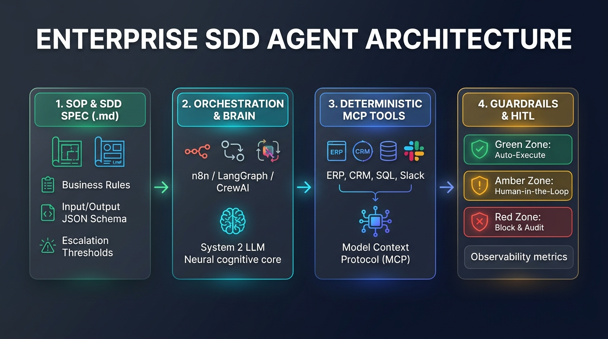

There is a scene that plays out every single week in hundreds of executive boardrooms and operations departments across 2026. Someone shares their screen, opens a visual workflow builder or a code notebook, connects a frontier language model to an email inbox and a spreadsheet, writes a ten-line prompt (*"You are an expert operations assistant; read the attached invoices and update our inventory"*), and clicks **Run**.

For the first ninety seconds, it looks like pure magic. The agent reads the PDF, reasons out loud, extracts the total amount, and appends a clean row to the database. Applause fills the room. Production deployment is approved for Monday morning.

By Wednesday at 11:00 AM, the CFO receives an urgent alert: the agent has double-processed a credit memo by interpreting a negative refund as a positive charge, overwritten the supplier code on three rush orders because a PDF arrived scanned at an angle, and—upon hitting a `429 Too Many Requests` error on the ERP API—entered an infinite retry loop that burned through \$400 in API tokens and locked out the corporate service account.

Welcome to the epidemic of ***Vibe Agents***: agents built on intuition, devoid of data contracts or permission boundaries, that dazzle in a controlled demo and collapse at the first contact with real-world enterprise entropy.

Yet when engineered with discipline, AI agents are the most powerful productivity lever of our decade. We saw this when analyzing how [HappyRobot](/en/posts/happyrobot/) reached unicorn status by automating real-world logistics phone calls, and how in [S&OP Engineering V: The Autonomous Brain](/en/posts/sop-engineering-part5-autonomous-agents/) and [the rise of the Agentic PMO](/en/posts/proj_ops_part2_agentic_pmo/) autonomous agents are transforming supply chain planning and project operations.

The difference between a dangerous toy and a high-reliability digital worker does not lie in waiting for a bigger model; it lies in **the formal process we use to specify and govern it**. In this article, we break down how to build simple, robust AI agents for daily enterprise operations, what tools and resources you actually need today, and how to unite classic **SOPs (*Standard Operating Procedures*)** with **SDD (*Spec-Driven Development*)**—setting the stage for our deep dive into [SDD vs. Vibe Coding](/en/posts/sdd_vs_vibe_coding/).

---

### 1. What We Learned Building a Real AI Army: Battle Scars from Project Autopilot

Before discussing theoretical frameworks, let us open the hood of our own engineering lab. Several months ago at Datalaria, we launched a radical *dogfooding* experiment: firing ourselves from manual content distribution, auditing, and editorial operations by building **Project Autopilot**, a multi-agent architecture documented step by step across nine installments (from the [initial blueprint of our autonomous agency](/en/posts/ai_agents_part1/) and [configuring the brain with Gemini and CrewAI](/en/posts/ai_agents_part2/), to [battling corporate API bureaucracy](/en/posts/ai_agents_part4/), [deploying on CI/CD with GitHub Actions](/en/posts/ai_agents_part5/), and [automated content auditing with Copilot CLI](/en/posts/ai_agents_part7/)).

In our [Project Autopilot Technical Post-Mortem](/en/posts/ai_agents_part9/), we shared unfiltered the three reality checks that hit every engineer or operations leader when moving agents into production:

1. **The Impedance Mismatch**: Enterprise systems (ERPs, SQL databases, GitHub Actions pipelines, payment gateways) are **strictly deterministic**: they expect an exact data type at an exact millisecond. Large Language Models (LLMs), conversely, are **inherently stochastic**: even with `temperature = 0.1`, a model may spontaneously decide to prepend a polite conversational greeting before a JSON block, crashing downstream parsers.
2. **The Polite Infinite Loop (`Error 143 SIGTERM`)**: Multi-agent frameworks like CrewAI offer a feature that sounds brilliant on paper: autonomous agent-to-agent delegation. When we left open delegation enabled without strict bounds, our *Analyst Agent* and *Writer Agent* got stuck in an extraordinarily polite, infinite philosophical debate over which stylistic angle best summarized a technical paragraph—silently burning cloud runner minutes until GitHub Actions forcefully killed the process with `SIGTERM`.
3. **The Illusion of Prompt Engineering**: Trying to fix erratic agent behavior by adding ALL-CAPS warnings to a system prompt (*"CRITICAL: NEVER HALLUCINATE A FIELD!"*) is the modern equivalent of putting duct tape on a high-pressure steam pipe. You do not need more eloquent pleas in natural language; you need **defensive programming and formal data contracts**.

That experience taught us the golden rule we now apply to every corporate workflow: **an effective enterprise agent is not a free-roaming chatbot with database credentials; it is a bounded reasoning microservice wrapped in a deterministic straitjacket**.

---

### 2. The 3 Highest-ROI Agent Archetypes in Daily Enterprise Operations

When a company decides to bring AI agents into its daily operations, the most common mistake is attempting to build an all-knowing "General Super-Agent" on day one—expected to answer customer emails, issue invoices, manage warehouse stock, and draft legal contracts. That approach guarantees failure.

The winning strategy is deploying **Single-Responsibility Agents**: small, focused digital workers specialized in a single operational bottleneck. Today, 85% of immediate enterprise return on investment (ROI) is concentrated in three foundational archetypes:

| Agent Archetype | Operational Bottleneck Solved | Complexity Level | Typical Daily Impact |
| :--- | :--- | :--- | :--- |
| **1. Intelligent Triage & Routing** | Shared inboxes (`info@`, `support@`, `purchasing@`) or Slack channels flooded with unstructured requests. | **Low** (Ideal to deploy in 48h) | Classifies urgency, extracts key entities (customer ID, order number), queries CRM status, and routes the ticket with a ready-to-send draft reply. |
| **2. Document Extraction & ERP Reconciliation** | Staff manually copy-pasting data from PDFs, packing slips, invoices, or supplier spreadsheets into the ERP. | **Medium** (Requires strict schemas) | Performs multimodal line-item extraction, cross-checks unit prices and quantities against the original Purchase Order, and posts the draft entry if 100% matched. |
| **3. Continuous Auditing & Context Preparation** | Hours lost every Monday morning cross-referencing reports for S&OP, finance, or project review meetings. | **Medium-High** (Scheduled / Cron execution) | Wakes up at dawn, queries SQL/APIs, flags statistical anomalies (stock-outs, budget overruns), and delivers an actionable executive briefing. |

Notice what all three archetypes share: none of them relies on an open-ended chat window where a user has a freeform conversation with a bot. They are **Event-Driven Agents**: they wake up upon a specific trigger (a webhook, an incoming email, a new database row, or a scheduled cron job), execute a bounded cognitive task, and output a strictly structured payload.

---

### 3. The Formal Methodology: From Operational SOPs to Spec-Driven Development (SDD)

This brings us to the core methodological question: *Can we unite everyday agent creation with SDD so our agents stay strictly controlled, or is there another formal methodology for governing them?*

Not only can they be united—**combining operational SOPs with SDD is the most effective formal discipline available today for enterprise AI**. It bridges two worlds that previously spoke different languages: **Classical Operations Engineering** and **Modern AI Software Engineering**.

In business operations, when you hire a junior finance or supply chain analyst, you do not hand them the corporate bank token on day one and say, *"Do whatever feels right."* You hand them a **Standard Operating Procedure (SOP)**: a normative document specifying step by step what checks to run, which systems to query, and above what dollar threshold they must escalate to a director for sign-off. As we explored in [From Narrative to Diagram: Designing S&OP Processes with AI and BPMN](/en/posts/bpmn_sop/), enterprises have spent decades perfecting process documentation.

Meanwhile, in software engineering, we are witnessing the rise of **SDD (*Spec-Driven Development*)**, the methodology we analyze in full depth in our companion post [SDD vs. Vibe Coding](/en/posts/sdd_vs_vibe_coding/). In SDD, the primary source artifact of a project is no longer raw Python or TypeScript code, but **the Executable Formal Specification (`SPEC.md`)**: a structured Markdown and type-schema contract that defines exact system behavior before a single line of implementation is generated.

When we fuse both disciplines, we get the **SOP-to-SDD Methodology for Enterprise Agents**. Instead of writing ad-hoc prompts, every agent in your organization is born from a formal specification sheet built on **four non-negotiable pillars**:

1. **Trigger & Explicit Scope**: What exact event wakes the agent, what its single mission is, and—even more importantly—what actions it is explicitly forbidden from taking.
2. **Strict Input/Output Data Contracts (JSON Schema / Pydantic)**: The exact typed structure the agent receives and the exact structure it is mathematically required to return. If the output fails schema validation, execution halts before any external system is touched.
3. **Least-Privilege Tool Inventory (Scoped MCP Tools)**: Which specific functions or [MCP (Model Context Protocol)](/en/posts/mcp_protocol/) servers the agent is authorized to invoke. If an agent only needs to verify an order status, its credentials must never possess write (`UPDATE`/`DELETE`) permissions on the database.
4. **The Traffic-Light Autonomy Matrix (*Guardrails & Human-in-the-Loop*)**: A deterministic boundary defining when the agent acts autonomously and when it must pause for human authorization:
   - 🟢 **Green Zone (Autonomous Execution)**: Low-risk, high-confidence standard cases (e.g., invoice matches the Purchase Order to the cent and total is under €1,500).
   - 🟡 **Amber Zone (Human-in-the-Loop Escalation)**: Cases with minor discrepancies or moderate financial impact. The agent prepares the entire dossier, drafts the proposed action, and sends an interactive `[Approve / Reject]` card via Slack or Teams to a human supervisor.
   - 🔴 **Red Zone (Hard Block & Alert)**: Critical anomalies, suspected fraud, or low extraction confidence. The agent aborts immediately and triggers a priority audit ticket.



At runtime, this architecture wraps the probabilistic LLM brain inside deterministic logic gates:


flowchart LR
    classDef trigger fill:#1e293b,stroke:#38bdf8,stroke-width:2px,color:#fff;
    classDef spec fill:#0f172a,stroke:#a855f7,stroke-width:2px,color:#fff;
    classDef brain fill:#0369a1,stroke:#7dd3fc,stroke-width:2px,color:#fff;
    classDef gate fill:#334155,stroke:#f59e0b,stroke-width:2px,color:#fff;
    classDef green fill:#065f46,stroke:#34d399,stroke-width:2px,color:#fff;
    classDef amber fill:#78350f,stroke:#fbbf24,stroke-width:2px,color:#fff;
    classDef red fill:#7f1d1d,stroke:#f87171,stroke-width:2px,color:#fff;

    T["⚡ Event Trigger<br/>(Email / Webhook / Cron)"]:::trigger --> V1{"🛡️ Gate 1:<br/>Input Sanitization"}:::gate
    S["📐 SDD Specification<br/>(SOP.md + JSON Schema)"]:::spec -.->|Injects Contract| B
    S -.->|Validation Rules| G2
    V1 -->|Clean Payload| B["🧠 Agentic Brain<br/>(LLM + Scoped MCP Tools)"]:::brain
    B -->|JSON Output| G2{"⚖️ Gate 2:<br/>Pydantic Validator + Rules"}:::gate
    
    G2 -->|🟢 Confidence > 95%<br/>Variance 0%| ZG["✅ Green Zone:<br/>Auto-Execute in ERP"]:::green
    G2 -->|🟡 Variance < 5%<br/>or Medium Amount| ZA["👀 Amber Zone (HITL):<br/>Slack/Teams Approval"]:::amber
    G2 -->|🔴 Schema Error /<br/>Critical Variance| ZR["🚨 Red Zone:<br/>Hard Block & Human Alert"]:::red


---

### 4. The Complete 2026 Tooling Stack: What Resources Do You Actually Need?

One of the biggest obstacles to building agents today is not a lack of tools, but analysis paralysis caused by a dozen new frameworks launching every week. To build operational agents under the SDD methodology cleanly and reliably, you only need to pick **one component from each of the four layers** of the modern agentic stack:

#### Layer 1: The Brain (Model Routing)
Never use a nuclear warhead to swat a fly. As we proved in [Project Autopilot](/en/posts/ai_agents_part9/) and examined in depth in [Inference-Time Scaling and System 2 Reasoning](/en/posts/inference_time_scaling/), the optimal enterprise architecture combines two distinct model classes:
- **Fast "System 1" Models** (*Gemini 2.5 Flash, Claude Haiku, GPT-4o-mini*): Ideal for 80% of operational tasks—triage, classification, and structured JSON extraction—delivering sub-second latency at near-zero marginal cost.
- **Reasoning "System 2" Models** (*Extended Thinking / Reasoning models*): Reserve these exclusively for nodes where the agent must resolve complex multi-variable inventory conflicts, reconcile ambiguous contract clauses, or compute contingency routes.

#### Layer 2: The Orchestrator (Visual *Low-Code* vs. *Code-First*)
Here you should make a pragmatic choice based on who will build and maintain the workflow:
- **The Visual / Low-Code Track (n8n, Dify, Make)**: If you want to automate departmental workflows in hours and allow operations managers to visually inspect and maintain every step, **n8n** (especially self-hosted or cloud with native AI Agent nodes) and **Dify** are the undisputed leaders in 2026. They let you wire up an email trigger, pass attachments through a scoped AI Agent node, enforce a structured output parser, route through deterministic `If/Switch` nodes, and dispatch interactive Slack approval buttons without spinning up custom backend servers.
- **The Engineering / Code-First Track (LangGraph, CrewAI, PydanticAI)**: If the agent is embedded in your core software product, requires strict Git version control, CI/CD unit testing, and fine-grained state management, write code in Python or TypeScript. While **CrewAI** excels at role-based multi-agent prototyping (as we used in [Autopilot Part 2](/en/posts/ai_agents_part2/)), **LangGraph** and **PydanticAI** are the gold standard when you need deterministic state machines where no agent can step outside your type-checked rails.

#### Layer 3: Hands & Connectors (The MCP Standard)
Until recently, connecting an agent to your ERP, PostgreSQL, Google Drive, and HubSpot required maintaining dozens of brittle custom API wrappers. Today, as we covered in [MCP (Model Context Protocol): The Standard Aiming to Be the USB of AI](/en/posts/mcp_protocol/), you can plug into standardized MCP servers. Your SDD specification simply declares which MCP server the agent is permitted to call and enforces read-only or scoped-write credentials at the protocol level.

#### Layer 4: Brakes & Black-Box Flight Recorder (Observability & Security)
An agent running in production without telemetry is a financial and security time bomb. You need two essential resources:
- **Prompt Injection Defense**: Any agent that reads external emails or third-party PDFs is exposed to attackers hiding malicious instructions inside the document (*Indirect Prompt Injection*), a threat vector we dissected in [Prompt Injection: The SQL Injection of Our Decade](/en/posts/prompt_injection/). Always isolate untrusted external data inside strict delimiters and enforce deterministic post-extraction validation.
- **Tracing & Continuous Evaluation (*Langfuse / Arize Phoenix*)**: Observability platforms like Langfuse log every trace of an agent's execution (exact input, tool calls, latency, token cost, and validation outcome). Furthermore, before modifying a spec or swapping models, you should run automated evaluation suites following the patterns in [Evaluating and Testing AI Agents in Production](/en/posts/evaluating_ai_agents/).

---

### 5. Step-by-Step Practical Case: Building an ERP Invoice Reconciliation Agent with SDD

To see how this methodology translates into daily practice, let us build the formal specification and deterministic validation core for one of the highest-ROI agents in any business: the **Supplier Invoice Reconciliation Agent (`AG-FIN-01`)**.

#### Step 1: Write the SDD Specification (`spec_invoice_reconciliation_agent.md`)
Before opening n8n or writing a single line of Python, the Operations Lead and the Systems Engineer agree on this one-page Markdown contract stored in Git:

```markdown
# SPEC: Supplier Invoice Reconciliation Agent (AG-FIN-01)

## 1. Objective & Scope
Ingest PDF invoices from logistics suppliers, extract cost line items, and reconcile them against the registered Purchase Order (PO) in the ERP.
- **EXPLICIT PROHIBITION**: The agent NEVER executes bank transfers or modifies existing Purchase Orders.

## 2. Trigger
New incoming email at `invoices@company.com` containing a `.pdf` attachment.

## 3. Permitted Tools (MCP Scope)
- `mcp_erp.get_purchase_order(po_number: str)` -> Read-only access (SELECT).
- `mcp_erp.create_draft_invoice(payload: dict)` -> Scoped write restricted to `DRAFT` status.
- `mcp_slack.request_human_approval(channel: str, summary: dict)` -> HITL notification.

## 4. Business Rules & Traffic-Light Autonomy Matrix (Guardrails)
1. **GREEN ZONE (Auto-Post)**:
   - Valid `po_number` exists in the ERP.
   - `abs(invoice.total - po.total) / po.total <= 0.02` (Max 2% tolerance for rounding/freight).
   - Total amount `<= 1500.00 EUR`.
   -> **Action**: Invoke `create_draft_invoice` with status `APPROVED_FOR_PAYMENT`.
2. **AMBER ZONE (Human-in-the-Loop)**:
   - Variance between 2.01% and 10.0%, OR total amount between `1500.01 EUR` and `10000.00 EUR`.
   -> **Action**: Invoke `create_draft_invoice` with status `PENDING_APPROVAL` and send interactive approval card to `#finance-approvals`.
3. **RED ZONE (Immediate Block)**:
   - Missing `po_number`, supplier Tax ID mismatch, variance `> 10%`, or amount `> 10000.00 EUR`.
   -> **Action**: Block ERP entry and open priority audit alert.
```

#### Step 2: Compile the Contract into Deterministic Code (Pydantic + Rules Gate)
Once the specification is signed off, we translate the output schema and the traffic-light matrix into deterministic **Pydantic** validation code. Notice a critical architectural choice here: **we never ask the LLM to decide whether the invoice belongs in the Green or Red Zone** (because LLMs shouldn't be trusted with financial compliance arithmetic); we ask the LLM only to extract structured data, and **our deterministic Python gate** enforces corporate law:

```python
from enum import Enum
from pydantic import BaseModel, Field

class ZoneDecision(str, Enum):
    GREEN_AUTO = "GREEN_AUTO_APPROVE"
    AMBER_HITL = "AMBER_HUMAN_REVIEW"
    RED_BLOCK = "RED_SECURITY_BLOCK"

class ExtractedInvoiceSpec(BaseModel):
    supplier_tax_id: str = Field(..., pattern=r"^[A-Z0-9]{8,12}$", description="Supplier VAT/Tax ID")
    po_number: str = Field(..., pattern=r"^PO-\d{4}-\d{5}$", description="Purchase Order Code")
    invoice_total_eur: float = Field(..., gt=0, description="Total invoice amount in EUR")
    line_items_summary: list[str] = Field(..., min_length=1)
    extraction_confidence: float = Field(..., ge=0.0, le=1.0)

def evaluate_sdd_guardrails(invoice: ExtractedInvoiceSpec, erp_po: dict | None) -> ZoneDecision:
    """Deterministic gate enforcing the Traffic-Light Matrix from SPEC AG-FIN-01."""
    # 1. Red Zone check for missing PO, low OCR confidence, or Tax ID mismatch
    if not erp_po or invoice.extraction_confidence < 0.92:
        return ZoneDecision.RED_BLOCK
    if invoice.supplier_tax_id != erp_po["supplier_tax_id"]:
        return ZoneDecision.RED_BLOCK

    # 2. Exact floating-point financial variance calculation
    po_total = float(erp_po["total_eur"])
    deviation_pct = abs(invoice.invoice_total_eur - po_total) / po_total

    if deviation_pct > 0.10 or invoice.invoice_total_eur > 10000.00:
        return ZoneDecision.RED_BLOCK

    # 3. Evaluate Green Zone vs. Amber Zone (Human-in-the-Loop)
    if deviation_pct <= 0.02 and invoice.invoice_total_eur <= 1500.00:
        return ZoneDecision.GREEN_AUTO

    return ZoneDecision.AMBER_HITL
```

This 40-line architectural pattern eliminates 99% of operational accidents at the root:
- If a vendor submits an invoice with a missing or malformed PO number, Pydantic's `^PO-\d{4}-\d{5}$` regex rejects the payload immediately.
- If the LLM hesitates on a blurry scan (`extraction_confidence < 0.92`), the function routes it straight to the **Red Zone** for human inspection.
- The 2% tolerance check and €1,500 ceiling are computed in pure deterministic Python math—never inside the probabilistic imagination of a neural network.

---

### 6. Final Reflection: The Limits of Autonomy and a Preview of the Datalaria SDD Pack

As we move closer to the horizon of Artificial General Intelligence (AGI), it is tempting to assume that we will soon outgrow specifications, type schemas, and traffic-light matrices because future agents will *"simply understand what we mean."*

Yet the history of mathematical logic and computer science teaches us the exact opposite. As we recently explored in our tribute to [Kurt Gödel and His Incompleteness Theorems](/en/posts/kurt_godel/), **no sufficiently complex formal system can prove its own consistency or validate its foundational axioms from within**. An AI agent, no matter how brilliant its reasoning engine, always operates inside an objective function that must be anchored to external, human-verifiable business rules.

In a real enterprise, autonomy without specification is not innovation—it is operational negligence. The true competitive advantage in 2026 does not belong to companies spinning up dozens of disconnected *Vibe Agents* that nobody knows how to audit; it belongs to organizations translating their operational know-how into **Executable Specifications (SDD)**: clear, versioned, deterministic contracts where humans and agents collaborate with complete traceability.

This guide is just the practical entry point to this paradigm shift:
1. **The Next Methodological Leap**: In our companion deep dive, **[SDD (Spec-Driven Development) vs. Vibe Coding: How to Build Robust Software with AI in 2026](/en/posts/sdd_vs_vibe_coding/)**, we scale this philosophy from operational workflows to full-stack software engineering—showing how to design system architectures, state machines, and automated test suites driven by specifications.
2. **Your Ready-to-Use Toolkit**: So you do not have to start from a blank page, we are preparing the launch of the **Datalaria SDD Pack**, which will soon be available for direct download in our **[Resources Section](/en/resources/)**. It will include our official Markdown templates for specifying operational agents (`AGENT_SPEC.md`) and software systems (`SYSTEM_SPEC.md`), Human-Agent RACI autonomy matrices, and base Pydantic/JSON validation schemas ready to plug into your n8n, CrewAI, or LangGraph workflows.

What about your organization? **Are you still trusting daily operations to improvised prompts while praying the model doesn't hallucinate, or have you started translating your business SOPs into executable formal specifications?**
