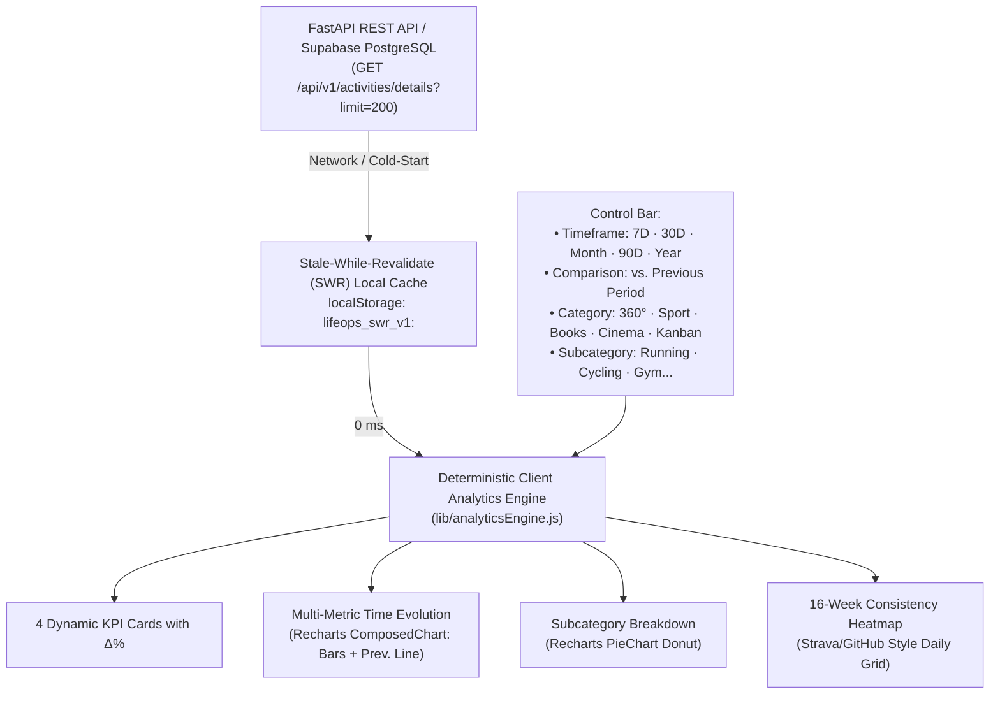
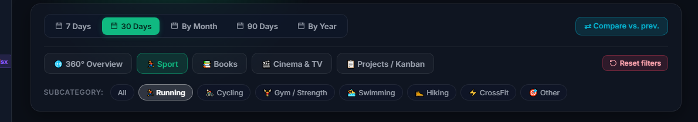
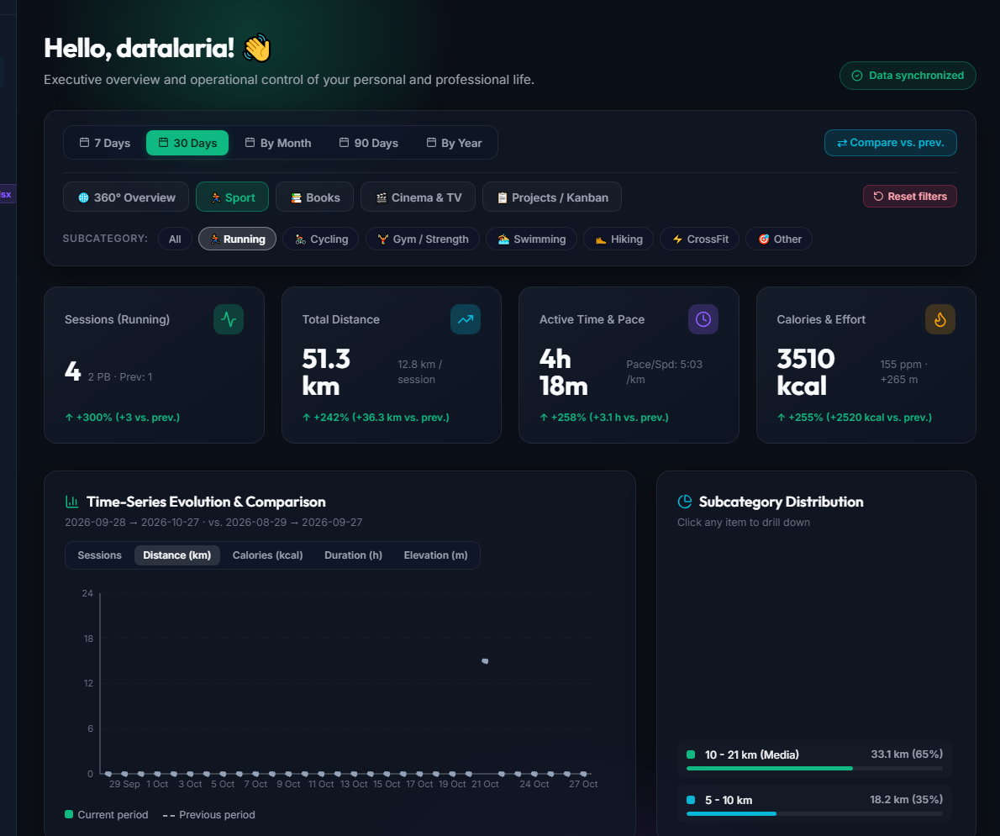
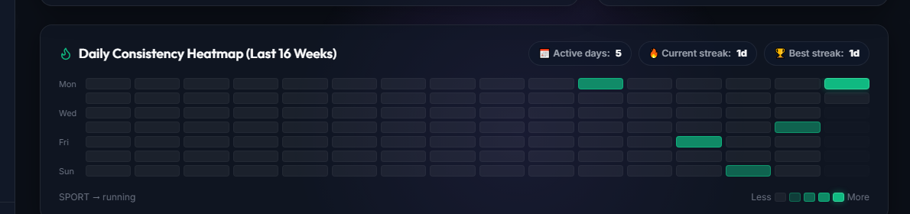
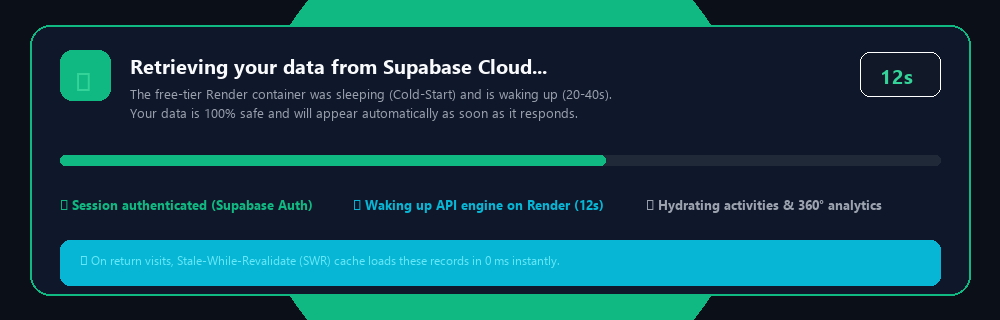

In [Part 5 of our engineering series](/en/posts/app-lifeops_part5_deploy_mobile_pwa/), we achieved a major milestone: deploying the entire **LifeOps architecture 24/7 in production at zero cost ($0/month)** by combining Netlify, Render, and Supabase, optimizing mobile ergonomics for smartphones, and installing the app as a native PWA.

However, once you start logging dozens of daily activities (workouts, bike rides, books read, movies watched, and Kanban tasks), a critical analytical challenge emerges: **data without analysis lacks operational value**.

Having 40 or 50 records in a PostgreSQL database is of little use if opening the dashboard doesn't immediately answer executive questions such as:
- *“How many kilometers did I run this month compared to last month?”*
- *“What percentage of my training went into sprint intervals versus long endurance runs?”*
- *“How has my daily consistency evolved, and what is my current active day streak?”*
- *“How can I filter exclusively by Running to inspect average pace and calories burned without mixing in gym workouts or movies?”*

In this sixth installment, we tackle the full evolution of the **360° Analytics Dashboard**, addressing both the deterministic client-side aggregation design and the most notorious UX challenge of zero-cost serverless infrastructure: **cloud container sleep periods (*cold-starts*)**.

> [!TIP]
> **Try the analytics live**: You can test the new 360° Dashboard with interactive data in Sandbox mode at [https://datalaria.com/apps/lifeops/#/?mock=true&lang=en](https://datalaria.com/apps/lifeops/#/?mock=true&lang=en) or log in with your Supabase account at [https://datalaria.com/apps/lifeops/#/?lang=en](https://datalaria.com/apps/lifeops/#/?lang=en).



---

### 🗺️ Full Roadmap of the LifeOps Series

1. 🟢 **Part 1**: [Personal Operating System Architecture and FastAPI + Supabase Backend](/en/posts/app-lifeops_part1_arquitectura_backend/)
2. 🟢 **Part 2**: [React Frontend with Glassmorphism, 360° Dashboard, and Dark Mode Design System](/en/posts/app-lifeops_part2_frontend_dashboard/)
3. 🟢 **Part 3**: [Core Modules: Sports, Reading Library, Cinema, and Professional Kanban Board](/en/posts/app-lifeops_part3_modulos_kanban/)
4. 🟢 **Part 4**: [Executive Reporting Engine in Word (.docx) and Multi-Sheet Excel Exports (.xlsx)](/en/posts/app-lifeops_part4_informes_word_excel/)
5. 🟢 **Part 5**: [24/7 Cloud Deployment at Zero Cost ($0/month), Mobile Optimization, and PWA](/en/posts/app-lifeops_part5_deploy_mobile_pwa/)
6. 🟢 **Part 6 (This article)**: 360° Analytics Dashboard with Multi-Dimensional Filtering, Recharts, and Cold-Start Mitigation in Supabase + Render

---

### 1. Architecture Decision: External BI (Grafana / Metabase) vs. Native React Engine (ADR-013) ⚖️

When planning advanced charts and timeframe filters, the first engineering instinct is often to reach for established Business Intelligence tools like **Grafana**, **Metabase**, or **Apache Superset**. However, evaluating our requirements against our SDD Constitution led to architectural decision **ADR-013**:

| Evaluation Factor | External BI Tool (Grafana / Metabase) | Native React 19 + Recharts 3.10 Engine (Our Choice) |
| :--- | :--- | :--- |
| **Multi-Tenant Security (RLS)** | ❌ Requires static direct database connection. Passing individual Supabase Auth JWTs requires expensive Enterprise licenses or custom proxy tokens. | ✅ **Perfect Isolation**: consumes secure user-scoped REST endpoints protected by Row-Level Security (`auth.uid() = user_id`). |
| **Infrastructure Cost** | ❌ Requires a separate container running 24/7 with dedicated RAM, or paid cloud plans. | ✅ **$0.00/month**: compiles directly into the Netlify static bundle. |
| **Sandbox Demo Mode (`?mock=true`)** | ❌ Impossible to feed an external iframe using in-memory mock state. | ✅ **100% Compatibility**: runs instantly with deterministic synthetic data. |
| **Filter Latency** | ⚠️ Every click triggers a remote SQL round-trip to the cloud. | ✅ **0 ms**: the timeframe dataset filters in client memory using pure `useMemo` hooks. |
| **Mobile UX & Aesthetics** | ⚠️ Visual disconnect from *Glassmorphism Dark Mode* and nested iframe scroll friction on mobile. | ✅ **Unified Design**: seamless responsive layout tailored to Datalaria's design system. |



---

### 2. Multi-Dimensional Cascading Filters & Period-over-Period Deltas ⏱️📊

The cornerstone of the new experience is the **Analytics Control Bar**, enabling three levels of analytical exploration without page reloads:



#### A. Timeframe Resolution
The engine supports five time horizons powered by the deterministic `resolveTimeWindows()` function:
1. **`7 Days` (`week`)**: Rolling last 7 days vs. immediately preceding 7 days.
2. **`30 Days` (`month`)**: Rolling last 30 days vs. immediately preceding 30 days.
3. **`By Month` (`calendar_month`)**: Dynamic month selector (`January` to `December`) and year, compared against the preceding calendar month.
4. **`90 Days` (`quarter`)**: Rolling last 90 days aggregated into weekly buckets.
5. **`By Year` (`year`)**: Full annual overview with 12 monthly buckets vs. prior year.

#### B. Invariant INV-8: Safe Percentage Delta Calculation ($\Delta\%$)
To compare current performance ($V_{\text{curr}}$) against the previous period ($V_{\text{prev}}$) without division-by-zero errors when starting a new discipline:

$$\Delta\% = \begin{cases} 
0\% & \text{if } V_{\text{prev}} = 0 \text{ and } V_{\text{curr}} = 0 \\
+100\% & \text{if } V_{\text{prev}} = 0 \text{ and } V_{\text{curr}} > 0 \\
\text{round}\left(\dfrac{V_{\text{curr}} - V_{\text{prev}}}{V_{\text{prev}}} \times 100\right) & \text{otherwise}
\end{cases}$$

Implemented in `lib/analyticsEngine.js`:

```javascript
export function computeDelta(currentVal, prevVal, unit = '', language = 'es') {
  const curr = Number(currentVal) || 0;
  const prev = Number(prevVal) || 0;
  const vsLabel = language === 'es' ? 'vs. ant.' : 'vs. prev.';

  if (prev === 0 && curr === 0) {
    return { positive: true, deltaPct: 0, text: 'Stable (0% vs. prev.)' };
  }
  if (prev === 0 && curr > 0) {
    return { positive: true, deltaPct: 100, text: `+100% (+${curr}${unit} ${vsLabel})` };
  }

  const diff = curr - prev;
  const pct = Math.round((diff / prev) * 100);
  const sign = diff >= 0 ? '+' : '';
  return {
    positive: diff >= 0,
    deltaPct: pct,
    diff,
    text: `${sign}${pct}% (${sign}${diff.toFixed(1)}${unit} ${vsLabel})`,
  };
}
```

---

### 3. The Visual Suite with Recharts: Contextual KPIs, Time-Series & Donut Charts 📈🍩

Selecting a category or drilling down into a subcategory (for example, filtering by **`Sport` ➔ `Running`**) dynamically updates the entire dashboard:



1. **4 Contextual KPI Cards**:
   - In **Sport**: adapt metrics to the selected discipline:
     - *Sessions*: workout count with $\Delta\%$ badge and personal bests (PB).
     - *Distance*: cumulative mileage and average km per session.
     - *Time & Pace*: active duration and average pace (`min/km` in running or `km/h` in cycling).
     - *Calories & Effort*: calories burned, average heart rate (`bpm`), and elevation gain (`+m`).
2. **Multi-Metric Time-Series Chart (`ComposedChart`)**:
   - Renders current period bars color-coded by category and overlays a **dashed trendline of the previous period** when the `⇄ Compare vs. prev.` toggle is active.
   - Built-in metric switcher: toggle on the fly between **Sessions**, **Distance (km)**, **Calories (kcal)**, **Duration (h)**, or **Elevation Gain (m)**.
3. **Subcategory Distribution (`PieChart` Donut)**:
   - Displays percentage and absolute shares for each activity type. Clicking any slice or legend item applies an automatic *drill-down* into that subcategory.

---

### 4. 16-Week Daily Consistency Heatmap (Strava / GitHub Style) 🔥🗓️

Habit formation thrives on visual streaks. To offer a bird's-eye view of consistency, we introduced a 112-day matrix (16 weeks × 7 days, Monday to Sunday):



The algorithm evaluates daily volume into 5 intensity levels (`level-0` to `level-4`) and computes in real time:
- **Active days in the period**.
- **Current active streak**: tracking consecutive days backward from today or yesterday.
- **All-time best streak**.

---

### 5. Solving the Zero-Cost Cloud Latency Challenge: Render Cold-Start Mitigation ⚡🛡️

Deploying full-stack applications on free cloud tiers (such as Render.com's Free Web Service) entails an inherent constraint: **containers spin down to sleep after 15 minutes of inactivity**.

When a user visits the app after a few hours of idle time, the first request can take **20 to 40 seconds** while the Python virtual machine boots up. In early versions, this latency caused an alarming UX defect: users saw `0` across all cards and blank charts, mistakenly believing **their data had been erased or lost**.

To eliminate this friction while preserving the **$0/month infrastructure cost**, we engineered a 3-tier solution:



#### Tier 1: Early Silent Pre-Warming (`wakeUpServer`)
The moment the browser loads the SPA inside `AuthContext.jsx`, before user authentication or navigation even finishes, a non-blocking `fetch` pings `/health`. This grants the backend container a 5-to-10 second head start to wake up.

#### Tier 2: Stale-While-Revalidate (SWR) Local Cache per User (`INV-10`)
Every successful `GET` response (`/api/v1/activities/details`, `/tasks`, `/stats/dashboard`) is cached in `localStorage` strictly namespaced by user ID (`lifeops_swr_v1:<user_id>:<endpoint>`).
- On subsequent visits, records and charts hydrate **in less than 10 milliseconds (`0 ms` perceived delay)**.
- Users interact with their data instantly while a background request synchronizes any fresh server changes.
- Any mutation (`POST`, `PATCH`, `DELETE`) automatically clears the cache to ensure strict data consistency.

#### Tier 3: Foreground Cloud Sync Banner & Loading Placeholders
When opening the app on a fresh device or cleared browser cache:
1. **Never show misleading zeroes**: KPI cards display waiting indicators (`···`) instead of `0`.
2. **Prominent Foreground Banner**: renders an animated spinner, live elapsed seconds counter (`0s, 1s, 2s...`), visual progress bar, and connection stages:
   - `✓ Session authenticated (Supabase Auth)`
   - `⟳ Waking up API engine on Render Cloud`
   - `⏳ Hydrating activities & 360° analytics`
3. After 4 seconds, the banner transparently explains that the cloud container is waking up and that **data is 100% secure**.
4. **Smart Timeframe Auto-Fit**: if the query returns records but none fall within the last 30 days (for example, after a holiday break), the dashboard automatically switches to `90 Days` or `By Year` so charts populate immediately.

---

### 6. Summary and Next Steps 🚀

With this evolution, LifeOps matures from a basic tracking tool into a **true personal and professional intelligence operating system**. Pairing a deterministic in-memory client engine with cold-start resilient caching demonstrates that fast, secure, and visually refined web applications can be built and maintained with a cloud bill of **exactly $0.00/month**.

Explore the web application, source code, and full technical specifications:

- 🎮 **Deployed Web App**: [https://datalaria.com/apps/lifeops/](https://datalaria.com/apps/lifeops/)
- 🕹️ **Interactive Sandbox Mode (No Sign-Up)**: [https://datalaria.com/apps/lifeops/#/?mock=true&lang=en](https://datalaria.com/apps/lifeops/#/?mock=true&lang=en)
- 📋 **Official LifeOps Technical Spec Sheet**: [/en/apps/lifeops/](/en/apps/lifeops/)
