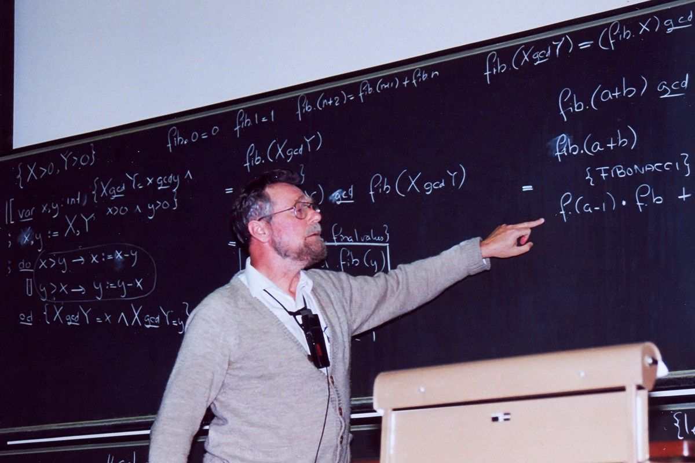
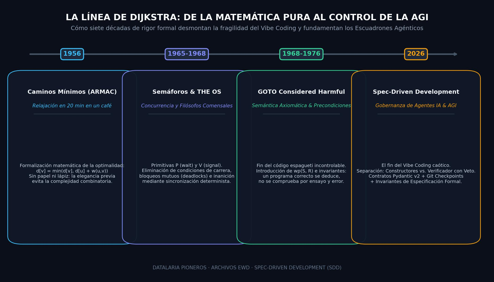

In the early 1950s, inside the quiet offices of the *Mathematisch Centrum* in Amsterdam, a young Dutch researcher of lean frame, piercing gaze, and deliberate cadence championed a conviction so radical that it scandalized postwar hardware engineers: **programming was neither an artisanal craft of electromechanical plumbing nor a lottery of empirical trial and error; it was a branch of pure mathematics as rigorous as Euclidean geometry or Newtonian calculus**.

That man was **Edsger Wybe Dijkstra** (1930–2002).

Throughout his life, his unyielding personality and ferocious disdain for mediocrity generated a body of folklore that computer science departments around the world still recount with reverent awe:

In the spring of 1956, the Amsterdam computation center was putting the finishing touches on the **ARMAC** computer. For its official inauguration before government dignitaries and the press, the laboratory directors needed a spectacular, intuitive demonstration that the public could grasp in seconds. They assigned the challenge to Dijkstra: design a program capable of calculating the shortest driving route between sixty-four cities in the Netherlands.

Dijkstra stepped out of the laboratory for a stroll along the Amsterdam canals with his fiancée, **Maria (Ria) Debets**. They sat down on a sunlit café terrace for a morning cup of coffee, and in just **twenty minutes of pure mental distillation**, he conceived the most famous, efficient, and enduring shortest-path algorithm in the history of science.

What astonished his peers was not merely the speed, but his methodology: **he used neither paper, nor pencil, nor napkins for scribbling notes**. Decades later, when asked how it was humanly possible to devise such a foundational breakthrough without jotting down a single equation, Dijkstra delivered his trademark razor-sharp reply:

> —*«If you need paper and pencil to design an algorithm, it means the algorithm is still far too complicated. Designing entirely in your head forces you to boil down the logical structure until it becomes inevitably simple, clean, and beautiful»*.



Just one year later, in 1957, when he arrived at the Amsterdam civil registry to marry Maria, the municipal magistrate asked him to state his profession for the official marriage certificate. Dijkstra answered calmly:

> —*«Computer programmer»*.  
> The magistrate frowned, flipped through the official municipal registry of legally recognized professions in the Kingdom of the Netherlands, and rejected the request with bureaucratic finality:  
> —*«That profession does not exist under Dutch law, Mr. Dijkstra. I cannot marry you under that title»*.

To proceed with the wedding, Dijkstra had to settle for registering under the administrative label of *«Theoretical Physicist»*, the degree he had earned at the University of Leiden. He was, for all practical purposes, the first recognized programmer in the Netherlands before the world even understood the meaning of the word.

Later, as a renowned professor at the University of Texas at Austin and winner of the prestigious **ACM Turing Award in 1972**, Dijkstra maintained an eccentricity that baffled his colleagues: **he adamantly refused to keep a computer in his office**.

For over four decades, using a Montblanc fountain pen and black India ink, he handwrote more than **1,300 technical essays and open letters**, universally known as the **EWD manuscripts**. He numbered them meticulously by hand (`EWD 1`, `EWD 2`... through `EWD 1318`), photocopied them on campus, and mailed them by postal post to a select global circle of mathematicians and researchers, effectively creating the first peer-to-peer social network of deep epistemological debate in computing.

If [Alan Turing](/en/posts/alan_turing/) formalized the universal computing machine, if [John von Neumann](/en/posts/john_von_neumann/) structured shared-memory hardware architecture, if [Claude Shannon](/en/posts/claude_shannon/) quantified information into bits, if [Kurt Gödel](/en/posts/kurt_godel/) mapped the boundaries of formal logic, and if [Norbert Wiener](/en/posts/norbert_wiener/) uncovered the cybernetic feedback loop, **Edsger Dijkstra taught humanity how to write software without descending into the abyss of chaos, self-delusion, and catastrophic failure**.

In 2026, as the software industry swoons over the hype of *«Vibe Coding»*—the practice of prompting large language models in loose natural prose and hoping the code works through statistical coincidence—Dijkstra’s legacy is no dusty historical relic: **it is the definitive intellectual antidote and the mathematical cornerstone upon which genuine agentic engineering in the AGI era must stand**.

---

### 1. From Theoretical Physics to ALGOL 60: The Compiler's Beard

Born in Rotterdam in May 1930, Dijkstra was the son of a chemist and a gifted mathematician who instilled in him from early childhood a fierce reverence for formal elegance and deductive clarity.

After studying theoretical physics and mathematics at Leiden University, his transition into computing in 1952 was almost accidental: Adriaan van Wijngaarden, director of the *Mathematisch Centrum*, offered him a part-time job programming the Netherlands' earliest experimental computers (the ARRA and ARMAC).

Dijkstra quickly uncovered a painful reality: **electronic computers were diaboloically fast instruments for magnifying human incompetence**. While machines could execute thousands of instructions per second, human beings kept making mistakes at their same ancient, artisanal rate.

By 1959, Dijkstra joined the international committee tasked with designing **ALGOL 60**, a visionary European initiative to forge a universal, machine-independent programming language that broke free from IBM's proprietary grip. ALGOL 60 introduced constructs we now take for granted: block-structured scopes with `begin...end`, lexical variable scope, parameter passing by value and by name, and a conceptual breakthrough that many contemporary theorists deemed impossible on limited hardware: **recursion**.

Dijkstra and his colleague **Jaap Zonneveld** undertook the monumental task of constructing the world’s first working compiler for ALGOL 60 on the experimental Electrologica X1 computer. Before keying in the first line of machine code, both engineers sealed a monastic pact:

> **Neither would shave his beard until the compiler was completely finished, formally verified, and completely free of any known defect.**

Through months of grueling labor in Amsterdam, their beards grew thick and wild as they derived every machine instruction with algebraic rigor. On August 24, 1960, their compiler executed its first recursive routine flawlessly on the first run. Zonneveld shaved immediately; Dijkstra, however, looked in the mirror, stroked his newly minted beard, and decided to keep it for the rest of his life as an enduring badge of mathematical discipline. That full white beard would become, alongside his leather sandals and rumpled shirts, the visual emblem of formal resistance against the sloppy empiricism of the computing industry.

---

### 2. The Shortest-Path Algorithm and the Quest for Optimality

The algorithm Dijkstra conceived on that sunny café terrace in 1956—and which he did not publish until 1959 in his seminal three-page paper *«A note on two problems in connexion with graphs»* in *Numerische Mathematik*—remains one of the purest monuments of analytical thought.

To appreciate its genius, consider a weighted directed graph $G = (V, E)$, where each vertex $v \in V$ represents a location or operational state, and each edge $(u, v) \in E$ carries a non-negative cost or weight $w(u, v) \ge 0$. The objective is to discover the path of minimal total weight from a single source vertex $s$ to all other vertices in the graph.

A naive brute-force approach would attempt to evaluate every conceivable combinatorial path between points, triggering a **factorial combinatorial explosion** that would bring any supercomputer to its knees.

Dijkstra proved that blind exploration was utterly unnecessary: he formulated the principle of **greedy relaxation** governed by an indestructible invariant. We maintain a set of visited vertices $S$ whose shortest path $d[u]$ from the source is already proven to be definitive. At each step, we identify the unvisited vertex $u^* \notin S$ boasting the minimum tentative distance computed so far:

$$u^* = \arg\min_{v \notin S} d[v]$$

We admit $u^*$ into our circle of certainty ($S \leftarrow S \cup \{u^*\}$) and systematically **relax** every outgoing edge $(u^*, v) \in E$:

$$d[v] = \min \left( d[v],\; d[u^*] + w(u^*, v) \right)$$


flowchart TD
    classDef classic fill:#1e1b4b,stroke:#818cf8,stroke-width:2px,color:#fff;
    classDef agents fill:#064e3b,stroke:#34d399,stroke-width:2px,color:#fff;
    classDef danger fill:#450a0a,stroke:#f87171,stroke-width:2px,color:#fff;

    subgraph PHILOSOPHERS ["1965: Dining Philosophers Problem (THE OS)"]
        direction TB
        P1["🧑‍🏫 5 Philosophers alternate between Thinking and Eating"]:::classic --> P2["🍴 5 Forks shared around a circular table"]:::classic
        P2 --> P3{"Does everyone grab their left fork simultaneously?"}:::danger
        P3 -- "Without semaphore" --> D1["🚨 CIRCULAR DEADLOCK (Universal Starvation)"]:::danger
        P3 -- "With P/V Semaphores" --> S1["✅ Deterministic Mutual Exclusion"]:::classic
    end

    subgraph MULTIAGENT ["2026: Autonomous Multi-Agent AI Squads (Helix / Scriba)"]
        direction TB
        A1["🤖 N Concurrent Subagents (Frontend, Backend, DB)"]:::agents --> A2["📁 Shared Git Repository, SQL Schemas, State Memory"]:::agents
        A2 --> A3{"Simultaneous edits across the same codebase?"}:::danger
        A3 -- "Blind Vibe Coding" --> D2["🚨 RACE CONDITIONS & STATE CORRUPTION"]:::danger
        A3 -- "SDD Orchestrator + Checkpoints" --> S2["✅ Atomic Validation with VETO (QA_PASS)"]:::agents
    end


Dijkstra’s proof demonstrated that because all edge weights are non-negative ($w \ge 0$), the tentative distance assigned to $u^*$ can never be undercut by any path winding through unvisited nodes.

That twenty-minute cafe insight serves today as the invisible circulatory system of our digital world:
* **Internet Routing**: The **OSPF** (*Open Shortest Path First*) protocol, which dictates how data packets travel across global fiber-optic backbones, runs a direct variant of Dijkstra’s algorithm.
* **Satellite Navigation**: Modern routing engines in Google Maps, Waze, and avionics flight planning rely on heuristic-guided descendants (such as the $A^*$ search algorithm, introduced in 1968 by Hart, Nilsson, and Raphael as a goal-directed extension of Dijkstra).
* **Reasoning Graphs in Frontier AI**: In 2026, frontier models equipped with deliberate test-time compute (*System 2 reasoning*) navigate deliberative thought graphs (*Tree-of-Thoughts* and *Graph-of-Thoughts*). Selecting which branch of mathematical reasoning to explore or prune to maximize accuracy within a strict token budget is, at its algorithmic root, a shortest-path optimization problem over weighted decision graphs.

---

### 3. The Dining Philosophers and the THE System: Inventing Concurrency

By 1965, the computing landscape was confronted with a terrifying new engineering frontier: **multiprogramming**. Mainframes no longer ran a single program sequentially; multiple independent processes shared the same processor and peripherals through asynchronous hardware interrupts.

The consequence was an epidemic of erratic bugs: processes clobbered each other's memory, mysterious deadlocks struck once every few weeks, and engineers spent months chasing defects they could never reproduce on demand (*race conditions* and *heisenbugs*).

At the Eindhoven University of Technology, Dijkstra designed the **THE multiprogramming system** (*Technische Hogeschool Eindhoven*), unveiled in 1968. To master the chaos of concurrency, he introduced two enduring concepts that founded modern operating systems:

#### 1. Semaphores and Mutual Exclusion
Dijkstra realized that ordinary software flags could never synchronize concurrent threads safely because reading and writing memory were not atomic operations. He conceived the **Semaphore**: a protected integer variable that can only be altered through two hardware-level atomic operations, christened with their original Dutch initials:
* **`P(s)`** (*from Dutch Proberen, "to test" or "try to decrement"*): if $s > 0$, decrement $s$ by 1 and proceed; if $s = 0$, suspend execution immediately until the resource becomes available.
* **`V(s)`** (*from Dutch Verhogen, "to increment"*): increment $s$ by 1 and awaken one of the waiting suspended processes.

With this elegant primitive, Dijkstra solved the fundamental challenge of **Mutual Exclusion (*Mutex*)**: mathematically guaranteeing that shared critical resources (a printer spool, a database row, or a ledger register) are modified by exactly one execution thread at any given microsecond.

  
  <em>Edsger W. Dijkstra at the blackboard at the University of Texas at Austin (1994): he strictly barred overhead transparencies and computers from his lectures, insisting on deriving formal proofs in live chalk.</em>

#### 2. The Dining Philosophers Problem (1965)
To dramatize the subtle perils of uncoordinated concurrency for his students, Dijkstra crafted computer science's most enduring pedagogical allegory:
* Five philosophers sit around a circular table. In front of each sits a plate of spaghetti, and between each adjacent pair of plates lies a single fork (five forks in total).
* A philosopher’s life alternates between two states: thinking and eating.
* Eating spaghetti strictly requires **two forks** (the fork to their left and the fork to their right).
* When hungry, a philosopher attempts to pick up both neighboring forks; when satisfied, they put both forks down and resume thinking.

If every philosopher sits down simultaneously and picks up their left-hand fork, every thinker holds one fork and stares at their neighbor, waiting indefinitely for the right-hand fork to be released. **No one can eat, no one releases their fork, and all five starve to death in circular deadlock**.

Dijkstra proved that concurrency without an asymmetric, mathematically ordered protocol for resource acquisition inevitably leads to catastrophic gridlock. He designed hierarchical resource allocation schemes (such as the **Banker’s Algorithm**) to ensure systems could never enter an unsafe state.

In 2026, as we deploy **Autonomous Multi-Agent AI Squads** operating concurrently across the same codebase or relational schema—as detailed in our guide on [How to Build Enterprise AI Agents with SDD](/en/posts/agentes_ia_operativa_sdd/)—the Dining Philosophers dilemma re-emerges with a vengeance: without a central Orchestrator, isolated branch workspaces, and atomic checkpoint locks, concurrent subagents will overwrite each other's work and corrupt architectural state.

---

### 4. «GOTO Considered Harmful» and the Veto on Vibe Coding in the AGI Era

In March 1968, the journal *Communications of the ACM* published an incendiary letter to the editor penned by Dijkstra: ***«Go To Statement Considered Harmful»***.

Until that moment, programmers treated arbitrary `GOTO` jumps as a standard tool of their trade: they leaped forward, backward, out of loops, and into the middle of subroutines at will. The outcome was an impenetrable tangle known as **spaghetti code**.

Dijkstra’s diagnosis was ruthless:
> *«For a number of years I have been familiar with the observation that the quality of programmers is a decreasing function of the density of go to statements in the programs they produce... The go to statement as it stands is just too easily abused, having the disastrous effect of making it impossible to establish a static correspondence between the textual program and its dynamic execution path»*.

Dijkstra proved that every conceivable algorithm could be expressed cleanly using just three canonical control structures:
1. **Sequence** (step-by-step execution).
2. **Selection** (`if...then...else`).
3. **Iteration** (`while...do` governed by a loop invariant).

This gave birth to **Structured Programming**. Yet for Dijkstra, clean control flow was merely the gateway. His supreme ambition was **Formal Verification**: treating software programs as mathematical theorems to be proven before they are ever compiled.

In 1976, he published his theoretical masterpiece: ***«A Discipline of Programming»***. There, he formulated the mathematical concept of the **Weakest Precondition (*$wp(S, R)$*)**:

Given a computational statement $S$ and a desired postcondition $R$ (the state required after execution), $wp(S, R)$ characterizes the exact set of initial states under which running $S$ is **guaranteed** to terminate cleanly and leave the system in state $R$.

In that same text, he inscribed the maxim that ought to be carved in bronze above the doorway of every software engineering organization:

> **«Program testing can be used to show the presence of bugs, but never to show their absence!»**


flowchart TD
    classDef vibe fill:#450a0a,stroke:#f87171,stroke-width:2px,color:#fff;
    classDef sdd fill:#0f172a,stroke:#38bdf8,stroke-width:2px,color:#fff;
    classDef gate fill:#064e3b,stroke:#34d399,stroke-width:2px,color:#fff;

    subgraph VIBE ["VIBE CODING (The Modern GOTO)"]
        direction TB
        V1["💬 Vague natural language prompt"]:::vibe --> V2["🤖 Blind probabilistic code generation"]:::vibe
        V2 --> V3["👁️ Superficial visual test (if it runs, ship it)"]:::vibe
        V3 --> V4["🚨 Edge-case crash / Silent regression within 48h"]:::vibe
        V4 --> V5["🩹 Patchwork prompts on top of patchwork code"]:::vibe
        V5 -.->|"Degradation loop"| V1
    end

    subgraph SDD ["SPEC-DRIVEN DEVELOPMENT (Dijkstra 2026)"]
        direction TB
        S1["📐 Formal Pre-Specification: spec.md + design.md"]:::sdd --> S2["🔒 Mathematical Invariants & Pydantic v2 Contracts"]:::sdd
        S2 --> S3["⚡ Construction by Specialized Subagents"]:::sdd
        S3 --> S4{"🛡️ Deterministic Verification Gate (Independent QA)"}:::gate
        S4 -- "QA_PASS" --> S5["🚀 Clean, Audited Production Release"]:::gate
        S4 -- "Invariant failure" --> S6["🛑 ABSOLUTE VETO & AUTOMATIC ROLLBACK"]:::sdd
    end


#### Dijkstra's Prophecy on «Vibe Coding» in 2026
Were Edsger Dijkstra to walk the earth in 2026 and witness the phenomenon of *Vibe Coding*—developers firing ambiguous English prompts at an LLM and accepting the output because *"it looks good on the first happy-path test"*—his response would not be fascination; it would be cold analytical fury.

To Dijkstra, *Vibe Coding* is nothing other than the modern reincarnation of the undisciplined `GOTO`:
1. **The Illusion of Empirical Sufficiency**: A large language model predicts likely token sequences based on past statistical distributions. Testing an agent's generated code two or three times confirms only that it survived those specific invocations. In distributed, concurrent, or financial architectures, catastrophic failure lurks in the exact mathematical corners the human prompt neglected to anticipate.
2. **The Surrender of Intent**: Delegating implementation to AI without first formalizing the specification ($wp(S, R)$) is not programming: it is divination. When an engineer does not comprehend the mathematical invariants of their system, they cease to be an engineer and become the hostage of a probabilistic black box.

In response to this fragile trend, modern software engineering has embraced Dijkstra’s formal vision through **Spec-Driven Development (SDD)**, the paradigm we explore in [SDD vs. Vibe Coding](/en/posts/sdd_vs_vibe_coding/):
* **Strict Separation of Specification and Implementation**: No AI agent writes a single line of production code without a pre-approved formal contract (`spec.md`) complete with strict data schemas (Pydantic v2) and immutable behavioral invariants.
* **Separation of Powers with Veto Authority (`INV-HELIX-1`)**: Just as Dijkstra distinguished the algorithm designer from the compiler, modern engineering squads ensure builder agents never verify their own work. An **Independent QA Verification Agent** validates deterministic gates against the spec, backed by the binding power to veto any release and trigger an immediate Git rollback upon the slightest regression (as demonstrated in our analysis of [Agent Evaluation & Testing in Production](/en/posts/evaluating_ai_agents/)).

---

### 5. The Sage of Austin, Enduring Aphorisms, and the Open Question

In 1984, after decades in Europe, Dijkstra accepted the Schlumberger Centennial Chair in Computer Sciences at the University of Texas at Austin, where he would teach until his retirement in 2000.

There, he honed his inimitable pedagogical style. He entered lecture halls without lecture notes, perched on the edge of the front desk, looked his students in the eye, and derived mathematical proofs across the blackboard with white chalk, banning slides and projected transparencies because he believed they dulled active contemplation.

From his fountain pen flowed some of the sharpest, most illuminating aphorisms in the history of science:
* *«Computer science is no more about computers than astronomy is about telescopes»*.
* *«The question of whether machines can think is about as relevant as the question of whether submarines can swim»*.
* *«Simplicity is a prerequisite for reliability, not a late afterthought»*.
* *«Elegance is not a dispensable luxury, but a decisive factor that separates survival from catastrophe in complex systems»*.

Diagnosed with terminal cancer, Dijkstra returned in 2002 to his home in Nuenen, the Netherlands—the very village where Vincent van Gogh had painted *The Potato Eaters* a century earlier. He passed away peacefully on August 6, 2002, surrounded by his beloved wife Maria and their three children.

Today, as we stand on the threshold of Artificial General Intelligence and watch autonomous software agents prepare to oversee energy grids, financial clearinghouses, and global defense networks, the voice of the man who charted the shortest path over coffee in Amsterdam echoes with urgent clarity:

No matter how colossal the foundation model, no matter how many trillions of parameters power its inference, and no matter how human its synthetic prose appears: **any complex system built without formal specifications and verified mathematical invariants is condemned to collapse under the weight of its own entropy**.

---

### An Open Question for the Reader

Edsger Dijkstra spent his life warning humanity against the mental laziness of trusting software simply because "it seems to work."

He showed us that genuine engineering greatness lies not in an ability to juggle chaos, but in the moral courage to demand mathematical simplicity where others settle for confusion.

In 2026, as millions of engineers worldwide surrender to the seduction of *Vibe Coding*, we face an existential question regarding our technical civilizational future:

**As we build the architectures that will govern the era of AGI... will we be formal architects capable of mathematically proving the correctness of our specifications, or will we become sorcerer's apprentices blindly trusting generated code simply because we lack the discipline to understand it?**

**And if an algorithm designed in twenty minutes on a sunlit café terrace could route the entire planet for seventy years... how much of the artificial complexity we build today would vanish if we dared to think with the crystalline clarity of Edsger Dijkstra?**

---

#### Sources & Recommended Reading:
* [**Edsger W. Dijkstra (1959)**: *A note on two problems in connexion with graphs* — Numerische Mathematik 1, 269–271](https://link.springer.com/article/10.1007/BF01386390)
* [**Edsger W. Dijkstra (1968)**: *Go To Statement Considered Harmful* — Communications of the ACM, Vol. 11, No. 3](https://dl.acm.org/doi/10.1145/362929.362947)
* [**Edsger W. Dijkstra (1965)**: *Cooperating Sequential Processes (EWD 123)* — Eindhoven University of Technology](https://www.cs.utexas.edu/users/EWD/transcriptions/EWD01xx/EWD123.html)
* [**Edsger W. Dijkstra (1972)**: *The Humble Programmer* (ACM Turing Award Lecture)](https://dl.acm.org/doi/10.1145/355604.361591)
* [**The University of Texas at Austin**: *The Dijkstra Manuscripts (Complete EWD Archive)*](https://www.cs.utexas.edu/users/EWD/)
* [**Computerphile**: *Dijkstra's Algorithm Explained* (YouTube)](https://www.youtube.com/watch?v=GazC3A4OQTE)
* [**Datalaria**: Norbert Wiener — Cybernetics, Feedback Loops, and the Machine Control Problem](/en/posts/norbert_wiener/)
* [**Datalaria**: Kurt Gödel — The Incompleteness Theorem, the Limits of Logic, and AGI](/en/posts/kurt_godel/)
* [**Datalaria**: John von Neumann — Computer Architecture, Game Theory, and Singularity](/en/posts/john_von_neumann/)
* [**Datalaria**: Alan Turing — The Genius Who Broke Enigma and Asked if Machines Could Think](/en/posts/alan_turing/)
* [**Datalaria**: SDD (Spec-Driven Development) vs. Vibe Coding](/en/posts/sdd_vs_vibe_coding/)
* [**Datalaria**: How to Build Enterprise AI Agents with SDD](/en/posts/agentes_ia_operativa_sdd/)
* [**Datalaria**: Evaluating and Testing Production AI Agents](/en/posts/evaluating_ai_agents/)

---

### 🛡️ From Formal Rigor to Quantitative Operational Excellence

To eliminate ambiguity, chaos, and patchwork improvisation across your organization’s decision-making and project roadmaps, apply deterministic, mathematically grounded frameworks. Explore our quantitative operational control models such as **[3-Point Stochastic PERT Estimation](/en/posts/stochastic-3-point-pert-estimation/)**, **[EVM Earned Value Management Dashboard](/en/posts/earned-value-management-evm-dashboard/)**, and review the **[Datalaria Executive Resources Catalog](/en/resources/)**:


