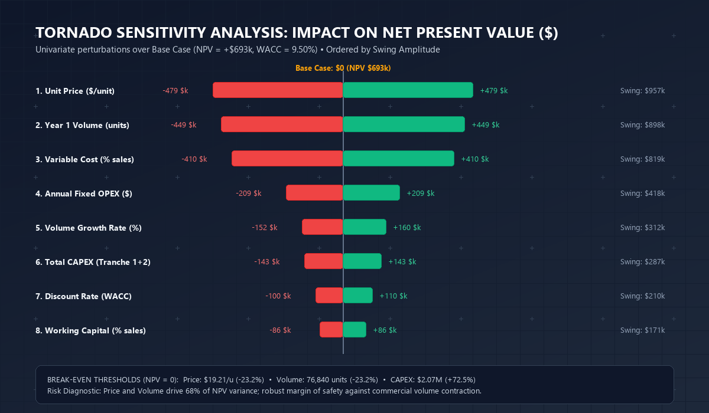

In virtually every corporate board meeting, executive committee, or capital allocation session where a Chief Operating Officer (COO), Chief Technology Officer (CTO), or Business Unit Leader pitches a significant capital expenditure (CAPEX), the same critical pathology unfolds: **the last-mile trap of the Business Case**.

An organization spends months vetting equipment suppliers, drafting engineering specifications spanning hundreds of pages, and negotiating contracts to the penny. Yet, when the proposal arrives at the desks of the Chief Executive Officer (CEO) and Chief Financial Officer (CFO), the financial justification collapses into a handcrafted, improvised spreadsheet. That model frequently conflates accounting profit with cash generation, ignores net working capital requirements, applies an arbitrary discount rate (or simply the commercial loan interest rate), and presumes linear, friction-free revenue scaling.

The strategic and financial fallout of this analytical gap is devastating:
1. **Conflating Accounting Margin with Free Cash Flow:** Teams confuse EBIT or EBITDA with liquidity in the bank account, ignoring the phased timing of cash disbursements and the interest tax shield.
2. **The Working Capital Cash Trap:** Aggressive revenue expansion consumes cash. Increased accounts receivable and elevated safety inventories absorb liquidity. Omitting the change in net working capital ($\Delta\text{NWC}$) blinds management to severe cash crunches during commercial ramp-up.
3. **Optimism Bias and the Planning Fallacy (Kahneman & Lovallo; Flyvbjerg):** As demonstrated by Nobel Laureate Daniel Kahneman and Oxford professor Bent Flyvbjerg in empirical megaproject research, over 80% of business plans suffer cost overruns exceeding 25% and capture less than 60% of projected revenues when reference class forecasting is absent.
4. **The Seductive Trap of the Internal Rate of Return (IRR):** The IRR remains the executive suite's favorite metric due to its intuitive percentage format. However, it conceals two fatal mathematical flaws: it implicitly presumes that intermediate cash flows are reinvested at the project's own IRR, and it fails to measure the absolute scale of economic wealth created.

To eliminate these vulnerabilities and elevate capital allocation to the standard of elite strategy consultancies and investment banks (McKinsey Corporate Finance Practice, BCG Corporate Development, Goldman Sachs), this official Datalaria methodology formalizes the full architecture of an **Institutional Financial Business Case**: rigorous Discounted Free Cash Flow (DCF) modeling, WACC estimation via the Capital Asset Pricing Model (CAPM), 3-year and 5-year Net Present Value (NPV), IRR and Modified IRR (MIRR), linearly interpolated Discounted Payback, Profitability Index (PI), one-way sensitivity modeling via the Tornado Chart, and capital governance anchored in tranched *stage gates* and binding *kill criteria*.


Preparing an executive CAPEX justification or digital transformation business case for the Investment Committee? Download the institutional 5-year DCF Excel model, CAPM-based WACC calculator, automated Tornado chart, and 16:9 editable Board deck.


---

## 1. What is an Institutional Financial Business Case? Foundations, Core Components, and the Strategic Decision Funnel

For any Chief Financial Officer (CFO), Chief Executive Officer (CEO), Chief Operating Officer (COO), Chief Technology Officer (CIO/CTO), or corporate investment committee evaluating a material capital allocation—or for professionals approaching this discipline for the first time—the **Financial Business Case** represents the international gold standard for the rigorous, quantitative, and auditable appraisal of corporate investments.

In canonical corporate finance (McKinsey Corporate Finance Practice, NYU Stern School of Business, and Harvard Business School), a business case is neither an internal marketing narrative nor an unhedged sales projection spreadsheet. Its primary objective is to answer with undeniable mathematical rigor the fundamental question posed by shareholders and the Board of Directors:

> **"Does this capital commitment generate unencumbered cash returns in excess of our corporate cost of capital (WACC), withstand market volatility, and incorporate binding off-ramps to preserve corporate liquidity?"**

### 1.1. The Anatomy of the Model: Four Structural Pillars

Unlike conventional departmental budget requests or informal net-profit projections, an Institutional Financial Business Case rests upon four interconnected analytical pillars:

1. **Discounted Free Cash Flow to Firm (FCFF / DCF) Engine:** The true economic cash generated by operations available to service all capital providers (NOPAT + Depreciation − CAPEX − $\Delta$NWC), stripping away the distortions of accrual accounting.
2. **CAPM-Derived Weighted Average Cost of Capital (WACC):** The defensible corporate hurdle rate weighting the cost of equity ($K_e$) derived from the Capital Asset Pricing Model (incorporating empirical industry betas and equity risk premiums) against after-tax debt financing ($K_d \cdot (1-t)$).
3. **Quantitative Risk Profiling (Tornado Sensitivity & Break-Even):** A normalized one-way stress test quantifying NPV variance against independent swings in operational drivers (sales price, volume, variable costs, fixed OPEX, CAPEX, and discount rate), ranking vulnerability by swing amplitude and isolating exact zero-NPV break-even tolerances.
4. **Tranched Capital Governance (*Staging, Stage Gates & Kill Criteria*):** Contractual and operational safeguards dividing capital outlays into milestones contingent upon verified technical deliverables (Factory Acceptance Testing, Site Acceptance Testing, and OEE $\ge 75\%$), alongside binding stop-loss rules to prevent distressed initiatives from draining treasury reserves.

### 1.2. Comparative Matrix: Informal Spreadsheets vs. Institutional Financial Business Case

| Analytical Dimension | Informal Spreadsheet Approach | Institutional Financial Business Case (Datalaria / McKinsey) | C-Level Strategic Advantage |
| :--- | :--- | :--- | :--- |
| **Return Metric** | Accounting Net Profit or Cumulative EBITDA. | **Discounted Free Cash Flow to Firm (FCFF)** net of tax, CAPEX, and working capital. | Eradicates accrual illusions; measures actual bankable liquidity. |
| **Discount Rate** | Bank borrowing rate or arbitrary round number (e.g., 10%). | **WACC Derived via CAPM** ($K_e$ with Damodaran sector beta + $K_d$ with tax shield). | Reflects true opportunity cost and systematic shareholder risk. |
| **Working Capital** | Omitted entirely or presumed static over time. | **Dynamic Net Working Capital Tracking ($\Delta\text{NWC}$)** indexed to sales growth. | Prevents liquidity crises and cash depletion during revenue ramp-up. |
| **Risk Modeling** | Single static case infected by optimism bias (Kahneman & Lovallo). | **3-Scenario Probability Matrix ($E[\text{NPV}]$)** and **One-Way Tornado Chart**. | Reveals dominant variance drivers and establishes verifiable safety margins. |
| **Decision Metrics** | Sole reliance on unhedged IRR or undiscounted payback. | **Canonical Metric Suite**: 3-Yr & 5-Yr NPV, IRR, Modified IRR (MIRR), and interpolated Discounted Payback. | Corrects IRR reinvestment fallacies and pinpoints precise capital recovery timing. |
| **Disbursement Control** | 100% budget released upfront without accountability. | **Phased Capital Tranches (*Staging*)** with OEE Stage Gates and binding Kill Criteria. | Caps Peak Funding exposure and enforces irrevocable exit protocols. |

### 1.3. How It Works: The Integral Strategic Decision Funnel (From Suite 01 Strategy to Suite 02 Decisions)

In high-performing enterprises and Tier-1 strategy consulting practice, **no financial model exists in an analytical silo**. The Financial Business Case in **Suite 02 (Decision Analysis & Prioritization)** serves as the ultimate economic gatekeeper and capital allocation filter of a 7-level strategic funnel:


flowchart TD
    S1["<b>Level 1: Exogenous Macro Environment</b> <b>Quantitative PESTEL Matrix</b> <small>Geopolitical shocks, interest rates, inflation, and ESG mandates</small>"]
    S2["<b>Level 2: Industry & Microeconomic Dynamics</b> <b>Weighted Porter's 5 Forces</b> <small>Supplier power, entry barriers, and defensible Economic Moat</small>"]
    S3["<b>Level 3: Internal Diagnostic & Cross-Matching</b> <b>Quantitative SWOT & CAME Matrix</b> <small>Aligning core competencies with high-yield market opportunities</small>"]
    S4["<b>Level 4: Portfolio Strategy & Capital Budgeting</b> <b>Dynamic BCG & McKinsey / GE 3x3 Matrix</b> <small>Corporate CAPEX allocation across SBUs (MBA Strategy Kit)</small>"]
    S5["<b>Level 5: Alternative Appraisal & Vendor Selection</b> <b>CMMI DAR Decision Matrix with Veto Filters</b> <small>Boolean must-haves, multicriteria scoring, and Make vs. Buy</small>"]
    S6["<b>Level 6: Roadmap Prioritization & Squad Capacity</b> <b>Agile RICE & ICE Prioritization Matrix</b> <small>Value density per person-month, capacity cut-lines, and growth tests</small>"]
    S7["<b>Level 7: Capital Authorization & Financial Governance</b> <b>Financial Business Case (NPV, IRR, Payback & Tornado)</b> <small>5-year DCF, CAPM WACC, risk sensitivity, and Board Decision Gateway</small>"]

    S1 --> S2
    S2 --> S3
    S3 --> S4
    S4 --> S5
    S5 --> S6
    S6 --> S7

    style S1 fill:#EFF6FF,stroke:#3B82F6,stroke-width:1.5px,color:#1E3A8A
    style S2 fill:#EEF2FF,stroke:#6366F1,stroke-width:1.5px,color:#312E81
    style S3 fill:#ECFDF5,stroke:#10B981,stroke-width:1.5px,color:#064E3B
    style S4 fill:#FFFBEB,stroke:#F59E0B,stroke-width:1.5px,color:#92400E
    style S5 fill:#F8FAFC,stroke:#64748B,stroke-width:1.5px,color:#0F172A
    style S6 fill:#EFF6FF,stroke:#2563EB,stroke-width:1.5px,color:#1E40AF
    style S7 fill:#0F172A,stroke:#10B981,stroke-width:2.5px,color:#FFFFFF


1. **Level 1 — Macro Scanning ([Quantitative PESTEL Matrix](/en/posts/quantitative-pestel-matrix/)):** Evaluates exogenous macroeconomic drivers (inflation, benchmark sovereign bond yields informing the risk-free rate $R_f$, trade tariffs) shaping long-term investment viability.
2. **Level 2 — Microeconomic & Industry Pressures ([Weighted Porter's 5 Forces](/en/posts/quantitative-porter-5-forces/)):** Diagnoses structural industry pricing power, customer bargaining leverage, and competitive moats preserving operating margins.
3. **Level 3 — Internal Diagnostic & Strategic Alignment ([Quantitative SWOT & CAME Matrix](/en/posts/quantitative-swot-came-matrix/)):** Synthesizes operational bottlenecks and determines whether a planned digital or industrial upgrade is an offensive growth initiative or a defensive survival necessity.
4. **Level 4 — Business Portfolio Capital Allocation ([Dynamic BCG Matrix](/en/posts/dynamic-bcg-matrix/) and [McKinsey / GE 3x3 Matrix](/en/posts/mckinsey-ge-matrix/)):** Channels corporate funding toward high-attractiveness Strategic Business Units (all unified in the [Corporate Strategy MBA Framework](/en/posts/corporate-strategy-mba-quantitative-framework/)).
5. **Level 5 — Critical Alternative Selection ([CMMI DAR Decision Matrix with Veto Filters](/en/posts/quantitative-dar-matrix/)):** Evaluates competing equipment vendors, ERP platforms, or Make vs. Buy dilemmas under non-negotiable compliance and security veto clauses.
6. **Level 6 — Product Roadmap & Engineering Capacity ([Agile RICE & ICE Prioritization Matrix](/en/posts/rice-ice-prioritization-matrix/)):** Calibrates squad delivery bandwidth using normalized value density per person-month and empirical capacity cut-lines to safeguard predictable milestones.
7. **Level 7 — Capital Authorization & Board Sign-Off (Financial Business Case):** Once an initiative aligns with corporate strategy (Suite 01), passes procurement veto screening (DAR), and secures roadmap prioritization (RICE), **it faces the definitive test of corporate capital**: projecting 5-year free cash flows, applying the WACC hurdle rate, stress-testing variance via Tornado sensitivity, and conditioning disbursement tranches upon auditable stage gates before executive leadership signs the investment charter.

---

## 2. The Institutional Business Case Decision Pipeline

Formulating an investment business case for Board-level capital authorization is not a detached spreadsheet exercise; it is a **sequential, binding decision pipeline** that connects operational shop-floor and market realities with the corporate cost of capital and Board oversight:


flowchart TD
    A["<b>1. Operational Drivers & WACC (CAPM)</b> <small>Cost of equity (Ke), net debt (Kd·(1-t)) Volume, pricing, variable costs, and fixed OPEX</small>"]
    
    B["<b>2. Income Statement Projection (P&L)</b> <small>Gross revenue • Gross Margin • EBITDA Straight-line depreciation • EBIT • Corporate taxes</small>"]
    
    C["<b>3. Free Cash Flow to Firm (FCFF) Modeling</b> <small>FCF = NOPAT + D&A − CAPEX − ΔNWC Phased disbursement calendar</small>"]
    
    D["<b>4. Core Return & Liquidity Metrics</b> <small>3-Yr & 5-Yr NPV • IRR • Modified IRR (MIRR) Interpolated Discounted Payback • Peak Funding</small>"]
    
    E["<b>5. Risk Profiling & Tornado Sensitivity</b> <small>One-way perturbations • Swing ranking Linear break-even thresholds • 3 Scenario states</small>"]
    
    F["<b>6. Phased Investment Plan, Stage Gates & Kill Criteria</b> <small>Tranched capital release tied to OEE & SAT Pre-committed stop-loss liquidation rules</small>"]
    
    G["<b>7. Board Decision Gateway</b> <small>Formal Investment Committee resolution C-Level sign-offs: CEO, CFO, Chair, and COO</small>"]

    A --> B
    B --> C
    C --> D
    D --> E
    E --> F
    F --> G

    style A fill:#F8FAFC,stroke:#64748B,stroke-width:1.5px,color:#0F172A
    style B fill:#EFF6FF,stroke:#3B82F6,stroke-width:1.5px,color:#1E3A8A
    style C fill:#F0FDF4,stroke:#10B981,stroke-width:2px,color:#065F46
    style D fill:#EFF6FF,stroke:#2563EB,stroke-width:2px,color:#1E40AF
    style E fill:#FEF3C7,stroke:#F59E0B,stroke-width:2px,color:#92400E
    style F fill:#FEF2F2,stroke:#EF4444,stroke-width:2px,color:#991B1B
    style G fill:#D1FAE5,stroke:#10B981,stroke-width:2.5px,color:#065F46


---

## 3. Mathematical Foundations: Free Cash Flow, WACC, and Return Metrics

To withstand the scrutiny of independent directors, external auditors, and corporate finance controllers, every line item in the model must be grounded in canonical corporate finance theory.

### 3.1. Formal Definition of Free Cash Flow to Firm (FCFF)

Free Cash Flow to Firm ($\text{FCFF}_t$ or $\text{FCF}_t$) represents the unencumbered cash generated by core operations available for distribution to all capital providers (debt holders and equity investors), after fulfilling all operating obligations, taxes, and necessary capital investments in fixed assets and working capital.

For each period $t \in \{0, 1, \dots, n\}$:

$$\text{FCF}_t = \text{EBIT}_t \cdot (1 - t) + \text{D\&A}_t - \text{CAPEX}_t - \Delta\text{NWC}_t$$

Where:
* **$\text{EBIT}_t$ (Operating Profit):** $\text{Revenue}_t - \text{Variable Costs}_t - \text{Fixed OPEX}_t - \text{D\&A}_t$.
* **$t$ (Effective Corporate Tax Rate):** Corporate income tax rate (typically 25.0%).
* **$\text{NOPAT}_t = \text{EBIT}_t \cdot (1 - t)$:** Net Operating Profit After Tax. Measures operating cash profitability as if the firm had no debt (debt financing costs are accounted for in the discount rate).
* **$\text{D\&A}_t$ (Depreciation and Amortization):** Non-cash accounting expense added back because it does not represent an actual cash outflow.
* **$\text{CAPEX}_t$ (Capital Expenditures):** Cash disbursements for primary machinery, facility preparation, robotics, and software commissioning.
* **$\Delta\text{NWC}_t$ (Change in Net Working Capital):** Operating liquidity absorbed by business expansion:
  $$\text{NWC}_t = \text{Receivables}_t + \text{Inventory}_t - \text{Payables}_t \approx \text{Revenue}_t \cdot \% \text{NWC}$$
  $$\Delta\text{NWC}_t = \text{NWC}_t - \text{NWC}_{t-1}$$

### 3.2. Weighted Average Cost of Capital (WACC) via CAPM

The discount hurdle rate applied to projected cash flows is not an arbitrary estimate; it is the **weighted opportunity cost of capital (WACC)** compensating capital providers for bearing systematic investment risk:

$$\text{WACC} = \frac{E}{V} \cdot K_e + \frac{D}{V} \cdot K_d \cdot (1 - t)$$

Where:
* $E/V$: Equity weighting over total capital ($E/(D+E)$).
* $D/V$: Net debt weighting over total capital ($D/(D+E)$).
* $K_d$: Pre-tax cost of debt (commercial borrowing rate).
* $K_d \cdot (1 - t)$: After-tax net borrowing cost reflecting the corporate interest tax shield.
* $K_e$: Cost of equity capital estimated via the **Capital Asset Pricing Model (CAPM)**:

$$K_e = R_f + \beta \cdot \text{ERP} + \text{Premiums}$$

* $R_f$ (Risk-Free Rate): Benchmark 10-year sovereign bond yield (baseline: 3.50%).
* $\beta$ (Levered Beta): Systematic market covariance for industrial equipment manufacturing (Damodaran benchmark: 1.20x).
* $\text{ERP}$ (Equity Risk Premium): Expected market return spread over sovereign paper (baseline: 5.50%).
* $\text{Premiums}$: Mid-cap size premium and illiquidity adjustment (baseline: 1.40%).

Under our calibrated baseline assumptions:
$$K_e = 3.50\% + 1.20 \cdot 5.50\% + 1.40\% = 11.50\%$$
$$K_d \cdot (1 - t) = 4.667\% \cdot (1 - 0.25) = 3.50\%$$
$$\text{WACC} = 0.75 \cdot 11.50\% + 0.25 \cdot 3.50\% = 8.625\% + 0.875\% = \mathbf{9.50\%}$$

### 3.3. Net Present Value (NPV) and Decision Rules

Net Present Value measures the absolute currency surplus generated by an initiative over and above the return demanded by corporate capital providers:

$$\text{NPV} = \sum_{t=0}^{n} \frac{\text{FCF}_t}{(1 + \text{WACC})^t} + \frac{\text{TV}}{(1 + \text{WACC})^n}$$

Where $\text{TV}$ denotes the optional Terminal Value modeled using the Gordon Shapiro constant-growth perpetuity formula:

$$\text{TV} = \frac{\text{FCF}_n \cdot (1 + g)}{\text{WACC} - g} \quad \text{provided } \text{WACC} > g$$

> **Canonical Board Decision Rule:**
> * If $\text{NPV} > 0$: Project generates positive economic shareholder wealth. **APPROVE**.
> * If $\text{NPV} = 0$: Project precisely recovers invested capital and the WACC hurdle rate. Neutral.
> * If $\text{NPV} < 0$: Project destroys shareholder value. **REJECT**.

### 3.4. The Spreadsheet Year-0 NPV Trap

A widespread modeling flaw in corporate practice occurs when financial analysts invoke the native `=NPV(rate, range)` function in Microsoft Excel or Google Sheets.

By architectural design in spreadsheet software, `NPV(r, cash_flows)` discounts the **first cell in the range** as if it occurred at the end of period 1 (discounted by $(1+r)^1$). If the modeler includes the Year 0 initial outlay inside the range (`=NPV(WACC, FCF0:FCF5)`), the initial investment is mistakenly discounted by $(1+\text{WACC})$, artificially inflating the reported NPV.

The mandatory institutional formula is:
$$\text{Institutional Excel Syntax:} \quad = \text{FCF}_0 + \text{NPV}(\text{WACC}, \text{FCF}_1:\text{FCF}_5)$$

### 3.5. IRR vs. Modified IRR (MIRR) and Discounted Payback

* **Internal Rate of Return (IRR):** The intrinsic discount rate $r$ equating the project's NPV to zero:
  $$\sum_{t=0}^n \frac{\text{FCF}_t}{(1 + \text{IRR})^t} = 0$$
* **Modified Internal Rate of Return (MIRR):** Resolves the IRR reinvestment fallacy by compounding positive cash flows at the corporate reinvestment rate ($r = \text{WACC}$) and discounting funding calls at the financing rate:
  $$\text{MIRR} = \left( \frac{\sum_{t=1}^n \text{FCF}_t^+ \cdot (1 + r)^{n-t}}{|\text{FCF}_0 + \sum_{t=1}^n \text{FCF}_t^- \cdot (1 + \text{WACC})^{-t}|} \right)^{1/n} - 1$$
* **Linearly Interpolated Discounted Payback:** Calculates the exact fractional year when the cumulative present value crosses from negative to positive:
  $$\text{Discounted Payback} = (t - 1) + \frac{|\text{Cumulative PV}_{t-1}|}{\text{Period } t \text{ PV of FCF}}$$
* **Profitability Index (PI):** Measures present value created per unit of capital committed:
  $$\text{PI} = \frac{\sum_{t=1}^n \frac{\text{FCF}_t^+}{(1 + \text{WACC})^t}}{\left| \text{FCF}_0 + \sum_{t=1}^n \frac{\text{FCF}_t^-}{(1 + \text{WACC})^t} \right|}$$

---

## 4. Analytical Matrix: What Each Metric Answers and Common Traps

| Return Metric | Business Question Answered | Primary Analytical Strength | Critical Vulnerability or Trap | Datalaria Governance Standard |
| :--- | :--- | :--- | :--- | :--- |
| **NPV (Net Present Value)** | How much absolute wealth does this initiative create today? | Direct dollar measurement of wealth creation; accounts for time value of money. | Requires disciplined derivation of WACC. | **Primary Decision Metric (Binding)** |
| **IRR (Internal Rate of Return)** | What intrinsic percentage yield does the invested capital deliver? | Intuitive for comparative benchmarking against interest rates. | Unrealistic reinvestment assumption; scale insensitivity; multiple sign roots. | **Secondary Hurdle Metric ($\ge$ WACC+3pp)** |
| **MIRR (Modified IRR)** | What is the true yield assuming cash is reinvested at the WACC? | Eliminates the reinvestment distortion of standard IRR. | Less familiar to non-finance executives. | **Robustness Validation** |
| **Discounted Payback** | Exactly how many years until committed capital is fully recovered? | Sharp indicator of treasury liquidity risk and duration exposure. | Ignores all cash flows generated after the cut-off period. | **Liquidity Safeguard ($<$ 4.0 Years)** |
| **Profitability Index (PI)** | How much present value is created per dollar invested? | Ideal for capital rationing across competing initiatives. | Scale insensitive (favors small projects). | **Capital Efficiency Filter (PI $>$ 1.2x)** |
| **Peak Funding Exposure** | What is the maximum cash trough and credit line required? | Defines maximum treasury drawdown and credit covenants. | Balance sheet liquidity measure, not a profitability indicator. | **Treasury Exposure Cap** |

---

## 5. Risk Profiling: Tornado Sensitivity Analysis and Break-Even Thresholds

A business case reliant upon a single deterministic forecast lacks credibility before an executive board. Corporate leaders do not expect prophetic certainty; they require clarity on **which operational drivers introduce variance and what safety margins protect capital**.

### 5.1. Tornado Sensitivity Methodology

The Tornado Chart stress-tests the financial model through normalized one-way perturbations. Holding all secondary assumptions constant, each individual driver is perturbed across defined downside and upside intervals (typically $\pm 15\%$ on commercial volumes and pricing, $\pm 5\text{ pp}$ on operating cost ratios, and $\pm 2\text{ pp}$ on WACC).

The resulting NPV swing for driver $i$ is calculated as:
$$\text{Swing}_i = |\text{NPV}_i^{\text{Upside}} - \text{NPV}_i^{\text{Downside}}|$$

Drivers are sorted descending by swing magnitude, forming the characteristic funnel silhouette that gives the Tornado chart its name:

  

  Official Tornado Sensitivity Chart: Input variables ranked by NPV variance swing (±20% one-way perturbation vs. base case of $693k).

### 5.2. Linear Break-Even Thresholds ($\text{NPV} = 0$)

One-way sensitivity analysis identifies the exact solvency thresholds where economic returns collapse to zero:
1. **Break-Even Unit Price ($19.21/unit):** The project tolerates a sustained commercial price deflation of up to **-23.2%** before destroying shareholder wealth.
2. **Break-Even Sales Volume (76,840 units):** Production can endure a market contraction of up to **-23.2%** below the 100,000-unit annual target while remaining self-funding.
3. **Maximum Tolerable CAPEX ($2,070,561):** Primary engineering and robotics installation can absorb a cost overrun of up to **+72.5%** over the $1.2M baseline budget before impairing the minimum required WACC return.

---

## 6. Capital Governance: Phased Staging, Stage Gates, and Kill Criteria

Boardroom capital authorization should never authorize an unrestricted lump-sum release on day one. Institutional corporate finance enforces **phased, milestone-contingent capital releases (*capital staging*)**:

1. **Tranche 1 (Q1 Year 0) | $850,000:** Detailed engineering, facility preparation, civil works, and primary robotics equipment procurement.
   * *Stage Gate 1:* 100% Factory Acceptance Testing (FAT) sign-off with zero critical safety or performance non-conformities.
2. **Tranche 2 (Q4 Year 1) | $350,000:** Manufacturing Execution System (MES) software integration, cell robotics integration, and plant commissioning.
   * *Stage Gate 2:* Site Acceptance Testing (SAT) sign-off and sustained preliminary Overall Equipment Effectiveness (OEE) $\ge 75\%$.

### Binding Project Abort Rules (Kill Criteria / Stop-Loss Policy)
* **Engineering Overrun Threshold:** If engineering and installation costs exceed the Tranche 1 budget by more than 15% (>$127,500 cost overrun) by Q3, Tranche 2 is automatically frozen pending an extraordinary Board audit.
* **Commercial Demand Shortfall:** If firm commercial sales commitments at 9 months fail to reach 75% of target volume (69,000 units), deployment of the secondary robotics cell is halted.
* **Hurdle Impairment:** If the mandatory annual DCF re-underwriting yields a revised IRR below the corporate WACC (9.50%), executive management must initiate the formal project exit protocol.

---

## 7. Solved Practical Case: Manufacturing Line Automation ($1.2M)

To ground the methodology in an authentic industrial setting, the model models the end-to-end automation of a mid-tier industrial plant:

### 7.1. Consolidated DCF Projection Statement (Values in $k)

| Projection Line Item ($k) | Year 0 | Year 1 | Year 2 | Year 3 | Year 4 | Year 5 |
| :--- | :---: | :---: | :---: | :---: | :---: | :---: |
| Production Volume (units) | - | 100,000 | 105,000 | 110,250 | 115,763 | 121,551 |
| Unit Selling Price ($) | - | 25.00 | 25.50 | 26.01 | 26.53 | 27.06 |
| **Gross Sales Revenue** | **-** | **2,500.0** | **2,677.5** | **2,867.6** | **3,071.2** | **3,289.3** |
| (-) Variable Costs (60%) | - | -1,500.0 | -1,606.5 | -1,720.6 | -1,842.7 | -1,973.6 |
| (-) Fixed Operating OPEX | - | -250.0 | -257.5 | -265.2 | -273.2 | -281.4 |
| **Operating EBITDA** | **-** | **+750.0** | **+813.5** | **+881.8** | **+955.3** | **+1,034.3** |
| (-) Depreciation (Straight-Line) | - | -170.0 | -240.0 | -240.0 | -240.0 | -240.0 |
| **EBIT (Operating Income)** | **-** | **+580.0** | **+573.5** | **+641.8** | **+715.3** | **+794.3** |
| (-) Corporate Taxes (25%) | - | -145.0 | -143.4 | -160.5 | -178.8 | -198.6 |
| **NOPAT** | **-** | **285.0** | **279.0** | **329.1** | **383.2** | **441.5** |
| (+) Depreciation Add-back | - | +170.0 | +240.0 | +240.0 | +240.0 | +240.0 |
| (-) Phased CAPEX Outlays | -850.0 | -350.0 | 0.0 | 0.0 | 0.0 | 0.0 |
| (-) Working Capital Change (10%) | - | -250.0 | -17.8 | -19.0 | -20.4 | -21.8 |
| **FREE CASH FLOW TO FIRM (FCF)** | **-850.0** | **-145.0** | **+501.3** | **+550.1** | **+602.8** | **+659.7** |
| Cumulative Nominal Cash Flow | -850.0 | -995.0 | -493.8 | +56.4 | +659.2 | +1,318.9 |
| **Cumulative Discounted PV (J-Curve)** | **-850.0** | **-982.4** | **-564.4** | **-145.4** | **+274.0** | **+693.0** |

### 7.2. Financial Performance Evaluation

1. **Absolute Value Creation:** The initiative generates a **5-Year NPV of +$692,991**, adding well over half a million dollars of net equity value beyond the corporate WACC hurdle.
2. **Substantial Return Spread:** The project delivers an **IRR of 28.89%**, generating a spread of **+19.39 percentage points above the 9.50% WACC** (comfortably clearing the +3.0 pp policy requirement). The **Modified IRR (MIRR) reaches 21.84%**, verifying robust economics under realistic capital reinvestment assumptions.
3. **Disciplined Payback Horizon:** Simple payback is achieved in **2.90 years**, while **Discounted Payback occurs at 3.35 years** (full economic recovery well within the 4.0-year corporate policy benchmark).
4. **Controlled Liquidity Drawdown:** The maximum cash exposure (**Peak Funding**) occurs in Year 1 at **-$995,000**, fully covered by existing revolving credit lines.

---

## 8. Boardroom Defense Protocol (Board Defense FAQ)

When presenting this capital expenditure request before the CFO and the Investment Committee, project leaders routinely encounter these critical governance inquiries:

### 1. Where does the 9.50% WACC come from, and why not use the commercial loan borrowing rate?
*Model Answer:* Commercial loan borrowing rates ($K_d \approx 4.67\%$, or 3.50% after the corporate interest tax shield) compensate only debt holders holding senior collateral. Equity capital represents 75% of total financing, demanding an 11.50% return under the CAPM framework to reflect operational manufacturing risk. Discounting projected flows with debt rates rather than the weighted cost of capital would lead to approving value-destroying projects.

### 2. Why prioritize NPV over IRR when IRR is more intuitive for Board members?
*Model Answer:* IRR suffers from two mathematical vulnerabilities: first, it presumes intermediate cash flows are reinvested at the project's own IRR (28.89%), which is unrealistic; NPV assumes reinvestment at the corporate WACC (9.50%), confirmed by the 21.84% MIRR. Second, IRR is blind to scale: a $50k project yielding 40% creates far less absolute shareholder wealth than a $1.2M program yielding 28.9%.

### 3. What happens if commercial sales contract 20% below forecast?
*Model Answer:* Tornado sensitivity and break-even calculations prove the automation line withstands a sustained volume contraction of up to -23.2% and a price erosion of up to -23.2% before NPV drops to zero. A 20% sales decline reduces NPV from $693k to approximately $95k, but the investment remains value-accretive and self-funding.

### 4. What is our maximum downside capital exposure if the project fails entirely?
*Model Answer:* Maximum financial exposure is capped at the Peak Funding trough ($995,000). Thanks to two-tranche capital staging and binding Kill Criteria, if commercial orders at 9 months fail to achieve 75% of target or engineering overruns exceed 15%, Tranche 2 ($350,000) is frozen immediately, limiting total exposure to $850,000.

### 5. Why penalize free cash flow with working capital if customers eventually settle their invoices?
*Model Answer:* Because working capital (uncollected receivables and buffer stock) ties up liquidity on the balance sheet. Every additional $1M in sales absorbs $100,000 in operational working capital. Omitting $\Delta\text{NWC}$ masks severe treasury shortfalls during production ramp-up.

### 6. How can the Board be confident these projections aren't inflated by optimism bias?
*Model Answer:* Through three institutional safeguards: 1) A documented Assumption Register backed by binding equipment vendor quotes; 2) Reference class forecasting against comparable manufacturing automation benchmarks; and 3) A mandatory 12-month Post-Investment Review (PIR) tied directly to the executive project sponsor's compensation scorecard.

---

## 9. Official Executive Decision Pack: Financial Business Case (NPV, IRR, Payback)

For Chief Financial Officers (CFO), Chief Executive Officers (CEO), Corporate Development leaders, and management consultants who need to deploy this quantitative framework with immediate production quality and Board-level rigor, we have released the complete official Suite 02 package:

{{< product-card
  title="Financial Business Case (NPV, IRR, Payback)"
  category="Finance & Investment"
  price="9€"
  original_price="29€"
  badge="📈 CFO Standard"
  icon="📈"
  preview_image="preview-pack.png"
  preview_caption="Real preview of included deliverables: DCF Financial Model in Excel (.xlsx with protected formulas), 16:9 C-Level Presentation (.pptx with native Tornado Chart and Board Decision Gateway), and Official Methodology Guide (.pdf)."
  deliverables="Excel .xlsx + Sheets|PowerPoint .pptx 16:9 C-Level|Methodology Guide PDF"
  features="Discounted free cash flow model over 3 and 5-year horizons|Automated calculation of NPV, IRR, MIRR, and interpolated Discounted Payback|CAPM-based WACC calculator, 3 scenario states, and probability-weighted expected NPV|One-way sensitivity analysis and dynamic Tornado chart for risk profiling|16:9 C-Level executive presentation structured under the Minto Pyramid|Instant direct download (.ZIP with ES and EN versions)"
  checkout_url="https://datalaria.lemonsqueezy.com/checkout/buy/c2ff153f-2f95-4671-ab14-1b8e02301079"
  button_text="Download Full Pack (.ZIP) • 8€"
>}}
The downloadable archive includes the institutional analytical workbooks in **Excel (.xlsx)** across 6 interconnected worksheets with ECMA-376 standard protection (formulas protected under password provided in the instructions, and white input cells 100% editable), the executive presentation in **PowerPoint (.pptx 16:9 widescreen)** under the Minto Pyramid with native editable Tornado charts and the Board Decision Gateway featuring 4 C-Level sign-offs, the **Official Methodology Guides in PDF** (5 pages) with complete mathematical proofs and Boardroom defense FAQs, and seamless Google Sheets import instructions.


*Legal Disclaimer: This financial model and methodology guide are decision-support tools designed for strategic quantitative modeling and capital allocation analysis. They do not constitute formal investment, legal, or tax advisory services.*

---

## 10. Authoritative Bibliographical References

1. **Brealey, Richard A., Myers, Stewart C., & Allen, Franklin (2020).** *Principles of Corporate Finance*. McGraw-Hill Education, New York (13th Edition).  
   *The seminal corporate finance treatise formalizing the mathematical superiority of NPV over IRR, free cash flow discounting, and project appraisal under uncertainty.* ISBN: `978-1260565553`

2. **Koller, Tim, Goedhart, Marc, & Wessels, David — McKinsey & Company (2020).** *Valuation: Measuring and Managing the Value of Companies*. John Wiley & Sons, Hoboken, NJ (7th Edition).  
   *The gold-standard corporate valuation handbook defining institutional Free Cash Flow to Firm (FCFF), WACC derivation, and value preservation in capital budgeting.* ISBN: `978-1119610885`

3. **Damodaran, Aswath (2012).** *Investment Valuation: Tools and Techniques for Determining the Value of Any Asset*. John Wiley & Sons, Hoboken, NJ (3rd Edition).  
   *Canonical reference work for empirical levered beta estimation, equity risk premiums (ERP), and industry cost of capital calibration.* [Explore data on Damodaran Online](https://pages.stern.nyu.edu/~adamodar/)

4. **Graham, John R., & Harvey, Campbell R. (2001).** *The Theory and Practice of Corporate Finance: Evidence from the Field*. Journal of Financial Economics, 60(2-3), 187-243.  
   *Foundational empirical survey analyzing how Fortune 500 CFOs apply NPV, IRR, and sensitivity analysis in capital expenditure decision-making.* DOI: `10.1016/S0304-405X(01)00044-7`

5. **Lovallo, Dan, & Kahneman, Daniel (2003).** *Delusions of Success: How Optimism Undermines Executives' Decisions*. Harvard Business Review, 81(7), 56-63.  
   *Seminal research on the planning fallacy and cognitive confirmation bias that distort corporate financial projections in strategic initiatives.* [Read at Harvard Business Review](https://hbr.org/2003/07/delusions-of-success-how-optimism-undermines-executives-decisions)

6. **Flyvbjerg, Bent (2006).** *From Nobel Prize to Project Management: Getting Risks Right*. Project Management Journal, 37(3), 5-15.  
   *Reference class forecasting methodology designed to eliminate cost overruns and schedule delays in industrial capital expenditures.* DOI: `10.1177/875697280603700302`

7. **Minto, Barbara (2009).** *The Pyramid Principle: Logic in Writing and Thinking*. Financial Times / Prentice Hall (3rd Edition).  
   *The universal executive communication standard for inductive logic, Action Titles, and persuasive governance synthesis before Corporate Boards.* ISBN: `978-0273710516`
