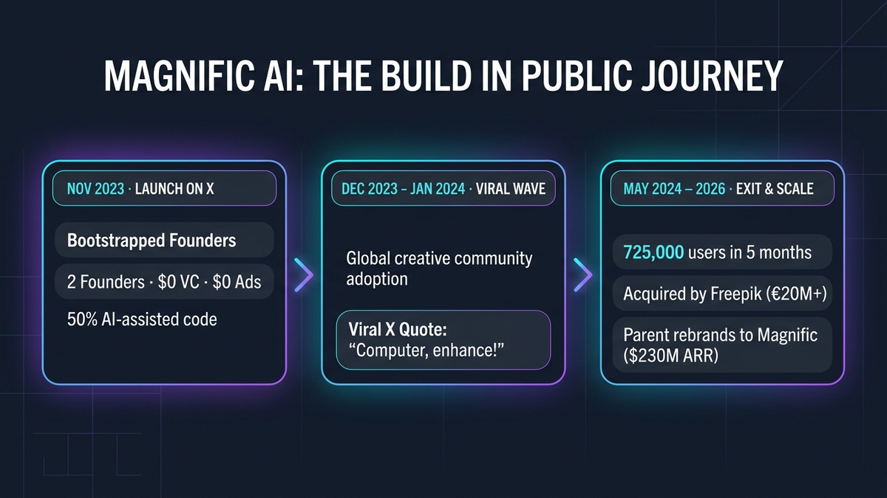

In January 2024, OpenAI CEO Sam Altman sparked an industry-wide debate when he revealed a running bet among tech founders: when would we see the world's first **"one-person billion-dollar company"**—a software titan operated by one or two individuals leveraging extreme artificial intelligence force multipliers.

What most commentators in San Francisco overlooked was that **two months earlier, five thousand miles away in Murcia, Spain**, two seasoned engineers and entrepreneurs had just shipped Europe's purest real-world prototype of that post-AGI thesis.

With zero venture capital, zero paid advertising, zero additional employees, and roughly **half of their production codebase co-written alongside AI coding assistants**, **Javi López** and **Emilio Nicolás** launched **Magnific AI** in late November 2023.

Within five months, they crossed **725,000 registered users**, built a multi-million-dollar recurring revenue engine as a two-person team, drew organic public praise on X from digital art icon **Beeple** and **Elon Musk**, and completed an exit to Málaga-based giant [**Freepik**](/en/posts/freepik/) structured around €20 million upfront cash plus multi-year earn-outs. Even more remarkably, on April 28, 2026, the acquiring giant officially rebranded its entire global corporate identity to **Magnific** after surpassing $230 million in Annual Recurring Revenue (ARR).

Continuing our technical series dissecting Spain's most impactful technology companies and deep-tech scale-ups—alongside [RavenPack](/en/posts/ravenpack/), [HappyRobot](/en/posts/happyrobot/), [Submer](/en/posts/submer/), [Multiverse Computing](/en/posts/multiverse_computing/), [Wallapop](/en/posts/wallapop/), [Flywire](/en/posts/flywire/), [Clarity AI](/en/posts/clarity_ai/), [Devo](/en/posts/devo/), [Nextail](/en/posts/nextail/), and [Carto](/en/posts/carto/)—this case study unpacks Magnific AI's origins, its viral X playbook, its tiled diffusion architecture, and what a two-founder exit tells engineers about the post-AGI economy.



---

### The Origins: From Erasmusu and a Sabbatical to an AI Lab in Murcia

Unlike the Silicon Valley stereotype of first-time college dropouts, Javi López and Emilio Nicolás brought thirteen years of battle-tested operational discipline to the table.

Back in 2009, the pair had co-founded **Erasmusu**, scaling it into Europe's largest online community and accommodation marketplace for international exchange students before selling the business to **Spotahome**. Following a well-earned sabbatical after more than a decade running marketplaces, both spotted an unmistakable tectonic shift in April 2022: early image diffusion models were beginning to turn raw text prompts into coherent visual compositions.

Rather than rushing to incorporate a wrapper startup overnight, Javi López spent **eighteen straight months** experimenting in public:

1. **Building distribution before writing product code**: Through his personal X account (**`@javilopen`**) and his Substack newsletter (*Latent Space*), he published hundreds of prompt engineering experiments, side-by-side model tests, and open visual tutorials for creators.
2. **Isolating the exact visual bottleneck**: While tools like early Midjourney and Stable Diffusion amazed casual users, studio illustrators, architects, and concept artists kept slamming into the same wall: outputs rendered at low resolution, and standard mathematical upscalers left skin textures, fabrics, and architectural details looking blurry and plastic.
3. **Shipping at AI-assisted velocity**: Operating on a lean budget under $5,000 and hiring zero outside contractors, the duo spent roughly three intense months building the first release. As López later shared, nearly **50% of Magnific's codebase was authored using Cursor and Claude**—foreshadowing in late 2023 the structured AI engineering workflows we now formalize under [Spec-Driven Development](/en/posts/sdd_vs_vibe_coding/).

---

### Viral X Chronicle: Launch Threads, "Computer, Enhance!" & Beeple

If Magnific's rendering engine turned heads technically, its go-to-market trajectory remains one of the cleanest case studies in **organic, product-led distribution on X (formerly Twitter)**.

On **November 27–28, 2023**, following a tight two-week waitlist and launching straight into a **paid-only tier with zero free trials** to prevent GPU unit-economics collapse, the founders opened access by posting dramatic "before and after" interactive sliders.

#### Three X Moments That Catapulted the Startup Worldwide

* **1. The launch wave and organic creator proof (`@javilopen`, November 2023):**  
  Because Javi López had spent a year and a half earning technical credibility in AI art circles on X, launch day needed zero ad spend. When creators uploaded low-res 1990s video game sprites, hand-drawn pencil sketches, or blurry AI generations and watched pores, stitching, foliage, and metallic reflections materialize in crisp high definition, the entire visual timeline turned into a self-propelling showcase.

* **2. Beeple's daily workflow endorsement (`December 19, 2023`):**  
  Barely three weeks post-launch, pioneering digital artist **Mike Winkelmann (Beeple)** messaged the founders privately sharing that he used Magnific every day in his creative practice. Javi captured the milestone publicly on X:
  > *"Knowing that @beeple, one of the artists I admire the most, is using and enjoying Magnific in his artworks is a dream come true ❤️"* — [`@javilopen` on X](https://x.com/javilopen) (December 19, 2023)

* **3. Elon Musk's viral reply (`January 8, 2024`):**  
  The true inflection point struck when AI designer Linus Ekenstam shared a viral thread on X demonstrating a dramatic `8x` upscale processed with Magnific AI. Amid millions of impressions, **Elon Musk (`@elonmusk`)** jumped directly into the thread quoting the iconic sci-fi cinema meme:
  > *"Computer, enhance!"* — `@elonmusk` on X (January 8, 2024)

  López later recounted in interviews that he had spent years trying unsuccessfully to get Musk's attention; letting a mind-bending visual product speak for itself organically put the two-person Spanish startup in front of tens of millions of viewers overnight at a customer acquisition cost of literally zero.

---

### The Core Engineering: Turning Hallucination into a Product Slider

Why did Magnific AI leave open-source deterministic upscalers (such as classic ESRGAN weights or bicubic interpolation) in the dust, and why couldn't users replicate it with a simple generalist prompt?

While the Large Language Model (LLM) industry was pouring billions into **eliminating hallucinations**, Javi López and Emilio Nicolás recognized a contrarian insight: **in visual generation and creative direction, bounded hallucination is not a bug—it is the core product**.

When you enlarge a blurry 256×256 image up to 4K using strictly deterministic pixel math, the algorithm can only smooth edges or average surrounding colors; it cannot infer how brushed aluminum catches light or how woven linen behaves under soft shadows. Magnific solved this through a **text-conditioned Tiled Latent Diffusion pipeline governed by precision constraint sliders**:


flowchart LR
    I["<b>1. Base Input</b> <small>Low-Res Image + Semantic Prompt</small>"] --> T["<b>2. Tiled Latent Split</b> <small>Overlapping latent tiles with global context guidance</small>"]
    C["<b>Creativity Slider</b> <small>Controls allowable generative detail hallucination</small>"] --> D
    R["<b>Resemblance Slider</b> <small>Structural anchor preserving identity & geometry</small>"] --> D
    H["<b>HDR & Fractality</b> <small>Local micro-contrast, lighting depth & texture</small>"] --> D
    T --> D["<b>3. Diffusion Inference</b> <small>Prompt-guided latent denoising on GPU clusters</small>"]
    D --> M["<b>4. Seamless Blending</b> <small>Color matching & artifact-free 4K/8K reconstruction</small>"]

    style I fill:#0F172A,stroke:#38BDF8,stroke-width:2px,color:#FFFFFF
    style T fill:#EFF6FF,stroke:#3B82F6,stroke-width:1.5px,color:#1E3A8A
    style C fill:#FAF5FF,stroke:#A855F7,stroke-width:1.5px,color:#581C87
    style R fill:#EFF6FF,stroke:#2563EB,stroke-width:1.5px,color:#1E3A8A
    style H fill:#FEF3C7,stroke:#F59E0B,stroke-width:1.5px,color:#92400E
    style D fill:#0F172A,stroke:#A855F7,stroke-width:2px,color:#FFFFFF
    style M fill:#D1FAE5,stroke:#10B981,stroke-width:2px,color:#065F46


That architecture gave creative professionals three intuitive, deterministic dials over stochastic diffusion models:

* **`Creativity` (Controlled Hallucination):** Governs how boldly the diffusion denoiser is allowed to invent brand-new micro-textures, lighting highlights, and organic imperfections absent from the source file.
* **`Resemblance` (Structural Anchoring):** Applies an inverse structural tether preventing the model from drifting away from a portrait's identity, typography geometry, or architectural perspective.
* **`HDR`:** Modulates perceived dynamic range, crispness, and tactile depth across fine surfaces.

By pairing tiled latent synthesis with semantic prompt guidance (*"vintage Swiss chronograph under rain-slicked neon light, 85mm macro"*), creators stopped passively enlarging blurry pixels and gained **surgical control over generative imagination**.

---

### From a Five-Month Exit to Freepik's 2026 Corporate Rebrand

Rejecting inflated venture-backed burn rates, Magnific AI traced one of the most capital-efficient value-creation arcs in European technology:

1. **November 2023 – May 2024 (Bootstrapped Hypergrowth):** Within five months of launch, the two-person operation surpassed **725,000 registered users** while remaining cash-flow positive from week one—using upfront subscriptions to fund real-time GPU inference overhead without external equity dilution.
2. **May 2024 (Strategic Acquisition by Freepik):** Just five months after day one, Málaga-headquartered giant [**Freepik**](/en/posts/freepik/)—backed by private equity firm EQT and led by CEO Joaquín Cuenca—acquired 100% of Magnific AI. Subsequent financial reporting from outlets like *Ecotechers* disclosed a structure built around **€20 million in fixed upfront cash** plus multi-year performance earn-outs tied to milestones and founder continuity.
3. **Product Suite Expansion (`Relight`, `Structure`, `Mystic`, `Precision`):** Far from remaining a single-feature upscaler, López and Nicolás expanded the engine into physical AI scene relighting (*Relight*), style consistency transfers, and flagship generation models such as *Mystic*.
4. **April 28, 2026 (The Acquired Brand Becomes the Mothership):** In one of the boldest strategic pivots in European software, **Freepik officially rebranded the entire global company under the Magnific name** as the group topped **$230 million in ARR** across more than one million paying subscribers. A two-person Murcian startup acquired just two years earlier wound up defining the identity, visual engine, and *"no-collar economy"* roadmap of the entire enterprise.

---

### Post-AGI Unit Economics: What This Means for Builders

Magnific AI's trajectory ties directly into Datalaria's ongoing engineering thesis on [agentic enterprise operations under SDD](/en/posts/agentes_ia_operativa_sdd/) and [closed-loop cybernetic control systems](/en/posts/norbert_wiener/):

When two founders ship roughly 50% of their production stack alongside AI coding assistants, build distribution organically before hiring a single salesperson, and generate tens of millions in enterprise value without raising venture capital, **headcount is no longer the primary constraint—specification rigor, technical architecture, and distribution leverage are**.

That exact principle—amplifying small engineering teams by orchestrating specialized AI agents behind strict deterministic quality gates—powers **Datalaria Helix**. If you lead engineering or product teams and want to deploy a structured 12-agent SDD engineering squad inside your own repositories, join our priority waitlist below:



---

### Updated Spanish Tech Startup Benchmark

Adding **Magnific AI** completes Datalaria's panoramic benchmark of Spain's premier technology success stories, spanning foundational enterprise SaaS to frontier AGI-era products:

| Startup / Company | Global HQ | Founded | Business Model | Core Technology Focus | Key Milestone / Scale |
| :--- | :--- | :---: | :--- | :--- | :--- |
| **Magnific AI** | **Murcia / Málaga** | **2023** | **B2C/B2B GenAI SaaS** | **Tiled Latent Diffusion, Creative Upscaling & Relight** | **725K users in 5 months (2 founders); €20M+ Freepik exit & global corporate rebrand ($230M+ ARR)** |
| **RavenPack** | Marbella / NY | 2003 | B2B Data SaaS | Financial NLP, Event Taxonomy, Knowledge Graphs, Bigdata.com | Wall Street's silent oracle; 200+ staff; FT Group alliance |
| **Submer** | Barcelona | 2015 | B2B Hardware / AIaaS | Single-phase immersion cooling for high-density AGI clusters | $55.5M Series C; 56 MW supercomputing campus |
| **HappyRobot** | San Francisco / Madrid | 2021 | B2B Voice AI Agents | Autonomous voice agents (<500ms) for freight & supply chains | $1.2B Unicorn; YC S23 alum; DHL, Schneider & Uber Freight |
| **Wallapop** | Barcelona | 2013 | C2C Marketplace | Computer Vision, semantic search, and geospatial matching | 19M+ users; majority acquisition by NAVER (>€800M) |
| **Multiverse Computing** | San Sebastian | 2019 | B2B Deep Tech | Tensor networks and quantum-inspired compression for LLMs | CompactifAI LLM compression; European quantum software leader |
| **Graphext** | Madrid | 2017 | Product-Led SaaS | Visual graph clustering, dimensionality reduction, embeddings | No-code exploratory data science platform |
| **Flywire** | Valencia / Boston | 2011 | Fintech B2B Payments | Complex cross-border payment flows and receivables automation | NASDAQ IPO ($FLYW); global enterprise payments network |
| **Nextail** | Madrid | 2014 | B2B Enterprise AI | Stochastic inventory optimization for fast fashion supply chains | Prescriptive merchandising deployed across 30+ countries |
| **Clarity AI** | Madrid / NY | 2017 | B2B SaaS ESG Analytics | Probabilistic machine learning and sustainability data cleaning | Coverage across 70,000+ firms; BlackRock partnership |
| **Devo** | Madrid / Boston | 2011 | B2B Cloud Analytics | Petabyte-scale real-time log ingestion and streaming analytics | $1.5B+ Unicorn; mission-critical SOC backbone for Fortune 500 |
| **Carto** | Madrid / NY | 2012 | B2B Spatial Analytics | Cloud-native Spatial SQL and GIS analytics over Lakehouses | Global geospatial platform integrated with Google & Snowflake |

---

### 5 Engineering & Product Lessons from Magnific AI

1. **Build your distribution 18 months before your product (*Audience-First*):** Magnific's unfair moat did not begin on launch day; it grew out of eighteen months of open experiments, tutorials, and trust built by Javi López on X and Substack. When they shipped, their exact ideal buyers were already watching.
2. **Invert the industry's biggest flaw into your signature feature:** While model labs fought to suppress text hallucinations, López and Nicolás turned geometrically bounded visual hallucination (`Resemblance` vs. `Creativity`) into an unmatched creative superpower.
3. **Charge from day one when marginal GPU inference costs money:** Opening a free tier on heavy diffusion workloads would have bankrupted two bootstrapped founders in 48 hours. Day-one paid subscriptions self-funded compute infrastructure and filtered for high-intent professionals.
4. **Prior founder reps multiply AI-coding speed:** Writing ~50% of the code via Claude and Cursor compressed development into three months, yet pricing discipline, viral launch orchestration, server scaling, and M&A negotiation came straight from thirteen years of operating Erasmusu.
5. **Never bet against tiny, high-leverage teams in the post-AGI era:** Two domain-obsessed builders leveraging modern AI tooling defined an entire software category before an enterprise committee would have finished scoping the budget.

---

### An Open Question for the Reader

Magnific AI leaves every software architect, founder, and executive leader in 2026 staring at an uncomfortable strategic question:

If two founders working out of Murcia can build a product in three months—on a sub-$5,000 budget with half its codebase co-authored by AI—attract organic praise from Elon Musk, exit for €20M+ in five months, and reshape a $230M ARR corporation:

**Which traditional corporate moats—headcount, proprietary boilerplate code, or a Silicon Valley zip code—truly survive intact as we enter the era of AGI-leveraged micro-teams?**

---

#### References and Further Reading:
* [**Upscale Conf San Francisco (YouTube)**: *Interview with Javi Lopez from Magnific AI*](https://www.youtube.com/watch?v=2YzoIO2hJjM)
* [**Itnig Podcast #328 (YouTube, Spanish)**: *¡CREAR y VENDER una EMPRESA de IA en 5 MESES! | Magnific AI*](https://www.youtube.com/watch?v=nIzzT75O5ow)
* [**Javi López on X**: `@javilopen`](https://x.com/javilopen)
* [**El País**: *Inside the first AI-era startups: "A few years ago, two people alone couldn't have built this"*](https://elpais.com/tecnologia/2024-01-24/asi-son-las-primeras-start-ups-en-la-era-de-la-ia-hace-unos-anos-solo-dos-personas-no-hubieramos-podido-montar-esto.html)
* [**Tech.eu**: *Freepik acquires Spanish AI image upscaler Magnific*](https://tech.eu/2024/05/07/freepik-acquires-spanish-ai-image-upscaler-magnific/)
* [**Startup Founder Stories**: *How Javi López and Emilio Nicolás scaled Magnific AI from $0 to millions with 2 founders*](https://startupfounderstories.com/stories/javi-lopez-magnific-0-to-10m-arr)
* [**Fortune**: *Freepik rebrands to Magnific at $230M ARR in its generative AI pivot*](https://fortune.com/2026/04/28/freepik-magnific-joaquin-cuenca-abela-230-million-arr-video-generation-ai-pivot/)
* [**Datalaria**: Freepik — How a Málaga Tech Giant Tamed AI to Conquer Creativity](/en/posts/freepik/)
* [**Datalaria**: HappyRobot — How Autonomous Voice Agents Conquered Global Logistics](/en/posts/happyrobot/)
* [**Datalaria**: RavenPack — From Marbella News Analytics to Wall Street's Brain](/en/posts/ravenpack/)
* [**Datalaria**: Submer — Liquid Immersion Cooling for AGI Supercomputers](/en/posts/submer/)
* [**Datalaria**: Spec-Driven Development vs. Vibe Coding](/en/posts/sdd_vs_vibe_coding/)

---

### 💼 Evaluate AI Investments & GPU Unit Economics with Financial Rigor

Want to stress-test GPU inference margins, customer payback periods, and M&A valuation scenarios before your Investment Committee? Apply our quantitative framework in **[Financial Business Case (NPV, IRR & Tornado)](/en/posts/financial-business-case-npv-irr/)** and access the **[Executive Pack in the Resources Catalog](/en/resources/#pack-business-case)**.
