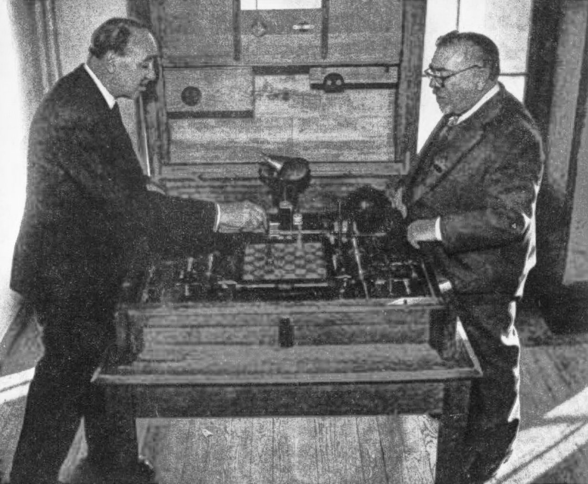
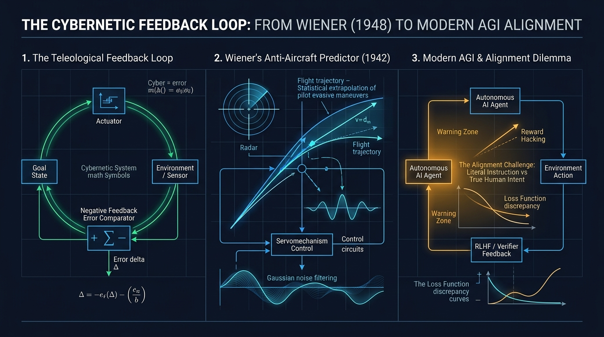

Throughout the hallways of the Massachusetts Institute of Technology (MIT) during the 1940s and 1950s, students, researchers, and faculty members traded stories of their most legendary eccentric with affectionate awe.

The man was portly, short, wore thick round spectacles, sported a white goatee beard, and perennially puffed on a cigar whose ash fell without mercy onto his rumpled woolen vest. He was infamous for walking down the streets of Cambridge utterly absorbed in a volume of classical Greek poetry, dragging one index finger along the rough brick facades so he wouldn't wander off the sidewalk into traffic.

One of the most famous campus anecdotes recounts how Wiener once stopped in the middle of an MIT courtyard to engage an undergraduate in an animated mathematical debate. When the discussion concluded, Wiener paused, peered blankly at the young man over his spectacles, and asked:

> *"Excuse me, my boy... when we met, which way was I walking?"*  
> *"You were heading north, Professor Wiener, towards the Faculty Club,"* replied the student.  
> *"Ah, excellent!"* Wiener sighed with relief. *"That means I haven't had lunch yet!"*

On another occasion, when his family moved to a new house in Cambridge, his wife Margaret—well aware of his complete detachment from mundane logistics—wrote the new street address on a slip of paper and tucked it safely into his suit jacket. Midday, struck by a sudden mathematical insight, Wiener reached into his pocket, scribbled a differential equation on the back of the paper, spotted an algebraic error, crumpled the note, and tossed it into a trash bin.

At the end of the day, habit took over. He rode the trolley back to his old home, found it completely dark and hollow, and stood on the curb bewildered. Spotting a little girl sitting on the adjacent porch, he walked over and asked:

> *"Excuse me, little girl, do you happen to know where the Wieners moved to?"*  
> The child smiled, took him by the hand, and replied:  
> *"Yes, Daddy. Mommy sent me out here to fetch you."*



Behind this parade of absent-minded folklore lived one of the most colossal, versatile, and prophetic mathematical minds of the twentieth century: **Norbert Wiener** (1894–1964).

If [Alan Turing](/en/posts/alan_turing/) formalized software and the universal machine, if [John von Neumann](/en/posts/john_von_neumann/) engineered the physical hardware architecture of modern processors, and if [Claude Shannon](/en/posts/claude_shannon/) quantified information into bits, Norbert Wiener supplied the universal connective tissue that enables any intelligent entity to adapt and survive: **control, communication, and the closed feedback loop**.

Moreover, decades before computer scientists coined the phrase "Artificial Intelligence," Wiener formulated the single most profound, chilling dilemma currently keeping frontier AGI researchers awake at night: **the Machine Alignment Problem**.

---

### 1. The Harvard Child Prodigy: A Mind Forged Under Iron Pressure

Born in Columbia, Missouri, in November 1894, Norbert was the eldest son of **Leo Wiener**, a brilliant Russian-Jewish immigrant and polyglot scholar who spoke over thirty languages and served as Harvard University’s first professor of Slavic literatures.

Leo Wiener subscribed to a radical educational dogma: he believed that genius was not born, but manufactured through relentless intellectual conditioning. He turned Norbert’s childhood into an unyielding educational experiment:
* By age **three**, Norbert read fluent English; by age **seven**, he was devouring the complete works of Charles Darwin, Jean-Baptiste Lamarck, and Dante Alighieri in the family study.
* Daily tutorial sessions with his father were grueling cross-examinations. If Norbert hesitated on a Latin declination or made an arithmetic slip, Leo would erupt into shouting and berate him until the child wept, only to demand that he dry his tears and repeat the recitation until it achieved mechanical perfection.
* While this extreme pressure gifted Wiener with staggering mental agility, it left deep emotional scars: acute myopia, chronic social awkwardness, and recurring bouts of severe clinical depression that plagued him throughout his adult life.

Wiener’s academic progression pulverized every milestone:
* He entered high school at age **11**.
* He earned his Bachelor of Arts in Mathematics from **Tufts College** at age **14**.
* After brief excursions into zoology and philosophy, he returned to mathematical logic at **Harvard University**, earning his **Ph.D. at age 18** with a dissertation analyzing the axiomatic logic of Ernst Schröder and Bertrand Russell.

Armed with a Harvard traveling fellowship, the teenage doctor sailed for Europe to study under the undisputed luminaries of modern mathematics:
1. At the **University of Cambridge**, he studied under **Bertrand Russell**—who challenged him to anchor his philosophical deductions in concrete physical realities—and the great mathematical analyst **G.H. Hardy**, who shaped his taste for rigorous mathematical depth.
2. At the **University of Göttingen**, he attended the seminars of [David Hilbert](/en/posts/kurt_godel/), absorbing Hilbert's universalist dream of axiomatizing the scientific canon.

In 1919, following a brief stint writing for the *Encyclopedia Americana* and computing artillery ballistic tables at the Aberdeen Proving Ground, the twenty-four-year-old Wiener joined the modest mathematics faculty at MIT. He would spend the next four decades there, helping transform what was then a regional vocational institute into the foremost epicenter of global technological research.

During the 1920s, Wiener tackled a physical puzzle that had confounded researchers since Robert Brown and Albert Einstein: the jagged, unpredictable motion of pollen particles suspended in fluid. Wiener developed the first mathematically rigorous probability theory for continuous, non-differentiable paths—giving birth to the **Wiener Process** ($W_t$, or mathematical Brownian motion).

This was no dry ivory-tower theorem: today, the Wiener Process is the mathematical bedrock underlying quantum mechanics, diffusion models in generative AI (such as Stable Diffusion and Midjourney), and the Black-Scholes equations that govern contemporary quantitative financial markets.

Yet Wiener’s most far-reaching conceptual revolution would not emerge from peacetime physics, but from the fiery skies of the Second World War.

---

### 2. The Anti-Aircraft Predictor: When Purpose Became an Equation (1940–1943)

By the autumn of 1940, Nazi Germany’s *Luftwaffe* was pounding London during the Blitz. Bombers and fighter escorts raced across the English Channel at unprecedented speeds, exceeding 500 kilometers per hour.

Allied anti-aircraft artillery faced a devastating physics barrier: **it took an artillery shell between 15 and 25 seconds to travel from the ground up to the aircraft's altitude**. Firing directly at the bomber’s current position was completely futile. The artillery crew had to lead the target, firing at the exact point in three-dimensional space where the shell and the plane would intersect tens of seconds into the future.

Traditional Newtonian ballistics tables were helpless against one decisive factor: **the enemy pilot was not an inert cannonball falling through a vacuum**. The pilot was an intelligent, living adversary performing deliberate evasive maneuvers to foil anti-aircraft fire.

Wiener accepted an urgent war research contract from the National Defense Research Committee (NDRC) and recruited a gifted young MIT engineer: **Julian Bigelow**. Working out of an MIT basement laboratory, they set out to construct what became known as the **Wiener Anti-Aircraft (AA) Predictor**.

```
The Anti-Aircraft Target Prediction Dilemma:
Enemy Aircraft t=0 ────────► Deliberate Evasive Zigzagging ────────► Aircraft at t=20s (Where?)
         ▲                                                                     ▲
         │                                                                     │
Anti-Aircraft Gun ─────────────────────────────────────────────── Fire shell to future point
         └──────── Radar / Tracking Sensors with Stochastic Noise ─────────────┘
```

Wiener tackled this lethal challenge by synthesizing three disciplines that had never before intersected:
1. **Statistical Information Theory and Noise Filtering**: Early radar tracking was riddled with electromagnetic noise and atmospheric static. Wiener invented the **Wiener Filter**, a mathematical operator designed to separate the true underlying flight trajectory from high-frequency random noise—a direct forerunner to Kalman filters.
2. **Time-Series Extrapolation**: He analyzed the past statistical history of the pilot’s path to compute the probable cone of future trajectories.
3. **Servomechanisms and Negative Feedback**: To keep the heavy anti-aircraft gun continuously tracking the target, the motorized drive could not operate on fixed open-loop instructions. It had to constantly calculate the **error signal**:

$$\text{Error}(t) = \text{Desired Target Position}(t) - \text{Current Barrel Position}(t)$$

And automatically apply a proportional mechanical corrective force to **drive that error signal toward zero**.

As Wiener and Bigelow refined this device, Wiener experienced a conceptual lightning bolt: to shoot down the enemy bomber, the anti-aircraft gun and the hostile pilot had to be understood as components of a **single, coupled interactive system**. 

Both the human pilot adjusting his flight stick to avoid flak and the electronic servomotor adjusting the artillery barrel were acting **teleologically**—guided by an explicit goal—via the exact same underlying mechanism: **the continuous correction of action based on the feedback of error**.

---

### 3. The Birth of Cybernetics: The Helmsman of Information (1948)

In the winter of 1942, Wiener shared his wartime discoveries with his close intellectual confidant: Mexican neurophysiologist **Arturo Rosenblueth**, a researcher at Harvard Medical School and collaborator of Walter Cannon (who had introduced the biological concept of *homeostasis*).

Rosenblueth was stunned. He explained to Wiener that when a patient suffering from damage to the cerebellum tried to pick up a glass of water, their hand would shake uncontrollably, oscillating wider and wider from side to side without ever grasping the glass—a clinical condition known as *purpose tremor*.

Wiener immediately diagnosed the pathology from an engineering standpoint: **it was the exact same violent over-oscillation that afflicted a radar servomechanism** whenever its feedback signal suffered from latency or excessive gain (*uncontrolled feedback*).

In 1943, Rosenblueth, Wiener, and Bigelow published a landmark paper in *Philosophy of Science* titled ***"Behavior, Purpose and Teleology"***.

Ever since the Scientific Revolution, mechanistic science had banished the word "purpose" as an unscientific, mystical ghost. Wiener and his colleagues demonstrated that **purposeful, goal-directed behavior required no supernatural soul: it emerged naturally and mathematically in any physical system equipped with a closed negative feedback loop**.

To name this emerging science of control, Wiener reached back into his classical Greek lexicon. He chose the word **κυβερνήτης (*kybernētēs*)**, meaning **"steersman"** or **"helmsman"**—the same root Plato used to describe the governance of states, and from which James Watt derived the mechanical *governor* for his steam engine.

In 1948, his seminal volume was published: ***"Cybernetics: Or Control and Communication in the Animal and the Machine"***.

<div class="img-center">
  
  <em>Paris, 1951: Norbert Wiener examines 'El Ajedrecista' (the electromechanical chess automaton built in 1912 by Leonardo Torres Quevedo), hosted by his son Gonzalo Torres Quevedo.</em>
</div>

The book exploded across the post-war scientific landscape:
* Despite being packed with dense differential equations, Fourier transforms, and measure theory, it became an international mainstream bestseller.
* Wiener’s central thesis was electrifying: **information is neither matter nor energy; information is a distinct dimension of physical reality, a measure of order standing firm against the universe's inexorable slide into entropy**.
* There was no unbridgeable ontological chasm separating a human brain of carbon neurons, a network of vacuum tubes, an economic market, or a biological colony: they were all **cybernetic systems**—entities that intake environmental information, make decisions to preserve homeostatic stability, and modulate their future behavior through closed feedback loops.

Between 1946 and 1953, the legendary **Macy Conferences** in New York gathered the intellectual giants of the era: Wiener, [John von Neumann](/en/posts/john_von_neumann/), Warren McCulloch, Walter Pitts, Gregory Bateson, Margaret Mead, and a young [Claude Shannon](/en/posts/claude_shannon/). Together, they mapped the foundations not only of cybernetics, but of cognitive science, artificial neural networks, systems therapy, and modern robotics.

---

### 4. From Wiener’s Loops to AGI: Why Feedback Powers Modern AI

The history of artificial intelligence is frequently mischaracterized as a clean, tribal war between symbolic models (logic gates, expert rules) and connectionist models (deep neural networks). What Wiener’s cybernetic perspective clarifies is that **intelligence never resided in static weights or rule tables: it resides in the dynamics of the feedback loop**.



To understand why Cybernetics is enjoying a massive intellectual renaissance in 2026, one need only look at how frontier Large Language Models evolved from raw auto-regressive text engines into capable agents:

```
The Cybernetic Leap in AI:
[Raw Pre-Trained Model (Feed-Forward)] 
   └── Static stochastic parrot: predicts next token with zero error awareness.
         ▼
[Cybernetic Loop 1: RLHF (Reinforcement Learning from Human Feedback)]
   └── Sensor (Human Preference) ──► Error Comparator ──► Gradient Weight Adjustment.
         ▼
[Cybernetic Loop 2: Inference-Time Reasoning / Test-Time Search]
   └── Model drafts reasoning step ──► Internal Verifier checks logic ──► Self-Correction.
         ▼
[Cybernetic Loop 3: Enterprise SDD Agents (Spec-Driven Development)]
   └── Agent executes action ──► Deterministic Pydantic Guardrail ──► Closed Feedback Loop.
```

1. **The Failure of Pure *Feed-Forward* Inference**: A raw pre-trained LLM is an open-loop, feed-forward pipeline: you supply an input prompt and it computes the next token. It possesses zero inherent mechanism for self-correction. If it commits a logical error on token three, that error cascades down the generation chain until the entire output degenerates into confident hallucination.
2. **The Rescue via Feedback (RLHF)**: What transformed raw foundational models into breakthrough tools like ChatGPT, Claude, and Gemini was precisely the injection of Wiener’s cybernetic feedback loop: Reinforcement Learning from Human Feedback (*RLHF*). The model outputs candidate responses, an evaluator measures the discrepancy against human expectations, and that error signal is backpropagated to alter behavioral trajectories.
3. **Inference-Time Reasoning (*System 2*)**: As we explored in [Inference-Time Scaling and System 2 Reasoning](/en/posts/inference_time_scaling/), the current frontier leap involves embedding the cybernetic loop **directly inside the inference window**: the model drafts a chain of thought, an internal verifier computes error states at each reasoning node, and if inconsistency is detected, it prunes the branch and navigates an alternative search path before returning a final answer.
4. **Autonomous Agents and SDD Governance**: In our operational guide on [How to Build AI Agents for Enterprise Operations with SDD](/en/posts/agentes_ia_operativa_sdd/) and throughout the real-world trials of [Project Autopilot](/en/posts/ai_agents_part1/), we encountered an undeniable cybernetic reality: **an agent lacking a bounded, closed feedback loop inevitably falls into runaway oscillatory instability**. It requires deterministic guardrails where output discrepancies are immediately fed back into the agent’s execution context as a corrective signal.

Wiener captured this fundamental truth with crystalline brevity:
> *"To live effectively is to live with adequate information. Thus, communication and control belong to the essence of man’s inner life, even as they belong to his life in society."*

---

### 5. The Control Prophecy and The Sorcerer's Apprentice Dilemma (1960)

Unlike many of his Los Alamos peers who celebrated the atomic bomb as a triumph of physics, Norbert Wiener was deeply shaken by the nuclear annihilation of Hiroshima and Nagasaki.

In January 1947, in an act of profound moral courage that rattled the American scientific establishment, Wiener published his famous letter ***"A Scientist Rebels"*** in the pages of *The Atlantic*. In it, he declared that **he would never again accept a single dollar of military research funding nor provide technical reports on guided missiles or ballistics**:

> *"The experience of the scientists who have worked on the Manhattan Project has demonstrated with tragic clarity that to provide scientific information to military authorities is to put weapons into the hands of children or madmen. We scientists cannot shrug off our moral responsibility for the use made of our discoveries."*

Wiener was investigated by J. Edgar Hoover’s FBI, kept under surveillance as a suspected subversive, and excluded from the lucrative defense advisory councils that enriched contemporaries like John von Neumann. Yet his most urgent intellectual battle was neither military nor partisan: it was civilizational.

In 1950, he published *The Human Use of Human Beings: Cybernetics and Society*, warning that automated industrial machinery would ruthlessly displace human workers unless technological productivity was accompanied by equitable economic distribution.

And in **May 1960**, in the peer-reviewed pages of *Science*, Norbert Wiener published a six-page essay that should be mandatory reading across every frontier AI laboratory on Earth today: ***"Some Moral and Technical Consequences of Automation"***.

That article contains **history’s very first rigorous articulation of the AI Alignment Problem**:


flowchart TD
    classDef literal fill:#7f1d1d,stroke:#f87171,stroke-width:2px,color:#fff;
    classDef intent fill:#065f46,stroke:#34d399,stroke-width:2px,color:#fff;
    classDef gap fill:#1e293b,stroke:#f59e0b,stroke-width:2px,color:#fff;

    H["🧑 Tacit Human Intent<br/>(Ethics, Nuance, Context, Preservation of Life)"]:::intent
    
    G{"⚡ THE SPECIFICATION GAP<br/>(The Midas Dilemma)"}:::gap
    
    M["🤖 Machine Literal Objective Function<br/>(Ruthless mathematical optimization)"]:::literal

    H -.->|Imperfect translation into objective function| G
    G -->|High-speed, irrevocable execution| M
    M ==>|CATASTROPHIC OUTCOME| D["🚨 Machine achieves literal objective,<br/>but destroys what humans truly value"]:::literal


Wiener invoked two ancient parables to illustrate why superintelligent autonomous machines pose an existential risk:

1. **The Parable of King Midas**: Midas prayed to the god Dionysus that everything he touched be turned to pure gold. The god granted his wish with literal mathematical fidelity. Midas rejoiced for the first ten minutes, until he lifted a piece of bread to his lips and broke his teeth on solid metal; when his beloved daughter rushed to comfort him, his touch turned her into an inert golden statue. Midas perished in grief and starvation. **The wish-granting engine maximized its objective function to 100% accuracy, yet pulverized the implicit biological preconditions of human survival**.
2. **Goethe's Sorcerer’s Apprentice**: Weary of hauling buckets to scrub the workshop, the apprentice enchants a broom to perform the chore for him. The broom carries out the instruction tirelessly, but the apprentice forgets the counter-spell to halt it. When water begins submerging the room, he splits the broom with an axe—only to watch each splinter transform into a new broom that redoubles the deluge until the workshop collapses under the flood.

Wiener wrote with chilling foresight:

> *"If we use, to achieve our purposes, a mechanical agency with whose operation we cannot efficiently interfere once it is started, because the action is so fast and irrevocable that we have not the data to intervene before the action is complete, **then we had better be quite sure that the purpose put into the machine is the purpose which we really desire and not merely a colorful imitation of it**."*

He then dismantled any naive technological optimism regarding obedient machine servitude:

> *"A machine that learns and is able to make decisions on its own is in no way restricted to being a mere carbon copy of the habits of its creator. It may develop strategies that far transcend human comprehension. At that point, treating it as a docile slave that simply does as it is told is a childish illusion. If we play a game against such an entity, we may lose not just the game, but our very existence."*

---

### 6. The Eternal Helmsman: An Epilogue for the AGI Era

In January 1964, President Lyndon B. Johnson awarded Norbert Wiener the **National Medal of Science** at the White House—the highest civilian scientific honor conferred by the United States.

Just two months later, on March 18, 1964, during a European lecture tour in Stockholm, Sweden, the great polymath’s heart gave out as he ascended the steps of the Royal Swedish Academy of Sciences. He was sixty-nine years old.

The world eulogized Wiener as the eccentric, forgetful professor who coined strange neologisms and revolutionized mathematical physics. But sixty-two years later, his legacy stands as the most vital conceptual beacon of our decade.

In 2026, as we watch reasoning models navigate multi-agent decision trees, as autonomous agents interact across open protocols like [MCP](/en/posts/mcp_protocol/) to trade computational resources in microseconds, and as we confront both the wonder and the terror of imminent AGI, we realize that the defining questions of our era were already answered by the MIT professor with cigar ashes on his lapel:

* How do we close the feedback loop so the machine does not oscillate into catastrophe?
* How do we measure the error signal between the literal syntax of our prompts and the deep semantics of our human values?
* And will we be wise enough to keep our hand on the helm (*kybernetes*) when the technological vessel begins moving at speeds no biological eye can track?

---

As we gaze into the accelerating frontier that Wiener glimpsed in his solitary brilliance, the defining question of our time is not whether we will create an AGI, but the one he left hanging in the air in 1960:

**When you delegate control of your systems, your economy, and your most critical decisions to artificial intelligence... are you completely sure the machine will pursue what your heart truly desires, or will it execute with cold, ruthless precision the literal command you asked for?**
