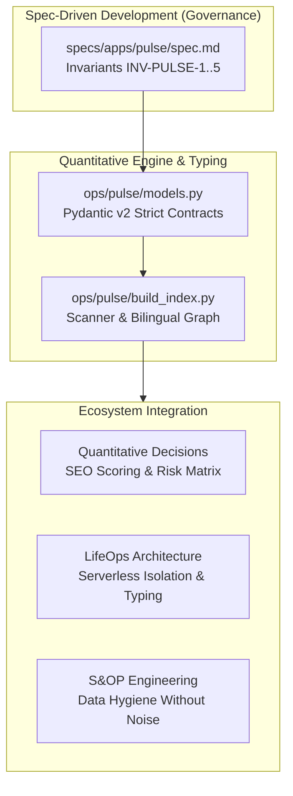
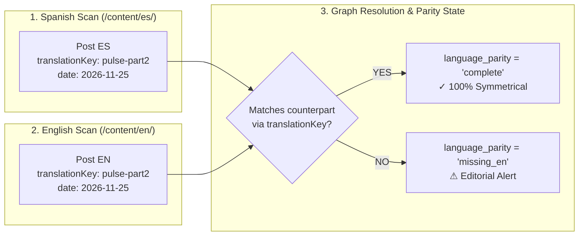

In the [first article of this series](/en/posts/pulse-part1-goodbye-notion-content-ops/), we exposed the fundamental Achilles' heel of technical content management: the inevitable drift between Git repositories and external databases like Notion or Airtable. We defined the **Content Ops as Code** philosophy, rooted in treating technical articles and their taxonomy exactly like version-controlled application source code.

However, adopting Git as the Single Source of Truth (SSOT) immediately presents a major software engineering dilemma: **Markdown files with YAML front matter lack a type-checking compiler**.

A simple typo in a dictionary key (`category` instead of `categories`), a publication date stored as free-form unparsed text (`"25-11-2026"` rather than ISO `2026-11-25`), or a tag provided as a raw string instead of a structured list triggers silent rendering failures in modern static site generators such as Hugo, Astro, or Next.js. Worse yet: when managing a bilingual engineering publication across English and Spanish, manually verifying that every translation maintains exact pairing, canonical links, and technical freshness quickly degenerates into an unmanageable bureaucratic maze.

In this article, we break down the internal engineering behind **Datalaria Pulse**: how we model robust data contracts using **Pydantic v2**, how we resolve linguistic parity with a deterministic bipartite graph, and how we integrate strict validation into **GitHub Actions** under an unbreakable rule: if a single metadata field is inconsistent, the pipeline aborts in a closed state (*Fail-Closed*).

---

## 0. Phase Objectives and Article Scope: Transitioning from Text Chaos to Data Contracts

The central objective of **Phase 5 at Datalaria** is to replace manual administrative toil with a deterministic architecture that indexes, validates, and governs technical content assets with zero runtime latency.

### Phase 5 Strategic Objectives:
1. **Immutable Data Contracts:** Establish a formal Python schema that validates editorial metadata before any production deployment.
2. **Automated Bilingual Parity (ES ⇔ EN):** Eliminate orphaned articles and ensure that every update to a Spanish post immediately flags its translation status in English.
3. **Continuous Integration Pipeline (CI/CD):** Execute automated unit and integration tests verifying security invariants (`INV-PULSE-1..5`) on every `git push`.
4. **Dual-Mode Delivery:** Power both the downloadable **Datalaria Pulse Kit** (featuring a standalone Python CLI scanner and Power Query connector) and the **Pulse Pro Cloud** version synced to Supabase PostgreSQL.

### Specific Objectives for this Article 2:
- Design the canonical `ContentAsset` entity in Pydantic v2 and examine the architectural advantages over plain dictionaries and Pydantic v1.
- Implement the two critical security invariants: private asset isolation (`INV-PULSE-1`) and base-100 analytics relativization (`INV-PULSE-2`).
- Explain the deterministic bipartite graph matching algorithm that pairs over 135 assets using `translationKey` and taxonomy mapping.
- Configure the GitHub Actions workflow that detects broken references, computes SEO scores (0 to 100), and outputs the verified `public.json` dataset consumed by the web UI.

---

## 1. Connecting with the Datalaria Ecosystem: Invariants and Spec-Driven Development

Datalaria Pulse applies the same mathematical rigor, interface contracts, and formal governance developed throughout our previous engineering suites and applications:



1. **The Contract Philosophy of [LifeOps](/en/apps/lifeops/):** In our LifeOps backend, we demonstrated that database persistence must be guarded by strict server-side validation to prevent corrupted states. Pulse applies this principle to the file system: Markdown files represent our persistent database, and Pydantic acts as our Object-Document Mapper (ODM).
2. **Objective Evaluation in the [Executive Decision Suite](/en/posts/executive-decision-packs-quantitative-framework/):** Rather than evaluating article quality through subjective opinions, Pulse implements a quantitative SEO scoring algorithm (0 to 100) auditing deterministic criteria: optimal title length, meta description presence, word count thresholds, and full linguistic parity.
3. **Data Hygiene in [S&OP Engineering](/en/posts/sop_engineering-data-hygiene/):** Just as supply chain forecasting filters out ERP transactional noise before training demand models, our Python scanner strips source code blocks, Hugo shortcodes (`app-ref`, `mermaid`), and raw HTML to compute true **lexical depth** and technical reading time.
4. **Deterministic Validation under [Spec-Driven Development (SDD)](/en/posts/sdd_vs_vibe_coding/):** In compliance with Datalaria's technical constitution, no content asset is merged into production without passing automated `pytest` test suites. Development is guided not by intuition (*vibe coding*), but by auditable specifications.

---

## 2. The Fragility of Raw Front Matter: Why Plain Markdown Fails as a Database

YAML front matter atop Markdown files (`index.md`) is convenient for individual writing, but exceptionally fragile as repository scale expands:

```yaml
---
# Example of front matter vulnerable to silent failure
title: "Data Architecture with Pydantic"
date: "2026/11/25"           # Non-ISO format: static generator parses text rather than date
category: "Engineering"      # Singular instead of plural: breaks taxonomy filtering
tags: "python, pydantic"     # String instead of list: breaks tag pill rendering
draft: False                 # Non-standard YAML capitalization: unpredictable parser behavior
image: "cover.png"           # Does cover.png actually exist in this directory?
---
```

When a static generator processes thousands of content lines without schema validation:
- Missing mandatory properties cause template engines to inject `nil` or render empty tags without raising explicit console errors.
- Unmatched multilingual files with identical slugs but missing translation keys produce routing collisions or break the language toggle in the navbar.
- Authors updating files locally may forget to attach a cover image, surfacing only as broken thumbnail links (`404 Not Found`) in production.

To eradicate this risk, we enforce a strict **Fail-Closed** design: any schema inconsistency immediately aborts local builds and GitHub Actions CI pipelines, preventing malformed assets from ever reaching deployment.

---

## 3. Modeling Data Contracts with Pydantic v2 (`ops/pulse/models.py`)

Pydantic v2, rebuilt from the ground up on its compiled Rust core (*pydantic-core*), delivers the computational performance needed to parse, validate, and compute metrics across hundreds of Markdown assets in fractions of a second.

We define a strict type hierarchy where every editorial entity (whether a Technical Post, an Interactive App, or a Downloadable Kit) is validated against the unified `ContentAsset` model:

```python
# ops/pulse/models.py (Simplified Canonical Extract)
from datetime import date, datetime
from typing import List, Literal, Optional, Dict, Any
from pydantic import BaseModel, Field

AssetType = Literal["post", "app", "kit", "suite", "mega_bundle"]
AssetStatus = Literal["idea", "draft", "review", "scheduled", "published", "available", "coming"]
VisibilityType = Literal["public", "private"]
LanguageParity = Literal["complete", "missing_en", "missing_es", "outdated_en", "outdated_es"]

class ContentAsset(BaseModel):
    id: str = Field(description="Unique identifier: translationKey or app slug")
    slug: str = Field(description="Base URL slug")
    asset_type: AssetType
    status: AssetStatus
    visibility: VisibilityType = "public"

    # Bilingual metadata consolidated into a single entity
    title_es: Optional[str] = None
    title_en: Optional[str] = None
    url_es: Optional[str] = None
    url_en: Optional[str] = None
    brief_es: Optional[str] = None
    brief_en: Optional[str] = None

    # Lifecycle and auditing
    publish_date: Optional[date] = None
    last_modified_es: Optional[datetime] = None
    last_modified_en: Optional[datetime] = None
    language_parity: LanguageParity = "complete"
    
    # Taxonomy and volume metrics
    category: str = "General"
    categories: List[str] = Field(default_factory=list)
    tags: List[str] = Field(default_factory=list)
    word_count_es: int = 0
    word_count_en: int = 0
    reading_time_min: int = 0

    def to_public_dict(self) -> Dict[str, Any]:
        """
        Enforces INV-PULSE-1 (rejection of private assets)
        and INV-PULSE-2 (strict stripping of absolute metrics).
        """
        if self.visibility == "private":
            raise ValueError(f"INV-PULSE-1 Violation: Attempted to export private asset {self.id}")

        return self.model_dump(
            exclude={"metrics_absolute"},
            mode="json"
        )
```

### The Two Constitutional Security Invariants:
1. **`INV-PULSE-1` (Privacy Isolation):** Assets flagged as internal drafts or private research (`visibility: private`) must never leak into the static `public.json` distribution. If the scanner detects a private item in the public payload, it throws a fatal exception and halts execution.
2. **`INV-PULSE-2` (Metrics Relativization):** Absolute Google Analytics 4 numbers (raw page views, active users, commercial sales conversions) remain strictly inside the author's private tracker. In the public dataset consumed by web visitors, metrics are mathematically normalized into a **Relative Base-100 Index** benchmarked against median performance and rank percentiles (`rank_pct`).

---

## 4. The Bipartite Graph of Bilingual ES ⇔ EN Parity

Sustaining bilingual symmetry across dozens of complex engineering posts requires treating content as a bipartite graph where each Spanish node (`content/es/posts/<slug>`) maps directly to its English counterpart (`content/en/posts/<slug>`).

Our `ops/pulse/build_index.py` engine resolves this pairing through a three-stage matching algorithm:



### Parity State Classifications:
- **`complete`:** Both files exist, share an identical `translationKey`, contain translated titles/descriptions, and exhibit modification timestamps differing by fewer than 15 days.
- **`missing_en` / `missing_es`:** An asset is published in one language, but completely missing from the target counterpart directory.
- **`outdated_en` / `outdated_es`:** Both files exist, but the Spanish original has received significant Git revisions (recent commits modifying over 100 words) that have not yet been synchronized into the English version.

This classification powers the **Bilingual Parity Card** in the Datalaria Pulse cockpit (currently standing at `137 / 137 assets, 100% parity`), alerting the team if a draft threatens international consistency.

---

## 5. Deterministic Compilation in GitHub Actions (`.github/workflows/pulse_ci.yml`)

To enforce these invariants without relying on manual diligence, we encapsulate the entire compilation workflow inside a GitHub Actions pipeline triggered on every `push` to `main` and on all Pull Requests:

```yaml
# .github/workflows/pulse_ci.yml
name: Datalaria Pulse - Content Ops as Code Pipeline

on:
  push:
    branches: [ main ]
    paths:
      - 'content/**'
      - 'data/**'
      - 'ops/pulse/**'
  pull_request:
    branches: [ main ]

jobs:
  validate-and-build:
    name: Validate Schemas, Parity & Hugo Build
    runs-on: ubuntu-latest

    steps:
      - name: Checkout Repository with Full Git History
        uses: actions/checkout@v4
        with:
          fetch-depth: 0 # Required for lastmod timestamps and commit logs

      - name: Setup Python 3.13 Environment
        uses: actions/setup-python@v5
        with:
          python-version: '3.13'
          cache: 'pip'

      - name: Install Pulse Engine Dependencies
        run: |
          pip install pydantic pyyaml pytest openpyxl

      - name: Run Indexer and Pydantic Schema Validation
        run: |
          python -m ops.pulse.build_index
          python -m ops.pulse.publish_public

      - name: Execute Security and Invariant Pytest Suite
        run: |
          python -m pytest ops/pulse/tests/ -v

      - name: Setup and Install Hugo Extended
        uses: peaceiris/actions-hugo@v3
        with:
          hugo-version: '0.148.2'
          extended: true

      - name: Strict Production Hugo Build
        run: |
          hugo --gc --minify
```

### Guarantees Enforced by this Pipeline:
1. **Pre-Production Failure:** If an author omits a mandatory front matter field, Pydantic raises a `ValidationError` specifying the file path and property, halting the deployment immediately.
2. **Cross-Reference Invariant:** If a post refers to an application that does not exist in `data/apps/` or vice versa, Hugo terminates with a non-zero exit code.
3. **Deterministic `public.json` Artifacts:** Datalaria Pulse always serves fresh, validated JSON data generated during the build step, eliminating reliance on manual external database syncing.

---

## 6. Key Takeaways and Next Steps

By replacing unvalidated front matter with a formal **Pydantic v2 + Git + GitHub Actions** pipeline, we achieve three critical operational benefits:
- **Zero Administrative Toil:** Technical authors focus 100% on writing and programming. Indexing, lexical auditing, and parity scoring happen automatically with every commit.
- **Fail-Closed Governance:** Invariants `INV-PULSE-1` and `INV-PULSE-2` guarantee that confidential traffic numbers and draft notes never leak into production.
- **Reusable Architecture:** The exact Python indexing engine powering Datalaria is bundled inside the commercial **Datalaria Pulse Kit**, allowing any engineering team or technical blogger to deploy it into their own static repo in minutes.

### Experience the Live Engine and Get the Kit:
- Explore the live indexed catalog and metrics directly in our [**Interactive Datalaria Pulse Cockpit**](/apps/pulse/).
- To automate your own static blog, migrate from Notion in 5 minutes, and acquire the complete Excel master tracker, get the [**Datalaria Pulse Kit**](/en/resources/#pack-pulse).

---

> **Coming Up in Part 3/5:**  
> *Executive Table, Kanban Board, and Monthly Calendar in React 19: Projecting a high-performance interactive web UI over a zero-latency static index.*
