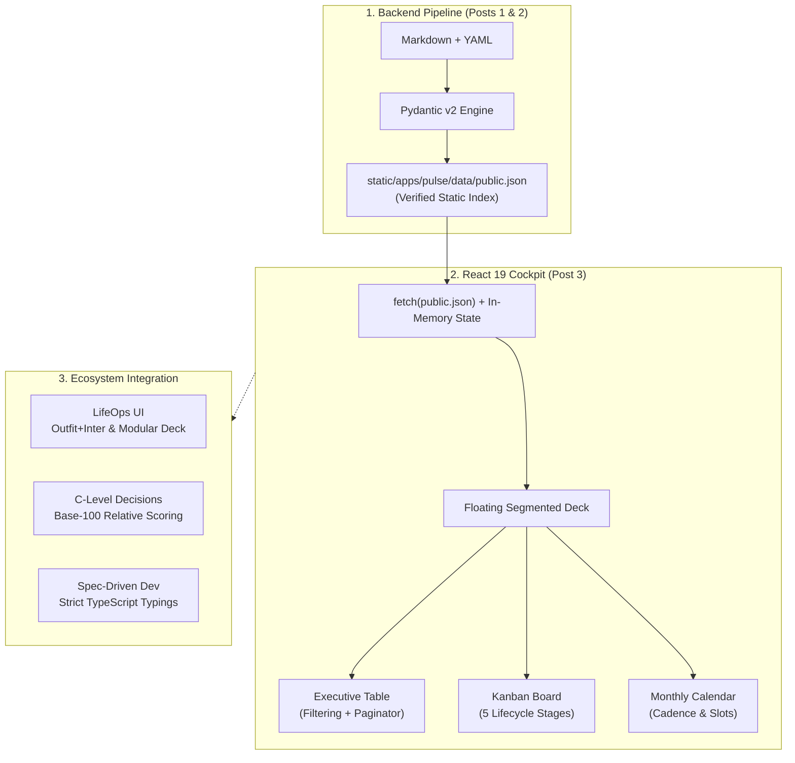
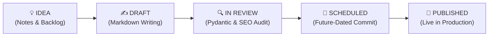

In the first two articles of this series, we demonstrated how to eliminate synchronization drift between external databases and Git ([Article 1](/en/posts/pulse-part1-goodbye-notion-content-ops/)) and how to bulletproof metadata quality and bilingual parity through strict Pydantic v2 data contracts and CI/CD pipelines ([Article 2](/en/posts/pulse-part2-pydantic-indexer-bilingual-parity-ci/)).

At the conclusion of that backend pipeline, we produce an exceptional data asset: `public.json`, a normalized, deterministic, and fully audited dataset consolidating 100% of the ecosystem's technical articles, interactive applications, and downloadable product suites.

However, structured data on disk remains inaccessible if technical editors and engineering leaders must inspect it by reading raw code or running CLI commands. Making strategic publication decisions demands a **high-level executive cockpit**: an operations center capable of filtering by taxonomy, identifying workflow bottlenecks in a Kanban pipeline, scheduling future releases on a monthly calendar, and capturing spontaneous ideas on the fly.

In this article, we break down the frontend engineering behind **Datalaria Pulse**: how we architected a Single Page Application (SPA) in **React 19 + TypeScript** that mounts directly over a static index, delivering instantaneous interactivity with **zero network latency** without server overhead or sluggish database queries.

---

## 0. Phase Objectives and Article Scope: Instant Interactivity over Static Data

The core objective of this stage in **Phase 5 at Datalaria** is to democratize access to the editorial catalog through a fluid, modern, and reactive user experience (UX).

### Phase 5 Strategic Objectives:
1. **Zero-Latency Data Consumption:** Eliminate traditional relational database roundtrips in the public interface by serving an immutable, CDN-cached static dataset (`public.json`).
2. **Multi-View Content Projection:** Present the single source of truth (SSOT) through three complementary perspectives: **Executive Table** (analytical auditing), **Kanban Board** (lifecycle stages), and **Monthly Calendar** (release cadence).
3. **Decoupled Optimistic Capture:** Enable authors to draft ideas and notes locally with instant browser persistence (`localStorage`), offering one-click YAML export for subsequent Git commits.
4. **Foundation for Pro Mode:** Design modular components capable of switching seamlessly between the static public dataset and real-time collaborative synchronization via Supabase PostgreSQL.

### Specific Objectives for this Article 3:
- Explain the *Static-First SPA* architectural pattern: how React 19 parses and filters hundreds of assets in client memory with zero network lag.
- Detail the engineering behind the **Executive Table**: predictive search, combined multi-taxonomy filters, and flexible pagination (10, 25, 50 rows).
- Analyze the mechanics of the **5-Stage Kanban Board** (*Idea*, *Draft*, *In Review*, *Scheduled*, *Published*) and its state transitions.
- Present the **Editorial Calendar Grid** and the local idea capture workflow with atomic Git backlog export.

---

## 1. Connecting with the Datalaria Ecosystem: From Executive Suites to the React 19 Cockpit

The interface design of Datalaria Pulse directly inherits the ergonomics, boardroom aesthetic, and quantitative rigor established in our earlier suites:



1. **The Visual Ergonomics of [LifeOps](/en/apps/lifeops/):** Pulse adopts the *Outfit + Inter* corporate typography, deep dark slate styling (`#080d1a` to `#0f172a`), neon cyan/emerald atmospheric accents, and the floating segmented navigation deck originally developed for our LifeOps platform.
2. **C-Level Executive Presentation from the [Decision Suite](/en/posts/executive-decision-packs-quantitative-framework/):** The Pulse navbar follows executive boardroom standards: 4 Macro KPIs highlighted by neon top borders (`Total Assets`, `Published`, `Scheduled`, and `Bilingual Parity`), complemented by contextual operational metrics (indexed words, estimated content equity, and top organic traffic driver).
3. **Triple Taxonomy from [S&OP Engineering](/en/posts/sop_engineering-data-hygiene/):** Just as supply chain planners segment inventory by family and channel, Pulse incorporates a dynamic 3-level taxonomy selector: macro ecosystem tiers (Articles vs Apps vs Kits), official 4-pillar blog themes, and granular category breakdowns.
4. **End-to-End Type Safety under [Spec-Driven Development (SDD)](/en/posts/sdd_vs_vibe_coding/):** TypeScript interfaces in React 19 mirror the exact Pydantic v2 contracts specified in `specs/apps/pulse/spec.md`. There is zero divergence in field naming, optionality, or default structures.

---

## 2. Frontend Architecture: React 19, TypeScript, and Zero-Latency State

Most content management tools make the architectural mistake of tightly coupling their web UI to a dynamic REST or GraphQL API backed by a remote database. Under that traditional paradigm, every time a user opens a Kanban board, the client executes heavy database queries (`SELECT * FROM posts JOIN categories...`), displays loading spinners, and introduces 200 to 800 ms of latency.

In Datalaria Pulse, we invert this model using the **Static-First** paradigm:

```typescript
// apps/pulse/web/src/App.tsx (Data Loading Lifecycle Extract)
interface PublicPulseDataset {
  version: string;
  generated_at: string;
  total_assets: number;
  published_assets: number;
  scheduled_assets: number;
  parity_summary: Record<string, number>;
  assets: ContentAsset[];
}

export function App() {
  const [dataset, setDataset] = useState<PublicPulseDataset | null>(null);
  const [loading, setLoading] = useState(true);
  const [activeTab, setActiveTab] = useState<'analytics' | 'table' | 'kanban' | 'calendar' | 'health'>('analytics');

  useEffect(() => {
    // Atomic fetch of precompiled static build index
    fetch('./data/public.json', { cache: 'no-cache' })
      .then(res => res.json())
      .then((data: PublicPulseDataset) => {
        setDataset(data);
        setLoading(false);
      })
      .catch(err => console.error("Error loading editorial dataset:", err));
  }, []);
  
  // ...
}
```

### Why This Architecture Outperforms Traditional Web Databases:
- **0 ms Navigation Latency:** Once the lightweight `public.json` bundle (~60 KB gzipped) is loaded into browser memory, all search queries, column sorting, tag filtering, and view transitions execute in **under 1 millisecond**.
- **Zero Server Costs:** The application requires no Node.js servers, Docker containers, or edge workers. Both frontend code and dataset assets are delivered entirely through static CDN edge nodes.
- **Outage Resilience:** Even if external analytics APIs or database services experience downtime, the Datalaria Pulse cockpit functions without degradation because its data is immutably version-controlled inside the Git commit.

---

## 3. View 1: The Multi-Criteria Executive Table

The **Executive Table** serves as the primary instrument for deep catalog auditing. When an organization manages over 100 technical articles, editorial leaders must answer complex questions in seconds: *which articles score below 70 in SEO audit?*, *which long-form guides exceed 3,000 words but lack English translations?*, *which asset leads organic search traffic?*.

```
┌─────────────────────────────────────────────────────────────────────────────────────────────┐
│ 🔍 Search by title, tag, or slug...    [All Asset Types ▼]       [All Statuses ▼]          │
├─────────────────────────────────────────────────────────────────────────────────────────────┤
│ ASSET / TITLE               TYPE   STATUS      PUB DATE     WORDS      PARITY    SEO SCORE  │
│ Porter's Five Forces...     POST   PUBLISHED   2026-10-19   4,218 w.   complete   60 / 100  │
│ Quantitative SWOT & CAME... POST   PUBLISHED   2026-10-13   4,867 w.   complete   60 / 100  │
│ Dynamic BCG Matrix...       POST   PUBLISHED   2026-10-26   3,920 w.   complete  100 / 100  │
└─────────────────────────────────────────────────────────────────────────────────────────────┘
```

### Key Engineering Features:
1. **Multi-Criteria Filtering:** The control bar enables simultaneous filtering by predictive text (fuzzy matches across titles, slugs, and tags), asset class (`post`, `app`, `kit`, `suite`), and editorial state (`published`, `scheduled`, `draft`, `idea`).
2. **Bi-Directional Sorting:** Clicking any header instantly reorders the catalog alphabetically, chronologically, by word count, or by relative traffic index.
3. **Adaptive Pagination:** A responsive density switcher supports 10, 25, 50, or 100 records per page, ensuring smooth DOM rendering across all devices.
4. **High-Contrast Parity Badges:** Clear chromatic indicators immediately highlight whether an asset maintains complete bilingual symmetry (`complete` in emerald green) or flags pending translations (`missing_en` in rose pink).

---

## 4. View 2: The 5-Stage Editorial Kanban Board

While the table specializes in analytical auditing, the **Kanban Board** manages the day-to-day workflow of technical writing and peer review. We structure the editorial lifecycle into 5 immutable stages:



### Card Architecture in the Kanban Grid:
Each card in the board functions as an autonomous component displaying:
- **Asset Type and Timestamp:** Category badge (`POST`, `APP`, `KIT`) and target release date.
- **Full Title & Link:** Direct link to inspect the asset in localhost or live production.
- **Taxonomy Pillar:** Official content category assignment (*Business Strategy*, *Software Engineering*, *Data Science*, *Quantitative Decisions*).
- **Quality Score:** SEO Score badge (0 to 100) color-coded via a traffic light system (green $\ge 80$, amber $\ge 60$, red $< 60$).

With 138 assets distributed across these 5 stages, engineering managers instantly identify review bottlenecks or verify whether upcoming scheduled releases satisfy weekly publishing quotas.

---

## 5. View 3: The Monthly Calendar and Rapid Idea Capture

An editorial calendar is not merely a list of dates; it is an instrument of strategic rhythm. The **Monthly Calendar** view in Datalaria Pulse projects upcoming releases on an interactive chronological timeline:

```
┌────────────────────────────────────────────────────────────────────────────────────────┐
│ 📅 Editorial Calendar — Chronological Release Planning                                │
├────────────────────────────────────────────────────────────────────────────────────────┤
│ 2026-11-18   Goodbye Notion: Datalaria Pulse and Editorial Ops from Git      [POST]     │
│ 2026-11-25   From Front Matter to Index: Pydantic v2 & GitHub Actions        [POST]     │
│ 2026-12-02   Executive Table, Kanban Board, and Monthly Calendar in React 19 [POST]     │
│ 2026-12-09   Automated GA4 and Search Console to Measure Organic ROI         [POST]     │
│ 2026-12-16   Datalaria Pulse Pro: Cloud Sync and Team Collaboration           [POST]     │
└────────────────────────────────────────────────────────────────────────────────────────┘
```

### Rapid Idea Capture with Local Persistence:
To maintain creative flow while authors research or code, we engineered the **`+ New Idea`** modal:
1. **Quick-Entry Modal:** Enables technical writers to record working titles, assign categories, tag relevant technologies, and write briefing notes.
2. **Optimistic In-Memory Merging:** Saving an idea writes it instantly to browser `localStorage` and optimistically merges it with the in-memory `public.json` array, updating the *Idea* Kanban column and top-level KPIs in zero milliseconds.
3. **Atomic Git Export (`YAML`):** The top navbar includes a dedicated **`YAML (N)`** button that formats all local ideas into valid YAML ready to commit directly into `data/editorial/backlog.yaml`. This bridges the web interface into Git without manual data entry.

---

## 6. Key Takeaways and Next Steps

Implementing this React 19 frontend proves that speed and visual sophistication do not require abandoning the simplicity of static architectures:
- **Instantaneous UX:** Search, filtering, and Kanban view shifts operate in sub-millisecond speeds over an in-memory dataset.
- **Complete Lifecycle Governance:** From the first captured idea to production SEO audits, every editorial stage is visible in a unified dashboard.
- **Foundation for Scale:** This identical frontend architecture powers the real-time cloud synchronization of **Pulse Pro** when teams connect their Supabase accounts.

### Experience the Cockpit and Get the Kit:
- Switch between the Executive Table, Kanban Board, and Calendar directly in our live [**Datalaria Pulse Cockpit**](/apps/pulse/).
- Get the master Excel tracker, Notion migration scripts, and automation suite in the [**Datalaria Pulse Kit**](/en/resources/#pack-pulse).

---

> **Coming Up in Part 4/5:**  
> *Automated Google Analytics 4 and Search Console: Measuring real organic ROI, content equity, and freshness scoring without exposing private metrics.*
