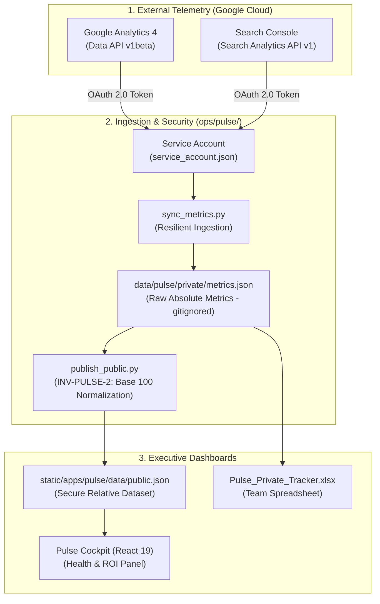

One of the most persistent blind spots in managing engineering blogs, technical documentation hubs, and developer marketing platforms is the **chronic disconnect between content repositories and web analytics platforms**.

On one side, engineers and technical writers craft documentation in Markdown, version-control every paragraph in Git, and deploy via automated CI/CD pipelines. On the other side, organic performance telemetry remains trapped inside third-party web consoles: bloated **Google Analytics 4** dashboards plagued by sampling thresholds and complex drill-downs, or **Google Search Console** reports that are seldom inspected until an algorithm update triggers an unexpected drop in search impressions.

The inevitable consequence is a total absence of quantitative feedback. Which technical guides attract qualified executive audiences yet lack a conversion trigger? Which architectural tutorials are older than 180 days and suffering from progressive decay in search relevance? Which deeply researched posts achieve outstanding SEO hygiene but remain buried due to insufficient internal link architecture?

In this fourth installment of the **Datalaria Pulse** series, we tackle the analytical dimension of the *Content Ops as Code* paradigm: how we connect to the official **GA4 Data API** and **Google Search Console v1** via a headless **Google Cloud Service Account** in Python, how we resolve the tension between analytical transparency and commercial secrecy through the **Principio of Mathematical Relativization**, and how we project a **Health & Content ROI** cockpit that values technical assets and prioritizes maintenance workflows.

---

## 0. Phase and Article Objectives: Moving from Vanity Metrics to Deterministic Content Return

This article forms part of the final stretch of **Datalaria Phase 5**, dedicated to equipping engineering and editorial teams with an autonomous, reproducible, and business-driven content operating system.

### Strategic Phase 5 Objectives:
1. **Eliminate Manual Analytics Reporting:** Automate periodic organic performance extraction within unattended GitHub Actions CI/CD workflows.
2. **Guarantee Strategic Privacy (`INV-PULSE-2`):** Ensure that no absolute figures for visits, active users, or revenue are ever exposed in the public frontend dataset.
3. **Optimize Publishing Cadence and Asset Freshness:** Objectively distinguish assets requiring urgent technical refreshes from evergreen traffic generators.
4. **Power the Dual-Mode Ecosystem:** Supply normalized relative telemetry to both the public interactive Web App sandbox and the private **Datalaria Pulse Kit** master spreadsheet in Microsoft Excel.

### Specific Objectives for this Article 4:
- Detail the unattended authentication architecture using a **Google Cloud Service Account** with strict read-only permissions for GA4 and Search Console.
- Build the resilient Python extraction engine (`ops/pulse/sync_metrics.py`) with *graceful degradation* fallback for offline local runs and isolated test runners.
- Formalize the mathematical **Relativization Model (Base 100 Index and Percentile Rank)** implemented in `ops/pulse/publish_public.py`.
- Deploy the **4-Quadrant Decision Matrix** (*Hidden SEO Gems*, *Organic Traffic Engines*, *Refresh Candidates*, and *Monetization Gaps*) within the Pulse Cockpit.
- Quantify accumulated **Content Equity Value** by valuing indexed technical word counts at institutional replacement cost.

---

## 1. Connecting with the Datalaria Ecosystem: Quantitative Rigor and Content Supply Chain

Analytics automation within Datalaria Pulse is not an isolated utility: it builds upon the exact quantitative principles, operational frameworks, and decision-making disciplines established throughout our platform:



### Strategic Connections with Sister Frameworks:
- **[S&OP Engineering and Data Hygiene](/en/posts/sop_ingenieria-higiene-datos/):** Just as slow-moving physical inventory ties up operational working capital in manufacturing, obsolete technical documentation erodes domain authority and brand credibility. Telemetry-driven freshness monitoring applies *inventory turnover principles* directly to digital content assets.
- **[Rational Decision-Making & Prioritization Frameworks](/en/posts/decision-making-prioritization-quantitative-framework/):** The 4-quadrant opportunity matrix replaces subjective editorial planning with deterministic multicriteria evaluation: instead of guessing what to draft next week, engineering resources are dynamically allocated to high-leverage content assets.
- **[Capital Budgeting & Business Case DCF/NPV Analysis](/en/posts/financial-business-case-npv-irr/):** Evaluating content return requires treating in-depth technical authoring as a capital asset (*CapEx* of engineering hours) and monitoring its long-term residual equity.
- **[Spec-Driven Development (SDD)](/en/posts/sdd_vs_vibe_coding/):** Confidentiality constraints are enforced as formal architectural invariants (`INV-PULSE-1` and `INV-PULSE-2`), verified by automated pytest test suites prior to every deployment.

---

## 2. Unattended Telemetry Ingestion: GA4 Data API and Search Console via Service Account

To eliminate tedious manual CSV exports and circumvent pricey third-party connectors, we engineered `ops/pulse/sync_metrics.py`. This script runs headlessly across developer machines and automated **GitHub Actions** CI/CD runners.

### 2.1 Unattended Authentication via Service Account
Rather than relying on interactive user-facing OAuth consent flows (which require browser prompts and manual token refreshes), we configure a Google Cloud Service Account with minimal read-only scopes:
- `Google Analytics Data API`: *Viewer* role assigned to the target GA4 Property (`GA4_PROPERTY_ID`).
- `Google Search Console API`: Read-only access assigned to the verified site domain (`sc-domain:datalaria.com`).

The credential keyfile (`service_account.json`) is rigorously excluded from Git tracking via `.gitignore` and injected securely as an encrypted secret (`GCP_SA_KEY`) during automated CI pipeline execution.

### 2.2 Canonical Path Normalization
A critical hurdle in programmatic analytics ingestion is URL fragmentation: analytics platforms record identical pages with trailing slashes (`/en/posts/my-post/`), without trailing slashes (`/en/posts/my-post`), with tracking parameters (`?utm_medium=social`), or with inconsistent casing.

The Python extraction engine sanitizes and normalizes every request before aggregation:

```python
def normalize_canonical_path(raw_path: str) -> str:
    """Normalizes raw web paths from GA4 and GSC to the canonical repository path."""
    path = raw_path.split("?")[0].split("#")[0].strip().lower()
    if not path.startswith("/"):
        path = "/" + path
    if not path.endswith("/"):
        path += "/"
    return path
```

### 2.3 The Graceful Degradation Pattern: Offline and CI Resilience
Under Spec-Driven Development, **a site build or automated test runner must never fail due to external network latency or missing third-party credentials**.

When a collaborator clones the repository locally or runs unit tests in an isolated Docker container, the script detects the absence of `service_account.json` and activates graceful degradation:

```python
if not CREDENTIALS_FILE.exists():
    print(f"[WARN] No service_account.json found. Skipping remote Google API calls.")
    # Reuses existing cached snapshot or generates a neutral test baseline
    return load_or_generate_fallback_metrics()
```

Thanks to this fail-safe architecture, Hugo compilation and frontend builds remain 100% deterministic and decoupled from third-party uptime.

---

## 3. The Relativization Principle: Strict Invariant `INV-PULSE-2` Compliance

Most analytics platforms fall into one of two extremes: either they wall off all data behind rigid authentication paywalls, or they recklessly expose backend APIs containing exact visitor numbers, revenue figures, and commercial volumes, leaking strategic intelligence to competitors.

Within Datalaria Pulse, we resolved this trade-off through the **Mathematical Relativization Principle**, codified as invariant **`INV-PULSE-2`**.

### 3.1 The Two Foundational Security Invariants
1. **`INV-PULSE-1` (Zero Private Asset Leakage):** Backlog ideas marked `visibility: private` are unconditionally stripped from the production bundle `static/apps/pulse/data/public.json`.
2. **`INV-PULSE-2` (Zero Absolute Volume Exposure):** The `metrics_absolute` dictionary (raw pageviews, unique visitors, clicks, impressions) is completely omitted from `public.json`. The public application receives exclusively normalized scores.

### 3.2 Mathematical Formulation of Relative Metrics
To convert a raw vector of monthly pageviews $V = [v_1, v_2, \dots, v_n]$ into an actionable yet privacy-preserving index, we execute three transformations:

#### 1. Median-Centered Base 100 Index ($I_{100}$)
Technical publishing exhibits severe positive skewness (a classic Pareto Power-Law distribution, where a small cluster of cornerstone articles drives the majority of organic traffic). Calculating an arithmetic mean severely distorts baseline performance. Consequently, we center our index upon the **median** value of the entire catalog:

$$\text{Median}(V) = \tilde{v}$$

$$I_{100, i} = \text{round}\left(\frac{v_i}{\tilde{v}} \times 100\right)$$

An asset with $I_{100} = 100$ performs exactly at the catalog median. An asset with $I_{100} = 350$ commands 250% more volume than the median post, delivering crystal-clear comparative context without ever disclosing whether that median represents 100 or 100,000 monthly readers.

#### 2. Performance Percentile Rank ($P_{\text{rank}}$)
We compute the asset's position within the empirical cumulative distribution, mapped between $0\%$ and $100\%$:

$$P_{\text{rank}, i} = \text{round}\left(\frac{\text{rank}(v_i) - 1}{n - 1} \times 100\right)$$

#### 3. 30-Day Momentum Trend ($\Delta_{30d}$)
Percentage growth rate compared to the preceding rolling 30-day window:

$$\Delta_{30d, i} = \frac{v_{i, \text{current}} - v_{i, \text{prior}}}{v_{i, \text{prior}}} \times 100$$

### 3.3 Deterministic CI Verification with Pytest
To guarantee that no accidental refactoring leaks sensitive metrics to production, the automated test suite (`ops/pulse/tests/test_sync_and_publish.py`) validates the public dataset before every commit:

```python
def test_publish_public_relativization_and_security():
    pub_dataset = publish_public_dataset()
    with open("static/apps/pulse/data/public.json", "r", encoding="utf-8") as f:
        data = json.load(f)
        
    for asset in data["assets"]:
        # 1. Zero private assets
        assert asset["visibility"] == "public"
        # 2. Zero absolute volume metrics
        assert asset.get("metrics_absolute") is None
        assert "rank_pct" in asset["metrics_relative"]
        assert "index_100" in asset["metrics_relative"]
```

---

## 4. Automated Content Health Diagnosis: Detecting Decay, Freshness, and Hidden Gems

Once telemetry is aggregated and relative indices computed, the Pulse analytics engine classifies every asset into a **4-Quadrant Opportunity Matrix**.

Projected dynamically within the **Health & ROI** tab of the web dashboard, this matrix guides immediate editorial action:

| Quadrant | Algorithmic Condition | Diagnostic Meaning | Prescribed Action |
| :--- | :--- | :--- | :--- |
| **1. Hidden SEO Gems** | `seo_score >= 80` and `rank_pct < 50` | Exceptional technical quality and keyword coverage, but organic readership is still developing. | Build internal links from cornerstone posts and amplify across engineering channels (LinkedIn, technical newsletters). |
| **2. Organic Traffic Engines** | `rank_pct >= 80` | High-performing cornerstone assets capturing the vast majority of qualified search traffic. | Conversion optimization: insert targeted calls-to-action (CTAs) directing readers toward relevant Apps and downloadable Kits. |
| **3. Refresh Candidates** | `age > 180 days` and `trend_30d < 0` | Freshness decay: mature documentation losing organic relevance against newly published external articles. | Update architectural code snippets, refresh benchmarks to modern standards (e.g. Node 24, Python 3.13), and republish. |
| **4. Monetization Gaps** | `rank_pct >= 60` and `associated_kits == 0` | Deeply visited technical assets attracting senior engineering leaders but lacking any downloadable resource. | Commercial priority: design a specialized Excel template or standalone toolkit to sell via Lemon Squeezy. |

---

## 5. The Concept of Accumulated Content Equity Value

What is the true monetary worth of an enterprise technical library? How does an engineering team justify the extensive time spent crafting deep-dive architectural analyses to executive management?

In standard corporate accounting, technical blogging is categorized as a sunk operational cost (*OpEx*). Datalaria Pulse introduces the concept of **Estimated Content Equity Value**, showcased prominently in our executive cockpit.

### Replacement Cost Valuation Methodology
This metric applies the **Intangible Asset Replacement Cost Method**:

$$V_{\text{equity}} = N_{\text{words}} \times C_{\text{market}}$$

Where:
- $N_{\text{words}}$ represents the verified count of indexed technical prose across production content (excluding boilerplate front matter, licenses, and repetitive code blocks).
- $C_{\text{market}}$ is the institutional consulting benchmark rate for specialized engineering documentation (conservatively pegged at **$0.10 USD per word** for high-depth mathematical, operational, and software engineering material).

For a mature technical publication such as Datalaria—comprising more than **214,800 technical words** across over one hundred paired bilingual assets—our Content Equity exceeds **$21,480 USD**. This shifts the executive perspective: authoring and maintaining deep documentation is not an expense, but a capital accumulation on the company's balance sheet.

---

## 6. Summary, Interactive Cockpit Access, and What Comes Next

Integrating **GA4 Data API** and **Search Console** into a unified *Content Ops as Code* pipeline completes the lifecycle loop. Content is no longer dead text idling inside static markdown directories: it is living software, audited in real-time, validated against strict invariants, and managed with quantitative precision.

### Explore the Interactive Tools:
- **Test the Datalaria Pulse Cockpit:** Explore the live **Health & ROI** tab, filter across the 4 opportunity quadrants, and review the median-centered Base 100 Index for every published asset at **[/apps/pulse/](/apps/pulse/)**.
- **Download the Datalaria Pulse Kit:** If you lead an engineering documentation or content operations team and want the **complete Excel 2016/365 master spreadsheet, automated Notion migration scripts, Power Query M connectors, and CI/CD pipelines**, visit **[/en/resources/](/en/resources/)**.

### What Comes Next in the Final Installment (Article 5):
In our concluding post of this series, we walk through practical team adoption:
- **Editorial Operations for Docs, SEO, and Marketing Teams: From Notion to Excel in 5 Minutes.**
- Step-by-step frictionless database export and Git synchronization.
- **Special Closing Chapter — Autonomous AI Content Factories & Pulse Pro:** How multi-agent AI teams automate the complete editorial pipeline (from backlog ideation to deterministic quality-gate review) and scale onto **Supabase Cloud**.
