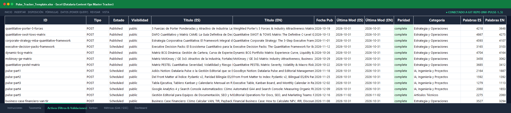

One of the most persistent organizational frictions in modern technology companies, digital marketing agencies, and product documentation teams occurs right at the cultural border between two disciplines: **software engineers who live in Git and content writers or SEO strategists who live in Notion, Airtable, or Excel**.

For engineering teams, technical content must be treated exactly like source code (*Content Ops as Code*): Markdown files version-controlled in Git, vetted through pull requests, validated by linters, and continuously deployed via automated CI/CD pipelines. For content writers, technical editors, and marketing leaders, this workflow feels distinctly uninviting: they have no desire to clone Git repositories via bash terminals, resolve cryptic merge conflicts, or diagnose YAML syntax errors in Markdown front matter.

Consequently, most organizations adopt an uneasy compromise: the content team manages an editorial calendar in Notion or Airtable that remains completely decoupled from the actual production repository. Within weeks, the system suffers chronic divergence (*content drift*): published articles live on the website without corresponding Notion cards, scheduled dates are altered in Notion without ever being reflected in Git, and technical auditing simply vanishes.

In this fifth and final installment of the **Datalaria Pulse** series, we close the loop on modern editorial governance. We demonstrate how to build an automated, bi-directional bridge using the **Datalaria Pulse Kit** (an Excel 2016/365 master template with Power Query M and a 5-minute Notion migration CLI), and we unveil the architecture of **Datalaria Pulse Pro**: an enterprise-ready cloud platform built on **Supabase Cloud + PostgreSQL 15** featuring Row-Level Security (RLS) and the capability to orchestrate an **Autonomous Editorial Factory Powered by AI Agents**.


---

### 🗺️ Datalaria Pulse Series Roadmap
To understand how each piece of the *Content Ops as Code* architecture fits together, this series consists of 5 structured installments:

1. ⚪ **Part 1**: [Goodbye Notion: Datalaria Pulse and Editorial Governance that Writes Itself from Git](/en/posts/pulse-part1-goodbye-notion-content-ops/).
2. ⚪ **Part 2**: [From Front Matter to Index: Pydantic v2, Bilingual Parity, and CI/CD Automation](/en/posts/pulse-part2-pydantic-indexer-bilingual-parity-ci/).
3. ⚪ **Part 3**: [Executive Table, Kanban Board, and Monthly Calendar in React 19 over a Static Index](/en/posts/pulse-part3-react-dashboard-table-kanban-calendar/).
4. ⚪ **Part 4**: [Automated Google Analytics 4 and Search Console: Measuring the Organic ROI of Every Post, App, and Kit](/en/posts/pulse-part4-ga4-search-console-automated/).
5. 🟢 **Part 5 (This article)**: Editorial Operations for Docs, SEO, and Marketing Teams: From Notion to Excel in 5 Minutes and AI Agent Factory.

---

## 0. Phase Objectives and Article Scope: Unifying Teams and Scaling with Autonomous Agents

This publication marks the successful completion of **Phase 5 (Milestone 5.8) at Datalaria**, establishing an operating model that unites familiar business ergonomics with the deterministic rigor demanded by modern software engineering.

### Strategic Objectives of Phase 5:
1. **Bridge the Organizational Adoption Divide:** Enable SEO specialists and content writers to operate within familiar environments (Excel, Notion) without compromising Git as the single source of truth.
2. **Guarantee Zero Vendor Lock-in (Dual-Mode Architecture):** Offer both an offline-first downloadable standalone toolkit (*Pulse Kit*) and a collaborative cloud ecosystem (*Pulse Pro*).
3. **Enforce Strict Multi-Tenant Isolation (`INV-PULSE-4` and `INV-PULSE-5`):** Implement Row-Level Security (RLS) policies in Supabase PostgreSQL to safeguard customer catalogs.
4. **Enable the Autonomous AI Editorial Factory:** Establish an operational loop where intelligent coding agents (Google Antigravity with Gemini Argon, Claude Code) research, draft, and audit content governed by deterministic contracts.

### Specific Scope of this Article 5:
- Detail the architecture of the **Excel 2016/365 Master Template** with dropdown validation rules, dark-mode styling, and automated KPIs.
- Implement the **5-minute Notion migration script** (`migrate_notion.py`), standardizing schemas and taxonomy without manual data entry.
- Provide the **Power Query M connector**, allowing users to synchronize their Git inventory into Excel with a single click.
- Deploy the **zero-dependency universal CLI scanner** (`pulse_repo_scanner.py`), fully compatible with Hugo, Next.js, Astro, and Docusaurus.
- Walk through the **Supabase PostgreSQL 15 architecture** in Datalaria Pulse Pro, exploring its RLS policies and interactive demo mode.
- Model the complete lifecycle of an **AI-driven Editorial Factory** (Idea ➔ Spec ➔ Code ➔ Deterministic Review ➔ CI/CD Deployment).

---

## 1. Connection to the Datalaria Ecosystem: From Spreadsheets to Autonomous Agents

The architectural philosophy of Datalaria Pulse is firmly grounded in the quantitative principles that govern the entire Datalaria portal:


flowchart TD
    subgraph STANDALONE ["1. Standalone Tier (Local and Autonomous)"]
        NOTION["Notion / Airtable (CSV Export)"] --> MIG["migrate_notion.py (5-min Normalizer)"]
        GIT["Git Repository (Markdown + YAML)"] --> SCAN["pulse_repo_scanner.py (Zero-dependency CLI)"]
        XLS["Pulse_Content_Ops_Template.xlsx (Excel 2016/365 + Power Query M)"]
        MIG --> XLS
        SCAN --> XLS
    end

    subgraph PRO ["2. Pro Cloud Tier (Collaborative and Secure)"]
        WEB["React 19 Cockpit (Datalaria Pulse)"]
        SUPA[("Supabase Cloud - PostgreSQL 15 + RLS")]
        WEB -->|"Auth and Sync"| SUPA
        SUPA --> WEB
    end

    subgraph AI ["3. Autonomous Tier (Agent Factory)"]
        AGENT["Autonomous Agents (Antigravity / Claude Code)"]
        SDD["Spec-Driven Development (Pydantic + Linters CI/CD)"]
        AGENT -->|"Markdown Draft"| SDD
        SDD -->|"Green Test (Code 0)"| GIT
    end

    XLS -->|"Import"| WEB
    GIT -->|"public.json"| WEB


### Strategic Parity with Core Datalaria Frameworks:
- **[S&OP Engineering & Data Hygiene](/en/posts/sop_ingenieria-higiene-datos/):** Editorial catalog management is fundamentally identical to inventory management in physical supply chains. Standardizing attributes (editorial SKUs, controlled taxonomies, closed status enums) eliminates data corruption and dead stock.
- **[Rational Decision-Making & Quantitative Prioritization](/en/posts/toma-decisiones-priorizacion-framework-cuantitativo/):** The 4-quadrant opportunity matrix and executive filters inside our Excel tracker apply multi-criteria weighted scoring to determine what to publish or refresh each week.
- **[Financial Business Case NPV / IRR](/en/posts/business-case-financiero-van-tir/):** SaaS tools like Notion Team or Airtable Plus incur cumulative recurring expenses (120 € to 240 € per user annually). Content Ops as Code with perpetual ownership slashes Total Cost of Ownership (TCO) by over 98%, breaking even within the first month.
- **[Spec-Driven Development (SDD)](/en/posts/sdd_vs_vibe_coding/):** The AI content factory rejects undisciplined writing (*Vibe Writing*); it operates under strict specifications where every article must pass formal Pydantic data contracts before being accepted into production.

---

## 2. The Editorial Divide: Why Notion Fails at Scale for Technical Teams

Notion and Airtable are brilliant tools for preliminary brainstorming and lightweight team notes. However, once a technical documentation site or engineering blog exceeds 50 articles or demands strict bilingual synchronization, critical structural failures emerge:

1. **Chronic Schema Drift:** When an author edits a title or changes a publication date in Notion, that change does not exist in the Git repository until someone manually edits the Markdown front matter. Inevitably, the two realities drift apart.
2. **Absence of Deterministic Verification:** Notion cannot verify whether a URL slug matches an actual folder on disk, whether a cover image asset exists, or whether an English version correctly mirrors its Spanish original via a shared `translationKey`.
3. **Vendor Lock-in and Recurring Cost:** Your editorial database is locked inside a third-party proprietary silo. If the vendor experiences an outage or modifies pricing tiers, the editorial team is held captive.
4. **Lack of Atomic Git Diffs:** In Git, every change is reviewed line-by-line via `git diff`. In Notion, version histories are opaque and completely severed from modern engineering workflows (*pull requests*, code reviews, preview deployments).

The solution is not to force non-technical writers into terminal commands, but to **engineer a deterministic bridge between both paradigms**.

---

## 3. The Datalaria Pulse Kit: From Notion to Excel in 5 Minutes

To empower content writers and marketing teams without violating Git's integrity, we engineered the standalone **Datalaria Pulse Kit**, a zero-dependency toolkit designed to standardize any existing content library.

### 3.1 The Excel 2016/365 Master Template (`Pulse_Content_Ops_Template.xlsx`)

Built to run natively across all modern versions of Microsoft Excel without macro security warnings or paid third-party add-ins:



- **Strict Cell Data Validations:** Pre-configured dropdown lists for primary attributes:
  - *Status:* `Idea`, `Draft`, `In Review`, `Scheduled`, `Published`.
  - *Language:* `es`, `en`.
  - *Type:* `post`, `app`, `kit`.
  - *Monetization Tier:* `free`, `premium`, `b2b`.
- **Executive Dark Formatting:** Color palettes aligned with Datalaria’s design system (emerald green for published assets, cyan for scheduled content, amber for drafts in review).
- **Automated Calculated Fields:** Dynamic formulas for days since publication, content decay warnings (>180 days), and bilingual coverage percentages.

### 3.2 Power Query M Connector: One-Click Git Synchronization

For spreadsheet users who want their Excel workbook to reflect the real-time status of the Git repository without writing code, the kit includes an optimized **Power Query M** script. Clicking Excel’s "Refresh All" button pulls the sanitized public dataset `public.json` straight into the sheet:

```powerquery
let
    // 1. Fetch public.json from local disk or production web endpoint
    Source = Json.Document(File.Contents("...\datalaria\static\apps\pulse\data\public.json")),
    
    // 2. Extract asset collection
    assets = Source[assets],
    #"Converted to Table" = Table.FromList(assets, Splitter.SplitByNothing(), null, null, ExtraValues.Error),
    
    // 3. Expand deterministic columns
    #"Expanded Columns" = Table.ExpandRecordColumn(#"Converted to Table", "Column1", 
        {"id", "title", "status", "category", "word_count", "reading_time_min", "metrics_relative"}, 
        {"ID", "Title", "Status", "Category", "Words", "Reading Minutes", "Metrics"}),
    
    // 4. Expand privacy-safe relative metrics (INV-PULSE-2)
    #"Expanded Metrics" = Table.ExpandRecordColumn(#"Expanded Columns", "Metrics", 
        {"index_100", "rank_pct"}, {"Base 100 Index", "Percentile"})
in
    #"Expanded Metrics"
```

### 3.3 5-Minute Notion Migration (`migrate_notion.py`)

Migrating from an existing Notion database to the structured Pulse schema takes less than five minutes:

1. Inside Notion, open your editorial board and click **Export ➔ CSV**.
2. Extract the resulting CSV file into your project folder.
3. Run our automated migration script:

```bash
python -m ops.pulse.migrate_notion_csv --input notion_export.csv --output Pulse_Tracker.xlsx
```

The script performs the following automatic transformations:
- Normalizes irregular Notion headers into canonical Pulse attributes (`Name` ➔ `title`, `Date` ➔ `date`, `Status` ➔ `status`, `Tags` ➔ `tags`).
- Cleanses and generates kebab-case URL slugs.
- Maps freeform category tags to a controlled taxonomy, assigning default values when attributes are missing.
- Generates a production-ready Excel workbook with pre-populated dropdowns and formatting.

### 3.4 Zero-Dependency Universal CLI Scanner (`pulse_repo_scanner.py`)

For engineering teams utilizing other frontend frameworks such as **Astro, Next.js, Hugo, or Docusaurus**, the kit incorporates a standalone Python scanner that uses exclusively Python’s standard library (`re`, `pathlib`, `os`):

```python
# ops/pulse/pulse_repo_scanner.py (excerpt)
import re
import os
import json
from pathlib import Path

def scan_markdown_repository(content_dir: str) -> list[dict]:
    """Recursively scans Markdown files extracting Front Matter YAML with zero dependencies."""
    results = []
    fm_pattern = re.compile(r"^---\s*\n(.*?)\n---\s*\n", re.DOTALL)
    
    for root, _, files in os.walk(content_dir):
        for f in files:
            if f.endswith((".md", ".markdown")):
                filepath = Path(root) / f
                content = filepath.read_text(encoding="utf-8", errors="ignore")
                match = fm_pattern.search(content)
                if match:
                    meta = parse_yaml_subset(match.group(1))
                    words = len(re.findall(r"\w+", content[match.end():]))
                    results.append({
                        "file": str(filepath.relative_to(content_dir)),
                        "title": meta.get("title", filepath.stem),
                        "status": "draft" if meta.get("draft") == "true" else "published",
                        "words": words,
                        "date": meta.get("date", "")
                    })
    return results
```

The scanner completes an audit of hundreds of technical files in under **200 milliseconds**, producing a standardized JSON manifest ready for CI/CD pipelines.

---

## 4. The Commercial Package: Dual-Mode Architecture and Zero Hidden Costs

The **Datalaria Pulse Kit** (available on Lemon Squeezy) adheres strictly to the *Buy Once, Own Forever* philosophy:

```
Datalaria_Pulse_Kit_v0.1.0.zip
├── 01_Excel_Templates/
│   ├── Pulse_Content_Ops_Template.xlsx    (Master Template with cell validations)
│   └── notion_power_query.m         (Power Query M connector source)
├── 02_Migration_Scripts/
│   ├── migrate_notion.py          (Notion ➔ Excel/Git migration engine)
│   └── pulse_repo_scanner.py          (Universal zero-dependency CLI)
├── 03_Documentation/
│   ├── GUIA_PULSE_KIT.md         (Step-by-step setup guide)
│   └── DATA_DICTIONARY.md             (Canonical attribute specification)
└── LICENSE.txt                        (Perpetual Commercial License)
```

### 3-Year Total Cost of Ownership (TCO) Comparison:

| Dimension | Notion Team / Airtable Plus | Datalaria Pulse Kit |
| :--- | :--- | :--- |
| **Pricing Model** | 10 € to 20 € / user / month | **One-time payment (19 € — launch discount from 39 €)** |
| **3-Year Cost (5-Person Team)** | 1,800 € to 3,600 € recurring | **19 € total (launch discount from 39 € — >98% savings)** |
| **Data Sovereignty** | Proprietary third-party cloud | **100% on your local machine and Git repository** |
| **Git Synchronization** | Fragile webhooks or manual updates | **Native: Git is the single source of truth** |
| **Automated CI/CD Auditing** | None | **GitHub Actions / Pre-commit integration** |

---

## 5. Special Chapter: Datalaria Pulse Pro and the Autonomous AI Editorial Factory

It is essential to clarify our distribution and operating model: while the **Datalaria Pulse Kit (19 €)** is the direct, downloadable standalone product with a perpetual license for spreadsheets and local Git repositories, **Datalaria Pulse Pro** is designed as a **tailored B2B enterprise upgrade**. It serves organizations, agencies, and documentation departments requiring a **custom multi-team deployment, a managed Supabase cloud backend, and an autonomous agentic CMS integrated into corporate infrastructure**.

Anyone can freely explore the live **[Datalaria Pulse Interactive Demo](/apps/pulse/)** directly in the browser. If your organization requires deploying a dedicated cloud instance with engineering onboarding and agentic pipelines, reach out directly at **[contacto@datalaria.com](mailto:contacto@datalaria.com)** or via our **[contact page](/en/contact/)**.

### 5.1 Collaborative Cloud Persistence with Supabase PostgreSQL 15 & RLS

Datalaria Pulse Pro connects seamlessly to a managed **Supabase PostgreSQL 15** database, encapsulating content data inside the dedicated `pulse` schema:

```sql
-- Multi-Tenant Security Migration in Supabase PostgreSQL (001_create_pulse_schema.sql)
CREATE SCHEMA IF NOT EXISTS pulse;

-- 1. Editorial Ideas and Backlog Table
CREATE TABLE IF NOT EXISTS pulse.ideas (
    id UUID PRIMARY KEY DEFAULT gen_random_uuid(),
    user_id UUID NOT NULL REFERENCES auth.users(id) ON DELETE CASCADE,
    title TEXT NOT NULL,
    notes TEXT DEFAULT '',
    category TEXT DEFAULT 'General',
    tags TEXT[] DEFAULT '{}',
    status TEXT DEFAULT 'idea' CHECK (status IN ('idea', 'draft', 'review', 'scheduled', 'published')),
    target_date DATE,
    created_at TIMESTAMPTZ DEFAULT NOW(),
    updated_at TIMESTAMPTZ DEFAULT NOW()
);

-- 2. Calendar Schedule and Exceptions Table
CREATE TABLE IF NOT EXISTS pulse.content_schedule (
    id UUID PRIMARY KEY DEFAULT gen_random_uuid(),
    user_id UUID NOT NULL REFERENCES auth.users(id) ON DELETE CASCADE,
    asset_id TEXT NOT NULL,
    override_date DATE NOT NULL,
    created_at TIMESTAMPTZ DEFAULT NOW(),
    updated_at TIMESTAMPTZ DEFAULT NOW(),
    UNIQUE(user_id, asset_id)
);

-- 3. Enable Strict Row Level Security (RLS) (Invariant INV-PULSE-4)
ALTER TABLE pulse.ideas ENABLE ROW LEVEL SECURITY;
ALTER TABLE pulse.content_schedule ENABLE ROW LEVEL SECURITY;

CREATE POLICY user_ideas_isolation ON pulse.ideas
    FOR ALL USING (auth.uid() = user_id) WITH CHECK (auth.uid() = user_id);

CREATE POLICY user_schedule_isolation ON pulse.content_schedule
    FOR ALL USING (auth.uid() = user_id) WITH CHECK (auth.uid() = user_id);
```

#### Three Distinct User Access Modes in the Web Cockpit:
1. **Interactive Demo Mode (Anonymous Visitors):** Unauthenticated users explore a pre-seeded sandbox containing 10 synthetic assets, allowing them to test the table, Kanban board, and calendar without exposing real data.
2. **Multi-Tenant Pro Mode (Registered Users):** Authenticated users receive an isolated cloud workspace governed by their `auth.uid()`, with real-time WebSocket synchronization across devices.
3. **Official Production Sync (Master Admins):** Datalaria engineers can synchronize the physical Git repository bi-directionally with the cloud database, ensuring zero-latency updates upon every commit.

---

### 5.2 The Autonomous Editorial Factory: AI Agents in the SDD Loop

The true transformational power of *Content Ops as Code* is unlocked when **autonomous agentic coding assistants** (such as Google Antigravity powered by Gemini Argon, or Claude Code) are integrated into the editorial pipeline:


sequenceDiagram
    autonumber
    actor Editor as Editorial Director
    participant Agent as AI Coding Agent (Antigravity)
    participant Git as Git Repository
    participant CI as GitHub Actions (CI/CD)
    participant Telemetry as GA4 & Search Console

    Editor->>Agent: "Analyze Refresh candidates and author Post 5"
    Agent->>Git: Reads public.json and detects orphan keywords
    Agent->>Git: Authors index.md (ES/EN) adhering to spec.md
    Agent->>CI: Runs pre-commit hooks (build_index, parity, linters)
    CI-->>Agent: Green test suite (18/18 passed, code 0)
    Agent->>Git: Opens atomic Pull Request
    Editor->>Git: Reviews and merges PR to main
    CI->>Git: Hugo static build deployed (2,750+ pages generated)
    Telemetry-->>Git: sync_metrics updates Base-100 trends on Sunday at 02:00


#### The Four Stages of the Autonomous Content Factory:
1. **Opportunity Discovery & Benchmarking (Idea):** The agent parses `public.json` and Search Console data to identify high-volume search topics with poor existing coverage, generating structured backlog proposals in `data/pulse/private/backlog_ideas.yaml`.
2. **Spec-Guided Drafting (Draft):** Rather than hallucinating unstructured prose, the agent reads the module’s `spec.md` and generates strict bilingual pairs (`content/es/` and `content/en/`), adhering to established terminology, internal cross-links, and Pydantic-validated front matter.
3. **Deterministic Quality Control (Review):** Before notifying human editors, the agent runs the local test suite (`python -m ops.pulse.build_index` and `pytest`). Broken links or missing translation keys cause the pipeline to fail immediately, prompting the agent to self-heal its code.
4. **Automated Deployment & Business Feedback (Publish & Learn):** Following human approval, GitHub Actions compiles the static site. During the next weekly scheduled run, `sync_metrics.py` polls GA4 and Search Console, calculating real organic ROI and closing the feedback loop for the next iteration.

---


> ### 🚀 What’s Next: Datalaria Helix (Launching in January 2027)
> 
> The Content Ops as Code workflow powering Pulse represents the first operational application of a larger paradigm shift: **Datalaria Helix**.
> 
> Helix is our next-generation *Spec-Driven Development* (SDD) framework, structured around a **coordinated squad of 12 specialized AI agents** (covering Triage, Architecture, Drafting, Linters, QA, and Security). We utilized this exact agent squad to audit, harden, and deterministically govern the entire development of Datalaria Pulse without a single context drift.
> 
> Datalaria Helix officially launches in **January 2027**. You can secure your spot and join our priority waitlist at **[Datalaria Resources — Software & SDD](/en/resources/#software)**.

---



---

## 6. Conclusions and Completion of the Datalaria Pulse Series

Over the course of five weeks and five exhaustive engineering essays, we have elevated content management from an ad-hoc craft into a **predictable engineering discipline**:

1. **[Part 1 — Goodbye Notion: Content Ops as Code](/en/posts/pulse-part1-goodbye-notion-content-ops/):** Established Git as the single source of truth, removing external third-party database silos.
2. **[Part 2 — From Front Matter to Index: Pydantic v2 and CI/CD](/en/posts/pulse-part2-pydantic-indexer-bilingual-parity-ci/):** Built the deterministic validation engine that indexes 140 technical assets in milliseconds with 100% bilingual parity.
3. **[Part 3 — Executive Table, Kanban, and Calendar in React 19](/en/posts/pulse-part3-react-dashboard-table-kanban-calendar/):** Designed a zero-latency interactive web cockpit over static JSON manifests.
4. **[Part 4 — Automated GA4 & Search Console: Health & ROI](/en/posts/pulse-part4-ga4-search-console-automated/):** Integrated official Google APIs via Service Accounts, normalizing metrics into a Base-100 index and valuing content equity at \21,480€.
5. **Part 5 — From Notion to Excel in 5 Minutes, Supabase Pro, and AI Agents:** United content and engineering teams with our standalone kit and paved the way for autonomous cloud-scale production.

Modern content operations no longer require a trade-off between the flexibility of a spreadsheet and the resilience of a code repository. With **Datalaria Pulse**, your entire technical catalog is authored, audited, and monetized from the exact same source of truth.

---

> ### Upgrade to Content Ops as Code
> 
> - **Experience the Live Web Cockpit:** Explore the live deployment of [Datalaria Pulse on the Web](/apps/pulse/) (Interactive Sandbox mode) with interactive Table, Kanban, Calendar, and Health views.
> - **Download the Datalaria Pulse Kit:** Get the kit at **[Datalaria Pulse Kit in Resources](/en/resources/#pack-pulse)** (Excel 2016/365 Master Template, Power Query M connector, and 5-minute migration CLI to streamline your editorial workflow today.
> - **Read the Official App Documentation:** Review the complete architecture and roadmap in the [Datalaria Pulse Technical App Specification](/en/apps/pulse/).
