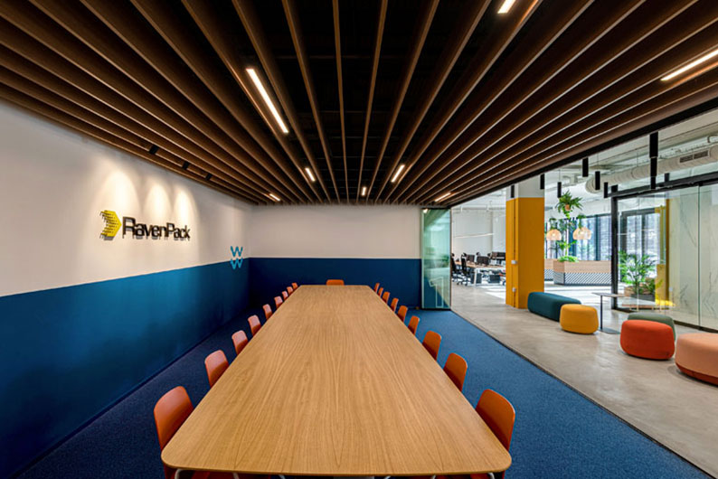
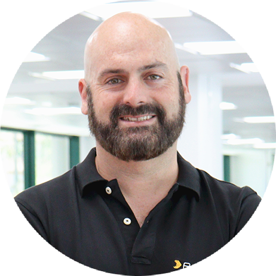

At the turn of the millennium, when an investment fund manager in Manhattan or the City of London wanted to trade on market-moving information, the process was as artisanal as it was agonizingly slow: armies of junior research analysts rushed to scan physical press newswires, highlighted 200-page SEC 10-K filings with marker pens, and placed frantic phone calls to equity brokers to adjust their portfolios.

In that analog Wall Street dominated by human gut instinct and locker-room rumors, virtually no one believed a computer could read unstructured text, decipher linguistic nuances, or quantify market panic faster and more objectively than a seasoned floor trader.

Even less conceivable was the idea that the pioneer company set to overthrow that paradigm would not be founded in Silicon Valley, Boston, or New York's Financial District, but more than four thousand miles away: **in an office suite overlooking the Mediterranean Sea on the Golden Mile of Marbella, Spain**.

Today, **RavenPack** is global finance's worst-kept open secret. Every single day, its proprietary natural language processing (NLP) pipelines process hundreds of millions of news articles, earnings call transcripts, regulatory filings, and social media feeds in real time, converting chaotic floods of text into structured sentiment and event signals that directly drive the algorithmic trading engines of the world’s most secretive and lucrative quantitative hedge funds (including titans like Millennium Management, Point72, Citadel, and Two Sigma).

Continuing our deep-dive series on top Spanish tech companies and scale-ups—including [Carto](/en/posts/carto/), [Devo](/en/posts/devo/), [Clarity AI](/en/posts/clarity_ai/), [Flywire](/en/posts/flywire/), [Wallapop](/en/posts/wallapop/), [HappyRobot](/en/posts/happyrobot/), and [Submer](/en/posts/submer/)—this case study explores the trajectory of RavenPack, its technical NLP engine, key B2B product lessons, and its indispensable role in the rise of **autonomous financial agents on the road to AGI**.



---

### The Origins: From Southern California to Marbella's Golden Mile

The story of RavenPack is inseparable from its co-founder and Chief Executive Officer, **Armando Gonzalez**.

Born in San Diego and raised in Southern California, Gonzalez moved to Europe in the late 1990s to study international economics and business administration at the *American University of Paris*. During his studies in France, he connected with European computer scientists and researchers experimenting with early natural language processing prototypes and automated text classification algorithms.

Gonzalez immediately saw a generational opportunity: financial markets run entirely on news and events, yet human beings suffer from an embarrassingly narrow biological bandwidth to read, digest, and act on information without emotional biases. If a machine could systematically ingest the entire global news stream, extract corporate entities, and quantify net sentiment in real time, quantitative traders would pay fortunes for that informational edge (*Alpha*).

In 2003, RavenPack was formally incorporated. But why Marbella?

The choice of headquarters was neither a government subsidy play nor an economic incentive scheme, but a conscious lifestyle and strategic decision. While visiting the Costa del Sol on the invitation of German partners with a vacation home in the area, Gonzalez was captivated by the mild Mediterranean climate, high-speed international telecommunications links, and a coastal environment that strongly mirrored his native Southern California.

Rather than setting up in a gray Manhattan skyscraper, Gonzalez leased office space in Marbella, convinced that in the internet age, mission-critical B2B enterprise software could be engineered from anywhere in the world provided the value proposition was truly best-in-class.

Initially, institutional bankers in New York and London viewed RavenPack with skepticism: *“How is a small shop in a sun-soaked resort town in southern Spain going to teach Wall Street how to read financial news?”* The answer came swiftly: while a human research analyst took fifteen minutes to open, read, and interpret a corporate earnings wire, **RavenPack's automated engine categorized the event, scored its novelty, and outputted a machine-readable trading signal in under fifty milliseconds**.

---

### Technical Architecture: From Unstructured Text to Quantitative Alpha

The core computational challenge RavenPack spent two decades solving is that financial language is one of the most deceitful, ambiguous, and context-dependent domains in computational linguistics:
* **Polysemy and Entity Disambiguation**: Differentiating whether *"Apple"* refers to the Cupertino tech giant, the fruit, or the Beatles’ record label (*Apple Corps*).
* **Syntactic Negation and Subtext**: A statement such as *“The company does not rule out bankruptcy protection”* contains positive verb structures, but carries intensely bearish real-world implications.
* **Echoes and Redundancy**: When a major economic event breaks at 09:00:00, global news syndicates publish hundreds of syndicated variations over the next ten minutes. Feeding an automated trading model the same signal hundreds of times would trigger a disastrous feedback loop of accidental over-leveraging.

To solve this, RavenPack engineered a rigorous four-stage data processing pipeline that has become the gold standard in quantitative finance:

#### 1. Massive Ingestion and Multi-Source Normalization
RavenPack formed historic data partnerships with global news agencies, most notably **Dow Jones & Company** (parent of *The Wall Street Journal* and *Barron's*). The system continuously ingests institutional newswires, regulatory SEC filings (10-K, 10-Q, 8-K), central bank policy releases, corporate earnings transcripts, premium digital outlets, and real-time social media data streams.

#### 2. Deep Entity Resolution and Event Taxonomy
The linguistic parser maps every identified entity to a normalized, unique permanent identifier in its master security database (cross-referenced with ISIN, CUSIP, SEDOL, and stock tickers). It then assigns the text to a proprietary **Event Taxonomy containing over 1,000 hierarchical categories**:
* Revenue and earnings guidance beats/misses.
* Mergers and acquisitions (M&A).
* Regulatory litigation, antitrust lawsuits, and patent disputes.
* Executive resignations, insider trading, and board turnover.
* Labor strikes, natural disasters, and international supply chain disruptions.

#### 3. Sentiment and Novelty Scoring (*Event Sentiment Score*)
RavenPack outputs calibrated probabilistic analytics rather than blunt binary positive/negative tags:
* **Event Sentiment Score (ESS)**: A normalized continuous index between 0 and 100. A score of 50 indicates absolute neutrality, scores above 50 signal an asset-positive (bullish) impact, and scores below 50 indicate an asset-negative (bearish) impact.
* **Event Novelty Score (ENS)**: Evaluates whether the incoming story contains original information or is merely a syndicated echo of an event published within a rolling 24-hour window. High-frequency quantitative algorithms typically only fire trade orders when $ENS = 100$.

#### 4. Point-in-Time Data Integrity
For quantitative researchers, the deadliest risk when training predictive models is *Look-Ahead Bias*. RavenPack maintains an immutable historical ledger documenting **exactly what information was known, and at what millisecond timestamp**, enabling researchers to run rigorous, survivor-bias-free backtests across more than twenty years of historical financial data.

---

### Global Scale, Financial Growth, and the LLM Era: Bigdata.com

Unlike consumer startups that burn cash on customer acquisition, RavenPack expanded through disciplined, cash-flow-positive enterprise contracts.

* **Strategic Distribution**: Its landmark 2008 distribution agreement with Dow Jones integrated RavenPack’s sentiment indices directly into the data feeds of the world's leading institutional desks.
* **Worldwide Footprint**: While engineering and R&D remain firmly anchored in Marbella, the company expanded its commercial and support infrastructure with regional headquarters in **New York** (One World Trade Center), **London**, **Singapore**, and **Hong Kong**, employing over two hundred engineers, data scientists, and quantitative researchers.
* **GP Bullhound Growth Investment**: In 2022 and 2023, technology investment bank **GP Bullhound** made a strategic growth investment in RavenPack to accelerate its most ambitious product pivot in a decade: **the launch of Bigdata.com**.
* **Strategic Partnership with Financial Times (FT Group)**: The Financial Times Group sealed a multifaceted strategic partnership with RavenPack encompassing equity investment via FT Ventures, an AI content licensing agreement with FT Professional to power Bigdata.com agents and analytics, and direct distribution across institutional workflows.

#### The Generative AI Turning Point

When generative Large Language Models took the world by storm in 2023, industry commentators predicted that specialized providers like RavenPack would be displaced by general-purpose models like GPT-4. Why pay for RavenPack when an analyst can simply prompt a chatbot?

Armando Gonzalez and his leadership team quickly proved that the exact opposite was true:
1. **Generalist LLMs Hallucinate in Finance**: Out-of-the-box LLMs make up balance sheet numbers, lack access to proprietary paywalled newswires, and fail to provide deterministic audit trails.
2. **The Birth of Bigdata.com**: RavenPack fused its twenty-year structured financial knowledge graph with frontier reasoning models, launching an enterprise financial research assistant tailored for fundamental portfolio managers and macro analysts.

An analyst can now query: *“Which European semiconductor suppliers showed the strongest negative sentiment correlation following US export restrictions over the past 3 years?”*, and Bigdata.com delivers a synthesized, mathematically grounded report complete with point-in-time verifiable citations, eliminating hallucinations entirely (mirroring the architecture we explored in [GraphRAG](/en/posts/graphrag/)).

---

### 5 Product & Engineering Lessons from RavenPack

1. **Structuring the Unstructured is an Evergreen Value Proposition**: More than 80% of enterprise information is unstructured text, audio, and documents. Building precision bridges that convert raw information into verified, structured data schemas creates exceptionally resilient businesses.
2. **Domain-Specific Depth Defeats Generalist Models**: In regulated, high-stakes environments like quantitative finance, medicine, and law, generic foundation models fall short. RavenPack’s two decades of domain taxonomies and curated ontologies cannot be matched by brute-force internet pre-training alone.
3. **Point-in-Time Precision is the Ultimate Data Moat**: In institutional enterprise software, providing an accurate answer is not enough. You must prove what was known at that specific millisecond to comply with regulatory audits and eliminate backtesting bias.
4. **High Switching Costs Create Impregnable Moats**: Once a quantitative hedge fund designs, validates, and trades algorithmic strategies on RavenPack's proprietary indicators (such as ESS and ENS), ripping out the provider requires re-engineering years of production trading code. The result is near-zero churn and immense customer lifetime value (*LTV*).
5. **Geography is Secondary to Relentless Product Focus**: Building a global financial data powerhouse from Marbella demonstrated—twenty years before remote work became normalized—that world-class talent and mission-critical software can thrive anywhere on Earth.

---

### Updated Spanish Tech Startup Benchmark

With the addition of RavenPack, Datalaria’s benchmark of Spain’s premier technology success stories incorporates a world leader in financial intelligence and quantitative AI:

| Startup / Company | Global HQ | Founded | Business Model | Core Technology Focus | Key Milestone / Scale |
| :--- | :--- | :--- | :--- | :--- | :--- |
| **RavenPack** | **Marbella / NY** | **2003** | **B2B Data SaaS** | **Financial NLP, Event Taxonomy, Knowledge Graphs, Big Data** | **Wall Street's silent oracle; 200+ employees; Dow Jones partner** |
| **Submer** | Barcelona | 2015 | B2B Hardware / AIaaS | Single-phase immersion cooling for high-density AGI clusters | $55.5M Series C; 56 MW supercomputing campus |
| **HappyRobot** | San Francisco / Madrid | 2021 | B2B Voice AI Agents | Autonomous voice agents for freight and logistics operations | Y Combinator alum; automating US supply chain dispatching |
| **Wallapop** | Barcelona | 2013 | C2C Marketplace | Computer Vision, semantic search, and geospatial matching | 19M+ active users; European circular economy leader |
| **Nanobanana** | Madrid | 2020 | B2B Engineering & Data | Cloud architecture, modern data engineering, and MLOps | Scaling enterprise data platforms for multinational corporations |
| **Multiverse Computing** | San Sebastian | 2019 | B2B Deep Tech | Tensor networks and quantum-inspired algorithms for LLMs | LLM compression engine (CompactifAI); €25M Series A |
| **Graphext** | Madrid | 2017 | Product-Led SaaS | Visual graph clustering, dimensionality reduction, embeddings | Advanced exploratory data analysis without writing code |
| **Flywire** | Valencia / Boston | 2011 | Fintech B2B Payments | Complex cross-border payment flows and receivables automation | NASDAQ IPO; multi-billion dollar public market valuation |
| **Nextail** | Madrid | 2014 | B2B Enterprise AI | Stochastic inventory optimization for fast fashion supply chains | Prescriptive merchandising algorithms for global retail brands |
| **Clarity AI** | Madrid / NY | 2017 | B2B SaaS ESG Analytics | Probabilistic machine learning and sustainability data cleaning | Coverage across 70,000+ companies and top global asset managers |
| **Devo** | Madrid / Boston | 2011 | B2B Cloud Analytics | Petabyte-scale real-time log ingestion and streaming analytics | $1.5B+ Unicorn; mission-critical security backbone for Fortune 500 |
| **Carto** | Madrid / NY | 2012 | B2B Spatial Analytics | Cloud-native Spatial SQL and GIS analytics over modern Lakehouses | De facto geospatial platform integrated with Google, Snowflake, AWS |

---

### The Future: RavenPack and the Road to Financial AGI

RavenPack's trajectory connects directly with our recent technical retrospectives on [Inference-Time Scaling](file:///c:/Users/dalae/OneDrive/Emprendiendo/datalaria/content/en/posts/inference_time_scaling/index.md) and [Spec-Driven Development](file:///c:/Users/dalae/OneDrive/Emprendiendo/datalaria/content/en/posts/sdd_vs_vibe_coding/index.md):

Capital markets cannot be navigated through naive intuition or casual vibe coding. They are the ultimate real-world manifestation of the non-stationary, adversarial multi-agent game theory modeled by [John von Neumann](file:///c:/Users/dalae/OneDrive/Emprendiendo/datalaria/content/en/posts/john_von_neumann/): a high-frequency ecosystem where every action immediately alters the state of the board.

By the late 2020s, the world's most sophisticated trading desks will not be operated by humans staring at dashboards, but by **swarms of autonomous System 2 reasoning agents**. 

These agents will operate under formal risk specifications, continuously track global geopolitical undercurrents, and deliberate across multi-step scenarios before committing capital. And whenever those autonomous agents need to verify what happened, how it correlates with historical precedent, and what its net macroeconomic impact will be, the authoritative truth signal will continue flowing from the exact place it originated twenty-three years ago: **RavenPack's servers in Marbella**.

---

### An Open Question for the Reader

RavenPack proved that structuring human knowledge in real time two decades ahead of the curve was the most durable business model of the information era.

With the advent of autonomous AI agents capable of managing portfolios and executing financial decisions with zero human latency:

**Do you believe financial markets will be the first domain in human civilization to achieve fully functional AGI before science or robotics?**

**And if algorithms are already reading, interpreting, and trading on market realities before human eyes can even register a news alert... are financial markets still a reflection of human society, or have they become an arena where humans are merely passive observers?**

We would love to hear your thoughts. Share your perspective in the comments below.

---

#### References and Further Reading:
* [**RavenPack Official Website**: Big Data Analytics for Finance & Bigdata.com](https://www.ravenpack.com/)
* [**Financial Times Group**: *Strategic Partnership with RavenPack*](https://aboutus.ft.com/press_release/strategic-partnership-ravenpack)
* [**YouTube**: *Armando Gonzalez, CEO of RavenPack on Bloomberg Markets Today*](https://www.youtube.com/watch?v=Vp1-7TuRu2U)
* [**El País**: *Wall Street's Artificial Intelligence is Designed in Marbella*](https://elpais.com/economia/2021-05-16/la-inteligencia-artificial-de-wall-street-se-disena-en-marbella.html)
* [**Cinco Días**: *RavenPack: The Spanish firm reading the news for Wall Street titans*](https://cincodias.elpais.com/)
* [**Datalaria**: Submer — The AI Thermal Wall and Liquid Immersion Cooling](/en/posts/submer/)
* [**Datalaria**: Flywire — From Valencia to the NASDAQ](/en/posts/flywire/)
* [**Datalaria**: Clarity AI — Sustainability Data at Global Scale](/en/posts/clarity_ai/)
* [**Datalaria**: Devo — The Log Ingestion & Observability Revolution](/en/posts/devo/)
* [**Datalaria**: Carto — Cloud-Native Geospatial Intelligence](/en/posts/carto/)
* [**Datalaria**: HappyRobot — Voice AI Agents for Supply Chain Logistics](/en/posts/happyrobot/)
* [**Datalaria**: Inference-Time Scaling and System 2 Reasoning](/en/posts/inference_time_scaling/)
* [**Datalaria**: GraphRAG — Why Vectors Aren't Enough](/en/posts/graphrag/)
* [**Datalaria**: John von Neumann — Game Theory and the Technological Singularity](/en/posts/john_von_neumann/)
