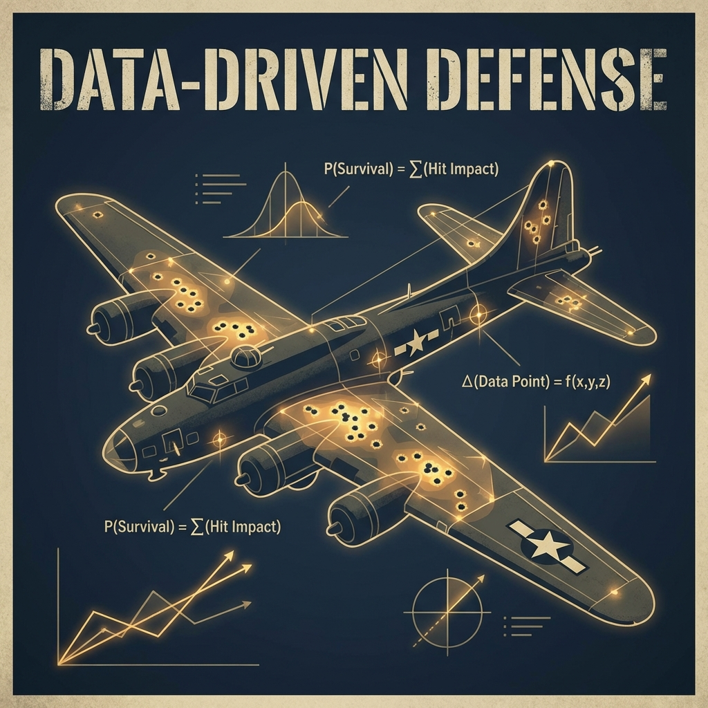

En el entorno de alta presión de la ingeniería de datos y la toma de decisiones ejecutiva, a menudo nos dejamos seducir por el dashboard. Confiamos en las filas de nuestras bases de datos SQL y en los logs de nuestros SIEMs porque son tangibles. Son lo que vemos.

Pero en mi experiencia diseñando sistemas—desde logística de la industria de defensa hasta infraestructuras cloud modernas—los datos más peligrosos no son los valores atípicos; son los datos que nunca llegaron a la base de datos.

Hoy, nos alejamos del código para examinar un "Primer Principio" fundamental del análisis de datos: el **Sesgo del Superviviente**. Para ello, debemos remontarnos a 1943 y a la mente de un hombre que vio lo invisible.

## La Guerra de los Números

La Segunda Guerra Mundial fue el primer conflicto donde la victoria dependió en gran medida del procesamiento de información y la aplicación del rigor matemático a la incertidumbre del campo de batalla. No solo se libró en las playas; se libró en oficinas donde las ecuaciones eran la munición y el enemigo era el error cognitivo.

Las Fuerzas Aéreas Aliadas enfrentaban una crisis. Sus bombarderos estratégicos, las Fortalezas Volantes B-17, sufrían tasas de bajas catastróficas sobre Europa. La solución intuitiva para el mando militar era simple: blindar los aviones. Pero el blindaje es un juego de suma cero; cada kilogramo de acero reduce la carga de bombas y la maniobrabilidad, paradójicamente haciendo que el avión sea más fácil de derribar.

Los militares recurrieron a los datos. Analizaron los bombarderos que regresaban de las misiones y mapearon cada agujero de bala. Los datos hablaban con claridad seductora: las alas, el fuselaje central y la cola estaban plagados de daños.

La lógica militar, guiada por la evidencia empírica visible, dictaba reforzar estas áreas "heridas". Tiene sentido, ¿verdad? Refuerzas donde te impactan.

Aquí es donde intervino **Abraham Wald**, un matemático judío-húngaro del Statistical Research Group (SRG) de la Universidad de Columbia.

  
  <em>Abraham Wald</em>

## La Inversión de la Lógica

Wald era un outsider. Excluido de la educación formal en su juventud debido a su religión, desarrolló una independencia intelectual radical. Miró los mismos diagramas que los generales pero llegó a la conclusión diametralmente opuesta.

Su argumento era elegante y contraintuitivo: **"El blindaje no va donde están los agujeros de bala. Va donde no están los agujeros: en los motores y la cabina"**.

¿Cómo llegó a esta conclusión? Haciendo la única pregunta que nadie más hizo: **¿Dónde están los aviones que faltan?**

Wald asumió que el fuego antiaéreo alemán era aleatorio. No tenía un sistema de guía que buscara las alas. Por lo tanto, los impactos debían estar uniformemente distribuidos. Si los aviones que regresaban a la base tenían agujeros en el fuselaje pero motores intactos, no era porque los motores no fueran alcanzados.

Era porque los aviones alcanzados en los motores **nunca regresaron**.

Los "puntos rojos" en los diagramas no indicaban daño crítico; indicaban daño sobrevivible. Los espacios vacíos eran las zonas letales. Wald nos enseñó que la verdad a menudo reside no en los datos que tenemos, sino en el silencio de los datos que nos faltan.

## Las Matemáticas de la Supervivencia

Aunque la historia se cuenta a menudo como un momento "¡Eureka!", la contribución de Wald fue un modelo estadístico riguroso que involucraba complejas probabilidades condicionales.

Veámoslo desde una perspectiva de ingeniería simplificada. Wald esencialmente estableció una relación inversa entre la densidad de daño observada y la vulnerabilidad.

Si definimos la vulnerabilidad como la probabilidad de que un avión sea derribado dado un impacto en una zona específica, y observamos la densidad de impactos en los supervivientes, la lógica fluye de la siguiente manera:

> **Si vulnerabilidad(motor) ≈ 1 (Letal) → Impactos en Motor en Supervivientes ≈ 0**

En otras palabras: si ser alcanzado en el motor casi siempre significa la muerte, entonces los aviones supervivientes casi nunca tendrán daños en el motor—no porque los motores no fueran alcanzados, sino porque esos aviones se estrellaron.

Wald demostró que un B-17 que regresa con 100 agujeros en sus alas proporciona evidencia estadística de la robustez del ala. Por el contrario, la ausencia de datos sobre daños en la bomba de combustible indica un umbral de fallo críticamente bajo.

## El Fantasma en la Máquina: Implicaciones Modernas

¿Por qué importa esto a un CTO o Ingeniero de Datos moderno? Porque el Sesgo del Superviviente es una epidemia en la economía digital. Estamos construyendo algoritmos y estrategias basadas en conjuntos de datos filtrados, a menudo con resultados desastrosos.

### 1. El Cementerio de Startups

En el ecosistema de startups, estamos obsesionados con el "Mito del Garaje". Vemos a Bill Gates o Mark Zuckerberg abandonar la universidad y tener éxito, así que inferimos que la educación formal es un obstáculo.

Este es un error puramente Waldiano. Estamos analizando los "bombarderos que regresaron". Por cada Zuckerberg, hay miles de desertores que fracasaron y son invisibles para Forbes. Al estudiar solo a los supervivientes ("unicornios"), aislamos características que podrían ser irrelevantes o incluso perjudiciales.

### 2. IA y Sesgo Algorítmico

Aquí es donde el legado de Wald se vuelve crítico para la ingeniería ética. Los modelos de Machine Learning son motores de inferencia. Si se alimentan con datos sesgados por supervivencia, automatizan la discriminación.

Amazon, por ejemplo, tuvo que descartar una IA de reclutamiento porque penalizaba a las mujeres. El modelo fue entrenado con currículums de contrataciones exitosas de la última década (los supervivientes). Como la industria tecnológica estaba históricamente dominada por hombres, el algoritmo aprendió que "ser hombre" era un predictor de supervivencia. No vio a las mujeres brillantes que fueron rechazadas debido al sesgo humano; solo vio los "agujeros en el fuselaje" de los hombres que lo lograron.

### 3. Ciberseguridad: El Efecto Avestruz

En ciberseguridad, los SOCs a menudo miden el éxito por "ataques bloqueados" por el firewall. Esto es peligroso. Un ataque bloqueado es un avión que regresó. El sistema funcionó.

Las amenazas reales son los **Fallos Silenciosos**—el malware que reside en la red durante meses sin activar una alerta (APTs). Si optimizas tu presupuesto basándote únicamente en logs de ataques bloqueados, estás reforzando el fuselaje mientras dejas los motores expuestos a exploits de día cero.

## Conclusión: Interrogando los Nulos

Abraham Wald nos dejó una advertencia epistemológica: **Los datos no son la realidad; son una sombra de la realidad proyectada a través del filtro de la supervivencia**.

Mientras construimos la próxima generación de productos de datos—ya sea un modelo de previsión S&OP o un agente autónomo—debemos adoptar la mentalidad del "Arquitecto del Vacío".

Debemos dejar de limpiar datos simplemente para que compilen. Necesitamos preguntar:
* ¿Qué clientes *no* están en el CRM? (El Churn)
* ¿Qué amenazas *no* están en los logs?
* ¿Qué predicciones *no* se materializaron?

La próxima vez que mires un dashboard que apunta a una conclusión obvia, recuerda los B-17 sobre Europa. Recuerda que la evidencia del éxito puede ser engañosa, y a veces, la única manera de sobrevivir es blindar el vacío.

---

#### Referencias y Lecturas Adicionales

1.  **Wald, A. (1980).** *A Method of Estimating Plane Vulnerability Based on Damage of Survivors*. Center for Naval Analyses.
2.  **Ellenberg, J.** *How Not to Be Wrong: The Power of Mathematical Thinking*. (Analiza el SRG y el impacto de Wald).
3.  **Mangel, M., & Samaniego, F. J. (1984).** *Abraham Wald's Work on Aircraft Survivability*. Journal of the American Statistical Association.
4.  **Crescendo.ai.** *16 Real AI Bias Examples & Mitigation Guide*. (Caso de estudio sobre el algoritmo de contratación de Amazon).
5.  **Forbes Tech Council.** *The Ostrich Effect And Survivorship Bias: The Real Cyber Threats*.
