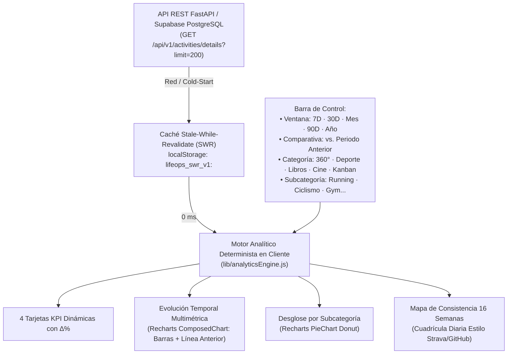
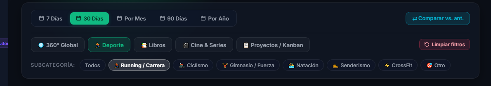
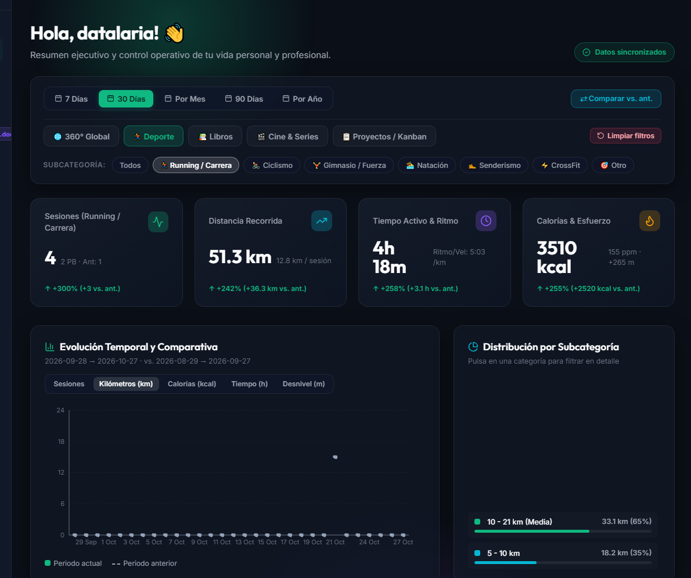
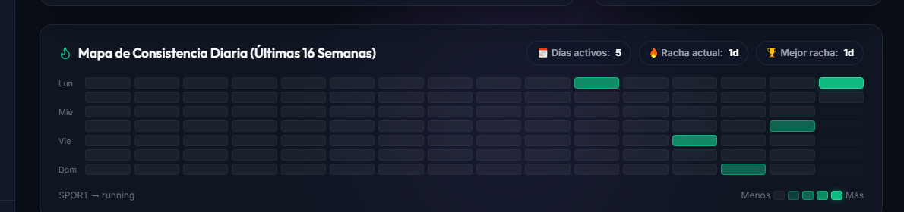
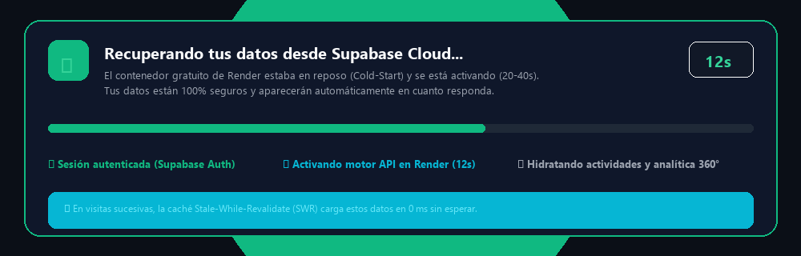

En la [Parte 5 de nuestra serie](/es/posts/app-lifeops_part5_deploy_mobile_pwa/) logramos un hito fundamental: desplegar la arquitectura completa de **LifeOps en producción 24/7 a coste cero ($0/mes)** combinando Netlify, Render y Supabase, optimizando la ergonomía táctil en smartphones e instalando la aplicación como PWA nativa.

Sin embargo, a medida que comienzas a registrar decenas de actividades diarias (carreras, rutas de ciclismo, libros leídos, películas vistas y tareas en tu tablero Kanban), surge una necesidad crítica de negocio y de uso personal: **el dato sin análisis carece de valor operativo**.

Tener 40 o 50 registros en una base de datos PostgreSQL no sirve de mucho si al abrir la aplicación no puedes responder de un vistazo a preguntas ejecutivas como:
- *«¿Cuántos kilómetros he corrido este mes en comparación con el mes anterior?»*
- *«¿Qué porcentaje de mis entrenamientos corresponde a series de velocidad vs. tiradas largas de fondo?»*
- *«¿Cómo ha evolucionado mi consistencia diaria y qué racha de días activos mantengo?»*
- *«¿Cómo puedo filtrar solo las actividades de tipo Running para analizar mi ritmo medio y calorías quemadas sin mezclarlo con el gimnasio o el cine?»*

En esta sexta entrega abordamos la evolución completa del **Dashboard 360° Analytics**, resolviendo tanto el diseño matemático de agregación de datos en cliente como el gran desafío de UX de la infraestructura *serverless* gratuita: **los periodos de reposo (*cold-starts*) de los contenedores cloud**.

> [!TIP]
> **Prueba la analítica en vivo**: Puedes explorar el nuevo Dashboard 360° con datos interactivos en modo Sandbox directo en [https://datalaria.com/apps/lifeops/#/?mock=true](https://datalaria.com/apps/lifeops/#/?mock=true) o iniciar sesión con tu cuenta en [https://datalaria.com/apps/lifeops/](https://datalaria.com/apps/lifeops/).



---

### 🗺️ Hoja de Ruta Completa de la Serie LifeOps

1. 🟢 **Parte 1**: [Arquitectura de un Sistema Operativo Personal y Backend con FastAPI + Supabase](/es/posts/app-lifeops_part1_arquitectura_backend/)
2. 🟢 **Parte 2**: [Frontend React con Glassmorphism, Dashboard 360° y Sistema de Diseño Dark Mode](/es/posts/app-lifeops_part2_frontend_dashboard/)
3. 🟢 **Parte 3**: [Módulos Core: Deporte, Biblioteca, Cine y Tablero Kanban Profesional](/es/posts/app-lifeops_part3_modulos_kanban/)
4. 🟢 **Parte 4**: [Motor de Informes Ejecutivos en Word (.docx) y Exportación Multi-Hoja en Excel (.xlsx)](/es/posts/app-lifeops_part4_informes_word_excel/)
5. 🟢 **Parte 5**: [Despliegue 24/7 en la Nube a Coste Cero ($0/mes), Optimización Móvil y PWA](/es/posts/app-lifeops_part5_deploy_mobile_pwa/)
6. 🟢 **Parte 6 (Este artículo)**: Dashboard 360° con Analítica Multidimensional, Recharts y Mitigación de Cold-Starts en Supabase + Render

---

### 1. Decisión de Arquitectura: ¿Grafana / BI Externo vs. Motor Nativo en React? (ADR-013) ⚖️

Al plantearnos cómo incorporar gráficos avanzados y filtrado temporal, el primer impulso en ingeniería suele ser recurrir a herramientas consagradas de Business Intelligence como **Grafana**, **Metabase** o **Apache Superset**. Sin embargo, tras analizar los requisitos del proyecto bajo nuestra Constitución SDD, registramos la decisión **ADR-013**:

| Factor de Evaluación | Herramienta BI Externa (Grafana / Metabase) | Motor Nativo React 19 + Recharts 3.10 (Nuestra Elección) |
| :--- | :--- | :--- |
| **Seguridad Multi-Tenant (RLS)** | ❌ Requiere conexión de base de datos directa. Propagar el JWT de Supabase Auth de cada usuario exige licencias Enterprise o proxies complejos. | ✅ **Aislamiento perfecto**: consume las APIs seguras del usuario autenticado bajo Row-Level Security (`auth.uid() = user_id`). |
| **Coste de Infraestructura** | ❌ Requiere un contenedor o servidor adicional 24/7 con RAM dedicada, o planes de pago en la nube. | ✅ **0,00 €/mes**: se compila directamente en el bundle estático de Netlify. |
| **Modo Sandbox (`?mock=true`)** | ❌ Imposible alimentar un iframe externo con datos simulados en la memoria del navegador. | ✅ **Compatibilidad 100%**: funciona de inmediato con datos sintéticos deterministas. |
| **Latencia al Cambiar Filtros** | ⚠️ Cada clic dispara una consulta SQL remota a la nube. | ✅ **0 ms**: el dataset completo del periodo se filtra en memoria con funciones puras `useMemo`. |
| **Experiencia Móvil y Estética** | ⚠️ Ruptura visual del *Glassmorphism Dark Mode* y problemas de scroll anidado en smartphones. | ✅ **Diseño unificado**: interfaz responsiva, táctil y adaptada a la estética de Datalaria. |



---

### 2. Filtrado Multidimensional en Cascada y Comparativa Inter-Periodo ⏱️📊

El corazón de la nueva experiencia es la **Barra de Control Analítico**, que permite explorar los datos en tres niveles de profundidad sin recargar la página:



#### A. Resolución de Ventanas Temporales
El motor soporta cinco horizontes temporales mediante la función determinista `resolveTimeWindows()`:
1. **`7 Días` (`week`)**: Últimos 7 días móviles vs. los 7 días inmediatamente anteriores.
2. **`30 Días` (`month`)**: Últimos 30 días móviles vs. los 30 días anteriores.
3. **`Por Mes` (`calendar_month`)**: Selector dinámico de mes (`Enero` a `Diciembre`) y año, comparado con el mes natural previo.
4. **`90 Días` (`quarter`)**: Últimos 90 días móviles agrupados por semana.
5. **`Por Año` (`year`)**: Vista consolidada del año completo con 12 cubos mensuales vs. el año anterior.

#### B. Invariante INV-8: Cálculo Determinista de Variación Porcentual ($\Delta\%$)
Para comparar el rendimiento actual ($V_{\text{curr}}$) frente al periodo previo ($V_{\text{prev}}$) sin sufrir errores de división por cero cuando comienzas una nueva disciplina:

$$\Delta\% = \begin{cases} 
0\% & \text{si } V_{\text{prev}} = 0 \text{ y } V_{\text{curr}} = 0 \\
+100\% & \text{si } V_{\text{prev}} = 0 \text{ y } V_{\text{curr}} > 0 \\
\text{round}\left(\dfrac{V_{\text{curr}} - V_{\text{prev}}}{V_{\text{prev}}} \times 100\right) & \text{en cualquier otro caso}
\end{cases}$$

Implementado en `lib/analyticsEngine.js`:

```javascript
export function computeDelta(currentVal, prevVal, unit = '', language = 'es') {
  const curr = Number(currentVal) || 0;
  const prev = Number(prevVal) || 0;
  const vsLabel = language === 'es' ? 'vs. ant.' : 'vs. prev.';

  if (prev === 0 && curr === 0) {
    return { positive: true, deltaPct: 0, text: 'Estable (0% vs. ant.)' };
  }
  if (prev === 0 && curr > 0) {
    return { positive: true, deltaPct: 100, text: `+100% (+${curr}${unit} ${vsLabel})` };
  }

  const diff = curr - prev;
  const pct = Math.round((diff / prev) * 100);
  const sign = diff >= 0 ? '+' : '';
  return {
    positive: diff >= 0,
    deltaPct: pct,
    diff,
    text: `${sign}${pct}% (${sign}${diff.toFixed(1)}${unit} ${vsLabel})`,
  };
}
```

---

### 3. La Suite Visual con Recharts: KPIs Contextuales, Series Temporales y Donut 📈🍩

Al cambiar de categoría o seleccionar una subcategoría (por ejemplo, filtrar por **`Deporte` ➔ `Running / Carrera`**), todo el panel se transforma dinámicamente:



1. **4 Tarjetas KPI Contextuales**:
   - En **Deporte**: adaptan sus métricas a la disciplina activa:
     - *Sesiones*: nº de entrenamientos con badge de $\Delta\%$ y récords personales (PB).
     - *Distancia*: kilometraje total acumulado y media de km por sesión.
     - *Tiempo y Ritmo*: duración activa total y ritmo medio (`min/km` en running o `km/h` en ciclismo).
     - *Calorías y Esfuerzo*: calorías quemadas, frecuencia cardíaca media (`ppm`) y desnivel positivo (`+m`).
2. **Gráfico de Evolución Temporal Multimétrica (`ComposedChart`)**:
   - Muestra las barras del periodo actual coloreadas según la categoría y superpone una **línea punteada con los datos del periodo anterior** cuando el botón `⇄ Comparar vs. ant.` está activo.
   - Selector integrado de métrica en cabecera: puedes alternar al vuelo entre **Sesiones**, **Kilómetros**, **Calorías**, **Tiempo en horas** o **Desnivel acumulado**.
3. **Distribución por Subcategoría (`PieChart` Donut)**:
   - Permite visualizar la cuota porcentual de cada actividad. Al hacer clic en cualquier sector o fila de la leyenda, el dashboard aplica un *drill-down* automático hacia esa subcategoría.

---

### 4. Mapa de Calor de Consistencia Diaria (16 Semanas Estilo Strava / GitHub) 🔥🗓️

La motivación en la gestión personal y deportiva se fundamenta en la constancia. Para ofrecer una visualización clara de hábitos y rachas, incorporamos una cuadrícula de 112 días (16 semanas × 7 días, de Lunes a Domingo):



El algoritmo evalúa la intensidad diaria en 5 niveles (`level-0` a `level-4`) según el volumen de actividad realizado y calcula en tiempo real:
- **Días activos en el periodo**.
- **Racha actual (*Current Streak*)**: contabilizando días consecutivos hacia atrás desde hoy o ayer.
- **Mejor racha histórica (*Best Streak*)**.

---

### 5. El Gran Reto de UX: Mitigación de Cold-Starts en la Nube Gratuita ⚡🛡️

Al desplegar aplicaciones full-stack en servicios cloud gratuitos (como el plan *Free Tier* de Render.com), nos enfrentamos a una realidad inevitable: **el contenedor entra en reposo tras 15 minutos sin peticiones**.

Cuando un usuario accede a la web tras varias horas de inactividad, el primer acceso puede tardar entre **20 y 40 segundos** mientras la máquina virtual Python arranca. En versiones anteriores, este retraso provocaba un efecto nefasto: el usuario veía las tarjetas con valor `0` y los gráficos vacíos, llegando a pensar que **sus datos se habían borrado o perdido**.

Para resolver este problema de forma radical sin romper el principio de **coste 0 €/mes**, diseñamos una solución en tres capas:



#### Capa 1: Pre-Warming Silencioso en el Arranque (`wakeUpServer`)
En el mismo instante en que el navegador carga la SPA en `AuthContext.jsx`, antes incluso de que el usuario termine de autenticarse o de navegar al Dashboard, se dispara un `fetch` no bloqueante al endpoint `/health`. Esto le otorga al contenedor entre 5 y 10 segundos de ventaja para despertar.

#### Capa 2: Caché Local *Stale-While-Revalidate* (SWR) aislada por Usuario (`INV-10`)
Toda respuesta de lectura (`GET /api/v1/activities/details`, `/tasks`, `/stats/dashboard`) se persiste en el `localStorage` del navegador bajo una clave estricta con prefijo de usuario (`lifeops_swr_v1:<user_id>:<endpoint>`).
- En la siguiente visita, los datos y gráficos se hidratan **en menos de 10 milisegundos (`0 ms` perceptibles)**.
- El usuario ve su información de inmediato, mientras en segundo plano se consulta a Render para obtener cualquier cambio reciente.
- Si el usuario realiza una mutación (`POST`, `PATCH`, `DELETE`), la caché local se invalida automáticamente para garantizar consistencia.

#### Capa 3: Banner de Sincronización en Primer Plano y Skeletons
Si el usuario entra desde un dispositivo nuevo o ha limpiado la caché y debe esperar el *Cold-Start* del servidor:
1. **Nunca mostramos ceros engañosos**: las tarjetas KPI muestran indicadores de espera (`···`) en lugar de `0`.
2. **Banner Informativo en Primer Plano**: muestra un spinner animado, un contador de segundos transcurridos en vivo (`0s, 1s, 2s...`), una barra de progreso visual y las fases del proceso:
   - `✓ Sesión autenticada (Supabase Auth)`
   - `⟳ Activando motor API en Render Cloud`
   - `⏳ Hidratando actividades y analítica 360°`
3. Si la espera supera los 4 segundos, el banner explica con total transparencia que el contenedor en la nube se está activando y que **sus datos están 100% protegidos**.
4. **Auto-ajuste de Ventana Temporal**: si la consulta devuelve actividades pero ninguna pertenece a los últimos 30 días (por ejemplo, tras un mes de vacaciones), el dashboard conmuta automáticamente a la vista de `90 Días` o `Por Año` para que los gráficos aparezcan poblados inmediatamente.

---

### 6. Conclusiones y Próximos Pasos 🚀

Con esta actualización, LifeOps pasa de ser una libreta de registros a un **auténtico sistema operativo de inteligencia personal y profesional**. La combinación de un motor analítico determinista en memoria con una arquitectura resiliente ante periodos de reposo demuestra que es perfectamente posible construir software rápido, seguro y visualmente atractivo manteniendo una factura de infraestructura de **0,00 € al mes**.

Tanto la aplicación web como el código fuente y las especificaciones técnicas completas están disponibles en la plataforma:

- 🎮 **Aplicación Web Desplegada**: [https://datalaria.com/apps/lifeops/](https://datalaria.com/apps/lifeops/)
- 🕹️ **Modo Sandbox Interactivo (Sin Registro)**: [https://datalaria.com/apps/lifeops/#/?mock=true](https://datalaria.com/apps/lifeops/#/?mock=true)
- 📋 **Ficha Técnica Oficial de LifeOps**: [/es/apps/lifeops/](/es/apps/lifeops/)
