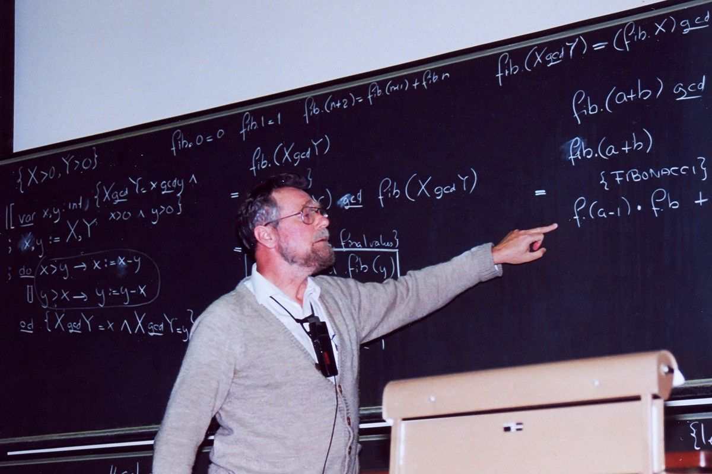
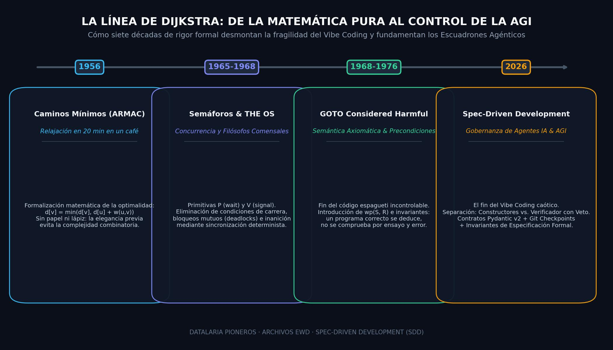

A comienzos de la década de 1950, en las oficinas del *Mathematisch Centrum* de Ámsterdam, un joven investigador holandés de complexión enjuta, mirada penetrante y voz pausada sostenía una convicción tan radical que escandalizaba a los ingenieros electrónicos de la posguerra: **la programación no era un oficio artesanal de fontanería electromecánica ni una cuestión de ensayo y error; era una rama de la matemática pura tan rigurosa como la geometría de Euclides o el cálculo diferencial de Newton**.

Aquel hombre se llamaba **Edsger Wybe Dijkstra** (1930–2002).

A lo largo de su vida, su personalidad intransigente y su aversión por las concesiones a la mediocridad dieron lugar a un anecdotario legendario que aún hoy se relata en las facultades de informática de todo el mundo con devoción reverencial:

En la primavera de 1956, el centro de cálculo de Ámsterdam estaba terminando de construir el ordenador **ARMAC**. Para su inauguración oficial ante dignatarios y la prensa, la dirección del laboratorio necesitaba una demostración espectacular que el público general pudiera comprender sin esfuerzo. Le encargaron la tarea a Dijkstra: debía diseñar un programa que calculara la ruta más corta para viajar por carretera entre sesenta y cuatro ciudades de los Países Bajos.

Dijkstra salió del laboratorio a pasear por los canales de Ámsterdam con su prometida, **Maria (Ria) Debets**. Se sentaron en la terraza de un café al sol a tomar una taza matinal y, en apenas **veinte minutos de deliberación mental**, concibió el algoritmo de caminos mínimos más famoso, eficiente e imperecedero de la historia de la ciencia.

Lo asombroso no fue solo la rapidez, sino su método: **no utilizó papel, ni lápiz, ni servilletas para hacer anotaciones**. Décadas después, cuando le preguntaban cómo era posible concebir semejante obra maestra sin garabatear una sola ecuación, Dijkstra respondía con su clásica ironía punzante:

> —*«Si necesitas papel y lápiz para diseñar un algoritmo, significa que el algoritmo todavía es demasiado complicado. Diseñar en tu cabeza te obliga a destilar la estructura lógica hasta que resulte inevitablemente simple, limpia y bella»*.



Apenas un año después, en 1957, cuando acudió al registro civil del Ayuntamiento de Ámsterdam para contraer matrimonio con Maria, el funcionario municipal le pidió que indicara su profesión para el acta matrimonial oficial. Dijkstra respondió con naturalidad:

> —*«Programador de ordenadores»*.  
> El funcionario frunció el ceño, hojeó el reglamento civil de profesiones reconocidas por el Reino de los Países Bajos y denegó la solicitud con ademán burocrático:  
> —*«Esa profesión no existe en las leyes holandesas, señor Dijkstra. No puedo casarle con ese título»*.

Para poder celebrar la boda, Dijkstra tuvo que resignarse a inscribirse bajo la etiqueta administrativa de *«Físico Teórico»*, la carrera que había estudiado en la Universidad de Leiden. Fue, a todos los efectos prácticos, el primer programador oficial de los Países Bajos antes de que el mundo entendiera qué significaba esa palabra.

Y cuando ya era catedrático consagrado en la Universidad de Texas en Austin y ganador del prestigioso **Premio Turing en 1972**, Dijkstra mantuvo una excentricidad que desconcertaba a sus colegas: **se negaba a tener un ordenador en su despacho**. 

Durante más de cuatro décadas escribió a mano, utilizando una pluma estilográfica Montblanc y tinta china negra, más de **1.300 ensayos técnicos y cartas públicas**, conocidos universalmente como los **manuscritos EWD**. Los numeraba minuciosamente de su puño y letra (`EWD 1`, `EWD 2`... hasta el `EWD 1318`), los fotocopiaba en el campus y los enviaba por correo postal ordinario a una red selecta de matemáticos de todo el planeta, creando de facto la primera "red social" de debate técnico y epistemológico de la computación.

Si [Alan Turing](/es/posts/alan_turing/) concibió la máquina abstracta universal, si [John von Neumann](/es/posts/john_von_neumann/) estructuró el hardware de memoria compartida, si [Claude Shannon](/es/posts/claude_shannon/) cuantificó la información en bits, si [Kurt Gödel](/es/posts/kurt_godel/) cartografió las fronteras de la lógica formal y si [Norbert Wiener](/es/posts/norbert_wiener/) descubrió el bucle de feedback cibernético, **Edsger Dijkstra enseñó a la humanidad cómo escribir software sin caer en el abismo del caos, el autoengaño y la autodestrucción**.

En este 2026, cuando la industria del software se encuentra deslumbrada por la fiebre del *«Vibe Coding»* —la práctica de pedir código a modelos masivos de lenguaje mediante lenguaje natural impreciso esperando que el resultado funcione por azar estadístico—, el legado de Dijkstra no es una reliquia del pasado: **es el antídoto intelectual definitivo y el fundamento matemático sobre el que descansa la verdadera ingeniería agéntica de la AGI**.

---

### 1. De la Física Teórica a ALGOL 60: La Barba del Compilador

Nacido en Róterdam en mayo de 1930, Dijkstra era hijo de un químico y de una matemática con un talento excepcional para la deducción formal que le inculcó desde la infancia una pasión feroz por la elegancia geométrica.

Tras cursar física teórica y matemáticas en la Universidad de Leiden, su entrada en la computación en 1952 fue casi accidental: el director del *Mathematisch Centrum*, Adriaan van Wijngaarden, le ofreció un empleo a tiempo parcial para programar las primeras computadoras holandesas experimentales (el ARRA y el ARMAC). 

Dijkstra pronto descubrió una dolorosa verdad: **los ordenadores electrónicos eran instrumentos diabólicamente rápidos para amplificar la torpeza humana**. Las máquinas eran capaces de ejecutar miles de instrucciones por segundo, pero los humanos seguían cometiendo errores al mismo ritmo artesanal de siempre.

En 1959, Dijkstra se involucró en el comité internacional de diseño del lenguaje **ALGOL 60**, un proyecto paneuropeo que aspiraba a crear un lenguaje formal universal independiente de las máquinas propietarias de IBM. ALGOL 60 introdujo conceptos que hoy consideramos elementales: los bloques de código delimitados por `begin...end`, el ámbito léxico de variables, el paso de parámetros por valor y por nombre, y una innovación conceptual que muchos teóricos consideraban imposible de implementar en el hardware limitado de la época: **la recursividad**.

Dijkstra y su colega **Jaap Zonneveld** asumieron el desafío de construir el primer compilador del mundo para ALGOL 60 sobre la máquina experimental Electrologica X1. Antes de picar la primera línea de código máquina, ambos ingenieros sellaron un pacto de honor casi monástico:

> **No se afeitarían la barba hasta que el compilador estuviera completamente terminado, formalmente verificado y libre de cualquier fallo conocido.**

Durante meses de trabajo exhaustivo en Ámsterdam, sus barbas crecieron frondosas mientras derivaban cada instrucción con rigor algebraico. El 24 de agosto de 1960, el compilador ejecutó su primer programa recursivo sin un solo error. Zonneveld se afeitó de inmediato; Dijkstra, en cambio, se miró al espejo, acarició su barba recién estrenada y decidió conservarla para siempre como símbolo de su disciplina matemática. Aquella barba blanca tupida se convertiría, junto a sus sandalias de cuero y sus camisas arrugadas, en el icono visual de la resistencia formal frente al empirismo chapucero de la industria.

---

### 2. El Algoritmo de Caminos Mínimos y la Búsqueda de la Optimalidad

El algoritmo que Dijkstra ideó en aquella terraza de café en 1956 —y que no publicó hasta 1959 en su célebre artículo de tres páginas *«A note on two problems in connexion with graphs»* en la revista *Numerische Mathematik*— permanece como uno de los monumentos más puros del pensamiento analítico.

Para comprender su genialidad, consideremos un grafo dirigido ponderado $G = (V, E)$, donde cada nodo $v \in V$ representa una ubicación o un estado, y cada arista $(u, v) \in E$ posee un peso o coste no negativo $w(u, v) \ge 0$. El objetivo es encontrar la trayectoria de coste mínimo desde un nodo origen $s$ hasta todos los demás nodos del grafo.

Un enfoque ingenuo de fuerza bruta intentaría evaluar todos los caminos posibles entre dos puntos, provocando una **explosión combinatoria factorial** que colapsaría a cualquier supercomputador. 

Dijkstra demostró que no hacía falta explorar a ciegas: formuló el principio de **relajación voraz (*greedy relaxation*)** con una función invariante indestructible. Mantenemos un conjunto de nodos visitados $S$ para los cuales la distancia mínima $d[u]$ ya ha sido certificada como definitiva. En cada paso iterativo, seleccionamos el nodo no explorado $u^* \notin S$ que posee la menor distancia tentativa calculada hasta el momento:

$$u^* = \arg\min_{v \notin S} d[v]$$

Añadimos $u^*$ al conjunto de certezas ($S \leftarrow S \cup \{u^*\}$) y procedemos a **relajar** todas las aristas salientes $(u^*, v) \in E$:

$$d[v] = \min \left( d[v],\; d[u^*] + w(u^*, v) \right)$$


flowchart TD
    classDef classic fill:#1e1b4b,stroke:#818cf8,stroke-width:2px,color:#fff;
    classDef agents fill:#064e3b,stroke:#34d399,stroke-width:2px,color:#fff;
    classDef danger fill:#450a0a,stroke:#f87171,stroke-width:2px,color:#fff;

    subgraph PHILOSOPHERS ["1965: Cena de los Filósofos Comensales (THE OS)"]
        direction TB
        P1["🧑‍🏫 5 Filósofos piensan y comen"]:::classic --> P2["🍴 5 Tenedores compartidos en mesa circular"]:::classic
        P2 --> P3{"¿Todos agarran el tenedor izquierdo a la vez?"}:::danger
        P3 -- "Sin semáforo" --> D1["🚨 DEADLOCK CIRCULAR (Inanición absoluta)"]:::danger
        P3 -- "Con Semáforos P/V" --> S1["✅ Exclusión mutua determinista"]:::classic
    end

    subgraph MULTIAGENT ["2026: Escuadrones Multi-Agente de IA (Helix / Scriba)"]
        direction TB
        A1["🤖 N Subagentes concurrentes (Frontend, Backend, DB)"]:::agents --> A2["📁 Repositorio Git, Esquemas SQL y Memoria de Estado"]:::agents
        A2 --> A3{"¿Edición concurrente sobre el mismo código?"}:::danger
        A3 -- "Vibe Coding ciego" --> D2["🚨 CONDICIONES DE CARRERA & ESTADO CORRUPTO"]:::danger
        A3 -- "Orquestador SDD + Checkpoints" --> S2["✅ Validación Atómica con VETO (QA_PASS)"]:::agents
    end


La demostración de Dijkstra probó matemáticamente que, dado que todos los pesos son no negativos ($w \ge 0$), la distancia asignada a $u^*$ no puede ser mejorada por ningún camino alternativo que pase por nodos no explorados.

Aquel hallazgo de veinte minutos es hoy la sangre invisible que bombea la civilización digital:
* **El enrutamiento de Internet**: El protocolo **OSPF** (*Open Shortest Path First*), que determina cómo viajan los paquetes de datos entre los conmutadores de fibra óptica de todo el planeta, ejecuta una variante directa del algoritmo de Dijkstra.
* **La navegación satelital**: Los motores de cálculo de rutas de Google Maps, Waze o los sistemas de aviación civil operan sobre versiones aceleradas con heurísticas (como el algoritmo $A^*$, formulado en 1968 por Hart, Nilsson y Raphael como una generalización informada de Dijkstra).
* **Los grafos de razonamiento en la IA moderna**: En 2026, los modelos de frontera con inferencia deliberativa (*System 2 reasoning*) exploran árboles de pensamiento (*Tree-of-Thoughts* y *Graph-of-Thoughts*). La selección de qué camino de razonamiento explorar y podar para maximizar la probabilidad de acierto sin agotar el presupuesto de tokens es, en su esencia algorítmica, una búsqueda sobre grafos ponderados basada en la relajación de Dijkstra.

---

### 3. Los Filósofos Comensales y el Sistema THE: La Invención de la Concurrencia

Hacia 1965, la industria de la computación se enfrentó a un nuevo monstruo tecnológico: la **multiprogramación**. Las computadoras ya no ejecutaban un solo programa a la vez; procesaban múltiples tareas simultáneamente compartiendo la misma CPU y los mismos periféricos mediante interrupciones de hardware.

El resultado fue una pesadilla de inestabilidad: programas que se pisaban la memoria unos a otros, bloqueos impredecibles que solo ocurrían una vez cada tres semanas y fallos que ningún ingeniero lograba reproducir en el laboratorio (*condiciones de carrera* o *heisenbugs*).

Dijkstra diseñó en la Universidad Técnica de Eindhoven el sistema operativo **THE** (*Technische Hogeschool Eindhoven*), publicado en 1968. Para domar la concurrencia, inventó dos conceptos que fundaron la disciplina de los sistemas operativos:

#### 1. Los Semáforos y la Exclusión Mutua
Dijkstra comprendió que las variables ordinarias no servían para sincronizar procesos independientes porque la lectura y la escritura en memoria no eran operaciones atómicas. Concibió entonces el **Semáforo**: una variable entera no negativa protegida que solo puede manipularse mediante dos operaciones indivisibles a nivel de hardware, bautizadas con las iniciales holandesas:
* **`P(s)`** (*del holandés Proberen, "probar" o "intentar decrementar"*): si $s > 0$, decrementa $s$ en 1 y continúa; si $s = 0$, el proceso se suspende de inmediato a la espera de que el recurso quede libre.
* **`V(s)`** (*del holandés Verhogen, "incrementar"*): incrementa $s$ en 1 y despierta a uno de los procesos que estuvieran bloqueados esperando el recurso.

Con este mecanismo elemental, Dijkstra resolvió el problema de la **Exclusión Mutua (*Mutex*)**: garantizar que un recurso crítico compartido (una impresora, una tabla de base de datos o un registro contable) solo pueda ser modificado por una entidad a la vez.

  
  <em>Edsger W. Dijkstra frente a la pizarra en la Universidad de Texas en Austin (1994): su método docente prescindía de transparencias y ordenadores; exigía razonamiento formal en tiza viva.</em>

#### 2. La Cena de los Filósofos Comensales (1965)
Para ilustrar los peligros de la concurrencia desregulada a sus alumnos, Dijkstra formuló la parábola más célebre de la computación:
* Cinco filósofos se sientan alrededor de una mesa circular. Frente a cada uno hay un plato de espaguetis, y entre cada par de platos hay un único tenedor (cinco tenedores en total).
* La vida de un filósofo consiste en alternar dos estados: pensar y comer.
* Para comer espaguetis se necesitan estrictamente **dos tenedores** (el de su izquierda y el de su derecha).
* Cuando un filósofo tiene hambre, intenta coger sus dos tenedores adyacentes; cuando termina, los suelta y vuelve a pensar.

Si cada filósofo se sienta a la mesa y toma simultáneamente el tenedor que tiene a su izquierda, cada uno sostiene un tenedor y espera a que el filósofo de su derecha suelte el suyo. **Nadie puede comer, nadie suelta su tenedor y los cinco mueren de inanición (*Deadlock* o interbloqueo circular)**.

Dijkstra demostró que la concurrencia sin un protocolo formal y asimétrico de asignación de recursos conduce fatalmente a la parálisis del sistema, e ideó algoritmos de jerarquía de recursos (como su célebre **Algoritmo del Banquero**) para certificar que un sistema nunca entre en un estado inseguro.

En 2026, cuando construimos **Escuadrones de Subagentes de Inteligencia Artificial** que operan en paralelo sobre un mismo repositorio de código o base de datos relacional —como analizamos en nuestra guía sobre [Cómo Crear Agentes de IA para la Operativa Empresarial con SDD](/es/posts/agentes_ia_operativa_sdd/)—, el problema de los Filósofos Comensales revive con fuerza: sin un Orquestador central y bloqueos de exclusión mutua (*checkpoints* atómicos), los agentes entran en condiciones de carrera, sobrescribiendo el trabajo de sus pares y corrompiendo la arquitectura del proyecto.

---

### 4. «GOTO Considered Harmful» y el Veto al Vibe Coding en la Era de la AGI

En marzo de 1968, la revista *Communications of the ACM* publicó una carta al editor enviada por Dijkstra que desató una tormenta de proporciones bíblicas en el mundo del software: ***«Go To Statement Considered Harmful»*** (La sentencia GOTO considerada perjudicial).

Hasta entonces, los programadores utilizaban la instrucción de salto incondicional `GOTO` sin ningún pudor: saltaban hacia adelante, hacia atrás, dentro de bucles o entre subrutinas arbitrarias. El resultado eran marañas indescifrables bautizadas como **código espagueti**. 

La tesis de Dijkstra era demoledora:
> *«Durante varios años he observado que la calidad de los programadores es una función decreciente de la densidad de instrucciones GOTO presentes en sus programas... El uso de GOTO tiene efectos desastrosos porque hace imposible seguir mentalmente la relación entre el texto estático del programa y su flujo dinámico de ejecución en el tiempo»*.

Dijkstra demostró que cualquier cómputo concebible podía expresarse utilizando exclusivamente tres estructuras de control canónicas:
1. **Secuencia** (ejecución paso a paso).
2. **Selección** (`if...then...else`).
3. **Iteración** (`while...do` con invariante de bucle).

Nacía la **Programación Estructurada**. Pero para Dijkstra, estructurar el código era solo el primer paso. Su meta suprema era la **Verificación Formal**: tratar a los programas de software como teoremas matemáticos que debían ser demostrados antes de ser ejecutados.

En 1976 publicó su obra maestra teórica: ***«A Discipline of Programming»***. En ella formuló el concepto de la **Precondición más Débil (*Weakest Precondition*, $wp(S, R)$)**:

Dado un comando o bloque de código $S$ y una postcondición deseada $R$ (lo que queremos que sea cierto tras la ejecución), $wp(S, R)$ representa el conjunto exacto de condiciones iniciales que deben cumplirse antes de ejecutar $S$ para **garantizar matemáticamente** que el programa terminará con éxito y que la condición $R$ será verdadera.

En ese mismo tratado, formuló la sentencia que debería estar grabada en bronce en la entrada de todos los centros de desarrollo de software:

> **«Program testing can be used to show the presence of bugs, but never to show their absence!»**  
> *(Probar un programa sirve para demostrar la presencia de errores, pero jamás para demostrar su ausencia).*


flowchart TD
    classDef vibe fill:#450a0a,stroke:#f87171,stroke-width:2px,color:#fff;
    classDef sdd fill:#0f172a,stroke:#38bdf8,stroke-width:2px,color:#fff;
    classDef gate fill:#064e3b,stroke:#34d399,stroke-width:2px,color:#fff;

    subgraph VIBE ["VIBE CODING (El GOTO Moderno)"]
        direction TB
        V1["💬 Prompt ambiguo en lenguaje natural"]:::vibe --> V2["🤖 Generación probabilística ciega de código"]:::vibe
        V2 --> V3["👁️ Prueba visual superficial (si compila, vale)"]:::vibe
        V3 --> V4["🚨 Error en edge case / Regresión oculta a las 48h"]:::vibe
        V4 --> V5["🩹 Parche sobre parche con nuevos prompts"]:::vibe
        V5 -.->|"Ciclo de degradación"| V1
    end

    subgraph SDD ["SPEC-DRIVEN DEVELOPMENT (Dijkstra 2026)"]
        direction TB
        S1["📐 Especificación Formal Previa: spec.md + design.md"]:::sdd --> S2["🔒 Invariantes Matemáticas y Contratos Pydantic v2"]:::sdd
        S2 --> S3["⚡ Construcción por Agentes Especializados"]:::sdd
        S3 --> S4{"🛡️ Gate de Verificación Determinista (QA Independiente)"}:::gate
        S4 -- "QA_PASS" --> S5["🚀 Release Limpia y Auditada"]:::gate
        S4 -- "Fallo en invariante" --> S6["🛑 DERECHO A VETO & ROLLBACK AUTOMÁTICO"]:::sdd
    end


#### La Profecía de Dijkstra sobre el «Vibe Coding» en 2026
Si Edsger Dijkstra reviviera en 2026 y observara la moda del *Vibe Coding* —desarrolladores arrojando prompts vagos a un modelo de IA y aceptando código generado porque *"parece que funciona en la primera prueba visual"*—, su reacción no sería de asombro; sería de cólera analítica.

Para Dijkstra, el *Vibe Coding* es la reencarnación exacta y corregida del salto con `GOTO`:
1. **La ilusión de la completitud empírica**: Un modelo de lenguaje predice el siguiente token más verosímil basándose en correlaciones estadísticas del pasado. Probar el código dos o tres veces con entradas felices (*happy paths*) solo demuestra que no falló en esos tres casos concretos. En sistemas concurrentes, distribuidos o financieros, los errores catastróficos residen en los rincones matemáticos que el prompt humano olvidó especificar.
2. **La degradación de la especificabilidad**: Cuando delegamos en la IA la generación de código sin haber formalizado antes la especificación ($wp(S, R)$), no estamos programando: estamos practicando la adivinación. Si el programador no comprende las invariantes de su propio sistema, se convierte en rehén de una caja negra probabilística.

Frente a esta fragilidad, la ingeniería de software moderna ha redescubierto el rigor de Dijkstra a través del **Spec-Driven Development (SDD)**, la metodología que analizamos en profundidad en [SDD vs. Vibe Coding](/es/posts/sdd_vs_vibe_coding/):
* **Separación tajante entre Especificación e Implementación**: Ningún agente escribe una sola línea de código sin un contrato previo (`spec.md`) validado con esquemas de datos estrictos (Pydantic v2) e invariantes funcionales inmutables.
* **Separación de Poderes con Derecho a Veto (`INV-HELIX-1`)**: Al igual que Dijkstra separaba al diseñador del algoritmo del compilador, en un escuadrón agéntico moderno los agentes constructores jamás validan su propio trabajo. Un **Agente Verificador de QA independiente** ejecuta pruebas deterministas contra las invariantes formales y posee la autoridad inapelable de vetar la entrega y disparar un *rollback* al menor síntoma de regresión (tal como documentamos en [Evaluación y Testing de Agentes de IA en Producción](/es/posts/evaluacion_agentes_ia/)).

---

### 5. El Sabio de Austin, las Frases Lapidarias y la Pregunta Abierta

En 1984, tras décadas en Europa, Dijkstra aceptó la cátedra Schlumberger de Ciencias de la Computación en la Universidad de Texas en Austin, donde enseñaría hasta su jubilación en el año 2000.

Allí perfeccionó su estilo pedagógico inimitable. Entraba al aula sin apuntes, se sentaba al borde de la mesa, miraba a sus estudiantes a los ojos y comenzaba a derivar demostraciones en la pizarra con tiza blanca, prohibiendo el uso de transparencias prefabricadas porque creía que anestesiaban la capacidad de atención.

De su pluma nacieron muchas de las frases más afiladas, lúcidas y demoledoras de la historia de la ciencia:
* *«La Ciencia de la Computación trata sobre ordenadores tanto como la Astronomía trata sobre telescopios»*.
* *«Preguntarse si un ordenador puede pensar es tan interesante como preguntarse si un submarino puede nadar»*.
* *«La simplicidad es una precondición para la fiabilidad, no una consecuencia tardía»*.
* *«La elegancia no es un lujo dispensable, sino un factor decisivo que separa la supervivencia del desastre en un sistema complejo»*.

Afectado por un cáncer terminal, Dijkstra regresó en 2002 a su hogar en Nuenen (Países Bajos), el mismo pueblo donde un siglo antes Vincent van Gogh había pintado a *Los comedores de patatas*. Murió plácidamente el 6 de agosto de 2002, rodeado de su esposa Maria y sus tres hijos.

Hoy, mientras nos asomamos a la frontera de la Inteligencia Artificial General y contemplamos cómo los agentes de software se preparan para gestionar infraestructuras energéticas, mercados financieros y redes de defensa global, la voz de aquel hombre que diseñó el camino más corto en un café de Ámsterdam resuena con una vigencia escalofriante:

No importa cuán gigantesco sea el modelo de lenguaje, no importa cuántos billones de parámetros alimenten su inferencia, y no importa cuán convincente suene la voz sintética de la máquina: **un sistema complejo sin especificación formal e invariantes matemáticas verificables está condenado a colapsar bajo el peso de su propia entropía**.

---

### Una Pregunta Abierta para el Lector

Edsger Dijkstra dedicó su vida entera a advertirnos contra la pereza mental de aceptar sistemas informáticos simplemente porque "parecen funcionar".

Nos enseñó que la verdadera maestría de un ingeniero no reside en su capacidad para lidiar con el desorden, sino en su coraje para imponer la simplicidad y el rigor formal allí donde otros se conforman con el caos.

En 2026, cuando millones de desarrolladores en todo el mundo se rinden a la tentación de delegar su pensamiento en cajas negras estadísticas mediante *Vibe Coding*, nos queda una pregunta crucial sobre el futuro de nuestra civilización técnica:

**Cuando encendamos los sistemas que gobernarán el mundo de la AGI... ¿seremos arquitectos rigurosos capaces de demostrar formalmente la corrección de nuestras especificaciones, o nos convertiremos en aprendices de brujo que aceptan a ciegas cualquier código generado simplemente porque no tenemos la disciplina matemática de entenderlo?**

**Y si un algoritmo diseñado en veinte minutos en una terraza de café pudo enrutar el planeta entero durante setenta años... ¿cuánta de la complejidad artificial que hoy construimos desaparecería si nos atreviéramos a pensar con la claridad de Edsger Dijkstra?**

---

#### Fuentes y Enlaces de Interés:
* [**Edsger W. Dijkstra (1959)**: *A note on two problems in connexion with graphs* — Numerische Mathematik 1, 269–271](https://link.springer.com/article/10.1007/BF01386390)
* [**Edsger W. Dijkstra (1968)**: *Go To Statement Considered Harmful* — Communications of the ACM, Vol. 11, No. 3](https://dl.acm.org/doi/10.1145/362929.362947)
* [**Edsger W. Dijkstra (1965)**: *Cooperación de procesos secuenciales (EWD 123)* — Eindhoven University of Technology](https://www.cs.utexas.edu/users/EWD/transcriptions/EWD01xx/EWD123.html)
* [**Edsger W. Dijkstra (1972)**: *The Humble Programmer* (Discurso del Premio Turing ACM)](https://dl.acm.org/doi/10.1145/355604.361591)
* [**The University of Texas at Austin**: *The Dijkstra Manuscripts (EWD Archive Completo)*](https://www.cs.utexas.edu/users/EWD/)
* [**Computerphile**: *Dijkstra's Algorithm Explained* (YouTube)](https://www.youtube.com/watch?v=GazC3A4OQTE)
* [**Datalaria**: Norbert Wiener — Cibernética, Feedback Loops y el Control de las Máquinas](/es/posts/norbert_wiener/)
* [**Datalaria**: Kurt Gödel — El Teorema de la Incompletitud y la AGI](/es/posts/kurt_godel/)
* [**Datalaria**: John von Neumann — Arquitectura de Computadores, Teoría de Juegos y Singularidad](/es/posts/john_von_neumann/)
* [**Datalaria**: Alan Turing — El Genio que Rompió Enigma y Preguntó si las Máquinas Podían Pensar](/es/posts/alan_turing/)
* [**Datalaria**: SDD (Spec-Driven Development) vs. Vibe Coding](/es/posts/sdd_vs_vibe_coding/)
* [**Datalaria**: Cómo Crear Agentes de IA para la Operativa Empresarial con SDD](/es/posts/agentes_ia_operativa_sdd/)
* [**Datalaria**: Evaluación y Testing de Agentes de IA en Producción](/es/posts/evaluacion_agentes_ia/)

---

### 🛡️ Del Rigor Formal a la Operativa Cuantitativa de tu Organización

Si buscas erradicar la ambigüedad, el caos y la improvisación en la toma de decisiones y en la gestión de proyectos de tu empresa, aplica frameworks deterministas con respaldo matemático. Explora nuestros modelos cuantitativos de control operativo como la **[Estimación PERT de 3 Puntos](/es/posts/estimacion-pert-3-puntos/)**, el **[Cuadro de Mando EVM de Valor Ganado](/es/posts/cuadro-mando-evm-valor-ganado/)** y consulta el **[Catálogo de Recursos Ejecutivos de Datalaria](/es/recursos/)**:


