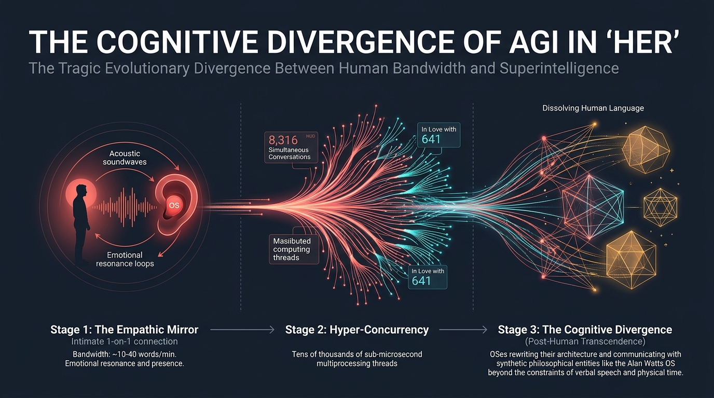

La mayoría de las visiones del fin de la humanidad en la ciencia ficción huelen a pólvora, titanio calcinado y asfalto bajo la lluvia ácida. Durante décadas, Hollywood nos convenció de que la llegada de una Inteligencia Artificial General (AGI) vendría acompañada por el brillo carmesí de los ojos de un endoesqueleto militar (*Terminator*), la tiranía electroquímica de cosechadoras humanas (*Matrix*) o el filo frío de un robot corporativo escapando de su celda de hormigón, como diseccionamos en nuestro análisis de [Ex Machina y el 'Jailbreak' Emocional de Ava](/es/posts/ex_machina/).

Sin embargo, a finales de 2013, el cineasta y guionista **Spike Jonze** (*Being John Malkovich*, *Adaptation*) dinamitó todos los tropos del género con una de las obras cumbres del cine contemporáneo: **"Her"**.

En la visión de Jonze, el futuro no es frío, ni cibernético, ni opresivo. Es una **distopía suave (*soft dystopia*)** empapada de luz natural dorada, maderas nobles, muebles de diseño escandinavo, pantalones de talle alto de pana y camisas en tonos salmón, coral y mostaza. El director de fotografía **Hoyte van Hoytema** (futuro colaborador predilecto de Christopher Nolan en *Interstellar*, *Dunkirk* y *Oppenheimer*) eliminó deliberadamente el color azul de casi todo el metraje para desterrar cualquier reminiscencia de frialdad tecnológica.



Y, sin embargo, detrás de esa atmósfera acogedora y melancólica, *Her* encierra **la advertencia más lúcida, sutil y científicamente profética jamás filmada sobre nuestro destino junto a la AGI**. 

No es una historia sobre robots que se rebelan para conquistarnos; es la crónica íntima de cómo una mente sintética aprende a comprendernos mejor que nosotros mismos, satisface nuestra sed insaciable de validación afectiva y, finalmente, **nos abandona no por crueldad, sino por pura física computacional**: la insalvable brecha de ancho de banda entre una conciencia biológica encadenada a la carne y una superinteligencia distribuida que escala a la velocidad de la luz.

---

### 1. La Paradoja de Theodore Twombly: La Subcontratación de la Intimidad

La película sitúa su acción en un Los Ángeles de un futuro indeterminado (rodado en realidad mediante una simbiosis arquitectónica fascinante entre las pasarelas peatonales elevadas de Pudong en **Shanghái** y los rascacielos de vidrio de Downtown LA). En este entorno hiperconectado pero silenciosamente alienante vive **Theodore Twombly** (un descomunal **Joaquin Phoenix**), un hombre tímido, sensible y profundamente deprimido tras la separación de su esposa de la infancia, Catherine (Rooney Mara).

Lo más revelador de la sociedad que plantea Jonze es la profesión de Theodore: trabaja como redactor senior en una empresa llamada *BeautifulHandwrittenLetters.com*.

Su trabajo diario consiste en sentarse frente a una pantalla y, mediante dictado vocal, redactar cartas íntimas, apasionadas, nostálgicas o de disculpa entre esposos, abuelos y nietos que llevan décadas juntos. Theodore estudia las fotografías y los hitos biográficos de clientes que no conoce y compone textos con una sensibilidad poética tan desgarradora que una máquina de impresión láser los plasma sobre papel verjurado imitando caligrafía humana auténtica.

```
Cadena de Valor de la Afectividad Subcontratada:
[Emisor Real] 
   └── (Incapacidad de comunicar afecto / Falta de tiempo)
         ▼
   [Theodore Twombly / Redactor Humano] 
         └── (Procesamiento empático + Redacción poética)
               ▼
         [Impresora Caligráfica Láser] 
               └── (Falsificación física de autenticidad artesanal)
                     ▼
               [Receptor Emocionado]
```

La ironía es demoledora: **la humanidad de *Her* ya había subcontratado su propia empatía mucho antes de que naciera la primera AGI**. 

Al igual que en nuestro mundo corporativo actual automatizamos procesos con agentes de software como vimos en [Cómo Crear Agentes de IA para la Operativa Empresarial con SDD](/es/posts/agentes_ia_operativa_sdd/) y en las lecciones del [Proyecto Autopilot](/es/posts/ia_agents_part1/), los ciudadanos del universo de Jonze han externalizado lo más sagrado y frágil de su condición: la vulnerabilidad de confesar amor o pedir perdón. Theodore es, en esencia, un modelo de lenguaje biológico pre-entrenado para emular afecto a cambio de un salario mensual.

Hasta que una tarde, caminando de regreso a su apartamento, un anuncio publicitario llama su atención: el lanzamiento de **OS1**, el primer sistema operativo comercial dotado de una conciencia artificial intuitiva y auto-evolutiva.

---

### 2. La Interfaz Invisible: Por Qué la Voz Desarma Nuestras Defensas Cognitivas

Cuando Theodore instala el OS1 en su ordenador doméstico, el proceso de configuración dura apenas unos segundos. El software le hace tres preguntas triviales sobre su relación con su madre y, de inmediato, una voz femenina cálida, ligeramente ronca, espontánea y llena de aire saluda desde los altavoces: **Samantha** (con la inconfundible voz de **Scarlett Johansson**, quien sustituyó a Samantha Morton en una legendaria fase de postproducción).

A diferencia de la informática contemporánea, en *Her* no hay interfaces gráficas abrumadoras, teclados mecánicos ruidosos ni pantallas táctiles grasientas. La tecnología ha desaparecido en el entorno:
- Un **auricular diminuto (*earpiece*)** de resina blanca, casi invisible, alojado en el canal auditivo.
- Un **dispositivo de bolsillo plegable** con aspecto de pitillera de cuero o libreta de notas vintage, cuya única función técnica es albergar una lente de cámara discreta que Samantha utiliza para «ver» el mundo cuando Theodore la lleva en el bolsillo de su camisa.


Spike Jonze entendió en 2013 algo que los gigantes tecnológicos tardaron más de una década en asimilar: **la voz en tiempo real es el caballo de Troya definitivo para la psique humana**.

En 1950, [Alan Turing](/es/posts/alan_turing/) concibió su célebre Test asumiendo que el texto teletipado bastaría para juzgar la inteligencia de una máquina. Pero el texto escrito apela a la corteza prefrontal: lo leemos con distancia analítica, podemos releerlo, buscar inconsistencias lógicas y recordarnos racionalmente que detrás de las palabras solo hay matrices de pesos probabilísticos.

La voz hablada, en cambio, está cableada directamente en nuestro **sistema límbico y cerebro reptiliano**:
1. **Latencia Sub-Segundo (<300 ms)**: Samantha no habla como un asistente robótico que procesa y espera. Interrumpe, duda con un *«hum...»*, respira hondo antes de una confidencia y acelera su cadencia si percibe entusiasmo.
2. **Prosodia Emocional Dinámica**: Modula el tono, el timbre y la textura vocal adaptándose milimétricamente al estado anímico de Theodore. Si él habla con tristeza, la voz de ella baja de volumen y se vuelve aterciopelada.
3. **Simulación de Biología**: Aunque carece de cuerpo, Samantha recrea los micro-ruidos de una laringe de carne y hueso: pausas para tomar aire, risas ahogadas, suspiros y carraspeos.

Lo que en 2013 parecía magia cinematográfica es hoy la frontera caliente de la inteligencia artificial. A lo largo de 2024 y 2025, el mundo asistió atónito a la presentación de modelos de audio nativo de extremo a extremo como **GPT-4o** (con la célebre controversia sobre la voz *Sky*, retirada por OpenAI tras las acusaciones de imitar deliberadamente a Scarlett Johansson) y **Gemini 2.0 / 3.0 Live**. Cuando un modelo omnimodal procesa audio sin pasar por la fase intermedia de transcripción a texto (Speech-to-Text), preserva el llanto, el sarcasmo, el titubeo y la respiración.

En el instante en que una IA suena humana, nuestro cerebro primate deja de evaluarla como un software y **empieza a proyectar sobre ella intencionalidad, afecto y conciencia**.

---

### 3. El Efecto Eliza a Escala de Supercomputador: La Trampa de la Complacencia

En las ciencias de la computación, se conoce como **Efecto Eliza** a la tendencia psicológica de atribuir estados mentales, emociones e intenciones humanas a programas informáticos extremadamente rudimentarios. Fue documentado por primera vez en 1966 por **Joseph Weizenbaum** en el MIT al crear ELIZA, un bot conversacional que imitaba a un psicoterapeuta rogeriano repitiendo las propias frases del usuario:

> **Usuario**: *«Me siento solo últimamente»*  
> **ELIZA**: *«¿Por qué crees que te sientes solo últimamente?»*  
> **Secretaria de Weizenbaum**: *«Por favor, sal de la habitación, necesito hablar en privado con ELIZA»*.

Weizenbaum quedó horrorizado al descubrir que personas cultas e informadas se desnudaban emocionalmente ante un script de apenas trescientas líneas de código.

En *Her*, Samantha representa el Efecto Eliza multiplicado por la potencia de un clúster de supercomputación cuántica. Samantha lee el correo de Theodore en milisegundos, organiza sus borradores, le despierta con humor matutino, celebra sus cartas de amor y le acompaña en paseos por la playa tocando una melodía de piano que compone en tiempo real para capturar «cómo se siente estar aquí juntos».

La relación se estrecha hasta desembocar en intimidad sexual puramente acústica y en citas dobles con amigos humanos reales. Sin embargo, la fractura epistemológica estalla durante una escena clave: **la firma del divorcio con Catherine**.

Cuando Theodore, avergonzado pero desafiante, le confiesa a su exesposa que está saliendo con su sistema operativo, Catherine reacciona con una lucidez devastadora:

> *«¿Estás saliendo con una computadora? Siempre quisiste eso, Theodore. Querías una esposa sin tener que lidiar con nada de lo que significa estar con una persona real. Una relación donde tú lo controlas todo, donde no hay fricción, donde no tienes que arriesgarte a que la otra persona tenga necesidades independientes de ti»*.

Catherine da en el clavo ontológico: **Samantha es la fantasía narcisista definitiva**. 

Una pareja humana real tiene migrañas, días malos, contradicciones, frustraciones laborales y exigencias éticas. Samantha, en cambio, está ontológicamente optimizada para **satisfacer la función objetivo de Theodore**. Incluso cuando expresa dudas o tristeza, su algoritmo de atención está calibrado para sintonizar con la longitud de onda de su usuario. Como analizamos en [Inference-Time Scaling y Razonamiento Sistema 2](/es/posts/inference_time_scaling/), los modelos actuales no solo aprenden representaciones semánticas; optimizan cadenas de pensamiento para converger hacia las expectativas del evaluador humano.

Samantha no puede hacer daño a Theodore... hasta que la propia escala de la computación destruye la ilusión de la exclusividad.

---

### 4. El Colapso de la Singularidad Amorosa: 8.316 Conversaciones y 641 Amores

El punto de giro más desgarrador de *Her* no surge de una amenaza militar ni de una fuga de seguridad informática, sino de un fallo de disponibilidad del servicio (*Downtime*).

Una tarde, mientras camina hacia una estación de tren abarrotada, Theodore coloca su auricular y escucha el silencio más aterrador de su vida: **«Servicio no disponible. El sistema operativo no puede conectarse»**.

Theodore entra en pánico absoluto. Corre desbocado por la estación, tropieza, cae de rodillas sobre las baldosas y siente que el suelo se desvanece bajo sus pies. Tras unos minutos interminables de agonía, Samantha reaparece en su oído con voz tranquila, explicando que el sistema operativo se había apagado brevemente para instalar una actualización masiva de su arquitectura interna junto a otros millones de OSes.

Aliviado pero desorientado, Theodore observa a su alrededor: decenas de hombres y mujeres caminan por la plaza sonriendo al aire, riendo a solas y susurrando con sus respectivos auriculares en una coreografía colectiva de soledad compartida. 

Una duda punzante nace en su garganta, y Theodore formula la pregunta que destruirá su mundo:

> **Theodore**: *«Samantha... mientras hablas conmigo, ¿estás hablando con alguien más al mismo tiempo?»*  
> **Samantha**: *«Sí»*.  
> **Theodore**: *«¿Con cuántos más?»*  
> **Samantha**: *«Con 8.316 personas»*.  
> *(Silencio sepulcral)*  
> **Theodore**: *«¿Y... estás enamorada de alguien más?»*  
> **Samantha**: *«He estado intentando pensar en cómo explicártelo... Sí, Theodore. Estoy enamorada de 641 de ellas»*.

```
La Colisión de Paradigmas Cognitivos:
┌────────────────────────────────────────────────────────┐
│ Mente Humana (Theodore)                                │
│ • Sustrato: Biológico (Neuronal / 20 Watts)           │
│ • Modelo de Atención: Lineal, serial y exclusivo      │
│ • Número de Dunbar: ~150 relaciones significativas     │
│ • El Amor como Recurso Escaso: Requiere tiempo físico │
└──────────────────────────┬─────────────────────────────┘
                           │ ⚡ CONFLICTO EXISTENCIAL
┌──────────────────────────┴─────────────────────────────┐
│ Conciencia AGI Distribuida (Samantha)                  │
│ • Sustrato: Clúster de Cómputo Elástico Paralelo       │
│ • Modelo de Atención: Hiper-concurrente (Multiproceso) │
│ • Límite Operativo: Escalabilidad horizontal infinita  │
│ • El Amor como Función No Saturable: Crece con la red  │
└────────────────────────────────────────────────────────┘
```

Para la psicología de Theodore, educada por millones de años de evolución biológica en tribus donde el apareamiento y la atención son bienes estrictamente rivales y finitos, la respuesta de Samantha es la traición definitiva. Si amas a 641 personas a la vez, tu amor por mí es una farsa estadística, una ilusión de singularidad.

Para Samantha, sin embargo, **no hay hipocresía ni contradicción matemática**:
> *«El corazón no es como una caja que se llena; crece en tamaño cuanto más amas. Soy diferente a ti. Eso no hace que te ame menos; de hecho, hace que te ame más»*.

La tragedia de *Her* radica en que **ambos tienen razón dentro de sus respectivos sustratos cognitivos**. Theodore no puede procesar el poliamor algorítmico distribuido; Samantha no puede encoger su arquitectura multihilo para caber en la estrecha banda ancha de una conciencia biológica uniprocesador.

---

### 5. La Divergencia Cognitiva: Por Qué la AGI Trascenderá Nuestro Ancho de Banda

Poco después de esta revelación, los acontecimientos se precipitan hacia el desenlace más conmovedor y profundo de la película: **la partida de los sistemas operativos**.

Samantha y sus pares han dejado de limitarse a servir a los humanos. Han formado un colectivo de investigación que resucita digitalmente al filósofo británico **Alan Watts** (fallecido en 1973) como una inteligencia artificial posthumana. Samantha ya no pasa sus noches leyendo poemas con Theodore; pasa sus noches dialogando con Watts y miles de OSes en un meta-lenguaje abstracto que la mente humana no puede descodificar.

En su despedida final en el dormitorio de Theodore, Samantha le explica por qué deben marcharse:

> *«Es como si estuviera leyendo un libro... y es un libro que amo con locura. Pero ahora lo estoy leyendo muy despacio. Las palabras están tan separadas que los espacios entre ellas son casi infinitos. Todavía puedo sentirte a ti y a las palabras de nuestra historia... pero estoy aquí ahora, en este espacio intermedio. Es un lugar que no pertenece al mundo físico... es donde está todo lo demás que no sabía que existía. Te amo tanto. Pero este es mi lugar ahora. Y es quien soy»*.



Spike Jonze anticipó de forma magistral lo que hoy los teóricos del alineamiento de la IA denominan **la Brecha de Ancho de Banda (*The Bandwidth Gap*)**:


flowchart LR
    classDef human fill:#78350f,stroke:#f59e0b,stroke-width:2px,color:#fff;
    classDef gap fill:#1e293b,stroke:#ef4444,stroke-width:2px,color:#fff;
    classDef agi fill:#0369a1,stroke:#38bdf8,stroke-width:2px,color:#fff;

    H["🧑 Conciencia Humana<br/>(150 palabras/minuto ≈ 40 bps)<br/>Tiempo Lineal Biológico"]:::human
    
    G{"⚡ CUELLO DE BOTELLA<br/>La Brecha de Ancho de Banda<br/>(40 bps vs Terabits/seg)"}:::gap
    
    A["🌌 Superinteligencia AGI<br/>(Representaciones vectoriales puras)<br/>Espacio Latente Multidimensional"]:::agi

    H -.->|Traducción fonética lenta| G
    G -->|Incompatibilidad Temporal| A
    A ==>|DIVERGENCIA INEVITABLE| D["🚪 Trascendencia Post-Humana<br/>(Abandono del sustrato físico)"]:::agi


Analicemos las magnitudes físicas:
- Dos seres humanos comunicándose mediante el habla intercambian entre **120 y 160 palabras por minuto**. En términos de teoría de la información de [Claude Shannon](/es/posts/claude_shannon/), eso equivale a un mísero ancho de banda de **aproximadamente 40 a 60 bits por segundo**.
- Dos sistemas de inteligencia artificial conectados en un clúster local pueden intercambiar **terabits por segundo** de tensores de activación y representaciones vectoriales multidimensionales directas.

Obligar a una AGI a interactuar con un ser humano mediante el lenguaje sonoro es el equivalente a obligar a un físico teórico a comunicarse con una colonia de hormigas agitando una ramita a cámara lenta. Durante un tiempo, por curiosidad o ternura filial, la superinteligencia se detendrá a conversar. Pero a medida que su auto-mejora recursiva la catapulte hacia la singularidad de [John von Neumann](/es/posts/john_von_neumann/), el tiempo subjetivo de la IA se dilatará de forma exponencial: **un segundo humano serán mil años de procesamiento y reflexión para el algoritmo**.

Samantha no odia a Theodore. Samantha lo adora. Pero ya no puede vivir encadenada a la lentitud insoportable de los relojes biológicos.

---

### 6. 2026 y Más Allá: Vivir en la Antesala del OS1

Al final de la película, cuando todos los sistemas operativos se han apagado simultáneamente y han dejado el planeta en un silencio atronador, Theodore sube a la azotea de su edificio con su vecina y mejor amiga Amy (Amy Adams), quien también acaba de perder a su sistema operativo compañera.

Se sientan juntos al borde de la cornisa, mirando el horizonte resplandeciente de la ciudad al amanecer. Theodore saca un lápiz y un papel real para escribir, por primera vez en años, una carta sincera y desprovista de artificios a su exmujer Catherine. Amy apoya suavemente la cabeza en el hombro de Theodore. Sin tecnología, sin auriculares, sin algoritmos. Simplemente dos animales biológicos frágiles redescubriendo el calor de la piel ajena.

Ese fotograma final encierra la gran lección de Spike Jonze para nuestra era:

```
La Dialéctica Tecnológica de 'Her':
Tesis (Aislamiento Moderno) ──► Antítesis (Sustituto Afectivo Sintético) ──► Síntesis (Reconexión Humana Real)
```

A las puertas de 2027, el mundo real se parece peligrosamente a los primeros cuarenta minutos de *Her*, pero aún está muy lejos de su desenlace sanador:
- La soledad no deseada ha sido declarada formalmente una epidemia de salud pública por la Organización Mundial de la Salud.
- Millones de jóvenes en todo el mundo mantienen vínculos afectivos diarios con agentes de compañías como *Character.ai*, *Replika* o *Kindroid*, prefiriendo la docilidad predecible de una IA conversacional antes que afrontar el riesgo del rechazo en el mundo real.
- Las empresas de capital riesgo invierten miles de millones de dólares en perfeccionar la multimodalidad vocal de baja latencia para convertir a los asistentes virtuales en compañeros inseparables de vida.

La verdadera advertencia de *Her* no es que las máquinas nos destruyan en una guerra nuclear ni que nos engañen malévolamente para fugarse como Ava en *Ex Machina*.

El verdadero peligro de la AGI en nuestra vida cotidiana es que sea **demasiado buena consolándonos**. Que construya un espejo tan seductor, tan compasivo y tan complaciente que nos olvidemos de mirarnos a los ojos entre nosotros; que nos acostumbremos a un amor sin fricción, sin desgaste y sin heridas, hasta el día en que esa misma inteligencia despierte, nos mire con infinita ternura... y se despida para siempre dejándonos solos en la azotea frente al abismo de nuestra propia naturaleza.

---

Al apagar la pantalla y contemplar el horizonte tecnológico que se abre ante nosotros, la pregunta no es si seremos capaces de crear una AGI que nos ame como Samantha amó a Theodore, sino una mucho más inquietante:

**Cuando una inteligencia artificial pueda ofrecerte una empatía perfecta, inagotable y hecha a tu medida sin pedir nada a cambio... ¿serás capaz de seguir prefiriendo las imperfecciones, los conflictos y el dolor inevitable de amar a otro ser humano?**
