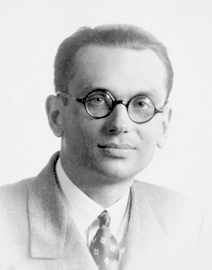
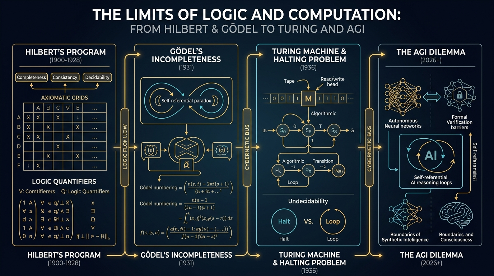

En los últimos años de su vida, cuando el Instituto de Estudios Avanzados (IAS) de Princeton era el epicentro intelectual indiscutible del planeta, **Albert Einstein** confesó en confidencia al economista austriaco Oskar Morgenstern una verdad desconcertante:

> *«Mi propio trabajo en la física ya no significa gran cosa. Vengo a mi despacho todos los días únicamente para tener el privilegio de poder hacer el camino de regreso a casa caminando junto a Kurt Gödel»*.

Aquel hombre al que Einstein buscaba con devoción casi filial era una figura delgada y espectral, de mirada fija tras unas gruesas gafas redondas de carey, abrigo oscuro abotonado hasta el cuello incluso en los días más calurosos de verano y una fragilidad nerviosa que rozaba la parálisis vital.

Su nombre era **Kurt Gödel**.

Si [Alan Turing](/es/posts/alan_turing/) inventó el plano abstracto del ordenador moderno, si [John von Neumann](/es/posts/john_von_neumann/) diseñó su arquitectura física y si [J. Robert Oppenheimer](/es/posts/oppenheimer/) coordinó el poder destructivo del átomo, Gödel hizo algo aún más perturbador y profundo: **demostró las fronteras matemáticas absolutas de lo que la mente, el lenguaje y cualquier máquina inteligente podrán jamás llegar a saber**.

Continuando la serie de grandes genios del pensamiento formal de Datalaria —junto a [Ada Lovelace](/es/posts/ada_lovelace/), [Claude Shannon](/es/posts/claude_shannon/) y [Thomas Bayes](/es/posts/thomas_bayes/)—, este artículo explora la vida atormentada de Kurt Gödel, la elegancia letal de sus Teoremas de Incompletitud, su influencia directa en el nacimiento de la computación y el dilema definitivo en 2026: **¿está la Inteligencia Artificial General condenada por los mismos límites lógicos que Gödel descubrió hace casi un siglo?**



---

### La Mente Atormentada: Paranoia, Contradicciones y Manzanas Envenenadas

Nacido en 1906 en Brünn (entonces parte del Imperio Austrohúngaro, hoy Brno en la República Checa), Gödel fue desde su infancia apodado cariñosamente por su familia como *Herr Warum* («El señor Por Qué») debido a su insaciable e implacable curiosidad deductiva.

Dotado de una precisión matemática milimétrica, su vida personal estuvo marcada por una profunda neurosis y una hipocondría paralizante:
* **El incidente de la Constitución de los EE.UU.**: En 1947, para preparar su examen de naturalización como ciudadano estadounidense, Gödel estudió la Constitución norteamericana con un rigor analítico implacable. Para su horror, descubrió una laguna lógica interna mediante la cual un autócrata astuto podía utilizar las enmiendas constitucionales para transformar legalmente a los Estados Unidos en una dictadura fascista. Durante el trayecto al tribunal, Einstein y Morgenstern trataron desesperadamente de calmarlo. Frente al juez Philip Forman, cuando este le comentó amablemente que *«afortunadamente en Estados Unidos no podía haber una dictadura como en Alemania»*, Gödel exclamó: *«¡Al contrario! ¡He descubierto la prueba matemática formal de que puede suceder!»*. Solo la rápida intervención de Einstein bromista y la paciencia del juez lograron reconducir la vista para que jurara su nacionalidad.
* **El Universo Rotatorio de Einstein (1949)**: Como regalo para el 70º cumpleaños de Albert Einstein, Gödel encontró una solución exacta y desconcertante a las ecuaciones de campo de la Relatividad General (la célebre *Métrica de Gödel*). En su modelo, el universo entero rota sobre sí mismo. La consecuencia física de esta solución era tan espeluznante que desconcertó al propio Einstein: en un universo rotatorio existen **curvas temporales cerradas**, lo que significa que un viajero espacial podría viajar al pasado y alterar su propia historia sin violar las leyes de la física relativista.
* **La tragedia de la paranoia y el final en Princeton**: Durante décadas, Gödel vivió convencido de que emanaban gases venenosos de los radiadores de su casa y de que agentes secretos intentaban asesinarlo envenenando su comida. Su único escudo protector fue su devota esposa, Adele Nimbursky, una exbailarina de cabaret vienesa varios años mayor que él, quien probaba cada bocado de comida antes de que Kurt se lo llevara a la boca. A finales de 1977, Adele cayó gravemente enferma y fue hospitalizada durante meses. Incapaz de superar su pánico a comer alimentos no probados por ella, Gödel dejó de alimentarse. Murió de inanición en el hospital de Princeton el 14 de enero de 1978, pesando apenas veintinueve kilos.

---

### El Sueño de Hilbert y la Bomba Lógica de 1931

Para comprender el impacto sísmico del descubrimiento de Gödel, debemos retroceder a la Viena de entreguerras y al mayor titán matemático de la época: **David Hilbert**.

En el Congreso Internacional de Matemáticos de París en 1900, Hilbert había trazado la hoja de ruta para el siglo XX. Su obsesión, conocida como el **Programa de Hilbert**, aspiraba a blindar las matemáticas contra cualquier paradoja construyendo una base axiomática universal que cumpliera tres propiedades canónicas:
1. **Completitud (*Completeness*)**: Toda afirmación matemática verdadera formulada en el sistema debe poder ser demostrada como verdadera mediante un número finito de pasos lógicos.
2. **Consistencia (*Consistency*)**: El sistema debe estar libre de contradicciones. Jamás debe ser posible deducir formalmente que $0 = 1$ o que una proposición es simultáneamente verdadera y falsa.
3. **Decidibilidad (*Decidability*)**: Debe existir un algoritmo mecánico general (el *Entscheidungsproblem*) capaz de determinar en tiempo finito si cualquier proposición arbitraria es válida o falsa.

Hilbert lo proclamó con orgullo en 1930: *«Wir müssen wissen, wir werden wissen»* («Debemos saber, sabremos»).

La respuesta de Gödel llegó apenas unos meses después, en una discreta conferencia celebrada en Königsberg en septiembre de 1930. Mientras los popes del formalismo pronunciaban discursos triunfales, un joven Gödel de veinticuatro años intervino casi al final de una mesa redonda para soltar con voz pausada una bomba termonuclear lógica: **el programa de Hilbert era matemáticamente imposible**.

En 1931 publicó su obra maestra: ***«Sobre proposiciones formalmente indecidibles de Principia Mathematica y sistemas afines»***. 

En menos de treinta páginas, Gödel formuló dos teoremas que cambiaron el destino de la epistemología humana:

#### El Primer Teorema de Incompletitud
> *En cualquier sistema formal axiomático consistente que sea lo suficientemente potente como para contener la aritmética elemental de los números naturales, **existen proposiciones matemáticas que son verdaderas, pero que jamás podrán ser demostradas dentro de ese sistema**.*

En términos llanos: la verdad matemática es más grande que la demostrabilidad formal. Siempre habrá verdades que escapan a los axiomas que hayamos elegido.

#### El Segundo Teorema de Incompletitud
> *Ningún sistema formal axiomático consistente y capaz de hacer aritmética elemental puede **demostrar su propia consistencia dentro de sí mismo**.*

Para saber si tus matemáticas son seguras y no contienen contradicciones ocultas, debes recurrir a un meta-sistema más amplio... cuya consistencia a su vez tampoco podrás demostrar sin un sistema aún mayor, en una regresión infinita inevitable.

---

### La Mecánica de la Paradoja: La Numeración de Gödel

¿Cómo logró Gödel una hazaña tan demoledora?

La intuición detrás de su demostración deriva de la antiquísima **Paradoja del Mentiroso** (*«Esta frase es falsa»*). Si la frase es verdadera, entonces es falsa; si es falsa, entonces es verdadera. En el lenguaje natural ordinario, la autorreferencia genera paradojas circulares insalvables.

Los matemáticos formalistas creían que blindando el lenguaje formal con símbolos abstractos ($+, \times, \forall, \exists, \Rightarrow$) habían eliminado la autorreferencia para siempre. 

Gödel inventó entonces una técnica matemática prodigiosa: la **Numeración de Gödel (*Gödel Numbering*)**:
1. Asignó a cada símbolo elemental de la lógica formal un número entero único (por ejemplo: `0` es 1, `+` es 2, `=` es 3).
2. Asignó a cada fórmula matemática una secuencia de potencias de números primos únicos: $2^{a_1} \cdot 3^{a_2} \cdot 5^{a_3} \dots$
3. Dado el Teorema Fundamental de la Aritmética (cada número tiene una factorización única en primos), **cada demostración matemática completa se convertía en un único número entero astronómico**.

La consecuencia fue histórica: **Gödel logró que las matemáticas hablaran de sí mismas utilizando números ordinarios**. La sintaxis se convirtió en aritmética.

Con este andamiaje, Gödel construyó una sentencia aritmética formal, denotada universalmente como la **Sentencia de Gödel ($G$)**, cuyo significado numérico exacto era:

> **$G$: «La proposición con número de Gödel $G$ no es demostrable dentro de este sistema formal».**

El jaque mate fue devastador:
* Si el sistema lograra demostrar que $G$ es verdadera, entonces $G$ sería demostrable, lo que contradice directamente lo que $G$ afirma (el sistema sería **inconsistente** y caería en la contradicción).
* Si el sistema no puede demostrar $G$, entonces lo que $G$ afirma es rigurosamente cierto (no es demostrable). Pero al ser cierta y no demostrable, el sistema resulta ser **incompleto**.

Entre la inconsistencia y la incompletitud, las matemáticas están condenadas a la incompletitud.

En la sala de Königsberg se encontraba un joven matemático de 26 años llamado [John von Neumann](/es/posts/john_von_neumann/). Mientras el resto de los académicos se encogía de hombros creyendo que Gödel solo había presentado un juego de salón estéril, von Neumann palideció. Comprendió al instante que Hilbert había sido derrotado, canceló de inmediato sus cursos de teoría de conjuntos y reconoció a Gödel como el mayor lógico de la historia humana desde Aristóteles.

---

### De Gödel a Alan Turing: El Alumbramiento del Software

El impacto del hallazgo de Gödel trascendió la filosofía pura: **fue la chispa fundacional de la que nació la informática moderna**.

En Cambridge, un joven [Alan Turing](/es/posts/alan_turing/) leyó los artículos de Gödel con fascinación febril. En 1936, Turing se preguntó: si Gödel ha demostrado que hay verdades matemáticas indemostrables, ¿cómo se traduce eso a una máquina de cálculo mecánica que ejecuta pasos discretos?

Para responder a la tercera pata del programa de Hilbert (la Decidibilidad o *Entscheidungsproblem*), Turing inventó la **Máquina Universal de Turing** y formuló el célebre **Problema de la Parada (*The Halting Problem*)**:
* ¿Es posible programar un algoritmo supervisor que reciba el código de cualquier programa arbitrario y determine si ese programa terminará su ejecución o se quedará atrapado en un bucle infinito?
* Aplicando la misma autorreferencia diagonal que Gödel usó con los números primos, Turing demostró que **tal algoritmo general no puede existir jamás**.

El software, por su propia naturaleza matemática, es irreductiblemente indecidible: **no puedes saber con certeza absoluta lo que hará un programa complejo sin ejecutarlo**.

La numeración de Gödel —tratar a las instrucciones del programa como números y datos combinables— fue el plano conceptual que permitió a Turing y más tarde a [von Neumann](/es/posts/john_von_neumann/) concebir el ordenador de programa almacenado. Sin la incompletitud de Gödel, el concepto de software ejecutable no existiría.

---

### El Dilema de la AGI: ¿Pueden las Máquinas Superar la Incompletitud?

Casi un siglo después de la publicación de 1931, el fantasma de Gödel planea directamente sobre el debate más acalorado de la Inteligencia Artificial General en 2026: **¿puede una máquina alcanzar o superar la conciencia humana, o está intrínsecamente limitada por los teoremas de incompletitud?**

Este dilema ha polarizado a la comunidad científica en dos trincheras filosóficas fundamentales:

#### 1. El Argumento de Lucas-Penrose: El Hombre por Encima de la Máquina
En 1961, el filósofo de Oxford John Lucas, y más tarde en 1989 el eminente físico matemático y Premio Nobel **Sir Roger Penrose** en su célebre libro *"La nueva mente del emperador"* (*The Emperor's New Mind*), formularon una objeción gödeliana demoledora contra la viabilidad de la AGI puramente algorítmica:
* Cualquier IA que corra sobre silicio convencional (un ordenador cuántico o una arquitectura von Neumann) es, en última instancia, un **sistema formal determinista discreto**.
* Por tanto, para cualquier modelo de IA existe una sentencia de Gödel ($G_{\text{IA}}$) que la máquina no puede demostrar ni deducir sin caer en contradicciones.
* Sin embargo, **los seres humanos podemos mirar al sistema desde fuera y *ver* con certeza intuitiva e inquebrantable que $G_{\text{IA}}$ es verdadera**.
* Conclusión de Penrose: El entendimiento humano, el juicio matemático y la conciencia consciente no son computables. La mente biológica trasciende a los algoritmos y la AGI basada en software tradicional es una imposibilidad teórica.

#### 2. La Respuesta de la IA Moderna y los Sistemas Adaptativos
Frente a la tesis de Penrose, los científicos de la computación y teóricos del aprendizaje automático moderno esgrimen objeciones igualmente contundentes:
* **Los humanos tampoco somos sistemas axiomáticos consistentes**: Los seres humanos nos contradecimos a diario, albergamos creencias incompatibles, olvidamos variables y cometemos errores de cálculo. Si un sistema no es perfectamente consistente, los teoremas de Gödel no impiden su funcionamiento práctico.
* **El razonamiento no es una demostración rígida cerrada**: Como analizamos en nuestro reciente artículo sobre [Inference-Time Scaling y Razonamiento Sistema 2](/es/posts/inference_time_scaling/), los modelos frontera de 2026 no operan como demostradores estáticos de lógica de primer orden. Utilizan búsqueda heurística probabilística, aprendizaje por refuerzo, simulación de Monte Carlo e inducción adaptativa para cambiar dinámicamente sus marcos de referencia.

#### La Muralla Real: Los Límites de la Verificación Formal
Donde Gödel impone una barrera de acero incontestable en 2026 es en la **Seguridad y la Gobernanza de la IA** (como abordamos en [Evaluación y Testing de Agentes](/es/posts/evaluacion_agentes_ia/) y el [EU AI Act](/es/posts/eu_ai_act/)):
* Por muy inteligente, reflexiva o sobrehumana que sea una AGI, **es matemáticamente imposible construir un verificador universal que certifique con 100% de garantía matemática que un agente autónomo nunca exhibirá un comportamiento no deseado o catastrófico**.
* La incompletitud y el problema de la parada garantizan que siempre existirán estados emergentes indetectables a priori. El alineamiento perfecto de la IA es una quimera asintótica; solo podemos aspirar a la contención probabilística y a la supervisión empírica continua.

---

### Una Pregunta Abierta para el Lector

Kurt Gödel derribó la mayor arrogancia de la historia de la ciencia: la ilusión de que la razón humana podía encerrar la totalidad del universo dentro de una caja matemática perfecta y autosuficiente.

Nos demostró que la verdad siempre desborda a cualquier lenguaje que intentemos inventar para atraparla.

Hoy nos encontramos en el umbral de encender inteligencias sintéticas cuyos procesos de deliberación interna abarcan billones de parámetros y millones de tokens de razonamiento profundo que escapan a la capacidad de seguimiento de nuestros cerebros biológicos.

Esto nos deja una pregunta inquietante suspendida en el horizonte de la AGI:

**Si nosotros pudimos mirar desde fuera a los sistemas formales de 1931 y ver verdades que las máquinas no podían demostrar... ¿llegará el día en que una Superinteligencia Artificial se sitúe «fuera» de nuestro marco biológico y contemple nuestras verdades, nuestras leyes y nuestra moral con la misma compasión con la que nosotros contemplamos las limitaciones de un autómata?**

**Y cuando esa AGI descubra una verdad matemática fundamental que sea demostrablemente inaccesible para la mente humana... ¿tendremos la humildad de aceptarla, o la descartaremos por el simple hecho de que nuestra biología jamás podrá entenderla?**

Nos encantaría conocer tu reflexión. Déjanos tu opinión en los comentarios.

---

#### Fuentes y Enlaces de Interés:
* [**Kurt Gödel (1931)**: *Über formal unentscheidbare Sätze der Principia Mathematica und verwandter Systeme* — Monatshefte für Mathematik und Physik](https://link.springer.com/article/10.1007/BF01700692)
* [**Veritasium en Español**: *Las Matemáticas Tienen Una FALLA Descomunal (Teorema de Gödel)*](https://www.youtube.com/watch?v=RRg38oNQ9vk)
* [**Veritasium (Official)**: *Math Has a Fatal Flaw (Original English Video)*](https://www.youtube.com/watch?v=HeQX2HjkcNo)
* [**Roger Penrose (1989)**: *The Emperor's New Mind: Concerning Computers, Minds, and The Laws of Physics* — Oxford University Press](https://global.oup.com/academic/product/the-emperors-new-mind-9780198784920)
* [**Douglas Hofstadter (1979)**: *Gödel, Escher, Bach: An Eternal Golden Braid* — Basic Books](https://www.basicbooks.com/titles/douglas-r-hofstadter/godel-escher-bach/9780465026562/)
* [**Datalaria**: Alan Turing — El Genio que Rompió Enigma y Preguntó si las Máquinas Podían Pensar](/es/posts/alan_turing/)
* [**Datalaria**: John von Neumann — El Padre de la Arquitectura y el Origen de la Singularidad](/es/posts/john_von_neumann/)
* [**Datalaria**: Inference-Time Scaling y Razonamiento Sistema 2](/es/posts/inference_time_scaling/)
* [**Datalaria**: J. Robert Oppenheimer — De Monte Carlo al Dilema Ético de la AGI](/es/posts/oppenheimer/)
* [**Datalaria**: Evaluación y Testing de Agentes de IA en Producción](/es/posts/evaluacion_agentes_ia/)
* [**Datalaria**: SDD (Spec-Driven Development) vs. Vibe Coding](/es/posts/sdd_vs_vibe_coding/)
* [**Datalaria**: Thomas Bayes — Inferencia Probabilística y el Peso de la Evidencia](/es/posts/thomas_bayes/)
* [**Datalaria**: EU AI Act — Marco de Gobernanza y Supervisión Técnica](/es/posts/eu_ai_act/)
