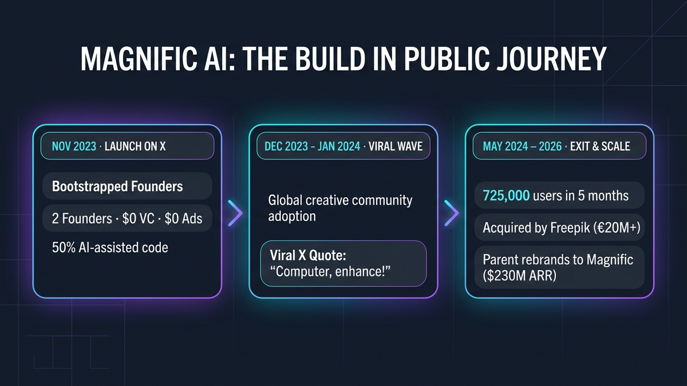

En enero de 2024, durante un discurso que dio la vuelta al mundo tecnológico, Sam Altman lanzó una apuesta entre colegas fundadores sobre cuál sería la fecha en que veríamos la primera **"empresa unipersonal de mil millones de dólares"**, una compañía gigante operada por una o dos personas gracias al apalancamiento extremo de la Inteligencia Artificial.

Lo que pocos en San Francisco miraban entonces es que, **dos meses antes y a nueve mil kilómetros de distancia, desde Murcia**, dos programadores y emprendedores españoles acababan de ejecutar el prototipo europeo más radical de esa tesis post-AGI.

Sin rondas de capital riesgo, sin equipo comercial, sin un solo euro invertido en anuncios y con aproximadamente **la mitad de su código base redactado mano a mano con asistentes de IA**, **Javi López** y **Emilio Nicolás** lanzaron **Magnific AI** a finales de noviembre de 2023.

En apenas cinco meses registraron más de **725.000 usuarios**, facturaron varios millones en ingresos recurrentes operando un equipo de dos personas, recibieron alabanzas públicas en X de figuras como **Beeple** y el mismísimo **Elon Musk**, y cerraron su venta a la multinacional malagueña [**Freepik**](/es/posts/freepik/) por 20 millones de euros fijos más incentivos variables plurianuales. Y lo más extraordinario estaba aún por llegar: en abril de 2026, el propio gigante comprador adoptó oficialmente **Magnific** como su nueva marca corporativa global tras superar los 230 millones de dólares de ingresos recurrentes anuales (ARR).

Continuando nuestra serie dedicada a las startups y escaladoras tecnológicas españolas más influyentes —junto a [RavenPack](/es/posts/ravenpack/), [HappyRobot](/es/posts/happyrobot/), [Submer](/es/posts/submer/), [Multiverse Computing](/es/posts/multiverse_computing/), [Wallapop](/es/posts/wallapop/), [Flywire](/es/posts/flywire/), [Clarity AI](/es/posts/clarity_ai/), [Devo](/es/posts/devo/), [Nextail](/es/posts/nextail/) y [Carto](/es/posts/carto/)—, este artículo disecciona la historia, los hilos virales en X, la ingeniería de difusión latente y las lecciones económicas de **Magnific AI** en el umbral de la AGI.



---

### Los Orígenes: De Erasmusu y un Sabático al Laboratorio de Murcia

A diferencia del mito de los fundadores universitarios inexpertos, Javi López y Emilio Nicolás llegaban con trece años de trinchera compartida a sus espaldas.

Ambos habían cofundado en 2009 **Erasmusu**, la mayor red y plataforma de alojamiento para estudiantes internacionales de Europa, haciéndola crecer con disciplina hasta venderla a **Spotahome**. Tras más de una década construyendo marketplaces y un merecido paréntesis sabático, en abril de 2022 detectaron una anomalía tectónica: las primeras versiones de los modelos de difusión de imágenes empezaban a transformar texto en píxeles coherentes.

En lugar de precipitarse a montar una empresa de inmediato, Javi López dedicó **dieciocho meses completos** a experimentar en público:

1. **Construir audiencia antes que código**: A través de su cuenta en X (**`@javilopen`**) y de su boletín en Substack (*Latent Space*), publicó cientos de experimentos de *prompt engineering*, comparativas visuales y tutoriales gratuitos para creadores digitales.
2. **Detectar el cuello de botella real**: Aunque herramientas como Midjourney o Stable Diffusion asombraban al público general, los diseñadores profesionales y estudios de arte digital chocaban contra el mismo muro técnico: las imágenes salían a baja resolución y, al ampliarlas con algoritmos tradicionales, los rostros, tejidos y texturas adquirían un aspecto plástico y lavado.
3. **Programar a velocidad aumentada por IA**: Con un presupuesto inferior a los 5.000 dólares y sin contratar ingenieros externos, dedicaron tres meses intensos a prototipar la solución. Como revelaron posteriormente, cerca del **50 % del código de Magnific fue generado en co-programación mediante Claude y Cursor**, anticipando en 2023 el flujo de ingeniería asistida que hoy definimos bajo [Spec-Driven Development](/es/posts/sdd_vs_vibe_coding/).

---

### Crónica Viral en X: Hilos, «Computer, Enhance!» y Beeple

Si el motor de Magnific sorprendía en el terreno técnico, su despegue comercial constituye uno de los casos más puros de **distribución orgánica basada en el efecto demostrativo (*Show, Don't Tell*)** jamás vistos en X (antes Twitter).

El **27–28 de noviembre de 2023**, tras una breve lista de espera de dos semanas y sin ofrecer prueba gratuita (*paid-only* desde el primer día para proteger sus costes de GPU), abrieron las puertas compartiendo comparativas de "antes y después" con un deslizador interactivo.

#### Tres Momentos de X que Cambiaron la Historia de la Startup

* **1. El hilo fundacional y el efecto bola de nieve (`@javilopen`, noviembre de 2023):**  
  Durante meses, Javi López había sembrado credibilidad técnica en X compartiendo trucos visuales sin vender nada. Cuando lanzó Magnific con ejemplos donde el rostro borroso de un personaje de videojuego de los años 90 o un boceto a lápiz renacían en ultra alta definición con poros, reflejos y fibras textiles fotorrealistas, miles de ilustradores, arquitectos y directores de arte convirtieron su propio *timeline* en el departamento de marketing gratuito de la empresa.

* **2. La confesión de Beeple (`19 de diciembre de 2023`):**  
  Apenas tres semanas después del lanzamiento, **Mike Winkelmann (Beeple)** —uno de los artistas digitales más influyentes del mundo— contactó en privado con los fundadores confesando que utilizaba la herramienta española a diario en sus obras. Javi compartió la emoción en su cuenta de X:
  > *"Knowing that @beeple, one of the artists I admire the most, is using and enjoying Magnific in his artworks is a dream come true ❤️"* — [`@javilopen` en X](https://x.com/javilopen) (19 de diciembre de 2023)

* **3. El meme de Elon Musk que colapsó las visitas (`8 de enero de 2024`):**  
  El punto de no retorno llegó cuando el diseñador Linus Ekenstam publicó en X un hilo mostrando un reescalado extremo de 8 aumentos (`8x`) procesado con Magnific AI. Entre millones de visualizaciones apareció la respuesta directa de **Elon Musk (`@elonmusk`)** citando la célebre frase cinematográfica de ciencia ficción:
  > *"Computer, enhance!"* — `@elonmusk` en X (8 de enero de 2024)

  Como contaría más tarde Javi López en entrevistas, había intentado en múltiples ocasiones captar la atención del fundador de Tesla y SpaceX sin éxito; bastó que la calidad visual hablara por sí sola para que Musk amplificara la startup murciana ante decenas de millones de seguidores sin haber gastado un céntimo en publicidad.

---

### La Ingeniería Secreta: Convertir la Alucinación en Producto

¿Por qué Magnific AI humillaba a los reescaladores clásicos de código abierto (como ESRGAN o interpolaciones bicúbicas) y por qué resultaba imposible de replicar con un *prompt* genérico?

Mientras que la industria de los Grandes Modelos de Lenguaje (LLMs) invertía miles de millones intentando **erradicar la alucinación**, Javi López y Emilio Nicolás partieron de una premisa contraintuitiva brillante: **en arte digital y diseño visual, la alucinación guiada es el producto**.

Si amplías una fotografía borrosa de 256×256 píxeles a 4K mediante matemáticas deterministas, el algoritmo solo puede suavizar bordes o inventar ruido promedio; no sabe cómo luce un poro de piel humana ni el tramado de un tejido de lino bajo luz lateral. Magnific AI resolvió el problema mediante un **pipeline de difusión latente por teselas (*Tiled Latent Diffusion*) condicionado por texto y parámetros de restricción**:


flowchart LR
    I["<b>1. Entrada Base</b> <small>Imagen Low-Res + Prompt Semántico</small>"] --> T["<b>2. Tiled Latent Split</b> <small>División en teselas con solapamiento y guía global</small>"]
    C["<b>Dial Creativity</b> <small>Grado de alucinación generativa permitida</small>"] --> D
    R["<b>Dial Resemblance</b> <small>Anclaje estructural a la geometría y sujeto original</small>"] --> D
    H["<b>Dial HDR & Fractality</b> <small>Contraste local, microtextura y densidad de detalle</small>"] --> D
    T --> D["<b>3. Inferencia de Difusión</b> <small>Denoising guiado sobre espacio latente en GPU</small>"]
    D --> M["<b>4. Blending & Fusión</b> <small>Cosido sin costuras e integración cromática 4K/8K</small>"]

    style I fill:#0F172A,stroke:#38BDF8,stroke-width:2px,color:#FFFFFF
    style T fill:#EFF6FF,stroke:#3B82F6,stroke-width:1.5px,color:#1E3A8A
    style C fill:#FAF5FF,stroke:#A855F7,stroke-width:1.5px,color:#581C87
    style R fill:#EFF6FF,stroke:#2563EB,stroke-width:1.5px,color:#1E3A8A
    style H fill:#FEF3C7,stroke:#F59E0B,stroke-width:1.5px,color:#92400E
    style D fill:#0F172A,stroke:#A855F7,stroke-width:2px,color:#FFFFFF
    style M fill:#D1FAE5,stroke:#10B981,stroke-width:2px,color:#065F46


Esta arquitectura introdujo al vocabulario creativo global un triplete de controles deterministas que todo director de arte podía dominar en segundos:

* **`Creativity` (Creatividad / Alucinación controlada):** Regula cuánto margen tiene el modelo de difusión para "imaginar" microdetalles completamente nuevos que no existían en el archivo de origen.
* **`Resemblance` (Semejanza estructural):** Actúa como un ancla matemática inversa que impide que la alucinación deforme el rostro, el logotipo o la perspectiva arquitectónica del original.
* **`HDR`:** Controla la profundidad dinámica, el contraste local y la nitidez de las superficies iluminadas.

Al combinar este motor por teselas con un *prompt* contextual (*"reloj mecánico suizo bajo lluvia nocturna, macro 85mm"*), el usuario dejaba de ser un operador pasivo para convertirse en un **director de precisión sobre la imaginación del modelo**.

---

### De la Venta Relámpago a Freepik al Gran Rebranding de 2026

A diferencia de las rondas infladas de Silicon Valley, la trayectoria financiera de Magnific AI reescribió los manuales de creación de valor en Europa:

1. **Noviembre 2023 — Mayo 2024 (Hipercrecimiento Bootstrapped):** En apenas cinco meses de existencia, la plataforma superó los **725.000 usuarios registrados** funcionando sin estructura burocrática, impulsada por suscripciones recurrentes desde el día uno para financiar la elevada factura de GPU de inferencia y mantener flujo de caja positivo.
2. **Mayo 2024 (Adquisición por Freepik):** Cinco meses después del lanzamiento inicial, la compañía malagueña [**Freepik**](/es/posts/freepik/) —respaldada por el fondo EQT y liderada por Joaquín Cuenca— cerró la adquisición del 100 % de Magnific AI. Tal y como revelaron posteriormente informes financieros especializados como *Ecotechers*, la operación estructuró un pago fijo inicial de **20 millones de euros en efectivo** acompañado de sucesivos pagos variables (*earn-outs*) plurianuales vinculados a métricas y permanencia.
3. **Expansión de Producto (`Relight`, `Structure`, `Mystic`, `Precision`):** Lejos de estancarse como una función aislada de *upscaling*, Javi López y Emilio Nicolás ampliaron el ecosistema con herramientas de reiluminación física de escenas (*Relight*), transferencia de estilo y modelos generativos nativos como *Mystic*.
4. **28 de abril de 2026 (La Cola Mueve al Gigante):** En un giro corporativo sin precedentes en la tecnología española, **Freepik anunció oficialmente su cambio de nombre corporativo para adoptar la marca Magnific** para todo el grupo tras superar los **230 millones de dólares de ARR** y consolidar más de un millón de suscriptores de pago. La startup de dos personas comprada dos años antes terminó definiendo el nombre, la arquitectura narrativa y la estrategia futura de toda la multinacional hacia la *"no-collar economy"*.

---

### Economía Post-AGI: ¿Qué Significa para Ingenieros y Empresas?

El caso de estudio de Magnific AI enlaza de lleno con nuestra tesis central en Datalaria sobre [la operativa empresarial gobernada por agentes de IA](/es/posts/agentes_ia_operativa_sdd/) y el [control cibernético de bucle cerrado](/es/posts/norbert_wiener/):

Cuando dos fundadores escriben el 50 % de su base técnica apalancándose en asistentes inteligentes, validan la demanda orgánica antes de contratar a un solo comercial y capturan millones de dólares de valor empresarial frente a laboratorios con cientos de doctores en plantilla, **el cuello de botella ya no es la capacidad de picar código: es la arquitectura del producto, la distribución y la especificación precisa**.

Ese mismo principio —multiplicar la capacidad operativa de equipos reducidos coordinando agentes especializados bajo especificaciones claras y controles deterministas— es el corazón de **Datalaria Helix**. Si lideras equipos técnicos o de producto y quieres aplicar un escuadrón estructurado de 12 agentes de ingeniería en tus propios repositorios, puedes reservar plaza con acceso fundador:



---

### Tabla Comparativa del Ecosistema Tecnológico Español

Con la incorporación de **Magnific AI**, el radar de Datalaria sobre las startups e innovaciones tecnológicas de origen español refleja la transición completa desde el SaaS tradicional hasta la infraestructura y los productos nativos de la era AGI:

| Startup / Empresa | Sede Principal | Año | Modelo de Negocio | Enfoque Tecnológico Clave | Hito / Escala Destacada |
| :--- | :--- | :---: | :--- | :--- | :--- |
| **Magnific AI** | **Murcia / Málaga** | **2023** | **B2C/B2B GenAI SaaS** | **Difusión latente por teselas, Creative Upscaling y Relight** | **725K usuarios en 5 meses (2 fundadores); adquirida por Freepik (20M€+) y rebranding global (>230M USD ARR)** |
| **RavenPack** | Marbella / NY | 2003 | B2B Data SaaS | NLP Financiero, Taxonomía de Eventos, Grafos y Bigdata.com | Oráculo de Wall Street; +200 empleados; alianza FT Group |
| **Submer** | Barcelona | 2015 | B2B Hardware / AIaaS | Refrigeración líquida por inmersión monofásica para clústeres AGI | Serie C de 55,5M USD; campus de supercómputo de 56 MW |
| **HappyRobot** | San Francisco / Madrid | 2021 | B2B Voice AI Agents | Agentes de voz en tiempo real (<500ms) para logística global | Unicornio (1.200M USD); Y Combinator S23; DHL & Uber Freight |
| **Wallapop** | Barcelona | 2013 | C2C Marketplace | Computer Vision, NLP semántico y geolocalización | +19M usuarios; adquisición mayoritaria por NAVER (>800M€) |
| **Multiverse Computing** | San Sebastián | 2019 | B2B Deep Tech | Redes tensoriales y algoritmos cuánticos para LLMs | Compactación de LLMs (CompactifAI); liderazgo europeo |
| **Graphext** | Madrid | 2017 | Product-Led SaaS | Grafos de clustering, reducción dimensional y embeddings | Analítica visual avanzada de datos sin código |
| **Flywire** | Valencia / Boston | 2011 | Fintech B2B Payments | Pagos transfronterizos complejos y conciliación de divisas | Salida a bolsa en el NASDAQ ($FLYW); escala global |
| **Nextail** | Madrid | 2014 | B2B Enterprise AI | Optimización estocástica de inventarios y Fast Fashion | Algoritmos prescriptivos desplegados en +30 países |
| **Clarity AI** | Madrid / NY | 2017 | B2B SaaS ESG Analytics | Machine Learning probabilístico y scoring de sostenibilidad | Cobertura de +70.000 empresas; alianza con BlackRock |
| **Devo** | Madrid / Boston | 2011 | B2B Cloud Analytics | Ingesta masiva de logs en streaming a escala petabyte | Unicornio (>1.500M USD); ciberseguridad en Fortune 500 |
| **Carto** | Madrid / NY | 2012 | B2B Spatial Analytics | Spatial SQL, Lakehouse nativo y SIG en la nube | Plataforma espacial global junto a Google y Snowflake |

---

### 5 Lecciones Estratégicas de Magnific AI para Fundadores y Equipos Tech

1. **Construye la distribución 18 meses antes que el producto (*Audience-First*):** La mayor ventaja competitiva de Magnific no estuvo solo en el algoritmo, sino en los cientos de experimentos compartidos por Javi López en X y Substack durante año y medio. Cuando lanzaron la aplicación, ya contaban con el canal orgánico exacto donde vivían sus primeros compradores.
2. **Convierte los defectos del paradigma en tu diferencial:** Mientras todo el sector combatía las alucinaciones textuales, ellos descubrieron que en el ámbito visual la alucinación acotada geométricamente (`Resemblance` vs. `Creativity`) generaba un valor artístico superior a la fidelidad fotográfica fría.
3. **Cobra desde el día cero cuando tu coste marginal es GPU pura:** Regalar pruebas gratuitas masivas con inferencia de difusión en la nube habría quebrado a dos fundadores *bootstrapped* en 48 horas. Un modelo de pago directo financió los servidores y filtró usuarios con intención real.
4. **La experiencia emprendedora previa multiplica el criterio bajo IA:** Aunque escribir el 50 % del código con Claude y Cursor aceleró el desarrollo técnico a tres meses, saber qué cobrar, cómo posicionar precios, cómo aguantar picos de tráfico y cómo negociar un M&A provino de los trece años previos operando Erasmusu.
5. **No subestimes el poder de un equipo mínimo frente a estructuras pesadas:** En la economía post-AGI, un equipo de dos personas con dominio del problema y apalancamiento agéntico puede crear un estándar de categoría antes de que una corporación termine de aprobar el presupuesto del proyecto.

---

### Pregunta Abierta para el Lector

La historia de Magnific AI plantea una cuestión fascinante para cualquiera que diseñe software o dirija una compañía tecnológica en 2026:

Si dos fundadores desde Murcia pudieron crear en tres meses —con menos de 5.000 dólares y mitad de código co-escrito por IA— un producto capaz de atraer a Elon Musk, venderse en cinco meses por más de 20 millones de euros y terminar dando nombre a todo un grupo de 230 millones de ARR:

**¿Qué parte de la ventaja competitiva tradicional de una empresa (tamaño de plantilla, código propietario o sede en Silicon Valley) sobrevive realmente cuando entramos en la economía de los equipos mínimos potenciados por AGI?**

---

#### Fuentes y Enlaces de Interés:
* [**Itnig Podcast #328 (YouTube)**: *¡CREAR y VENDER una EMPRESA de IA en 5 MESES! | Magnific AI con Javi López y Emilio Nicolás*](https://www.youtube.com/watch?v=nIzzT75O5ow)
* [**Upscale Conf San Francisco (YouTube)**: *Interview with Javi Lopez from Magnific AI*](https://www.youtube.com/watch?v=2YzoIO2hJjM)
* [**Perfil oficial de Javi López en X**: `@javilopen`](https://x.com/javilopen)
* [**El País**: *Así son las primeras ‘start-ups’ en la era de la IA: “Hace unos años, solo dos personas no hubiéramos podido montar esto”*](https://elpais.com/tecnologia/2024-01-24/asi-son-las-primeras-start-ups-en-la-era-de-la-ia-hace-unos-anos-solo-dos-personas-no-hubieramos-podido-montar-esto.html)
* [**Xataka**: *Freepik adquiere Magnific y refuerza su arsenal de herramientas de IA "made in Spain"*](https://www.xataka.com/robotica-e-ia/freepik-adquiere-magnific-refuerza-su-arsenal-herramientas-ia-made-in-spain)
* [**Xataka**: *Freepik se llama ahora Magnific: el gigante malagueño cambia de nombre en plena reinvención hacia la IA*](https://www.xataka.com/empresas-y-economia/freepik-se-llama-ahora-magnific-cambio-nombre)
* [**Ecotechers**: *Las cifras de la venta de Magnific AI a Freepik*](https://www.ecotechers.com/p/cifras-venta-magnific-ai-freepik)
* [**Fortune**: *Freepik's AI pivot to Magnific and $230M ARR*](https://fortune.com/2026/04/28/freepik-magnific-joaquin-cuenca-abela-230-million-arr-video-generation-ai-pivot/)
* [**Datalaria**: Freepik — La Historia del Gigante Malagueño que Domó a la IA](/es/posts/freepik/)
* [**Datalaria**: HappyRobot — Cómo los Agentes de Voz Autónomos Conquistaron la Logística Global](/es/posts/happyrobot/)
* [**Datalaria**: RavenPack — De la Analítica de Noticias en Marbella al Cerebro de Wall Street](/es/posts/ravenpack/)
* [**Datalaria**: Submer — La Refrigeración Líquida para Superordenadores AGI](/es/posts/submer/)
* [**Datalaria**: Spec-Driven Development vs. Vibe Coding](/es/posts/sdd_vs_vibe_coding/)

---

### 💼 Evalúa Inversiones en IA y Escenarios de Retorno con Rigor Financiero

¿Cómo modelar unit economics, costes de GPU por inferencia, periodos de recuperación (*payback*) o escenarios de salida M&A en proyectos de IA ante un Comité de Inversión? Aplica nuestro marco cuantitativo en **[Business Case Financiero (VAN, TIR y Tornado)](/es/posts/business-case-financiero-van-tir/)** y descarga el **[Pack Ejecutivo completo en el Catálogo de Recursos](/es/recursos/#pack-business-case)**.
