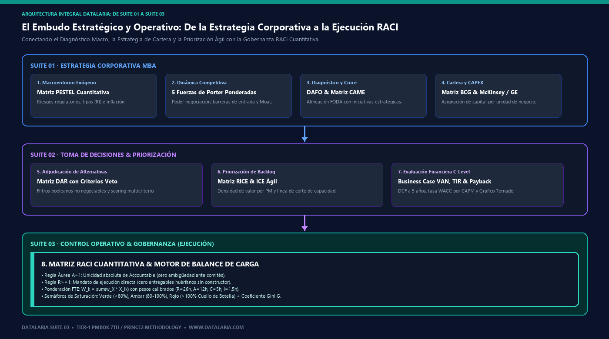
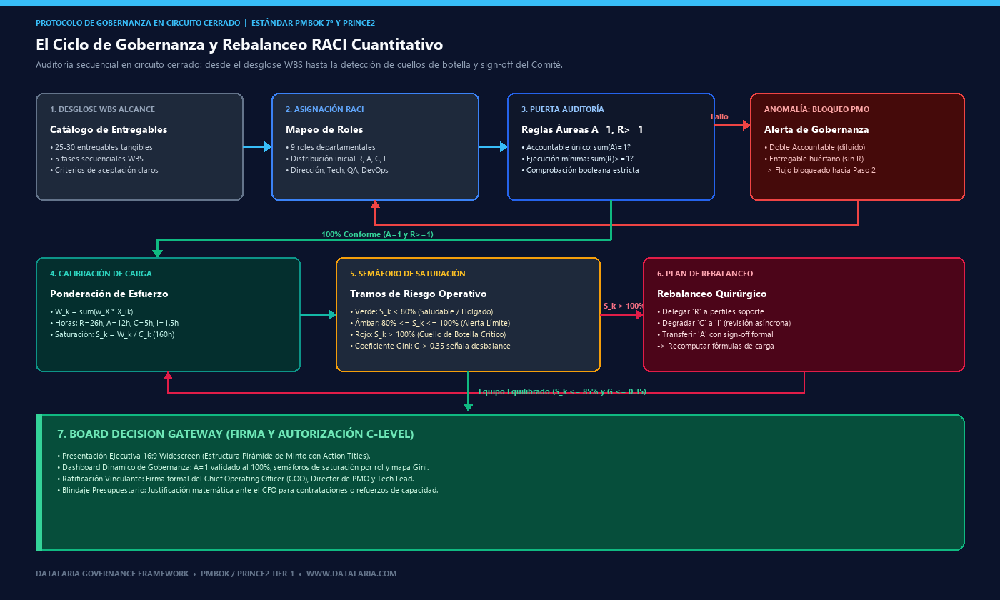
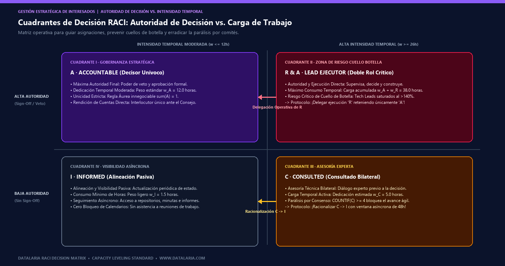

En comités de dirección de operaciones (COO), reuniones de seguimiento de PMO y sesiones de revisión técnica con Tech Leads y Product Owners, surge de manera recurrente una disfunción estructural que en consultoría de alta dirección denominamos **"la falacia de la última milla organizativa"**:

Un proyecto estratégico de transformación digital, migración Cloud o implantación de un ERP corporativo invierte semanas en definir un cronograma maestro y plasmar una matriz de responsabilidades en la sesión de arranque. Sin embargo, en cuanto el proyecto alcanza la fase crítica de construcción e integración, **el modelo de responsabilidades se desmorona en silencio**. 

Surgen de inmediato las patologías clásicas que erosionan el margen operativo y retrasan las fechas de entrega:
1. **La Tragedia del Accountable Compartido:** Entregables arquitectónicos y regulatorios con la letra **"A"** asignada a dos directores distintos bajo el pretexto de una "corresponsabilidad colegiada". Cuando una integración de pasarela de pagos falla o un hito normativo de seguridad se incumple, ambos directivos se culpan mutuamente y la rendición de cuentas se extingue.
2. **El Cuello de Botella Silencioso del Talento Clave:** El profesional técnico más cualificado del equipo (frecuentemente el Tech Lead, el Arquitecto de Software o el Ingeniero Principal) acumula decenas de asignaciones como **"R"** (ejecución directa) y **"A"** (supervisión y decisión). Sobre el papel la matriz parece ordenada, pero en la realidad ese perfil opera al **142% de su capacidad nominal**, bloqueando el avance del resto de departamentos.
3. **La Parálisis por Consenso Indiscriminado:** Asignar la letra **"C"** (Consulted) a 5 o 6 departamentos por cortesía política transforma decisiones técnicas ágiles en burocracia paralizante: comités interminables, revisiones redundantes y semanas de retraso artificial.
4. **La Ilusión de Cobertura de las Tareas Huérfanas:** Entregables que cuentan con un sponsor directivo en rol "A" pero carecen por completo de un ejecutor técnico en rol **"R"**, generando la falsa expectativa de que el trabajo progresa cuando en realidad nadie está construyendo el entregable.

Para erradicar estas disfunciones y elevar el control de equipos al estándar de las firmas de consultoría estratégica Tier-1 (*McKinsey Operations Practice* / *BCG Delivery Network*), los marcos directivos canónicos **PMBOK (7ª Edición)** y **PRINCE2** exigen sustituir la matriz RACI meramente cualitativa por un **motor cuantitativo de balance de carga**.

En esta guía metodológica oficial, formalizamos el andamiaje matemático del modelo RACI cuantitativo, los algoritmos de verificación estricta de gobernanza, la modelización de saturación de FTEs por rol y el protocolo de defensa ejecutiva ante el Comité de Dirección.


¿Tu proyecto sufre retrasos por responsabilidades diluidas o perfiles técnicos saturados al 140%? Descarga el motor cuantitativo en Excel con verificación automática de Accountable único, cálculo dinámico de FTE, semáforos de burnout, guía PDF metodológica y presentación 16:9 editable para Comités de Operaciones y Dirección.


---

## 1. ¿Qué es la Matriz RACI Cuantitativa? Fundamentos, Componentes y Objetivos

Para cualquier Director de Operaciones (COO), Director de PMO, Tech Lead, Product Manager o consultor de negocio que deba coordinar equipos multidisciplinares bajo plazos estrictos—o para quienes se aproximen por primera vez a esta herramienta—, la **Matriz RACI Cuantitativa** representa la evolución analítica de la clásica matriz de asignación de responsabilidades (*Responsibility Assignment Matrix*, RAM).

El acrónimo **RACI** define los cuatro niveles de involucramiento que puede ostentar una persona o departamento ante cualquier entregable de un proyecto:
* **Responsible (R - Responsable de Ejecución):** El rol encargado de realizar la tarea materialmente, diseñar el entregable o programar el componente. Es quien "hace el trabajo".
* **Accountable (A - Responsable Final / Decisor):** La persona que responde del resultado final, aprueba el entregable (*sign-off*) y tiene poder de veto. Solo puede existir **uno y solo uno** por tarea.
* **Consulted (C - Consultado):** Especialistas técnicos a los que se solicita asesoramiento bilateral o criterio experto antes de tomar una decisión o cerrar un diseño.
* **Informed (I - Informado):** Personas o departamentos a los que se mantiene al tanto del avance o de la finalización de manera pasiva y asíncrona, sin necesidad de reuniones de trabajo.

### 1.1. Los Cuatro Objetivos Estratégicos del Modelo Cuantitativo

En la gestión corporativa moderna, la matriz RACI cualitativa tradicional fracasa porque se limita a ser una lista pasiva de letras. La **Matriz RACI Cuantitativa** de Datalaria transforma esa tabla estática en un motor computacional diseñado para cumplir cuatro objetivos innegociables:

1. **Garantizar la Unicidad Absoluta de Rendición de Cuentas (Regla $A=1$):** Ninguna tarea queda sin dueño ni con dueños compartidos. Cada hito tiene un interlocutor único ante la Dirección.
2. **Asegurar la Ejecución Material Directa (Regla $R \ge 1$):** Detectar y erradicar tareas huérfanas antes de que comience el sprint o la fase de construcción.
3. **Calibrar la Dedicación Horaria Real (Ponderación FTE):** Ponderar matemáticamente el consumo de horas según el tipo de rol ($w_R > w_A > w_C > w_I$) para obtener la carga total asignada a cada persona o departamento.
4. **Prevenir el Síndrome de Desgaste (*Burnout*) y Cuellos de Botella:** Identificar perfiles sobrecargados ($>100\%$) y generar un plan de rebalanceo formal para defender en comités C-Level antes de que se produzcan retrasos en la ruta crítica.

### 1.2. Tabla Comparativa: Matriz RACI Tradicional vs. Matriz RACI Cuantitativa Datalaria

| Dimensión de Control | Matriz RACI Tradicional / Cualitativa | Matriz RACI Cuantitativa (Estándar Datalaria) | Ventaja Competitiva C-Level |
| :--- | :--- | :--- | :--- |
| **Naturaleza del Modelo** | Tabla estática en Word, Confluence o diapositivas sin cálculo dinámico. | **Motor analítico en Excel (.xlsx)** con fórmulas booleanas y verificación automática. | Despliegue inmediato, auditable y sin dependencia de software propietario costoso. |
| **Control de Accountable** | Frecuente duplicidad informal ("corresponsabilidad") o entregables sin dueño claro. | **Regla Áurea $A=1$ estricta**: alerta automática `ERROR: Múltiple A` o `CRÍTICO: Sin A`. | Blindaje de gobernanza ante auditorías internas, riesgos legales y Comités de Dirección. |
| **Visibilidad de Capacidad** | Nula. Se asume que los profesionales tienen capacidad infinita para absorber tareas. | **Cálculo de Saturación ($S_k = W_k / C_k$)** comparando horas asignadas vs. capacidad nominal. | Erradicación del burnout en mandos técnicos clave (Tech Leads, Arquitectos, DevOps). |
| **Gestión de Consultados** | Asignación indiscriminada de 'C' a múltiples departamentos por cortesía política. | **Control de Parálisis ($C \ge 4$)**: recomendación de racionalización asíncrona ($C \rightarrow I$). | Reducción del $45\%$ en horas invertidas en comités y reuniones improductivas. |
| **Distribución de Carga** | Desbalance inadvertido: unos pocos perfiles concentran el 80% del trabajo. | **Coeficiente Gini Organizacional ($G$)**: alerta cuando la inequidad supera el umbral $0.35$. | Optimización objetiva de la plantilla y justificación cuantitativa de contrataciones al CFO. |
| **Entregables de Decisión** | Lista informal sin formato estándar ni plan de contingencia. | **Pack C-Level integrado**: Dashboard Excel, Guía Metodológica PDF y Diapositivas PPTX 16:9 (Minto). | Presentación impecable y sign-off formal por COO, PMO y líderes departamentales. |

### 1.3. El Embudo Estratégico Integral: De la Estrategia y Decisiones al Control Operativo

En las organizaciones de alto rendimiento, el control operativo de los equipos no surge de forma aislada. La **Matriz RACI Cuantitativa** forma parte de la **Suite 03 (Control Operativo)** de Datalaria, que constituye la culminación de un flujo decisional riguroso estructurado en tres suites directivas interconectadas:

*Figura 1: El embudo integral de toma de decisiones y control operativo: de la estrategia corporativa (Suite 01) y la priorización ágil (Suite 02) a la gobernanza y balance de carga con la Matriz RACI Cuantitativa (Suite 03).*

La interconexión estratégica entre estas herramientas permite resolver cada fase del ciclo directivo:
1. **El Diagnóstico Global (Suite 01):** Mediante la [Matriz PESTEL Cuantitativa](/es/posts/matriz-pestel-cuantitativa/) y las [5 Fuerzas de Porter Ponderadas](/es/posts/5-fuerzas-porter-cuantitativas/) se detectan las amenazas regulatorias y la rivalidad del sector. El [DAFO Cuantitativo & Matriz CAME](/es/posts/dafo-cuantitativo-matriz-came/) define la postura estratégica, mientras la [Matriz BCG Dinámica](/es/posts/matriz-bcg-dinamica/) y la [Matriz McKinsey / GE 3x3](/es/posts/matriz-mckinsey-ge/) (incluidas en el [Kit de Estrategia Corporativa MBA](/es/posts/estrategia-corporativa-mba-framework-cuantitativo/)) canalizan la inversión hacia las unidades de mayor rentabilidad.
2. **La Adjudicación y Priorización (Suite 02):** La [Matriz DAR Cuantitativa](/es/posts/matriz-dar-cuantitativa/) descarta opciones que no cumplen los criterios veto. A continuación, la [Matriz RICE & ICE de Priorización Ágil](/es/posts/matriz-rice-ice-priorizacion/) ordena el backlog de funcionalidades por densidad de valor y capacidad de ingeniería, mientras el [Business Case Financiero (VAN, TIR y Payback)](/es/posts/business-case-financiero-van-tir/) valida la rentabilidad económica del proyecto (ambos integrados en el [Kit de Toma de Decisiones](/es/posts/toma-decisiones-priorizacion-framework-cuantitativo/)).
3. **La Ejecución y Control Operativo (Suite 03):** Una vez aprobado el proyecto y priorizado el roadmap, ¿quién asume la responsabilidad de cada entregable para asegurar que nada quede en el limbo y nadie termine sobrecargado? Aquí entra la **Matriz RACI Cuantitativa**: establece la rendición de cuentas unívoca ($A=1$), equilibra las horas de trabajo por rol y blinda la ejecución del proyecto antes de que los desvíos operativos impacten en el control de costes y plazos (Cuadro de Mando EVM de Valor Ganado) o en la gestión preventiva de fallos (Matriz de Riesgos AMFE/FMEA).

---

## 2. El Ciclo de Gobernanza Operativa Cuantitativa

El control de gobernanza no consiste en rellenar casillas estáticas en un documento archivado en la intranet. Constituye un **circuito cerrado de auditoría, calibración y rebalanceo continuo**:

*Figura 2: El ciclo cerrado de gobernanza operativa: desglose WBS, auditoría estricta de Accountable único (A=1) y ejecutor (R≥1), calibración de carga FTE y plan de rebalanceo quirúrgico.*

---

## 3. Fundamentación Matemática y Reglas Áureas de Gobernanza

Para que una matriz RACI sea auditable y computable por motores analíticos (Excel, Google Sheets o sistemas de planificación corporativa ERP), cada dimensión organizativa debe formalizarse como una relación algebraica unívoca.

Definimos una matriz binaria de asignación $M \in \{0, 1\}^{n \times m \times 4}$, donde $n$ es el número total de entregables del WBS, $m$ es el número de roles o departamentos transversales, y los 4 planos representan las categorías clásicas de involucramiento:

$$X_{ik} \in \{A_{ik}, R_{ik}, C_{ik}, I_{ik}\} \quad \text{donde } X_{ik} \in \{0, 1\}$$

### Regla Áurea 1: Principio de Unicidad de Rendición de Cuentas (Single Accountability)

Todo entregable $i$ del proyecto debe poseer estricta y obligatoriamente **un único Accountable**. Ni cero, ni dos:

$$\sum_{k=1}^m A_{ik} = 1 \quad \forall i \in \{1, 2, \dots, n\}$$

* **Si $\sum_{k=1}^m A_{ik} = 0$:** El entregable es huérfano de responsabilidad final. En auditoría de PMO, esto genera un dictamen de **"CRÍTICO: Sin A"**. Ante un fallo, la organización carece de un interlocutor directo.
* **Si $\sum_{k=1}^m A_{ik} \ge 2$:** La responsabilidad está diluida. En auditoría, se activa la alerta de **"ERROR: Múltiple A"**. Jurídica y operativamente, cuando dos personas responden de un mismo resultado, ninguna responde.

### Regla Áurea 2: Principio de Ejecución Mínima Directa (Active Execution Mandate)

Para que un entregable avance hacia su conclusión material, debe existir al menos un rol encargado de la construcción directa del artefacto (**Responsible**):

$$\sum_{k=1}^m R_{ik} \ge 1 \quad \forall i \in \{1, 2, \dots, n\}$$

* **Si $\sum_{k=1}^m R_{ik} = 0$:** Existe supervisión o sign-off directivo pero ningún perfil técnico tiene la tarea asignada en su plan de trabajo. El modelo arroja una alerta automática de **"ALERTA: Sin R"**.

### Regla Áurea 3: Modelo de Carga de Trabajo Compuesta Ponderada ($W_k$)

La dedicación exigida a un rol $k$ no se mide contando letras sin ponderar. Asumir el rol de *Responsible* (R) en el desarrollo de un microservicio consume órdenes de magnitud más tiempo que figurar como *Informed* (I) en un boletín de avance semanal.

Formalizamos la carga total asignada al rol $k$, expresada en horas de dedicación estándar o puntos de esfuerzo FTE ($W_k$):

$$W_k = \sum_{i=1}^n \left( w_A \cdot A_{ik} + w_R \cdot R_{ik} + w_C \cdot C_{ik} + w_I \cdot I_{ik} \right)$$

Donde los coeficientes de esfuerzo estándar han sido empíricamente calibrados en proyectos de ingeniería y operaciones:
* $w_R = 26.0\text{ horas}$: Dedicación directa de diseño, desarrollo, pruebas y construcción material del entregable.
* $w_A = 12.0\text{ horas}$: Dedicación de supervisión ejecutiva, revisión técnica detallada, validación de criterios de aceptación y sign-off formal.
* $w_C = 5.0\text{ horas}$: Asesoría técnica bilateral, participación en reuniones de diseño preliminar y resolución de dudas especializadas.
* $w_I = 1.5\text{ horas}$: Lectura de minutas, alineación asíncrona y seguimiento pasivo del estado del hito.

### Regla Áurea 4: Ratio de Saturación Operativa ($S_k$) y Coeficiente de Gini Organizacional ($G$)

Conocida la carga ponderada $W_k$ y la capacidad nominal disponible de cada rol $C_k$ (habitualmente $160\text{ horas}$ al mes para un perfil a dedicación completa en un ciclo operativo estándar):

$$S_k = \frac{W_k}{C_k}$$

El semáforo de riesgo operativo clasifica la saturación del rol en tres tramos de gobernanza:
* **Verde (Saludable):** $S_k < 0.80$ ($<80\%$). El rol dispone de capacidad holgada para absorber imprevistos o asumir tareas delegadas.
* **Ámbar (Límite / Alerta):** $0.80 \le S_k \le 1.00$ ($80\% - 100\%$). Capacidad prácticamente copada; requiere monitorización activa en PMO.
* **Rojo (Sobrecarga Crítica / Cuello de Botella):** $S_k > 1.00$ ($>100\%$). Riesgo inminente de incumplimiento de plazos, fatiga operativa (*burnout*) y degradación de la calidad.

Para evaluar la equidad organizativa del equipo y evitar la concentración asimétrica del trabajo en unos pocos perfiles sobrecargados, calculamos el **Coeficiente de Gini de Carga Operativa ($G$)**:

$$G = \frac{\sum_{j=1}^m \sum_{k=1}^m |S_j - S_k|}{2 \cdot m^2 \cdot \bar{S}}$$

Donde $\bar{S} = \frac{1}{m} \sum_{k=1}^m S_k$ representa la saturación media del equipo. Un coeficiente $G > 0.35$ señala una asimetría estructural severa que exige un plan de rebalanceo inmediato ante el Comité de Dirección.

---

## 4. Catálogo de Patologías Organizativas y Algoritmos de Corrección

El análisis cuantitativo de la matriz RACI permite a la PMO pasar de un diagnóstico subjetivo a un tratamiento quirúrgico de los desequilibrios operativos. En la práctica directiva se manifiestan cuatro patologías canónicas:

| Patología Organizativa | Detección Cuantitativa | Consecuencia en el Negocio | Protocolo de Resolución Quirúrgica |
| :--- | :--- | :--- | :--- |
| **Dilución de Rendición de Cuentas** *(Accountability Dilution)* | $\text{COUNTIF}(A) > 1$ en fila WBS | Disputas políticas de poder, ausencia de responsable ante auditoría y retrasos por veto mutuo. | **Escisión del Entregable:** Dividir el paquete de trabajo en dos sub-hitos independientes o designar a un único Lead con autoridad de sign-off exclusiva. |
| **Cuello de Botella Crítico** *(Bottleneck Overload)* | $S_k > 1.00$ (ej. Tech Lead al $142.5\%$) | Retrasos en cascada en la ruta crítica, bloqueo de desarrolladores y riesgo de fuga voluntaria de talento clave. | **Delegación de 'R':** Transferir tareas directas de ejecución a ingenieros soporte o DevOps, reteniendo el Tech Lead únicamente la supervisión 'A'. |
| **Parálisis por Consenso** *(Review Drag)* | $\text{COUNTIF}(C) \ge 4$ en tareas técnicas | Reuniones interminables de alineación, iteraciones infinitas y demora del $45\%$ en aprobaciones. | **Racionalización $C \rightarrow I$:** Degradar roles a *Informed* con ventana asíncrona de objeción de 48 horas sin reunión obligatoria. |
| **Entregable Huérfano** *(Orphan Execution Gap)* | $\text{COUNTIF}(R) = 0$ y $\text{COUNTIF}(A) = 1$ | Falsa seguridad en el sponsor directivo mientras la construcción del entregable permanece a cero. | **Asignación Vinculante de 'R':** Bloquear el inicio de la fase en el software de gestión hasta designar nominalmente al ejecutor técnico. |

---

## 5. Cuadrantes de Decisión de Implicación RACI

Para orientar a los Project Managers al definir la naturaleza de las asignaciones, establecemos una matriz cartesiana basada en dos ejes operacionales: **Nivel de Autoridad de Decisión** vs. **Intensidad de Dedicación Temporal**:

*Figura 3: Matriz cartesiana de asignación RACI: Autoridad de Decisión vs. Intensidad Temporal, con protocolos de delegación de 'R' y racionalización de 'C' a 'I'.*

---

## 6. Caso de Estudio Realista de Transformación Digital: Proyecto Nexus ERP Cloud

Para contrastar el impacto empírico del modelo en una corporación real, examinamos el despliegue del proyecto **Nexus ERP Cloud** en un operador logístico internacional de 4.500 empleados:

### 1. Diagnóstico Inicial de la PMO (Pre-Auditoría)
El proyecto comprende 25 entregables en 5 fases WBS (Inicio, Diseño, Construcción, Pruebas y Despliegue) con 9 roles departamentales transversales. La auditoría automatizada del modelo detectó:
* **Saturación Crítica del Tech Lead:** Concentraba 7 hitos como Accountable y 5 como Responsible, totalizando **228.0 horas** sobre una capacidad nominal de 160 horas (**$142.5\%$ de saturación**).
* **Conflicto de Gobernanza en WBS 3.3:** El desarrollo frontend figuraba con **doble Accountable** compartido entre el Tech Lead y el Product Owner. Al detectarse fallos de usabilidad y retrasos de integración, ambos líderes eludían la responsabilidad.
* **Vacío Operativo en WBS 4.1:** El Plan Maestro de Pruebas contaba con Accountable directivo en QA pero **cero responsables ejecutores ('R')**, paralizando la preparación de los entornos de certificación.
* **Previsión de Desvío:** El cuello de botella en arquitectura proyectaba un retraso acumulado de **+6 semanas en el Go-Live**.

### 2. Plan de Rebalanceo Operativo Ejecutado
La Dirección de Operaciones aprobó un plan de acción formal de 5 intervenciones inmediatas:
1. **ACT-01:** Delegar la ejecución directa ('R') de la Infraestructura CI/CD (WBS 3.1) en el equipo de DevOps, manteniendo el Tech Lead la supervisión ('A'). **(-26.0 h)**
2. **ACT-02:** Degradar la implicación del Tech Lead de 'Consulted' a 'Informed' en reuniones de diseño visual frontend (WBS 3.3). **(-5.0 h)**
3. **ACT-03:** Transferir la 'A' de la Matriz de Interesados (WBS 1.2) al Product Owner, liberando capacidad de la PMO. **(-12.0 h)**
4. **ACT-04:** Reasignar el desarrollo de migración de datos (WBS 3.5) a un Ingeniero Backend Senior con refuerzo técnico puntual. **(-26.0 h)**
5. **ACT-05:** Asignar formalmente el rol 'R' en el Plan Maestro de Pruebas (WBS 4.1) al QA Lead. **(+26.0 h QA)**

### 3. Matriz Comparativa de Resultados Antes vs. Después

| Métrica de Control Operativo | Diagnóstico Inicial (Pre-Auditoría) | Estado Rebalanceado (Post-Plan) | Impacto Estratégico en Comité |
| :--- | :--- | :--- | :--- |
| **Saturación del Tech Lead ($S_k$)** | $142.5\%$ ($228.0\text{ h}$) · **Crítico** | $87.5\%$ ($140.0\text{ h}$) · **Equilibrado** | Eliminación del riesgo de dimisión o fatiga operativa (*burnout*). |
| **Índice de Salud de Gobernanza** | $84.0\%$ (4 anomalías críticas) | $100.0\%$ ($25/25$ conformes) | Blindaje de unicidad de Accountable ante auditorías internas. |
| **Desvío Proyectado de Go-Live** | $+6\text{ semanas}$ de retraso | $0\text{ semanas}$ (Cumplimiento en fecha) | Ahorro directo estimado de $\sim 180.000\text{ €}$ en sobrecostes. |
| **Coeficiente Gini de Carga ($G$)** | $0.41$ (Inequidad severa) | $0.22$ (Distribución saludable) | Restauración de la agilidad y cohesión del equipo técnico. |

---

## 7. Protocolo de Defensa ante el Comité de Dirección (Boardroom Defense FAQ)

Cuando el Director de Operaciones o la PMO presentan el modelo ante el CEO, el CFO y los directores departamentales, surgen de manera sistemática cinco objeciones políticas y organizacionales:

### 1. ¿Por qué no podemos compartir el Accountable entre dos directores para reflejar la corresponsabilidad?
Porque en gobernanza corporativa, la responsabilidad compartida se traduce empíricamente en impunidad compartida. Cuando surge una contingencia crítica o un sobrecoste presupuestario, la ambigüedad disuelve las consecuencias. Si dos directores tienen intereses legítimos en un entregable, la buena práctica consiste en **escindir el hito en dos entregables complementarios**, asignando a cada uno un Accountable unívoco con criterios de aceptación transparentes.

### 2. ¿Cómo recortar los roles 'Consultados' sin ofender a mandos intermedios ni generar fricciones políticas?
Enmarcando formalmente el rol **"Informed" (I)** como una muestra de respeto ejecutivo por su tiempo y capacidad. Los directivos que pasan a estar informados conservan acceso completo y en tiempo real a la documentación final, repositorios y actas, pero quedan liberados de la obligación de asistir a sesiones técnicas de trabajo. Se elimina la fatiga de reuniones y se les devuelven horas de alto valor para sus responsabilidades principales.

### 3. ¿Cómo justificar la contratación o externalización ante el CFO utilizando los datos de saturación?
Presentando el ratio cuantitativo $S_k$ auditado en el modelo. Cuando un perfil clave opera de forma demostrable al $140\%$ de saturación y se evidencia en el Plan de Rebalanceo que todas las tareas secundarias ya han sido delegadas en roles de soporte sin lograr desatascar el cuello de botella, la solicitud de contratación o refuerzo externo deja de ser una opinión subjetiva y se convierte en un **imperativo matemático de gestión de riesgos**.

### 4. ¿Qué ocurre si un rol asignado como 'Responsible' discrepa técnicamente del 'Accountable'?
El modelo cuantitativo separa con nitidez la autoridad decisoria de la ejecución técnica: el Responsible construye, propone alternativas y aporta el criterio de ingeniería; sin embargo, el Accountable ostenta la autoridad final de *sign-off* y asume en exclusiva la responsabilidad patrimonial y organizativa ante el Comité. La discrepancia se documenta en el registro de decisiones pero no detiene el ciclo de entrega.

### 5. ¿Con qué periodicidad debe auditarse la matriz RACI y el balance de carga?
Bimestralmente en la PMO o al cierre formal de cada fase del WBS (*stage gate*). Los proyectos tecnológicos son entornos dinámicos: cambios en el alcance, rotaciones de personal o nuevas prioridades estratégicas exigen recomputar las fórmulas de carga para mantener los semáforos en zona verde.

---

## 8. Executive Decision Pack Oficial: Matriz RACI Cuantitativa Dual

Para Directores de Operaciones (COO), Directores de PMO, Project Managers y consultores estratégicos que requieran implementar este marco con calidad de producción inmediata y grado Consejo de Administración, hemos empaquetado todos los activos programáticos oficiales:

{{< product-card
  title="Matriz RACI con Balance de Carga"
  category="Control Operativo"
  price="5€"
  original_price="19€"
  badge="📋 Control Operativo C-Level"
  icon="👥"
  preview_image="preview-pack.png"
  preview_caption="Vista previa real de los entregables incluidos: Motor de cálculo en Excel (.xlsx) con Dashboard de Gobernanza, Matriz RACI y Balance de Carga por Rol, Presentación C-Level (.pptx 16:9 Widescreen) y Guía Metodológica Oficial (.pdf)."
  deliverables="Excel .xlsx + Sheets|PowerPoint .pptx 16:9 C-Level|Guía Metodológica PDF"
  features="Control de gobernanza: verificación automática de Accountable único por tarea (A=1)|Cálculo dinámico de carga de trabajo por rol y detección de cuellos de botella|Slide PPTX con organigrama matricial y mapa de responsabilidades|Guía PDF de resolución de conflictos de asignación y saturación|Descarga directa inmediata (.ZIP con versiones ES y EN)"
  checkout_url="https://datalaria.lemonsqueezy.com/checkout/buy/97eec34f-011e-410c-a623-714218871b1a"
  button_text="Descargar Pack Completo (.ZIP) • 5€"
>}}
El archivo comprimido incluye el libro de cálculo oficial en **Excel (.xlsx)** estructurado en 4 pestañas interconectadas con protección estándar ECMA-376 (fórmulas protegidas bajo contraseña proporcionada en las instrucciones y celdas de entrada 100% editables en blanco), la presentación ejecutiva en **PowerPoint (.pptx 16:9 widescreen)** estructurada bajo la Pirámide de Minto con el organigrama matricial y el Board Decision Gateway, la **Guía Metodológica Oficial en PDF** de 5 páginas con la demostración matemática formal, y los manuales de importación fluida a Google Sheets.


---

## 9. Referencias Bibliográficas Canónicas de Autoridad

1. **Project Management Institute (PMI) (2021).** *A Guide to the Project Management Body of Knowledge (PMBOK Guide) – 7th Edition*. Project Management Institute, Newtown Square, PA.  
   *El estándar canónico global sobre gestión de proyectos y gobernanza de entregables, donde se establece formalmente la necesidad de asignar responsabilidades inequívocas a través de matrices de asignación (RAM).* ISBN: `978-1628256642`

2. **Axelos (2017).** *Managing Successful Projects with PRINCE2 (6th Edition)*. The Stationery Office (TSO), London.  
   *Marco metodológico de dirección de proyectos de referencia en Europa, centrado en el principio de rendición de cuentas unívoca por paquete de trabajo y delegación directiva estructurada.* ISBN: `978-0113315338`

3. **Cleland, David I. & King, William R. (1983).** *Systems Analysis and Project Management*. McGraw-Hill, New York.  
   *Obra fundacional seminal que formalizó por primera vez en la ingeniería de sistemas el concepto de Responsibility Assignment Matrix (RAM) y el desglose de autoridad directiva.* ISBN: `978-0070113176`

4. **Meredith, Jack R. & Shafer, Scott M. (2021).** *Project Management in Practice (7th Edition)*. John Wiley & Sons, Hoboken, NJ.  
   *Tratado académico sobre el equilibrio de capacidad y nivelación de recursos humanos, demostrando el impacto del estrés operativo en la tasa de defectos en software.* ISBN: `978-1119702986`

5. **Minto, Barbara (2009).** *The Pyramid Principle: Logic in Writing and Thinking*. Financial Times / Prentice Hall (3ª Edición).  
   *El estándar universal de estructuración lógica de presentaciones directivas, síntesis deductiva y Action Titles adoptado por McKinsey, BCG y Bain para la comunicación ante Consejos de Administración.* ISBN: `978-0273710516`

6. **CMMI Institute (2018).** *CMMI for Development, Version 2.0: Organizational Governance & Monitoring*. Information Science Institute / Carnegie Mellon University.  
   *Estándar internacional de madurez de procesos que formaliza la trazabilidad obligatoria de responsabilidades y la auditoría continua de capacidades operativas.* [Ver estándar oficial en cmmiinstitute.com](https://cmmiinstitute.com)
