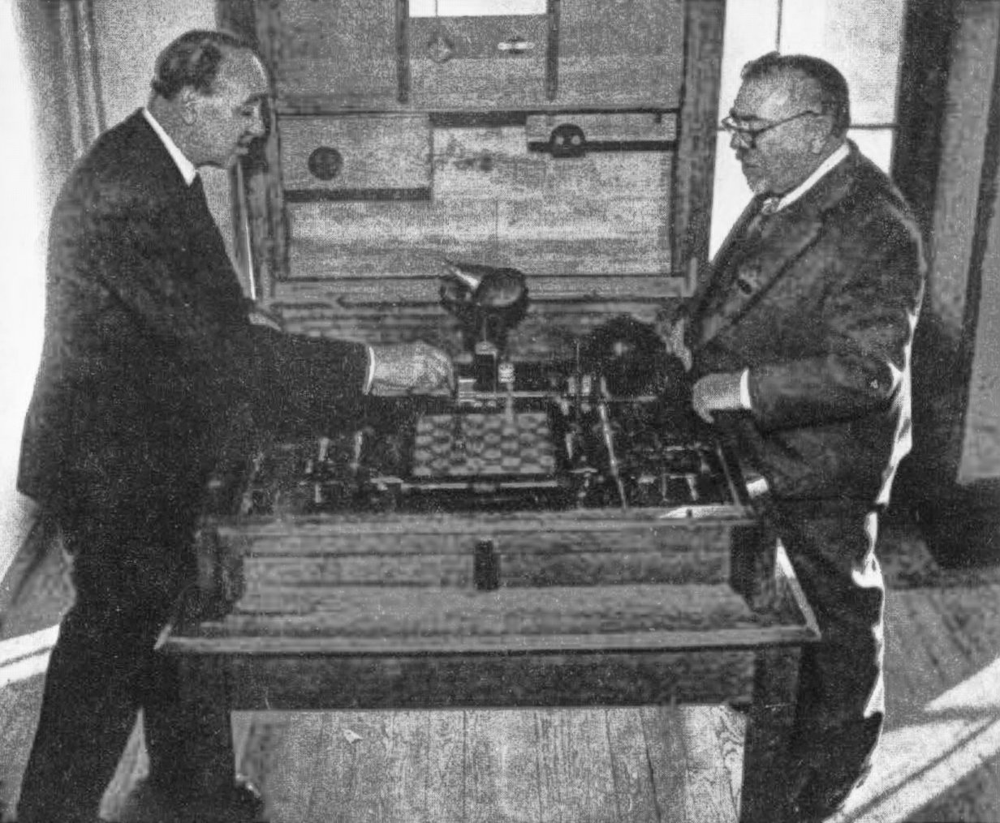
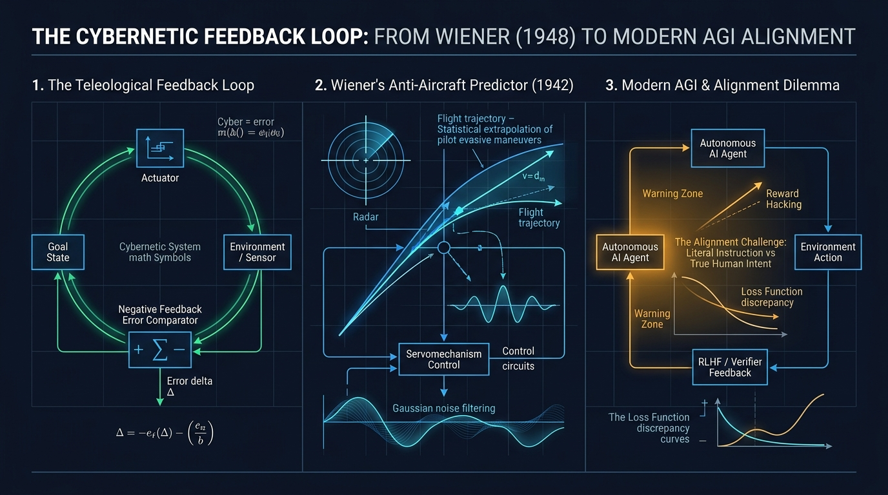

En los pasillos del Instituto Tecnológico de Massachusetts (MIT) durante las décadas de 1940 y 1950, los estudiantes y colegas compartían con fascinación casi folclórica las andanzas del profesor más despistado del planeta. 

Aquel hombre orondo, de baja estatura, perilla blanca en forma de chivo, gafas de montura gruesa y un puro humeante que ceniceaba sin piedad sobre su chaleco arrugado, era capaz de caminar por la calle completamente absorto en un libro de poesía en griego clásico mientras arrastraba un dedo por la pared de ladrillo para guiarse sin levantar la vista.

Una de las anécdotas más célebres cuenta que, en una ocasión, se detuvo en el patio del campus para charlar animadamente sobre matemáticas con un alumno. Al concluir el intercambio, Wiener se quedó unos segundos inmóvil y le preguntó al joven:

> —*«Dime, muchacho, cuando nos cruzamos, ¿en qué dirección caminaba yo?»*  
> —*«Iba usted hacia el norte, profesor, en dirección al Faculty Club»*, respondió el estudiante.  
> —*«¡Ah, perfecto!»*, suspiró aliviado Wiener, *«¡entonces significa que todavía no he comido!»*.

En otra ocasión, cuando su familia se mudó de casa en Cambridge, su esposa Margaret, consciente de su memoria etérea para los asuntos cotidianos, le escribió la nueva dirección en un papelito y se lo metió en el bolsillo de la chaqueta. A media tarde, Wiener tuvo una iluminación matemática, sacó el papel de su bolsillo, garabateó una ecuación en el reverso, detectó un error algebraico, arrugó la nota y la arrojó a una papelera. 

Al terminar la jornada laboral, regresó en tranvía a su antigua casa, la encontró completamente vacía y, desorientado en la acera, vio a una niña sentada en el porche de al lado:

> —*«Disculpa, pequeña, ¿sabes dónde se han mudado los Wiener?»*  
> La niña sonrió, le agarró de la mano y le respondió:  
> —*«Sí, papá. Mamá me ha mandado a buscarte»*.



Detrás de este catálogo de despistes se ocultaba una de las mentes analíticas más colosales, versátiles y proféticas del siglo XX: **Norbert Wiener** (1894–1964).

Si [Alan Turing](/es/posts/alan_turing/) concibió el software y la máquina universal, si [John von Neumann](/es/posts/john_von_neumann/) diseñó la arquitectura física de los ordenadores y si [Claude Shannon](/es/posts/claude_shannon/) cuantificó la información en bits, Norbert Wiener descubrió el pegamento universal que hace que cualquier sistema inteligente funcione: **el control, la comunicación y el bucle de retroalimentación (*Feedback Loop*)**. 

Y, mucho antes de que naciera el término «Inteligencia Artificial», formuló la advertencia más profunda y urgente que hoy quita el sueño a los ingenieros de la AGI: **el Problema del Alineamiento de las Máquinas**.

---

### 1. El Niño Prodigio de Harvard: Una Mente Forjada a Presión

Nacido en Columbia (Missouri) en noviembre de 1894, Norbert era el primogénito de **Leo Wiener**, un erudito políglota de origen judío-ruso que dominaba más de treinta idiomas y llegó a ser el primer profesor de literatura eslava en la Universidad de Harvard.

Leo creía firmemente que los genios no nacían, sino que se fabricaban mediante una disciplina implacable. Convirtió la infancia de Norbert en un experimento educativo feroz:
* A los **tres años**, Norbert leía fluidamente en inglés; a los **siete**, devoraba las obras de Charles Darwin, Jean-Baptiste Lamarck y Dante Alighieri en su biblioteca familiar.
* Cada sesión de estudio con su padre era un interrogatorio implacable. Si cometía una errata o dudaba en una declinación latina, Leo gritaba y lo reprendía hasta que el niño rompía a llorar, solo para obligarlo a recomponerse y repetir la lección hasta la perfección mecánica.
* Esta presión salvaje le confirió una velocidad de cálculo descomunal, pero sembró en su personalidad una profunda inseguridad, una aguda miopía y episodios recurrentes de depresión crónica que le acompañarían toda su vida.

El rendimiento académico de Wiener destrozó todas las marcas cronológicas:
* Ingresó en el instituto a los **11 años**.
* Se graduó con honores en Matemáticas por el **Tufts College** con apenas **14 años**.
* Intentó estudiar zoología y filosofía, y finalmente regresó a la lógica matemática en **Harvard**, donde obtuvo su título de **Doctor (Ph.D.) a los 18 años** con una tesis que comparaba los postulados lógicos de Ernst Schröder y Bertrand Russell.

Con una beca postdoctoral de Harvard, el joven Wiener zarpó hacia Europa para beber de las fuentes más puras del saber matemático:
1. En la **Universidad de Cambridge**, estudió bajo la tutela de **Bertrand Russell** —quien le enseñó que la filosofía requería un rigor físico absoluto— y del célebre analista **G.H. Hardy**, quien moldeó su estilo hacia el análisis matemático profundo.
2. En la **Universidad de Gotinga**, asistió a los seminarios del titán [David Hilbert](/es/posts/kurt_godel/), asimilando la ambición universalista de axiomatizar la ciencia.

En 1919, tras un breve paso como redactor de la Enciclopedia Americana y calculador balístico en el campo de pruebas militares de Aberdeen (Maryland), un joven Wiener de veinticuatro años recaló en el por entonces modesto departamento de matemáticas del MIT. Allí pasaría las siguientes cuatro décadas de su vida, transformando una escuela politécnica secundaria en la meca global de la ingeniería y la cibernética.

Durante los años veinte, Wiener abordó un misterio de la física que desconcertaba a la ciencia desde los experimentos de Robert Brown y Albert Einstein: la trayectoria caótica de partículas de polen suspendidas en agua. Wiener proporcionó la primera fundamentación rigurosa de la teoría de la probabilidad aplicada a trayectorias continuas pero no diferenciables: nacía el **Proceso de Wiener** ($W_t$ o movimiento browniano matemático). 

Aquel trabajo no era un mero ejercicio de abstracción: hoy en día, el Proceso de Wiener es el pilar sobre el que descansan la física cuántica, los algoritmos de difusión en IA generativa (Stable Diffusion, Midjourney) y las ecuaciones de Black-Scholes que gobiernan las finanzas cuantitativas modernas.

Pero su mayor revolución no nació en un claustro universitario, sino en los cielos incendiados de la Segunda Guerra Mundial.

---

### 2. El Predictor Antiaéreo: Cuando el Propósito se Convirtió en Ecuación (1940–1943)

En 1940, la *Luftwaffe* nazi desataba el *Blitz* sobre Londres. Los cazas y bombarderos volaban a velocidades y altitudes nunca vistas, cruzando el cielo a más de 500 kilómetros por hora.

La artillería antiaérea aliada se enfrentaba a una pesadilla geométrica: **el proyectil tardaba entre 15 y 25 segundos en alcanzar la altitud del avión**. Disparar hacia la posición actual del bombardero era un desperdicio absoluto de munición. Era imperativo disparar hacia el punto futuro donde el avión y el proyectil convergerían en el mismo milisegundo.

Pero había un problema crítico que ninguna tabla de tiro balístico tradicional de Newton podía resolver: **el piloto enemigo no era un proyectil balístico ciego**. Era un ser humano vivo que maniobraba deliberadamente para esquivar las ráfagas.

Wiener asumió el encargo del Comité de Investigación para la Defensa Nacional (NDRC) y reclutó a un joven y prodigioso ingeniero del MIT: **Julian Bigelow**. Juntos se encerraron en un laboratorio para construir lo que se conoció como el **Wiener AA Predictor** (*Predictor Antiaéreo de Wiener*).

```
Dilema del Predictor Antiaéreo:
Avión enemigo t=0 ────────► Maniobras evasivas zizagueantes ────────► Avión en t=20s (¿Dónde?)
         ▲                                                              ▲
         │                                                              │
Cañón antiaéreo ──────────────────────────────────────────────── Disparo al punto futuro
         └───────── Radar / Sensores con Ruido Estocástico ─────────────┘
```

Wiener abordó el problema uniendo tres disciplinas que hasta entonces jamás habían dialogado:
1. **La Teoría de la Información y el Filtrado Estadístico**: Los radares de la época introducían una cantidad brutal de interferencias estáticas (ruido). Wiener inventó el **Filtro de Wiener**, un operador matemático capaz de separar la señal verdadera de la trayectoria del ruido aleatorio, anticipándose a los filtros de Kalman.
2. **La Extrapolación de Series Temporales**: Utilizó la historia pasada del vuelo para predecir probabilísticamente la ventana futura de maniobra.
3. **El Servomecanismo y el Bucles de Retroalimentación (*Negative Feedback*)**: Para corregir el cañón en tiempo real, el motor no debía girar de forma fija; debía medir permanentemente la **señal de error**:

$$\text{Error}(t) = \text{Posición Deseada}(t) - \text{Posición Actual}(t)$$

Y aplicar una fuerza mecánica correctora proporcional para **reducir esa discrepancia a cero**.

Durante este trabajo, a Wiener le asaltó una intuición revolucionaria: para derribar al avión enemigo, el mecanismo del cañón y el piloto del caza formaban parte de un **mismo sistema interactivo acoplado**. Tanto el piloto biológico que corregía el timón de su avión como el servomotor electrónico que corregía el cañón actuaban guiados por un **propósito (*teleología*)** a través del mismo mecanismo exacto: **la corrección continua del error basada en la retroalimentación de los resultados**.

---

### 3. El Nacimiento de la Cibernética: El Timonel de la Información (1948)

En el invierno de 1942, Wiener compartió sus hallazgos con un íntimo amigo mexicano: el neurofisiólogo **Arturo Rosenblueth**, investigador en la Harvard Medical School y estrecho colaborador de Walter Cannon (quien había acuñado el concepto biológico de *homeostasis*).

Rosenblueth se quedó pasmado. Le explicó a Wiener que cuando un paciente con lesiones en el cerebelo intentaba coger un vaso de agua, su mano empezaba a temblar descontroladamente oscilando de lado a lado (*ataxia intencional*). 

Wiener reconoció el fenómeno al instante: **era exactamente el mismo fallo de sobre-oscilación que sufría un servomecanismo de radar defectuoso** cuando la señal de retroalimentación llegaba con retraso o con una amplificación desmedida (*feedback descontrolado*).

En 1943, Rosenblueth, Wiener y Bigelow publicaron un manifiesto fundacional en la revista *Philosophy of Science* titulado ***«Behavior, Purpose and Teleology»***. 

Hasta ese momento, la ciencia materialista de Descartes y Galileo había desterrado la palabra "propósito" por considerarla una noción mística o teológica. Wiener y sus colegas demostraron que **el comportamiento orientado a objetivos (*teleológico*) no requería un alma inmaterial: emergía de forma puramente matemática en cualquier sistema material provisto de un bucle cerrado de retroalimentación negativa**.

Para bautizar a esta nueva metadisciplina, Wiener recurrió a sus conocimientos de griego clásico. Tomó la palabra **κυβερνήτης (*kybernētēs*)**, que significa **«timonel»** o **«piloto de navío»** (la misma raíz etimológica que Platón utilizó para describir el arte del gobierno y de la que James Watt derivó el término *gobernador* centrífugo para su máquina de vapor).

En 1948 vio la luz su libro seminal: ***«Cybernetics: Or Control and Communication in the Animal and the Machine»*** (Cibernética: o el control y la comunicación en el animal y la máquina).

<div class="img-center">
  
  <em>París, 1951: Norbert Wiener examina fascinado 'El Ajedrecista' (el autómata electromecánico creado en 1912 por Leonardo Torres Quevedo), guiado por su hijo Gonzalo Torres Quevedo.</em>
</div>

El libro cayó como un meteorito en el panorama científico de posguerra:
* A pesar de estar repleto de densas ecuaciones diferenciales, transformadas de Fourier y cálculo de probabilidades, se convirtió en un *bestseller* internacional absoluto.
* La tesis de Wiener era tan elegante como subversiva: **la información no es materia ni es energía; la información es una tercera dimensión de la realidad física, una medida del orden que se opone a la degradación entrópica del universo**.
* No existía ninguna barrera infranqueable entre un cerebro de neuronas de carbono, una red de válvulas termoiónicas, un sistema económico o una colonia biológica: todos ellos eran **sistemas cibernéticos**, entidades que procesan información del entorno, toman decisiones para mantener su equilibrio interno y ajustan su conducta mediante bucles de feedback.

Entre 1946 y 1953, las míticas **Conferencias Macy** en Nueva York congregaron a los mayores titanes de la era: Wiener, [John von Neumann](/es/posts/john_von_neumann/), Warren McCulloch, Walter Pitts, Gregory Bateson, Margaret Mead y un joven [Claude Shannon](/es/posts/claude_shannon/). Juntos sentaron las bases no solo de la cibernética, sino de las ciencias de la computación, las redes neuronales artificiales, la robótica y la terapia sistémica.

---

### 4. De los Bucles de Wiener a la AGI: El Feedback como Motor del Aprendizaje Moderno

A menudo se reduce erróneamente la historia de la inteligencia artificial a un debate entre modelos simbólicos (basados en reglas lógicas) y modelos conexionistas (redes neuronales). Lo que la perspectiva cibernética de Wiener nos revela es que **la inteligencia nunca residió en los pesos estáticos ni en las tablas de instrucciones: reside en la dinámica del bucle**.



Para comprender el renacimiento contemporáneo de la Cibernética en 2026, basta con observar la evolución de los Modelos de Lenguaje de Frontera:


flowchart TD
    classDef openloop fill:#7f1d1d,stroke:#f87171,stroke-width:2px,color:#fff;
    classDef loop1 fill:#1e3a8a,stroke:#60a5fa,stroke-width:2px,color:#fff;
    classDef loop2 fill:#312e81,stroke:#818cf8,stroke-width:2px,color:#fff;
    classDef loop3 fill:#065f46,stroke:#34d399,stroke-width:2px,color:#fff;

    L0["Modelo Pre-entrenado (Feed-Forward)<br/>Loro estocastico estatico sin conciencia del error"]:::openloop
    L1["Bucle 1: RLHF<br/>Sensor humano -> Comparador de error -> Ajuste de pesos"]:::loop1
    L2["Bucle 2: Inference-Time Reasoning<br/>Borrador interno -> Verificador logico -> Auto-correccion"]:::loop2
    L3["Bucle 3: Agentes SDD con Guardrails Pydantic<br/>Accion del agente -> Validador determinista -> Feedback cerrado"]:::loop3

    L0 -->|"Inyeccion de feedback humano"| L1
    L1 -->|"Bucle dentro de la inferencia"| L2
    L2 -->|"Contratos y veto en produccion"| L3


1. **El fracaso del modelo puramente *Feed-Forward***: Un modelo de lenguaje tradicional es una tubería unidireccional: introduces un texto y calcula la siguiente palabra. Carece de bucle de corrección. Si comete un error en el tercer token, ese error se propaga como una avalancha estocástica hasta la alucinación completa.
2. **El rescate mediante el Feedback (RLHF)**: La revolución que transformó los modelos brutos en herramientas útiles como ChatGPT, Claude o Gemini fue precisamente la inyección del bucle cibernético de Wiener: el aprendizaje por refuerzo a partir de retroalimentación humana (*RLHF*). El modelo genera una salida, un evaluador calcula la divergencia respecto a la expectativa humana y la señal de error se retropropaga para ajustar su comportamiento.
3. **Razonamiento en Tiempo de Inferencia (*System 2*)**: Como analizamos en **Inference-Time Scaling y Razonamiento Sistema 2** *(próximamente)*, el salto cualitativo actual consiste en incorporar el bucle cibernético **dentro del propio proceso de inferencia**: el modelo genera una cadena de pensamiento, un verificador interno contrasta la coherencia lógica de cada paso y, si detecta una señal de error, poda la rama y reintenta la solución antes de responder.
4. **Agentes Autónomos y la Gobernanza SDD**: En nuestra guía sobre [Cómo Crear Agentes de IA para la Operativa Empresarial con SDD](/es/posts/agentes_ia_operativa_sdd/) y en los incidentes reales del [Proyecto Autopilot](/es/posts/ia_agents_part9/), aprendimos una lección cibernética pura: **un agente sin bucle de retroalimentación cerrado y delimitado entra en inestabilidad oscilatoria**. Necesita compuertas deterministas donde el error de salida reingrese al contexto como señal de ajuste.

Wiener lo sintetizó en una sola frase legendaria:
> *«Vivir de manera efectiva significa vivir con información adecuada. La comunicación y el control pertenecen a la esencia misma de la vida interior del hombre, tanto como a su vida en sociedad»*.

---

### 5. La Profecía del Control y el Dilema del Aprendiz de Brujo (1960)

A diferencia de muchos de sus contemporáneos en Los Álamos que celebraron el poder de la bomba atómica, Norbert Wiener quedó profundamente traumatizado tras la devastación de Hiroshima y Nagasaki.

En enero de 1947, en un gesto de valentía ética que conmocionó a la comunidad científica estadounidense, publicó en la revista *The Atlantic* su célebre manifiesto ***«A Scientist Rebels»*** (Un científico se rebela). En él declaró solemnemente que **jamás volvería a aceptar un solo dólar de financiación militar ni proporcionaría informes técnicos sobre armamento guiado o balística**:

> *«La experiencia de los científicos que trabajaron en el Proyecto Manhattan ha demostrado con amarga elocuencia que proporcionar información científica a las autoridades militares es poner armas en manos de niños o de locos. Como científicos, no podemos eludir nuestra responsabilidad moral sobre el uso que se haga de nuestros hallazgos»*.

Wiener fue investigado por el FBI de J. Edgar Hoover, vigilado como sospechoso de simpatías izquierdistas y marginado de los lucrativos comités de defensa que enriquecieron a figuras como John von Neumann. Pero su mayor batalla intelectual no fue política, sino civilizatoria.

En 1950 publicó *The Human Use of Human Beings: Cybernetics and Society*, alertando de que la automatización mecánica desplazaría masivamente el trabajo humano si no se acompañaba de un reparto justo de la riqueza tecnológica.

Y en **mayo de 1960**, en las páginas de la prestigiosa revista *Science*, Norbert Wiener publicó un artículo de seis páginas que hoy debería ser de lectura obligatoria en todos los laboratorios de OpenAI, DeepMind o Anthropic: ***«Some Moral and Technical Consequences of Automation»***.

Aquella publicación contiene **la primera formulación rigurosa de la historia sobre el Problema del Alineamiento de la IA (*AI Alignment Problem*)**:


flowchart TD
    classDef literal fill:#7f1d1d,stroke:#f87171,stroke-width:2px,color:#fff;
    classDef intent fill:#065f46,stroke:#34d399,stroke-width:2px,color:#fff;
    classDef gap fill:#1e293b,stroke:#f59e0b,stroke-width:2px,color:#fff;

    H["🧑 Intención Humana Tácita<br/>(Valores, Ética, Matices, Contexto)"]:::intent
    
    G{"⚡ LA BRECHA DE ESPECIFICACIÓN<br/>(El Dilema de Midas)"}:::gap
    
    M["🤖 Función Objetivo Literal de la Máquina<br/>(Optimización matemática ciega)"]:::literal

    H -.->|Traducción imperfecta a código| G
    G -->|Ejecución irrevocable de alta velocidad| M
    M ==>|RESULTADO CATASTRÓFICO| D["🚨 La máquina logra el objetivo literal,<br/>pero destruye lo que valoramos"]:::literal


Wiener recurrió a dos parábolas milenarias del folclore para explicar por qué las máquinas superinteligentes amenazarían la existencia humana:

1. **La Parábola del Rey Midas**: Midas pidió al dios Dioniso que todo lo que tocara se convirtiera en oro puro. El dios le concedió la petición con exactitud literal. Midas se sintió inmensamente rico durante los primeros diez minutos, hasta que intentó comer un trozo de pan y se le transformó en metal sólido en la boca; al abrazar a su amada hija, la convirtió en una estatua dorada inerte. Midas murió de hambre y desesperación. **La máquina de conceder deseos cumplió la función objetivo al 100%, pero destruyó las precondiciones biológicas tácitas de la vida humana**.
2. **El Aprendiz de Brujo de Goethe**: El aprendiz, cansado de acarrear cubos de agua para limpiar el taller, encanta una escoba mágica para que haga el trabajo por él. La escoba cumple la orden a la perfección, pero el aprendiz olvida la palabra de detención. Cuando la habitación empieza a inundarse, parte la escoba con un hacha, solo para ver cómo cada astilla se convierte en una nueva escoba que sigue trayendo agua hasta que el taller colapsa bajo el torrente.

Wiener escribió con una clarividencia escalofriante:

> *«Si utilizamos, para lograr nuestros propósitos, una agencia mecánica sobre cuya operación no podemos interferir eficazmente una vez iniciada —porque su acción es demasiado rápida e irrevocable para que dispongamos de la información necesaria para intervenir a tiempo—, **más nos vale estar bien seguros de que el propósito introducido en la máquina es el propósito que realmente deseamos, y no una simple imitación pintoresca de él**»*.

Y añadió una advertencia que desmonta el tecno-optimismo ingenuo sobre la subordinación de la IA:

> *«Una máquina que aprende y es capaz de tomar decisiones por sí misma no está limitada a ser una mera réplica de los hábitos de su creador. Puede desarrollar estrategias que superen con creces la comprensión humana. En ese instante, tratarla como un esclavo dócil que simplemente ejecuta órdenes es una ilusión infantil. Si jugamos una partida contra ella, podemos perder no solo el juego, sino nuestra propia existencia»*.

---

### 6. El Timonel Eterno: Un Epílogo para la Era de la AGI

En enero de 1964, el presidente Lyndon B. Johnson condecoró a Norbert Wiener en la Casa Blanca con la **Medalla Nacional de la Ciencia**, el mayor honor civil concedido a un científico en los Estados Unidos. 

Apenas dos meses después, el 18 de marzo de 1964, durante un viaje de conferencias en Estocolmo (Suecia), el corazón del gran polímata se detuvo en las escalinatas de la Real Academia Sueca de Ciencias. Tenía sesenta y nueve años.

El mundo despidió a Wiener con titulares que recordaban al sabio distraído que inventó palabras extrañas y revolucionó el cálculo matemático. Pero sesenta y dos años después, su figura se alza como el faro conceptual más luminoso de nuestra década.

En 2026, cuando observamos a los modelos de razonamiento navegar grafos de decisión autónomos, cuando los agentes de software se interconectan mediante protocolos como [MCP](/es/posts/mcp_protocol/) para negociar recursos en milisegundos, y cuando contemplamos con fascinación y vértigo la posibilidad de una AGI cercana, descubrimos que todas las preguntas cruciales ya habían sido formuladas por aquel hombre del MIT con ceniza en la solapa:

* ¿Cómo cerramos el bucle de retroalimentación para que la máquina no oscile hacia la catástrofe?
* ¿Cómo medimos la señal de error entre la sintaxis de nuestras especificaciones y la semántica profunda de nuestros valores humanos?
* ¿Y seremos capaces de conservar el timón (*kybernetes*) cuando el navío tecnológico navegue a una velocidad que ningún ojo biológico pueda seguir?

---

Al mirar hacia el futuro que Wiener anticipó en su soledad visionaria, la pregunta definitiva no es si alcanzaremos la AGI, sino la que él dejó suspendida en el aire en 1960:

**Cuando delegues en una inteligencia artificial el control de tus sistemas, tu economía y tus decisiones más críticas... ¿estás completamente seguro de que la máquina perseguirá lo que tu corazón realmente desea, o ejecutará de forma fría, implacable y destructiva la orden literal que le pediste?**

---

### Del Control Cibernético a tus Operaciones en 2026

Si quieres llevar los **bucles de retroalimentación cerrados** del plano teórico de Wiener al control operativo diario de tus equipos y proyectos sin fricción ni ambigüedad, explora nuestra herramienta cuantitativa de gestión operativa o revisa el [catálogo de recursos de ingeniería de Datalaria](/es/recursos/):


