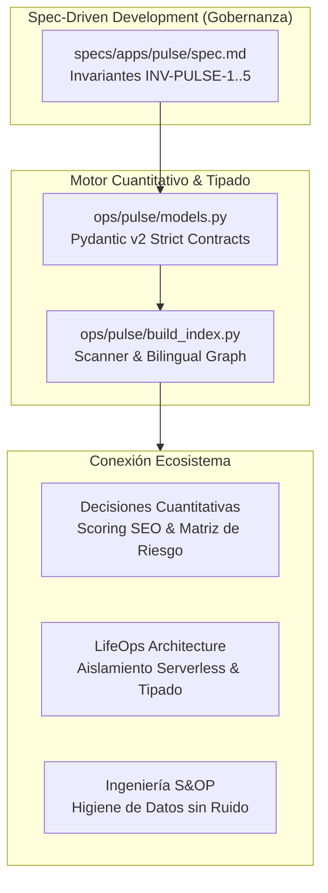
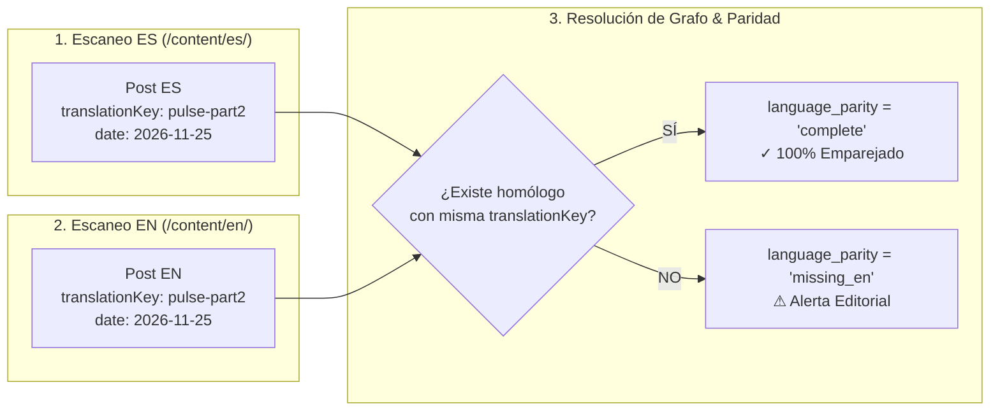

En la [primera entrega de esta serie](/es/posts/pulse-parte1-adios-notion-content-ops/) expusimos el talón de Aquiles de la gestión editorial técnica: la desincronización inevitable entre repositorios Git y bases de datos externas como Notion o Airtable. Definimos la filosofía **Content Ops as Code**, fundamentada en tratar los artículos técnicos y su taxonomía exactamente como código fuente bajo control de versiones.

Sin embargo, adoptar Git como Fuente Única de Verdad (*Single Source of Truth* o SSOT) introduce de inmediato un desafío mayúsculo para los equipos de ingeniería: **el Markdown con front matter YAML no posee un compilador con comprobación de tipos**.

Un error tipográfico en una clave (`category` en lugar de `categories`), una fecha escrita como texto plano con formato inconsistente (`"25-11-2026"` en vez del estándar ISO `2026-11-25`), o un tag introducido como string en lugar de lista generan roturas silenciosas en generadores estáticos como Hugo, Astro o Next.js. Peor aún: cuando se publica un blog técnico bilingüe en español e inglés, comprobar manualmente que cada traducción conserva su correspondencia exacta, sus enlaces canónicos y su frescura técnica se convierte en un laberinto inmanejable.

En este artículo desglosamos la ingeniería interna de **Datalaria Pulse**: cómo modelamos nuestros contratos de datos con **Pydantic v2**, cómo resolvemos la paridad lingüística mediante un grafo determinista y cómo integramos la validación en **GitHub Actions** bajo una regla inquebrantable: si hay un solo dato inconsistente, el pipeline falla en modo cerrado (*Fail-Closed*).

---

## 0. Objetivos de la Fase y de este Artículo: Del Caos de Texto a los Contratos de Tipado

El objetivo neurálgico de la **Fase 5 de Datalaria** consiste en reemplazar la burocracia administrativa manual por una arquitectura determinista que indexe, valide y gobierne activos técnicos con latencia cero.

### Objetivos Estratégicos de la Fase 5:
1. **Contratos de Datos Inmutables:** Establecer un esquema formal en Python que valide metadatos editoriales antes de cualquier despliegue a producción.
2. **Paridad Bilingüe Automatizada (ES ⇔ EN):** Eliminar los artículos huérfanos y garantizar que cada actualización de un post en español refleje inmediatamente su estado de traducción al inglés.
3. **Pipeline de Integración Continua (CI/CD):** Ejecutar pruebas automatizadas unitarias y de integración que verifiquen las invariantes de seguridad (`INV-PULSE-1..5`) en cada `git push`.
4. **Distribución en Dos Modos (Dual-Mode):** Alimentar tanto el **Datalaria Pulse Kit** descargable (con su escáner universal CLI en Python puro y conector Power Query) como la versión **Pulse Pro Cloud** sincronizada con Supabase.

### Objetivos Específicos de este Artículo 2:
- Diseñar la entidad canónica `ContentAsset` en Pydantic v2 y analizar las ventajas de migrar desde diccionarios planos o Pydantic v1.
- Implementar las dos invariantes de seguridad críticas: aislamiento de activos privados (`INV-PULSE-1`) y anonimización/relativización de analítica en base 100 (`INV-PULSE-2`).
- Explicar el algoritmo determinista de emparejamiento bilingüe que mapea más de 135 activos cruzando `translationKey` y taxonomía.
- Configurar el workflow de GitHub Actions que audita enlaces rotos, calcula el SEO Score (0 a 100) y genera el archivo `public.json` consumido por la interfaz web.

---

## 1. Conexión con el Ecosistema Datalaria: Invariantes y Spec-Driven Development

Datalaria Pulse aplica a la estrategia de contenidos los mismos principios de rigor matemático, contratos de interfaz y gobernanza formal desarrollados en nuestras herramientas anteriores:



1. **La Filosofía de Contratos de [LifeOps](/es/apps/lifeops/):** En el backend de LifeOps demostramos que la persistencia en base de datos debe estar protegida por validaciones estrictas en servidor para evitar estados corrompidos. Pulse traslada este principio al sistema de ficheros: el Markdown es el backend, y Pydantic actúa como la capa de abstracción de datos.
2. **Evaluación Objetiva en la [Suite de Toma de Decisiones](/es/posts/toma-decisiones-priorizacion-framework-cuantitativo/):** En lugar de evaluar la calidad de un post por apreciaciones subjetivas, Pulse implementa un algoritmo cuantitativo de scoring SEO (0 a 100) que audita parámetros objetivos: longitud óptima de título, presencia de descripción, recuento léxico superior al umbral y paridad idiomática completa.
3. **Higiene de Datos en [Ingeniería S&OP](/es/posts/sop_ingenieria-higiene-datos/):** Al igual que en la planificación de operaciones se limpian los outliers del ERP antes de proyectar la demanda, nuestro escáner en Python elimina bloques de código, shortcodes de Hugo (`app-ref`, `mermaid`) y etiquetas HTML para calcular la métrica real de **profundidad léxica** y tiempo de lectura técnica.
4. **Validación Determinista bajo [Spec-Driven Development (SDD)](/es/posts/sdd_vs_vibe_coding/):** Siguiendo la Constitución técnica de Datalaria, ningún activo se incorpora al catálogo si no supera las pruebas automáticas en `pytest`. El desarrollo no se basa en conjeturas (*vibe coding*), sino en especificaciones auditables.

---

## 2. La Fragilidad del Front Matter: Por Qué el Markdown Crudo no es una Base de Datos

El front matter en formato YAML que encabeza cada archivo Markdown (`index.md`) es cómodo para la redacción individual, pero extraordinariamente vulnerable cuando el repositorio crece:

```yaml
---
# Ejemplo de front matter vulnerable a fallos silenciosos
title: "Arquitectura de Datos con Pydantic"
date: "2026/11/25"           # Formato no ISO: Hugo puede interpretar texto en lugar de fecha
category: "Ingenieria"       # Singular en vez de plural: rompe el filtro de categorías
tags: "python, pydantic"     # String en vez de lista: rompe el renderizado de etiquetas
draft: False                 # Mayúscula no estándar en YAML: comportamiento impredecible
image: "cover.png"           # ¿Existe realmente el archivo cover.png en la carpeta?
---
```

Cuando un generador estático procesa miles de líneas sin validación:
- Si una propiedad requerida falta, el motor suele inyectar `nil` o renderizar cadenas vacías sin emitir advertencias visibles en consola.
- Si dos artículos en distintos idiomas comparten el mismo slug pero omiten su clave de enlace (`translationKey`), el portal genera rutas colisionadas o rompe el conmutador de idiomas ES/EN en el encabezado.
- Si un redactor modifica un archivo en local pero olvida añadir la imagen de portada, el error salta únicamente cuando el usuario final experimenta una imagen rota (`404 Not Found`) en producción.

Para erradicar este problema, adoptamos el principio **Fail-Closed**: cualquier inconsistencia en los metadatos detiene de inmediato el proceso de build local y el pipeline de CI/CD, impidiendo la generación de artefactos defectuosos.

---

## 3. Modelado de Contratos con Pydantic v2 (`ops/pulse/models.py`)

Pydantic v2, reescrito sobre su núcleo de Rust (*pydantic-core*), nos ofrece la velocidad necesaria para escanear y validar cientos de archivos Markdown en apenas unas décimas de segundo.

Definimos una jerarquía de tipos estricta donde cada activo editorial (sea un Post técnico, una Aplicación interactiva o un Kit descargable) se valida contra la entidad canónica `ContentAsset`:

```python
# ops/pulse/models.py (Extracto canónico simplificado)
from datetime import date, datetime
from typing import List, Literal, Optional, Dict, Any
from pydantic import BaseModel, Field

AssetType = Literal["post", "app", "kit", "suite", "mega_bundle"]
AssetStatus = Literal["idea", "draft", "review", "scheduled", "published", "available", "coming"]
VisibilityType = Literal["public", "private"]
LanguageParity = Literal["complete", "missing_en", "missing_es", "outdated_en", "outdated_es"]

class ContentAsset(BaseModel):
    id: str = Field(description="Identificador único: translationKey o slug de app")
    slug: str = Field(description="Slug base URL")
    asset_type: AssetType
    status: AssetStatus
    visibility: VisibilityType = "public"

    # Metadatos bilingües unificados en una sola fila
    title_es: Optional[str] = None
    title_en: Optional[str] = None
    url_es: Optional[str] = None
    url_en: Optional[str] = None
    brief_es: Optional[str] = None
    brief_en: Optional[str] = None

    # Ciclo de vida y auditoría
    publish_date: Optional[date] = None
    last_modified_es: Optional[datetime] = None
    last_modified_en: Optional[datetime] = None
    language_parity: LanguageParity = "complete"
    
    # Taxonomía y volumen
    category: str = "General"
    categories: List[str] = Field(default_factory=list)
    tags: List[str] = Field(default_factory=list)
    word_count_es: int = 0
    word_count_en: int = 0
    reading_time_min: int = 0

    def to_public_dict(self) -> Dict[str, Any]:
        """
        Garantiza INV-PULSE-1 (rechazo de activos privados)
        e INV-PULSE-2 (eliminación estricta de métricas absolutas).
        """
        if self.visibility == "private":
            raise ValueError(f"Violación INV-PULSE-1: Intento de exportar activo privado {self.id}")

        return self.model_dump(
            exclude={"metrics_absolute"},
            mode="json"
        )
```

### Las Dos Invariantes Constitucionales de Seguridad:
1. **`INV-PULSE-1` (Aislamiento de Privacidad):** Los artículos marcados como borradores internos o notas privadas (`visibility: private`) jamás pueden filtrarse al archivo estático `public.json`. Si el generador detecta un activo privado en el array público, arroja una excepción fatal e interrumpe la ejecución.
2. **`INV-PULSE-2` (Relativización de Métricas):** Las cifras absolutas de Google Analytics 4 (visitas reales, usuarios únicos, conversiones de compra) pertenecen exclusivamente al tracker privado del autor. Para el dataset público que consume el navegador, las métricas se transforman matemáticamente en un **Índice Relativo Base 100** respecto a la mediana y su percentil de tráfico (`rank_pct`).

---

## 4. El Grafo Bipartito de Paridad Bilingüe ES ⇔ EN

Mantener paridad completa en un blog con decenas de artículos técnicos requiere modelar el contenido como un grafo bipartito donde cada nodo en español (`content/es/posts/<slug>`) debe emparejarse con su equivalente en inglés (`content/en/posts/<slug>`).

El motor de escaneo `ops/pulse/build_index.py` resuelve este emparejamiento siguiendo un algoritmo de tres fases:



### Reglas de Clasificación de Paridad:
- **`complete`:** Ambos archivos existen, comparten `translationKey`, poseen título y descripción en sus respectivos idiomas, y su fecha de modificación tiene un desfase inferior a 15 días.
- **`missing_en` / `missing_es`:** El artículo ha sido publicado en un idioma, pero no existe fichero homólogo en el idioma complementario.
- **`outdated_en` / `outdated_es`:** Ambos archivos existen, pero la versión en español ha recibido actualizaciones sustanciales en Git (commits recientes con cambios de más de 100 palabras) que aún no se han sincronizado en la versión inglesa.

Gracias a esta clasificación, el Dashboard de Datalaria Pulse proyecta un indicador directo de **Salud Bilingüe** (actualmente `137 / 137 activos, 100% paridad`), alertando al equipo editorial si un borrador amenaza con desincronizar el catálogo internacional.

---

## 5. Compilación Determinista en GitHub Actions (`.github/workflows/pulse_ci.yml`)

Para hacer cumplir estas invariantes sin depender de la disciplina manual, encapsulamos todo el pipeline en una acción de GitHub Actions que se dispara en cada `push` a la rama `main` y en cada Pull Request:

```yaml
# .github/workflows/pulse_ci.yml
name: Datalaria Pulse - Content Ops as Code Pipeline

on:
  push:
    branches: [ main ]
    paths:
      - 'content/**'
      - 'data/**'
      - 'ops/pulse/**'
  pull_request:
    branches: [ main ]

jobs:
  validate-and-build:
    name: Validate Schemas, Parity & Hugo Build
    runs-on: ubuntu-latest

    steps:
      - name: Checkout Repository con Historial Git
        uses: actions/checkout@v4
        with:
          fetch-depth: 0 # Requerido para leer fechas y commits de lastmod

      - name: Configurar Entorno Python 3.13
        uses: actions/setup-python@v5
        with:
          python-version: '3.13'
          cache: 'pip'

      - name: Instalar Dependencias del Motor Pulse
        run: |
          pip install pydantic pyyaml pytest openpyxl

      - name: Ejecutar Indexador y Comprobación de Tipos Pydantic
        run: |
          python -m ops.pulse.build_index
          python -m ops.pulse.publish_public

      - name: Ejecutar Batería de Tests Unitarios de Seguridad
        run: |
          python -m pytest ops/pulse/tests/ -v

      - name: Configurar e Instalar Hugo Extended
        uses: peaceiris/actions-hugo@v3
        with:
          hugo-version: '0.148.2'
          extended: true

      - name: Compilación Estricta de Producción en Hugo
        run: |
          hugo --gc --minify
```

### ¿Qué Garantiza este Workflow en CI?
1. **Detección Previa a Producción:** Si un autor olvida rellenar un campo obligatorio en el front matter, Pydantic emite un error de validación `ValidationError` con la ruta exacta del archivo y el campo infractor, abortando el commit.
2. **Validación de Enlaces Cruzados:** Si un post referencia una App que no existe en `data/apps/` o viceversa, Hugo detiene el proceso con código de salida no cero gracias al principio de invarianza de nuestra plantilla.
3. **Generación Determinista de `public.json`:** La web de Datalaria Pulse siempre consume un índice fresco y verificado generado automáticamente en el propio proceso de build, eliminando cualquier intervención manual en bases de datos externas.

---

## 6. Conclusiones y Próximos Pasos

Al sustituir el front matter sin tipar por un pipeline formal de **Pydantic v2 + Git + GitHub Actions**, hemos alcanzado tres hitos fundamentales:
- **Cero Deuda Administrativa (*Toil*):** El autor técnico se enfoca al 100% en escribir y programar. La catalogación, el conteo léxico y la auditoría de paridad ocurren de forma transparente en cada commit.
- **Gobernanza a Prueba de Errores:** Las invariantes `INV-PULSE-1` e `INV-PULSE-2` aseguran que ningún dato confidencial de tráfico ni borradores internos se publiquen jamás por descuido humano.
- **Infraestructura Reutilizable:** El mismo motor en Python que indexa Datalaria se distribuye empaquetado en el **Datalaria Pulse Kit** para que cualquier equipo editorial o bloguero técnico pueda implementarlo en su propio repositorio en cuestión de minutos.

### Prueba la Herramienta en Vivo y Descarga el Kit:
- Explora el catálogo real y las métricas indexadas directamente en nuestro [**Cockpit Interactivo de Datalaria Pulse**](/apps/pulse/).
- Si quieres automatizar tu propio blog estático, migrar tu base de datos de Notion en 5 minutos y disponer de la plantilla maestra de seguimiento en Excel, consigue el [**Datalaria Pulse Kit**](/es/recursos/#pack-pulse).

---

> **En la próxima entrega (Artículo 3/5):**  
> *Tabla Ejecutiva, Tablero Kanban y Calendario Mensual en React 19: Cómo proyectar una interfaz web interactiva de alto rendimiento sobre un índice estático con latencia cero.*
