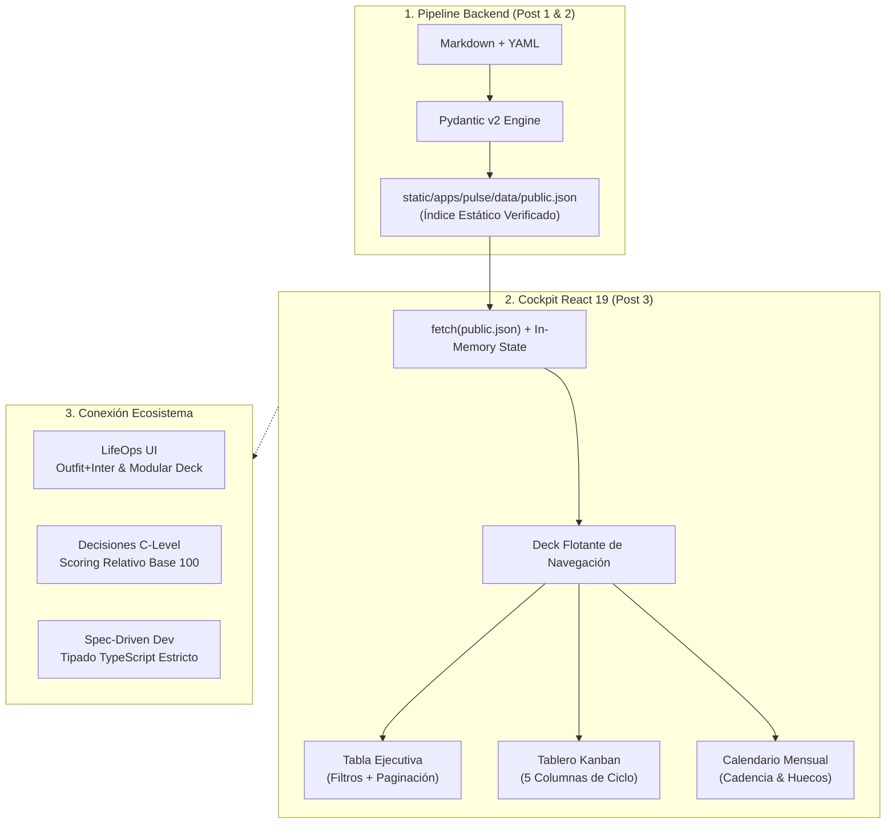
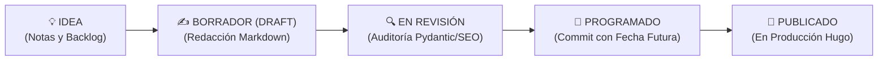

En los dos primeros artículos de esta serie demostramos cómo erradicar la desincronización entre bases de datos externas y Git ([Artículo 1](/es/posts/pulse-parte1-adios-notion-content-ops/)) y cómo blindar la calidad de los metadatos y la paridad bilingüe mediante contratos de tipado estricto en Pydantic v2 y pipelines de CI/CD ([Artículo 2](/es/posts/pulse-parte2-indexador-pydantic-paridad-ci/)).

Al finalizar ese pipeline de backend disponemos de un activo de datos excepcional: el archivo `public.json`, un dataset normalizado, determinista y auditado que consolida el 100% de los posts técnicos, aplicaciones interactivas y kits descargables del ecosistema.

Sin embargo, los datos estructurados en disco carecen de utilidad si el equipo editorial y la dirección técnica deben inspeccionarlos leyendo código fuente o ejecutando comandos en la terminal. Para tomar decisiones estratégicas de publicación se requiere una **interfaz ejecutiva de alto nivel**: una consola de control (*cockpit*) que permita filtrar por categorías temáticas, monitorizar cuellos de botella en un flujo Kanban, visualizar los próximos lanzamientos en un calendario mensual y capturar nuevas ideas al vuelo.

En este artículo desglosamos la arquitectura frontend de **Datalaria Pulse**: cómo diseñamos una Single Page Application (SPA) en **React 19 + TypeScript** que se monta directamente sobre un índice estático, ofreciendo interactividad instantánea con **latencia cero** sin incurrir en costes de servidores ni depender de bases de datos lentas.

---

## 0. Objetivos de la Fase y de este Artículo: Interactividad Instantánea sobre Datos Estáticos

El propósito de esta etapa en la **Fase 5 de Datalaria** radica en democratizar el acceso al catálogo editorial mediante una experiencia de usuario (UX) fluida, moderna y reactiva.

### Objetivos Estratégicos de la Fase 5:
1. **Consumo de Datos con Cero Latencia:** Eliminar las llamadas a bases de datos relacionales tradicionales en la navegación pública sirviendo un índice estático inmutable (`public.json`) alojado en la CDN.
2. **Multi-Visualización de Contenidos:** Proyectar la misma fuente única de verdad (*SSOT*) a través de tres prismas complementarios: **Tabla Ejecutiva** (auditoría analítica), **Tablero Kanban** (ciclo de vida) y **Calendario Mensual** (planificación temporal).
3. **Captura Optimista Desacoplada:** Permitir a cualquier autor registrar ideas o notas en local con persistencia inmediata en el navegador (`localStorage`), facilitando la exportación limpia a YAML para su posterior commit en Git.
4. **Fundación para el Modo Pro:** Diseñar los componentes visuales de modo que puedan alternar de forma transparente entre el dataset público estático y la sincronización colaborativa en tiempo real con Supabase PostgreSQL.

### Objetivos Específicos de este Artículo 3:
- Explicar el patrón arquitectónico *Static-First SPA*: cómo React 19 renderiza cientos de activos en memoria sin desfase de red (*network lag*).
- Desgranar la ingeniería de la **Tabla Ejecutiva**: búsqueda predictiva, filtros combinados por taxonomía y paginación ajustable (10, 25, 50 registros).
- Analizar el diseño del **Tablero Kanban de 5 Columnas** (*Idea*, *Borrador*, *En Revisión*, *Programado*, *Publicado*) y su lógica de estados.
- Presentar la rejilla del **Calendario Editorial** y el sistema de captura de ideas con exportación atómica a Git backlog.

---

## 1. Conexión con el Ecosistema Datalaria: De las Suites Ejecutivas al Dashboard React 19

El diseño de la interfaz de Datalaria Pulse bebe directamente de los estándares de usabilidad, estética de panel de instrumentos y rigor cuantitativo forjados en nuestras suites precedentes:



1. **La Ergonomía Visual de [LifeOps](/es/apps/lifeops/):** Pulse adopta la tipografía corporativa *Outfit + Inter*, el modo oscuro profundo (*Dark Slate* `#080d1a` a `#0f172a`), los resplandores neón cian y esmeralda, y la estructura de navegación segmentada flotante que desarrollamos originalmente para la gestión personal en LifeOps.
2. **Presentación Directiva de la [Suite de Toma de Decisiones](/es/posts/toma-decisiones-priorizacion-framework-cuantitativo/):** La cabecera de Pulse sigue el estándar directivo C-Level: 4 Macro KPIs con bordes superiores neón (`Total Activos`, `Publicados`, `Programados` y `Paridad Bilingüe`) seguidos de métricas operativas contextuales (palabras indexadas, patrimonio de contenidos estimado y activo líder de tráfico orgánico).
3. **Taxonomía Triple de [Ingeniería S&OP](/es/posts/sop_ingenieria-higiene-datos/):** Al igual que en la planificación operativa segmentamos referencias por familias y canales, Pulse implementa un selector dinámico en 3 niveles: macro-grupos del ecosistema (Artículos vs Apps vs Kits), 4 pilares temáticos del blog y categorías detalladas.
4. **Tipado de Extremo a Extremo en [Spec-Driven Development (SDD)](/es/posts/sdd_vs_vibe_coding/):** Las interfaces TypeScript en React 19 son un reflejo idéntico de los esquemas Pydantic v2 documentados en `specs/apps/pulse/spec.md`. No existe discrepancia en nombres de campos, tipos opcionales ni valores por defecto.

---

## 2. Arquitectura Frontend: React 19, TypeScript y Carga Optimista

La inmensa mayoría de las herramientas de gestión de contenidos cometen el error de acoplar la interfaz web a una API REST conectada a una base de datos relacional. En ese modelo tradicional, cada vez que un usuario abre el tablero Kanban, la aplicación emite una consulta SQL compleja (`SELECT * FROM posts JOIN categories...`), introduce spinners de carga y genera latencias perceptibles de 200 a 800 ms.

En Datalaria Pulse invertimos por completo la ecuación aplicando el patrón **Static-First**:

```typescript
// apps/pulse/web/src/App.tsx (Extracto del ciclo de carga)
interface PublicPulseDataset {
  version: string;
  generated_at: string;
  total_assets: int;
  published_assets: int;
  scheduled_assets: int;
  parity_summary: Record<string, number>;
  assets: ContentAsset[];
}

export function App() {
  const [dataset, setDataset] = useState<PublicPulseDataset | null>(null);
  const [loading, setLoading] = useState(true);
  const [activeTab, setActiveTab] = useState<'analytics' | 'table' | 'kanban' | 'calendar' | 'health'>('analytics');

  useEffect(() => {
    // Carga atómica del índice estático en build time
    fetch('./data/public.json', { cache: 'no-cache' })
      .then(res => res.json())
      .then((data: PublicPulseDataset) => {
        setDataset(data);
        setLoading(false);
      })
      .catch(err => console.error("Error al cargar índice:", err));
  }, []);
  
  // ...
}
```

### ¿Por Qué Esta Arquitectura Supera a las Bases de Datos Clásicas?
- **Latencia de 0 ms en Navegación:** Una vez descargado el archivo `public.json` (~60 KB comprimido en gzip), todas las operaciones de búsqueda por texto, ordenación de columnas, filtrado por tags y conmutación de vistas se resuelven en **memoria local en menos de 1 milisegundo**.
- **Cero Coste de Servidor:** No requiere instancias de Node.js, contenedores Docker ni bases de datos activas en el edge. El frontend y los datos se sirven íntegramente como activos estáticos desde cualquier CDN global.
- **Inmunidad ante Caídas:** Si una API externa o un servidor de analítica sufre una interrupción, el panel de control de Datalaria Pulse continúa funcionando de forma impecable porque la fuente de verdad ya está congelada en el commit de Git.

---

## 3. Vista 1: La Tabla Ejecutiva Multifactorial

La **Tabla Ejecutiva** es el caballo de batalla para auditorías masivas de catálogo. Cuando un equipo gestiona más de 100 artículos técnicos, necesita responder preguntas complejas en segundos: *¿cuáles son los posts con un SEO Score inferior a 70?*, *¿qué artículos superan las 3.000 palabras pero no tienen traducción al inglés?*, *¿cuál es el activo líder en tráfico relativo?*.

```
┌─────────────────────────────────────────────────────────────────────────────────────────────┐
│ 🔍 Buscar por título, tag o slug...    [Todos Tipo de Activo ▼]  [Todos Estado ▼]          │
├─────────────────────────────────────────────────────────────────────────────────────────────┤
│ ACTIVO / TÍTULO             TIPO   ESTADO      FECHA PUB    PALABRAS   PARIDAD   SCORE SEO   │
│ 5 Fuerzas de Porter...      POST   PUBLISHED   2026-10-19   4.218 pal. complete   60 / 100   │
│ DAFO Cuantitativo y CAME... POST   PUBLISHED   2026-10-13   4.867 pal. complete   60 / 100   │
│ Matriz BCG Dinámica...      POST   PUBLISHED   2026-10-26   3.920 pal. complete  100 / 100   │
└─────────────────────────────────────────────────────────────────────────────────────────────┘
```

### Capacidades de Ingeniería Implementadas:
1. **Filtro Multi-Criterio Combinado:** La barra de herramientas permite filtrar simultáneamente por texto predictivo (coincidencias en título, slug y etiquetas), tipo de activo (`post`, `app`, `kit`, `suite`) y estado editorial (`published`, `scheduled`, `draft`, `idea`).
2. **Ordenación Bidireccional:** Pulsar sobre cualquier cabecera reordena instantáneamente la lista por orden alfabético, cronológico, volumen de palabras o índice de tráfico.
3. **Paginación Inteligente:** Conmutador de densidad de visualización en tramos de 10, 25, 50 o 100 activos por página, garantizando una renderización fluida de DOM en pantallas táctiles o dispositivos de menor potencia.
4. **Píldoras Cromáticas de Estado:** Etiquetas visuales de alto contraste que destacan inmediatamente si un activo posee paridad bilingüe completa (`complete` en verde esmeralda) o si presenta traducciones pendientes (`missing_en` en rojo rosáceo).

---

## 4. Vista 2: El Tablero Kanban Editorial de 5 Columnas

Mientras la tabla prioriza el análisis analítico, el **Tablero Kanban** organiza el trabajo diario de redacción y revisión. Modelamos el flujo editorial mediante 5 columnas que representan el ciclo de vida inmutable de cualquier activo técnico:



### Anatomía de Cada Tarjeta en el Kanban:
Cada tarjeta en el tablero es un componente autónomo que proyecta:
- **Tipo y Fecha:** Badge de categoría (`POST`, `APP`, `KIT`) y fecha prevista de publicación.
- **Título Completo:** Con enlace directo al artículo en local o en el portal de producción.
- **Temática Oficial:** Asignación taxonómica (*Estrategia Empresarial*, *Ingeniería de Software*, *Ciencia de Datos*, *Decisiones Cuantitativas*).
- **Indicador de Calidad:** Chip de SEO Score (0 a 100) coloreado en escala semafórica (verde $\ge 80$, ámbar $\ge 60$, rojo $< 60$).

Al consolidar los 138 activos en estas 5 etapas, el equipo técnico detecta de un vistazo si la columna *En Revisión* presenta atascos o si la reserva de contenidos *Programados* garantiza la cadencia semanal acordada.

---

## 5. Vista 3: El Calendario Mensual y la Captura Rápida de Ideas

Un calendario editorial no es una lista estática de fechas; es una herramienta de cadencia estratégica. La vista de **Calendario Mensual** de Datalaria Pulse proyecta todos los lanzamientos previstos en una cuadrícula cronológica ordenada por semanas:

```
┌────────────────────────────────────────────────────────────────────────────────────────┐
│ 📅 Calendario Editorial — Planificación Cronológica                                   │
├────────────────────────────────────────────────────────────────────────────────────────┤
│ 2026-11-18   Adiós Notion: Datalaria Pulse o la Gestión Editorial desde Git [POST]     │
│ 2026-11-25   Del Front Matter al Índice: Pydantic v2 y GitHub Actions        [POST]     │
│ 2026-12-02   Tabla Ejecutiva, Tablero Kanban y Calendario en React 19        [POST]     │
│ 2026-12-09   Conexión GA4 y Search Console para Medir el ROI Orgánico        [POST]     │
│ 2026-12-16   Datalaria Pulse Pro: Sincronización Cloud y Equipos con Supabase [POST]    │
└────────────────────────────────────────────────────────────────────────────────────────┘
```

### Captura Rápida de Ideas con Persistencia Local:
Para no interrumpir el flujo creativo de los autores mientras investigan o redactan, implementamos el botón **`+ Nueva Idea`**:
1. **Modal de Entrada Rápida:** Permite redactar un título provisional, asignar categoría, definir tags y escribir notas iniciales de briefing.
2. **Fusión Optimista en Memoria:** Al pulsar guardar, la idea se almacena de inmediato en el `localStorage` del navegador y se fusiona en tiempo real con el array `public.json`, apareciendo automáticamente en la columna *Idea* del Kanban y en los contadores de la cabecera.
3. **Exportación Atómica a Git (`YAML`):** La barra superior incluye el botón **`YAML (N)`**, que descarga o copia al portapapeles la estructura exacta en YAML para pegarla directamente en `data/editorial/backlog.yaml`. Con ello, la idea capturada en la web se traslada formalmente al repositorio Git sin intermediarios.

---

## 6. Conclusiones y Próximos Pasos

La implementación de este frontend en React 19 demuestra que la velocidad y la riqueza interactiva no exigen renunciar a la simplicidad del desarrollo estático:
- **Experiencia de Usuario Instantánea:** Los filtros, la búsqueda y las vistas Kanban responden en fracciones de milisegundo al trabajar sobre un índice en memoria.
- **Gobierno Completo del Ciclo Editorial:** Desde la anotación inicial de una idea hasta la auditoría SEO de un post publicado, todo ocurre dentro de una consola visual unificada.
- **Arquitectura Lista para Crecer:** Este mismo cliente web es la base sobre la que se apoya la sincronización en tiempo real del **Modo Pro Cloud** cuando el usuario decide conectar su cuenta de Supabase.

### Explora el Panel Interactivo y Consigue el Kit:
- Navega en tiempo real entre la Tabla Ejecutiva, el Tablero Kanban y el Calendario en nuestro [**Cockpit en Vivo de Datalaria Pulse**](/apps/pulse/).
- Consigue la plantilla maestra Excel con importador de Notion y los scripts de automatización en el [**Datalaria Pulse Kit**](/es/recursos/#pack-pulse).

---

> **En la próxima entrega (Artículo 4/5):**  
> *Google Analytics 4 y Search Console Automatizados: Cómo calcular el Retorno de Inversión (ROI) orgánico, patrimonio de contenidos y scoring de frescura de cada post sin exponer datos privados.*
