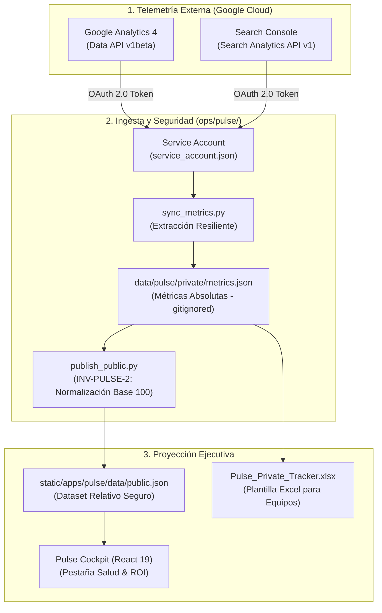

Uno de los mayores puntos ciegos en la gestión de blogs técnicos, plataformas de documentación de producto y medios de ingeniería es la **desconexión crónica entre el repositorio de contenidos y las plataformas de analítica web**.

Por un lado, los desarrolladores y creadores técnicos escriben artículos en Markdown, los versionan en Git y los despliegan mediante integración continua. Por otro lado, la telemetría de rendimiento orgánico permanece atrapada en consolas de terceros: paneles de **Google Analytics 4** con interfaces pesadas y muestreos opacos, o informes de **Google Search Console** que nadie consulta salvo tras una caída repentina de tráfico.

El resultado es la ausencia sistemática de retroalimentación cuantitativa. ¿Qué artículos atraen visitas cualificadas pero carecen de una llamada a la acción para monetizar? ¿Qué tutoriales superan los 180 días de antigüedad y sufren una pérdida paulatina de tracción (*content decay*)? ¿Qué piezas cuentan con una optimización SEO sobresaliente pero necesitan enlaces internos para despegar?

En este cuarto artículo de la serie **Datalaria Pulse** abordamos la capa analítica de la filosofía *Content Ops as Code*: cómo conectamos las APIs oficiales de **GA4 Data API** y **Search Console v1** mediante una *Service Account* en Python, cómo resolvemos el compromiso entre transparencia analítica y secreto comercial mediante el **Principio de Relativización Matemática**, y cómo estructuramos un panel de **Salud & ROI** que calcula el patrimonio editorial y prioriza las acciones de mantenimiento de catálogo.

---

## 0. Objetivos de la Fase y de este Artículo: Del Tráfico Vanidoso a la Medición Cuantitativa del Retorno Orgánico

Esta entrega se enmarca en la recta final de la **Fase 5 de Datalaria**, cuyo objetivo principal es dotar al ecosistema de una gobernanza editorial autónoma, reproducible y orientada a resultados de negocio.

### Objetivos Estratégicos de la Fase 5:
1. **Erradicar la Consulta Manual de Analítica:** Automatizar la recolección periódica de métricas de rendimiento orgánico en pipelines desatendidos de CI/CD.
2. **Preservar la Confidencialidad Comercial (`INV-PULSE-2`):** Garantizar que ningún dato cuantitativo absoluto de visitas, usuarios o facturación se exponga jamás en el frontend público de la aplicación.
3. **Optimizar la Cadencia y el Retorno de Inversión:** Identificar objetivamente los activos que demandan una actualización documental urgente frente a los que constituyen motores estables de generación de negocio.
4. **Alimentar el Ecosistema Dual-Mode:** Suministrar métricas relativas enriquecidas tanto al sandbox interactivo de la Web App como a la plantilla maestra privada de **Datalaria Pulse Kit** en Excel.

### Objetivos Específicos de este Artículo 4:
- Explicar la arquitectura de autenticación desatendida mediante **Google Cloud Service Account** con permisos estrictos de solo lectura para GA4 y Search Console.
- Diseñar el motor ETL en Python (`ops/pulse/sync_metrics.py`) con capacidad de *graceful degradation* ante caídas de red o entornos de pruebas sin credenciales.
- Formalizar el modelo matemático de **Relativización (Índice Base 100 y Percentil de Rendimiento)** implementado en `ops/pulse/publish_public.py`.
- Desplegar la **Matriz de 4 Cuadrantes de Oportunidad** (*Joyas SEO*, *Motores de Tráfico*, *Candidatos a Refresh* y *Brechas de Monetización*) en la consola de Datalaria Pulse.
- Cuantificar el **Patrimonio Editorial Acumulado (*Content Equity Value*)** evaluando la base instalada de palabras técnicas a coste de reposición.

---

## 1. Conexión con el Ecosistema Datalaria: Rigor Cuantitativo y Cadena de Suministro Editorial

La automatización analítica de Datalaria Pulse no es una pieza aislada: responde a los mismos principios de ingeniería cuantitativa y toma de decisiones basados en datos que articulan el resto de metodologías del portal:



### Relaciones Clave con otros Frameworks del Portal:
- **[Ingeniería S&OP e Higiene de Datos](/es/posts/sop_ingenieria-higiene-datos/):** Así como en las operaciones de cadena de suministro el inventario obsoleto inmoviliza capital de trabajo, en una biblioteca técnica los artículos desactualizados deterioran la reputación del dominio y el posicionamiento de marca. La monitorización de caducidad documental aplica el concepto de *rotación de inventario* a los activos de contenido.
- **[Toma de Decisiones Racional & Priorización](/es/posts/toma-decisiones-priorizacion-framework-cuantitativo/):** La matriz de 4 cuadrantes traslada los modelos de decisión multicriterio y matrices CAME/DAFO a la estrategia de marketing: en lugar de intuiciones sobre qué escribir el próximo lunes, los recursos del equipo se asignan determinísticamente a maximizar el impacto de los activos existentes.
- **[Business Case Financiero VAN / TIR](/es/posts/business-case-financiero-van-tir/):** Medir el retorno de un post técnico requiere tratar la redacción como un proyecto de inversión de capital (*CapEx* de horas de ingeniería) y calcular su valor residual en forma de *Content Equity*.
- **[Spec-Driven Development (SDD)](/es/posts/sdd_vs_vibe_coding/):** Las reglas de confidencialidad de datos se modelan como invariantes inquebrantables (`INV-PULSE-1` e `INV-PULSE-2`), verificadas por suites automatizadas de pruebas en cada commit.

---

## 2. Ingesta de Telemetría sin Intervención Manual: GA4 Data API y Search Console con Service Account

Para erradicar la necesidad de exportar informes manuales en formato CSV o depender de conectores de pago en Looker Studio, diseñamos el script `ops/pulse/sync_metrics.py`. Este módulo se ejecuta de forma desatendida tanto en la máquina local del ingeniero como en el runner de **GitHub Actions**.

### 2.1 Autenticación Desatendida con Service Account
En lugar de flujos interactivos de OAuth de usuario (que requieren abrir el navegador y refrescar tokens temporales), utilizamos una cuenta de servicio de Google Cloud con permisos mínimos:
- `Google Analytics Data API`: Rol *Viewer* sobre la propiedad GA4 correspondiente (`GA4_PROPERTY_ID`).
- `Google Search Console API`: Permiso de lectura sobre el recurso de dominio (`sc-domain:datalaria.com`).

El archivo de credenciales (`service_account.json`) permanece estrictamente fuera del control de versiones mediante `.gitignore` y se inyecta como un secreto cifrado (`GCP_SA_KEY`) en el pipeline de CI/CD.

### 2.2 Normalización de Rutas Canónicas
Uno de los retos de la ingesta automatizada es que las herramientas de analítica registran URLs de múltiples formas: con barra final (`/es/posts/mi-post/`), sin barra (`/es/posts/mi-post`), con parámetros de campaña (`?utm_source=linkedin`) o con mayúsculas espurias.

El extractor de métricas limpia y normaliza cada registro antes de consolidarlo:

```python
def normalize_canonical_path(raw_path: str) -> str:
    """Normaliza rutas web de GA4 y GSC a la ruta canónica del repositorio."""
    path = raw_path.split("?")[0].split("#")[0].strip().lower()
    if not path.startswith("/"):
        path = "/" + path
    if not path.endswith("/"):
        path += "/"
    return path
```

### 2.3 Patrón Graceful Degradation: Resiliencia ante Entornos Sin Red
Una regla cardinal de la gobernanza SDD es que **la compilación del sitio web jamás debe fallar por causas externas de red o falta de credenciales de terceros**.

Si un nuevo colaborador clona el repositorio o un test unitario se ejecuta en un contenedor aislado, el módulo detecta la ausencia de `service_account.json` y activa la degradación elegante:

```python
if not CREDENTIALS_FILE.exists():
    print(f"[WARN] No se encontró service_account.json. Saltando llamadas a APIs.")
    # Reutiliza el snapshot previo en disco o genera una distribución neutra
    return load_or_generate_fallback_metrics()
```

Gracias a este patrón, el build de Hugo y la suite de pruebas frontend pueden compilarse siempre al 100% sin dependencias bloqueantes de infraestructura externa.

---

## 3. El Principio de Relativización: Cumplimiento Estricto de `INV-PULSE-2`

La mayoría de herramientas SaaS de analítica caen en uno de dos extremos: o no muestran datos a los usuarios no registrados (forzando un muro de pago opaco), o cometen la temeridad de exponer APIs con métricas reales de tráfico, clics y conversiones de su propio negocio, revelando información estratégica crítica a competidores y clientes.

En Datalaria Pulse resolvimos esta dicotomía aplicando el **Principio de Relativización Matemática**, formalizado en la especificación técnica bajo la invariante **`INV-PULSE-2`**.

### 3.1 Las Dos Invariantes de Seguridad de Pulse
1. **`INV-PULSE-1` (Cero Fuga de Ideas Privadas):** Los activos en backlog con `visibility: private` jamás se incluyen en el artefacto compilado `static/apps/pulse/data/public.json`.
2. **`INV-PULSE-2` (Cero Cifras Absolutas en el Frontend Público):** En `public.json`, el nodo `metrics_absolute` (visitas, usuarios, clics, impresiones) se purga por completo. El frontend solo recibe métricas normalizadas.

### 3.2 Formulación Matemática de las Métricas Relativas
Para transformar un vector de visitas mensuales $V = [v_1, v_2, \dots, v_n]$ en un índice informativo y seguro, aplicamos tres transformaciones:

#### 1. Índice Base 100 sobre la Mediana ($I_{100}$)
En distribuciones editoriales de tráfico con fuerte asimetría positiva (*Power Law* o distribución de Pareto, donde un puñado de artículos estrella concentra gran parte de las visitas), la media aritmética distorsiona la realidad. Por ello, normalizamos respecto a la **mediana** del catálogo:

$$\text{Mediana}(V) = \tilde{v}$$

$$I_{100, i} = \text{round}\left(\frac{v_i}{\tilde{v}} \times 100\right)$$

Un activo con $I_{100} = 100$ rinde exactamente en la mediana de la web. Un artículo con $I_{100} = 350$ supera en un 250% la tracción típica del portal, transmitiendo una noción perfecta de impacto relativo sin revelar si la mediana corresponde a 100 o a 100.000 lectores al mes.

#### 2. Percentil de Rendimiento ($P_{\text{rank}}$)
Calculamos la posición relativa del activo dentro de la distribución acumulada del sitio, mapeada entre $0\%$ y $100\%$:

$$P_{\text{rank}, i} = \text{round}\left(\frac{\text{rango}(v_i) - 1}{n - 1} \times 100\right)$$

#### 3. Tendencia a 30 Días ($\Delta_{30d}$)
Tasa de variación porcentual respecto a la ventana móvil del mes precedente:

$$\Delta_{30d, i} = \frac{v_{i, \text{actual}} - v_{i, \text{previo}}}{v_{i, \text{previo}}} \times 100$$

### 3.3 Verificación Determinista con Pytest
Para blindar que ningún error de programación exponga datos confidenciales en producción, la suite de pruebas unitarias (`ops/pulse/tests/test_sync_and_publish.py`) evalúa automáticamente el dataset público antes de cada despliegue:

```python
def test_publish_public_relativization_and_security():
    pub_dataset = publish_public_dataset()
    with open("static/apps/pulse/data/public.json", "r", encoding="utf-8") as f:
        data = json.load(f)
        
    for asset in data["assets"]:
        # 1. Cero ideas privadas
        assert asset["visibility"] == "public"
        # 2. Cero métricas absolutas
        assert asset.get("metrics_absolute") is None
        assert "rank_pct" in asset["metrics_relative"]
        assert "index_100" in asset["metrics_relative"]
```

---

## 4. Diagnóstico Automatizado de Salud Editorial: Detección de *Decay*, *Freshness* y Joyas SEO

Una vez recopilada la telemetría y calculados los índices relativos, el motor de analítica de Pulse categoriza automáticamente cada activo en una **Matriz de 4 Cuadrantes Estratégicos**.

Esta matriz se proyecta visualmente en la pestaña **Salud & ROI** de la aplicación web y orienta directamente las tareas del equipo editorial:

| Cuadrante | Condición Algorítmica | Diagnóstico Técnico | Acción Recomendada |
| :--- | :--- | :--- | :--- |
| **1. Joyas SEO Ocultas** | `seo_score >= 80` y `rank_pct < 50` | Contenido técnicamente impecable y exhaustivo, pero con tráfico orgánico aún en desarrollo. | Enlazar internamente desde artículos consolidados y redifundir en redes profesionales (LinkedIn, newsletters). |
| **2. Motores de Tráfico** | `rank_pct >= 80` | Activos de alto rendimiento que concentran la mayor atracción de audiencia técnica del portal. | Optimizar conversión: insertar llamadas a la acción (*CTAs*) directas hacia los Kits y Apps relacionados. |
| **3. Candidatos a Refresh** | `antigüedad > 180 días` y `trend_30d < 0` | Obsolescencia documental (*content decay*): artículos maduros cuya tracción comienza a erosionarse frente a competidores más recientes. | Renovar ejemplos prácticos, actualizar referencias a estándares vigentes (ej. Node 24, Python 3.13) y relanzar. |
| **4. Brecha de Monetización** | `rank_pct >= 60` y `kits_asociados == 0` | Artículos de alto interés profesional que atraen a comités y directivos pero no ofrecen ningún recurso descargable. | Oportunidad comercial prioritaria: diseñar una plantilla Excel o un kit interactivo para Lemon Squeezy. |

---

## 5. El Concepto de Patrimonio Editorial Acumulado (*Content Equity Value*)

¿Cuánto vale la biblioteca técnica de una compañía? ¿Cómo se justifica ante la dirección financiera (*CFO*) la inversión en documentación técnica de máxima profundidad?

En la mayoría de organizaciones los artículos técnicos se contabilizan como un gasto operativo a fondo perdido (*OpEx*). En Datalaria Pulse introducimos la métrica de **Patrimonio Editorial Estimado (*Content Equity Value*)**, visible en el panel superior de analítica.

### Metodología de Valoración por Coste de Reposición
El indicador se fundamenta en el **coste de reposición de activos intangibles** (*Replacement Cost Method*):

$$V_{\text{patrimonio}} = N_{\text{palabras}} \times C_{\text{mercado}}$$

Donde:
- $N_{\text{palabras}}$ representa el recuento exhaustivo de palabras técnicas indexadas en los artículos de producción (excluyendo front matter, licencias y código auxiliar repetitivo).
- $C_{\text{mercado}}$ es la tarifa de referencia de mercado para consultoría técnica y redacción especializada de ingeniería (fijada conservadoramente en **$0,10 USD por palabra** para documentación matemática, de arquitectura de software y operaciones).

Para un catálogo consolidado como el de Datalaria, con más de **214.800 palabras técnicas** estructuradas en más de un centenar de entregas bilingües, el patrimonio editorial supera los **$21.480 USD**. Esta métrica transforma la percepción del catálogo: cada nuevo artículo o actualización no es un coste, sino un incremento patrimonial duradero en el balance de activos intangibles de la empresa.

---

## 6. Conclusiones, Acceso al Cockpit y Próximos Pasos

La integración de **GA4 Data API** y **Search Console** en un pipeline de *Content Ops as Code* cierra el círculo de la ingeniería editorial. Los contenidos ya no son textos inertes almacenados en carpetas olvidadas: son activos de software auditados, correlacionados con telemetría en tiempo real y gestionados con disciplina cuantitativa.

### Recursos Disponibles y Demostración Interactiva:
- **Prueba el Cockpit de Datalaria Pulse:** Explora en vivo la pestaña **Salud & ROI**, filtra por cuadrantes de oportunidad y examina el índice relativo Base 100 de cada activo en **[/apps/pulse/](/apps/pulse/)**.
- **Descarga Datalaria Pulse Kit:** Si gestionas un blog corporativo o equipo editorial y deseas la **Plantilla Maestra Excel 2016/365 con el importador automático de Notion, conector Power Query M y scripts de sincronización**, accede a la suite comercial en **[/es/recursos/](/es/recursos/)**.

### Próxima Entrega de la Serie (Artículo 5 - Cierre):
En el quinto y último artículo de la serie abordaremos el traspaso operativo para equipos reales:
- **Gestión Editorial para Equipos de Documentación, SEO y Marketing: de Notion a Excel en 5 minutos.**
- Migración automatizada paso a paso de bases de datos de Notion hacia Git sin fricción.
- **Capítulo Especial — Visión Pro & Fábrica Autónoma con IA:** Cómo orquestamos el ciclo de vida completo mediante agentes autónomos de IA y cómo escalar a la infraestructura multi-tenant sobre **Supabase Cloud**.
