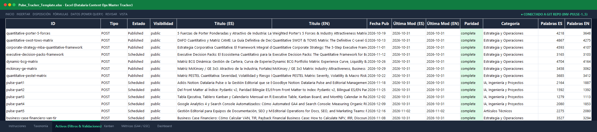

Uno de los mayores conflictos organizativos en las empresas de base tecnológica, agencias de marketing digital y plataformas de documentación de producto ocurre en la frontera entre dos culturas: **los desarrolladores que habitan en Git y los redactores o estrategas SEO que viven en Notion, Airtable o Excel**.

Para los equipos de ingeniería, el contenido técnico debe tratarse como código fuente (*Content Ops as Code*): archivos Markdown versionados, revisados mediante *pull requests*, validados por linters y desplegados por pipelines de integración continua. Para los redactores, especialistas de marketing y directores de contenido, este flujo resulta hostil: no quieren clonar repositorios en terminales bash, resolver conflictos de merge ni descifrar fallos de sintaxis en el front matter YAML.

Como resultado, la mayoría de organizaciones terminan adoptando una solución fragmentada: el equipo de contenidos gestiona un tablero en Notion o Airtable totalmente desvinculado del repositorio real. En cuestión de semanas, el catálogo sufre una desincronización crónica (*content drift*): artículos publicados en la web que no existen en el tablero, fechas de programación alteradas en Notion que jamás se reflejan en Git, y una ausencia total de auditoría técnica.

En esta quinta y última entrega de la serie **Datalaria Pulse** cerramos el círculo de la gobernanza editorial. Mostramos cómo tender un puente bidireccional mediante el **Datalaria Pulse Kit** (plantilla Excel 2016/365 con Power Query M y script de migración desde Notion en 5 minutos) y desvelamos la arquitectura de **Datalaria Pulse Pro**: una plataforma en la nube sobre **Supabase Cloud + PostgreSQL 15** con seguridad por filas (RLS) y la capacidad de orquestar una **Fábrica Editorial Autónoma con Agentes de IA**.


---

### 🗺️ Hoja de Ruta de la Serie Datalaria Pulse
Para entender cómo encaja cada pieza del rompecabezas de *Content Ops as Code*, esta serie se compone de 5 entregas estructuradas:

1. ⚪ **Parte 1**: [Adiós Notion: Datalaria Pulse o la Gestión Editorial que se Escribe Sola desde Git](/es/posts/pulse-parte1-adios-notion-content-ops/).
2. ⚪ **Parte 2**: [Del Front Matter al Índice: Pydantic v2, Paridad Bilingüe y Automatización con CI/CD](/es/posts/pulse-parte2-indexador-pydantic-paridad-ci/).
3. ⚪ **Parte 3**: [Tabla Ejecutiva, Tablero Kanban y Calendario Mensual en React 19 sobre un Índice Estático](/es/posts/pulse-parte3-tablero-react-tabla-kanban-calendario/).
4. ⚪ **Parte 4**: [Google Analytics 4 y Search Console Automatizados: Cómo Medir el ROI Orgánico de Cada Post, App y Kit](/es/posts/pulse-parte4-ga4-search-console-automatico/).
5. 🟢 **Parte 5 (Este artículo)**: Gestión Editorial para Equipos de Documentación, SEO y Marketing: de Notion a Excel en 5 minutos y Fábrica con IA.

---

## 0. Objetivos de la Fase y de este Artículo: Unificando Equipos y Escalando con Agentes Autónomos

Con este artículo culminamos el despliegue del **Hito 5.8 de Datalaria**, consolidando un modelo operativo que une la simplicidad de uso para perfiles de negocio con el rigor determinista que exige la ingeniería moderna.

### Objetivos Estratégicos de la Fase 5:
1. **Resolver la Brecha de Adopción Organizativa:** Permitir que especialistas SEO y editores trabajen con herramientas familiares (Excel, Notion) sin degradar la Fuente Única de Verdad en Git.
2. **Garantizar Cero Vendor Lock-in (Arquitectura Dual-Mode):** Ofrecer una alternativa descargable y autónoma de licencia perpetua (*Pulse Kit*) junto con un entorno colaborativo en la nube (*Pulse Pro*).
3. **Asegurar Aislamiento Multi-Tenant Estricto (`INV-PULSE-4` e `INV-PULSE-5`):** Implementar políticas de Row-Level Security (RLS) en Supabase para proteger los catálogos privados de cada cliente.
4. **Habilitar la Fábrica Editorial Autónoma con IA:** Articular un pipeline donde agentes inteligentes (Google Antigravity, Claude Code) investigan, redactan y verifican contenidos bajo la supervisión de reglas deterministas.

### Objetivos Específicos de este Artículo 5:
- Demostrar la estructura técnica de la **Plantilla Maestra Excel 2016/365** con validaciones desplegables y fórmulas automáticas.
- Implementar el script de **Migración desde Notion en 5 Minutos** (`migrate_notion.py`), que normaliza taxonomías y fechas sin intervención manual.
- Presentar el conector de **Power Query M**, capaz de sincronizar el inventario de Git con Excel con un solo clic.
- Desplegar el **Escáner Universal CLI sin dependencias** (`pulse_repo_scanner.py`), compatible con Hugo, Next.js, Astro y Docusaurus.
- Analizar la arquitectura de **Supabase PostgreSQL 15** en Datalaria Pulse Pro, sus contratos RLS y el modo demo interactivo.
- Diseñar el ciclo de vida completo de la **Fábrica Editorial con Agentes de IA** (Idea ➔ Spec ➔ Code ➔ Review determinista ➔ Despliegue CI/CD).

---

## 1. Conexión con el Ecosistema Datalaria: De la Planilla al Agente Autónomo

El enfoque de Datalaria Pulse se apoya en los cuatro pilares fundamentales de la metodología de ingeniería de Datalaria:


flowchart TD
    subgraph STANDALONE ["1. Nivel Standalone (Local y Autónomo)"]
        NOTION["Notion / Airtable (Export CSV)"] --> MIG["migrate_notion.py (Normalizador 5 min)"]
        GIT["Repositorio Git (Markdown + YAML)"] --> SCAN["pulse_repo_scanner.py (CLI 0 dependencias)"]
        XLS["Pulse_Content_Ops_Template.xlsx (Excel 2016/365 + Power Query M)"]
        MIG --> XLS
        SCAN --> XLS
    end

    subgraph PRO ["2. Nivel Pro Cloud (Colaborativo y Seguro)"]
        WEB["Cockpit React 19 (Datalaria Pulse)"]
        SUPA[("Supabase Cloud - PostgreSQL 15 + RLS")]
        WEB -->|"Auth y Sync"| SUPA
        SUPA --> WEB
    end

    subgraph AI ["3. Nivel Autónomo (Fábrica de Agentes)"]
        AGENT["Agentes Autónomos (Antigravity / Claude Code)"]
        SDD["Spec-Driven Development (Pydantic + Linters CI/CD)"]
        AGENT -->|"Borrador Markdown"| SDD
        SDD -->|"Test Verde (Code 0)"| GIT
    end

    XLS -->|"Importación"| WEB
    GIT -->|"public.json"| WEB


### Relaciones Clave con otros Frameworks de Datalaria:
- **[Ingeniería S&OP e Higiene de Datos](/es/posts/sop_ingenieria-higiene-datos/):** La gestión de un catálogo de contenidos es idéntica a la gestión de inventario en la cadena de suministro. La estandarización de atributos (SKUs editoriales, taxonomías controladas y estados cerrados) erradica la corrupción de datos y el inventario muerto.
- **[Toma de Decisiones Racional & Priorización](/es/posts/toma-decisiones-priorizacion-framework-cuantitativo/):** La matriz de 4 cuadrantes y los filtros ejecutivos de la plantilla Excel aplican modelos de decisión multicriterio ponderados para definir qué publicar o actualizar cada semana.
- **[Business Case Financiero VAN / TIR](/es/posts/business-case-financiero-van-tir/):** Las herramientas SaaS como Notion o Airtable conllevan un coste recurrente acumulativo (120€ a 240€ por usuario al año). Content Ops as Code con licencia perpetua reduce el Coste Total de Propiedad (TCO) a una fracción, amortizándose en el primer mes de uso.
- **[Spec-Driven Development (SDD)](/es/posts/sdd_vs_vibe_coding/):** La fábrica editorial no improvisa contenido (*Vibe Writing*); opera bajo especificaciones rigurosas donde cada artículo cumple un contrato de datos Pydantic antes de llegar a producción.

---

## 2. El Abismo Editorial: Por Qué Notion Falla a Escala en Equipos Técnicos

Notion y Airtable son herramientas excepcionales para la ideación rápida y la colaboración en fases iniciales. Sin embargo, cuando una plataforma editorial técnica supera los 50 artículos o requiere paridad bilingüe estricta, surgen fricciones estructurales insalvables:

1. **Desfase Temporal Crónico (*Drift*):** Si un autor cambia el título o la fecha de un post en Notion, el cambio no existe en el repositorio hasta que alguien edita manualmente el archivo Markdown. Inevitablemente, ambos mundos divergen.
2. **Ausencia de Verificación Determinista:** Notion no puede comprobar si un slug coincide exactamente con la carpeta física en disco, si el archivo de imagen de portada existe o si la versión en inglés está emparejada mediante el mismo `translationKey`.
3. **Bloqueo de Proveedor (*Vendor Lock-in*):** La base de datos vive en los servidores cerrados de un tercero. Si el servicio sufre una caída o decide cambiar sus políticas de precios por usuario, el equipo queda rehén de la plataforma.
4. **Falta de Diffs Atómicos:** En Git, un cambio se visualiza línea por línea con `git diff`. En Notion, el historial de versiones es opaco y carece de integración con los flujos de trabajo de ingeniería (*pull requests*, revisiones de código, despliegues automáticos).

La solución no consiste en obligar a los redactores a utilizar comandos de Git, sino en **establecer un protocolo determinista de conversión y sincronización**.

---

## 3. Datalaria Pulse Kit: De Notion a Excel en 5 Minutos

Para empoderar a los equipos de redacción y marketing sin comprometer la pureza de Git, empaquetamos el **Datalaria Pulse Kit**, un conjunto descargable y autónomo que transforma cualquier catálogo existente en un sistema estructurado.

### 3.1 La Plantilla Maestra Excel 2016/365 (`Pulse_Content_Ops_Template.xlsx`)

Diseñada para funcionar en cualquier versión moderna de Microsoft Excel sin requerir macros VBA sospechosas ni complementos de pago:



- **Validaciones de Celda Estrictas:** Desplegables de selección para columnas clave:
  - *Estado:* `Idea`, `Borrador`, `En Revisión`, `Programado`, `Publicado`.
  - *Idioma:* `es`, `en`.
  - *Tipo:* `post`, `app`, `kit`.
  - *Tier de Monetización:* `free`, `premium`, `b2b`.
- **Formato Condicional Ejecutivo:** Colores oscuros coordinados con el sistema de diseño de Datalaria (verde esmeralda para activos publicados, cyan para programados, ámbar para borradores).
- **Columnas Calculadas Dinámicas:** Cálculo automático de días desde la última publicación, estado de obsolescencia documental (>180 días) y ratio de paridad bilingüe.

### 3.2 Conector Power Query M: Sincronización Automática con un Clic

Para los usuarios de Excel que desean reflejar el estado actual del repositorio Git sin escribir una sola línea de código, el kit incluye una consulta en lenguaje **Power Query M**. Al pulsar el botón "Actualizar Todo" de Excel, la planilla consume directamente el dataset público `public.json`:

```powerquery
let
    // 1. Obtener el archivo public.json desde el repositorio local o URL web
    Origen = Json.Document(File.Contents("...\datalaria\static\apps\pulse\data\public.json")),
    
    // 2. Extraer la lista de activos
    assets = Origen[assets],
    #"Convertida a Tabla" = Table.FromList(assets, Splitter.SplitByNothing(), null, null, ExtraValues.Error),
    
    // 3. Expandir los atributos deterministas de cada post
    #"Columnas Expandidas" = Table.ExpandRecordColumn(#"Convertida a Tabla", "Column1", 
        {"id", "title", "status", "category", "word_count", "reading_time_min", "metrics_relative"}, 
        {"ID", "Título", "Estado", "Categoría", "Palabras", "Minutos Lectura", "Métricas"}),
    
    // 4. Expandir métricas relativas seguras (INV-PULSE-2)
    #"Métricas Expandidas" = Table.ExpandRecordColumn(#"Columnas Expandidas", "Métricas", 
        {"index_100", "rank_pct"}, {"Índice Base 100", "Percentil"})
in
    #"Métricas Expandidas"
```

### 3.3 Migración desde Notion en 5 Minutos (`migrate_notion.py`)

Si tu equipo ya gestiona una base de datos en Notion, migrar a la estructura estandarizada de Pulse toma exactamente 5 minutos:

1. En Notion, ve a la base de datos editorial y selecciona **Export ➔ CSV**.
2. Descomprime el archivo CSV resultante en tu carpeta de trabajo.
3. Ejecuta el script de migración determinista:

```bash
python -m ops.pulse.migrate_notion_csv --input notion_export.csv --output Pulse_Tracker.xlsx
```

El script ejecuta las siguientes transformaciones automáticas:
- Mapea las cabeceras heterogéneas de Notion a los nombres de campo canónicos de Pulse (`Name` ➔ `title`, `Date` ➔ `date`, `Status` ➔ `status`, `Tags` ➔ `tags`).
- Limpia y formatea los slugs URL a minúsculas con guiones deterministas.
- Valida que las categorías correspondan a una taxonomía cerrada, asignando valores por defecto ante registros vacíos.
- Genera la planilla Excel lista para usar con todas sus validaciones intactas.

### 3.4 El Escáner Universal CLI (`pulse_repo_scanner.py`)

Para equipos de ingeniería que no utilizan Python en su stack principal o que desean auditar un blog construido en **Astro, Next.js, Hugo o Docusaurus**, el kit incorpora un escáner autónomo de **cero dependencias**:

```python
# ops/pulse/pulse_repo_scanner.py (extracto)
import re
import os
import json
from pathlib import Path

def scan_markdown_repository(content_dir: str) -> list[dict]:
    """Escanea recursivamente archivos Markdown extrayendo Front Matter YAML sin librerías externas."""
    results = []
    fm_pattern = re.compile(r"^---\s*\n(.*?)\n---\s*\n", re.DOTALL)
    
    for root, _, files in os.walk(content_dir):
        for f in files:
            if f.endswith((".md", ".markdown")):
                filepath = Path(root) / f
                content = filepath.read_text(encoding="utf-8", errors="ignore")
                match = fm_pattern.search(content)
                if match:
                    # Extracción determinista de metadatos mediante parsing seguro
                    meta = parse_yaml_subset(match.group(1))
                    words = len(re.findall(r"\w+", content[match.end():]))
                    results.append({
                        "file": str(filepath.relative_to(content_dir)),
                        "title": meta.get("title", filepath.stem),
                        "status": "draft" if meta.get("draft") == "true" else "published",
                        "words": words,
                        "date": meta.get("date", "")
                    })
    return results
```

Este script se ejecuta en menos de **200 milisegundos** sobre repositorios con cientos de artículos, produciendo un JSON estandarizado listo para alimentar pipelines de CI/CD.

---

## 4. El Paquete Comercial: Arquitectura Dual-Mode y Cero Costes Ocultos

El paquete **Datalaria Pulse Kit** (disponible en Lemon Squeezy) se distribuye bajo una filosofía de soberanía de datos estricta:

```
Datalaria_Pulse_Kit_v0.1.0.zip
├── 01_Excel_Templates/
│   ├── Pulse_Content_Ops_Template.xlsx    (Plantilla Maestra con validaciones)
│   └── notion_power_query.m         (Código fuente de consulta Power Query)
├── 02_Migration_Scripts/
│   ├── migrate_notion.py          (Conversor Notion ➔ Excel/Git)
│   └── pulse_repo_scanner.py          (CLI universal sin dependencias)
├── 03_Documentation/
│   ├── GUIA_PULSE_KIT.md       (Instrucciones paso a paso)
│   └── ESPECIFICACION_CAMPOS.md       (Diccionario de datos canónico)
└── LICENSE.txt                        (Licencia Comercial Perpetua)
```

### Análisis Comparativo de Costes (TCO a 3 Años):

| Dimensión | Notion Team / Airtable Plus | Datalaria Pulse Kit |
| :--- | :--- | :--- |
| **Modelo de Precio** | 10 € a 20 € / usuario / mes | **Pago único perpetuo (19 € — descuento de lanzamiento desde 39 €)** |
| **Coste 3 Años (Equipo 5 personas)** | 1.800 € a 3.600 € recurrentes | **19 € total (descuento de lanzamiento desde 39 € — Ahorro >98%)** |
| **Soberanía de Datos** | Servidores externos cerrados | **100% en tu máquina y tu repositorio Git** |
| **Sincronización con Git** | Manual o mediante webhooks frágiles | **Nativa: Git es la única fuente de verdad** |
| **Auditoría CI/CD** | No disponible | **Ejecución en GitHub Actions / Pre-commit** |

---

## 5. Capítulo Especial: Datalaria Pulse Pro & La Fábrica Editorial Autónoma con Agentes de IA

Es importante clarificar el modelo de despliegue y gobernanza de la plataforma: mientras que el **Datalaria Pulse Kit (19 €)** es el producto descargable directo y autónomo de licencia perpetua para operar sobre planillas Excel y repositorios Git locales, **Datalaria Pulse Pro** se posiciona como una **solución B2B avanzada bajo demanda**. Está concebida para organizaciones, agencias y departamentos de documentación técnica que requieran una **implementación a medida multi-equipo, backend gestionado en la nube con Supabase y un CMS autónomo y agéntico integrado en su flujo empresarial**.

Cualquier profesional puede interactuar sin barreras con el **[Modo Demo de Datalaria Pulse](/apps/pulse/)** desplegado en vivo en el portal. Si tu organización precisa una instancia cloud privada con soporte de ingeniería y fábrica agéntica, puedes solicitar un diagnóstico en **[contacto@datalaria.com](mailto:contacto@datalaria.com)** o a través de nuestra **[página de contacto](/es/contact/)**.

### 5.1 Persistencia Colaborativa en Supabase Cloud con Row-Level Security (RLS)

Datalaria Pulse Pro se conecta a una instancia gestionada de **Supabase PostgreSQL 15**, encapsulando la lógica editorial en el esquema cerrado `pulse`:

```sql
-- Migración de Seguridad Multi-Tenant en Supabase PostgreSQL (001_create_pulse_schema.sql)
CREATE SCHEMA IF NOT EXISTS pulse;

-- 1. Tabla de Ideas y Backlog Editorial
CREATE TABLE IF NOT EXISTS pulse.ideas (
    id UUID PRIMARY KEY DEFAULT gen_random_uuid(),
    user_id UUID NOT NULL REFERENCES auth.users(id) ON DELETE CASCADE,
    title TEXT NOT NULL,
    notes TEXT DEFAULT '',
    category TEXT DEFAULT 'General',
    tags TEXT[] DEFAULT '{}',
    status TEXT DEFAULT 'idea' CHECK (status IN ('idea', 'draft', 'review', 'scheduled', 'published')),
    target_date DATE,
    created_at TIMESTAMPTZ DEFAULT NOW(),
    updated_at TIMESTAMPTZ DEFAULT NOW()
);

-- 2. Tabla de Excepciones y Programaciones del Calendario
CREATE TABLE IF NOT EXISTS pulse.content_schedule (
    id UUID PRIMARY KEY DEFAULT gen_random_uuid(),
    user_id UUID NOT NULL REFERENCES auth.users(id) ON DELETE CASCADE,
    asset_id TEXT NOT NULL,
    override_date DATE NOT NULL,
    created_at TIMESTAMPTZ DEFAULT NOW(),
    updated_at TIMESTAMPTZ DEFAULT NOW(),
    UNIQUE(user_id, asset_id)
);

-- 3. Habilitar Row Level Security (RLS) estricto (Invariante INV-PULSE-4)
ALTER TABLE pulse.ideas ENABLE ROW LEVEL SECURITY;
ALTER TABLE pulse.content_schedule ENABLE ROW LEVEL SECURITY;

CREATE POLICY user_ideas_isolation ON pulse.ideas
    FOR ALL USING (auth.uid() = user_id) WITH CHECK (auth.uid() = user_id);

CREATE POLICY user_schedule_isolation ON pulse.content_schedule
    FOR ALL USING (auth.uid() = user_id) WITH CHECK (auth.uid() = user_id);
```

#### Los Tres Modos de Acceso en la Consola Web:
1. **Modo Demo (Visitantes Anónimos):** Si un usuario entra sin credenciales, el cliente web detecta la ausencia de sesión y puebla la memoria local con 10 activos sintéticos para permitir explorar la tabla, el Kanban y el calendario sin tocar la base de datos real.
2. **Modo Pro Multi-Tenant (Usuarios Registrados):** Cada usuario autenticado cuenta con un espacio de trabajo aislado regido por su `auth.uid()`. Sus ideas y borradores se sincronizan en tiempo real mediante WebSockets de Supabase.
3. **Canal Oficial Sincronizado (Master Admins):** Los ingenieros responsables de Datalaria pueden sincronizar bidireccionalmente el repositorio Git físico con la nube, asegurando que la consola web refleje con latencia cero cada commit publicado.

---

### 5.2 La Fábrica Editorial Autónoma: Agentes de IA en el Bucle SDD

La verdadera potencia de *Content Ops as Code* se manifiesta al incorporar **agentes inteligentes de codificación** (como Google Antigravity con modelos Gemini Argon, o Claude Code) en la cadena de producción de contenidos:


sequenceDiagram
    autonumber
    actor Editor as Director Editorial
    participant Agent as Agente IA (Antigravity)
    participant Git as Repositorio Git
    participant CI as GitHub Actions (CI/CD)
    participant Telemetry as GA4 & Search Console

    Editor->>Agent: "Investiga brechas en el cuadrante Refresh y genera Post 5"
    Agent->>Git: Consulta public.json y detecta keywords huérfanas
    Agent->>Git: Redacta index.md (ES/EN) cumpliendo spec.md
    Agent->>CI: Ejecuta pre-commit (build_index, paridad, linters)
    CI-->>Agent: Tests Verdes (18/18 passed, code 0)
    Agent->>Git: Crea Pull Request con cambios atómicos
    Editor->>Git: Revisa y aprueba el PR (Merge a main)
    CI->>Git: Despliegue Hugo (2.750+ páginas generadas)
    Telemetry-->>Git: sync_metrics actualiza Base 100 el domingo a las 02:00


#### Las 4 Etapas de la Fábrica Autónoma:
1. **Detección de Oportunidades & Benchmarking (Idea):** El agente analiza el dataset `public.json` y los datos de Google Search Console para identificar temas con alta demanda de búsqueda pero baja cobertura en el catálogo existente. Registra la nueva propuesta en `data/pulse/private/backlog_ideas.yaml`.
2. **Redacción Estructurada Guiada por Especificaciones (Draft):** El agente no improvisa libremente; lee el archivo `spec.md` del módulo y genera la pareja bilingüe (`content/es/` y `content/en/`) asegurando un vocabulario técnico consistente, enlaces a posts relacionados y un front matter validado por Pydantic v2.
3. **Control de Calidad Determinista (Review):** Antes de solicitar la revisión humana, el agente ejecuta localmente la suite de validación (`python -m ops.pulse.build_index` y `pytest`). Si un enlace está roto o la paridad ES ⇔ EN se rompe, el pipeline falla y el agente corrige el código de inmediato.
4. **Despliegue y Retroalimentación de Negocio (Publish & Learn):** Tras la aprobación editorial, GitHub Actions compila el sitio web estático. En la siguiente ejecución semanal del cron, `sync_metrics.py` consulta GA4 y Search Console, calculando el impacto orgánico real y cerrando el ciclo de retroalimentación para la próxima iteración.

---


> ### 🚀 El Futuro Inmediato: Datalaria Helix (Lanzamiento en Enero de 2027)
> 
> La automatización de Content Ops as Code que articula Pulse es la primera aplicación práctica de una transformación metodológica mucho más profunda: **Datalaria Helix**.
> 
> Helix es nuestro framework de *Spec-Driven Development* (SDD) de nueva generación, estructurado en torno a un **escuadrón coordinado de 12 agentes de IA especializados** (que cubren desde Triaje, Arquitectura y Redacción hasta Linters deterministas, QA y Seguridad). Con este mismo escuadrón agéntico hemos auditado, blindado y gobernado el desarrollo íntegro de Datalaria Pulse sin una sola fuga de contexto.
> 
> Datalaria Helix se lanzará oficialmente en **Enero de 2027**. Puedes reservar tu plaza y unirte a la lista de espera prioritaria en **[Datalaria Recursos — Software & SDD](/es/recursos/#software)**.

---



---

## 6. Conclusiones y Cierre de la Serie Datalaria Pulse

A lo largo de estas cinco semanas y cinco entregas en profundidad, hemos transformado la gestión de contenidos desde un proceso artesanal y desarticulado en una **disciplina de ingeniería reproducible**:

1. **[Parte 1 — Adiós Notion: Content Ops as Code](/es/posts/pulse-parte1-adios-notion-content-ops/):** Definimos los principios de la Fuente Única de Verdad en Git y la eliminación de silos de datos externos.
2. **[Parte 2 — Del Front Matter al Índice: Pydantic v2 y CI/CD](/es/posts/pulse-parte2-indexador-pydantic-paridad-ci/):** Construimos el motor de validación determinista que audita 140 activos en milisegundos con 100% de paridad bilingüe.
3. **[Parte 3 — Tabla Ejecutiva, Kanban y Calendario en React 19](/es/posts/pulse-parte3-tablero-react-tabla-kanban-calendario/):** Diseñamos una interfaz visual ultrarrápida con filtrado reactivo sobre un índice estático con latencia cero.
4. **[Parte 4 — GA4 y Search Console Automatizados: Salud & ROI](/es/posts/pulse-parte4-ga4-search-console-automatico/):** Conectamos las APIs oficiales mediante Service Account, relativizando métricas privadas en un índice Base 100 y cuantificando \21.480€ de patrimonio editorial.
5. **Parte 5 — De Notion a Excel en 5 Minutos, Supabase Pro y Fábrica IA:** Unificamos a los equipos con el Kit descargable y abrimos las puertas a la producción autónoma escalable en la nube.

La gestión editorial de última generación ya no exige elegir entre la comodidad de una planilla y la seguridad de un repositorio de código. Con **Datalaria Pulse**, el catálogo completo se escribe, audita y monetiza desde la misma fuente de verdad.

---

> ### Da el Salto a Content Ops as Code
> 
> - **Explora la Consola Interactiva:** Accede ya a la versión en vivo de [Datalaria Pulse en el Portal](/apps/pulse/) (Modo Sandbox interactivo) y prueba las vistas de Tabla, Kanban, Calendario y Salud Editorial.
> - **Descarga el Datalaria Pulse Kit:** Consigue el kit en **[Datalaria Pulse Kit en Recursos](/es/recursos/#pack-pulse)** (Plantilla Maestra Excel 2016/365, el conector Power Query M y el script de migración en 5 minutos para transformar tu equipo de contenidos hoy mismo.
> - **Consulta la Ficha Oficial de la App:** Revisa todas las especificaciones, arquitectura y roadmap en la [Ficha Técnica de Datalaria Pulse](/es/apps/pulse/).
