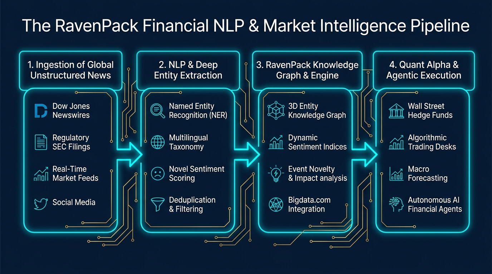

A comienzos de la década de 2000, si un gestor de fondos de inversión en Manhattan o en la City de Londres quería operar en base a la información del mercado, el procedimiento era tan artesanal como ineficiente: ejércitos de analistas júnior leían a toda prisa teletipos de prensa, subrayaban con rotulador informes trimestrales de la SEC de doscientas páginas y llamaban por teléfono a los intermediarios de bolsa para ajustar sus carteras.

En aquel Wall Street analógico dominado por el instinto humano y los rumores de pasillo, casi nadie creía que un ordenador pudiera leer texto libre, comprender la ironía o cuantificar el pánico financiero con mayor rapidez y frialdad que un operador curtido en el parqué.

Mucho menos concebible era que la empresa pionera que iba a derribar ese paradigma no se fundara en Silicon Valley, ni en Boston, ni en el distrito financiero de Nueva York, sino a más de seis mil kilómetros de distancia: **en un centro de negocios con vistas al mar Mediterráneo, en la Milla de Oro de Marbella (Málaga)**.

Hoy en día, **RavenPack** es el secreto a voces mejor guardado de las finanzas globales. Sus algoritmos procesan diariamente cientos de millones de artículos periodísticos, transcripciones de conferencias de resultados (*earnings calls*), comunicados regulatorios y redes sociales en tiempo real, convirtiendo torrentes caóticos de texto en datos estructurados de sentimiento y eventos que alimentan directamente los modelos de trading algorítmico de los mayores *hedge funds* cuantitativos del planeta (firmas como Millennium Management, Point72, Citadel o Two Sigma).

Continuando nuestra serie sobre gigantes y startups tecnológicas españolas —como [Carto](/es/posts/carto/), [Devo](/es/posts/devo/), [Clarity AI](/es/posts/clarity_ai/), [Flywire](/es/posts/flywire/), [Wallapop](/es/posts/wallapop/), [HappyRobot](/es/posts/happyrobot/) y [Submer](/es/posts/submer/)—, este artículo analiza la trayectoria de RavenPack, la arquitectura de su motor de NLP, sus lecciones de negocio B2B y su rol decisivo en la emergencia de los **agentes financieros autónomos hacia la AGI**.



---

### Los Orígenes: De California a la Milla de Oro de Marbella

La historia de RavenPack es inseparable de la figura de su fundador y consejero delegado, **Armando Gonzalez**.

Nacido en San Diego y criado en el sur de California, Gonzalez se trasladó a Europa a finales de los años noventa para cursar estudios de economía internacional y administración de empresas en la *American University of Paris*. Durante su etapa universitaria en Francia, entró en contacto con investigadores alemanes y franceses que experimentaban con prototipos tempranos de lingüística computacional y algoritmos de clasificación textual.

Gonzalez intuyó de inmediato una oportunidad colosal: los mercados financieros se mueven por noticias, pero los humanos tienen un ancho de banda biológico lamentablemente estrecho para leerlas y procesarlas sin sesgos emocionales. Si una máquina pudiera "leer" el flujo de noticias mundial, extraer entidades corporativas y medir su impacto neto en tiempo real, los operadores cuantitativos pagarían sumas astronómicas por esa ventaja informativa (*Alpha*).

En 2003 nació formalmente RavenPack. Pero, ¿por qué Marbella?

La elección de la sede central no respondió a subsidios públicos ni a planes estratégicos gubernamentales, sino a una decisión personal y de calidad de vida. Tras visitar la Costa del Sol invitado por unos socios alemanes que poseían una residencia en la zona, Gonzalez quedó deslumbrado por el clima templado, las infraestructuras de telecomunicaciones emergentes y un paisaje marítimo que le recordaba con fuerza a su California natal. 

En lugar de instalarse en un rascacielos gris en Manhattan, Gonzalez alquiló una oficina en Marbella, convencido de que en la era de internet la excelencia técnica y el software B2B de misión crítica podían construirse desde cualquier rincón del mundo si la propuesta de valor era insustituible.

Al principio, los banqueros de Nueva York y Londres miraban a RavenPack con recelo: *«¿Cómo va una pequeña empresa en una ciudad vacacional del sur de España a decirnos a nosotros cómo interpretar las noticias de Wall Street?»*. La respuesta no tardó en llegar: mientras un analista humano tardaba quince minutos en abrir y desgranar un teletipo de resultados empresariales, **el motor de RavenPack tardaba menos de cincuenta milisegundos en clasificar la noticia, calcular su novedad y ejecutar una orden de compra o venta automatizada**.

---

### La Arquitectura Técnica: De Texto No Estructurado a Señal de Trading

El gran desafío al que se enfrentó RavenPack durante dos décadas fue que el texto financiero es uno de los dominios más complejos, engañosos y ruidosos de la ciencia computacional:
* **Polisemia y desambiguación de entidades**: Distinguir si la palabra *"Apple"* se refiere al gigante tecnológico de Cupertino, a la fruta o a la discográfica de los Beatles (*Apple Corps*).
* **El contexto y la negación**: La frase *«La empresa no descarta una suspensión de pagos»* contiene palabras positivas (*«no descarta»*), pero su significado real es profundamente bajista.
* **La redundancia y la novedad**: Si una noticia económica estalla a las 09:00:00, los cables de prensa publicarán trescientas versiones similares en los siguientes diez minutos. Alimentar a un modelo cuantitativo con la misma señal trescientas veces provocaría un bucle desastroso de sobrecompra.

Para resolver esto, RavenPack diseñó una canalización (*pipeline*) de cuatro fases que hoy es el estándar de la industria cuantitativa:

#### 1. Ingesta Masiva y Normalización Multi-Fuente
RavenPack suscribió alianzas estratégicas históricas con los mayores proveedores de información del mundo, destacando su acuerdo con **Dow Jones & Company** (la matriz de *The Wall Street Journal* y *Barron's*). El sistema ingiere continuamente cables de noticias propietarios, registros regulatorios de la SEC (10-K, 10-Q, 8-K), comunicados gubernamentales de bancos centrales, medios digitales y redes sociales globales.

#### 2. Extracción Profunda de Entidades y Taxonomía de Eventos
El motor lingüístico asigna cada mención a una entidad normalizada única en su base de datos (con identificadores estables como ISIN, CUSIP, SEDOL o tickers bursátiles). A continuación, clasifica el texto dentro de una **Taxonomía de Eventos propietaria con más de 1.000 categorías jerárquicas**:
* Resultados financieros y guías de ingresos (*Earnings Guidance*).
* Fusiones y adquisiciones (M&A).
* Litigios legales, demandas de patentes y sanciones regulatorias.
* Dimisiones y escándalos corporativos de CEOs.
* Huelgas laborales, desastres climáticos e interrupciones en la cadena de suministro.

#### 3. Puntuación de Sentimiento y Novedad (*Event Sentiment Score*)
RavenPack no devuelve un simple «positivo o negativo». Genera métricas probabilísticas calibradas:
* **Event Sentiment Score (ESS)**: Un índice continuo normalizado entre 0 y 100, donde 50 representa neutralidad estricta, puntuaciones superiores a 50 indican impacto alcista para el activo, y valores inferiores a 50 señalan impacto bajista.
* **Event Novelty Score (ENS)**: Evalúa si la noticia aporta información virgen o si es un eco derivado de un evento publicado previamente en una ventana móvil de 24 horas. Los algoritmos de trading de alta frecuencia solo reaccionan cuando $ENS = 100$.

#### 4. Integridad Histórica y Datos "Point-in-Time"
Para los científicos de datos financieros, el mayor peligro al entrenar modelos predictivos es el sesgo de anticipación (*Look-Ahead Bias*). RavenPack conserva el registro inmutable de **qué información exacta estaba disponible y en qué milisegundo preciso**, permitiendo a los investigadores realizar *backtesting* riguroso de estrategias cuantitativas sobre más de dos décadas de datos históricos sin sesgos de supervivencia.

---

### Tracción, Financiación y el Salto a la Era de los LLMs: Bigdata.com

A diferencia de muchas startups de moda que queman millones en publicidad y rondas desmedidas, RavenPack siguió un modelo de crecimiento disciplinado basado en la rentabilidad operativa y el flujo de caja positivo (*Cash Flow Positive*).

* **Alianzas Estratégicas y Datos Exclusivos**: Su alianza con Dow Jones en 2008 catapultó su producto al integrar los indicadores de RavenPack directamente en los terminales y feeds de datos de los mayores bancos del mundo.
* **Expansión Global**: Aunque el corazón tecnológico y de I+D permanece en Marbella, la compañía expandió su presencia comercial y de soporte abriendo sedes en **Nueva York** (One World Trade Center), **Londres**, **Singapur** y **Hong Kong**, superando los doscientos ingenieros, lingüistas y científicos de datos.
* **El Apoyo de GP Bullhound**: En 2022 y 2023, la firma europea de banca de inversión y capital riesgo **GP Bullhound** invirtió estratégicamente en RavenPack para acelerar su mayor transformación en una década: **el lanzamiento de Bigdata.com**.
* **Alianza Estratégica con Financial Times (FT Group)**: El Financial Times Group selló una triple alianza estratégica con RavenPack que combina inversión de capital a través de FT Ventures, licencia de contenidos periodísticos de FT Professional para enriquecer Bigdata.com y Analytics, e integración en los flujos de decisión de la banca global.

#### La Amenaza y Oportunidad de la IA Generativa

Con la eclosión de los Grandes Modelos de Lenguaje en 2023, muchos analistas vaticinaron que empresas como RavenPack serían canibalizadas por modelos generalistas como GPT-4. ¿Para qué pagar por RavenPack si puedes pedirle a un chatbot que analice un texto?

Armando Gonzalez y su equipo demostraron que la realidad era exactamente la opuesta:
1. **Los LLMs generalistas alucinan en finanzas**: Un modelo generalista no conoce los precios de cierre exactos, inventa cifras de márgenes operativos y carece de acceso a cables de prensa protegidos por derechos de autor millonarios.
2. **El Nacimiento de Bigdata.com**: RavenPack combinó su grafo de conocimiento de veinte años con modelos de lenguaje de frontera. Creó un asistente de investigación de inteligencia de mercados para gestores fundamentales y analistas macro.

Ahora, un gestor puede preguntar en lenguaje natural: *«¿Qué empresas de la cadena de suministro de semiconductores en Europa mostraron mayor correlación negativa de sentimiento tras las restricciones de exportación en los últimos 3 años?»*, y la plataforma genera un análisis exhaustivo respaldado por datos matemáticos auditables y citas textuales verificadas, eliminando por completo la alucinación (conectando con el enfoque que exploramos en [GraphRAG](/es/posts/graphrag/)).

---

### 5 Lecciones de Producto e Ingeniería de RavenPack

1. **Estructurar lo no estructurado es una propuesta de valor eterna**: El 80% de los datos generados por la civilización es texto, audio y vídeo sin formato. Las empresas que construyen puentes de precisión milimétrica entre el caos de la información libre y los esquemas estructurados crean negocios prácticamente indestructibles.
2. **La especificidad de dominio vence al modelo generalista**: En medicina, derecho y finanzas de alto nivel, los modelos genéricos fallan por falta de calibración. Los diccionarios semánticos, taxonomías de eventos y ontologías de dominio de RavenPack tienen décadas de refinamiento que ningún pre-entrenamiento masivo puede replicar sin datos propietarios.
3. **La latencia y el tiempo (*Point-in-Time*) son el foso defensivo**: En el software corporativo, no basta con acertar la respuesta: hay que acertarla en el milisegundo exacto y poder demostrar cómo era el estado del mundo en ese instante histórico para cumplir con los reguladores.
4. **Los costes de cambio (*Switching Costs*) blindan la cuota de mercado**: Cuando un fondo cuantitativo diseña sus modelos matemáticos de inversión sobre las métricas de RavenPack (como el ESS o el ENS), cambiar de proveedor de datos implicaría reescribir y volver a calibrar diez años de código de trading. El resultado es un *churn* casi nulo y un valor de vida del cliente (*LTV*) gigantesco.
5. **La ubicación geográfica es secundaria frente al talento de clase mundial**: Construir un gigante global de datos financieros desde Marbella demostró, veinte años antes del auge del trabajo remoto, que la concentración de talento especializado y el enfoque implacable en el producto superan a cualquier código postal de Silicon Valley.

---

### Tabla Comparativa del Ecosistema Tecnológico Español

Con la incorporación de RavenPack, la comparativa de los grandes casos de éxito de producto tecnológico e inteligencia artificial nacidos en España se actualiza con un pionero indiscutible de las finanzas globales:

| Startup / Empresa | Sede Principal | Año | Modelo de Negocio | Enfoque Tecnológico Clave | Hito / Escala Destacada |
| :--- | :--- | :--- | :--- | :--- | :--- |
| **RavenPack** | **Marbella / NY** | **2003** | **B2B Data SaaS** | **NLP Financiero, Taxonomía de Eventos, Grafos y Big Data** | **Oráculo de Wall Street; +200 empleados; aliada de Dow Jones** |
| **Submer** | Barcelona | 2015 | B2B Hardware / AIaaS | Refrigeración líquida por inmersión monofásica para clústeres AGI | Serie C de 55,5M\$; campus de supercómputo de 56 MW |
| **HappyRobot** | San Francisco / Madrid | 2021 | B2B Voice AI Agents | Agentes de voz en tiempo real para logística y transporte | Acelerada por Y Combinator; automatización de fletes en EE.UU. |
| **Wallapop** | Barcelona | 2013 | C2C Marketplace | Computer Vision, NLP semántico y geolocalización | +19M usuarios; líder indiscutible en economía circular |
| **Nanobanana** | Madrid | 2020 | B2B Engineering & Data | Arquitectura Cloud, MLOps e ingeniería de datos moderna | Despliegues de datos a gran escala en corporaciones |
| **Multiverse Computing** | San Sebastián | 2019 | B2B Deep Tech | Redes tensoriales y computación cuántica para LLMs | Compactación de LLMs (CompactifAI); Serie A de 25M€ |
| **Graphext** | Madrid | 2017 | Product-Led SaaS | Grafos de clustering, reducción dimensional y embeddings | Analítica visual avanzada de datos sin código |
| **Flywire** | Valencia / Boston | 2011 | Fintech B2B Payments | Pagos transfronterizos complejos y conciliación de divisas | Salida a bolsa en el NASDAQ; valoración multimillonaria |
| **Nextail** | Madrid | 2014 | B2B Enterprise AI | Optimización estocástica de inventarios y Fast Fashion | Algoritmos de prescripción de stock en marcas globales |
| **Clarity AI** | Madrid / NY | 2017 | B2B SaaS ESG Analytics | Machine Learning probabilístico y desduplicación de datos | Cobertura de +70.000 empresas y miles de fondos globales |
| **Devo** | Madrid / Boston | 2011 | B2B Cloud Analytics | Ingesta masiva de logs en streaming a escala petabyte | Unicornio (>1.500M\$); pilar de ciberseguridad en Fortune 500 |
| **Carto** | Madrid / NY | 2012 | B2B Spatial Analytics | Spatial SQL, Lakehouse nativo y SIG en la nube | Plataforma espacial de referencia global (Google, Snowflake) |

---

### El Futuro: RavenPack en el Camino hacia la AGI Financiera

La evolución de RavenPack conecta de forma orgánica con los artículos técnicos más recientes de Datalaria sobre [Inference-Time Scaling](file:///c:/Users/dalae/OneDrive/Emprendiendo/datalaria/content/es/posts/inference_time_scaling/index.md) y [Spec-Driven Development](file:///c:/Users/dalae/OneDrive/Emprendiendo/datalaria/content/es/posts/sdd_vs_vibe_coding/index.md):

Los mercados de capitales no se resuelven con intuición superficial ni con "vibe coding". Son el tablero definitivo de teoría de juegos analizado por [John von Neumann](file:///c:/Users/dalae/OneDrive/Emprendiendo/datalaria/content/es/posts/john_von_neumann/): un entorno no estacionario donde cada decisión genera una reacción adversaria en milisegundos.

Hacia finales de esta década, los mayores fondos de cobertura del mundo no estarán operados por analistas que leen dashboards, sino por **enjambres de agentes autónomos de razonamiento Sistema 2**. 

Estos agentes recibirán especificaciones formales de riesgo, monitorizarán el pulso geopolítico mundial en tiempo real y deliberarán internamente antes de mover miles de millones de dólares. Y cuando esos agentes necesiten saber qué ocurrió, cómo se correlaciona con la historia y qué impacto neto tiene sobre la economía global, la señal de la verdad seguirá brotando del mismo lugar donde nació hace veintitrés años: **en los servidores de RavenPack en Marbella**.

---

### Una Pregunta Abierta para el Lector

RavenPack demostró que adelantarse dos décadas a su tiempo estructurando el conocimiento humano en tiempo real era el negocio más rentable de la era de la información.

Con la llegada inminente de agentes de IA capaces de gestionar carteras y tomar decisiones económicas sin intervención humana:

**¿Crees que el mercado financiero será el primer dominio de nuestra civilización en alcanzar una AGI funcional completa antes que la ciencia o la robótica?**

**Y si los algoritmos ya leen, interpretan y ejecutan operaciones antes de que los ojos humanos puedan parpadear... ¿siguen siendo los mercados un reflejo de la sociedad humana, o se han convertido en un juego donde las personas somos meros espectadores?**

Nos encantaría conocer tu reflexión. Déjanos tu opinión en los comentarios.

---

#### Fuentes y Enlaces de Interés:
* [**RavenPack Official Website**: Big Data Analytics for Finance & Bigdata.com](https://www.ravenpack.com/)
* [**Financial Times Group**: *Strategic Partnership with RavenPack*](https://aboutus.ft.com/press_release/strategic-partnership-ravenpack)
* [**YouTube**: *Armando Gonzalez, CEO of RavenPack on Bloomberg Markets Today*](https://www.youtube.com/watch?v=Vp1-7TuRu2U)
* [**El País**: *La inteligencia artificial de Wall Street se diseña en Marbella*](https://elpais.com/economia/2021-05-16/la-inteligencia-artificial-de-wall-street-se-disena-en-marbella.html)
* [**Cinco Días**: *RavenPack: La firma española que lee las noticias a los grandes de Wall Street*](https://cincodias.elpais.com/)
* [**Datalaria**: Submer — El Muro Térmico de la IA y la Refrigeración Líquida](/es/posts/submer/)
* [**Datalaria**: Flywire — De Valencia a Cotizar en el NASDAQ](/es/posts/flywire/)
* [**Datalaria**: Clarity AI — Datos y Sostenibilidad a Escala Global](/es/posts/clarity_ai/)
* [**Datalaria**: Devo — La Revolución de la Observabilidad y los Logs](/es/posts/devo/)
* [**Datalaria**: Carto — Inteligencia Geoespacial en la Nube](/es/posts/carto/)
* [**Datalaria**: HappyRobot — Agentes de Voz para la Cadena de Suministro](/es/posts/happyrobot/)
* [**Datalaria**: Inference-Time Scaling y Razonamiento Sistema 2](/es/posts/inference_time_scaling/)
* [**Datalaria**: GraphRAG — Por Qué los Vectores No Bastan](/es/posts/graphrag/)
* [**Datalaria**: John von Neumann — Teoría de Juegos y la Singularidad](/es/posts/john_von_neumann/)
