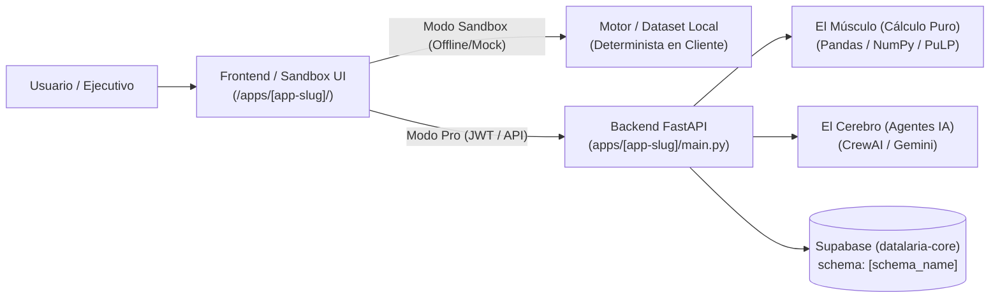

# Especificación Técnica SDD: [NOMBRE DE LA APLICACIÓN] (`[app-slug]`)

> **ID de Especificación:** `SPEC-APP-[SLUG]`  
> **Versión:** `1.0.0`  
> **Estado:** `DRAFT | APPROVED | IMPLEMENTED | DEPRECATED`  
> **Propietario de Dominio:** Datalaria (Operations Engineering & Applied AI)  
> **Ubicación del Código Fuente:** `apps/[app-slug]/`  
> **Ubicación del Artefacto Público:** `static/apps/[app-slug]/` (Ruta web: `/apps/[app-slug]/`)

---

## 1. Propósito Ejecutivo y Modelo de Monetización (Business Context)

### 1.1 Problema que Resuelve
[Descripción concisa en 2-3 líneas del problema operativo, cuantitativo o de gestión que resuelve esta aplicación para un perfil ejecutivo (C-Level / Director de Operaciones / Ingeniero).]

### 1.2 Vínculo de Monetización (Dual-Mode Strategy)
- **Modo Sandbox (Gratis / Captación):** [Qué puede hacer el visitante en el navegador sin registrarse ni levantar servidor, usando datos sintéticos o pre-calculados].
- **Modo Pro / Live Engine:** [Qué capacidades avanzadas desbloquea el backend FastAPI + Supabase + Agentes IA].
- **Upsell Directo (Lemon Squeezy):**
  - **Producto / Suite Vinculada:** [Ej. Suite 03: Control Operativo / Pack EVM / Mega Bundle]
  - **URL / Placement de Checkout:** [URL de Lemon Squeezy con `?embed=1` y atributo `data-product-name`]

---

## 2. Arquitectura del Módulo y Flujo de Datos



### 2.1 Manifiesto de Archivos (File Manifest)
| Archivo | Rol y Responsabilidad |
| :--- | :--- |
| `apps/[app-slug]/...` | [Descripción exacta de la responsabilidad única del archivo] |

---

## 3. Contratos de Datos y API (Interfaces)

### 3.1 Esquema de Base de Datos (Supabase PostgreSQL)
- **Proyecto:** `datalaria-core`
- **Esquema (`schema`):** `[nombre_esquema]`
- **Políticas RLS:** [Detalle de aislamiento por `user_id` o lectura pública controlada]

```sql
-- Definición declarativa de tablas clave
```

### 3.2 Contratos Pydantic / Endpoints REST (o Contratos JS)
| Método y Ruta | Entrada (Request Contract) | Salida (Response Contract) | Códigos de Estado |
| :--- | :--- | :--- | :--- |
| `GET /api/v1/...` | Query / Body Schema | Pydantic Model / JSON | `200`, `400`, `422`, `500` |

---

## 4. El Músculo Matemático e Invariantes de Dominio

> **Regla SDD:** Ningún LLM calcula estas métricas. Deben ser funciones puras y deterministas.

### 4.1 Fórmulas y Algoritmos Clave
- **[Nombre de Métrica 1]:** `Fórmula matemática exacta`
- **Cláusulas de Guarda (Edge Cases):** [Ej. Qué devuelve la función si el denominador es `0`, si el archivo está vacío o si hay valores `NaN`].

---

## 5. Requisitos No Funcionales (Seguridad, i18n, UI)
- **Internacionalización (i18n):** Soporte bilingüe (`es` / `en`) mediante diccionario único (cero duplicación de archivos `.html`).
- **Variables de Entorno Requeridas (`.env.example`):**
  - `SUPABASE_URL`
  - `SUPABASE_KEY`
  - `[OTRAS_VARIABLES]`
- **Aislamiento Estático:** Ningún archivo `.py`, `.sql` o `.env` puede copiarse a `static/apps/[app-slug]/`.

---

## 6. Criterios de Aceptación y Comandos de Verificación (Verification Gates)

Para considerar cualquier cambio en esta aplicación como **VÁLIDO**, deben ejecutarse y pasar con código `0` los siguientes comandos:

1. **Tests Unitarios y de Invariantes Matemáticas:**
   ```powershell
   pytest apps/[app-slug]/tests -v
   ```
2. **Linting / Verificación Estática:**
   ```powershell
   # Python o Frontend según aplique
   ```
3. **Verificación de Seguridad e Integración con el Portal Hugo:**
   ```powershell
   hugo --gc --minify
   ```
   - [ ] Comprobar que `public/apps/[app-slug]/` contiene únicamente activos web públicos y cero archivos `.py` o `.env`.
   - [ ] Comprobar que la interfaz carga en modo Sandbox sin errores `OFFLINE` en consola aunque el backend local esté apagado.
   - [ ] Comprobar que la ficha `/es/apps/[app-slug]/` y `/en/apps/[app-slug]/` refleja la versión actual y que los posts de referencia contienen el shortcode `app-ref`.

---

## 7. Ficha Pública (Showcase)

- **Fichero de datos:** `data/apps/[app-slug].yaml` (contrato en `specs/portal/apps-showcase/spec.md` §3)
- **Tier:** `flagship | b2b | lab` · **Status:** `live | beta | maintenance | frozen | incubating`
- **Captura:** `content/{es,en}/apps/[app-slug]/cover.png`
- **Posts de referencia:** [lista de slugs]

---

## 8. Historial Evolutivo (Changelog SemVer)

> Sincronizado con `releases` en `data/apps/[app-slug].yaml` (Constitución Art. 8.3).

| Versión | Fecha | Tipo | Cambios | Commit(s) |
| :--- | :--- | :--- | :--- | :--- |
| `v1.0.0` | AAAA-MM-DD | 🚀 Lanzamiento | ... | `abc1234` |
