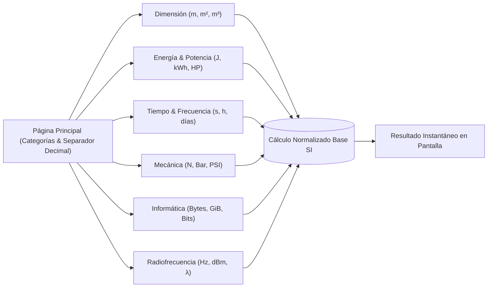

# SPEC-APP-CONVERSOR: Conversor de Unidades (Navaja Suiza Científica)

> **Identificador:** `SPEC-APP-CONVERSOR`  
> **Versión:** `v1.0.0` (Estado: `frozen` / Legacy)  
> **Fecha:** `2025-10-04` (Congelación: `2026-10-25`)  
> **Clasificación:** Tier `lab` | Scientific & Engineering Toolkit  
> **Ruta Canónica:** `https://datalaria.com/apps/conversor/`  
> **Ficha Técnica:** `https://datalaria.com/es/apps/conversor/` (EN: `/en/apps/conversor/`)

---

## 1. RESUMEN EJECUTIVO Y PROPÓSITO

El **Conversor Universal Pro** es una suite ligera y multipágina de conversión de magnitudes físicas, dimensionales y unidades técnicas de ingeniería, diseñada como una "navaja suiza digital" rápida, limpia y sin publicidad.

El proyecto cumple con los siguientes principios rectores:
1. **Precisión Matemática sin Pérdida:** Todas las conversiones se normalizan respecto a las unidades canónicas del Sistema Internacional (SI) (metro, julio, segundo, newton, byte, herzio) antes de proyectar a la unidad de destino, evitando acumulaciones de error de coma flotante.
2. **Cobertura de 6 Disciplinas Clave:** Estructurado en 6 módulos especializados: Dimensión (longitud, área, volumen), Energía/Potencia, Tiempo/Frecuencia, Mecánica (fuerza, presión), Informática/Datos y Radiofrecuencia (potencia en dBm, longitud de onda).
3. **Interoperabilidad de Notación Numérica:** Dispone de un conversor en vivo de formato de separador numérico para intercambiar instantáneamente entre el punto decimal (.) anglosajón y la coma decimal (,) europea en cifras de miles y decimales.
4. **Despliegue Estático Ultraligero:** Cero dependencias externas de librerías o frameworks pesados; tiempos de carga instantáneos en cualquier navegador y paridad bilingüe completa en `/es/` y `/en/`.

---

## 2. ARQUITECTURA DEL SISTEMA

La aplicación se estructura como un sistema estático modular desacoplado en el cliente:

### Componentes Principales:
- **Hub Central (`index.html`):** Panel de tarjetas de navegación rápida y herramienta de transformación de formato de millares/decimales.
- **Módulos Especializados (`*.html`):** Páginas dedicadas por disciplina física con cálculo reactivo bidireccional y tarjetas didácticas explicativas.
- **Motor Aritmético:** Fórmulas físicas deterministas que operan con aritmética de alta precisión en memoria del navegador.

---

## 3. STACK TECNOLÓGICO

- **Motor Frontend:** Vanilla JavaScript (ES6+), HTML5 semántico.
- **Estilos:** CSS Grid y Flexbox responsivo sin dependencias externas.
- **Estándares Científicos:** Sistema Internacional de Unidades (SI) y constantes de ingeniería (CODATA).
- **Alojamiento:** Directorio estático de Hugo en `/apps/conversor/`.

---

## 4. ARTÍCULOS TÉCNICOS ASOCIADOS

| Idioma | Título del Post | Slug Canónico |
| :--- | :--- | :--- |
| **ES** | *Creando mi 'Navaja Suiza' Digital: Un Conversor de Unidades a Medida con la IA* | `content/es/posts/app_conversor_unidades/index.md` |
| **EN** | *Building My Digital 'Swiss Army Knife': A Custom Unit Converter with AI* | `content/en/posts/app_unit_converter/index.md` |

---

## 5. HISTORIAL DE VERSIONES Y ESTADO DE CONGELACIÓN

- **`v1.0.0` (2025-10-04) — [ESTADO FINAL CONGELADO]:**
  - Despliegue de los 6 módulos completos (Dimensión, Energía, Tiempo, Mecánica, Informática, Radiofrecuencia).
  - Conversor de formato numérico decimal/miles (punto y coma).
  - Soporte bilingüe espejo con navegación localizada en `/es/` y `/en/`.
  - Explicaciones científicas didácticas en cada pantalla de conversión.
  - Estado congelado como herramienta estática de referencia permanente.
- **`v0.5.0` (2025-09-28):**
  - Añadidos módulos de Mecánica y Radiofrecuencia (fórmulas dBm/vatios y longitud de onda).
- **`v0.1.0` (2025-09-20):**
  - Prototipo inicial de longitud, masa y formato de separadores numéricos.
