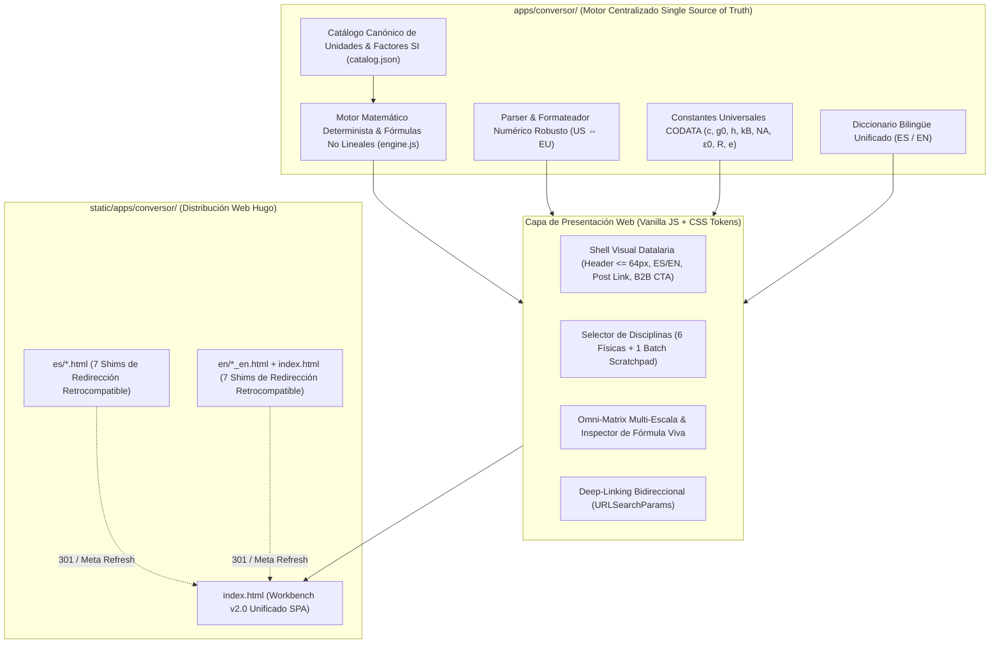

# SPEC-APP-CONVERSOR: Conversor de Unidades ("Engineering Workbench v2.1")

> **Identificador:** `SPEC-APP-CONVERSOR`  
> **Versión:** `v2.1.0` (Estado: `active`)  
> **Fecha:** `2026-11-05`  
> **Clasificación:** Tier `lab` | Scientific & Engineering Toolkit  
> **Ruta Canónica:** `https://datalaria.com/apps/conversor/`  
> **Ficha Técnica:** `https://datalaria.com/es/apps/conversor/` (EN: `/en/apps/conversor/`)  
> **Especificación de Diseño:** [`specs/apps/conversor/design.md`](file:///c:/Users/dalae/OneDrive/Emprendiendo/datalaria/specs/apps/conversor/design.md)

---

## 1. RESUMEN EJECUTIVO Y PROPÓSITO

El **Conversor Universal Pro ("Engineering Workbench v2.0")** es una suite científica y técnica de alta precisión para conversión de magnitudes físicas, metrología de ingeniería, constantes fundamentales y formateo de datos numéricos internacionales. 

Diseñado bajo la **Constitución SDD v1.1.0** para resolver las fricciones de herramientas genéricas con publicidad, el workbench opera enteramente en el cliente (100% offline y de carga instantánea) bajo una arquitectura **Single-Source-of-Truth** que erradica la deuda técnica de archivos HTML duplicados.

### 1.1 Objetivos Clave de la Versión 2.0.0:
1. **Rigor Metrológico SI / CODATA:** Todas las conversiones se normalizan respecto a unidades canónicas del Sistema Internacional (SI) o definiciones oficiales CODATA 2022/NIST, asegurando reversibilidad numérica exacta ($\epsilon \le 10^{-9}$).
2. **Cobertura Completa sin Brechas de Contrato (*Zero Contract Drift*):** Incorporación completa de potencia logarítmica RF (`dBm ⇔ W / mW`), longitud de onda y frecuencia electromagnética bidireccional ($\lambda = c / f$), energía térmica británica (`BTU`), unidades de almacenamiento binarias IEC (`KiB, MiB, GiB, TiB`) frente a decimales SI (`kB, MB, GB, TB`), y presión técnica e hidráulica (`bar, psi, Pa, atm, torr`).
3. **Batch Scratchpad & Formateador Masivo Avanzado:** Procesamiento multilínea de columnas de números pegadas desde hojas de cálculo (Excel, Google Sheets), permitiendo alternar formato decimal/miles (`US ⇔ EU`) y/o convertir unidades físicas de cada fila con exportación en 1 clic.
4. **Shell Datalaria, Ergonomía y Deep-Linking:** Cabecera institucional compacta (`← Datalaria`, selector `ES | EN`, botón `Kits B2B`), atajos de teclado (`⇄ Invertir`, `Copiar`), selector de precisión/notación científica, y persistencia de estado en la URL (`URLSearchParams`) para compartir cálculos reproducibles.
5. **Cero Dependencias de Red Externas:** Eliminación del CDN de Tailwind; estilizado mediante Design Tokens CSS nativos ultraligeros.

---

## 2. ARQUITECTURA DEL SISTEMA

### Componentes Principales:
- **`catalog.js`:** Definición declarativa de las 6 categorías físicas, sus magnitudes, símbolos, factores SI exactos y nombres bilingües.
- **`engine.js`:** Funciones puras de conversión lineal, conversión no lineal (Temperatura, dBm, $\lambda$), cálculo de Omni-Matrix y formateador numérico con detección heurística mejorada.
- **`app.js` / `index.html`:** Interfaz reactiva en Vanilla JS que gobierna eventos, atajos de teclado, sincronización de parámetros de URL (`?lang=es|en&cat=...&mag=...&val=...&from=...&to=...`) y almacenamiento de historial en `localStorage`.
- **Shims de Retrocompatibilidad:** Pequeños archivos HTML estáticos en las rutas históricas de `/es/` y `/en/` que redirigen instantáneamente a la URL canónica preservando los parámetros de categoría e idioma, garantizando **cero enlaces 404** para el portal y el SEO.

---

## 3. CATÁLOGO DE MAGNITUDES Y METROLOGÍA SI

### 3.1 Magnitudes y Factores Canónicos de Conversión

| Disciplina | Magnitud | Unidad Base SI | Unidades Soportadas |
| :--- | :--- | :--- | :--- |
| **Dimensión** | Longitud | Metro ($m$) | $m, km, cm, mm, \mu m, nm, mi, yd, ft, in, NM$ (millas náuticas) |
| | Área | Metro cuadrado ($m^2$) | $m^2, km^2, ha, mi^2, ac, ft^2, in^2$ |
| | Volumen | Metro cúbico ($m^3$) | $m^3, l, ml, cm^3, gal\text{ (US)}, qt\text{ (US)}, pt\text{ (US)}, cup\text{ (US)}, fl\text{ }oz\text{ (US)}$ |
| **Energía** | Energía | Julio ($J$) | $J, kJ, cal, kcal, Wh, kWh, BTU\text{ (IT: }1055.056\text{ J)}, eV, ft\cdot lbf$ |
| | Potencia | Vatio ($W$) | $W, kW, MW, hp\text{ (métrica: 735.49875 W)}, hp\text{ (mecánica: 745.69987 W)}, BTU/h$ |
| | Temperatura | Kelvin ($K$) | Celsius ($^\circ C$), Fahrenheit ($^\circ F$), Kelvin ($K$), Rankine ($^\circ R$) |
| **Tiempo** | Tiempo | Segundo ($s$) | $s, ms, \mu s, ns, min, h, d, w, a\text{ (año estándar 365 d)}, a_j\text{ (año juliano 365.25 d)}$ |
| **Mecánica** | Masa | Kilogramo ($kg$) | $kg, g, mg, \mu g, lb, oz, t\text{ (métrica)}, ton\text{ (US corta)}$ |
| | Fuerza | Newton ($N$) | $N, kN, MN, lbf, dyn, kgf$ |
| | Presión | Pascal ($Pa$) | $Pa, kPa, MPa, bar, mbar, psi, atm, torr\text{ / }mmHg$ |
| **Informática** | Almacenamiento (Decimal SI) | Byte ($B$) | $B, kB\text{ (10}^3\text{)}, MB\text{ (10}^6\text{)}, GB\text{ (10}^9\text{)}, TB\text{ (10}^{12}\text{)}, PB$ |
| | Almacenamiento (Binario IEC) | Byte ($B$) | $B, KiB\text{ (2}^{10}\text{)}, MiB\text{ (2}^{20}\text{)}, GiB\text{ (2}^{30}\text{)}, TiB\text{ (2}^{40}\text{)}, PiB$ |
| | Ancho de Banda | Bit/s ($bps$) | $bps, kbps, Mbps, Gbps, Tbps$ |
| **Radiofrecuencia** | Frecuencia | Hercio ($Hz$) | $Hz, kHz, MHz, GHz, THz$ |
| | Frecuencia ⇔ Longitud Onda | Metros ($m$) | Bidireccional: $\lambda = c / f \iff f = c / \lambda$ ($c = 299\,792\,458\text{ m/s}$) |
| | Potencia Logarítmica | Milivatios ($mW$) | $dBm \iff W, mW, kW$ ($P_{dBm} = 10 \log_{10}(P_{mW})$) |

### 3.2 Constantes Físicas Universales (CODATA 2022)
1. **Velocidad de la luz en el vacío ($c$):** $299\,792\,458\text{ m/s}$ (Exacta).
2. **Aceleración estándar de la gravedad ($g_0$):** $9.80665\text{ m/s}^2$ (Exacta).
3. **Constante de Planck ($h$):** $6.62607015 \times 10^{-34}\text{ J}\cdot\text{s}$ (Exacta).
4. **Constante de Boltzmann ($k_B$):** $1.380649 \times 10^{-23}\text{ J/K}$ (Exacta).
5. **Número de Avogadro ($N_A$):** $6.02214076 \times 10^{23}\text{ mol}^{-1}$ (Exacto).
6. **Permitividad del vacío ($\varepsilon_0$):** $8.8541878128 \times 10^{-12}\text{ F/m}$.
7. **Constante universal de los gases ($R$):** $8.314462618\text{ J/(mol}\cdot\text{K)}$.
8. **Carga elemental ($e$):** $1.602176634 \times 10^{-19}\text{ C}$ (Exacta).

---

## 4. INVARIANTES DE DOMINIO (`INV-CONV-*`)

- **`INV-CONV-1` (Reversibilidad Numérica Estricta):** Para cualquier par de unidades $(A, B)$ dentro de una misma magnitud lineal, $\text{convert}(\text{convert}(x, A, B), B, A) = x$ con error relativo $\le 10^{-9}$.
- **`INV-CONV-2` (Completitud sin Drift):** Los módulos de Radiofrecuencia (dBm ⇔ W, λ ⇔ f bidireccional), Informática (IEC vs SI) y Energía (BTU) deben existir funcionalmente en el código y en la interfaz.
- **`INV-CONV-3` (Cero Dependencias Externas en Runtime):** Queda prohibida la carga de scripts o estilos externos vía CDN (`cdn.tailwindcss.com`, fuentes o librerías de terceros no locales/seguras).
- **`INV-CONV-4` (Retrocompatibilidad 100% de Enlaces Históricos):** Los 14 archivos HTML previos en `static/apps/conversor/es/` y `en/` se reemplazan por shims de redirección válidos que preservan la categoría en la URL (`/apps/conversor/?lang=...&cat=...`).
- **`INV-CONV-5` (Inmunidad XSS en Manipulación de Cadenas):** Ninguna entrada del usuario en el formateador de números o parámetros URL se inyecta en el DOM mediante `innerHTML`.
- **`INV-CONV-6` (Paridad Bilingüe Total):** Todo elemento textual de la interfaz, nombres de unidades y mensajes didácticos debe contar con su correspondiente traducción en el diccionario bilingüe (`es` y `en`).
- **`INV-CONV-7` (Tríada de Enlaces del Ecosistema Datalaria):** La cabecera superior debe integrar de forma obligatoria los tres enlaces canónicos del ecosistema: 1. Enlace a la Ficha de la App (`/apps/<slug>/`) con objetivos y roadmap; 2. Enlace a la Guía Técnica (`/posts/<post>/`) con el post técnico; 3. Enlace a Kits B2B (`/recursos/`) para conversión y monetización no intrusiva.
- **`INV-CONV-8` (Soporte Dual Modo Día / Modo Noche y Cero FOUC):** La interfaz debe implementar soporte nativo completo para tema claro (`[data-theme="light"]`) y oscuro (`[data-theme="dark"]`), con persistencia en `localStorage` (`pref-theme`), conmutador en cabecera con atajo de teclado (`T` / `Alt + T`), detección de preferencia del sistema operativo (`prefers-color-scheme`) y script inline en `<head>` para garantizar cero parpadeo visual en carga (anti-FOUC).
- **`INV-CONV-9` (Evaluación Segura de Expresiones Aritméticas):** El campo de entrada debe evaluar expresiones matemáticas de forma determinista mediante analizador sintáctico recursivo propio sin utilizar `eval()` ni `Function()`, soportando operadores estándar, constantes (`pi`, `e`) y funciones analíticas (`sqrt`, `abs`, trigonométricas).
- **`INV-CONV-10` (PWA Offline, Resiliencia sin Conexión y Botón de Instalación In-App):** La aplicación debe incluir `manifest.json` válido, un Service Worker (`sw.js`) ligero que precachee los activos nucleares de la app permitiendo funcionamiento 100% offline, y un botón in-app (`#btn-install-pwa`) en cabecera que capture `beforeinstallprompt` en navegadores Chromium/Android, guíe en iOS Safari (Compartir -> Añadir a inicio) y se oculte automáticamente en modo `standalone` tras su instalación.

---

## 5. HISTORIAL DE VERSIONES Y EVOLUCIÓN

- **`v2.1.0` (2026-11-05) — [ESTADO: ACTIVO — PWA OFFLINE & MATH EVALUATOR]:**
  - **PWA Offline Nativa (`INV-CONV-10` / OPP-01):** Soporte de instalación en escritorio y móvil, Service Worker con estrategia Cache-First/Stale-While-Revalidate y Web App Manifest con icono SVG vectorial.
  - **Calculadora de Expresiones Inline (`INV-CONV-9` / OPP-03):** Campo de entrada con soporte para expresiones matemáticas directas (`2*pi*50`, `sqrt(144)`, `2^10`) con previsualización en tiempo real y cero vulnerabilidad XSS.
  - **Modo Dual Día / Noche (`INV-CONV-8`):** Design tokens duales de alto contraste, conmutador en cabecera, persistencia en `pref-theme`, atajo `T` / `Alt+T` y script anti-FOUC.
  - **Ecosistema Canónico (`INV-CONV-7`):** Integración de botón directo a Ficha de la App en cabecera superior.
- **`v2.0.0` (2026-11-04) — [SUPERSEDED]:**
  - **Refactorización Arquitectónica:** Migración a arquitectura *Single-Source-of-Truth* en `/apps/conversor/` con compilación estática y 14 shims de redirección retrocompatibles (eliminación del antipatrón de 15 HTML duplicados y corrección de la corrupción de cabecera en `en/mecanica_en.html`).
  - **Cierre de Contract Drift:** Implementación de potencia en dBm ⇔ W/mW, cálculo bidireccional $\lambda \iff f$, soporte de BTU y diferenciación estricta entre almacenamiento decimal SI y binario IEC (KiB..TiB).
  - **Resolución de Bugs Numéricos:** Corrección del truncamiento de 3 decimales provocado por `toLocaleString`, formateador de salida con precisión configurable (`Auto`, `2..8`, `Sci`) y motor de parseo robusto para separadores de miles y decimales que no corrompe entradas de 3 decimales (`1,234`).
  - **Módulo Batch Scratchpad:** Herramienta multilínea para conversión en masa de columnas pegadas desde Excel/CSV (formato de separadores y/o cambio de magnitud física en lote).
  - **Experiencia de Usuario e Integración:** Shell visual Datalaria con navegación institucional `← Datalaria`, fuentes `Outfit`/`Inter`/`JetBrains Mono` con `tabular-nums`, botones rápidos de inversión (`⇄`) y copiado (`✓`), enlaces permanentes por URL (`URLSearchParams`), barra de constantes CODATA y puente PLG no intrusivo hacia el catálogo de Kits B2B de Datalaria.
- **`v1.0.0` (2025-10-04) — [LEGACY FROZEN]:**
  - Versión multipágina original con 6 categorías aisladas en `/es/` y `/en/`.
