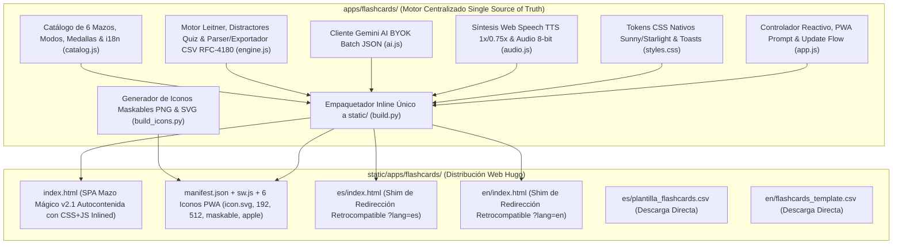

# SPEC-APP-FLASHCARDS: Flashcards AI ("Mazo Mágico v2.1")

> **Identificador:** `SPEC-APP-FLASHCARDS`  
> **Versión:** `v2.1.0` (Estado: `active`)  
> **Fecha:** `2026-11-06`  
> **Clasificación:** Tier `lab` | EdTech, Active Recall & Cognitive Toolkit  
> **Ruta Canónica:** `https://datalaria.com/apps/flashcards/`  
> **Ficha Técnica:** `https://datalaria.com/es/apps/flashcards/` (EN: `/en/apps/flashcards/`)  
> **Especificación de Diseño:** [`specs/apps/flashcards/design.md`](file:///c:/Users/dalae/OneDrive/Emprendiendo/datalaria/specs/apps/flashcards/design.md)

---

## 1. RESUMEN EJECUTIVO Y PROPÓSITO

**Flashcards AI ("Mazo Mágico v2.1")** es la evolución integral de la aplicación de estudio activo (*Active Recall*), repetición espaciada y memorización bilingüe de Datalaria. Inspirada en la experiencia real de ayudar a un estudiante en edad escolar con ciencias bilingües y vocabulario en inglés sin recurrir al monótono método de «tapar con la mano», la versión 2.1 alcanza la paridad arquitectónica con *Ábaco Arcade v2.1* y *Conversor Universal Pro v2.1*, dotando a la aplicación de **resiliencia PWA 100% offline, empaquetado autocontenido inline único, suite completa de iconos maskables, instalación guiada en iOS Safari/Android y ciclo inteligente de actualización in-app**.

### 1.1 Objetivos Clave de la Versión 2.0.0 (Base):
1. **Inclusión Multigeneracional (Niños y Adultos):** 6 mazos curados listos para usar en 1 clic (desde ciencias bilingües escolares hasta Business English, conceptos clave de IA y estrategia financiera), eliminando la barrera de entrada de pantallas vacías.
2. **Cierre de Brechas de Contrato (*Zero Contract Drift*):**
   - Integración nativa de síntesis de voz fonética (*Web Speech API*) con velocidad normal (`1.0x`) y modo tortuga (`0.75x`) para desgranar la fonética sílaba a sílaba.
   - Persistencia completa en `LocalStorage` de mazos personalizados, progreso y medallas.
   - Parser y exportador CSV estándar RFC-4180 con soporte para comas dentro de comillas.
3. **3 Modos de Estudio Adaptativos:**
   - **🎴 Modo Giro Clásico (Active Recall 3D):** Volteo tridimensional con cajas de dominio Leitner (`🌱 Repetir`, `👍 Bien`, `👑 Dominada`).
   - **🎯 Modo Quiz Arcade (4 Opciones):** Pregunta con 4 alternativas y distractores calculados en el navegador.
   - **✍️ Modo Escritura / Spelling (Reto Ortográfico):** Reto de escritura exacta con botón de pistas de letras reveladas.
4. **Motor Generativo IA en Lote (Gemini BYOK):** Inferencia estructurada JSON con `gemini-2.5-flash` (y fallback a `gemini-2.0-flash`).
5. **Arquitectura Single-Source-of-Truth y Cero CDNs:** Eliminación total de dependencias externas.

### 1.2 Objetivos Específicos de la Versión 2.1.0 (PWA Offline & Smart Update):
1. **Empaquetado Inline Monolítico Ultrarrápido (`build.py`):** Incrustar estilos CSS y módulos JS directamente en `static/apps/flashcards/index.html` para carga en 1 sola petición HTTP, eliminando peticiones en cascada y archivos sueltos.
2. **Suite de 6 Iconos PWA (Rasterizados & Maskables):** Generación determinista de `icon.svg`, `icon-192.png`, `icon-512.png`, `icon-maskable-192.png`, `icon-maskable-512.png` y `apple-touch-icon.png` con `start_url: "/apps/flashcards/"` en `manifest.json`.
3. **Botón de Instalación Universal (`#btn-install-pwa`):** Visible siempre que la app no corra en modo `standalone`. Dispara el instalador nativo en Android/PC y muestra un Toast interactivo con instrucciones paso a paso en iPhone/iPad (iOS Safari).
4. **Ciclo de Actualización In-App Inteligente (`#btn-check-update` + `#pwa-update-banner`):** Badge interactivo de versión para buscar actualizaciones bajo demanda, verificación en segundo plano al recuperar el foco (`visibilitychange`) y banner flotante con activación vía `postMessage({ action: 'skipWaiting' })` y recarga automática ante `controllerchange`.
5. **Sistema de Toasts Flotantes Lúdicos (`#toast-container`):** Feedback visual para estado de actualización, instalación y guardado sin popups invasivos.

---

## 2. ARQUITECTURA DEL SISTEMA

---

## 3. CATÁLOGO DE MAZOS Y MODOS DE ESTUDIO

### 3.1 Los 6 Mazos Curados (Niños y Adultos)
1. **🦴 Ciencias Bilingües: El Cuerpo Humano (ES ⇔ EN):** Vocabulario anatómico escolar bilingüe (*articulaciones/joints, columna vertebral/spinal column, cráneo/skull, costillas/ribs, pulmones/lungs, fémur/femur, etc.*).
2. **🪐 Exploradores del Espacio & Naturaleza (ES ⇔ EN):** Conceptos científicos fundamentales (*fotosíntesis, vía láctea, gravedad, ecosistema, etc.*).
3. **🌍 Capitales y Maravillas del Mundo:** Reto geográfico y cultural con pistas útiles.
4. **💼 Business & Tech English (Falsos Amigos & Verbos):** Términos profesionales comúnmente malinterpretados (*actually, embarrassed, compromise, sensible, deliverable, throughput*).
5. **🤖 Conceptos Clave de IA & Data Science:** Vocabulario esencial de IA moderna (*RAG, Hallucination, Overfitting, Embeddings, Spec-Driven Development, Context Window*).
6. **⚡ Productividad, Finanzas & Estrategia MBA:** Modelos mentales y métricas de negocio (*EBITDA, Break-even, Coste de Oportunidad, Matriz DAR, Ley de Little*).

### 3.2 Modos de Juego
- **Modo Giro Clásico:** Active Recall puro en 3D con clasificación Leitner en 3 niveles de dominio.
- **Modo Quiz Arcade:** Identificación rápida entre 4 opciones con cronometraje opcional.
- **Modo Escritura:** Refuerzo ortográfico con botón de asistencia que desvela letras progresivamente.

---

## 4. INVARIANTES DE DOMINIO (`INV-FLASH-*`)

- **`INV-FLASH-1` (Serialización CSV Bidireccional RFC-4180):** Todo mazo exportado a CSV y re-importado mediante el motor de `engine.js` conserva el 100% de sus tarjetas y campos, soportando comas y comillas en textos (`parseCSV(exportCSV(deck)) == deck`).
- **`INV-FLASH-2` (Cierre Completo de Contract Drift):** La aplicación incluye síntesis de voz fonética nativa en cliente (`Web Speech API`) con velocidad dual (1.0x y 0.75x tortuga), persistencia real de mazos y récords en `localStorage`, y generación con Gemini API actualizada.
- **`INV-FLASH-3` (Cero Dependencias Externas en Runtime):** Prohibido el uso de CDNs externos (`cdn.tailwindcss.com`, fuentes web bloqueantes o imágenes de `media.giphy.com`). Todo el CSS, SVGs, audio y animación de confeti es nativo y local.
- **`INV-FLASH-4` (Retrocompatibilidad 100% de Rutas):** Las URLs históricas `/apps/flashcards/es/index.html` y `/apps/flashcards/en/index.html` redirigen con meta-refresh a `?lang=es` y `?lang=en` reparando el error `UTF-g`, preservando la descarga de plantillas CSV.
- **`INV-FLASH-5` (Inmunidad XSS y Privacidad BYOK):** Ningún texto procedente de inputs, CSV o respuestas de Gemini se renderiza en el DOM sin sanitización. La clave API de Gemini del usuario reside únicamente en su navegador (`localStorage`) y nunca se envía a servidores de Datalaria.
- **`INV-FLASH-6` (Paridad Bilingüe Total ES ⇔ EN):** Todos los textos de la interfaz, los 6 mazos pre-cargados, las opciones del creador y las 6 medallas están localizados al 100% en español e inglés.
- **`INV-FLASH-7` (Tríada de Enlaces Datalaria):** La cabecera superior integra los tres enlaces canónicos: Ficha de la App (`/apps/flashcards/`), Post Historia IA (`/posts/app_flashcards/`) y Kits B2B (`/recursos/`).
- **`INV-FLASH-8` (PWA 100% Offline, Instalación Multi-Plataforma y Actualización In-App):** La aplicación debe incluir `manifest.json` con `start_url: "/apps/flashcards/"` e iconos `any` y `maskable` (`icon.svg`, `icon-192.png`, `icon-512.png`, `icon-maskable-192.png`, `icon-maskable-512.png`, `apple-touch-icon.png`), un Service Worker `sw.js` con soporte de `skipWaiting` y precaché completo Cache-First + Stale-While-Revalidate, botón `#btn-install-pwa` adaptativo (Chromium/Android y guía iOS Safari), botón de versión `#btn-check-update` para búsqueda manual de actualizaciones y banner `#pwa-update-banner` para activación instantánea.
- **`INV-FLASH-9` (Persistencia Anti-FOUC y Atajos de Teclado):** Micro-script en `<head>` para evitar parpadeos de tema claro/oscuro y atajos rápidos de teclado (`Espacio`/`Enter` voltear, `1`/`2`/`3` evaluar, `V` pronunciar, `T` tema, `M` sonido).

---

## 5. HISTORIAL DE VERSIONES Y EVOLUCIÓN

- **`v2.1.0` (2026-11-06) — [ESTADO: ACTIVO — "PWA OFFLINE & SMART UPDATE"]:**
  - **Empaquetado Monolítico Inline:** CSS y módulos JS inlined en `static/apps/flashcards/index.html` para carga en 1 sola petición HTTP sin archivos sueltos.
  - **Suite Completa de Iconos PWA:** Generados `icon-192.png`, `icon-512.png`, `icon-maskable-192.png`, `icon-maskable-512.png` y `apple-touch-icon.png` con `purpose: "any maskable"`.
  - **Botón `📲 Instalar` Universal:** Visible siempre que `!isStandalone`, con prompt nativo en Android/PC y toast instructivo en iOS Safari.
  - **Ciclo de Actualización In-App Inteligente:** Badge `#btn-check-update` interactivo en cabecera, comprobación al re-enfocar (`visibilitychange`) y banner `#pwa-update-banner` con actualización en caliente vía `skipWaiting`.
  - **Sistema de Toasts Lúdicos:** Reemplazo de alertas nativas por contenedor `#toast-container` no intrusivo.
- **`v2.0.0` (2026-11-06) — [SUPERSEDED — "OPERACIÓN MAZO MÁGICO"]:**
  - **Evolución Multigeneracional:** 6 mazos curados para niños y adultos.
  - **Pronunciación Fonética Web Speech API:** Velocidad normal (1.0x) y tortuga (0.75x).
  - **3 Modos de Estudio:** Giro 3D Leitner, Quiz Arcade 4 opciones y Modo Escritura.
  - **Inferencia Gemini Batch JSON:** `gemini-2.5-flash` en lote estructurado.
- **`v1.0.0` (2025-10-17) — [LEGACY FROZEN]:**
  - Prototipo funcional inicial generado con IA y Tailwind CDN en páginas separadas `/es/` y `/en/`.
