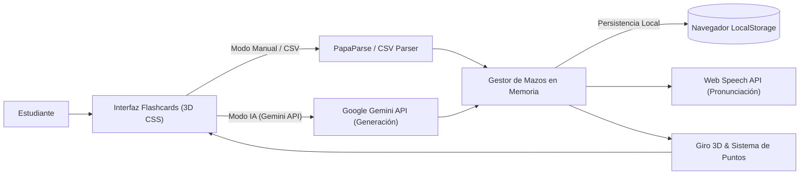

# SPEC-APP-FLASHCARDS: Flashcards AI (Estudio & Memorización Activa)

> **Identificador:** `SPEC-APP-FLASHCARDS`  
> **Versión:** `v1.0.0` (Estado: `frozen` / Legacy)  
> **Fecha:** `2025-10-17` (Congelación: `2026-10-25`)  
> **Clasificación:** Tier `lab` | EdTech & Client-Side AI Utility  
> **Ruta Canónica:** `https://datalaria.com/apps/flashcards/`  
> **Ficha Técnica:** `https://datalaria.com/es/apps/flashcards/` (EN: `/en/apps/flashcards/`)

---

## 1. RESUMEN EJECUTIVO Y PROPÓSITO

**Flashcards AI** es una aplicación interactiva de estudio basada en la metodología de memorización activa (*Active Recall*) y repetición sistemática, desarrollada para superar las limitaciones de los métodos tradicionales de estudio estático.

El proyecto aborda los siguientes objetivos:
1. **Estudio Bilingüe sin Fricción:** Diseñado para aprender y repasar vocabulario y conceptos científicos en varios idiomas (español, inglés, etc.) con fonética y soporte auditivo.
2. **Generación Aumentada por IA:** Incorpora integración directa con la API de Google Gemini en el navegador, permitiendo al estudiante escribir solo un concepto clave y autogenerar definiciones rigurosas, traducciones y guías de pronunciación.
3. **Privacidad Total y Cero Servidores:** Operación 100% en el cliente; los mazos de estudio se guardan en el `LocalStorage` del navegador o se importan/exportan como ficheros CSV estándar, sin registrar datos de usuario en bases de datos externas.

---

## 2. ARQUITECTURA DEL SISTEMA

La aplicación se ejecuta íntegramente en el navegador del usuario (*Client-Side Architecture*):

### Componentes Principales:
- **Motor de Renderizado 3D (CSS Transforms):** Implementación de volteo de tarjeta con perspectiva tridimensional (`rotateY`), permitiendo alternar entre pregunta/concepto y respuesta/definición con animaciones fluidas.
- **Importador/Exportador CSV (PapaParse):** Motor de serialización tabular para cargar o respaldar listas de vocabulario mediante plantillas `.csv`.
- **Conector Generativo Gemini:** Llamadas asíncronas seguras en cliente a la API de Gemini (modelo Gemini Flash) usando la API Key proporcionada por el usuario.
- **Síntesis de Voz (Web Speech API):** Lector fonético en vivo integrado para perfeccionar la pronunciación de los términos en inglés y otros idiomas.

---

## 3. STACK TECNOLÓGICO

- **Motor Frontend:** Vanilla JavaScript, HTML5, CSS 3D Transforms.
- **Librerías Cliente:** PapaParse (parser CSV).
- **APIs Web Nativas:** Web Speech API (Text-to-Speech), Web Storage API (LocalStorage).
- **Inteligencia Artificial:** Google Gemini API (Google AI Studio).
- **Alojamiento:** Directorio estático de Hugo en `/apps/flashcards/`.

---

## 4. ARTÍCULOS TÉCNICOS ASOCIADOS

| Idioma | Título del Post | Slug Canónico |
| :--- | :--- | :--- |
| **ES** | *Programando con IA: Creando mi Propia App mágica de Flashcards para Estudiar* | `content/es/posts/app_flashcards/index.md` |
| **EN** | *AI-Powered Programming: Creating My Own Magical Flashcards Study App* | `content/en/posts/app_flashcards/index.md` |

---

## 5. HISTORIAL DE VERSIONES Y ESTADO DE CONGELACIÓN

- **`v1.0.0` (2025-10-17) — [ESTADO FINAL CONGELADO]:**
  - Incorporación del modo de autogeneración mágica con Google Gemini API.
  - Implementación de síntesis fonética por voz mediante Web Speech API.
  - Soporte de importación/exportación de mazos en CSV con plantillas de ejemplo.
  - Giro tridimensional de tarjetas y almacenamiento persistente en LocalStorage.
  - Estado congelado como herramienta terminada para uso educativo.
- **`v0.5.0` (2025-10-10):**
  - Soporte de ficheros CSV y motor de animación de volteo 3D.
- **`v0.1.0` (2025-10-02):**
  - Prototipo inicial de tarjetas manuales y gamificación simple con puntos.
