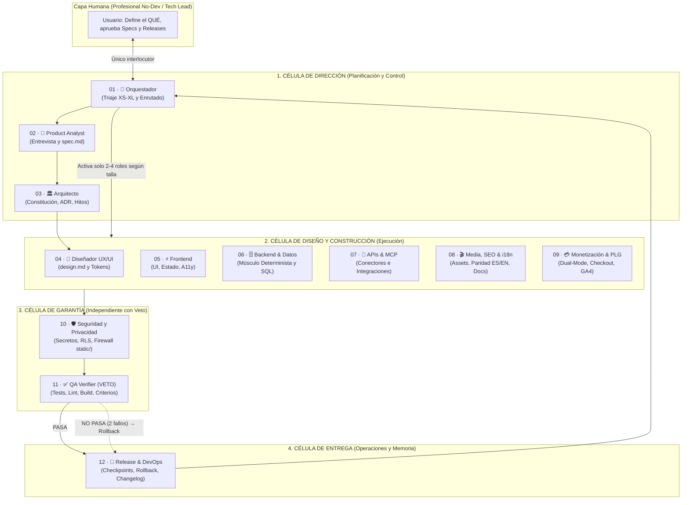

# Especificación Técnica SDD: Datalaria Helix (`helix`)

> **ID de Especificación:** `SPEC-APP-HELIX`  
> **Versión:** `1.1.0`  
> **Estado:** `APPROVED`  
> **Propietario de Dominio:** Datalaria (Operations Engineering & Applied AI)  
> **Referencia ADR:** [`ADR-017`](file:///c:/Users/dalae/OneDrive/Emprendiendo/datalaria/specs/DECISIONS.md)  
> **Ubicación del Escuadrón Canónico:** `specs/squad/`  
> **Ubicación del Código Fuente:** `apps/helix/web/` (Frontend SPA Sandbox) · `ops/helix/` (Adaptadores, CLI `helix` y Kit Factory)  
> **Ubicación del Artefacto Público:** `static/apps/helix/` (Ruta web: `/apps/helix/`)

---

## 1. Propósito Ejecutivo y Modelo de Monetización (Business Context)

### 1.1 Problema que Resuelve
Los profesionales no desarrolladores (consultores, directores de operaciones, PMs, analistas financieros, emprendedores) están construyendo aplicaciones y herramientas personales con agentes de IA mediante *vibe coding* (*prompt-and-pray*). El resultado funciona durante las primeras 48 horas pero colapsa en cuanto se intenta ampliar o mantener (*Vibe Debt*): pérdida de contexto entre sesiones, regresiones silenciosas, claves expuestas, interfaces inconsistentes y ausencia de marcha atrás.

**Datalaria Helix** (*«La spec es el ADN de tu app; los agentes solo la expresan»*) empaqueta el sistema operativo de Spec-Driven Development (SDD) de Datalaria en un **escuadrón coordinado de 12 agentes especializados** gobernado por contratos, triaje determinista de carga (`XS–XL`), diseño UX/UI con sistema de tokens, auditoría de seguridad, verificación independiente con derecho a veto y CLI de rollback en 1 comando. Es 100 % agnóstico de la herramienta (Google Antigravity, Claude Code, Cursor, GitHub Copilot / OpenAI Codex).

### 1.2 Escalera de Valor y Monetización (Dual-Mode Strategy — Constitución Art. 3)
1. **Nivel 0 — Executive Sandbox Web Gratis (`/apps/helix/` — Modo A+B, Cero API Key):**
   - **Modo A (Spec Builder Determinista):** Asistente interactivo en el navegador (15–20 preguntas ramificadas en lenguaje de negocio) que calcula en tiempo real el **Spec Quality & Vibe-Debt Risk Score (`0..100`)** y genera en el navegador un paquete `.zip` inicial con `AGENTS.md`, `_constitution.md`, `spec.md`, `design.md` y `ROADMAP.md` adaptados al proyecto del usuario.
   - **Modo B (Exportador de Mega-Prompt):** Genera el prompt estructurado de los agentes **Product Analyst + Arquitecto + UX/UI** listo para copiar y pegar en cualquier chat gratuito (ChatGPT, Claude, Gemini) sin exigir API key.
   - *(El Modo C con BYOK Gemini API en vivo queda pospuesto a `v1.1` según `ADR-017`).*
2. **Nivel 1 — Datalaria Helix Starter Kit (`9 €` en Lemon Squeezy):**
   - Guía metodológica SDD en PDF de alta definición + plantillas base comentadas + 2 agentes esenciales (`01-orchestrator` y `02-product-analyst`).
3. **Nivel 2 — Datalaria Helix Core Kit (`19 €` Precio Oficial de Lanzamiento Early-Bird / `39 €` PVP):**
   - El **Escuadrón completo de 12 Agentes** en formato canónico Markdown + adaptadores pre-compilados para **Antigravity** (`.agents/`), **Claude Code** (`.claude/agents/` + `CLAUDE.md`), **Cursor** (`.cursor/rules/`) y **Codex** (`AGENTS.md`).
   - **CLI `helix`** en Python puro (`0` dependencias externas): comandos `init`, `triage`, `new-spec`, `checkpoint`, `verify`, `rollback` y `status` (+ guía de modo manual sin terminal).
   - **3 Blueprints de Arquitectura** listos para clonar: (1) Web App Estática / Calculadora Ejecutiva, (2) SPA React + Supabase con RLS, y (3) Motor Cuantitativo Python + FastAPI + Excel/PDF.
   - **2 Casos de Estudio Reales Documentados:** *Case Study #1: Datalaria Pulse ("Operación Crisol")* y *Case Study #2: Micro-App para profesional no-dev*.
4. **Nivel 3 — Datalaria Helix Pro *(Condicional — Hito 6.10, Marzo 2027)*:**
   - Solo se construirá si a +60 días del lanzamiento se superan los 3 umbrales de validación de `ADR-017`: $\ge 300$ suscriptores en waitlist/sandbox, $\ge 50$ ventas de Core Kit y $\ge 30\%$ de compradores solicitando actualizaciones recurrentes de agentes o dashboard cloud en el esquema `helix` de Supabase (`datalaria-core`).

---

## 2. Arquitectura del Sistema y del Escuadrón de 12 Agentes



### 2.1 Manifiesto de Archivos del Ecosistema Helix (File Manifest)

| Archivo / Directorio | Rol y Responsabilidad | Hito |
| :--- | :--- | :-: |
| `specs/apps/helix/spec.md` | Especificación técnica SDD maestra de Datalaria Helix. | `6.1` |
| `specs/squad/README.md` | Índice operativo del escuadrón de 12 agentes y protocolo de carga bajo demanda. | `6.1` |
| `specs/squad/TECH_RADAR.yaml` | Radar tecnológico y de mercado bajo demanda (anillos ADOPT, TRIAL, ASSESS, HOLD). | `6.4` |
| `specs/squad/OPPORTUNITY_BACKLOG.md` | Registro priorizado RICE de mejoras técnicas, UX y monetización/contenidos. | `6.4` |
| `specs/squad/triage-rubric.md` | Reglas deterministas de dimensionamiento (`XS–XL`), disparadores y plantilla de Tarjeta de Triaje. | `6.1` |
| `specs/_templates/design.template.md` | Plantilla canónica `design.md` para sistemas de diseño y auditoría UX/UI por aplicación. | `6.1` |
| `specs/squad/01-orchestrator.md` .. `12-release-devops.md` | Las 12 fichas canónicas `AGENT_SPEC` con frontmatter YAML estructurado. | `6.1` |
| `ops/helix/build_adapters.py` | Compilador determinista que lee `specs/squad/*.md` y genera adaptadores para Antigravity, Claude Code, Cursor y Codex. | `6.2 / 6.4` |
| `ops/helix/build_core_kit.py` | Generador del Kit Core genérico, 12 agentes agnósticos, adaptadores y 3 blueprints. | `6.4` |
| `ops/helix/cli.py` | CLI multiplataforma (`helix`) en Python estándar (`0` dependencias) para `init`, `triage`, `checkpoint`, `verify` y `rollback`. | `6.5` |
| `ops/helix/build_kit.py` | Empaquetador programático de `Datalaria_Helix_Starter.zip` y `Datalaria_Helix_Core_Kit.zip`. | `6.8` |
| `ops/helix/tests/` | Suite `pytest` que verifica esquemas YAML de los 12 agentes, rúbrica de triaje, adaptadores y CLI. | `6.2–6.8` |
| `apps/helix/web/` | Código fuente de la SPA *Helix Spec Builder* (React 19 + Vite + TypeScript, Modo A+B). | `6.6` |
| `static/apps/helix/` | Bundle estático compilado de la SPA. Cero archivos `.py`, `.env` o `.sql` (`INV-HELIX-6`). | `6.6` |
| `data/apps/helix.yaml` | Metadatos públicos de la App para `/es/apps/helix/` y `/en/apps/helix/` (Constitución Art. 8). | `6.8` |

---

## 3. Contratos de Datos e Interfaces (`AGENT_SPEC` y Triaje)

### 3.1 Contrato de Ficha de Agente (`AGENT_SPEC` Frontmatter YAML)
Cada uno de los 12 archivos en `specs/squad/<nn>-<slug>.md` DEBE iniciar con un bloque YAML frontmatter validable con el siguiente esquema:

```yaml
id: "01-orchestrator"                # Patrón: ^\d{2}-[a-z0-9-]+$
name_es: "Orquestador / Delivery Lead"
name_en: "Orchestrator / Delivery Lead"
cell: "direction"                    # Enum: direction | construction | assurance | delivery
icon: "🎯"
activates_on_sizes: ["XS", "S", "M", "L", "XL"]
mandatory_triggers: ["all_tasks"]    # Disparadores que fuerzan su activación
can_write_production_code: false     # Booleano estricto de privilegio de escritura
has_veto_power: false                # True exclusivamente en 10-security-privacy y 11-qa-verifier
inputs: ["user_request", "specs/ROADMAP.md", "specs/squad/triage-rubric.md"]
outputs: ["triage_card", "specs/ROADMAP.md"]
```

### 3.2 Contrato de la Tarjeta de Triaje (`TriageCard`)
Salida obligatoria de 6 líneas emitida por `01-orchestrator` antes de modificar cualquier archivo:

```text
TRIAGE HELIX · Hito <X.Y> · Talla: <XS | S | M | L | XL>
Superficies afectadas: <docs | ui | frontend | backend | data_sql | apis | media_i18n | monetization | auth_security>
Roles activados (<N> de 12): <Lista de agentes activos con su icono>
Roles en banquillo: <Resto de agentes no cargados en contexto>
Verification Gate: <Comandos exactos de validación que ejecutará 11-qa-verifier>
Presupuesto y Gobernanza: Máx. 2 intentos por gate · Checkpoint <tag> · Aprobación humana previa: <SÍ | NO>
```

---

## 4. El Músculo Determinista e Invariantes de Dominio (`INV-HELIX-*`)

### 4.1 Algoritmo Determinista de Triaje (`ops/helix/` y Sandbox)
Dada una tarea con número de archivos estimados $F$, superficies tocadas $S$ y banderas booleanas de cambio de contrato ($\Delta_{\text{spec}}$) o nueva aplicación ($\Delta_{\text{app}}$):
1. **Asignación de Talla Base:**
   - Si $\Delta_{\text{app}} = \text{True} \implies \text{Talla} = \mathbf{XL}$ (se descompone obligatoriamente en $N$ hitos de talla $\le \mathbf{L}$).
   - Si $\Delta_{\text{spec}} = \text{True}$ o $|S| \ge 3 \implies \text{Talla} = \mathbf{L}$.
   - Si $|S| = 2$ o $F > 3 \implies \text{Talla} = \mathbf{M}$.
   - Si $1 < F \le 3$ y $|S| = 1 \implies \text{Talla} = \mathbf{S}$.
   - Si $F = 1$ y $|S| = 1$ sin cambio de contrato $\implies \text{Talla} = \mathbf{XS}$.
2. **Inyección de Disparadores Automáticos (Independientes de la Talla):**
   - Si `auth_security` o `data_sql` o `monetization` $\in S \implies$ activar `10-security-privacy`.
   - Si `ui` o `frontend` $\in S \implies$ activar `04-ux-ui`.
   - Si `media_i18n` $\in S \implies$ activar `08-media-i18n`.
   - En **toda** tarea ($\forall \text{Talla} \in \{\text{XS..XL}\}$) $\implies$ activar `01-orchestrator` y `11-qa-verifier`.

### 4.2 Puntuación Determinista de Calidad de una Spec (`SpecQualityScore` `0..100`)
El Sandbox *Helix Spec Builder* y el CLI `helix verify` evalúan cualquier `spec.md` mediante 5 pilares de 20 puntos (cero uso de LLM para puntuar):
$$\text{Score}_{\text{spec}} = 20 \cdot I_{\text{problem}} + 20 \cdot I_{\text{nongoals}} + 20 \cdot I_{\text{contracts}} + 20 \cdot I_{\text{invariants}} + 20 \cdot I_{\text{gates}}$$
donde cada indicador $I_k \in \{0, 0.5, 1\}$ verifica determinísticamente por expresiones regulares y AST Markdown la presencia y completitud de: (1) Problema y Usuario objetivo, (2) *Non-Goals* explícitos, (3) Modelo de datos/contratos tipados, (4) Invariantes `INV-*` y seguridad, y (5) Comandos ejecutables de verificación con código de salida `0`.

### 4.3 Las 8 Invariantes Innegociables de Datalaria Helix
- **`INV-HELIX-1` (Separación Estricta Construcción vs. Verificación):** Ningún agente constructor (`04-ux-ui` a `09-monetization`) puede marcar un hito como `[x]` ni aprobar su propio entregable. `11-qa-verifier` (y `10-security-privacy` cuando se activa) tienen derecho a veto vinculante.
- **`INV-HELIX-2` (Carga Bajo Demanda / Protección de Ventana de Contexto):** Queda prohibido cargar en el contexto de la sesión las 12 fichas de `specs/squad/` simultáneamente para tareas `XS`, `S` o `M`. El agente ejecuta el arranque en 3 pasos de `AGENTS.md`, realiza el triaje con `triage-rubric.md` y lee **únicamente** las fichas de los roles activados en la Tarjeta de Triaje.
- **`INV-HELIX-3` (Disparadores Automáticos de Seguridad, UX e i18n):** Ninguna talla reducida (`XS` o `S`) puede usarse para eludir a `10-security-privacy` si el cambio toca variables de entorno, `.env`, autenticación, políticas RLS, pagos o archivos en `/static/`.
- **`INV-HELIX-4` (Fuente Única de Agentes y Adaptadores Compilados):** Las 12 fichas en `specs/squad/*.md` son la única fuente de verdad (*Single Source of Truth*). Los archivos en `.agents/`, `.claude/agents/` o `.cursor/rules/` son artefactos compilados por `ops/helix/build_adapters.py` y está prohibido editarlos manualmente.
- **`INV-HELIX-5` (CLI Cero-Dependencias y Paridad Sin-CLI):** El ejecutable `ops/helix/cli.py` debe funcionar en Windows, macOS y Linux utilizando exclusivamente la librería estándar de Python $\ge 3.10$ (`argparse`, `pathlib`, `subprocess`, `json`, `zipfile`, `hashlib`), sin requerir `pip install`. Toda operación del CLI debe tener su equivalente mediante prompt directo al Orquestador para usuarios no técnicos.
- **`INV-HELIX-6` (Privacidad Client-Side en el Sandbox y Firewall `static/`):** El Sandbox web (`/apps/helix/`) ejecuta toda la entrevista, puntuación y generación del `.zip` en la memoria del navegador del usuario, sin transmitir sus respuestas a ningún backend salvo que el usuario se registre voluntariamente en la Waitlist de Brevo. `static/apps/helix/` jamás contendrá archivos `.py`, `.sql` ni `.env`.
- **`INV-HELIX-7` (Protocolo de Rollback Automático al 2.º Fallo):** Si un Verification Gate falla en 2 intentos consecutivos de reparación, el flujo se detiene obligatoriamente, restaura el estado limpio del checkpoint (`git checkout` / `git restore` al tag `sdd-checkpoint-*`) y documenta el bloqueo en el `Audit Log` de `ROADMAP.md`.
- **`INV-HELIX-8` (Presupuesto Estricto de Contexto, Control Anti-Bloat y Criterio de Lección Aprendida):**
  1. *Tope Duro por Ficha:* Ninguna ficha canónica en `specs/squad/<id>.md` puede superar jamás las **85 líneas totales** ni contener más de **6 ítems** en su Sección `## 6. Reglas de Fricción Real y Correcciones ([USER-FIX] / [ENV-FIX])`. Cuando entra una regla nueva y se alcanza el límite de 6, el Orquestador aplica poda FIFO o fusión sintética.
  2. *Criterio Exclusivo de Registro (`User-Correction & Friction First`):* Queda **prohibido** registrar en la Sección 6 conocimientos teóricos generales ya adquiridos por el modelo LLM. **Únicamente** se registran ajustes derivados de **correcciones posteriores del usuario vía prompt (`[USER-FIX]`)** o **errores empíricos de ejecución/entorno (`[ENV-FIX]`)** ocurridos durante un hito real.
  3. *Aislamiento de Archivos de Radar (`Lazy Radar Loading`):* Los archivos `specs/squad/TECH_RADAR.yaml` y `specs/squad/OPPORTUNITY_BACKLOG.md` **nunca se cargan por defecto** en el arranque de tareas `XS`, `S`, `M` o `L`. Solo se leen cuando el Coordinador (`01-orchestrator`) ejecuta una ceremonia de actualización de skills/radar o al planificar un hito estratégico `XL`.

---

## 5. Requisitos No Funcionales (i18n, UX/UI, Telemetría)

- **Bilingüismo Nativo ES/EN (Constitución Art. 5.1):** Tanto las fichas de salida del Sandbox como la interfaz web `/apps/helix/` operan en español e inglés desde una única base de código (`?lang=es|en`).
- **Estándar Visual C-Level:** Gobernado por `specs/_templates/design.template.md` (modo oscuro ejecutivo `#0f172a`, tipografía `Outfit + Inter`, contraste WCAG 2.2 AA).
- **Eventos de Telemetría GA4:**
  - `join_waitlist_helix` (implementado en Hito 6.0).
  - `generate_helix_spec_zip` (al descargar el ZIP desde el Sandbox `/apps/helix/`).
  - `copy_helix_megaprompt` (al usar el exportador de prompt Modo B).
  - `begin_checkout_helix_kit` (al abrir el checkout de Lemon Squeezy para Starter o Core Kit).

---

## 6. Criterios de Aceptación y Comandos de Verificación por Hito (Verification Gates)

1. **Gate Hito 6.1 (Documentación de Spec y Escuadrón):**
   - Existencia e integridad de `specs/apps/helix/spec.md`, `specs/squad/README.md`, `specs/squad/triage-rubric.md`, `specs/_templates/design.template.md` y las 12 fichas `specs/squad/01-orchestrator.md` .. `12-release-devops.md` con frontmatter YAML válido.
   - `hugo --renderToMemory` (código `0`) y `python -m pytest ops/pulse/tests -v` (`18/18 PASSED`).
2. **Gate Hito 6.2 (Dogfooding Interno en Datalaria):**
   - `python ops/helix/build_adapters.py` + `python -m pytest ops/helix/tests -v` + `hugo --renderToMemory` (código `0`).
3. **Gate Hito 6.3 ("Operación Crisol" sobre Datalaria Pulse):**
   - `python -m pytest ops/pulse/tests -v` + `cd apps/pulse/web && npm run lint && npm run build:portal` + `hugo --renderToMemory` (verificando embargo público de Pulse hasta el `2026-11-18`).
4. **Gate Hitos 6.4–6.8 (Kit Core, CLI `helix`, Sandbox Web y Empaquetado Comercial):**
   - `python -m pytest ops/helix/tests -v` + `cd apps/helix/web && npm run lint && npm run build:portal` + `hugo --gc --minify` (código `0` y firewall `static/` limpio).

---

## 7. Ficha Pública y Respaldo Editorial

- **Fichero de datos (Hito 6.8):** `data/apps/helix.yaml` (`tier: flagship`, `status: incubating` hasta enero 2027).
- **Artículos publicados de pre-lanzamiento (Hito 6.0):**
  1. `sdd_vs_vibe_coding` (`2026-11-04`, ES/EN).
  2. `agentes_ia_operativa_sdd` (`2026-11-11`, ES/EN).
- **Serie de lanzamiento oficial (Hito 6.9, Enero 2027):** 5 artículos técnicos bilingües documentando la arquitectura de los 12 agentes, la *Operación Crisol* sobre Datalaria Pulse, el CLI de rollback y el caso demo de principio a fin.

---

## 8. Historial Evolutivo (Changelog SemVer)

| Versión | Fecha | Tipo | Cambios | Commit(s) |
| :--- | :--- | :--- | :--- | :--- |
| `v0.2.0` | 2026-11-04 | 🧬 Evolución | Incorporación de `INV-HELIX-8` (control anti-bloat <= 85 líneas, lecciones de fricción real [USER-FIX]/[ENV-FIX]), creación de `TECH_RADAR.yaml`, `OPPORTUNITY_BACKLOG.md` y compilador del Kit Core genérico (`build_core_kit.py`) con 3 blueprints y suite pytest de init en directorio vacío (`ADR-019`). | *Hito 6.4* |
| `v0.1.0` | 2026-11-03 | 📐 Spec | Aprobación de `SPEC-APP-HELIX`, definición de las 7 invariantes `INV-HELIX-1..7`, rúbrica determinista de triaje `XS–XL`, plantilla `design.template.md` y creación de las 12 fichas `AGENT_SPEC` en `specs/squad/` (Hito 6.1 / `ADR-017`). | *Hito 6.1* |
