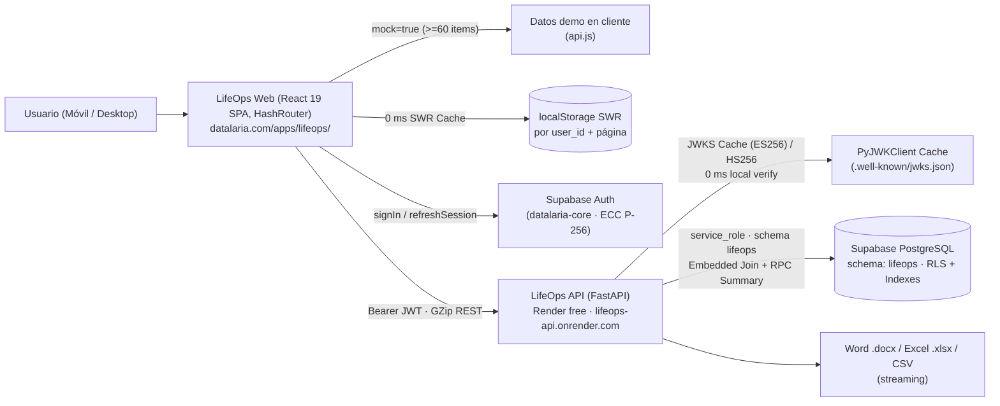

# Especificación Técnica SDD: LifeOps (`lifeops`)

> **ID de Especificación:** `SPEC-APP-LIFEOPS`
> **Versión de la Spec:** `1.2.0` (Actualizada el 2026-11-19 con Paginación Server-Side 12/24/48, Join Embebido PostgREST, Auth Local JWKS ECC P-256 / ES256 y Resiliencia Móvil — `ADR-030`)
> **Versión de la App documentada:** `v1.2.0` (ver §9 Historial Evolutivo)
> **Estado:** `APPROVED` — Hitos 1.1 a 1.11 completados ✅ (`v1.2.0` en producción)
> **Categoría SDD:** 🟢 Activa en Producción (App activa #1 de 7)
> **Código fuente canónico:** [`apps/lifeops/web/`](file:///c:/Users/dalae/OneDrive/Emprendiendo/datalaria/apps/lifeops/web) (frontend) · [`apps/lifeops/api/`](file:///c:/Users/dalae/OneDrive/Emprendiendo/datalaria/apps/lifeops/api) (backend)
> **Artefacto público:** [`static/apps/lifeops/`](file:///c:/Users/dalae/OneDrive/Emprendiendo/datalaria/static/apps/lifeops) → `https://datalaria.com/apps/lifeops/`
> **Ficha pública:** `/es/apps/lifeops/` · `/en/apps/lifeops/` (ver [`apps-showcase/spec.md`](file:///c:/Users/dalae/OneDrive/Emprendiendo/datalaria/specs/portal/apps-showcase/spec.md))

---

## 1. Propósito y Contexto de Negocio

### 1.1 Problema que resuelve
Unificar en un único "sistema operativo personal y profesional" información que normalmente vive dispersa en 5+ aplicaciones de suscripción: entrenamientos deportivos, lecturas, cine/series, proyectos y tareas Kanban, con capacidad de **cruzar datos y generar informes ejecutivos** (Word/Excel/CSV) a coste de infraestructura **0 €/mes**.

### 1.2 Público objetivo
- **Lector técnico del blog:** demostrador full-stack real (React 19 + FastAPI + Supabase) documentado en una serie de 6 artículos publicados.
- **Prosumer / profesional:** uso real autenticado en escritorio y móvil (PWA) para su propia gestión personal y profesional con históricos crecientes de cientos de actividades.

### 1.3 Respaldo editorial (Invariante `App ⇔ Post`, Constitución Art. 7)

| Parte | Slug (ES y EN comparten carpeta) | Fecha | Tema |
| :-: | :--- | :--- | :--- |
| 1 | `app-lifeops_part1_arquitectura_backend` | 2026-09-10 | Arquitectura cloud, modelo de datos y backend FastAPI |
| 2 | `app-lifeops_part2_frontend_dashboard` | 2026-09-13 | Frontend React + Dashboard |
| 3 | `app-lifeops_part3_modulos_kanban` | 2026-09-15 | Módulos interactivos y Kanban |
| 4 | `app-lifeops_part4_informes_word_excel` | 2026-09-18 | Motor de informes Word/Excel |
| 5 | `app-lifeops_part5_deploy_mobile_pwa` | 2026-09-19 | Despliegue 24/7, móvil y PWA |
| 6 | `app-lifeops_part6_analytics_dashboard_360` | 2026-10-27 | Dashboard 360°, Recharts y mitigación de cold-starts |

### 1.4 Estrategia Dual-Mode (Constitución Art. 3)

| Modo | Estado actual | Comportamiento |
| :--- | :--- | :--- |
| **Sandbox / Demo** | ✅ Implementado | `?mock=true` (query o hash) o `localStorage.lifeops_mock = 'true'` → usuario simulado `mock-user-datalaria`, datos de ejemplo deterministas en [`api.js`](file:///c:/Users/dalae/OneDrive/Emprendiendo/datalaria/apps/lifeops/web/src/lib/api.js) ($\ge 60$ entrenamientos para demostrar paginación `12/24/48`), sin llamadas a backend. |
| **Pro / Live** | ✅ Implementado | Login Supabase Auth (email+password) → JWT (`ECC P-256 / ES256`) → API FastAPI en Render → Supabase schema `lifeops`. |
| **Upsell** | ❌ No aplica hoy | LifeOps no tiene producto vinculado en Lemon Squeezy. Su CTA de conversión es la **newsletter** y el enlace a la serie de posts. *(Decisión D-LO-1, §10).* |

### 1.5 Non-Goals y Límites (Fuera de Alcance)
- **Prohibido introducir paginación por cursor/keyset compleja:** Para el volumen de un usuario prosumer ($10^2$–$10^4$ actividades), la paginación determinista por `limit`/`offset` (`.range()`) con índice compuesto y `count="exact"` ofrece coste constante $O(\text{page\_size})$ sin sobre-ingeniería.
- **Prohibido mantener el contenedor Render despierto 24/7 con cron externo en esta fase:** Un ping cada 14 min consume $\sim 744\text{ h/mes}$ de la cuota gratuita de $750\text{ h/mes}$ de Render, poniendo en riesgo otros servicios gratuitos. La latencia de arranque en frío se resuelve arquitectónicamente con hidratación SWR en `0 ms`, verificación JWT local, refresh de sesión ante `401` y retry con backoff exponencial.
- **Prohibido usar LLMs para cálculos o agregaciones de métricas:** Todos los KPIs deportivos (`total_km`, `total_seconds`, `total_kcal`, `pb_count`, ritmos y variaciones $\Delta\%$) se calculan de forma 100 % determinista en SQL/Python o en el motor JS (`Constitución Art. 1.3`).
- **Prohibido ejecutar scripts de seeding sobre cuentas reales:** Todo seed o test de carga está restringido por `seeder_guard.py` (`INV-11` / `ADR-014`).

---

## 2. Arquitectura



### 2.1 Despliegue actual

| Pieza | Plataforma | Config | Notas |
| :--- | :--- | :--- | :--- |
| Frontend | Netlify (portal Hugo) | Script `npm run build:portal` en [`apps/lifeops/web/package.json`](file:///c:/Users/dalae/OneDrive/Emprendiendo/datalaria/apps/lifeops/web/package.json) → compila a `static/apps/lifeops/` | `base: './'` en [`vite.config.js`](file:///c:/Users/dalae/OneDrive/Emprendiendo/datalaria/apps/lifeops/web/vite.config.js). `HashRouter` evita depender de reglas SPA. |
| Backend | Render (plan free) | [`render.yaml`](file:///c:/Users/dalae/OneDrive/Emprendiendo/datalaria/apps/lifeops/api/render.yaml) con `rootDir: apps/lifeops/api`, Python 3.11.9 | Cold start ~45-60 s; `GZipMiddleware`, cabecera `Server-Timing` y `--proxy-headers` activos en `v1.2.0`. |
| Base de datos | Supabase `datalaria-core` | [`supabase_schema.sql`](file:///c:/Users/dalae/OneDrive/Emprendiendo/datalaria/apps/lifeops/api/supabase_schema.sql) + [`migrations/2026-11_lifeops_perf_indexes.sql`](file:///c:/Users/dalae/OneDrive/Emprendiendo/datalaria/apps/lifeops/api/migrations/2026-11_lifeops_perf_indexes.sql) | Schema `lifeops` conforme con Constitución Art. 4. Firma JWT activa en proyecto: `ECC (P-256)` (`ES256`). |

### 2.2 Manifiesto de archivos — Backend (`apps/lifeops/api/`)

| Archivo | Responsabilidad |
| :--- | :--- |
| `main.py` | App FastAPI (`v1.2.0`), `GZipMiddleware(minimum_size=1024)`, middleware `Server-Timing`, rate-limit SlowAPI (120/min), CORS, registro de routers, `/` y `/health`. Monkey-patch IPv4 acotado a `os.name == "nt"`. |
| `config.py` | `Settings` (pydantic-settings): Supabase URL/keys/JWT secret opcional, schema `lifeops`, host/puerto, CORS. |
| `middleware/auth.py` | Dependencia `get_current_user` → `AuthenticatedUser{id,email,role}`. Inspecciona `alg` del JWT: verifica `ES256/RS256` en local mediante `PyJWKClient` cacheado (`lifespan=3600, timeout=5`) contra `/auth/v1/.well-known/jwks.json`, o `HS256` con `SUPABASE_JWT_SECRET`. Rechazo inmediato `401` ante `InvalidSignatureError` o `ExpiredSignatureError` (`SEC-1` + `INV-17`). |
| `services/supabase_client.py` | Cliente singleton con `service_role` (bypassa RLS) + helper `db(table)` y `rpc(fn, params)` sobre schema `lifeops`. |
| `services/seeder_guard.py` | Guardia anti-contaminación de datos sintéticos con lista blanca estricta (`INV-11` / `ADR-014`). |
| `models/activity.py`, `models/project.py` | Contratos Pydantic v2 de actividades, detalles (`WorkoutResponse`, `BookResponse`, `FilmResponse`) y paginación (`PageSize = Literal[12, 24, 48]`, `SportSummary`, `PagedActivitiesResponse`). |
| `routers/activities.py` | CRUD de actividades, `GET /activities/paged` (paginación server-side `12/24/48` + `include_summary` + join embebido PostgREST) y `GET /activities/details` (join embebido sin `.in_()`). |
| `routers/projects.py` | CRUD de proyectos + `tasks_router` (CRUD tareas + comentarios JSONB). |
| `routers/stats.py` | Resumen de dashboard y desglose por tipo/fechas. |
| `routers/reports.py` | Plantillas, generación `.docx`, historial, exportación CSV y Excel. |
| `routers/alerts.py` | Alertas inteligentes calculadas al vuelo + descarte. |
| `services/report_generator.py` | Motor `python-docx` de informes ejecutivos. |
| `services/data_exporter.py` | Exportación CSV (UTF-8 BOM) y libro Excel (`openpyxl`). |
| `services/alerts_evaluator.py` | Reglas: deadlines de tareas, inactividad deportiva, bienvenida y lecturas estancadas. |
| `migrations/2026-11_lifeops_perf_indexes.sql` | Índices de FK (`workouts/books/films.activity_id`), índice compuesto de orden total en `activities` y función SQL `lifeops.sport_summary(UUID)`. |

### 2.3 Manifiesto de archivos — Frontend (`apps/lifeops/web/src/`)

| Ruta | Responsabilidad |
| :--- | :--- |
| `App.jsx` | `HashRouter`, code-splitting por ruta (`lazy`), rutas protegidas. |
| `context/AuthContext.jsx` | Sesión Supabase, signIn/signUp/signOut/reset/update password, pre-warming inicial y en `visibilitychange`/`focus`, bypass mock. |
| `context/LanguageContext.jsx` + `i18n/locales/{es,en}.js` | i18n por diccionario (`Constitución Art. 5`): `?lang=` → `localStorage.lifeops_language` → idioma navegador. |
| `lib/supabase.js` | Cliente Supabase JS (`VITE_SUPABASE_*`). |
| `lib/api.js` | `apiFetch` con inyección de JWT, auto-refresh único ante `401` (`refreshSession`), timeout de `75 s` en `GET` con retry backoff exponencial (`2-4-8-16 s`), caché SWR (`lifeops_swr_v2:`), `getActivitiesPaged` con fallback `404` y $\ge 60$ entrenamientos mock. |
| `lib/sportFormatters.js` | Funciones puras `getWorkoutTotalSeconds`, `formatWorkoutDuration` y `calculatePaceOrSpeed` desacopladas de componentes React para cumplir `react/only-export-components` en `oxlint`. |
| `lib/analyticsEngine.js` | Motor determinista puro en cliente para filtrado jerárquico, ventanas temporales (`week`, `month`, `quarter`, `year`), deltas ($\Delta\%$), series temporales y mapa de calor de consistencia. |
| `hooks/usePagedActivities.js` | Hook SWR reutilizable para módulos paginados (`user:type:size:page`), con *seed* optimista desde caché del Dashboard en página 1, estados `idle/loading/syncing/error/ready` y prefetch en segundo plano (`include_summary=false`). |
| `components/common/Paginator.jsx` + `Paginator.css` | Selector segmentado `12 · 24 · 48`, paginador de escritorio y compacto móvil (`‹ 2 / 12 ›` con área táctil $\ge 44\text{ px}$), texto de rango y accesibilidad WCAG 2.2 AA. |
| `pages/` | `LoginPage`, `DashboardPage` (también `/stats`), `PersonalPage`, `ProfessionalPage`, `ReportsPage`, `SettingsPage`. |
| `components/Personal/` | `SportModule` (paginado `12/24/48`, KPIs desde `summary`, 4 estados explícitos, Cards por defecto en móvil), `BooksModule`, `FilmsModule`. |
| `components/Professional/` | `KanbanBoard` (bitácora de comentarios), `ProjectsManager`. |
| `components/Layout/` | `MainLayout`, `Sidebar`, `Header` (polling de alertas pausado con `document.hidden` y diferido `3 s`), `BottomNav` (móvil). |
| `components/Dashboard/` | `StatWidget`, `QuickActions`, `SystemHealth`. |
| `components/Notifications/` | `NotificationDrawer` (alertas). |
| `components/common/` | `Modal` (bottom-sheet en móvil vía `createPortal`), `LanguageSwitcher`. |

### 2.4 Rutas de la SPA

| Hash route | Página | Protegida |
| :--- | :--- | :-: |
| `#/login` | Login / registro / recuperación | No |
| `#/` y `#/stats` | Dashboard 360° | Sí |
| `#/personal?tab=sport&page=1&size=12` | Deporte (paginado) · Lecturas · Cine | Sí |
| `#/professional` | Proyectos · Kanban | Sí |
| `#/reports` | Informes y exportaciones | Sí |
| `#/settings` | Ajustes de cuenta | Sí |
| `*` | Redirección a `#/` | — |

---

## 3. Contratos de Datos

### 3.1 Base de datos — `datalaria-core`, schema `lifeops`

| Dominio | Tabla / Función | Clave / relación / Índice | En uso por la API |
| :--- | :--- | :--- | :-: |
| Personal | `activities` | `user_id → auth.users` · `activity_type ∈ {sport, book, film, learning, journal}` · Índice compuesto `idx_activities_user_type_date_order (user_id, activity_type, date DESC, created_at DESC, id DESC)` | ✅ |
| Personal | `workouts` | `activity_id → activities` (CASCADE) · Índice FK `idx_workouts_activity_id (activity_id)` | ✅ |
| Personal | `books` | `activity_id → activities` (CASCADE) · Índice FK `idx_books_activity_id (activity_id)` | ✅ |
| Personal | `films` | `activity_id → activities` (CASCADE) · Índice FK `idx_films_activity_id (activity_id)` | ✅ |
| Personal | `lifeops.sport_summary(p_user_id UUID)` | Función SQL `SECURITY INVOKER` / `STABLE` que agrega `count`, `total_km`, `total_seconds`, `total_kcal` y `pb_count` en PostgreSQL en `< 5 ms` | ✅ (`v1.2.0`) |
| Personal | `habits`, `habit_logs` | `user_id` / `habit_id` | ❌ Reservadas |
| Profesional | `projects` | `user_id` · `status ∈ {planning, active, on_hold, completed, cancelled}` | ✅ |
| Profesional | `tasks` | `project_id → projects` (SET NULL) · `status ∈ {backlog, todo, in_progress, review, done, cancelled}` · `comments JSONB` | ✅ |
| Transversal | `generated_reports` | `user_id` · `metadata JSONB` | ✅ (historial) |
| Transversal | `report_templates`, `alert_rules`, `alert_log` | `user_id` | ❌ Reservadas |

**RLS:** activado en las 12 tablas; políticas `auth.uid() = user_id` (o vía padre en tablas hijas). Trigger `update_updated_at` en `activities`, `projects`, `tasks`.

> ⚠️ Como la API usa `service_role`, **RLS no protege las peticiones del backend**; el aislamiento depende al 100 % de que `get_current_user` verifique criptográficamente el JWT (`SEC-1` + `INV-17`) y de que toda query filtre por `user_id` (`INV-1`).

### 3.2 API REST (prefijo `/api/v1`, todas requieren `Authorization: Bearer <JWT>` salvo indicación)

| Recurso | Endpoints |
| :--- | :--- |
| Sistema | `GET /` · `GET /health` *(públicos)* |
| Activities | `GET /activities/paged?activity_type=sport&page=1&page_size=12&include_summary=true` *(paginación server-side `12/24/48` con join embebido y resumen KPI opcional)* · `GET /activities/details?activity_type=&date_from=&date_to=&limit=` *(join embebido PostgREST hasta 2000 registros)* · `GET /activities/?activity_type=` · `GET /activities/{id}` · `POST /activities/` · `POST /activities/{sport,book,film}` · `PATCH /activities/{id}` · `PATCH /activities/{id}/{sport,book,film}` · `DELETE /activities/{id}` · `GET /activities/{id}/{workout,book,film}` |
| Projects | `GET /projects/?status=` · `GET /projects/{id}` · `POST /projects/` · `PATCH /projects/{id}` · `DELETE /projects/{id}` · `GET /projects/{id}/tasks` |
| Tasks | `GET /tasks/?status=&project_id=` · `GET /tasks/{id}` · `POST /tasks/` · `PATCH /tasks/{id}` · `DELETE /tasks/{id}` · `POST /tasks/{id}/comments` · `DELETE /tasks/{id}/comments/{comment_id}` |
| Stats | `GET /stats/dashboard` · `GET /stats/breakdown?date_from=&date_to=` |
| Reports | `GET /reports/templates` · `POST /reports/generate` · `GET /reports/history` · `GET /reports/export/csv?entity=` · `GET /reports/export/excel` |
| Alerts | `GET /alerts/` · `POST /alerts/{alert_id}/dismiss` |

#### Contrato JSON de `GET /api/v1/activities/paged` (`v1.2.0` — `ADR-030`)
- **Parámetros Query:**
  - `activity_type`: `Optional[ActivityType] = Query(None)` (ej. `sport`, `book`, `film`).
  - `page`: `int = Query(1, ge=1)`.
  - `page_size`: `Literal[12, 24, 48] = Query(12)` (lista blanca estricta; cualquier otro valor devuelve `HTTP 422`).
  - `include_summary`: `bool = Query(True)` (`true` en la carga inicial o tras mutación CRUD; `false` al cambiar de página o en prefetch para ejecutar **1 única consulta `O(page_size)`**).
  - `date_from`, `date_to`: `Optional[date] = Query(None)`.
- **Respuesta Tipada (`PagedActivitiesResponse`):**
```json
{
  "items": [
    {
      "id": "e8b5c2a0-...",
      "user_id": "459d8ddf-...",
      "activity_type": "sport",
      "title": "Carrera Inicial 13",
      "date": "2026-11-16",
      "duration_minutes": 49,
      "metadata": { "duration_seconds": 2905 },
      "workout": {
        "id": "w-101",
        "activity_id": "e8b5c2a0-...",
        "workout_type": "running",
        "distance_km": 8.41,
        "calories": 512,
        "avg_heart_rate": 151,
        "elevation_m": 85,
        "personal_best": false
      }
    }
  ],
  "page": 1,
  "page_size": 12,
  "total": 70,
  "total_pages": 6,
  "has_more": true,
  "summary": {
    "count": 70,
    "total_km": 394.6,
    "total_seconds": 67320,
    "total_kcal": 25360,
    "pb_count": 0
  }
}
```

### 3.3 Variables de entorno

| Ámbito | Variable | Obligatoria |
| :--- | :--- | :-: |
| API | `SUPABASE_URL`, `SUPABASE_ANON_KEY`, `SUPABASE_SERVICE_ROLE_KEY` | ✅ |
| API | `SUPABASE_JWT_SECRET` | Opcional en proyectos `ECC (P-256) / ES256` (verificados vía JWKS derivado de `SUPABASE_URL`); requerida si se usan tokens legacy `HS256` |
| API | `SUPABASE_SCHEMA` (def. `lifeops`), `CORS_ORIGINS`, `API_HOST`, `API_PORT` | Opcional |
| Web | `VITE_SUPABASE_URL`, `VITE_SUPABASE_ANON_KEY`, `VITE_API_URL` | ✅ |

---

## 4. Lógica de Dominio e Invariantes

| ID | Invariante | Verificación |
| :--- | :--- | :--- |
| INV-1 | Ninguna petición autenticada puede leer/escribir filas de otro `user_id`. | Test con dos usuarios y token falsificado → `401` (`test_auth.py`, `test_data_isolation.py`). |
| INV-2 | Un JWT con firma inválida o expirado devuelve `401`. | `pytest` sobre `get_current_user`. |
| INV-3 | Borrar una actividad elimina en cascada su detalle (workout/book/film). | Garantizado por FK `ON DELETE CASCADE`. |
| INV-4 | Borrar un proyecto no borra sus tareas (`project_id → NULL`). | FK `ON DELETE SET NULL`. |
| INV-5 | Los comentarios de tarea se persisten como array JSONB ordenado cronológicamente con `id`, `text`, `created_at`. | Test de contrato del endpoint de comentarios. |
| INV-6 | La exportación CSV usa UTF-8 con BOM (apertura correcta en Excel). | Bytes iniciales `EF BB BF`. |
| INV-7 | El modo `mock=true` nunca realiza peticiones de red a la API ni a Supabase e incluye $\ge 60$ actividades deportivas deterministas para ejercitar la paginación `12/24/48`. | Revisión de `api.js` / `AuthContext.jsx` + test headless en `?mock=true`. |
| INV-8 | El cálculo de variación porcentual ($\Delta\%$) entre el periodo actual ($V_{\text{curr}}$) y el anterior ($V_{\text{prev}}$) es determinista y seguro ante división por cero: si $V_{\text{prev}} = 0$ y $V_{\text{curr}} > 0$ devuelve $+100\%$; si ambos son $0$ devuelve $0\%$; en caso general $\text{round}\left(\frac{V_{\text{curr}} - V_{\text{prev}}}{V_{\text{prev}}} \times 100\right)$. | Test unitario sobre la lógica de agregación. |
| INV-9 | `GET /api/v1/activities/details` respeta simultáneamente `user_id`, `activity_type`, `date_from` y `date_to` y aplana los sub-objetos `workout`, `book` y `film` como diccionarios singulares (`dict | None`). | Test en `apps/lifeops/api/tests/test_auth.py`. |
| INV-10 | La caché local *Stale-While-Revalidate* (`localStorage`) está aislada por `user_id` (`lifeops_swr_v2:<user_id>:<endpoint>`), se invalida automáticamente tras mutaciones (`POST`/`PATCH`/`DELETE`) y se purga al cerrar sesión (`signOut`). | Revisión de `api.js` y `DashboardPage.jsx` + `npm.cmd run lint`. |
| INV-11 | **Aislamiento Estricto Anti-Contaminación de Datos Sintéticos / Seeder Guard (`ADR-014`):** Prohibido insertar datos de prueba en cuentas reales (`dalaez1@gmail.com`). Todo script de seeding valida el objetivo con `validate_synthetic_seed_target`. | Suite `apps/lifeops/api/tests/test_data_isolation.py`. |
| INV-12 | **Orden Total Determinista en Paginación (`ADR-030`):** `GET /api/v1/activities/paged` ordena por `date DESC, created_at DESC, id DESC` y aplica `.range(offset, offset + page_size - 1)`. Las páginas son estrictamente disjuntas y su unión reconstruye el conjunto total sin duplicados ni omisiones, incluso cuando múltiples actividades comparten la misma fecha `date`. | Suite `apps/lifeops/api/tests/test_pagination.py` con fechas repetidas. |
| INV-13 | **Lista Blanca de Tamaño de Página y Metadatos Exactos:** `page_size` solo acepta `12`, `24` o `48` (cualquier otro valor devuelve `HTTP 422`); `page >= 1`; `total_pages = max(1, ceil(total / page_size))` y `has_more = (page * page_size) < total`. | Test de contrato en `test_pagination.py`. |
| INV-14 | **Resumen KPI Histórico Desacoplado (`include_summary`):** Cuando `include_summary=true`, `summary` (`count`, `total_km`, `total_seconds`, `total_kcal`, `pb_count`) refleja la suma exacta sobre **todo** el histórico filtrado del usuario e invariante respecto a `page` o `page_size`. Cuando `include_summary=false` (cambio de página o prefetch), `summary` es `null` y el backend ejecuta **1 sola consulta `O(page_size)`**. | Test unitario en `test_pagination.py` verificando igualdad $\sum \text{páginas} == \text{summary}$ y omisión con `include_summary=false`. |
| INV-15 | **Erradicación del Antipatrón `.in_()` Lineal en PostgREST:** Ninguna consulta en `activities.py` construye filtros `.in_("activity_id", ...)` dependientes de $N$. Tanto `/paged` como `/details` emplean join embebido PostgREST (`select("*, workouts(*)")`) y normalizan la relación hija a objeto singular. | Test con mock de `db` en `test_pagination.py` que falla si se invoca `.in_()`. |
| INV-16 | **Prohibición de Falsos Estados Vacíos ante Error o Timeout:** Ningún fallo de red, cold-start o error HTTP puede renderizar el estado vacío *"Aún no hay entrenamientos"*. La UI distingue 4 estados explícitos: (1) Skeleton / Hidratación SWR en `0 ms`, (2) Banner de sincronización cloud con contador de segundos, (3) Tarjeta de error con botón *"Reintentar"*, y (4) Vacío real solo cuando la API o caché confirman `total === 0`. | Verificación headless y de código en `SportModule.jsx` y `usePagedActivities.js`. |
| INV-17 | **Verificación Criptográfica JWT en Memoria Local por Algoritmo (`ECC P-256 / ES256` y `HS256`):** `get_current_user` inspecciona `alg` en la cabecera del token: si es `ES256/RS256`, valida localmente con `PyJWKClient` cacheado (`lifespan=3600, timeout=5`) sobre `{SUPABASE_URL}/auth/v1/.well-known/jwks.json`; si es `HS256`, valida con `SUPABASE_JWT_SECRET`. Ante `InvalidSignatureError` o `ExpiredSignatureError`, rechaza inmediatamente con `HTTP 401` **sin realizar llamadas de red a `client.auth.get_user()`**. | Tests unitarios en `test_auth.py` (HS256 + ES256 válido/forjado/expirado, 0 llamadas a `get_user` en firma inválida). |
| INV-18 | **Resiliencia Móvil ante Suspensión de PWA y Cold-Start:** (a) Ante un `HTTP 401`, `apiFetch` ejecuta **1 único intento automático** de `supabase.auth.refreshSession()` y reintenta la petición antes de propagar error; (b) las lecturas `GET` disponen de timeout de `75 s` y retry con backoff exponencial (`2-4-8-16 s`, tope `120 s`) en errores de red/timeout/`5xx`; (c) `Header.jsx` difiere `3 s` la carga inicial de `/api/v1/alerts/` y pausa el polling de `60 s` cuando `document.hidden === true`. | Revisión de `api.js` y `Header.jsx` + lint `oxlint` con `0` errores. |

### 4.1 Especificación del Motor Analítico 360° (`v1.1.0` — ADR-013)
1. **Dimensiones de Filtrado en Cascada:**
   - **Rango Temporal (`period`):** `week` (7 días vs. 7 previos), `month` (30 días vs. 30 previos), `quarter` (90 días vs. 90 previos), `year` (año/12 meses vs. año previo).
   - **Categoría Principal (`category`):** `all` (Vista 360°), `sport`, `book`, `film`, `tasks`.
   - **Subcategoría (`subcategory`):** `running`, `cycling`, `gym`, `swimming`, `hiking`, `crossfit`, `other` (en `sport`); estados en `book`/`tasks`; formatos en `film`.
   - **Métrica Activa (`metric`):** `count`, `distance_km`, `calories`, `duration_hours`, `pages_read`.
2. **Los 4 Bloques Visuales del Dashboard 360°:** (1) 4 Tarjetas KPI Dinámicas con $\Delta\%$, (2) Gráfico de Evolución Temporal Multimétrica (`Recharts ComposedChart`), (3) Gráfico Donut de Subcategorías (`Recharts PieChart`), (4) Mapa de Calor de Consistencia Diaria (16 semanas, racha actual y mejor racha).

### 4.2 Contrato UX y Funcional de Paginación y Resiliencia Móvil (`v1.2.0` — ADR-030)
1. **Selector de Tamaño de Página (`12 · 24 · 48`):**
   - Control segmentado compacto junto al conmutador *Cards / Table*, con valor por defecto **`12`** y persistencia en `localStorage.lifeops_sport_page_size`.
   - Cambiar `page_size` restablece `page = 1` y conserva el `summary` ya cargado (`include_summary=false`).
2. **Paginador Adaptativo Escritorio / Móvil (`Paginator.jsx`):**
   - **Escritorio (`> 768 px`):** `‹ Anterior · 1 2 3 … N · Siguiente ›` junto al indicador de rango *"Mostrando 1–12 de 70 actividades"* / *"Showing 1–12 of 70 activities"*.
   - **Móvil (`<= 768 px`):** Formato compacto `‹  Página 2 / 6  ›` con botones táctiles de al menos `44 × 44 px`, atributos `aria-label` y foco de teclado visible (WCAG 2.2 AA).
   - **Vista móvil por defecto:** En pantallas `<= 768 px`, si el usuario no ha forzado explícitamente el modo en la sesión, se prioriza la vista *Cards* (`grid`) frente a la tabla horizontal de 10 columnas.
3. **Sincronización URL (`useSearchParams`) y Transiciones:**
   - Deep-link bidireccional `#/personal?tab=sport&page=2&size=24` coordinado con `PersonalPage.jsx` para no perder `tab=sport` ni contaminar las pestañas `books`/`films`.
   - Al cambiar de página: se mantiene la lista actual con opacidad atenuada (`0.55`) mientras carga la nueva (evitando saltos bruscos de scroll), se desplaza suavemente al encabezado de la lista y se precarga en segundo plano (`requestIdleCallback` / `setTimeout`) la página `page + 1` con `include_summary=false` si `has_more === true`.
   - **Comportamiento tras mutaciones CRUD:** Crear o duplicar un entrenamiento navega a `page = 1` con `include_summary=true`. Borrar el único elemento restante de una página `page > 1` retrocede automáticamente a `page - 1` con `include_summary=true`.
4. **KPIs Históricos Constantes:**
   - El banner superior de 4 métricas (*Distancia Total*, *Tiempo Activo*, *Calorías Quemadas*, *Récords Personales*) renderiza siempre los totales históricos de `summary`, nunca la suma parcial de los 12 elementos de la página visible.

---

## 5. Requisitos No Funcionales

| Área | Estado | Detalle |
| :--- | :-: | :--- |
| i18n ES/EN | ✅ | Diccionarios centralizados en `es.js` y `en.js` incluyendo cabeceras de tabla deportiva y controles de paginación. |
| Responsive / móvil | ✅ | Bottom nav, modales bottom-sheet `92dvh`, paginador táctil $\ge 44\text{ px}$ y resiliencia ante suspensión de PWA (`INV-18`). |
| Rendimiento | ✅ | Carga constante $O(12\text{–}48)$, compresión `GZipMiddleware`, cabecera `Server-Timing`, join embebido PostgREST y verificación JWT en memoria local (`0 ms` de red a Supabase Auth). |
| Rate limiting | ✅ | 120 req/min por IP real de cliente (`SlowAPI` + `--proxy-headers` en Render). |
| Coste | ✅ | 0 €/mes (Render free + Supabase free + Netlify). |
| Firewall `static/` (Art. 2) | ✅ | `static/apps/lifeops/` contiene exclusivamente el bundle estático compilado. |

---

## 6. Deuda Técnica y Riesgos Registrados

| ID | Severidad | Descripción | Estado / Resolución |
| :--- | :-: | :--- | :--- |
| **SEC-1** | 🔴 Crítica | `get_current_user` aceptaba tokens sin verificar firma (`verify_signature: False`). | ✅ **Resuelto en Hito 1.2** (`v1.0.1`). |
| **SEC-2** | 🟠 Alta | `python-jose` sin mantenimiento activo. | ✅ **Resuelto en Hito 1.2** (migrado a `PyJWT[crypto]`). |
| **OPS-1** | 🟠 Alta | Doble copia manual del build a `static/apps/lifeops/`. | ✅ **Resuelto en Hito 1.2** (`npm run build:portal`). |
| **QA-1** | 🟡 Media | Ausencia de suite de tests en backend. | ✅ **Resuelto en Hitos 1.2 y 1.7** (14 tests en `apps/lifeops/api/tests/`). |
| **PERF-1** | 🔴 Crítica | **Auth remota por petición (`F-8` / `AUD-7`):** El proyecto Supabase firma con `ECC (P-256)` (`ES256`) y Render carecía de verificación JWKS local, forzando `client.auth.get_user(token)` por red en el 100 % de las peticiones y en tokens HS256 inválidos. | 🛠️ **Hito 1.9:** Verificación local por `alg` (`PyJWKClient` cacheado para `ES256` + `HS256` local) y rechazo inmediato `401` ante firma inválida (`INV-17`). |
| **PERF-2** | 🔴 Crítica | **Abort en Cold-Start, falso vacío y sesión móvil caducada (`F-1..F-4` / `AUD-5`):** Timeout de `45 s` < spin-up de Render (`~60 s`), sin retry ni lectura SWR en `SportModule`, sin `refreshSession()` ante `401` y con polling de `Header.jsx` compitiendo cada `60 s`. | 🛠️ **Hito 1.10:** Auto-refresh `401`, timeout `75 s` + backoff `2-4-8-16 s`, lectura SWR en `0 ms`, 4 estados explícitos y pausa de alertas en segundo plano (`INV-16`, `INV-18`). |
| **PERF-3** | 🔴 Alta | **Descarga $O(N)$ y límite de URL `.in_()` en PostgREST (`F-5`, `F-6`):** `SportModule` descargaba hasta 500 filas y `activities.py` concatenaba $N$ UUIDs en `.in_("activity_id", ...)` en la URL HTTP. | 🛠️ **Hitos 1.9 y 1.10:** Endpoint `/activities/paged` (`12/24/48`) y join embebido PostgREST `select("*, workouts(*)")` (`INV-12..15`). |
| **PERF-4** | 🟠 Alta | **Recálculo $O(N)$ del resumen en cada clic e índices FK faltantes (`F-7`, `F-10` / `AUD-2`):** PostgreSQL no indexa FKs automáticamente (`workouts/books/films.activity_id`) y recalcular `summary` en cada cambio de página escanea toda la tabla. | 🛠️ **Hito 1.9:** Parámetro `include_summary=true|false` + migración SQL con índices FK, índice compuesto en `activities` y función `lifeops.sport_summary(UUID)`. |
| **PERF-5** | 🟡 Media | **Sin compresión GZip ni `--proxy-headers` en Render (`F-9`).** | 🛠️ **Hito 1.9:** `GZipMiddleware(minimum_size=1024)`, `Server-Timing` y `--proxy-headers` en `render.yaml`. |
| **PERF-6** | 🟢 Baja | **Colisión de URL params en `PersonalPage.jsx`, warnings `oxlint` y literales i18n en tabla (`F-12` / `AUD-4`, `AUD-8`).** | 🛠️ **Hitos 1.10 y 1.11:** `useSearchParams` unificado, `sportFormatters.js`, diccionarios `es/en` y versión `v1.2.0` en `Sidebar.jsx` y `main.py`. |

---

## 7. Estructura del Módulo (`apps/lifeops/`)

```text
apps/lifeops/
├── web/                              ← Frontend React 19 + Vite 8
│   ├── src/
│   │   ├── components/
│   │   │   ├── common/
│   │   │   │   ├── Paginator.jsx     (Hito 1.10: Selector 12/24/48 + paginador adaptativo)
│   │   │   │   └── Paginator.css
│   │   │   ├── Personal/
│   │   │   │   ├── SportModule.jsx   (Hito 1.10: Paginado + 4 estados + KPIs summary)
│   │   │   │   └── ...
│   │   ├── hooks/
│   │   │   └── usePagedActivities.js (Hito 1.10: SWR por página + prefetch + seed Dashboard)
│   │   └── lib/
│   │       ├── api.js                (Hito 1.10: Refresh 401 + backoff + getActivitiesPaged)
│   │       ├── sportFormatters.js    (Hito 1.10: Helpers puros sin warnings oxlint)
│   │       └── analyticsEngine.js
├── api/                              ← Backend FastAPI + Pydantic v2
│   ├── middleware/
│   │   └── auth.py                   (Hito 1.9: JWKS ES256 cacheado + HS256 + INV-17)
│   ├── migrations/
│   │   └── 2026-11_lifeops_perf_indexes.sql (Hito 1.9: Índices FK/compuesto + RPC sport_summary)
│   ├── models/
│   │   └── activity.py               (Hito 1.9: PageSize, SportSummary, PagedActivitiesResponse)
│   ├── routers/
│   │   └── activities.py             (Hito 1.9: /paged + join embebido PostgREST)
│   ├── services/
│   │   └── seeder_guard.py           (INV-11: Guardia anti-contaminación sintética)
│   └── tests/
│       ├── test_health.py
│       ├── test_auth.py              (INV-1, INV-2, INV-9, INV-17)
│       ├── test_data_isolation.py    (INV-11)
│       └── test_pagination.py        (Hito 1.9: INV-12, INV-13, INV-14, INV-15)
└── README.md
```

---

## 8. Criterios de Aceptación (Verification Gates)

```powershell
# 1. Verificación de Calidad de Especificación Helix SDD
python -m ops.helix.cli verify --spec specs/apps/lifeops/spec.md

# 2. Backend (usando el entorno virtual local .venv de la API)
cd apps/lifeops/api; .\.venv\Scripts\python.exe -m pytest -v

# 3. Frontend (Linting estático + Build sincronizado a static/apps/lifeops/)
cd apps/lifeops/web; npm.cmd run lint; npm.cmd run build:portal

# 4. Gobernanza Editorial Datalaria Pulse & Portal Hugo
python -m ops.pulse.build_index; python -m ops.pulse.publish_public
hugo --renderToMemory
```

- [x] `python -m ops.helix.cli verify --spec specs/apps/lifeops/spec.md` alcanza `100/100` (Hito 1.8).
- [x] `.\.venv\Scripts\python.exe -m pytest -v` pasa al 100 % incluyendo `test_pagination.py` (`INV-12..15`) y `test_auth.py` (`INV-17`: ES256 JWKS + rechazo inmediato de firma inválida) (Hito 1.9).
- [x] `npm.cmd run lint` (`oxlint`: `0` errores) y `npm.cmd run build:portal` terminan con código `0` (Hito 1.10).
- [x] Verificación en navegador headless (`390×844` móvil y `1440×900` escritorio) sobre `/apps/lifeops/#/?mock=true` confirma 12 tarjetas iniciales, selector `12/24/48`, cambio de página y tarjeta de error ante caída de red (nunca falso estado vacío, `INV-16`) (Hito 1.10).
- [x] `hugo --renderToMemory` compila con código `0` y versión `v1.2.0` sincronizada en `data/apps/lifeops.yaml`, `spec.md`, `Sidebar.jsx` y `main.py` (Hito 1.11).

---

## 9. Historial Evolutivo (Changelog)

> Versionado **SemVer**. La fuente de verdad pública de esta tabla es `data/apps/lifeops.yaml` (Constitución Art. 8.3); esta sección y ese fichero se mantienen sincronizados en cada release.

| Versión | Fecha | Tipo | Cambios | Commit(s) / Hito |
| :--- | :--- | :--- | :--- | :--- |
| `v0.1.0` | 2026-08-29 | 🚀 Lanzamiento | Integración inicial: React + FastAPI + Supabase, multilenguaje ES/EN, motor de informes y seguridad básica. | `35efa03` |
| `v0.2.0` | 2026-08-29 | ☁️ Infra | Backend 24/7 en Render, auto-retry ante cold start, endpoint de producción en el build. | `680a94f` … `14f2122` |
| `v0.3.0` | 2026-08-30 | ✨ Feature | Bitácora de comentarios con marca temporal en tareas Kanban (JSONB). | `98fa66c` |
| `v0.4.0` | 2026-08-31 | 📱 UX | Rediseño responsive completo: bottom nav, modales bottom-sheet, gestos táctiles. | `b41157c` … `86794ba` |
| `v1.0.0` | 2026-09-19 | 📚 Publicación | Versión publicada con la serie de 5 artículos (13-19 sept). | `4c033f6` … `1415ae8` |
| `v1.0.1` | 2026-10-24 | 🔒 Seguridad | SEC-1 (verificación de firma JWT), PyJWT, tests, aislamiento en `apps/lifeops/`, build reproducible. | Hito 1.2 |
| `v1.1.0` | 2026-10-27 | 📊 Feature | Motor Analítico 360° interactivo: filtros por año/mes/semana, comparativa $\Delta\%$ contra periodo anterior, drill-down por subcategorías, gráfico Donut y mapa de calor de consistencia diaria. | Hito 1.5 |
| `v1.1.1` | 2026-10-27 | ⚡ Perf & UX | Mitigación de latencia y cold-start de Render: pre-warming `/health`, caché *Stale-While-Revalidate* aislada por `user_id` y banner de sincronización en primer plano en el Dashboard. | Hito 1.6 |
| `v1.2.0` | 2026-11-19 | ⚡ Perf & Mobile | Paginación server-side `12/24/48` en Deporte con resumen histórico desacoplado (`include_summary`), join embebido PostgREST (eliminando `.in_()` lineal), índices SQL y RPC `sport_summary`, verificación JWT `ECC (P-256) / ES256` en memoria vía JWKS cacheado, compresión GZip y resiliencia móvil completa (auto-refresh `401`, retry backoff, hidratación SWR `0 ms` y 4 estados explícitos). | Hitos 1.8–1.11 (`ADR-030`) |

---

## 10. Decisiones Abiertas y Cerradas

| ID | Pregunta | Decisión / Estado |
| :--- | :--- | :--- |
| D-LO-1 | ¿Se vincula LifeOps a algún producto de pago? | Cerrada: No por ahora; CTA = newsletter + serie de posts. |
| D-LO-2 | ¿Sigue activo el site Netlify `datalaria-app-lifeops`? | Cerrada: Mantenido en CORS por compatibilidad; URL canónica servida desde `datalaria.com/apps/lifeops/`. |
| D-LO-3 | ¿Se habilita registro abierto (`signUp`) para cualquier visitante? | Cerrada: Mantener comportamiento actual vigilando cuotas de Supabase. |
| D-LO-4 | ¿Ping externo cada 14 min a Render free? | Cerrada (`ADR-030`): Descartado por consumir ~744 h de las 750 h gratis/mes; se resuelve con caché SWR + JWKS local + backoff. |
| D-LO-5 | Tamaño de página por defecto y opciones en Deporte. | Cerrada (`ADR-030`): **12** por defecto, con selector segmentado **`12 · 24 · 48`**. |
| D-LO-6 | ¿Extender paginación a Libros y Películas en esta misma épica? | Cerrada: Posponer a un hito `S` posterior reutilizando `usePagedActivities` y `Paginator`. |
