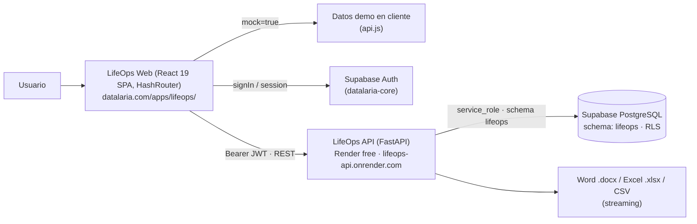

# Especificación Técnica SDD: LifeOps (`lifeops`)

> **ID de Especificación:** `SPEC-APP-LIFEOPS`
> **Versión de la Spec:** `1.1.1` (Actualizada el 2026-10-27 con Caché SWR, Pre-Warming y UX de Sincronización en Primer Plano)
> **Versión de la App documentada:** `v1.1.1` (ver §9 Historial Evolutivo)
> **Estado:** `APPROVED` — Hitos 1.1 a 1.6 activos/completados
> **Categoría SDD:** 🟢 Lista para documentar (App activa #1 de 7)
> **Código fuente actual:** [`lifeops-app/`](file:///c:/Users/dalae/OneDrive/Emprendiendo/datalaria/lifeops-app) (frontend) · [`lifeops-api/`](file:///c:/Users/dalae/OneDrive/Emprendiendo/datalaria/lifeops-api) (backend)
> **Código fuente objetivo (Hito 1.2):** `apps/lifeops/web/` · `apps/lifeops/api/`
> **Artefacto público:** [`static/apps/lifeops/`](file:///c:/Users/dalae/OneDrive/Emprendiendo/datalaria/static/apps/lifeops) → `https://datalaria.com/apps/lifeops/`
> **Ficha pública (Hito 1.4):** `/es/apps/lifeops/` · `/en/apps/lifeops/` (ver [`apps-showcase/spec.md`](file:///c:/Users/dalae/OneDrive/Emprendiendo/datalaria/specs/portal/apps-showcase/spec.md))

---

## 1. Propósito y Contexto de Negocio

### 1.1 Problema que resuelve
Unificar en un único "sistema operativo personal y profesional" información que normalmente vive dispersa en 5+ aplicaciones de suscripción: entrenamientos deportivos, lecturas, cine/series, proyectos y tareas Kanban, con capacidad de **cruzar datos y generar informes ejecutivos** (Word/Excel/CSV) a coste de infraestructura **0 €/mes**.

### 1.2 Público objetivo
- **Lector técnico del blog:** demostrador full-stack real (React + FastAPI + Supabase) documentado en una serie de 5 artículos.
- **Prosumer / profesional:** uso real autenticado para su propia gestión personal/profesional.

### 1.3 Respaldo editorial (Invariante `App ⇔ Post`, Constitución Art. 7)

| Parte | Slug (ES y EN comparten carpeta) | Fecha | Tema |
| :-: | :--- | :--- | :--- |
| 1 | `app-lifeops_part1_arquitectura_backend` | 2026-09-10 | Arquitectura cloud, modelo de datos y backend FastAPI |
| 2 | `app-lifeops_part2_frontend_dashboard` | 2026-09-13 | Frontend React + Dashboard |
| 3 | `app-lifeops_part3_modulos_kanban` | 2026-09-15 | Módulos interactivos y Kanban |
| 4 | `app-lifeops_part4_informes_word_excel` | 2026-09-18 | Motor de informes Word/Excel |
| 5 | `app-lifeops_part5_deploy_mobile_pwa` | 2026-09-19 | Despliegue 24/7, móvil y PWA |
| 6 | `app-lifeops_part6_analytics_dashboard_360` | 2026-10-27 | Dashboard 360°, Recharts y mitigación de cold-starts |

> Los 5 posts enlazan hoy directamente a `https://datalaria.com/apps/lifeops/`. En el **Hito 1.4** se añadirá en cada uno (ES y EN) un enlace a la **ficha pública** de la App, manteniendo el enlace directo a la App.

### 1.4 Estrategia Dual-Mode (Constitución Art. 3)

| Modo | Estado actual | Comportamiento |
| :--- | :--- | :--- |
| **Sandbox / Demo** | ✅ Implementado | `?mock=true` (query o hash) o `localStorage.lifeops_mock = 'true'` → usuario simulado `mock-user-datalaria`, datos de ejemplo deterministas en [`api.js`](file:///c:/Users/dalae/OneDrive/Emprendiendo/datalaria/lifeops-app/src/lib/api.js#L10-L315), sin llamadas a backend. |
| **Pro / Live** | ✅ Implementado | Login Supabase Auth (email+password) → JWT → API FastAPI en Render → Supabase schema `lifeops`. |
| **Upsell** | ❌ No aplica hoy | LifeOps no tiene producto vinculado en Lemon Squeezy. Su CTA de conversión es la **newsletter** y el enlace a la serie de posts. *(Decisión abierta D-LO-1, §10).* |

> ⚠️ **Gap de UX:** el modo demo existe pero no es descubrible: un visitante que entra en `/apps/lifeops/` aterriza en el login. La ficha pública (Hito 1.4) debe ofrecer el botón **"Probar demo"** → `/apps/lifeops/#/?mock=true`.

---

## 2. Arquitectura



### 2.1 Despliegue actual

| Pieza | Plataforma | Config | Notas |
| :--- | :--- | :--- | :--- |
| Frontend | Netlify (portal Hugo) | Build manual `vite build` → copia de `lifeops-app/dist/` a `static/apps/lifeops/` | `base: './'` en [`vite.config.js`](file:///c:/Users/dalae/OneDrive/Emprendiendo/datalaria/lifeops-app/vite.config.js) permite servir en subruta. `HashRouter` evita depender de reglas SPA. |
| Frontend (alt.) | Netlify site `datalaria-app-lifeops` | [`lifeops-app/netlify.toml`](file:///c:/Users/dalae/OneDrive/Emprendiendo/datalaria/lifeops-app/netlify.toml) | Aparece en CORS. *Verificar si sigue activo (D-LO-2).* |
| Backend | Render (plan free) | [`render.yaml`](file:///c:/Users/dalae/OneDrive/Emprendiendo/datalaria/lifeops-api/render.yaml) con `rootDir: lifeops-api`, Python 3.11.9 | Cold start ~30-50 s; el frontend implementa auto-retry con spinner. También hay `Dockerfile` y `Procfile`. |
| Base de datos | Supabase `datalaria-core` | [`supabase_schema.sql`](file:///c:/Users/dalae/OneDrive/Emprendiendo/datalaria/lifeops-api/supabase_schema.sql) | Schema `lifeops` — ya conforme con Constitución Art. 4. |

### 2.2 Manifiesto de archivos — Backend (`lifeops-api/`)

| Archivo | Responsabilidad |
| :--- | :--- |
| `main.py` | App FastAPI, rate-limit global SlowAPI (120/min), CORS, registro de routers, `/` y `/health`. Incluye monkey-patch IPv4 de `socket.getaddrinfo` (workaround Windows). |
| `config.py` | `Settings` (pydantic-settings): Supabase URL/keys/JWT secret, schema, host/puerto, CORS. |
| `middleware/auth.py` | Dependencia `get_current_user` → `AuthenticatedUser{id,email,role}` a partir del Bearer JWT. **Ver §6 Riesgo SEC-1.** |
| `services/supabase_client.py` | Cliente singleton con `service_role` (bypassa RLS) + helper `db(table)` sobre schema `lifeops`. |
| `models/activity.py`, `models/project.py` | Contratos Pydantic v2 de actividades (sport/book/film) y proyectos/tareas. |
| `routers/activities.py` | CRUD de actividades y sus detalles (workout/book/film). |
| `routers/projects.py` | CRUD de proyectos + `tasks_router` (CRUD tareas + comentarios JSONB). |
| `routers/stats.py` | Resumen de dashboard y desglose por tipo/fechas. |
| `routers/reports.py` | Plantillas, generación `.docx`, historial, exportación CSV y Excel. |
| `routers/alerts.py` | Alertas inteligentes calculadas al vuelo + descarte. |
| `services/report_generator.py` | Motor `python-docx` de informes ejecutivos. |
| `services/data_exporter.py` | Exportación CSV (UTF-8 BOM) y libro Excel (`openpyxl`). |
| `services/alerts_evaluator.py` | Reglas: deadlines de tareas, inactividad deportiva, bienvenida, etc. |

### 2.3 Manifiesto de archivos — Frontend (`lifeops-app/src/`)

| Ruta | Responsabilidad |
| :--- | :--- |
| `App.jsx` | `HashRouter`, code-splitting por ruta (`lazy`), rutas protegidas. |
| `context/AuthContext.jsx` | Sesión Supabase, signIn/signUp/signOut/reset/update password, bypass mock. |
| `context/LanguageContext.jsx` + `i18n/locales/{es,en}.js` | i18n por diccionario (✅ conforme Art. 5): `?lang=` → `localStorage.lifeops_language` → idioma navegador. |
| `lib/supabase.js` | Cliente Supabase JS (env `VITE_SUPABASE_*`, fallback de URL hardcodeado). |
| `lib/api.js` | `apiFetch` con inyección de JWT, datos mock y fachada `api.*` de todos los endpoints. |
| `pages/` | `LoginPage`, `DashboardPage` (también `/stats`), `PersonalPage`, `ProfessionalPage`, `ReportsPage`, `SettingsPage`. |
| `components/Personal/` | `SportModule`, `BooksModule`, `FilmsModule`. |
| `components/Professional/` | `KanbanBoard` (bitácora de comentarios), `ProjectsManager`. |
| `components/Layout/` | `MainLayout`, `Sidebar`, `Header`, `BottomNav` (móvil). |
| `components/Dashboard/` | `StatWidget` (KPI con badge `trend` $\Delta\%$), `QuickActions`, `SystemHealth`, `AnalyticsDashboard` (barra de filtros, gráfico temporal multimétrica, donut de subcategorías y mapa de calor de consistencia). |
| `lib/analyticsEngine.js` | Motor determinista puro en cliente para filtrado jerárquico (categoría/subcategoría), ventanas temporales (`week`, `month`, `year`), cálculo de deltas ($\Delta$ y $\Delta\%$) frente al periodo anterior, series temporales y matriz de consistencia diaria. |
| `components/Notifications/` | `NotificationDrawer` (alertas). |
| `components/common/` | `Modal` (bottom-sheet en móvil vía `createPortal`), `LanguageSwitcher`. |

### 2.4 Rutas de la SPA

| Hash route | Página | Protegida |
| :--- | :--- | :-: |
| `#/login` | Login / registro / recuperación | No |
| `#/` y `#/stats` | Dashboard | Sí |
| `#/personal` | Deporte · Lecturas · Cine | Sí |
| `#/professional` | Proyectos · Kanban | Sí |
| `#/reports` | Informes y exportaciones | Sí |
| `#/settings` | Ajustes de cuenta | Sí |
| `*` | Redirección a `#/` | — |

---

## 3. Contratos de Datos

### 3.1 Base de datos — `datalaria-core`, schema `lifeops`

| Dominio | Tabla | Clave / relación | En uso por la API |
| :--- | :--- | :--- | :-: |
| Personal | `activities` | `user_id → auth.users` · `activity_type ∈ {sport, book, film, learning, journal}` | ✅ |
| Personal | `workouts` | `activity_id → activities` (CASCADE) | ✅ |
| Personal | `books` | `activity_id → activities` · `status ∈ {reading, completed, wishlist, abandoned}` | ✅ |
| Personal | `films` | `activity_id → activities` · `media_type ∈ {movie, series, documentary, anime}` | ✅ |
| Personal | `habits`, `habit_logs` | `user_id` / `habit_id` | ❌ Modelado, sin endpoints ni UI |
| Profesional | `projects` | `user_id` · `status ∈ {planning, active, on_hold, completed, cancelled}` | ✅ |
| Profesional | `tasks` | `project_id → projects` (SET NULL) · `status ∈ {backlog, todo, in_progress, review, done, cancelled}` · `comments JSONB` | ✅ |
| Transversal | `generated_reports` | `user_id` · `metadata JSONB` | ✅ (historial) |
| Transversal | `report_templates` | `user_id` | ❌ Plantillas hardcodeadas en `reports.py` |
| Transversal | `alert_rules`, `alert_log` | `user_id` | ❌ Alertas calculadas al vuelo |

**RLS:** activado en las 12 tablas; políticas `auth.uid() = user_id` (o vía padre en tablas hijas). Trigger `update_updated_at` en `activities`, `projects`, `tasks`.

> ⚠️ Como la API usa `service_role`, **RLS no protege las peticiones del backend**; el aislamiento depende al 100% de que `get_current_user` sea fiable y de que cada query filtre por `user_id` (ver SEC-1).

### 3.2 API REST (prefijo `/api/v1`, todas requieren `Authorization: Bearer <JWT>` salvo indicación)

| Recurso | Endpoints |
| :--- | :--- |
| Sistema | `GET /` · `GET /health` *(públicos)* |
| Activities | `GET /activities/?activity_type=` · `GET /activities/details?activity_type=&date_from=&date_to=&limit=` *(hasta 1000 registros con detalle embebido para motor analítico)* · `GET /activities/{id}` · `POST /activities/` · `POST /activities/{sport,book,film}` · `PATCH /activities/{id}` · `PATCH /activities/{id}/{sport,book,film}` · `DELETE /activities/{id}` · `GET /activities/{id}/{workout,book,film}` |
| Projects | `GET /projects/?status=` · `GET /projects/{id}` · `POST /projects/` · `PATCH /projects/{id}` · `DELETE /projects/{id}` · `GET /projects/{id}/tasks` |
| Tasks | `GET /tasks/?status=&project_id=` · `GET /tasks/{id}` · `POST /tasks/` · `PATCH /tasks/{id}` · `DELETE /tasks/{id}` · `POST /tasks/{id}/comments` · `DELETE /tasks/{id}/comments/{comment_id}` |
| Stats | `GET /stats/dashboard` · `GET /stats/breakdown?date_from=&date_to=` |
| Reports | `GET /reports/templates` · `POST /reports/generate` *(body: `template_type ∈ {monthly_summary, sport_performance, project_status}`, `date_from`, `date_to` → stream `.docx`)* · `GET /reports/history` · `GET /reports/export/csv?entity=` · `GET /reports/export/excel` |
| Alerts | `GET /alerts/` · `POST /alerts/{alert_id}/dismiss` |

Contrato fuente de verdad ejecutable: OpenAPI autogenerado en `/docs` y `/redoc`. **Hito 1.2** exportará un snapshot versionado a `specs/apps/lifeops/openapi.json` para detectar cambios de contrato.

### 3.3 Variables de entorno

| Ámbito | Variable | Obligatoria |
| :--- | :--- | :-: |
| API | `SUPABASE_URL`, `SUPABASE_ANON_KEY`, `SUPABASE_SERVICE_ROLE_KEY` | ✅ |
| API | `SUPABASE_JWT_SECRET` | ✅ *(pasa a obligatoria tras SEC-1)* |
| API | `SUPABASE_SCHEMA` (def. `lifeops`), `CORS_ORIGINS`, `API_HOST`, `API_PORT` | Opcional |
| Web | `VITE_SUPABASE_URL`, `VITE_SUPABASE_ANON_KEY`, `VITE_API_URL` | ✅ |

---

## 4. Lógica de Dominio e Invariantes

> LifeOps no es un motor cuantitativo; sus invariantes son de **aislamiento, integridad y formato**.

| ID | Invariante | Verificación (Hito 1.2) |
| :--- | :--- | :--- |
| INV-1 | Ninguna petición autenticada puede leer/escribir filas de otro `user_id`. | Test con dos usuarios y token falsificado → `401`. |
| INV-2 | Un JWT con firma inválida o expirado devuelve `401`. | `pytest` sobre `get_current_user`. |
| INV-3 | Borrar una actividad elimina en cascada su detalle (workout/book/film). | Garantizado por FK `ON DELETE CASCADE`. |
| INV-4 | Borrar un proyecto no borra sus tareas (`project_id → NULL`). | FK `ON DELETE SET NULL`. |
| INV-5 | Los comentarios de tarea se persisten como array JSONB ordenado cronológicamente con `id`, `text`, `created_at`. | Test de contrato del endpoint de comentarios. |
| INV-6 | La exportación CSV usa UTF-8 con BOM (apertura correcta en Excel). | Test que verifique los 3 primeros bytes `EF BB BF`. |
| INV-7 | El modo `mock=true` nunca realiza peticiones de red a la API ni a Supabase. | Revisión de `api.js` / `AuthContext.jsx`. |
| INV-8 | El cálculo de variación porcentual ($\Delta\%$) entre el periodo actual ($V_{\text{curr}}$) y el anterior ($V_{\text{prev}}$) es determinista y seguro ante división por cero: si $V_{\text{prev}} = 0$ y $V_{\text{curr}} > 0$ devuelve $+100\%$ (nuevo impulso); si ambos son $0$ devuelve $0\%$; en caso general $\text{round}\left(\frac{V_{\text{curr}} - V_{\text{prev}}}{V_{\text{prev}}} \times 100\right)$. | Test unitario sobre la lógica de agregación y validación de esquemas en `pytest`. |
| INV-9 | El filtro de `GET /api/v1/activities/details` respeta simultáneamente `user_id`, `activity_type`, `date_from` y `date_to` e inyecta los sub-objetos `workout`, `book` y `film`. | Test en `apps/lifeops/api/tests/test_auth.py`. |
| INV-10 | La caché local *Stale-While-Revalidate* (`localStorage`) está aislada por `user_id` (`lifeops_swr_v2:<user_id>:<endpoint>`), se invalida automáticamente tras mutaciones (`POST`/`PATCH`/`DELETE`) y se purga al cerrar sesión (`signOut`). Mientras no existan datos ni en caché ni del servidor, la UI muestra el banner de sincronización en primer plano y skeletons en lugar de valores `0` engañosos. | Revisión de `api.js` y `DashboardPage.jsx` + `npm run lint`. |
| INV-11 | **Aislamiento Estricto Anti-Contaminación de Datos Sintéticos / Seeder Guard:** Cualquier script de carga, benchmarking o generación de datos de prueba tiene terminantemente prohibido insertar datos en cuentas reales de usuario (como `dalaez1@gmail.com`). La inserción está acotada por lista blanca exclusiva a cuentas demo autorizadas (`datalaria@gmail.com`). Todo script de seeding debe validar el objetivo mediante `validate_synthetic_seed_target` y la base de datos es auditada contra firmas sintéticas. | Suite de tests automatizada en `apps/lifeops/api/tests/test_data_isolation.py` (`pytest`). |

### 4.1 Especificación del Motor Analítico 360° (`v1.1.0` — ADR-013)
1. **Dimensiones de Filtrado en Cascada:**
   - **Rango Temporal (`period`):** `week` (últimos 7 días / semana actual vs. 7 días previos), `month` (últimos 30 días / mes seleccionado vs. 30 días previos), `quarter` (últimos 90 días vs. 90 días previos), `year` (año seleccionado / últimos 12 meses vs. año previo).
   - **Categoría Principal (`category`):** `all` (Vista 360°), `sport`, `book`, `film`, `tasks`.
   - **Subcategoría (`subcategory`):**
     - En `sport`: `all`, `running`, `cycling`, `gym`, `swimming`, `hiking`, `crossfit`, `other`.
     - En `book`: `all`, `completed`, `reading`, `wishlist`.
     - En `film`: `all`, `movie`, `series`, `documentary`, `anime`.
     - En `tasks`: `all` o filtrado por `project_id` / estado (`done`, `in_progress`, `todo`).
   - **Métrica Activa del Gráfico Temporal (`metric`):**
     - `count` (nº de actividades/sesiones), `distance_km` (km recorridos), `calories` (kcal quemadas), `duration_hours` (horas dedicadas), `pages_read` (páginas leídas).
2. **Los 4 Bloques Visuales del Dashboard 360°:**
   - **Bloque 1 — Tarjetas KPI Dinámicas con Comparativa ($\Delta\%$):** 4 widgets que adaptan sus métricas a la categoría/subcategoría activa (ej. en *Deporte → Carrera*: Sesiones, Kilómetros totales, Tiempo/Ritmo medio y Calorías/FC media) mostrando la flecha de tendencia y el porcentaje respecto al periodo anterior.
   - **Bloque 2 — Gráfico de Evolución Temporal Multimétrica (`Recharts ComposedChart`):** Barras del periodo actual agrupadas por día (en vista semanal/mensual) o por mes (en vista anual) + línea/área comparativa del periodo anterior.
   - **Bloque 3 — Gráfico Donut de Subcategorías (`Recharts PieChart`):** Desglose porcentual y absoluto por subcategoría (tipos de deporte, géneros/estados de lectura, plataformas/formatos de cine o estado de proyectos).
   - **Bloque 4 — Mapa de Calor de Consistencia Diaria (Estilo Strava/GitHub):** Matriz visual de actividad diaria con cálculo de días activos, racha actual (*current streak*) y mejor racha (*best streak*).

---

## 5. Requisitos No Funcionales

| Área | Estado | Detalle |
| :--- | :-: | :--- |
| i18n ES/EN | ✅ | Diccionarios únicos; quedan literales sueltos en español (`"Cargando LifeOps..."` en `App.jsx`, `ProtectedRoute.jsx`, mensajes de error en `api.js`). |
| Responsive / móvil | ✅ | Bottom nav, modales bottom-sheet 92dvh (agosto 2026). |
| Rendimiento | ✅ | Code-splitting por ruta + chunks `vendor-react`, `vendor-supabase`, `vendor-icons`, `vendor-libs`. |
| Rate limiting | ✅ | 120 req/min por IP (SlowAPI). |
| Coste | ✅ | 0 €/mes (Render free + Supabase free + Netlify). |
| Firewall `static/` (Art. 2) | ✅ | `static/apps/lifeops/` solo contiene bundle compilado. *(El `_redirects` interno es inocuo: Netlify solo lee el de la raíz.)* |
| Shell Datalaria (Art. 5.2) | ⚠️ | No hay enlace visible de "volver a Datalaria" ni a la ficha de la App. |
| Tipado frontend | ⚠️ | JSX sin TypeScript. *No se migra a TS en este ciclo (no aporta valor inmediato).* |

---

## 6. Deuda Técnica y Riesgos Registrados

| ID | Severidad | Descripción | Resolución planificada |
| :--- | :-: | :--- | :--- |
| **SEC-1** | 🔴 Crítica | `get_current_user` acepta tokens **sin verificar firma** (paso 2: `verify_signature: False`) y el backend opera con `service_role`. Un JWT forjado con un `sub` ajeno da acceso a datos de otro usuario. | **Hito 1.2:** verificar firma siempre (HS256 con `SUPABASE_JWT_SECRET` o JWKS para ES256); eliminar el paso sin firma; fail-fast si falta el secreto. |
| SEC-2 | 🟠 Alta | `python-jose` sin mantenimiento activo. | Hito 1.2: migrar a `PyJWT[crypto]` (ya contemplado como fallback en el código). |
| OPS-1 | 🟠 Alta | Doble copia manual del build (`lifeops-app/dist/` ↔ `static/apps/lifeops/`): riesgo de publicar una versión distinta a la del código. | Hito 1.2: script único `build:portal` que compila y sincroniza. |
| OPS-2 | 🟡 Media | `render.yaml` usa `rootDir: lifeops-api`; mover carpetas rompe el despliegue si no se actualiza Render a la vez. | Hito 1.2: mover + actualizar `rootDir` + verificar `/health` en Render. |
| QA-1 | 🟡 Media | 0 tests (ni `pytest` ni frontend). | Hito 1.2: suite mínima `pytest` (INV-1, 2, 5, 6 + `/health`) con cliente Supabase simulado. |
| DOM-1 | 🟢 Baja | Tablas `habits`, `habit_logs`, `report_templates`, `alert_rules`, `alert_log` modeladas pero sin uso. | Backlog evolutivo (v1.x): o se implementan o se documentan como reservadas. |
| UX-1 | 🟢 Baja | Modo demo no descubrible desde la entrada de la App. | Hito 1.4 (botón "Probar demo" en la ficha) + v1.1 (enlace "Ver demo" en `LoginPage`). |
| UX-2 | 🟢 Baja | Literales en español fuera del diccionario i18n. | Backlog v1.1. |
| CODE-1 | 🟢 Baja | Monkey-patch IPv4 global en `main.py` (solo útil en Windows local). | Hito 1.2: limitarlo a entorno local (`if os.name == "nt"`). |

---

## 7. Plan de Aislamiento (Hito 1.2) — Estructura Objetivo

```text
apps/lifeops/
├── web/        ← lifeops-app/   (sin dist/ ni node_modules/ versionados)
├── api/        ← lifeops-api/   (+ tests/)
│   ├── services/
│   │   └── seeder_guard.py     (INV-11: Guardia y detección de fugas sintéticas)
│   └── tests/
│       ├── test_health.py
│       ├── test_auth.py        (INV-1, INV-2, INV-9)
│       └── test_data_isolation.py (INV-11: Seeder guard y aislamiento multitenant)
└── README.md   → enlaza a esta spec
```

**Reglas del movimiento (un único hito, con checkpoint `sdd-checkpoint-pre-1.2`):**
1. Mover con `git mv` para conservar historial.
2. Actualizar `rootDir` en `render.yaml` **y** en el dashboard de Render (`apps/lifeops/api`).
3. Script `npm run build:portal` en `apps/lifeops/web` = `vite build` + sincronizar `dist/` → `static/apps/lifeops/` (borrando hashes antiguos).
4. Aplicar SEC-1, SEC-2 y CODE-1. **No** se cambia ninguna funcionalidad visible.

---

## 8. Criterios de Aceptación (Verification Gates)

```powershell
# Frontend
cd apps/lifeops/web; npm ci; npm run lint; npm run build:portal

# Backend
cd apps/lifeops/api; pytest -v

# Portal
hugo --gc --minify
```

- [ ] `npm run lint` y `npm run build:portal` terminan con código `0`.
- [ ] `pytest` en verde, incluyendo el test de token forjado → `401`.
- [ ] `hugo --gc --minify` con código `0`; `public/apps/lifeops/` sin `.py`, `.env` ni `.sql`.
- [ ] `https://datalaria.com/apps/lifeops/#/?mock=true` carga el dashboard demo sin peticiones a la API.
- [ ] `GET https://lifeops-api.onrender.com/health` → `200` tras el redespliegue.
- [ ] Login real + creación/edición/borrado de una tarea funcionan en producción.

---

## 9. Historial Evolutivo (Changelog)

> Versionado **SemVer**. La fuente de verdad pública de esta tabla es `data/apps/lifeops.yaml` (ver `apps-showcase/spec.md`); esta sección y ese fichero deben mantenerse sincronizados en cada release. Versiones anteriores a v1.0.0 reconstruidas desde el historial de Git.

| Versión | Fecha | Tipo | Cambios | Commit(s) |
| :--- | :--- | :--- | :--- | :--- |
| `v0.1.0` | 2026-08-29 | 🚀 Lanzamiento | Integración inicial: React + FastAPI + Supabase, multilenguaje ES/EN, motor de informes y seguridad básica. | `35efa03` |
| `v0.2.0` | 2026-08-29 | ☁️ Infra | Backend 24/7 en Render, auto-retry ante cold start, endpoint de producción en el build. | `680a94f`, `8a7fda5`, `864afef`, `14f2122` |
| `v0.3.0` | 2026-08-30 | ✨ Feature | Bitácora de comentarios con marca temporal en tareas Kanban (JSONB). | `98fa66c` |
| `v0.4.0` | 2026-08-31 | 📱 UX | Rediseño responsive completo: bottom nav, modales bottom-sheet, gestos táctiles. | `b41157c`, `a8dfc35`, `813aec0`, `86794ba` |
| `v1.0.0` | 2026-09-19 | 📚 Publicación | Versión publicada con la serie de 5 artículos (13-19 sept). Estado documentado por esta spec. | `4c033f6` … `1415ae8` |
| `v1.0.1` | 2026-10-24 | 🔒 Seguridad | SEC-1 (verificación de firma JWT), PyJWT, tests, aislamiento en `apps/lifeops/`, build reproducible. | Hito 1.2 |
| `v1.1.0` | 2026-10-27 | 📊 Feature | Motor Analítico 360° interactivo: filtros por año/mes/semana, comparativa $\Delta\%$ contra periodo anterior, drill-down por subcategorías (running, ciclismo, fuerza, géneros, plataformas), selector de métrica (km, kcal, horas, sesiones), gráfico Donut y mapa de calor de consistencia diaria. | Hito 1.5 |
| `v1.1.1` | 2026-10-27 | ⚡ Perf & UX | Mitigación de latencia y cold-start de Render: (1) Pre-warming automático de `/health` al abrir la app, (2) Caché instantánea *Stale-While-Revalidate* en cliente aislada por `user_id`, (3) Tarjeta visual en primer plano con contador de progreso y skeletons durante la carga inicial para evitar mostrar datos a cero. | Hito 1.6 |

---

## 10. Decisiones Abiertas

| ID | Pregunta | Propuesta por defecto |
| :--- | :--- | :--- |
| D-LO-1 | ¿Se vincula LifeOps a algún producto de pago? | No por ahora; CTA = newsletter + serie de posts. |
| D-LO-2 | ¿Sigue activo el site Netlify `datalaria-app-lifeops`? | Si no se usa, retirarlo de CORS y eliminar `lifeops-app/netlify.toml` en el Hito 1.2. |
| D-LO-3 | ¿Se habilita registro abierto (`signUp`) para cualquier visitante? | Mantener el comportamiento actual; revisar cuotas de Supabase si crece el uso. |
