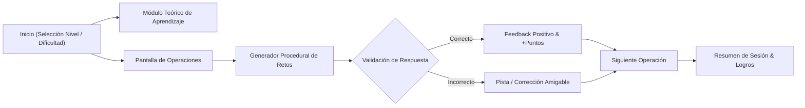

# SPEC-APP-MATHS: Matemáticas Interactivas (Entrenamiento de Cálculo Mental)

> **Identificador:** `SPEC-APP-MATHS`  
> **Versión:** `v1.0.0` (Estado: `frozen` / Legacy)  
> **Fecha:** `2025-09-11` (Congelación: `2026-10-25`)  
> **Clasificación:** Tier `lab` | Educational & Cognitive Game  
> **Ruta Canónica:** `https://datalaria.com/apps/maths/`  
> **Ficha Técnica:** `https://datalaria.com/es/apps/maths/` (EN: `/en/apps/maths/`)

---

## 1. RESUMEN EJECUTIVO Y PROPÓSITO

**Matemáticas Interactivas** es una aplicación educativa gamificada concebida para el entrenamiento del cálculo mental y las cuatro operaciones aritméticas elementales (sumas, restas, multiplicaciones y divisiones) en niños de infantil y primaria.

El proyecto representa un hito fundamental en el aprendizaje tecnológico del ecosistema:
1. **Pair-Programming con IA:** Nació y se desarrolló íntegramente mediante ingeniería de instrucciones (*Prompt Engineering*) y diálogo iterativo con ChatGPT, aplicando los principios del curso de IA e Innovación de Founderz.
2. **Pedagogía Progresiva Adaptativa:** Ofrece 4 niveles escolares (Infantil 1 y 2, Primaria 1 y 2) con dos grados de dificultad (1 dígito para conceptos iniciales, 2 dígitos para retos avanzados).
3. **Ciclo de Feedback Inmediato:** Proporciona explicaciones teóricas visuales previas, validación reactiva instantánea de respuestas, puntuación dinámica y refuerzo motivador con emoticonos y sonidos.
4. **Portabilidad Total:** Empaquetada como una aplicación web autocontenida que corre sin conexión en cualquier navegador, con despliegue bilingüe en español e inglés.

---

## 2. ARQUITECTURA DEL SISTEMA

La aplicación funciona como una SPA (*Single Page Application*) estática y reactiva en memoria del cliente:

### Componentes Principales:
- **Generador Procedural de Retos:** Algoritmo determinista que produce expresiones aritméticas pseudoaleatorias acotadas rigurosamente al nivel educativo y la dificultad elegida.
- **Módulo de Tutoría y Aprendizaje:** Pantallas interactivas con representaciones gráficas del significado de cada operación matemática antes de iniciar la práctica.
- **Motor de Gamificación:** Temporizador de rondas, marcador acumulativo de aciertos y rachas, y feedback visual/auditivo amigable.

---

## 3. STACK TECNOLÓGICO

- **Motor Frontend:** Vanilla JavaScript, HTML5, CSS3.
- **Diseño & Animaciones:** CSS Flexbox, efectos visuales de feedback y diseño adaptativo.
- **Copilotaje de IA:** ChatGPT (OpenAI) y metodología Prompt Engineering (Founderz).
- **Alojamiento:** Directorio estático de Hugo en `/apps/maths/`.

---

## 4. ARTÍCULOS TÉCNICOS ASOCIADOS

| Idioma | Título del Post | Slug Canónico |
| :--- | :--- | :--- |
| **ES** | *Copilotando con IA: Aprendiendo con Founderz y ChatGPT* | `content/es/posts/founderz-programando-chatGPT/index.md` |
| **EN** | *Co-piloting with AI: Learning with Founderz and ChatGPT* | `content/en/posts/founderz-coding-chatGPT/index.md` |

---

## 5. HISTORIAL DE VERSIONES Y ESTADO DE CONGELACIÓN

- **`v1.0.0` (2025-09-11) — [ESTADO FINAL CONGELADO]:**
  - Implementación de las 4 operaciones (suma, resta, multiplicación, división) y los 4 niveles educativos.
  - Sistema de dificultad configurable (1 y 2 dígitos) y pantalla didáctica de aprendizaje previo.
  - Refuerzo positivo con emoticonos, sonidos y resumen estadístico de la sesión.
  - Paridad bilingüe completa con versiones en `/es/` e `/en/`.
  - Estado congelado como proyecto educativo y testimonio de desarrollo acelerado con IA.
- **`v0.5.0` (2025-09-05):**
  - Adición de temporizador interactivo y operaciones de multiplicación y división.
- **`v0.1.0` (2025-08-28):**
  - Primer prototipo de sumas y restas generado en una única sesión de pair-programming con ChatGPT.
