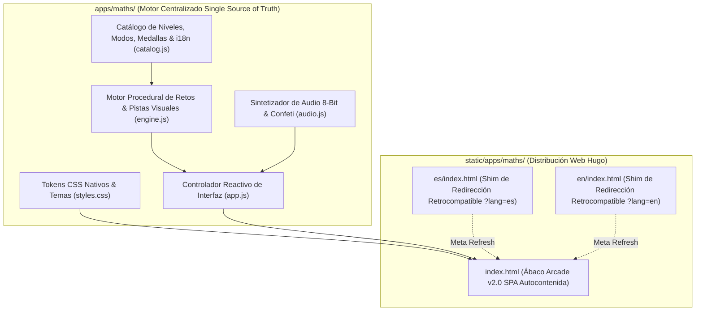

# SPEC-APP-MATHS: Matemáticas Interactivas ("Ábaco Arcade v2.0")

> **Identificador:** `SPEC-APP-MATHS`  
> **Versión:** `v2.1.0` (Estado: `active`)  
> **Fecha:** `2026-11-05`  
> **Clasificación:** Tier `lab` | Educational & Cognitive Game  
> **Ruta Canónica:** `https://datalaria.com/apps/maths/`  
> **Ficha Técnica:** `https://datalaria.com/es/apps/maths/` (EN: `/en/apps/maths/`)  
> **Especificación de Diseño:** [`specs/apps/maths/design.md`](file:///c:/Users/dalae/OneDrive/Emprendiendo/datalaria/specs/apps/maths/design.md)

---

## 1. RESUMEN EJECUTIVO Y PROPÓSITO

**Ábaco Arcade v2.0** es la evolución integral de la aplicación educativa gamificada de cálculo mental de Datalaria. Conservando la génesis del proyecto como caso de estudio de *Pair-Programming con IA* (nacido en ChatGPT y Founderz), la versión 2.0 supera el estado *frozen* erradicando el *contract drift* histórico y extendiendo su disfrute tanto a **niños de 5 a 11 años** como a **jóvenes y adultos** que buscan agilidad mental mediante una experiencia lúdica, visual e intuitiva.

### 1.1 Objetivos Clave de la Versión 2.0.0:
1. **Inclusión Total (Niños y Adultos):** 6 niveles adaptativos que cubren desde el conteo y sumas básicas de 1 dígito hasta retos de agilidad para adultos (operaciones combinadas, incógnitas y cálculo rápido de porcentajes).
2. **Cierre de Contract Drift de Audio y Gamificación:** Implementación de síntesis nativa de audio con Web Audio API (cero dependencias de red), racha con combo multiplicador (`🔥 x2, x3, x5`), confeti físico y 6 medallas coleccionables.
3. **Didáctica Visual (Manipulador Matemático):** Pistas visuales dinámicas con objetos tangibles (manzanas, estrellas, cuadrículas de multiplicación y reparto en cajas con resto) para afianzar el razonamiento abstracto sin frustración.
4. **Ergonomía Táctil en Tablet y Móvil:** Numpad arcade en pantalla con relieve 3D que previene que el teclado nativo tape la interfaz, manteniendo paridad con teclado físico de PC.
5. **Arquitectura Single-Source-of-Truth:** Unificación del código en `/apps/maths/`, eliminación de la duplicación `es/` y `en/`, purga de dependencias externas (`cdn.tailwindcss.com`) y shims retrocompatibles con cero rotura de enlaces SEO.
6. **Shell Datalaria:** Barra superior institucional con la Tríada Canónica de enlaces (`Ficha App`, `Post Historia IA`, `Kits B2B`) y conmutador `ES | EN`.

---

## 2. ARQUITECTURA DEL SISTEMA

### Componentes Principales:
- **`catalog.js`:** Contratos de los 6 niveles, 3 modos de juego, 6 medallas, contenido didáctico y diccionario bilingüe unificado `ES / EN`.
- **`engine.js`:** Generador puramente determinista de retos aritméticos acotados, evaluador estricto de respuestas y generador de datos para el manipulador visual.
- **`audio.js`:** Motor sintetizador procedural mediante Web Audio API (frecuencias sinusoidales para efectos `success`, `combo`, `streak`, `hint`, `error`, `game_over`) y sistema de partículas confeti en `<canvas>`.
- **`build.py`:** Generador del bundle `index.html` estático y de los shims de redirección retrocompatibles.

---

## 3. CATÁLOGO DE NIVELES Y MODOS DE JUEGO

### 3.1 Niveles Adaptativos
1. **Nivel 1 · Explorador (Infantil 1 · 5–6 años):** Sumas sencillas $a + b \le 10$ con manipulador visual automático.
2. **Nivel 2 · Aventurero (Infantil 2 · 6–7 años):** Sumas y Restas garantizando $a - b \ge 0$.
3. **Nivel 3 · Cadete (Primaria 1 · 7–9 años):** Sumas, Restas y Tablas de Multiplicar ($2 \times 2$ hasta $9 \times 9$).
4. **Nivel 4 · Maestro (Primaria 2 · 9–11 años):** 4 operaciones completas, incluyendo división entera con cociente $q$ y resto $r$.
5. **Nivel 5 · Cerebro Ágil (Secundaria y Adultos):** Jerarquía de operaciones combinadas ($a + b \times c$), ecuaciones con incógnita ($a + ? = c$).
6. **Nivel 6 · Leyenda Cuántica (Reto Adultos Pro):** Cálculo rápido de porcentajes, potencias cuadradas y aritmética avanzada con límite de tiempo.

### 3.2 Modos de Juego
- **Modo Zen:** Sin temporizador. Aprendizaje tranquilo, pistas visuales ilimitadas.
- **Modo Clásico (10 Rondas):** 10 preguntas con cuenta atrás dinámica (10s por pregunta), puntos según velocidad y combo racha multiplicador.
- **Modo Contrarreloj (60s Time Attack):** Reto continuo de 1 minuto para adultos o retos familiares. Cada racha de 5 aciertos añade $+3\text{ segundos}$ extra.

---

## 4. INVARIANTES DE DOMINIO (`INV-MATHS-*`)

- **`INV-MATHS-1` (Rigor Aritmético y Cero División por Cero):** Todo reto generado tiene solución matemática exacta en números enteros. En niveles 1–4 nunca se producen restas negativas. En divisiones, $b \ge 1$ y $a = b \cdot q + r$ con $0 \le r < b$.
- **`INV-MATHS-2` (Cierre Completo de Contract Drift):** La aplicación incluye sonido real nativo sintetizado con Web Audio API, explicaciones didácticas con manipuladores visuales, 6 niveles para niños y adultos y 3 modos de juego.
- **`INV-MATHS-3` (Cero Dependencias Externas en Runtime):** Queda terminantemente prohibido cargar librerías o CDNs de terceros (`cdn.tailwindcss.com`, fuentes web bloqueantes). Todo el CSS y los iconos SVG son nativos y autocontenidos.
- **`INV-MATHS-4` (Retrocompatibilidad 100% de Rutas):** Las URLs históricas `/apps/maths/es/index.html` y `/apps/maths/en/index.html` deben redirigir a `/apps/maths/?lang=es` y `?lang=en` con meta-refresh; eliminación de archivos huérfanos (`index_backup.html`).
- **`INV-MATHS-5` (Inmunidad XSS):** Ninguna entrada del usuario ni dato de `localStorage` o `URLSearchParams` se renderiza sin sanitización en el DOM.
- **`INV-MATHS-6` (Paridad Bilingüe Total ES ⇔ EN):** La totalidad de textos, botones, explicaciones y medallas existe en ambos idiomas sin omisión alguna.
- **`INV-MATHS-7` (Tríada de Enlaces Datalaria):** La cabecera superior integra los tres accesos directos al ecosistema: Ficha de la App (`/apps/maths/`), Historia IA (`/posts/founderz-.../`) y Recursos B2B (`/recursos/`).
- **`INV-MATHS-8` (PWA 100% Offline, Iconos Adaptativos y Actualización Reactiva):** La aplicación debe contar con `manifest.json`, batería completa de iconos SVG y PNG adaptativos (maskable 192/512 para Android e iOS) y un Service Worker (`sw.js`) con estrategia Cache-First/Stale-While-Revalidate que precachee todos sus activos, permitiendo instalación en pantalla de inicio, ejecución 100% offline y actualización reactiva in-app mediante banner flotante `[ 🔄 Actualizar ahora ]` y botón interactivo `#btn-check-update` sin necesidad de desinstalar.
- **`INV-MATHS-9` (Persistencia de Tema Anti-FOUC, Sonido y Atajos de Teclado):** La aplicación debe persistir el tema (`pref-theme`) y sonido (`maths-sound`) en `localStorage`, ejecutando un micro-script inline en `<head>` para evitar destellos (FOUC), y ofrecer atajos rápidos de teclado (`T` para alternar tema, `M` para silenciar/activar audio, `H` para conmutar pista visual).

---

## 5. HISTORIAL DE VERSIONES Y EVOLUCIÓN

- **`v2.1.0` (2026-11-05) — [ESTADO: ACTIVO — PWA OFFLINE & FEEDBACK FORMATIVO]:**
  - **PWA Offline e Instalable (`INV-MATHS-8`):** `manifest.json`, Service Worker `sw.js` y botón `📲 Instalar App` con soporte para instalación nativa en tablets, móviles (iOS/Android) y escritorio.
  - **Feedback Formativo y Didáctico:** Banner animado tras responder que muestra refuerzo positivo inmediato al acertar o solución correcta durante 1.8s (con botón `Siguiente ➔` opcional) al fallar o acabarse el tiempo, antes de avanzar de ronda.
  - **Corrección de Localización y Paridad:** Localización dinámica de expresiones numéricas (`% of` en inglés) y erradicación de `window.confirm()` nativo reemplazado por toasts y confirmaciones visuales integradas.
  - **Persistencia Anti-FOUC y Atajos (`INV-MATHS-9`):** Persistencia en `localStorage` del tema Daylight/Cosmic Night y estado de sonido, script inline anti-FOUC y atajos de teclado `T`, `M`, `H`.
- **`v2.0.0` (2026-11-05) — [SUPERSEDED]:**
  - **Evolución Multigeneracional:** Ampliación del rango didáctico de 4 niveles infantiles a 6 niveles adaptativos (Infantil a Reto Mental de Adultos con porcentajes y combinadas).
  - **Sintetizador Web Audio & Confeti:** Cierre de drift histórico de sonido mediante sintetizador nativo procedural de 8-bit y motor de confeti en Canvas.
  - **Manipulador Visual Interactivo:** Pistas visuales con objetos agrupables y reparto matricial/cajas para comprensión tangible de los conceptos.
  - **Numpad Arcade Táctil:** Teclado táctil en pantalla 3D que resuelve la fricción de pantallas táctiles en tablets y móviles.
  - **3 Modos de Juego y Medallas:** Modos Zen, Clásico 10 Rondas y Contrarreloj 60s, con 6 medallas y persistencia local de récords.
  - **Arquitectura Single-Source-of-Truth:** Código fuente unificado en `/apps/maths/`, empaquetado estático sin CDNs externos y shims de redirección SEO en `/es/` y `/en/`.
- **`v1.0.0` (2025-09-11) — [LEGACY FROZEN]:**
  - Prototipo funcional inicial generado con ChatGPT/Founderz con 4 operaciones en HTML monolítico separado en `/es/` y `/en/`.
