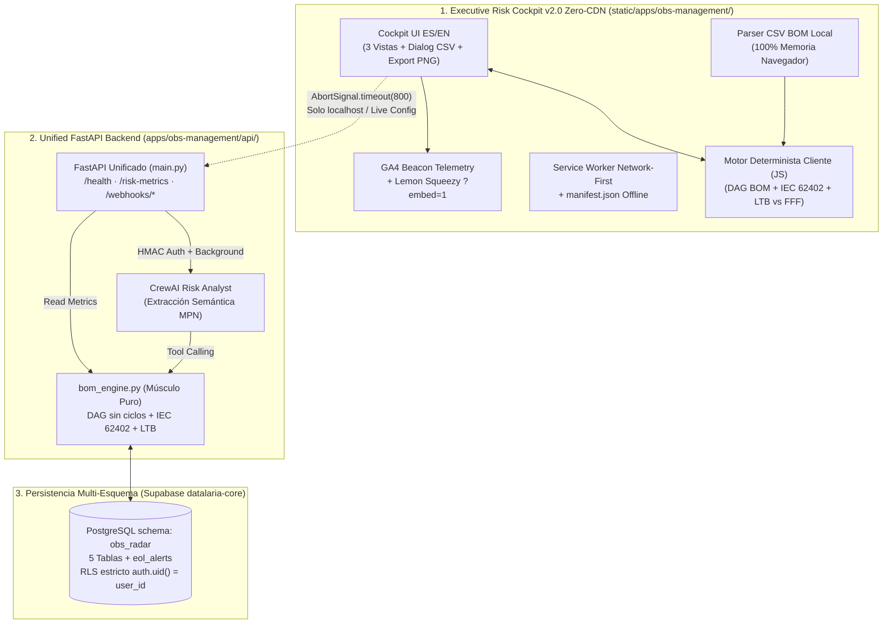

# Especificación Técnica SDD: Agentic Radar (`obs-management`)

> **ID de Especificación:** `SPEC-APP-OBS-MANAGEMENT`  
> **Versión de la Spec:** `2.0.0` (Evolución *Executive Risk Cockpit Zero-CDN & Motor Determinista IEC 62402*)  
> **Versión de la App en Producción Actual:** `v2.0.0` (Armonizada en Hito `OBS-4`)  
> **Estado:** `APPROVED (Active SDD Contract)`  
> **Categoría SDD:** 🟢 Suite Ejecutiva B2B Activa (App #2 de 7 · 2.º activo con mayor tracción orgánica en Datalaria)  
> **Contrato Visual Vinculado:** [`specs/apps/obs-management/design.md`](file:///c:/Users/dalae/OneDrive/Emprendiendo/datalaria/specs/apps/obs-management/design.md) (`DESIGN-APP-OBS-MANAGEMENT`)  
> **ADR Vinculado:** [`ADR-032`](file:///c:/Users/dalae/OneDrive/Emprendiendo/datalaria/specs/DECISIONS.md)  
> **Código fuente canónico:** `apps/obs-management/web/` (Frontend Zero-CDN) · `apps/obs-management/api/` (FastAPI + CrewAI + `bom_engine.py`) · `apps/obs-management/tests/` (Suite `pytest`)  
> **Artefacto público compilado:** [`static/apps/obs-management/`](file:///c:/Users/dalae/OneDrive/Emprendiendo/datalaria/static/apps/obs-management) → `https://datalaria.com/apps/obs-management/`  
> **Ficha pública:** `/es/apps/obs-management/` · `/en/apps/obs-management/`

---

## 1. Propósito, Contexto de Negocio y Perfiles de Usuario

### 1.1 Problema que resuelve
En la industria electrónica, aeroespacial y de fabricación de equipos industriales, la discontinuación de un componente crítico de silicio (notificación **PCN / PDN / EOL**) suele gestionarse de forma reactiva como un "Cisne Negro" que detiene líneas de ensamblaje con decenas o cientos de miles de euros en margen comprometido. **Agentic Radar (`obs-management`)** operacionaliza la norma internacional **IEC 62402** combinando **El Músculo** (recorrido determinista de grafos BOM multinivel, puntuación de criticidad y análisis financiero *Last Time Buy* vs. Rediseño *Form-Fit-Function*) con **El Cerebro** (extracción semántica de MPNs desde texto libre con CrewAI):

1. **Visibilidad financiera en `< 3 s` (*Content-First*):** Traduce avisos técnicos de obsolescencia en **Margen Bruto P&L en Riesgo (€)**, ensamblajes bloqueados y capital circulante requerido para un *Last Time Buy (LTB)*.
2. **Laboratorio Interactivo 100 % Privado en el Navegador:** Permite a cualquier visitante sin registro ni backend simular escenarios EOL/PDN, explorar visualmente el grafo BOM `MPN → AML → Subensamblaje → SKU Final`, evaluar la decisión **LTB vs. Rediseño FFF** y analizar su propio BOM `.csv` localmente sin exponer propiedad intelectual a servidores externos.
3. **Puente Product-Led Growth (PLG) con Supply Chain & Control Operativo:** Conecta la alerta de obsolescencia con el dimensionamiento estocástico de colchones de inventario (**`pack-stock`** · Stock de Seguridad & ROP), la prevención sistemática de fallos (**`pack-amfe`** · AMFE/FMEA) y el gobierno operativo integral (**`suite-03`** · Control Operativo).

### 1.2 Perfiles de Usuario y Audiencia Objetivo
| Perfil / Persona | Contexto de Uso | Pregunta que Resuelve en `< 5 min` |
| :--- | :--- | :--- |
| **Director de Operaciones (COO / VP Supply Chain)** | Portátil `13"–16"` en comité semanal de operaciones o móvil en revisión rápida. | *"¿Qué SKUs comerciales se paran si se agota este MPN y cuánto capital circulante necesito para blindar el stock puente?"* |
| **Director Financiero (CFO / Controller)** | Revisión de riesgo P&L y aprobación de presupuestos de contingencia (CAPEX/Working Capital). | *"¿Es financieramente más rentable ejecutar un Last Time Buy (LTB) inmovilizando tesorería o financiar el NRE de un rediseño FFF?"* |
| **Ingeniero de Componentes / Compras Técnicas** | Auditoría de listas de materiales (BOM/AML) tras recibir correos PDN/EOL de fabricantes. | *"¿Qué subensamblajes comparten este componente, tenemos alternativa cualificada en la AML y cómo impacto el árbol con mi propio CSV?"* |
| **Audiencia Técnica y Ejecutiva Internacional de Datalaria (> 80 % EN)** | Lectores de la serie editorial `obs_parte1..7` (285 vistas/30d) y visitantes de `/apps/`. | *"¿Cómo funciona en vivo un motor Dual-Mode orientado a eventos con cálculo financiero determinista sin depender de alucinaciones LLM?"* |

### 1.3 Respaldo Editorial (Invariante `App ⇔ Post`, Constitución Art. 7)
Respaldada por una serie publicada de 7 entregas bilingües (y ampliación planificada Parte 8 en `OBS-5`):

| Parte | Slug ES | Slug EN | Fecha | Tema |
| :-: | :--- | :--- | :--- | :--- |
| 1 | `obs_parte1_intro` | `obs_part1_intro` | 2026-04-11 | La falacia del Cisne Negro, norma IEC 62402 y matriz de criticidad. |
| 2 | `obs_parte2_tactica` | `obs_part2_tactics` | 2026-04-14 | Estrategia táctica proactiva vs. reactiva y gestión del ciclo de vida. |
| 3 | `obs_parte3_arquitectura` | `obs_part3_architecture` | 2026-04-18 | Arquitectura del grafo relacional BOM en Supabase PostgreSQL. |
| 4 | `obs_parte4_ingesta` | `obs_part4_ingestion` | 2026-03-19 | Ingesta de datos, validación y normalización con Pandas. |
| 5 | `obs_parte5_radar` | `obs_part5_radar_agent` | 2026-05-01 | Agente CrewAI para extracción semántica de PDN y tool calling financiero. |
| 6 | `obs_parte6_fastapi` | `obs_part6_fastapi_server` | 2026-05-09 | Servidor asíncrono FastAPI con webhooks y procesamiento en segundo plano. |
| 7 | `obs_parte7_dashboard` | `obs_part7_executive_dashboard` | 2026-05-17 | Dashboard ejecutivo táctico y telemetría de decisión. |
| 8 *(OBS-5)* | `obs_parte8_simulador_ltb_v2` | `obs_part8_ltb_simulator_v2` | 2026-12-09 | Executive Risk Cockpit v2.0 Zero-CDN, simulador DAG BOM, calculadora LTB vs. FFF y sinergia con Stock de Seguridad (`pack-stock`) y Kit IEC 62402 (`pack-obs`). |

### 1.4 Estrategia Dual-Mode y Puente Comercial PLG (Constitución Art. 3)

| Modo / Capa | Estado | Comportamiento y Contrato de Valor |
| :--- | :--- | :--- |
| **Modo 1 — Executive Sandbox Zero-CDN (24/7 Gratis)** | 🎯 Objetivo `OBS-2` | Carga en `< 1.2 s` sin login ni llamadas externas. Incluye 3 escenarios industriales pre-cargados en 1 clic, inyector interactivo de alertas PDN/EOL, visor SVG del grafo BOM, calculadora **LTB vs. Rediseño FFF**, importador **CSV BOM 100 % local en navegador** y exportación a CSV / JSON / Tarjeta Ejecutiva PNG (`1200×630`). Cero errores `> OFFLINE`. |
| **Modo 2 — Live Engine (FastAPI + CrewAI + Supabase `obs_radar`)** | 🎯 Objetivo `OBS-3` | En entorno local (`localhost`) o con `apiBase` configurado, el cliente sondea `/api/v1/dashboard/risk-metrics` con `AbortSignal.timeout(800)`. Si responde HTTP 200 válido, activa el badge `● LIVE ENGINE ONLINE`; si no, degrada silenciosamente al Modo Sandbox. |
| **Puente Comercial PLG (Kits ya en comercialización)** | 🎯 Objetivo `OBS-2` & `OBS-4` | Integración contextual no intrusiva con checkout embebido **Lemon Squeezy (`?embed=1`)** y telemetría GA4 `beacon` hacia:<br>• **`pack-stock`** (*Calculadora de Stock de Seguridad & ROP · 7 €*): `https://datalaria.lemonsqueezy.com/checkout/buy/513e5cad-9f9f-4b53-a435-b511a846d79e?embed=1`<br>• **`pack-amfe`** (*Matriz de Riesgos & AMFE / FMEA · 7 €*): `https://datalaria.lemonsqueezy.com/checkout/buy/6eea6aa0-fe9f-440b-8bb9-6f29b303e57a?embed=1`<br>• **`suite-03`** (*Pack Suite 3: Control Operativo · 22 €*, PVP 34 €): `https://datalaria.lemonsqueezy.com/checkout/buy/ee578b8e-29d6-4361-ba19-4b0b5abfd89a?embed=1` |

---

## 2. Non-Goals y Límites (Fuera de Alcance de `v2.0.0`)

Para preservar la simplicidad arquitectónica, el coste fijo `0 €/mes` y el foco comercial de la semana de lanzamiento de Suite 3, quedan **explícitamente excluidos** de `v2.0.0`:

1. ❌ **Prohibido ejecutar cálculos financieros o de BOM mediante LLMs:** Toda agregación de márgenes, criticidad IEC 62402 o comparación LTB vs. FFF se ejecuta en código determinista (`bom_engine.py` y su espejo JS cliente), nunca por aproximación generativa (Constitución Art. 1.3).
2. ❌ **Prohibido depender de CDNs externos en runtime:** No se permite cargar `cdn.tailwindcss.com`, librerías de gráficos pesadas desde CDN ni fuentes bloqueantes que impidan el funcionamiento offline o degraden LCP/INP.
3. ❌ **Prohibido subir archivos CSV del usuario a servidores de Datalaria:** El importador de BOM en Sandbox es 100 % local en memoria del navegador para garantizar confidencialidad absoluta de listas de materiales industriales.
4. ❌ **Sin conectores ERP/PLM propietarios en vivo ni API keys de pago en el Sandbox:** Las integraciones con SAP/Oracle/SiliconExpert/Accuris pertenecen a despliegues B2B privados (*Modo Pro*), jamás a la demo pública.
5. ❌ **Sin lanzamiento comercial de un Kit independiente *IEC 62402* durante la ventana 26–30 Nov 2026:** Para no canibalizar `pack-stock` (7 €), `suite-03` (22 €) ni `mega-bundle` (39 €), el eventual Kit dedicado de `19 €` queda acotado a `OBS-6` (Q1 2027 / modo staged).
6. ❌ **Sin framework SPA pesado (React/Vite/Webpack) para el Cockpit v2.0:** Siguiendo *Platform-First* (`ADR-031`), el frontend se construye con HTML5 semántico, CSS moderno con Design Tokens y ES Modules / Vanilla JS compilado en bundle limpio sin dependencias npm en producción.

---

## 3. Arquitectura del Sistema y File Manifest



### 3.1 File Manifest Canónico (Fuente Única vs. Artefacto Público)

| Ruta | Rol / Responsabilidad | Regla de Gobernanza |
| :--- | :--- | :--- |
| `apps/obs-management/web/index.html` | Plantilla fuente semántica del Executive Risk Cockpit v2.0 (ES/EN, 3 vistas, `<dialog>` nativo). | Fuente canónica frontend. |
| `apps/obs-management/web/styles.css` | Hoja de estilos Zero-CDN basada en tokens de `design.md` (`@container`, `scrollbar-color`, `prefers-reduced-motion`). | Sin Tailwind CDN; `< 18 KB`. |
| `apps/obs-management/web/engine.js` | Motor determinista cliente: DAG BOM con `visited`, criticidad IEC 62402, cálculo LTB vs. FFF, parser CSV local y 3 escenarios preset. | Paridad matemática 100 % con `bom_engine.py`. |
| `apps/obs-management/web/i18n.js` | Diccionarios bilingües completos `ES` y `EN` (100 % paridad de claves, rutas y textos comerciales). | Verificado por `pytest` (`INV-OBS-2`). |
| `apps/obs-management/web/app.js` | Controlador UI, renderizador SVG del grafo BOM, exportador CSV/JSON/PNG Canvas, sonda Live `AbortSignal.timeout(800)` y GA4 `beacon`. | Cero `innerHTML` dinámico (`INV-OBS-3`). |
| `apps/obs-management/web/sync_static.py` | Script determinista de compilación/sincronización desde `apps/obs-management/web/` hacia `static/apps/obs-management/` con verificación `--check`. | Garantiza firewall `static/`. |
| `apps/obs-management/api/bom_engine.py` | Músculo matemático puro Python (recorrido DAG sin ciclos, criticidad IEC 62402, LTB vs. FFF) sin dependencia de red ni LLM. | Cobertura `pytest` 100 % offline. |
| `apps/obs-management/api/main.py` | API FastAPI unificada (`/health`, `/api/v1/dashboard/risk-metrics`, `/api/v1/webhooks/commercial-radar`, `/api/v1/webhooks/inbound-email`) con Pydantic v2, CORS `.env` y firma HMAC/Bearer. | Sustituye al antiguo `dashboard_api.py` mockeado. |
| `apps/obs-management/api/obsolescence_agent.py` | Agente CrewAI con delimitación segura anti-Prompt-Injection para extracción semántica de MPN. | Solo *El Cerebro*, nunca aritmética. |
| `apps/obs-management/api/supabase_tools.py` | Adaptador de lectura/escritura sobre `.schema('obs_radar')` que delega el cómputo en `bom_engine.py`. | Sin N+1 queries recursivas. |
| `apps/obs-management/api/supabase_schema.sql` | DDL idempotente para `CREATE SCHEMA IF NOT EXISTS obs_radar;` con `user_id` y RLS en las 5 tablas + `eol_alerts`. | Cumple Constitución Art. 4. |
| `apps/obs-management/api/seeder_guard.py` | Guardia anti-contaminación de datos (`ADR-014`) para `data_loader.py` y `.env.example`. | Bloquea escrituras accidentales en producción. |
| `apps/obs-management/tests/` | `test_frontend_contract.py` (`OBS-2`) + `test_backend_engine.py` (`OBS-3`) + script E2E headless Edge. | Gate vinculante `11-qa-verifier`. |
| `static/apps/obs-management/` | Artefactos públicos sincronizados: `index.html`, `styles.css`, `app.js` (o bundle inline), `manifest.json`, `sw.js`, `icons/*`. | **PROHIBIDO** `.py`, `.sql`, `.env`, `.pyc`, `.txt` debug. |

---

## 4. El Músculo Determinista: Fórmulas y Algoritmos

### 4.1 Recorrido DAG Multinivel de BOM sin Ciclos (`INV-OBS-4`)
Dado un grafo dirigido $G = (V, E)$ donde las aristas apuntan de componente hijo a ensamblaje/producto padre (`child_pn -> parent_id`), la función `traverse_bom_upward(mpn, catalog)` opera en memoria sobre índices pre-cargados ($O(V + E)$, cero consultas N+1):

1. Normaliza `mpn_clean = mpn.strip().upper()`.
2. Resuelve los `internal_pn` vinculados en la AML y cuenta las alternativas cualificadas activas (`alt_active_count`) por cada `internal_pn`.
3. Ejecuta búsqueda en profundidad/anchura ascendente manteniendo un conjunto `visited: set[str]` de nodos de la ruta actual (y registro de aristas recorridas) para cortar determinísticamente cualquier ciclo anómalo sin bucle infinito, señalando `cycle_detected: bool`.
4. Consolida los productos finales (`End_Product_SKU`) en un mapa deduplicado por `sku` (evitando duplicar el `gross_margin` de un mismo SKU cuando dos subensamblajes suyos comparten el mismo MPN):
   $$\text{TotalRiskEUR} = \sum_{s \in \mathcal{S}_{\text{afectados}}} \text{gross\_margin}(s)$$
   donde `gross_margin(s)` se expresa estrictamente en **euros absolutos (€, `NUMERIC(12, 2)`)** tanto en el dataset sintético como en `obs_radar.products`.

### 4.2 Índice de Criticidad IEC 62402 ($C_{\text{IEC}} \in [0, 100]$)
Cada vínculo de riesgo `(mpn, sku)` recibe una puntuación determinista reproducible entre `0` y `100`:

$$C_{\text{IEC}} = \min\!\left(100,\; \text{round}\!\left(0.40 \cdot S_{\text{lifecycle}} + 0.35 \cdot S_{\text{aml}} + 0.25 \cdot S_{\text{margin}}\right)\right)$$

| Factor | Definición Determinista |
| :--- | :--- |
| **$S_{\text{lifecycle}}$** | `Obsolete = 100`, `EOL = 85`, `NRND = 55`, `Active = 10`. |
| **$S_{\text{aml}}$** | Alternativas activas cualificadas en AML para el mismo `internal_pn`: `0 → 100` (Single-Source crítico), `1 → 50`, `>= 2 → 15`. |
| **$S_{\text{margin}}$** | Exposición financiera normalizada: $\min\!\left(100,\; 100 \cdot \frac{\text{margin\_at\_risk}}{M_{\text{ref}}}\right)$ con $M_{\text{ref}} = 15\,000\text{ €}$ por defecto (o máximo margen del catálogo si es superior). |
| **Clasificación Operativa** | `C_IEC >= 75` → `CRITICAL LTB REQUIRED` · `45 <= C_IEC < 75` → `EVALUATING INVENTORY` · `C_IEC < 45` → `MONITORED`. |

### 4.3 Modelo Matemático de Decisión *LTB vs. Rediseño FFF* y Puente APICS (`pack-stock`)
Para un componente en EOL/Obsoleto con demanda mensual media $D_m > 0$, coeficiente de variación de demanda $\text{CV}_D \in [0, 1]$ (defecto `0.20`), horizonte de rediseño y cualificación $T_r > 0$ (meses), plazo de entrega del proveedor $L_m \ge 0$ (meses), stock actual disponible $I_0 \ge 0$ (unidades), precio unitario LTB $P_{\text{ltb}} > 0$, precio unitario componente sustituto $P_{\text{fff}} > 0$, coste de ingeniería no recurrente $\text{NRE} \ge 0$, tasa combinada de coste de capital y posesión/obsolescencia $(w + h)$ anual (defecto `WACC 10 % + holding/dead stock 18 % = 28 %`), margen mensual en riesgo $M_m \ge 0$ y nivel de servicio objetivo $Z \in \{1.645\,(95\%),\; 2.054\,(98\%),\; 2.326\,(99\%)\}$:

1. **Demanda base de cobertura puente:** $Q_{\text{base}} = D_m \cdot (T_r + L_m)$.
2. **Stock de Seguridad puente (conexión directa estándar APICS/ASCM de `pack-stock`):**
   $$SS_{\text{LTB}} = Z \cdot (\text{CV}_D \cdot D_m) \cdot \sqrt{T_r + L_m}$$
3. **Cantidad neta a comprar en LTB:** $Q_{\text{LTB}} = \max\!\left(0,\; \lceil Q_{\text{base}} + SS_{\text{LTB}} - I_0 \rceil\right)$.
4. **Capital Circulante Inmovilizado (Working Capital LTB):** $WC_{\text{LTB}} = Q_{\text{LTB}} \cdot P_{\text{ltb}}$.
5. **Coste Total Esperado de Estrategia LTB:**
   $$\text{TC}_{\text{LTB}} = WC_{\text{LTB}} \cdot \left(1 + \frac{w + h}{2} \cdot \frac{T_r}{12}\right)$$
6. **Cobertura actual en meses y riesgo de parada en Rediseño FFF:**
   $$T_{\text{stock}} = \frac{I_0}{D_m}, \qquad \text{GapMeses} = \max(0,\; T_r - T_{\text{stock}})$$
   $$\text{TC}_{\text{FFF}} = \text{NRE} + \left(Q_{\text{base}} \cdot P_{\text{fff}}\right) + \left(\text{GapMeses} \cdot M_m\right)$$
7. **Veredicto Determinista y Punto de Equilibrio:**
   - Si $\text{GapMeses} > 0$ y $\text{NRE} + Q_{\text{base}} \cdot P_{\text{fff}} < \text{TC}_{\text{LTB}}$: **`HYBRID_BRIDGE`** (*Ejecutar LTB mínimo para cubrir $\text{GapMeses}$ + iniciar Rediseño FFF*).
   - En caso contrario, si $\text{TC}_{\text{LTB}} \le \text{TC}_{\text{FFF}}$: **`EXECUTE_LTB`**.
   - Si $\text{TC}_{\text{FFF}} < \text{TC}_{\text{LTB}}$: **`REDESIGN_FFF`**.
   - **Ahorro neto estimado:** $\Delta_{\text{ahorro}} = |\text{TC}_{\text{LTB}} - \text{TC}_{\text{FFF}}|$ y **Break-Even (meses de producción)** si $P_{\text{ltb}} > P_{\text{fff}}$: $T^* = \frac{\text{NRE}}{D_m \cdot (P_{\text{ltb}} - P_{\text{fff}})}$.

---

## 5. Contratos de Datos Tipados (Pydantic v2 & Esquema `obs_radar`)

### 5.1 Contratos API FastAPI (Pydantic v2)

```python
from datetime import datetime
from typing import Literal
from pydantic import BaseModel, Field

SeverityBand = Literal["CRITICAL LTB REQUIRED", "EVALUATING INVENTORY", "MONITORED"]
LifecycleStatus = Literal["Active", "NRND", "EOL", "Obsolete"]
LtbVerdict = Literal["EXECUTE_LTB", "REDESIGN_FFF", "HYBRID_BRIDGE"]

class CommercialAlert(BaseModel):
    alert_type: Literal["PDN", "EOL", "PCN"]
    mpn: str = Field(..., min_length=2, max_length=120)
    manufacturer: str = Field(..., min_length=2, max_length=120)
    estimated_eol_date: str | None = None

class InboundEmail(BaseModel):
    subject: str = Field(..., min_length=3, max_length=300)
    text: str = Field(..., min_length=10, max_length=20000)

class AffectedSkuItem(BaseModel):
    sku: str
    trigger_mpn: str
    assembly_path: list[str] = Field(default_factory=list)
    margin_at_risk: float = Field(..., ge=0.0)
    criticality_score: int = Field(..., ge=0, le=100)
    alt_sources_count: int = Field(..., ge=0)
    status: SeverityBand

class DashboardRiskMetrics(BaseModel):
    total_risk_eur: float = Field(..., ge=0.0)
    active_alerts: int = Field(..., ge=0)
    blocked_skus_count: int = Field(..., ge=0)
    estimated_ltb_capital_eur: float = Field(..., ge=0.0)
    affected_skus: list[AffectedSkuItem]
    agent_logs: list[str]
    cycle_detected: bool = False
    generated_at: datetime

class LtbComparisonInput(BaseModel):
    monthly_demand: float = Field(..., gt=0)
    demand_cv: float = Field(0.20, ge=0.0, le=1.0)
    redesign_months: float = Field(..., gt=0, le=60)
    lead_time_months: float = Field(2.0, ge=0.0, le=24)
    current_stock_units: float = Field(0.0, ge=0.0)
    ltb_unit_price_eur: float = Field(..., gt=0)
    fff_unit_price_eur: float = Field(..., gt=0)
    redesign_nre_eur: float = Field(..., ge=0.0)
    annual_holding_wacc_rate: float = Field(0.28, ge=0.0, le=1.0)
    monthly_margin_at_risk_eur: float = Field(..., ge=0.0)
    service_level_z: Literal[1.645, 2.054, 2.326] = 2.054

class LtbComparisonResult(BaseModel):
    safety_stock_units: int
    ltb_order_qty: int
    ltb_working_capital_eur: float
    ltb_total_cost_eur: float
    fff_total_cost_eur: float
    stock_gap_months: float
    savings_eur: float
    breakeven_months: float | None
    verdict: LtbVerdict

class HealthResponse(BaseModel):
    status: Literal["ok"]
    service: str = "agentic-radar-api"
    version: str = "2.0.0"
    schema_name: str = "obs_radar"
```

### 5.2 Contrato SQL Multi-Esquema (`obs_radar` con RLS en las 5 Tablas + `eol_alerts`)

```sql
CREATE SCHEMA IF NOT EXISTS obs_radar;

-- Todas las tablas (products, internal_parts, bom_lines, aml, manufacturer_parts, eol_alerts)
-- residen en obs_radar.*, incluyen user_id UUID NOT NULL DEFAULT auth.uid()
-- y activan RLS estricto:
--   ALTER TABLE obs_radar.<table> ENABLE ROW LEVEL SECURITY;
--   CREATE POLICY "tenant_isolation_<table>" ON obs_radar.<table>
--     FOR ALL TO authenticated
--     USING (auth.uid() = user_id)
--     WITH CHECK (auth.uid() = user_id);
```

---

## 6. Invariantes Formales del Sistema (`INV-OBS-1` a `INV-OBS-8`)

Toda implementación de `OBS-2` a `OBS-5` debe cumplir estas 8 invariantes verificables por pruebas automatizadas:

| ID | Nombre | Regla Verificable (Gate Determinista) |
| :--- | :--- | :--- |
| **`INV-OBS-1`** | **Zero-CDN & Firewall `static/`** | `static/apps/obs-management/` contiene **0 referencias** a `cdn.tailwindcss.com` u otros scripts/CSS CDN externos; el bundle total cliente (HTML+CSS+JS sin iconos) pesa `< 45 KB` transferidos (gzip, y `< 115 KB` raw); y existen **0 archivos** `.py`, `.sql`, `.env`, `.pyc` o `.txt` de debug dentro de `static/`. |
| **`INV-OBS-2`** | **Paridad Bilingüe 100 % `ES ⇔ EN`** | Base única de código con 100 % de claves idénticas en `I18N.es` y `I18N.en`; detección automática de `?lang=es|en` / `localStorage` / `document.referrer`; cero textos mezclados ES/EN; y en modo `en` **cero enlaces** apuntando a rutas `/es/`. |
| **`INV-OBS-3`** | **Cero XSS / `innerHTML` & Modern Web Hygiene** | Cero asignaciones `innerHTML` para datos dinámicos ni vaciados `.innerHTML = ''` (uso exclusivo de nodos DOM + `textContent` + `.replaceChildren()`); sonda local con `AbortSignal.timeout(800)`; y **`0` hallazgos** en `modern-web-guidance legacy-scan`. |
| **`INV-OBS-4`** | **Motor Determinista BOM DAG sin Ciclos** | Tanto `engine.js` como `bom_engine.py` implementan guardia de ciclos (`visited`), deduplican SKUs finales en el cálculo de `total_risk_eur`, usan euros absolutos en `gross_margin` y producen resultados idénticos (`abs(diff) < 0.01`) en escenarios de referencia sin llamar a LLMs. |
| **`INV-OBS-5`** | **Aislamiento `obs_radar`, RLS Completo y Auth Webhooks** | `supabase_schema.sql` declara `CREATE SCHEMA IF NOT EXISTS obs_radar;` y activa `ENABLE ROW LEVEL SECURITY` con política `auth.uid() = user_id` en las **5 tablas** base + `eol_alerts`; los webhooks `POST` rechazan con `HTTP 401` si falta/falla la firma HMAC/Bearer; CORS lee `ALLOWED_ORIGINS` desde `.env` (prohibido `*` en producción). |
| **`INV-OBS-6`** | **Fuente Única y Coherencia SemVer** | `data/apps/obs-management.yaml`, `layouts/apps/list.html`, `specs/apps/obs-management/spec.md`, `design.md` y `sw.js` declaran exactamente la misma versión SemVer (`v2.0.0` al cerrar `OBS-4`) y el stack técnico real (`Vanilla JS`, `Zero-CDN CSS`, `CrewAI`, `FastAPI`). |
| **`INV-OBS-7`** | **Privacidad Absoluta del Importador CSV Local** | Al importar un BOM `.csv` propio en el Sandbox, el parseo y cálculo ocurren al 100 % en memoria del navegador con **0 peticiones HTTP salientes** que contengan filas, MPNs o márgenes del usuario. |
| **`INV-OBS-8`** | **Telemetría GA4 No Bloqueante & Puente PLG `?embed=1`** | Todos los eventos `gtag` usan `transport_type: 'beacon'` y tipado estructurado (`item_id`, `language`, `source`); el Sandbox funciona al 100 % sin muros de pago; y todos los CTAs hacia `pack-stock`, `pack-amfe` y `suite-03` emplean URLs verificadas de Lemon Squeezy con `?embed=1`. |

---

## 7. Historial Evolutivo (SemVer)

| Versión | Fecha | Tipo | Cambios |
| :--- | :--- | :--- | :--- |
| `v1.0.0` | 2026-05-17 | 🚀 Lanzamiento | Versión original respaldada por la serie de 7 artículos (CrewAI + FastAPI + Dashboard Tailwind). |
| `v1.0.1` | 2026-10-24 | 🔒 Seguridad & UX | Aislamiento físico del backend en `apps/obs-management/api/`, firewall `static/` y primer modo Sandbox determinista sin error `OFFLINE` (Hito 2.1). |
| `v2.0.0` | 2026-11-22 | ✨ Evolución Mayor | Contrato SDD `100/100` + `design.md` + `ADR-032` (`OBS-1`); Cockpit Zero-CDN bilingüe ES/EN con Simulador PDN/BOM SVG, Calculadora LTB vs. FFF, CSV local y puente PLG `?embed=1` (`OBS-2`); Backend unificado FastAPI + `obs_radar` RLS + `pytest` (`OBS-3`); PWA Offline, portada real, catálogo armonizado y enlaces cruzados Suite 3 (`OBS-4`); Post `obs_parte8` (`OBS-5`). |

---

## 8. Criterios de Aceptación y Verification Gates

Ningún hito (`OBS-1` a `OBS-5`) podrá marcarse como `[x]` en [`specs/ROADMAP.md`](file:///c:/Users/dalae/OneDrive/Emprendiendo/datalaria/specs/ROADMAP.md) sin superar con código de salida `0` los comandos ejecutables de su Gate por parte de `11-qa-verifier` (y `10-security-privacy` cuando aplique `TRG-SEC`):

```powershell
# 1. Validación SDD de especificación (OBS-1 — Objetivo: 100/100)
python -m ops.helix.cli verify --spec specs/apps/obs-management/spec.md

# 2. Suite determinista Python (motor BOM/LTB, contrato frontend, i18n, seguridad RLS/HMAC — OBS-2/OBS-3/OBS-4)
python -m pytest apps/obs-management/tests -v

# 3. Escaneo Modern Web Guidance sobre artefactos públicos (OBS-2/OBS-4 — Objetivo: 0 hallazgos)
npx.cmd -y modern-web-guidance@latest legacy-scan static/apps/obs-management --json

# 4. Sincronización editorial Datalaria Pulse y build de producción Hugo sin enlaces rotos (OBS-2/OBS-4/OBS-5)
python -m ops.pulse.build_index
python -m ops.pulse.publish_public
hugo --renderToMemory
```

Criterios funcionales obligatorios en E2E Headless Edge (`1440×900` y `390×844`, `OBS-2` y `OBS-4`):
1. `0` errores de consola JS, `0` respuestas HTTP `>= 400`, `0` peticiones a `cdn.tailwindcss.com`.
2. `scrollWidth <= clientWidth` en escritorio y móvil `390px` tanto en idioma `es` como en `en` (+25 % longitud de texto).
3. Cambio de escenario en `< 16 ms`, inyección simulada de alerta EOL actualizando KPIs y grafo SVG, cálculo LTB vs. FFF operativo, importación de BOM de ejemplo en `<dialog>` y verificación PWA (`Installability Errors: []` en `OBS-4`).
