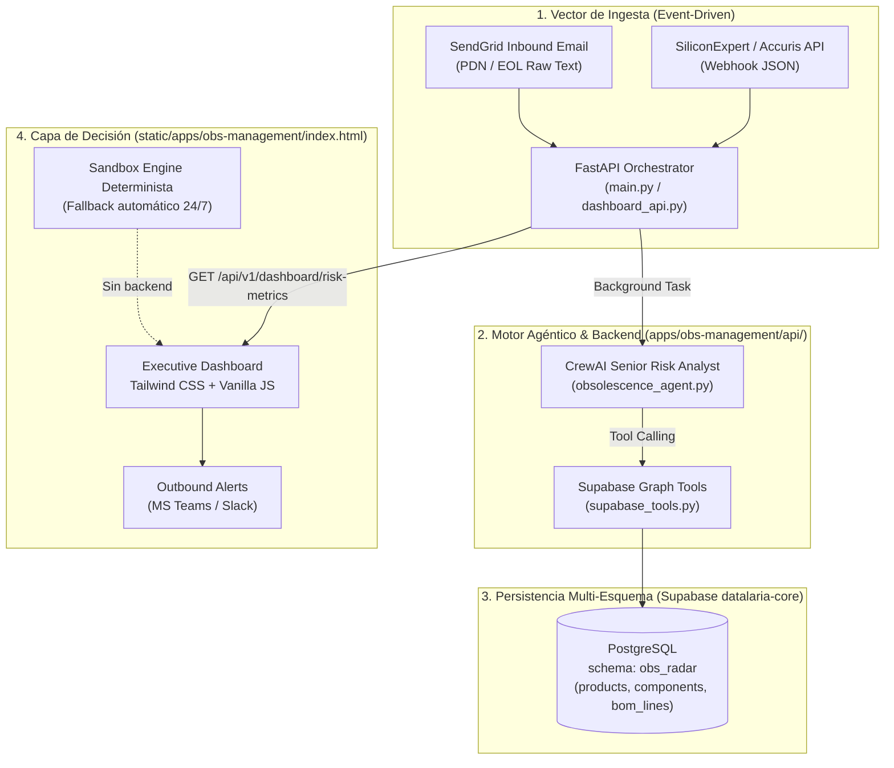

# Especificación Técnica SDD: Agentic Radar (`obs-management`)

> **ID de Especificación:** `SPEC-APP-OBS-MANAGEMENT`  
> **Versión de la Spec:** `1.0.0` (Reverse-Spec formal a 2026-10-24)  
> **Versión de la App documentada:** `v1.0.0`  
> **Estado:** `APPROVED (Reverse-Spec)`  
> **Categoría SDD:** 🟡 Requiere aislamiento previo (App activa #2 de 7)  
> **Código fuente anterior:** [`static/apps/obs-management/`](file:///c:/Users/dalae/OneDrive/Emprendiendo/datalaria/static/apps/obs-management) (mezcla de frontend y scripts backend)  
> **Código fuente objetivo (Hito 2.1):** `apps/obs-management/api/` (backend CrewAI + FastAPI) · `static/apps/obs-management/index.html` (Frontend Dual-Mode Sandbox)  
> **Artefacto público:** [`static/apps/obs-management/`](file:///c:/Users/dalae/OneDrive/Emprendiendo/datalaria/static/apps/obs-management) → `https://datalaria.com/apps/obs-management/`  
> **Ficha pública:** `/es/apps/obs-management/` · `/en/apps/obs-management/`  

---

## 1. Propósito y Contexto de Negocio

### 1.1 Problema que resuelve
En la industria electrónica y de operaciones de fabricación, la obsolescencia técnica de un componente crítico de silicio (notificación EOL / PDN) suele tratarse como una crisis impredecible ("Cisne Negro") que detiene líneas de montaje con millones de euros en juego. **Agentic Radar** transforma la obsolescencia en una ventaja competitiva cuantificable bajo la norma internacional **IEC 62402**:
1. Ingesta notificaciones no estructuradas de fin de vida (PDN/EOL) procedentes de correos electrónicos y APIs comerciales (SiliconExpert, Accuris).
2. Extrae semánticamente el número de parte del fabricante (MPN) mediante un agente especializado de **CrewAI**.
3. Recorre el grafo relacional de listas de materiales (BOM multinivel) en PostgreSQL/Supabase.
4. Calcula en tiempo real el **P&L y Margen Bruto en Riesgo** (ej. 15.450,00 EUR) y expone la telemetría en un Dashboard Ejecutivo táctico orientado a directores de operaciones (COO) y financieros (CFO).

### 1.2 Público objetivo
* **Dirección de Operaciones (COO / VP Supply Chain):** Visualización inmediata del impacto financiero y bloqueo de SKUs finales afectados (`DRONE-X1`, `SERVER-RACK-9`).
* **Ingeniería de Componentes y Compras:** Alertas tempranas para negociar compras de último lote (*Last Time Buy - LTB*) o autorizar rediseños *Form, Fit, Function (FFF)*.
* **Lectores técnicos de Datalaria:** Demostrador de arquitectura agéntica industrial orientada a eventos (EDA).

### 1.3 Respaldo editorial (Invariante `App ⇔ Post`, Constitución Art. 7)
Respaldada por una serie de 7 entregas técnicas publicadas en español e inglés:

| Parte | Slug ES | Slug EN | Fecha | Tema |
| :-: | :--- | :--- | :--- | :--- |
| 1 | `obs_parte1_intro` | `obs_part1_intro` | 2026-04-11 | La falacia del Cisne Negro, norma IEC 62402 y matriz de criticidad. |
| 2 | `obs_parte2_tactica` | `obs_part2_tactics` | 2026-04-14 | Estrategia táctica proactiva vs reactiva y gestión del ciclo de vida. |
| 3 | `obs_parte3_arquitectura` | `obs_part3_architecture` | 2026-04-18 | Arquitectura del grafo relacional BOM en Supabase PostgreSQL. |
| 4 | `obs_parte4_ingesta` | `obs_part4_ingestion` | 2026-03-19 | Ingesta de datos, validación y normalización con Pandas. |
| 5 | `obs_parte5_radar` | `obs_part5_radar_agent` | 2026-05-01 | Agente de CrewAI para extracción semántica de PDN y tool calling financiero. |
| 6 | `obs_parte6_fastapi` | `obs_part6_fastapi_server` | 2026-05-09 | Servidor asíncrono FastAPI con webhooks y procesamiento en segundo plano. |
| 7 | `obs_parte7_dashboard` | `obs_part7_executive_dashboard` | 2026-05-17 | Dashboard ejecutivo táctico en Tailwind CSS y Vanilla JS. |

### 1.4 Estrategia Dual-Mode (Constitución Art. 3)

| Modo | Estado | Comportamiento |
| :--- | :--- | :--- |
| **Executive Sandbox (Web Pública)** | ✅ Reparado en Hito 2.1 | Al abrir `datalaria.com/apps/obs-management/`, si no hay backend local en `localhost:8001`, el dashboard **activa automáticamente el modo Sandbox determinista**: renderiza en vivo los **15.450,00 EUR** en riesgo, las 2 alertas críticas (`DRONE-X1` y `SERVER-RACK-9`), anima la consola de logs de CrewAI en tiempo real y muestra un banner de upsell al *Executive Decision Pack* de Datalaria. Cero errores `> OFFLINE`. |
| **Live Engine (Conectado / Local)** | ✅ Implementado | Si el backend FastAPI está activo (puerto 8001 o variable de entorno de API), el dashboard consume la telemetría en tiempo real desde el endpoint `/api/v1/dashboard/risk-metrics`. |
| **Monetización / Upsell** | ✅ Activo | Banner integrado hacia los modelos ejecutivos y templates de evaluación financiera en Lemon Squeezy. |

---

## 2. Arquitectura del Sistema



### 2.1 Manifiesto de Archivos — Distribución SDD

| Archivo | Ubicación Anterior | Ubicación Objetivo SDD | Responsabilidad |
| :--- | :--- | :--- | :--- |
| `index.html` | `static/apps/obs-management/` | [`static/apps/obs-management/index.html`](file:///c:/Users/dalae/OneDrive/Emprendiendo/datalaria/static/apps/obs-management/index.html) | Dashboard táctico frontend (Dual-Mode: Sandbox + Live). **Único archivo en `static/`**. |
| `main.py` | `static/apps/obs-management/` | `apps/obs-management/api/main.py` | Entrada de FastAPI para webhooks asíncronos y worker de CrewAI. |
| `dashboard_api.py` | `static/apps/obs-management/` | `apps/obs-management/api/dashboard_api.py` | API REST para métricas de P&L en riesgo (`/api/v1/dashboard/risk-metrics`). |
| `obsolescence_agent.py` | `static/apps/obs-management/` | `apps/obs-management/api/obsolescence_agent.py` | Definición de agentes CrewAI con LLM Gemini para extracción semántica. |
| `supabase_tools.py` | `static/apps/obs-management/` | `apps/obs-management/api/supabase_tools.py` | Tools de CrewAI para cálculo de impacto financiero sobre la base de datos. |
| `data_loader.py` | `static/apps/obs-management/` | `apps/obs-management/api/data_loader.py` | Script de carga y verificación de estructuras BOM en Supabase. |
| `generate_dummy_bom.py` | `static/apps/obs-management/` | `apps/obs-management/api/generate_dummy_bom.py` | Generador de dataset industrial de demostración. |
| `supabase_schema.sql` | `static/apps/obs-management/` | `apps/obs-management/api/supabase_schema.sql` | Esquema DDL para el esquema `obs_radar` en Supabase. |
| `requirements.txt` | `static/apps/obs-management/` | `apps/obs-management/api/requirements.txt` | Dependencias del motor (FastAPI, CrewAI, Supabase, Pydantic, etc.). |
| `.env` / `__pycache__` | `static/apps/obs-management/` | **ELIMINADOS DE `static/`** | Expulsados inmediatamente del directorio público. |

---

## 3. Contratos e Interfaces

### 3.1 Endpoint de Telemetría Ejecutiva (`/api/v1/dashboard/risk-metrics`)
* **Método:** `GET`
* **Contrato JSON:**
```json
{
  "total_risk_eur": 15450.00,
  "active_alerts": 2,
  "affected_skus": [
    {
      "sku": "DRONE-X1",
      "margin_at_risk": 12500.00,
      "status": "CRITICAL LTB REQUIRED",
      "trigger_mpn": "TI-CAP-10U-50"
    },
    {
      "sku": "SERVER-RACK-9",
      "margin_at_risk": 2950.00,
      "status": "EVALUATING INVENTORY",
      "trigger_mpn": "STM32F405RGT6"
    }
  ],
  "agent_logs": [
    "[18:31:02] [Webhook] Inbound email parsed. Subject: EOL Notification TI-CAP-10U-50.",
    "[18:31:03] [CrewAI] Awakening 'Senior Risk Analyst' agent...",
    "[18:31:05] [CrewAI] Parsing semantic text. MPN extracted: TI-CAP-10U-50.",
    "[18:31:05] [Tool Calling] Executing calculate_financial_impact().",
    "[18:31:06] [Supabase SQL] Transversing bom_lines... Parent End_Product found: DRONE-X1.",
    "[18:31:07] [CrewAI] P&L calculated. Retained Margin at Risk: 12,500.00 EUR.",
    "[18:31:08] [FastAPI] Triggering Microsoft Teams outbound webhook alert.",
    "[18:32:14] [Webhook] Commercial API hit from SiliconExpert (Status: EOL).",
    "[18:32:15] [CrewAI] Parsing payload. MPN extracted: STM32F405RGT6.",
    "[18:32:16] [Supabase SQL] Transversing bom_lines... Parent End_Product found: SERVER-RACK-9.",
    "[18:32:18] [CrewAI] P&L calculated. Retained Margin at Risk: 2,950.00 EUR."
  ]
}
```

---

## 4. Deuda Técnica y Riesgos Resueltos en Hito 2.1

| ID | Severidad | Descripción | Resolución en Hito 2.1 |
| :--- | :-: | :--- | :--- |
| **SEC-OBS-1** | 🔴 Crítica | Archivos `.env`, `.py`, `.sql` y `__pycache__` expuestos directamente en `static/apps/obs-management/` y descargables vía web pública en Netlify. | Mover todo código backend a `apps/obs-management/api/`; erradicar `.env` y `.pyc` de `static/`. |
| **UX-OBS-1** | 🔴 Crítica | `index.html` realizaba un `fetch` a `http://localhost:8001`. En producción, la petición fallaba y mostraba `> OFFLINE. Cannot connect to Analytics API on port 8001.` | Implementación del **Modo Sandbox Determinista**: fallback automático con datos ejecutivos reales, animación de consola y badge de telemetría sin errores. |
| **DATA-OBS-1** | 🟠 Alta | El esquema SQL operaba en el `public` de Supabase sin namespace. | Normalizado para operar bajo el esquema dedicado `obs_radar` (Constitución Art. 4). |

---

## 5. Historial Evolutivo (SemVer)

| Versión | Fecha | Tipo | Cambios |
| :--- | :--- | :--- | :--- |
| `v1.0.0` | 2026-05-17 | 🚀 Lanzamiento | Versión documentada por la serie de 7 artículos (CrewAI + FastAPI + Dashboard Tailwind). |
| `v1.0.1` | 2026-10-24 | 🔒 Seguridad & UX | Aislamiento físico de backend en `apps/obs-management/api/`, higienización de `static/`, erradicación del error `OFFLINE` y activación del Modo Sandbox determinista (Hito 2.1). |

---

## 6. Criterios de Aceptación (Gates de Verificación)

1. `static/apps/obs-management/` contiene **exclusivamente** `index.html`. Ningún archivo `.py`, `.sql`, `.env` ni `.pyc` permanece en `static/`.
2. Al abrir `https://datalaria.com/apps/obs-management/` (o en local sin backend en puerto 8001):
   - Muestra `15.450,00 EUR` en riesgo.
   - Muestra las 2 alertas activas.
   - La tabla lista `DRONE-X1` y `SERVER-RACK-9`.
   - La consola anima secuencialmente las trazas de CrewAI.
   - Muestra el indicador `● SANDBOX MODE (TELEMETRÍA DEMO)` en verde esmeralda.
   - Cero textos de error `> OFFLINE`.
3. `hugo --renderToMemory` compila limpiamente sin errores.
