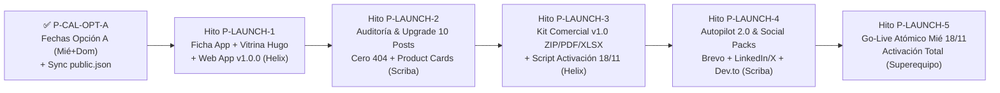

# Plan Maestro de Lanzamiento y Publicación: Datalaria Pulse (`v1.0.0`)

> **ID de Documento:** `PLAN-PULSE-LAUNCH-18NOV`  
> **Especificación Vinculada:** [`specs/apps/pulse/spec.md`](file:///c:/Users/dalae/OneDrive/Emprendiendo/datalaria/specs/apps/pulse/spec.md) (`v1.3.0+`) · [`specs/apps/pulse/design.md`](file:///c:/Users/dalae/OneDrive/Emprendiendo/datalaria/specs/apps/pulse/design.md)  
> **Fecha Oficial de Lanzamiento (Día 1):** Miércoles **18 de noviembre de 2026 (`2026-11-18`)**  
> **Cadencia Editorial Aprobada (Opción A):** **2 artículos por semana (Miércoles y Domingo)** — Cierre de serie en 15 días (`2026-11-18` → `2026-12-02`) + cobertura dominical continua (`2026-12-06`).  
> **Gobernanza SDD:** Superequipo **Datalaria Helix** (Ingeniería, App, Ficha, Kit) + **Datalaria Scriba** (Serie de 5 Artículos, SEO, Autopilot 2.0, Brevo & Sindicación).

---

## 1. Cronograma Maestro de Publicación (Opción A · Cero Enlaces Rotos `INV-SCRIBA-CHRONO`)

Desde el **Día 1 (`2026-11-18`)**, la **Aplicación Web (`/apps/pulse/`)**, la **Ficha Oficial (`/es/apps/pulse/` y `/en/apps/pulse/`)** y el **Kit Comercial (`#pack-pulse` en `/es/recursos/` y `/en/resources/`)** quedan **100% activos y operativos en producción**.

La serie técnica de 5 artículos bilingües se despliega a razón de **2 entregas por semana (Miércoles y Domingo)**:

| Fecha | Día | Activo / Entrega Publicada en Vivo | Slug ES / Slug EN | Regla de Enlaces Activos (`INV-SCRIBA-CHRONO`) |
| :--- | :---: | :--- | :--- | :--- |
| **`2026-11-15`** | Dom | **Preludio Autopilot Parte 10:** *Puente Scriba ⇔ Pulse* | `autopilot-parte10-scriba-sindicacion-puente-pulse` `autopilot-part10-scriba-syndication-pulse-bridge` | Sin enlaces a posts futuros de Pulse (`>= 18/11`). |
| **`2026-11-18`** | **Mié** *(Día 1)* | 🚀 **Lanzamiento Datalaria Pulse `v1.0.0`:** 1. **App Web:** `/apps/pulse/` 2. **Ficha App:** `/es/apps/pulse/` y `/en/apps/pulse/` 3. **Kit Comercial (19 €):** `/es/recursos/#pack-pulse` 4. **Post Parte 1 (1/5):** *Adiós Notion: Content Ops as Code* | `pulse-parte1-adios-notion-content-ops` `pulse-part1-goodbye-notion-content-ops` | - **Parte 1:** Enlaza a App, Ficha y Kit (`200 OK`). Partes 2–5 en texto plano. - **Ficha App:** Parte 1 clicable; Partes 2–5 renderizadas como tarjetas *"📅 Próxima entrega"* sin `<a href>`. - **Kit `#pack-pulse`:** Botón *"Artículo técnico 📖"* apunta a **Parte 1** (`200 OK`). |
| **`2026-11-22`** | **Dom** | 🟢 **Post Parte 2 (2/5):** *Del Front Matter al Índice: Pydantic v2, Paridad ES/EN y CI/CD* | `pulse-parte2-indexador-pydantic-paridad-ci` `pulse-part2-pydantic-indexer-bilingual-parity-ci` | - **Parte 2:** Enlaza hacia atrás a Parte 1, App, Ficha y Kit (`200 OK`). Partes 3–5 en texto plano. - **Ficha App:** Partes 1 y 2 clicables automáticamente; Partes 3–5 *"📅 Próxima entrega"*. |
| **`2026-11-25`** | **Mié** | 🟢 **Post Parte 3 (3/5):** *Tabla Ejecutiva, Tablero Kanban y Calendario en React 19* | `pulse-parte3-tablero-react-tabla-kanban-calendario` `pulse-part3-react-dashboard-table-kanban-calendar` | - **Parte 3:** Enlaza hacia atrás a Partes 1 y 2, App, Ficha y Kit (`200 OK`). Partes 4–5 en texto plano. - **Ficha App:** Partes 1, 2 y 3 clicables automáticamente. |
| **`2026-11-29`** | **Dom** | 🟢 **Post Parte 4 (4/5):** *GA4 y Search Console Automatizados: Salud & ROI Orgánico* | `pulse-parte4-ga4-search-console-automatico` `pulse-part4-ga4-search-console-automated` | - **Parte 4:** Enlaza hacia atrás a Partes 1, 2 y 3, App, Ficha y Kit (`200 OK`). Parte 5 en texto plano. - **Ficha App:** Partes 1 a 4 clicables automáticamente. |
| **`2026-12-02`** | **Mié** *(Cierre)* | 🏁 **Post Parte 5 (5/5):** *De Notion a Excel en 5 Minutos: Kit Power Query y Fábrica IA* | `pulse-parte5-kit-excel-migracion-notion-equipos` `pulse-part5-excel-kit-notion-migration-teams` | - **Parte 5:** Enlaza a Partes 1–4, App, Ficha y Kit (`200 OK`). - **Cierre de Malla (`E04`):** Se activan los enlaces `1 ↔ 2 ↔ 3 ↔ 4 ↔ 5` en toda la serie y el botón *"Artículo técnico 📖"* del Kit pasa a apuntar a la **Parte 5**. |
| **`2026-12-06`** | **Dom** | 📘 **Post Deep-Tech Dominical:** *Inference-Time Scaling y Razonamiento Sistema 2* | `inference_time_scaling` `inference_time_scaling` | Mantiene la continuidad dominical tras el cierre de la serie Pulse. |

---

## 2. Hoja de Ruta Operativa por Hitos (`P-LAUNCH-1` a `P-LAUNCH-5`)

Cada hito se planifica con **Gemini 4 Argon** (definición de contratos, invariantes y prompt determinista) y se ejecuta con **Gemini 3.8 Flash** o **Gemini 4 Hydrogen**.

---

### `[x]` Hito `P-LAUNCH-1`: Blindaje del Portal, Ficha Enriquecida `/apps/pulse/`, `pulse.yaml v1.0.0` y Mejoras en la Web App

* **Escuadrón y Roles:** **Datalaria Helix** (`01-orchestrator`, `03-architect`, `05-frontend`, `08-media-i18n`, `09-monetization`, `11-qa-verifier`).
* **Objetivos y Entregables:**
  1. **Blindaje de [`layouts/apps/single.html`](file:///c:/Users/dalae/OneDrive/Emprendiendo/datalaria/layouts/apps/single.html) frente a Series Escalonadas e i18n de Productos:**
     * Evitar que `single.html` aborte el build de Hugo (`errorf`) cuando una App tiene entregas futuras programadas en `posts:`.
     * Validar que si `$app.status == "live"`, exista **al menos 1 post publicado** (`$publishedCount >= 1`).
     * Renderizar los posts ya publicados como tarjetas clicables con miniatura, y los posts futuros (`not $postPage`) como elegantes tarjetas **"📅 Programado · `<fecha>`"** usando los metadatos de fallback (`title`, `summary`, `date`) de `data/apps/<slug>.yaml` **sin etiqueta `<a href>`** (cero `404`).
     * Soportar mapas bilingües (`es`/`en`) en `related_products` (`name`, `description`, `checkout_url`) tanto en `single.html` como en `layouts/partials/app-card.html`.
  2. **Actualización de [`data/apps/pulse.yaml`](file:///c:/Users/dalae/OneDrive/Emprendiendo/datalaria/data/apps/pulse.yaml) a `v1.0.0`:**
     * Elevar `current_version: v1.0.0` (manteniendo `status: incubating` hasta el paso de activación `P-LAUNCH-5` y actualizando la aserción en `ops/pulse/release_18nov.py`).
     * Añadir las releases `v0.4.0` (`2026-11-08`, `state: internal`, Motor de Impacto SEO/GA4 `impact_analyzer.py`) y `v1.0.0` (`2026-11-18`, `state: released`, Consolidación de 182 activos, Gobernanza de Releases SemVer `INV-PULSE-7..8` y Cuadrante 5 Scriba).
     * Añadir el bloque bilingüe `related_products:` apuntando a `/es/recursos/#pack-pulse` y `/en/resources/#pack-pulse`.
     * Enriquecer las 5 entradas de `posts:` con `date` (`2026-11-18`, `2026-11-22`, `2026-11-25`, `2026-11-29`, `2026-12-02`), `title` (`es`/`en`) y `summary` (`es`/`en`).
  3. **Ficha Enriquecida Bilingüe en [`content/es/apps/pulse/index.md`](file:///c:/Users/dalae/OneDrive/Emprendiendo/datalaria/content/es/apps/pulse/index.md) y [`content/en/apps/pulse/index.md`](file:///c:/Users/dalae/OneDrive/Emprendiendo/datalaria/content/en/apps/pulse/index.md):**
     * Redactar el cuerpo Markdown siguiendo el estándar de excelencia de `weather/index.md`: Novedades de `v1.0.0`, tabla de **Centro de Control y Acceso Directo por Escenarios en 1 Clic (*Deep-Linking*)** (`?tab=dashboard`, `?tab=table`, `?tab=kanban`, `?tab=calendar`, `?tab=health`, `?demo=true`, `?tab=table&type=app`, `?tab=table&type=kit`), formulación matemática KaTeX del **SEO Score Determinista ($0\text{--}100$)** y del **Índice Relativo de Tráfico ($\text{Index}_{100}$)**, y conexión con el Kit B2B.
  4. **Mejoras de Cabecera y Deep-Linking en la App Web ([`apps/pulse/web/src/App.tsx`](file:///c:/Users/dalae/OneDrive/Emprendiendo/datalaria/apps/pulse/web/src/App.tsx)):**
     * Soportar deep-linking por URL para filtros: `?type=post|app|kit` y `?status=published|scheduled|draft|idea` al inicializar el estado en `App.tsx`.
     * Añadir en la cabecera de la App Web la insignia de versión **`v1.0.0`** y el botón/enlace directo a la **Ficha Técnica Oficial** (`/es/apps/pulse/` en ES, `/en/apps/pulse/` en EN).
     * Compilar el bundle de producción en `static/apps/pulse/` y regenerar `public.json`.
* **Verification Gate (`P-LAUNCH-1`):**
  * `cd apps/pulse/web && npm run lint && npm run build:portal` (código `0`)
  * `python -m ops.pulse.build_index && python -m ops.pulse.publish_public` (código `0`)
  * `hugo --renderToMemory` y `hugo --renderToMemory -D -F` (código `0`)
  * `python -m pytest ops/pulse/tests -v` (código `0`)

---

### `[x]` Hito `P-LAUNCH-2`: Auditoría, Saneamiento Anti-404 y Upgrade a `v1.0.0` de los 10 Artículos de la Serie (`ES/EN`)

* **Escuadrón y Roles:** **Datalaria Scriba** (`E01-editorial-orchestrator`, `E03-technical-writer`, `E04-bilingual-seo-editor`, `E05-content-monetizer`, `E07-editorial-qa`).
* **Objetivos y Entregables:**
  1. **Saneamiento Cronológico Estricto (`INV-SCRIBA-CHRONO`):**
     * En las **Partes 2, 3 y 4 (ES y EN)**, convertir en texto plano sin `<a href>` las referencias de la *"Hoja de Ruta de la Serie"* hacia capítulos posteriores a la fecha de cada post (`Parte 2` solo enlaza a `Parte 1`; `Parte 3` solo enlaza a `Partes 1 y 2`; `Parte 4` solo enlaza a `Partes 1, 2 y 3`; `Parte 5` enlaza a `Partes 1–4`).
     * Añadir un test determinista en `ops/pulse/tests/test_impact_analyzer.py` que verifique que **ningún artículo (ni siquiera `scheduled`) contiene enlaces Markdown hacia otro artículo cuya `publish_date` sea estrictamente posterior a la suya**.
  2. **Corrección de los 6 Enlaces Rotos (`404`) en Inglés (`EN`):**
     * `pulse-part1` EN: `/en/recursos/#pack-pulse` → `/en/resources/#pack-pulse`.
     * `pulse-part2` EN y `pulse-part3` EN: `/en/posts/executive-decision-packs-quantitative-framework/` → `/en/posts/decision-making-prioritization-quantitative-framework/`.
     * `pulse-part4` EN: `/en/posts/sop_ingenieria-higiene-datos/` → `/en/posts/sop_engineering-data-hygiene/`.
     * `pulse-part5` EN: corregir los 3 slugs en español bajo `/en/posts/` por sus equivalentes reales en inglés (`sop_engineering-data-hygiene`, `decision-making-prioritization-quantitative-framework`, `financial-business-case-npv-irr`).
  3. **Corrección de Formato (Mermaid y KaTeX):**
     * Sustituir el diagrama ASCII en `Parte 1` (ES y EN) por un diagrama vectorial ``.
     * Escapar los signos `\$` en `Parte 4` (ES y EN, líneas 221–223) y eliminar el backslash literal `\21.480€` / `\21,480€` en `Parte 5` (ES y EN).
  4. **Actualización Funcional a Pulse `v1.0.0` e Inyección de `product-card`:**
     * Actualizar cifras y arquitectura en las 5 entregas (182 activos consolidados, 5 pilares temáticos del blog, tracking SemVer de Releases `🚀 APP` / `⚡ APP vX.Y` / `📦 KIT`, Cuadrante 5 de Sincronización Editorial Scriba, diagnóstico CSV Notion en 1 clic e `impact_analyzer.py`).
     * Copiar `pulse-preview-es.png` y `pulse-preview-en.png` a las carpetas de los posts e insertar la tarjeta visual `` del Kit en **Parte 1** (para conversión desde el `18/11`) y **Parte 5**.
* **Verification Gate (`P-LAUNCH-2`):**
  * `python -m ops.pulse.build_index && python -m ops.pulse.publish_public` (código `0`)
  * `hugo --renderToMemory -F` (código `0`)
  * `python -m pytest ops/pulse/tests -v` (código `0`)

---

### `[x]` Hito `P-LAUNCH-3`: Actualización del Kit Comercial (`packages/pulse/ v1.0.0`) y Script de Activación Atómica (`release_18nov.py`)

* **Escuadrón y Roles:** **Datalaria Helix** (`01-orchestrator`, `06-backend-data`, `09-monetization`, `10-security-privacy`, `12-release-devops`, `11-qa-verifier`).
* **Objetivos y Entregables:**
  1. **Actualización de Documentación y Plantillas en `packages/pulse/`:**
     * Corregir en [`packages/pulse/GUIA_PULSE_KIT.md`](file:///c:/Users/dalae/OneDrive/Emprendiendo/datalaria/packages/pulse/GUIA_PULSE_KIT.md) los emails antiguos por `contacto@datalaria.com`.
     * Actualizar [`packages/pulse/ESPECIFICACION_CAMPOS.md`](file:///c:/Users/dalae/OneDrive/Emprendiendo/datalaria/packages/pulse/ESPECIFICACION_CAMPOS.md) y [`ops/pulse/kit/build_pulse_kit.py`](file:///c:/Users/dalae/OneDrive/Emprendiendo/datalaria/ops/pulse/kit/build_pulse_kit.py) con las 5 categorías canónicas del blog y los nuevos campos `version`, `release_type`, `parent_asset_id` y `editorial_post_slug`.
     * Regenerar el libro maestro `.xlsx`, la guía PDF de 4 páginas (`GUIA_EJECUTIVA_PULSE.pdf`) y el paquete `datalaria-pulse-content-ops-kit-v1.0.zip` sincronizado en `packages/00_DISTRIBUCION_LEMONSQUEEZY/Datalaria_Pulse_Kit.zip`.
  2. **Blindaje de Enlaces del Kit y Modo `--activate` en [`ops/pulse/release_18nov.py`](file:///c:/Users/dalae/OneDrive/Emprendiendo/datalaria/ops/pulse/release_18nov.py):**
     * Cambiar en `STAGED_PACK_PULSE_RESOURCE` y `staged_pack_pulse_18nov.json` los campos `article_url_es/en` y `guide_url_es/en` para que el `18/11` apunten a la **Parte 1** (`/es/posts/pulse-parte1-adios-notion-content-ops/` y `/en/posts/pulse-part1-goodbye-notion-content-ops/`), evitando un enlace `404` hasta el `02/12`.
     * Implementar la función `activate_launch(dry_run: bool = False)` en `ops/pulse/release_18nov.py` para conmutar atómicamente el día del lanzamiento:
       1. `data/apps/pulse.yaml`: `status: incubating` → `status: live`.
       2. `content/{es,en}/apps/pulse/index.md`: `draft: true` → `draft: false`.
       3. `data/pulse/kits.yaml`: insertar/activar `pack-pulse` con `status: published` y `publish_date: "2026-11-18"`.
       4. `layouts/partials/recursos_catalog.html`, `content/es/recursos/_index.md`, `content/en/resources/_index.md` y `layouts/partials/index_profile.html`: habilitar la tarjeta comercial `#pack-pulse` y la tarjeta de la App en la Home.
* **Verification Gate (`P-LAUNCH-3`):**
  * `python -m ops.pulse.kit.package_kit` (código `0`)
  * `python -m ops.pulse.release_18nov --verify-embargo` (código `0`)
  * `python -m pytest ops/pulse/tests -v` (código `0`)

---

### `[x]` Hito `P-LAUNCH-3B`: Auditoría y Upgrade UX, Tipográfico y Documental del Kit Comercial (`packages/pulse/ v1.0.0`)

* **Escuadrón y Roles:** **Superequipo Datalaria Helix (`01`, `06`, `09`, `10`, `11`, `12`) + Datalaria Scriba (`E01`, `E02`, `E03`)**.
* **Objetivos y Entregables:**
  1. **Aislamiento del Tracker Privado & Muestra de 10 Activos (`ops/pulse/kit/build_pulse_kit.py` & `packages/pulse/sample_notion_export.csv`):**
     * Trasladado `Pulse_Private_Tracker.xlsx` (`is_template=False`) a `data/pulse/private/Pulse_Private_Tracker.xlsx` (excluido de Hugo vía `ignoreFiles: '(?i)\.xlsx$'` en `config.yaml` y de Git vía `.gitignore`) y eliminado de `packages/pulse/`.
     * Estandarizados `Pulse_Content_Ops_Template.xlsx` y `sample_notion_export.csv` a exactamente **10 activos representativos** (8 `post`, 1 `app`, 1 `kit`), cubriendo las 5 categorías canónicas, los 5 estados (`Published`, `Scheduled`, `Review`, `Draft`, `Idea`), versiones SemVer (`v1.0.0`, `v0.9.0`, `v0.4.0`), `outdated_en`, Quick Win SEO (`pos: 9.4`, `Score: 65`) y un huérfano de monetización (`2.450` visitas sin Kit).
     * Incorporado bloque *"FLUJO DE TRABAJO RECOMENDADO EN 3 PASOS"* en Hoja 1 (`Instrucciones`) del Excel.
  2. **Onboarding en Raíz y Caso de Uso Scriba (`packages/pulse/00_EMPIEZA_AQUI_README.md` & `GUIA_PULSE_KIT.md`):**
     * Creado `00_EMPIEZA_AQUI_README.md` en la raíz del `.zip` con mapa visual, rutas por perfil (Excel / Notion / Git) y resumen práctico.
     * Añadida Sección 8 *"Caso de Uso Práctico de Extremo a Extremo: El Ritual Editorial de Datalaria Scriba"* en `GUIA_PULSE_KIT.md`.
  3. **Rediseño Tipográfico 5 Páginas sin Cortes (`ops/pulse/kit/build_pdf_guide.py`):**
     * Registradas fuentes TrueType (`Segoe UI`, `Segoe UI Bold`, `Consolas` + subsetting `145 KB`) y maquetación estricta con `insert_textbox` (`x0=40..555`, verificación `rc >= 0`), erradicando cortes de línea y glifos corruptos (`·`).
     * Estructurado en 5 páginas A4 incluyendo portada ejecutiva, anatomía de 6 hojas + GA4/GSC, conectores Power Query/CLI, Caso de Uso de 3 escenarios y referencia `ContentAsset` + `INV-PULSE-1..8`.
  4. **Empaquetado Único Sin Duplicados (`ops/pulse/kit/package_kit.py` & `release_18nov.py`):**
     * Colocados `00_EMPIEZA_AQUI_README.md`, `GUIA_EJECUTIVA_PULSE.pdf` y `LICENSE.txt` en la raíz de `Datalaria_Pulse_Kit.zip` junto a las 3 carpetas (`12` ficheros, `262.0 KB`), sincronizado con `00_DISTRIBUCION_LEMONSQUEEZY/` y eliminado el alias duplicado `datalaria-pulse-content-ops-kit-v1.0.zip`.
* **Verification Gate (`P-LAUNCH-3B`):**
  * `python -m ops.pulse.kit.package_kit` (código `0`)
  * `python -m ops.pulse.release_18nov --verify-embargo` (código `0`)
  * `python -m pytest ops/pulse/tests -v` (`37/37` en verde, código `0`)
  * `hugo --renderToMemory` (código `0`)

---

### `[x]` Hito `P-LAUNCH-3C`: Excel Automatizado con Tablas/Filtros/Color de Pestañas + Empaquetado Comercial Dual ES/EN

* **Escuadrón y Roles:** **Datalaria Helix (`01-orchestrator`, `03-architect`, `06-backend-data`, `08-media-i18n`, `09-monetization`, `11-qa-verifier`, `12-release-devops`)**.
* **Objetivos y Entregables:**
  1. **Motor Excel Automatizado Dual ES/EN (`ops/pulse/kit/build_pulse_kit.py` & `ops/pulse/migrate_notion.py`):**
     * Parametrizado `build_pulse_excel(is_template: bool = True, lang: str = "es")`:
       * `is_template=False` → `data/pulse/private/Pulse_Private_Tracker.xlsx` (135+ activos reales, cero exposición en packages).
       * `is_template=True, lang="es"` → `packages/pulse/Pulse_Content_Ops_Template_ES.xlsx` (y alias `Pulse_Content_Ops_Template.xlsx`).
       * `is_template=True, lang="en"` → `packages/pulse/Pulse_Content_Ops_Template_EN.xlsx` (hojas: `Instructions`, `Taxonomy`, `Assets`, `Kanban`, `Metrics`, `Dashboard`).
     * **Cero duplicación manual:**
       * `Activos`/`Assets`: Fuente Única de Verdad con cálculo automático de lectura (`=IF(MAX(L{r},M{r})=0,0,MAX(1,ROUND(MAX(L{r},M{r})/200,0)))`) y lectura dinámica de visitas y usuarios desde `Métricas` vía `=IF(A{r}="","",IFERROR(INDEX(...),0))`.
       * `Métricas`/`Metrics`: validación de datos en columna A (`Asset ID`), y auto-rellenado de Tipo (Col B) y Título (Col H) desde `Activos` vía `INDEX/MATCH`.
       * `Kanban`: tablero 100% dinámico basado en columnas auxiliares Y:AC de `Activos`, con contadores en cabecera `=COUNTIF(...)`.
       * `Dashboard`: KPIs estratégicos, desglose por tipo, salud en las 5 categorías canónicas y radar de acción inmediata (paridad, SEO < 80, frescura y huérfanos).
     * **Tablas Nativas Excel (`TableStyleMedium2`) con filtros automáticos por columna, ordenación en 1 clic y `freeze_panes` en cabeceras.**
     * **Colores temáticos de pestañas:** Azul cielo (`0284C7`) para informativas, Esmeralda (`059669`) para datos y Ámbar (`D97706`) para el dashboard.
     * **Cumplimiento estricto `INV-PULSE-5`:** Fórmulas universales compatibles con Excel 2016+, Office 365 y Google Sheets sin macros VBA ni fórmulas matriciales dependientes de versión.
  2. **Entregables Bilingües Duales en `packages/pulse/`:**
     * Conectores Power Query M duales: `notion_power_query_es.m`, `notion_power_query_en.m`, `git_public_json_power_query_es.m`, `git_public_json_power_query_en.m`.
     * Datasets de muestra duales (10 activos): `sample_notion_export_es.csv`, `sample_notion_export_en.csv`.
     * Licencias comerciales bilingües: `LICENSE_ES.txt`, `LICENSE_EN.txt` (con `contacto@datalaria.com`).
     * Onboarding localizado: `00_EMPIEZA_AQUI_ES.md`, `00_START_HERE_EN.md`, `00_EMPIEZA_AQUI_README.md`, `00_START_HERE_README.md`.
     * Guías técnicas y diccionarios: `GUIA_PULSE_KIT_ES.md`, `PULSE_KIT_GUIDE_EN.md`, `ESPECIFICACION_CAMPOS_ES.md`, `FIELD_SPECIFICATION_EN.md`.
     * Guías ejecutivas maquetadas en PDF (5 páginas exactas): `GUIA_EJECUTIVA_PULSE_ES.pdf` y `PULSE_EXECUTIVE_GUIDE_EN.pdf`.
     * Escáner universal con flag multi-idioma: `packages/pulse/pulse_repo_scanner.py --lang {es,en}`.
  3. **Empaquetado Comercial Dual y Sincronización Lemon Squeezy (`ops/pulse/kit/package_kit.py`):**
     * Estructura completa en `Datalaria_Pulse_Kit.zip`: raíz con archivos bilingües, carpetas completas `ES/` y `EN/` (con sus 3 subcarpetas numeradas), más carpetas legadas para retrocompatibilidad total (38 archivos, 804.3 KB).
     * Sincronizado automáticamente a `packages/00_DISTRIBUCION_LEMONSQUEEZY/Datalaria_Pulse_Kit.zip`.
  4. **Gobernanza y Suite de Pruebas:**
     * Actualizados `release_18nov.py` y `staged_pack_pulse_18nov.json` con la edición Dual y el Excel automatizado.
     * Actualizadas y superadas al 100% las suites `test_excel_kit.py` y `test_kit_packaging.py`.
* **Verification Gate (`P-LAUNCH-3C`):**
  * `python -m ops.pulse.kit.package_kit` (código `0`)
  * `python -m ops.pulse.release_18nov --prepare-staged-card && python -m ops.pulse.release_18nov --verify-embargo` (código `0`)
  * `python -m pytest ops/pulse/tests ops/helix/tests -v` (`104/104` en verde, código `0`)
  * Renderizado PNG PyMuPDF de Página 1 en ambos PDFs (`595x842 pt`, `rc >= 0`) (código `0`)
  * `hugo --renderToMemory` (código `0`)

---

### `[x]` Hito `P-LAUNCH-4`: Campaña Autopilot 2.0, Newsletter Brevo 2.0 y Social Packs de la Serie (`18/11` → `02/12`)

* **Escuadrón y Roles:** **Datalaria Scriba** (`E01-editorial-orchestrator`, `E05-content-monetizer`, `E06-social-syndicator`, `E08-autopilot-dispatcher`, `E07-editorial-qa`).
* **Objetivos y Entregables:**
  1. **Generación de `social_pack.yaml` para las 5 entregas de Datalaria Pulse:**
     * Crear los archivos `social_pack.yaml` en los directorios de los posts de la serie Pulse (empezando por `pulse-parte1` / `pulse-part1` para el miércoles `18/11`), cumpliendo con `SPEC-OPS-AUTOPILOT v2.1.0`:
       * **Brevo Newsletter 2.0 Anti-Churn:** Asunto, preheader, *"⚡ En 60 segundos: Los 3 Insights Clave"*, 1 Hero clicable y doble CTA UTM hacia la App Web (`/apps/pulse/`) y el Kit (`#pack-pulse`).
       * **LinkedIn Post:** Hook técnico + cuerpo estructurado + CTA con UTMs.
       * **Hilo de X (Twitter) Coste 0 €:** 4–5 tweets validados bajo el límite ponderado de 280 caracteres con enlaces X Web Intent listos para publicar en 1 clic.
       * **Sindicación Dev.to y CoderLegion:** Metadatos y `canonical_url` apuntando a `https://datalaria.com/...`.
  2. **Simulación `DRY_RUN=true` del Pipeline Autopilot 2.0:**
     * Validar los artefactos de sindicación (`dist_devto_{lang}.md` y `dist_coderlegion_{lang}.md`) y las invariantes `INV-AUTO-1..8`.
* **Verification Gate (`P-LAUNCH-4`):**
  * `python -m pytest autopilot/tests ops/pulse/tests -v` (código `0`)
  * `hugo --renderToMemory` (código `0`)

---

### `[ ]` Hito `P-LAUNCH-5`: Ejecución del Lanzamiento Oficial (Go-Live Miércoles `18/11`)

* **Escuadrón y Roles:** **Superequipo Datalaria Helix (`01`, `11`, `12`) + Datalaria Scriba (`E01`, `E07`, `E08`)**.
* **Objetivos y Entregables:**
  1. Ejecutar `python -m ops.pulse.release_18nov --activate` para abrir en producción:
     * Ficha `/es/apps/pulse/` y `/en/apps/pulse/` (`draft: false`, `status: live`).
     * Kit comercial `#pack-pulse` en `/es/recursos/`, `/en/resources/`, `data/pulse/kits.yaml` y Home (`index_profile.html`).
     * Post **Parte 1** (`2026-11-18`) activo en el blog con la App Web `v1.0.0` en `/apps/pulse/`.
  2. Regenerar índices finales (`python -m ops.pulse.build_index && python -m ops.pulse.publish_public`).
  3. Verificar compilación de producción (`hugo --gc --minify`) y etiquetar el release con `sdd-checkpoint-pulse-launch-v1.0`.
* **Verification Gate (`P-LAUNCH-5`):**
  * `hugo --gc --minify` (código `0`)
  * `python -m pytest ops/pulse/tests ops/helix/tests autopilot/tests -v` (código `0`)
