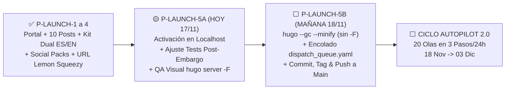

# Plan Maestro de Lanzamiento y Publicación: Datalaria Pulse (`v1.0.0`)

> **ID de Documento:** `PLAN-PULSE-LAUNCH-18NOV`  
> **Especificación Vinculada:** [`specs/apps/pulse/spec.md`](file:///c:/Users/dalae/OneDrive/Emprendiendo/datalaria/specs/apps/pulse/spec.md) (`v1.3.0+`) · [`specs/apps/pulse/design.md`](file:///c:/Users/dalae/OneDrive/Emprendiendo/datalaria/specs/apps/pulse/design.md) · [`specs/ops/autopilot/spec.md`](file:///c:/Users/dalae/OneDrive/Emprendiendo/datalaria/specs/ops/autopilot/spec.md) (`v2.2.0` / `ADR-028`)  
> **Fecha Oficial de Lanzamiento (Día 1):** Miércoles **18 de noviembre de 2026 (`2026-11-18`)**  
> **Estrategia de Despliegue Localhost + Push:** Pre-activación local y QA visual en `localhost` el **Martes `17/11`** (sin `commit` ni `push`), seguida de `git push` a producción el **Miércoles `18/11`** y distribución en **3 Olas / 24h** hasta el **Jueves `03/12/2026`**.  
> **Checkout Lemon Squeezy Oficial:** `https://datalaria.lemonsqueezy.com/checkout/buy/3aac3253-2081-44b5-af4d-c0ecfc257be0?embed=1`

---

## 1. Cronograma Maestro de Contenido en Web (Opción A · `INV-SCRIBA-CHRONO`)

Desde el momento del `push` el **Día 1 (`2026-11-18`)**, quedan operativos en producción la **Web App (`/apps/pulse/`)**, las **Fichas (`/es/apps/pulse/` y `/en/apps/pulse/`)**, el **Kit Dual ES/EN (`#pack-pulse` en `/recursos/` y Lemon Squeezy)** y la **Parte 1**. La serie se despliega a razón de **2 entregas por semana (Miércoles y Domingo)**:

| Fecha | Día | Activo / Entrega Publicada en Vivo | Slug ES / Slug EN | Regla de Enlaces Activos (`INV-SCRIBA-CHRONO`) |
| :--- | :---: | :--- | :--- | :--- |
| **`2026-11-15`** | Dom | **Preludio Autopilot Parte 10:** *Puente Scriba ⇔ Pulse* | `autopilot-parte10-scriba-sindicacion-puente-pulse` `autopilot-part10-scriba-syndication-pulse-bridge` | Ya publicada en producción. |
| **`2026-11-18`** | **Mié** *(Día 1)* | 🚀 **Go-Live Datalaria Pulse `v1.0.0`:** • **App Web:** `/apps/pulse/` • **Ficha App:** `/es/apps/pulse/` y `/en/apps/pulse/` • **Kit Comercial (19 €):** `/recursos/#pack-pulse` • **Post Parte 1 (1/5):** *Adiós Notion: Content Ops as Code* | `pulse-parte1-adios-notion-content-ops` `pulse-part1-goodbye-notion-content-ops` | - **Parte 1:** Enlaza a App, Ficha y Checkout Lemon Squeezy (`product-card`). Partes 2–5 en texto plano. - **Kit `#pack-pulse`:** Botón *"Artículo técnico 📖"* apunta a **Parte 1**. |
| **`2026-11-22`** | **Dom** | 🟢 **Post Parte 2 (2/5):** *Del Front Matter al Índice: Pydantic v2, Paridad ES/EN y CI/CD* | `pulse-parte2-indexador-pydantic-paridad-ci` `pulse-part2-pydantic-indexer-bilingual-parity-ci` | - Enlaza hacia atrás a Parte 1, App, Ficha y Kit. Partes 3–5 en texto plano. |
| **`2026-11-25`** | **Mié** | 🟢 **Post Parte 3 (3/5):** *Tabla Ejecutiva, Tablero Kanban y Calendario en React 19* | `pulse-parte3-tablero-react-tabla-kanban-calendario` `pulse-part3-react-dashboard-table-kanban-calendar` | - Enlaza hacia atrás a Partes 1–2, App, Ficha y Kit. Partes 4–5 en texto plano. |
| **`2026-11-29`** | **Dom** | 🟢 **Post Parte 4 (4/5):** *GA4 y Search Console Automatizados: Salud & ROI Orgánico* | `pulse-parte4-ga4-search-console-automatico` `pulse-part4-ga4-search-console-automated` | - Enlaza hacia atrás a Partes 1–3, App, Ficha y Kit. Parte 5 en texto plano. |
| **`2026-12-02`** | **Mié** *(Cierre)* | 🏁 **Post Parte 5 (5/5):** *De Notion a Excel en 5 Minutos: Kit Power Query y Fábrica IA* | `pulse-parte5-kit-excel-migracion-notion-equipos` `pulse-part5-excel-kit-notion-migration-teams` | - **Cierre de Malla (`E04`):** Activar enlaces cruzados `1 ↔ 2 ↔ 3 ↔ 4 ↔ 5` en toda la serie y actualizar botón *"Artículo técnico 📖"* de `#pack-pulse` hacia Parte 5 (o mantener Parte 1 según estrategia). |
| **`2026-12-06`** | **Dom** | 📘 **Post Dominical Continuidad:** *Inference-Time Scaling y Razonamiento Sistema 2* | `inference_time_scaling` | Mantiene cadencia dominical sin huecos tras cerrar Pulse. |

---

## 2. Estado de Hitos de Construcción y Lanzamiento

- `[x]` **`P-CAL-OPT-A`**: Fechas Opción A (`18/11`, `22/11`, `25/11`, `29/11`, `02/12`) configuradas y sincronizadas.
- `[x]` **`P-LAUNCH-1`**: Blindaje de `layouts/apps/single.html`, `pulse.yaml v1.0.0`, fichas enriquecidas y deep-linking en Web App React.
- `[x]` **`P-LAUNCH-2`**: Saneamiento anti-404 `INV-SCRIBA-CHRONO` y `product-card` en los 10 artículos ES/EN.
- `[x]` **`P-LAUNCH-3`, `3B` y `3C`**: Excel automatizado Dual ES/EN con cero duplicación, tablas nativas, colores de pestaña, guías PDF de 5 páginas TrueType y ZIP Dual `Datalaria_Pulse_Kit.zip` (`38` archivos, `804.3 KB`).
- `[x]` **`P-LAUNCH-4`**: `social_pack.yaml` ES/EN generados y validados para las 5 entregas (`DRY_RUN PASS`).
- `[x]` **`P-LAUNCH-LS-PREP & URL`**: Miniaturas `1200×630` / `1080×1080`, previews `1600×980` sin glifos `□` y checkout URL real de Lemon Squeezy cableada (`3aac3253-2081-44b5-af4d-c0ecfc257be0?embed=1`).

---

### `[x]` Hito `P-LAUNCH-5A` (HOY Martes `17/11`): Pre-Activación en Localhost y Adaptación Limpia de Tests

* **Objetivo:** Descongelar todo en el árbol de trabajo **local** hoy `17/11` **SIN hacer `git commit` ni `git push`**, permitiendo auditar y depurar visualmente en `http://localhost:1313` toda la Home, la Web App, la ficha, el catálogo `/recursos/#pack-pulse`, el modal de detalles, el checkout overlay de Lemon Squeezy y las 5 partes de la serie.
* **Qué ocurre con los tests de embargo al activar:** Al pasar `pulse` de `incubating` a `live`, existen 5 tests diseñados para bloquear el embargo pre-lanzamiento (`test_embargo_18nov_and_previews`, `test_jan2027_embargo_and_pulse_18nov_embargo_coexistence`, `test_dual_embargo_helix_jan2027_and_pulse_18nov_intact`, `test_pulse_18nov_embargo_still_intact` y `test_inv_portal_rel_1_embargo_and_public_status`) además de `autopilot/tests/test_autopilot_orchestrator.py::test_secondary_cta_blocks_incubating_apps_and_allows_live_apps`. En `P-LAUNCH-5A` se actualizan limpiamente para verificar el **estado `live` de Pulse** manteniendo **intacto al 100 % el embargo de Datalaria Helix (`Enero 2027`)**, de modo que `pytest` y GitHub Actions CI pasen en verde al `100 %` mañana al hacer push.
* **Acciones ejecutadas en `P-LAUNCH-5A` (2026-11-17):**
  1. Creado checkpoint `sdd-checkpoint-pre-p-launch-5a`.
  2. Ejecutado `python -m ops.pulse.release_18nov --activate` (usa automáticamente `DEFAULT_CHECKOUT_URL` con `?embed=1`).
  3. Ejecutado `python -m ops.pulse.build_index` y `python -m ops.pulse.publish_public` (actualiza `public.json` con Pulse en estado `live`).
  4. Actualizado `ops/pulse/release_18nov.py` (`verify_live_launch()` + `--verify-live`) y los 6 tests afectados (`ops/pulse/tests/test_kit_packaging.py`, `ops/helix/tests/test_kit_packaging.py`, `ops/helix/tests/test_launch_series.py`, `ops/helix/tests/test_sandbox_web.py`, `ops/helix/tests/test_portal_radar.py`, `autopilot/tests/test_autopilot_orchestrator.py`) para exigir `status: live` en Pulse, `draft: false` en fichas, `pack-pulse` activo con checkout real **y embargo Helix Ene-2027 al 100 %**.
  5. Verificado `pytest` completo (`152/152` en verde) y `hugo --renderToMemory -F` (código `0`). Nota de build en fecha `2026-11-17`: `hugo --renderToMemory` sin `-F` dispara intencionadamente la guardia Art. 7 de `layouts/apps/single.html` porque Parte 1 está fechada a `2026-11-18`; a partir de las `00:00` del `18/11` pasará `hugo --gc --minify` sin `-F`.
  6. Preview local lista con **`hugo server -F --disableFastRender`** (el flag `-F` es imprescindible hoy `17/11` para ver los posts fechados a `>= 2026-11-18`).

---

### `[x]` Hito `P-LAUNCH-5B` (Miércoles `2026-11-18` · Go-Live Producción): Compilación Real Sin `-F`, Cola 24h (Solo Parte 1) y `git push`

* **Objetivo:** Publicar oficialmente **Datalaria Pulse `v1.0.0`** + **Parte 1** en `datalaria.com` el `2026-11-18`, y dejar encoladas las olas automáticas diferidas únicamente de la **Parte 1** en `data/editorial/dispatch_queue.yaml` (Partes 2..5 se encolarán bajo demanda en su fecha).
* **Acciones verificadas de `P-LAUNCH-5B`:**
  1. ✅ Reloj verificado (`>= 2026-11-18`) y compilación Hugo de producción **sin `-F`** (`hugo --minify -d <scratch>` y `hugo --renderToMemory`): exit `0`, confirmando existencia de `es/posts/pulse-parte1-adios-notion-content-ops/index.html`, `en/posts/pulse-part1-goodbye-notion-content-ops/index.html`, `es/apps/pulse/index.html`, `en/apps/pulse/index.html`, `apps/pulse/index.html` y `#pack-pulse` en `{es/recursos,en/resources}/index.html`, con **Partes 2–5 y Helix (`2027`) ausentes**.
  2. ✅ Regenerados `python -m ops.pulse.build_index` (`185` activos), `python -m ops.pulse.publish_public` (`174` públicos / `158` publicados; `pulse`, `pack-pulse` y `pulse-part1` en `status: published`, excluidos `draft`s y `helix` bajo `INV-PULSE-9`) y `python -m ops.pulse.sync_admin_snapshot` (Supabase RLS `HTTP 200`).
  3. ✅ Encoladas en [`data/editorial/dispatch_queue.yaml`](file:///c:/Users/dalae/OneDrive/Emprendiendo/datalaria/data/editorial/dispatch_queue.yaml) **únicamente las 3 olas diferidas de Parte 1** mediante `enqueue_post_waves(..., include_newsletter=True, include_wave1=False)` (`2_en_native` `14:30Z`, `3a_es_syndication` `19:30Z`, `3b_en_syndication` `2026-11-19T05:30Z`). Partes 2..5 diferidas por instrucción explícita.
  4. ✅ Assurance Gate en verde (`pytest`, `--verify-live`, `--verify-embargo`, `orchestrator --dry-run` ES/EN y `hugo --renderToMemory`).
  5. ✅ Commit oficial de lanzamiento en `main`, tag `sdd-checkpoint-pulse-launch-v1.0` y **`git push origin main` + tag**.
  6. ⏳ Pendiente de ejecución manual tras verificar Netlify `HTTP 200`: lanzar **Ola 1 (`1_es_native`)** de Parte 1 en GitHub Actions + 1-clic X Web Intent (ES).

---

## 3. Ciclo Completo de Publicaciones y Olas Autopilot 2.0 (`18/11` → `03/12`)

Siguiendo el protocolo híbrido de **3 Olas en 24h (`ADR-028` / `Hito 7.6`)**:
- **Ola 1 (`1_es_native`, Mañana `~08:30–09:00 CET`):** Se dispara **manualmente** desde GitHub Actions (`Run workflow`) una vez verificado `HTTP 200` en `datalaria.com` (Netlify). Publica **LinkedIn ES** + **Newsletter Brevo ES (Lista `#3`)**. **X Coste 0 € (ES)** se publica manualmente en 1 clic con la `web_intent_url` de `social_pack.yaml`.
- **Ola 2 (`2_en_native`, Tarde `15:30 CET` / `14:30 UTC` — Apertura USA):** Se ejecuta **automáticamente por Cron** (`30 14 * * *`) desde `dispatch_queue.yaml`. Publica **LinkedIn EN** + **Newsletter Brevo EN (Lista `#4`)**. **X Coste 0 € (EN)** se publica manualmente en 1 clic.
- **Ola 3A (`3a_es_syndication`, Noche `20:30 CET` / `19:30 UTC` — +12h SEO):** Se ejecuta **automáticamente por Cron** (`30 19 * * *`). Sindica en **Dev.to (ES)** con `canonical_url` hacia `datalaria.com`.
- **Ola 3B (`3b_en_syndication`, Mañana Día +1 `07:30 CET` / `06:30 UTC` — +22h SEO):** Se ejecuta **automáticamente por Cron** (`30 6 * * *`). Sindica en **Dev.to (EN)** + **CoderLegion (EN)** con `canonical_url`/`source_url` hacia `datalaria.com`.

### Calendario Exhaustivo de las 20 Olas (5 Entregas · 16 Días)

| Entrega | Ola | Fecha & Hora | Disparo | Archivo Objetivo (`file_path`) | Canales Ejecutados |
| :--- | :---: | :--- | :--- | :--- | :--- |
| **Parte 1** | **1** | Mié `18/11` `08:45 CET` | Manual `workflow_dispatch` *(tras `push` + HTTP 200)* | `content/es/posts/pulse-parte1-adios-notion-content-ops/index.md` | LinkedIn ES + Brevo `#3` + X ES (manual 1-clic) |
| **Parte 1** | **2** | Mié `18/11` `15:30 CET` (`14:30 UTC`) | 🤖 Cron `30 14 * * *` | `content/en/posts/pulse-part1-goodbye-notion-content-ops/index.md` | LinkedIn EN + Brevo `#4` + X EN (manual 1-clic) |
| **Parte 1** | **3A** | Mié `18/11` `20:30 CET` (`19:30 UTC`) | 🤖 Cron `30 19 * * *` | `content/es/posts/pulse-parte1-adios-notion-content-ops/index.md` | Dev.to ES (`canonical_url`) |
| **Parte 1** | **3B** | Jue `19/11` `07:30 CET` (`06:30 UTC`) | 🤖 Cron `30 6 * * *` | `content/en/posts/pulse-part1-goodbye-notion-content-ops/index.md` | Dev.to EN + CoderLegion EN (`source_url`) |
| **Parte 2** | **1** | Dom `22/11` `09:00 CET` | Push/Deploy diario Netlify + Manual `workflow_dispatch` | `content/es/posts/pulse-parte2-indexador-pydantic-paridad-ci/index.md` | LinkedIn ES + Brevo `#3` + X ES (manual) |
| **Parte 2** | **2** | Dom `22/11` `15:30 CET` (`14:30 UTC`) | 🤖 Cron `30 14 * * *` | `content/en/posts/pulse-part2-pydantic-indexer-bilingual-parity-ci/index.md` | LinkedIn EN + Brevo `#4` + X EN (manual) |
| **Parte 2** | **3A** | Dom `22/11` `20:30 CET` (`19:30 UTC`) | 🤖 Cron `30 19 * * *` | `content/es/posts/pulse-parte2-indexador-pydantic-paridad-ci/index.md` | Dev.to ES |
| **Parte 2** | **3B** | Lun `23/11` `07:30 CET` (`06:30 UTC`) | 🤖 Cron `30 6 * * *` | `content/en/posts/pulse-part2-pydantic-indexer-bilingual-parity-ci/index.md` | Dev.to EN + CoderLegion EN |
| **Parte 3** | **1** | Mié `25/11` `09:00 CET` | Push/Deploy diario Netlify + Manual `workflow_dispatch` | `content/es/posts/pulse-parte3-tablero-react-tabla-kanban-calendario/index.md` | LinkedIn ES + Brevo `#3` + X ES (manual) |
| **Parte 3** | **2** | Mié `25/11` `15:30 CET` (`14:30 UTC`) | 🤖 Cron `30 14 * * *` | `content/en/posts/pulse-part3-react-dashboard-table-kanban-calendar/index.md` | LinkedIn EN + Brevo `#4` + X EN (manual) |
| **Parte 3** | **3A** | Mié `25/11` `20:30 CET` (`19:30 UTC`) | 🤖 Cron `30 19 * * *` | `content/es/posts/pulse-parte3-tablero-react-tabla-kanban-calendario/index.md` | Dev.to ES |
| **Parte 3** | **3B** | Jue `26/11` `07:30 CET` (`06:30 UTC`) | 🤖 Cron `30 6 * * *` | `content/en/posts/pulse-part3-react-dashboard-table-kanban-calendar/index.md` | Dev.to EN + CoderLegion EN |
| **Parte 4** | **1** | Dom `29/11` `09:00 CET` | Push/Deploy diario Netlify + Manual `workflow_dispatch` | `content/es/posts/pulse-parte4-ga4-search-console-automatico/index.md` | LinkedIn ES + Brevo `#3` + X ES (manual) |
| **Parte 4** | **2** | Dom `29/11` `15:30 CET` (`14:30 UTC`) | 🤖 Cron `30 14 * * *` | `content/en/posts/pulse-part4-ga4-search-console-automated/index.md` | LinkedIn EN + Brevo `#4` + X EN (manual) |
| **Parte 4** | **3A** | Dom `29/11` `20:30 CET` (`19:30 UTC`) | 🤖 Cron `30 19 * * *` | `content/es/posts/pulse-parte4-ga4-search-console-automatico/index.md` | Dev.to ES |
| **Parte 4** | **3B** | Lun `30/11` `07:30 CET` (`06:30 UTC`) | 🤖 Cron `30 6 * * *` | `content/en/posts/pulse-part4-ga4-search-console-automated/index.md` | Dev.to EN + CoderLegion EN |
| **Parte 5** | **1** | Mié `02/12` `09:00 CET` | Cierre Malla (`P-LAUNCH-5C`) + Manual `workflow_dispatch` | `content/es/posts/pulse-parte5-kit-excel-migracion-notion-equipos/index.md` | LinkedIn ES + Brevo `#3` + X ES (manual) |
| **Parte 5** | **2** | Mié `02/12` `15:30 CET` (`14:30 UTC`) | 🤖 Cron `30 14 * * *` | `content/en/posts/pulse-part5-excel-kit-notion-migration-teams/index.md` | LinkedIn EN + Brevo `#4` + X EN (manual) |
| **Parte 5** | **3A** | Mié `02/12` `20:30 CET` (`19:30 UTC`) | 🤖 Cron `30 19 * * *` | `content/es/posts/pulse-parte5-kit-excel-migracion-notion-equipos/index.md` | Dev.to ES |
| **Parte 5** | **3B** | Jue `03/12` `07:30 CET` (`06:30 UTC`) | 🤖 Cron `30 6 * * *` | `content/en/posts/pulse-part5-excel-kit-notion-migration-teams/index.md` | Dev.to EN + CoderLegion EN *(Cierre Final)* |

> ⚠️ **Recordatorio Técnico Vital (Posts Programados en Hugo + Netlify):**
> Hugo es estático (`buildFuture: false` en Netlify). Para que cada post programado (`22/11`, `25/11`, `29/11`, `02/12`) aparezca en `datalaria.com` el día que corresponde **antes** de disparar su Ola 1, debe ocurrir un **re-build de Netlify** ese día (ya sea porque hiciste un `git commit --allow-empty` / actualización de índice `build_index` + `push`, o mediante tu cron/Build Hook de Netlify). **Regla de Oro (`INV-AUTO-10`):** Nunca dispares la **Ola 1** de una entrega sin confirmar primero que su URL devuelve `HTTP 200` en `https://datalaria.com`.
