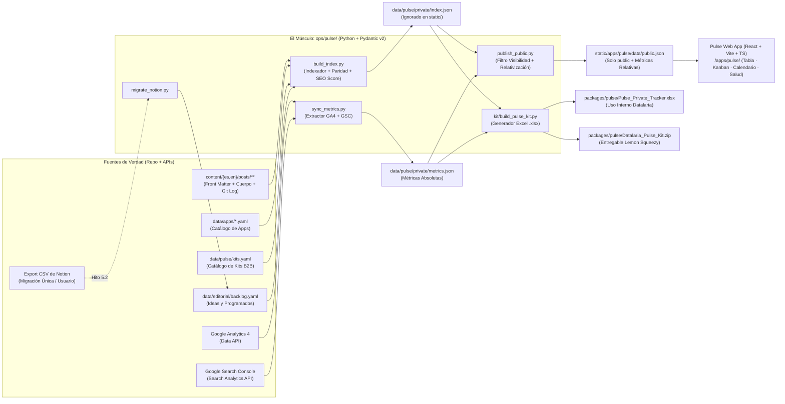

# Especificación Técnica SDD: Datalaria Pulse (`pulse`)

> **ID de Especificación:** `SPEC-APP-PULSE`  
> **Versión:** `1.0.0`  
> **Estado:** `APPROVED`  
> **Propietario de Dominio:** Datalaria (Operations Engineering & Applied AI)  
> **Ubicación del Código Fuente:** `apps/pulse/web/` (Frontend SPA) · `ops/pulse/` (Motor Python ETL + Kit Factory)  
> **Ubicación del Artefacto Público:** `static/apps/pulse/` (Ruta web: `/apps/pulse/`)

---

## 1. Propósito Ejecutivo y Modelo de Monetización (Business Context)

### 1.1 Problema que Resuelve
Elimina la doble entrada manual y la desincronización de calendarios editoriales en herramientas externas (como Notion o Trello) para equipos de documentación técnica, SEO, marketing de contenidos B2B y medios digitales. **Datalaria Pulse** automatiza el gobierno de activos editoriales (*Content Ops as Code*) extrayendo directamente del repositorio (o de `sitemap.xml` / exports de Notion) el estado de cada Post, Aplicación y Kit, evaluando determinísticamente su paridad bilingüe (`ES ⇔ EN`), salud SEO, caducidad documental y cruzándolo con métricas de rendimiento orgánico (GA4 + Google Search Console).

### 1.2 Vínculo de Monetización (Dual-Mode Strategy — Constitución Art. 3)
- **Modo 1 — Executive Sandbox Público (Gratis / Instantáneo / 24x7):**
  - Accesible en `https://datalaria.com/apps/pulse/` sin registro ni llamadas a backends externos.
  - Carga el dataset público pre-calculado (`static/apps/pulse/data/public.json`), mostrando los activos publicados, programados y las ideas marcadas con `visibility: public`.
  - **Privacidad de Métricas por Diseño:** Expone métricas reales de GA4 y Search Console transformadas exclusivamente a **escalas relativas** (percentil `rank_pct`, índice base 100 sobre la mediana `index_100` y variación porcentual `trend_30d_pct`), ocultando cifras absolutas de negocio y activos prospectivos (`visibility: private`).
  - Permite además al visitante **cargar en memoria (100% en navegador) su propio CSV exportado de Notion** para visualizar al instante su propio tablero Tabla / Kanban / Calendario y auditoría de paridad/SEO antes de comprar el Kit.
- **Modo 2 — Vista Privada Local & Kit Descargable (v1 Sin Backend Cloud):**
  - La suscripción alojada Pro/Team con Supabase queda **aparcada (ADR-012 Ronda 3)** hasta validar tracción en el Hito 5.8.
  - En local (`npm run dev` o generador Excel privado), el propietario de Datalaria visualiza el 100% de sus activos (incluyendo `visibility: private` y métricas absolutas de GA4/GSC).
- **Upsell Directo (Lemon Squeezy):**
  - **Producto Vinculado:** **Datalaria Pulse — Content Ops & Notion Migration Kit** (plantilla maestra Excel `.xlsx` compatible con Excel 2016+/365 + importador automático de Notion por Power Query y script Python + generador Git/Hugo/Astro + guía paso a paso de conexión GA4 y Search Console con Service Account propia).
  - **Integración en Catálogo:** Publicado en `/es/recursos/` y `/en/resources/` e integrado con botones de conversión trazados en GA4 dentro de la App y de la serie de 5 artículos.

---

## 2. Arquitectura del Módulo y Flujo de Datos



### 2.1 Manifiesto de Archivos (File Manifest)
| Archivo / Directorio | Rol y Responsabilidad |
| :--- | :--- |
| `specs/apps/pulse/spec.md` | Especificación técnica SDD canónica de Datalaria Pulse. |
| `data/pulse/kits.yaml` | Catálogo estructurado de Kits y Suites B2B de Datalaria (fuente única para Pulse y páginas de recursos). |
| `data/editorial/backlog.yaml` | Registro de ideas y artículos futuros sin fichero Markdown creado aún (`visibility: public \| private`). |
| `data/pulse/private/` | Directorio local (excluido de `static/` y protegido por `.gitignore` para datos sensibles) con `index.json` y `metrics.json` completos. |
| `ops/pulse/models.py` | Contratos Pydantic v2 estrictos (`ContentAsset`, `LanguageParity`, `SeoAudit`, `RelativeMetrics`, `PublicPulseDataset`). |
| `ops/pulse/migrate_notion.py` | Script determinista de migración desde el CSV exportado de Notion hacia `backlog.yaml` y validación contra los posts del repo. |
| `ops/pulse/build_index.py` | Escáner de `content/{es,en}/posts/`, `data/apps/*.yaml`, `data/pulse/kits.yaml` y `backlog.yaml`; calcula conteo real de palabras, paridad bilingüe, auditoría SEO y enlaces cruzados. |
| `ops/pulse/sync_metrics.py` | Extractor automatizado de métricas de GA4 (`screenPageViews`, `totalUsers`, `userEngagementDuration`) y Search Console (`clicks`, `impressions`, `ctr`, `position`) por URL de Post, App y Kit. |
| `ops/pulse/publish_public.py` | Compilador de seguridad que filtra activos `private` y transforma métricas absolutas en índices relativos (`public.json`), bloqueando cualquier fuga de datos privados. |
| `ops/pulse/kit/build_pulse_kit.py` | Fábrica programática (`openpyxl`) que genera la plantilla maestra `Pulse_Content_Ops.xlsx` (para el Kit de clientes) y el tracker privado poblado de Datalaria. |
| `ops/pulse/tests/` | Suite `pytest` de validación de invariantes (paridad ES/EN, relativización, ausencia de fugas privadas, integridad de Excel). |
| `apps/pulse/web/` | Código fuente de la SPA (React 19 + Vite + TypeScript + Tailwind/CSS variables de Datalaria): vistas Tabla, Kanban, Calendario, Salud Editorial e importador CSV de Notion en cliente. |
| `static/apps/pulse/` | Bundle estático compilado (`index.html`, `assets/`, `data/public.json`). Cero archivos `.py`, `.env` o datos privados. |
| `.github/workflows/pulse.yml` | Pipeline CI/CD ejecutado en cada `push` a `content/**` y mediante `schedule` diario para mantener `public.json` sincronizado. |

---

## 3. Contratos de Datos y Modelo de Columnas (Hitos 5.0 y 5.1)

### 3.1 Entidad Unificada: `ContentAsset` (Pydantic v2 / JSON Schema)
Cada fila o tarjeta representa un **activo único bilingüe** (`post`, `app` o `kit`), emparejando automáticamente las versiones en español e inglés mediante su `translationKey` (para posts) o `slug` (para apps y kits).

| Campo | Tipo | Origen | En `public.json` | Equivalente Notion |
| :--- | :--- | :--- | :-: | :--- |
| `id` | `str` | Automático (`translationKey` o `slug`) | ✅ | *(No existía — mezclaba ES/EN)* |
| `asset_type` | `Literal["post", "app", "kit"]` | Automático (según directorio/fuente) | ✅ | *(No existía)* |
| `status` | `Literal["idea", "draft", "review", "scheduled", "published"]` | Automático (`draft`, `date` vs hoy) o `ops.status` / `backlog.yaml` | ✅ | `Status` |
| `visibility` | `Literal["public", "private"]` | Manual en `backlog.yaml` o `ops.visibility` (por defecto `public` en publicados) | Solo `"public"` | *(No existía)* |
| `title_es` / `title_en` | `str \| None` | Automático (front matter `title` / YAML) | ✅ | `Title` |
| `url_es` / `url_en` | `str \| None` | Automático (ruta canónica Hugo) | ✅ | `Link` |
| `publish_date` | `date \| None` | Automático (front matter `date` / `release_date`) | ✅ | `Publish Date` |
| `last_modified_es` / `en` | `datetime \| None` | Automático (`git log -1 --format=%cI` por archivo) | ✅ | `Last Updated` *(estaba vacío)* |
| `language_parity` | `Literal["complete", "missing_en", "missing_es", "outdated_en", "outdated_es"]` | Automático (existencia de par + comparación de `last_modified`) | ✅ | *(No existía)* |
| `category` | `str` | Automático (`category` o primera de `categories`) | ✅ | `Category` |
| `tags` | `list[str]` | Automático (front matter `tags`) | ✅ | `Tags` |
| `series` | `str \| None` | Automático (`series` o prefijo de slug `app-lifeops_part*`, `obs_parte*`) | ✅ | *(No existía)* |
| `brief_es` / `brief_en` | `str` | Automático (`description` o `summary`; o `brief` en `backlog.yaml`) | ✅ | `Content Brief` |
| `word_count_es` / `en` | `int` | Automático (conteo léxico real del cuerpo Markdown sin bloques de código/HTML) | ✅ | `Word Count` *(era manual)* |
| `reading_time_min` | `int` | Automático (`ceil(word_count / 200)`) | ✅ | *(No existía)* |
| `related_app` | `str \| None` | Automático (detección de shortcode ``) | ✅ | *(No existía)* |
| `related_kit` | `str \| None` | Automático (detección de enlaces a `/recursos/` o checkout Lemon Squeezy) | ✅ | *(No existía)* |
| `seo_audit` | `SeoAudit` | Automático (`score_0_100` + flags: longitud de título, meta description, imagen de portada, enlaces internos, tags) | ✅ | `SEO Score` *(estaba vacío)* |
| `freshness_status` | `Literal["fresh", "review_soon", "stale"]` | Automático (según días desde `last_modified` frente a umbral de caducidad, por defecto 180/365 días) | ✅ | *(No existía)* |
| `owner` | `str` | Manual opcional (`ops.owner`, por defecto `"Daniel Alaez"`) | ✅ | `Author` |
| `campaign` | `str \| None` | Manual opcional (`ops.campaign` o `backlog.yaml`) | ✅ | `Related Campaign` |
| `social_channels` | `list[str]` | Manual/Autopilot (`ops.social` — ej. `["linkedin", "x"]`) | ✅ | `Social Networks` |
| `metrics_relative` | `RelativeMetrics \| None` | Automático (`publish_public.py` a partir de GA4 + GSC) | ✅ | `Performance Notes` |
| `metrics_absolute` | `AbsoluteMetrics \| None` | Automático (`sync_metrics.py`: visitas, usuarios, tiempo, impresiones, clics, CTR, posición media) | ❌ **(Prohibido en `public.json`)** | *(No existía)* |

> **Columnas eliminadas respecto a Notion:** `Related SEO Strategy` (100% vacía y redundante con `seo_audit` + `campaign`).

---

## 4. El Músculo Matemático e Invariantes de Dominio

> **Regla SDD (Constitución Art. 1.3):** Todas las métricas de paridad, auditoría SEO y relativización de tráfico se calculan mediante funciones deterministas en Python cubiertas por `pytest`.

### 4.1 Fórmulas y Reglas Deterministas
1. **Estado del Activo (`status`):**
   - Si proviene exclusivamente de `backlog.yaml`: usa el estado declarado (`idea`, `draft`, `review`, `scheduled`).
   - Si existe fichero en `content/`:
     - Si `ops.status` está definido en front matter → prevalece `ops.status`.
     - Si `draft: true` → `"draft"`.
     - Si `draft: false` y `date > CURRENT_DATE` → `"scheduled"`.
     - Si `draft: false` y `date <= CURRENT_DATE` → `"published"`.
2. **Paridad Bilingüe (`language_parity`):**
   - `"missing_en"` si existe versión ES pero no EN; `"missing_es"` si existe EN pero no ES.
   - Si existen ambas y `(last_modified_es - last_modified_en) > 7 días` → `"outdated_en"`.
   - Si `(last_modified_en - last_modified_es) > 7 días` → `"outdated_es"`.
   - En caso contrario → `"complete"`.
3. **Puntuación de Salud SEO (`seo_audit.score_0_100`):**
   - Suma ponderada de 5 checks deterministas (20 puntos cada uno):
     1. `title_ok`: longitud entre 35 y 75 caracteres.
     2. `description_ok`: presencia de `description` o `summary` entre 80 y 180 caracteres.
     3. `parity_ok`: `language_parity == "complete"`.
     4. `taxonomy_ok`: al menos 1 categoría y $\ge 3$ `tags`.
     5. `internal_links_ok`: cuerpo con $\ge 1$ enlace interno o shortcode `app-ref`.
4. **Relativización de Métricas para el Sandbox Público (`RelativeMetrics`):**
   - Sea $V_i$ el total de páginas vistas (ES + EN) del activo $i$ en los últimos 30 días, y $\tilde{V}$ la mediana de los activos publicados con $V > 0$:
     $$\text{index\_100}_i = \text{round}\left( \frac{V_i}{\max(\tilde{V}, 1)} \times 100 \right)$$
   - `rank_pct`: percentil de $V_i$ dentro del conjunto de activos publicados ($0..100$).
   - `trend_30d_pct`: variación porcentual respecto a la ventana previa de 30 días, acotada en $[-100\%, +500\%]$ (si el periodo previo fue $0$ y el actual $>0$, devuelve $+100\%$).
   - `gsc_opportunity`: booleano `True` cuando el activo está en el cuartil superior de impresiones de Search Console y su posición media está entre $5.0$ y $20.0$ (oportunidad de optimización de título/CTR).

### 4.2 Invariantes de Seguridad y Dominio
- **INV-PULSE-1 (Cero Fuga de Ideas Privadas):** Ningún registro con `visibility == "private"` puede aparecer en `static/apps/pulse/data/public.json`.
- **INV-PULSE-2 (Cero Fuga de Métricas Absolutas):** El archivo `static/apps/pulse/data/public.json` jamás debe contener claves de conteos absolutos (`views`, `users`, `clicks`, `impressions`, `revenue`).
- **INV-PULSE-3 (Emparejamiento Bilingüe Exacto):** Todo par de artículos en `content/es/posts/<slug>` y `content/en/posts/<slug>` que comparta `translationKey` (o nombre de carpeta) debe consolidarse en un único `ContentAsset` sin duplicar filas.
- **INV-PULSE-4 (Firewall `static/` — Constitución Art. 2):** `static/apps/pulse/` solo puede contener HTML, JS, CSS, imágenes y `data/public.json`. Cero archivos `.py`, `.yaml`, `.xlsx` o `.env`.
- **INV-PULSE-5 (Compatibilidad Universal del Excel del Kit):** El libro `Pulse_Content_Ops.xlsx` debe generarse usando fórmulas compatibles con Excel 2016/2019/365 y Google Sheets (`COUNTIFS`, `SUMIFS`, `INDEX/MATCH`), sin depender de funciones exclusivas de insiders para garantizar que cualquier comprador B2B pueda abrirlo sin errores `#NAME?`.

---

### 4.3 Arquitectura Pro Cloud (Supabase pulse Schema — Hito 5.8 / ADR-015)

Para superar la limitación de almacenamiento exclusivamente en localStorage y dotar a la plataforma de sincronización bidireccional instantánea entre la Web (datalaria.com/apps/pulse/) y Localhost (http://localhost:1313/apps/pulse/), se formaliza la extensión **Pulse Pro Cloud**:

1. **Unificación en el Cluster Supabase (datalaria-core — Constitución Art. 4):**
   - Nuevo esquema dedicado: CREATE SCHEMA IF NOT EXISTS pulse;
2. **Tablas del Esquema pulse:**
   - **pulse.ideas:**
     - id UUID PRIMARY KEY DEFAULT gen_random_uuid()
     - user_id UUID NOT NULL REFERENCES auth.users(id) ON DELETE CASCADE
     - 	itle TEXT NOT NULL
     - 
otes TEXT DEFAULT ''
     - category TEXT DEFAULT 'General'
     - 	ags TEXT[] DEFAULT '{}'
     - status TEXT DEFAULT 'idea' CHECK (status IN ('idea', 'draft', 'review', 'scheduled', 'published'))
     - 	arget_date DATE
     - created_at TIMESTAMPTZ DEFAULT NOW()
     - updated_at TIMESTAMPTZ DEFAULT NOW()
   - **pulse.content_schedule:** Reprogramaciones y excepciones manuales del calendario editorial.
3. **Seguridad y RLS (Row-Level Security):**
   - ALTER TABLE pulse.ideas ENABLE ROW LEVEL SECURITY;
   - Política estricta: CREATE POLICY user_ideas_isolation ON pulse.ideas FOR ALL USING (auth.uid() = user_id);
   - Permite a cualquier usuario visitante registrarse en modo Demo/Trial para gestionar su propio backlog en la nube sin interferir en los datos de otros usuarios ni en el repositorio maestro de Datalaria.
4. **Sincronización Bidireccional Web ↔ Localhost:**
   - La SPA React conecta con Supabase Auth.
   - En modo no autenticado: opera como Sandbox estático (public.json + localStorage).
   - En modo autenticado: sincroniza ideas y cambios de estado directamente contra la base de datos Supabase en tiempo real.

---

## 5. Requisitos No Funcionales (Seguridad, i18n, UI y Kit)
- **Internacionalización (i18n — Constitución Art. 5.1):** Diccionario único `es`/`en` en `apps/pulse/web/src/i18n/` con detección automática por `?lang=es|en`, `localStorage` o idioma del navegador.
- **Diseño y Vistas de la SPA (`apps/pulse/web/`):**
  1. **Vista Tabla Ejecutiva:** Ordenación multi-columna, búsqueda instantánea, filtros por tipo (`post`/`app`/`kit`), estado, categoría, paridad bilingüe y oportunidad SEO.
  2. **Vista Kanban por Estado:** Columnas `Idea` · `Draft` · `In Review` · `Scheduled` · `Published` con tarjetas que muestran insignias de idioma (`ES`/`EN`), serie, score SEO e índice de tráfico relativo.
  3. **Vista Calendario Editorial:** Navegación mensual/trimestral por `publish_date` diferenciando visualmente posts publicados, programados, lanzamientos de Apps y Kits.
  4. **Panel de Salud y ROI de Contenido:** Resumen de KPIs (cadencia mensual, % de paridad bilingüe, cola de refresco de contenidos antiguos y oportunidades de CTR en Search Console).
  5. **Modo "Prueba con tu CSV de Notion" (Client-Side Sandbox):** Botón que permite al visitante arrastrar su propio `.csv` exportado de Notion en el navegador (sin subirlo a ningún servidor) para poblar instantáneamente las 4 vistas y previsualizar lo que obtendrá con el Kit.
- **Variables de Entorno Opcionales (`ops/pulse/`):**
  - `GA4_PROPERTY_ID` y `GOOGLE_APPLICATION_CREDENTIALS` (JSON de Service Account en GitHub Secrets / `.env` local).
  - `GSC_SITE_URL` (ej. `sc-domain:datalaria.com`).
  - *Graceful Degradation:* Si las credenciales de GA4/GSC no están presentes en un entorno local de test, `sync_metrics.py` reutiliza el último snapshot o genera métricas relativas neutras sin romper el build.

---

## 6. Criterios de Aceptación y Comandos de Verificación (Verification Gates)

Para dar por completado cada hito de la Fase 5, deben superarse con código `0` los siguientes comandos:

1. **Verificación del Motor Python e Invariantes (`ops/pulse/`):**
   ```powershell
   pytest ops/pulse/tests -v
   ```
2. **Generación del Índice, Métricas Relativas y Kit Excel:**
   ```powershell
   python ops/pulse/build_index.py
   python ops/pulse/publish_public.py
   python ops/pulse/kit/build_pulse_kit.py
   ```
3. **Linting y Build del Frontend (`apps/pulse/web/`):**
   ```powershell
   cd apps/pulse/web; npm run lint; npm run build:portal
   ```
4. **Integración y Firewall del Portal Hugo:**
   ```powershell
   hugo --gc --minify
   ```
   - [ ] `static/apps/pulse/data/public.json` existe, es válido según `PublicPulseDataset` y supera los tests `INV-PULSE-1` y `INV-PULSE-2`.
   - [ ] Cero archivos `.py`, `.env`, `.sql` o `.xlsx` dentro de `static/apps/pulse/`.
   - [ ] El archivo `packages/pulse/Pulse_Content_Ops.xlsx` se genera sin errores y contiene las hojas `Instrucciones`, `Activos`, `Kanban`, `Calendario`, `Paridad_SEO`, `Metricas` y `Dashboard`.

---

## 7. Ficha Pública y Respaldo Editorial (Hito 5.7)

- **Fichero de datos:** `data/apps/pulse.yaml`
- **Tier:** `b2b` · **Status:** `incubating` (pasará a `live` en el Hito 5.7 al publicar la serie de artículos, cumpliendo el Art. 7 de la Constitución).
- **Serie de 5 artículos planificada (ES y EN):**
  1. `pulse-parte1-adios-notion-content-ops` — *Adiós Notion: presentamos Datalaria Pulse, la gestión editorial que se escribe sola desde Git*
  2. `pulse-parte2-indexador-pydantic-paridad-ci` — *Del front matter al índice: Pydantic, paridad ES/EN y automatización con GitHub Actions*
  3. `pulse-parte3-tablero-react-tabla-kanban-calendario` — *Tabla, Kanban y Calendario en React sobre un índice estático*
  4. `pulse-parte4-ga4-search-console-automatico` — *Cómo conectar Google Analytics 4 y Search Console para medir el ROI de cada Post, App y Kit*
  5. `pulse-parte5-kit-excel-migracion-notion-equipos` — *Gestión editorial para equipos de documentación, SEO y marketing: de Notion a Excel en 5 minutos*
     - **Apartado Especial al Cierre (Visión Pro & Fábrica Autónoma con IA):** Sección dedicada a exponer la automatización del ciclo de vida editorial completo con agentes de IA (Idea ➔ Generación asistida de Draft ➔ Review con Quality Gate determinista ➔ Programación inteligente por huecos de cadencia ➔ Publicación automática con CI/CD sin intervención manual), orientado como servicio de consultoría avanzada, despliegue en entornos corporativos o futura suscripción Pulse Pro/Enterprise, con llamada a la acción (CTA) directa para contactar y profundizar en implementaciones a medida.

---

## 8. Historial Evolutivo (Changelog SemVer)

| Versión | Fecha | Tipo | Cambios | Commit(s) |
| :--- | :--- | :--- | :--- | :--- |
| `v0.1.0` | 2026-10-28 | 📐 Spec | Aprobación de la especificación técnica SDD (`SPEC-APP-PULSE`), modelo unificado de activos (`post`/`app`/`kit`), privacidad por métricas relativas y diseño del Kit Excel + importador de Notion (Hitos 5.0 y 5.1). | *Completado* |
| `v0.2.0` | 2026-10-29 | ⚡ Pro Cloud | Arquitectura Pro Cloud sobre Supabase cluster datalaria-core (esquema pulse, RLS estricto auth.uid() = user_id, Auth en React SPA, sincronización bidireccional Web ↔ Localhost, usuario demo confirmado y suite pytest 18/18 verde — Hito 5.7 / ADR-015). | *Completado* |
