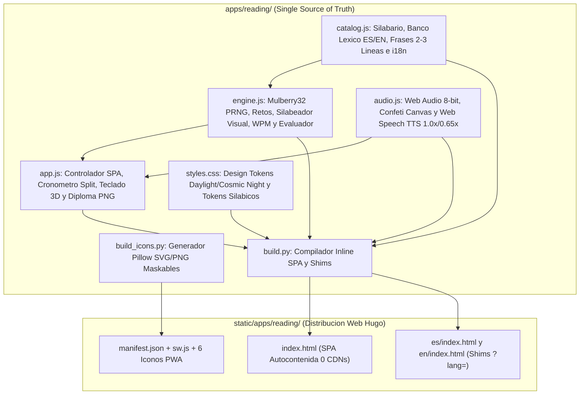

# SPEC-APP-READING: Lector Arcade / Reader Arcade (`reading`)

> **Identificador:** `SPEC-APP-READING`  
> **Versión:** `v1.0.0` (Estado: `APPROVED — Spec-First` · App en estado `incubating`)  
> **Fecha:** `2026-11-17`  
> **Clasificación:** Tier `lab` | EdTech · Alfabetización, Conciencia Fonológica y Fluidez Lectora (`ES ⇔ EN`)  
> **Ruta Canónica:** `https://datalaria.com/apps/reading/`  
> **Ficha Técnica (Embargada hasta 2026-12-16):** `https://datalaria.com/es/apps/reading/` (EN: `/en/apps/reading/`)  
> **Especificación de Diseño:** [`specs/apps/reading/design.md`](file:///c:/Users/dalae/OneDrive/Emprendiendo/datalaria/specs/apps/reading/design.md)  
> **Referencia de Comunalidad:** [`specs/apps/maths/spec.md`](file:///c:/Users/dalae/OneDrive/Emprendiendo/datalaria/specs/apps/maths/spec.md) (*Ábaco Arcade v2.3*)

---

## 1. Propósito Ejecutivo, Usuario Objetivo y Modelo Dual-Mode

### 1.1 Problema que Resuelve y Usuario Objetivo
**Lector Arcade** (*Reader Arcade* en inglés) es la aplicación educativa lúdica de Datalaria para el aprendizaje progresivo de la lectura y el entrenamiento de la fluidez lectora. Hereda la arquitectura, ergonomía táctil, estética *Consumer Playful* y bucle motivacional de [`apps/maths/`](file:///c:/Users/dalae/OneDrive/Emprendiendo/datalaria/specs/apps/maths/spec.md), adaptándolos íntegramente al dominio de la alfabetización infantil y familiar.

- **Usuario Objetivo Primario:** Niños y niñas de **4 a 11 años** en etapas de pre-lectura, lectoescritura inicial y consolidación lectora, junto con **padres, madres, docentes y tutores internacionales** (en español o inglés) que practican en tablets, móviles o PC sin distracciones ni publicidad.
- **Propuesta de Valor en < 5 minutos:**
  1. **Sección `💡 Aprender`:** Laboratorio fonético interactivo con audio dual (`1.0x` normal / `0.65x` modo tortuga) y selector `AA / Aa` para dominar letras, sílabas directas sencillas, sílabas complejas (inversas, trabadas, dígrafos) y lectura entonada de frases.
  2. **Sección `🎮 Jugar`:** 6 niveles adaptativos (desde letras con imagen y palabras con huecos hasta frases de 2 y 3 líneas sin ayuda) combinables con 4 modos de juego, incluyendo **Modo Normal** (sin reloj) y **Contrarreloj Lector** (cronómetro de precisión que se congela al completar la lectura de la palabra o frase y calcula las **PPM / WPM**).
  3. **Sección `🏆 Logros`:** 3 perfiles familiares locales aislados, 6 medallas desbloqueables, récord de velocidad lectora y generador de **Diploma Arcade PNG (`1200×800`)**.

### 1.2 Gobernanza Editorial y Estrategia Dual-Mode (Constitución Art. 3 y Art. 7)
- **Ejecución 100% Client-Side Offline (Sandbox Instantáneo 24x7):** La aplicación funciona íntegramente en el navegador como PWA instalable sin registro, sin APIs externas, sin servidores backend y sin pantallas `OFFLINE`.
- **Embargo Editorial (`App Activa ⇔ Post Publicado`):** Permanecerá en estado `status: incubating` (`draft: true` en fichas `/apps/reading/`) hasta su lanzamiento editorial conjunto en la **2.ª–3.ª semana de diciembre de 2026** (`launch_date: "2026-12-16"`).
- **Producto Comercial Descargable (Dual-Mode EdTech):** El kit comercial descargable para familias y centros educativos (`packages/reading/Kit_Imprimible_Lector_Arcade_Dual.zip`) es generado de forma determinista mediante `ops/reading/build_printable_kit.py`, integrando 120 Flashcards recortables en PDF, Cuaderno de Lectoescritura A4 de 6 niveles en PDF y Tracker Excel Docente/Familiar con fórmulas de fluidez lectora, manteniéndose staged y bajo embargo para Lemon Squeezy.

---

## 2. Límites y Non-Goals (Fuera de Alcance v1.0)

Para blindar la determinabilidad, privacidad infantil y resiliencia offline:
- ❌ **Cero Reconocimiento de Voz en la Nube (`SpeechRecognition`):** Prohibido depender de APIs de micrófono remotas en `v1.0` (rompen PWA offline, fallan en iOS Safari/Firefox y comprometen la privacidad de voces infantiles). La verificación de lectura se realiza de forma 100% determinista mediante **cierre instantáneo de cronómetro al completar / pulsar `✅ ¡Leído!` + micro-check visual de comprensión en 1 toque**.
- ❌ **Cero Dependencias Externas en Runtime:** Prohibido cargar CDNs (`cdn.tailwindcss.com`, Google Fonts remotas, librerías de iconos o imágenes externas).
- ❌ **Cero Backend o Base de Datos Cloud en v1.0:** Sin servidores FastAPI ni tablas Supabase; toda la persistencia de perfiles, medallas y récords reside aislada por perfil en `localStorage`.
- ❌ **Sin Sílabas Autogeneradas por Heurísticas Débiles:** Las palabras no se silabean algorítmicamente en runtime; cada entrada del catálogo incluye su segmentación silábica pedagógica curada y verificada por tests.

---

## 3. Arquitectura del Sistema y Contratos de Datos



### 3.1 Manifiesto de Archivos (File Manifest)

| Archivo | Rol y Responsabilidad Única |
| :--- | :--- |
| `apps/reading/catalog.js` | Catálogo bilingüe `window.READING_CATALOG`: 6 niveles, 4 modos, 3 perfiles, 6 medallas, 4 módulos de `Aprender`, bancos léxicos curados (`ES` y `EN`), frases 2–3 líneas con `microCheck` e `i18n` completo. |
| `apps/reading/engine.js` | Músculo determinista `window.ReadingEngine`: `createSeededRng`, `normalizeAnswer` (preservando `Ñ/ñ`), `computeWpm`, `computeRoundScore`, generador de retos y pistas visuales silábicas. |
| `apps/reading/audio.js` | Controlador `window.ReadingAudio`: sintetizador 8-bit Web Audio API, `launchConfetti` en Canvas y `speakText(text, lang, rate)` (`1.0x` / `0.65x` tortuga) vía Web Speech API. |
| `apps/reading/app.js` | Controlador reactivo de interfaz, gestión de cronómetro lector (`stopwatch` y `sprint`), teclado táctil alfabético 3D, perfiles en `localStorage`, PWA update flow y `downloadReadingDiploma()`. |
| `apps/reading/styles.css` | Design Tokens nativos (`Daylight Arcade` + `Cosmic Night`), estilos silábicos (`--syl-a`, `--syl-b`, `--syl-complex`), botones 3D y maquetación responsive (`390px`, `768px`, `1440px`). |
| `apps/reading/build_icons.py` | Generador determinista Pillow de `icon-192.png`, `icon-512.png`, `icon-maskable-192.png`, `icon-maskable-512.png` y `apple-touch-icon.png`. |
| `apps/reading/build.py` | Empaquetador estático inline hacia `static/apps/reading/index.html`, copiador de assets PWA y generador de shims `es/index.html` y `en/index.html`. |
| `apps/reading/manifest.json` | Manifiesto PWA instalable (`start_url: "/apps/reading/"`, `display: "standalone"`, iconos `any` y `maskable`). |
| `apps/reading/sw.js` | Service Worker offline (`CACHE_NAME = 'datalaria-reading-v1.0.0'`, `PRECACHE_ASSETS`, `skipWaiting`). |
| `apps/reading/tests/test_reading_engine.py` | Suite `pytest` + Node.js verificando `INV-READ-1..12`. |
| `ops/reading/build_printable_kit.py` | Generador determinista del Kit Imprimible Comercial ZIP (`PyMuPDF` + `openpyxl`) con Flashcards PDF, Cuaderno A4 y Tracker Excel. |
| `specs/apps/reading/design.md` | Contrato visual UX/UI (`DESIGN-APP-READING`). |

### 3.2 Contratos de Datos en Cliente (`catalog.js` / `engine.js`)

```typescript
export type LevelId = 'l1' | 'l2' | 'l3' | 'l4' | 'l5' | 'l6';
export type GameModeId = 'normal' | 'stopwatch' | 'sprint' | 'daily';
export type ChallengeKind = 'choice' | 'fill_letters' | 'read_check';

export interface MicroCheckOption {
  icon: string;
  label: string;
  isCorrect: boolean;
}

export interface ReadingChallenge {
  id: string;
  levelId: LevelId;
  lang: 'es' | 'en';
  kind: ChallengeKind;
  prompt: string;             // Palabra, sílaba o texto completo
  lines?: string[];           // Para niveles l5 (2 líneas) y l6 (3 líneas)
  syllables?: string[];       // Descomposición curada: ["MA","RI","PO","SA"]
  emoji?: string;             // Ilustración ancla (visible en l1-l3; oculta hasta validar en l4)
  wordCount: number;          // Palabras reales para cálculo PPM/WPM
  maskedSlots?: Array<{ index: number; expected: string }>; // Para l3
  keyboardChars?: string[];   // 8-10 letras táctiles candidatas para l3
  choices?: Array<{ id: string; label: string; emoji?: string; isCorrect: boolean }>; // l1-l2
  microCheck?: { question: string; options: MicroCheckOption[] }; // l4-l6
}

export interface ProfileStats {
  highScores: Record<string, number>;
  bestWpm: number;
  bestStreakEver: number;
  unlockedMedals: string[];
}
```

### 3.3 Catálogo Curricular: 6 Niveles Adaptativos y 4 Modos de Juego

| Nivel | Nombre (`ES` / `EN`) | Edad | Contenido y Ayuda Visual | Mecánica de Validación |
| :--- | :--- | :---: | :--- | :--- |
| **`l1`** | 🌱 **Letras y Sílabas Iniciales** / *First Letters & Syllables* | 4–5 | Vocales, consonantes y sílabas directas (`MA, PA, SA...`) con imagen ancla y audio `🔊` opcional. | Selección entre 4 fichas táctiles 3D. |
| **`l2`** | 🖼️ **Palabra con Imagen** / *Word with Picture* | 5–6 | Palabras bisílabas sencillas (`CASA, PATO, LUNA`) con imagen protagonista visible y sílabas alternables. | Emparejamiento palabra-imagen o lectura + `✅ ¡Leído!`. |
| **`l3`** | 🧩 **Letras Faltantes** / *Missing Letters* | 6–7 | Palabras con imagen y 1–2 letras omitidas (`P _ T _`, `_ U E S O`). | **Teclado Alfabético Táctil 3D** (8–10 letras con distractores fonéticos). Cierre automático del reloj al rellenar el último hueco. |
| **`l4`** | 🚀 **Lectura Sin Ayuda** / *Independent Word Reading* | 7–8 | Palabras complejas (trabadas, inversas, dígrafos `ES` / blends, digraphs `EN`) **sin imagen previa**. | Lectura pura ➔ pulsar `✅ ¡Leído!` (congela reloj) ➔ **Micro-Check Visual** (3 iconos). |
| **`l5`** | 📖 **Frases de 2 Líneas** / *2-Line Stories* | 8–9 | Oraciones cotidianas de 2 líneas (`10–16` palabras) con ritmo natural. | Lectura completa ➔ `✅ ¡Leído!` (congela reloj y calcula PPM) ➔ pregunta relámpago de comprensión. |
| **`l6`** | 🏆 **Mini-Relatos de 3 Líneas** / *3-Line Mini-Stories* | 9–11+ | Párrafos breves de 3 líneas (`22–34` palabras) con `¿?`, `¡!`, comas y datos curiosos. | Lectura completa ➔ `✅ ¡Leído!` (congela reloj y calcula PPM) ➔ pregunta inferencial de 3 opciones. |

**Modos de Juego:**
1. **`normal` (🧘 Modo Normal):** 10 rondas sin temporizador ni límite de tiempo. Pistas visuales (`💡`) y voz (`🔊 / 🐢`) libres para aprender sin estrés.
2. **`stopwatch` (⏱️ Contrarreloj Lector):** Cronómetro de precisión (`00:00.0`) que arranca al mostrarse la palabra o frase y **se cierra/detiene en el instante exacto** en que el usuario completa las letras (`l3`) o pulsa **`✅ ¡Leído!`** (`l2`, `l4`, `l5`, `l6`), calculando tiempo exacto y **PPM (WPM)** (con techo de seguridad `20s` palabras / `45s` frases).
3. **`sprint` (⚡ Sprint 60s):** Reloj global de 60 segundos para encadenar retos rápidos; cada racha de 5 aciertos consecutivos añade `+3s`.
4. **`daily` (📅 Reto Diario):** 10 retos deterministas diarios por fecha `YYYY-MM-DD` y nivel (`Mulberry32`), tira emoji Wordle (`🟩`/`💡`/`🟥`) y Repaso de Fallos.

**Pestaña `💡 Aprender` (4 Bloques Progresivos):**
1. **Letras y Sonidos:** Vocales + consonantes con toggle `AA / Aa` y ejemplo ilustrado (`A ➔ 🐝 Abeja`).
2. **Sílabas Sencillas:** Mesa de Mezclas Silábica (`C + V` en ES / CVC Onset-Rime en EN).
3. **Sílabas Complejas:** Inversas (`AL..UL`), Trabadas (`PLA, BRA, TRA...`) y Dígrafos/Reglas (`CH, LL, RR, QU, GUE/GUI, CE/CI, Ñ` en ES; `bl/st/tr`, `sh/ch/th/wh`, `magic-e` en EN).
4. **Taller de Frases:** Entonación y pausas en `,`, `.`, `¿?`, `¡!` con lectura modelo (`1.0x` y `0.5x`).

---

## 4. El Músculo Matemático y Lingüístico (100% Determinista)

> **Constitución Art. 1.3:** Todo cálculo de velocidad lectora, puntuación, mezcla y normalización ortográfica se ejecuta en JavaScript puro determinista en `apps/reading/engine.js`.

### 4.1 Fórmulas Exactas y Cláusulas de Guarda
1. **Velocidad Lectora (`computeWpm(wordCount, elapsedMs)`):**
   - Cláusula de guarda anti-división por cero o pulsación accidental: `elapsedSec = Math.max(0.4, elapsedMs / 1000)` y si `wordCount <= 0` devuelve `0`.
   - Fórmula: `Math.min(350, Math.round((wordCount * 60) / elapsedSec))`.
2. **Fluidez Efectiva (`effectiveWpm`):**
   - Métrica combinada de velocidad y comprensión: `effectiveWpm = Math.round(avgWpm * (accuracy / 100))`.
3. **Puntuación de Ronda (`computeRoundScore({ mode, streak, usedHint, elapsedMs, targetSec })`):**
   - `base = 100`
   - `speedBonus = (mode === 'stopwatch' || mode === 'daily') ? Math.round(Math.max(0, targetSec - (elapsedMs / 1000)) * 12) : 0`
   - `multiplier = streak >= 5 ? 3 : (streak >= 3 ? 2 : 1)`
   - `cleanBonus = usedHint ? 0 : 20`
   - Total: `Math.round((base + speedBonus) * multiplier) + cleanBonus`.
4. **Estrellas de Dominio (`computeStarsForScore(score)`):**
   - `score >= 1400` $\rightarrow$ 3 estrellas (`⭐⭐⭐`).
   - `score >= 900` $\rightarrow$ 2 estrellas (`⭐⭐☆`).
   - `score >= 400` $\rightarrow$ 1 estrella (`⭐☆☆`).
   - `< 400` $\rightarrow$ 0 estrellas (`☆☆☆`).
5. **Normalización Ortográfica Protegiendo `Ñ/ñ` (`normalizeAnswer(str)`):**
   - Sustituir temporalmente `Ñ/ñ` por un token centinela (`\u0001`), aplicar `.normalize('NFD').replace(/[\u0300-\u036f]/g, '')` para tolerar tildes opcionales (`Á -> A`), restaurar el centinela a `Ñ`, y convertir a `.toUpperCase().trim()`. De este modo `normalizeAnswer('piña') === 'PIÑA'` y `normalizeAnswer('PIÑA') !== normalizeAnswer('PINA')`.

---

## 5. Invariantes de Dominio (`INV-READ-*`)

- **`INV-READ-1` (Rigor Fonético y Consistencia de Banco Léxico):** En el 100% de las entradas de `wordBank`, la concatenación exacta de `syllables.join('')` equivale a `word` (en español); en `l4`–`l6`, todo `microCheck` posee exactamente 3 opciones con 1 sola marcada `isCorrect: true`.
- **`INV-READ-2` (Determinismo de Cronómetro Contrarreloj y WPM):** En `stopwatch`, el cronómetro se congela al completar las letras o pulsar `¡Leído!` antes de renderizar el `microCheck`; `computeWpm()` es una función pura protegida ante `wordCount <= 0`, `elapsedMs <= 0` y valores nulos.
- **`INV-READ-3` (Cero Dependencias Externas en Runtime):** Prohibido cargar CDNs externos (`cdn.tailwindcss.com`, `fonts.googleapis.com`, `fonts.gstatic.com`, STT cloud).
- **`INV-READ-4` (Retrocompatibilidad y Firewall `static/`):** Shims en `static/apps/reading/{es,en}/index.html` redirigiendo a `?lang=es|en` y cero archivos `.py`, `.sql`, `.env`, `.pyc` o `.git` en `static/apps/reading/`.
- **`INV-READ-5` (Inmunidad XSS):** Toda cadena dinámica, parámetro URL o dato de `localStorage` pasa por escape HTML estricto o `textContent`.
- **`INV-READ-6` (Paridad Bilingüe Real `ES ⇔ EN`):** Paridad al 100% de claves `i18n`, niveles, modos, medallas y bloques de aprendizaje entre `es` y `en`, cargando cada idioma su propio currículo fonético nativo.
- **`INV-READ-7` (Tríada Canónica Datalaria):** Cabecera con `#datalaria-back-link`, `#link-spec`, `#link-post` y `#link-kits`.
- **`INV-READ-8` (PWA 100% Offline, Iconos Maskables y Update In-App):** `manifest.json` (`start_url: "/apps/reading/"`), `sw.js` (`PRECACHE_ASSETS`, `skipWaiting`), 6 iconos (`icon.svg`, `192`, `512`, `maskable-192`, `maskable-512`, `apple-touch-icon.png`), `#btn-install-pwa`, `#btn-check-update` y `#pwa-update-banner`.
- **`INV-READ-9` (Anti-FOUC, Persistencia y Atajos):** Micro-script inline `pref-theme` en `<head>`, persistencia de audio `reading-sound` y atajos `T`, `M`, `H`, `Espacio`/`Enter` y teclado físico `A-Z`/`Ñ`/`Backspace`.
- **`INV-READ-10` (Semilla Diaria Determinista y Repaso de Fallos):** `createSeededRng('YYYY-MM-DD_level')` genera secuencias reproducibles en `daily`; tira Wordle (`🟩`/`💡`/`🟥`) y *Mistake Review* al concluir la partida.
- **`INV-READ-11` (Perfiles Familiares Aislados y Diploma PNG):** Perfiles aislados en `localStorage` (`datalaria_reading_v1_stats_<profileId>`) incluyendo `bestWpm`, y generador `downloadReadingDiploma()` en `<canvas>` 2D (`1200×800`).
- **`INV-READ-12` (Integridad `Ñ/ñ` y Ergonomía Pedagógica):** Preservación estricta `Ñ !== N` en evaluación ortográfica, botones táctiles $\ge 48\times48\text{ px}$ y toggles `AA/Aa` + `🎨 Sílabas`.
- **`INV-READ-13` (Compatibilidad Visual Universal e Ilustraciones SVG Inline):** Prohibido el uso de emojis pertenecientes a bloques Unicode $\ge 12.0$ que rendericen como glifos vacíos (tofu `□`) en sistemas operativos comunes o presenten *semantic mismatches* (ej. `MESA` con silla `🪑`). Todo concepto léxico sin representación emoji universal Unicode $\le 11.0$ o con riesgo visual se resuelve mediante ilustraciones vectoriales SVG inline optimizadas (`viewBox="0 0 120 120"`, clase `.reading-svg-icon`) expuestas por `window.ReadingIllustrations` (`apps/reading/illustrations.js`). El audio tortuga opera a velocidad exacta `0.5x`.
- **`INV-READ-14` (Mejoras In-App de Producto, Fluidez y Lámina Imprimible):** 
  1. El cálculo de velocidad lectora en modo contrarreloj (`computeWpm`) se aplica a todos los niveles (`l1` a `l6`), derivando además las **PPM Efectivas** ($\text{round}(\text{PPM}_{\text{avg}} \times \text{Precisión})$) al finalizar la partida.
  2. En el escenario activo de juego se provee botón dual de audio **`🔊 1.0x`** y **`🐢 0.5x`** con resaltado fonético secuencial tipo **Karaoke Silábico** (`.karaoke-active`).
  3. Cada tarjeta de nivel en la pantalla principal muestra sus **Estrellas de Dominio (`⭐⭐⭐`)** según `computeStarsForScore(bestScore)`.
  4. Modo **"✏️ Mis Palabras"** activable por input o parámetro URL `?words=...` con filtrado estricto anti-XSS (`INV-READ-5`), preservación de la `Ñ/ñ` y generación dinámica de retos `fill_letters`.
  5. Personalización opcional del nombre del alumno en el Diploma PNG (`1200×800`) y botón para exportar la **Lámina de Repaso Imprimible A4 PNG** (`1200×1600`) mediante `downloadPracticeSheet()`.
  6. Confirmación de seguridad en 2 toques para el reinicio de estadísticas.

---

## 6. Requisitos No Funcionales y Gobernanza

- **Internacionalización (`ES ⇔ EN`):** Código fuente único en `apps/reading/` sin duplicación de HTML por idioma.
- **Variables de Entorno:** Ninguna requerida (100% client-side offline).
- **Embargo Comercial/Editorial (Art. 7):** `status: incubating` y `launch_date: "2026-12-16"` hasta publicar el post bilingüe asociado en diciembre de 2026.

---

## 7. Criterios de Aceptación y Comandos de Verificación (Verification Gates)

Para considerar válido cualquier hito de `apps/reading/`, deben pasar con código de salida `0` (ejecutados secuencialmente en PowerShell sin `&&`):

1. **Verificación de Especificación SDD:**
   ```powershell
   python -m ops.helix.cli verify --spec specs/apps/reading/spec.md
   ```
2. **Tests Unitarios y de Invariantes (`pytest` + Node.js):**
   ```powershell
   python -m pytest apps/reading/tests -v
   ```
3. **Suite de Gobernanza Helix y Pulse:**
   ```powershell
   python -m pytest ops/helix/tests ops/pulse/tests -v
   ```
4. **Compilación de Portal Hugo y Validación de Embargo:**
   ```powershell
   hugo --renderToMemory
   ```

---

## 8. Ficha Pública (Showcase)

- **Fichero de datos:** `data/apps/reading.yaml`
- **Tier:** `lab` · **Status:** `incubating` (estreno previsto `2026-12-16`)
- **Captura:** `content/{es,en}/apps/reading/cover.png` (`1200×750 px`)
- **Posts de referencia:** Serie bilingüe programada para la 2.ª–3.ª semana de diciembre de 2026.

---

## 9. Historial Evolutivo (Changelog SemVer)

| Versión | Fecha | Tipo | Cambios | Commit(s) |
| :--- | :--- | :--- | :--- | :--- |
| `v1.1.0` | `2026-11-19` *(estreno `2026-12-16`)* | 🚀 Feature | Hitos R.8 y R.9: Saneamiento Léxico completo y librería vectorial SVG `illustrations.js` (`INV-READ-13`); Audio dual en partida `1.0x` / `0.5x` con karaoke silábico sincronizado; cálculo universal de PPM en `l1`–`l6` y PPM efectivas; 3 estrellas de dominio por nivel (`computeStarsForScore`); modo «Mis Palabras» (`?words=...`) con retos dinámicos; nombre personalizado en diploma PNG; generador de Lámina de Repaso Imprimible A4 PNG (`downloadPracticeSheet`), confirmación en 2 toques para reset y tarjeta «Zona Padres y Docentes» (`INV-READ-14`). | *Hitos R.8–R.9* |
| `v1.0.0` | `2026-11-17` *(estreno `2026-12-16`)* | 🚀 Lanzamiento | Hitos R.1 a R.7 completados: Construcción completa de Lector Arcade (`apps/reading/`), 6 niveles curriculares adaptativos (`l1`–`l6`), 4 modos de juego (Normal, Contrarreloj Split con cálculo PPM, Sprint 60s, Reto Diario determinista), Laboratorio Fonético bilingüe ES/EN con Mesa de Mezclas, Web Audio 8-bit + TTS bilingüe nativo (1.0x / 0.5x), teclado táctil 3D, 3 perfiles locales aislados, Diploma Arcade PNG (1200x800), PWA offline con precaché, ficha técnica (`data/apps/reading.yaml`) y portadas oficiales (`cover.png`). | *Hitos R.1–R.7* |
| `v0.1.0` | `2026-11-17` | 📐 Spec | Hito R.1: Aprobación de `SPEC-APP-READING`, `DESIGN-APP-READING` y `ADR-029`. | *Hito R.1* |
