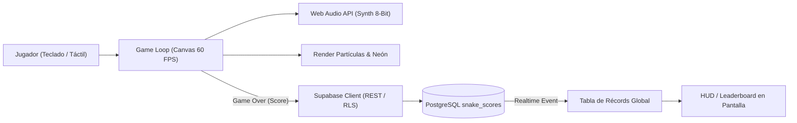

# SPEC-APP-SNAKE: Neon Snake (Arcade Web Serverless)

> **Identificador:** `SPEC-APP-SNAKE`  
> **Versión:** `v1.0.0` (Estado: `frozen` / Legacy)  
> **Fecha:** `2026-02-14` (Congelación: `2026-10-25`)  
> **Clasificación:** Tier `lab` | Arcade & Client-Side GameDev  
> **Ruta Canónica:** `https://datalaria.com/games/snake/`  
> **Ficha Técnica:** `https://datalaria.com/es/apps/snake/` (EN: `/en/apps/snake/`)

---

## 1. RESUMEN EJECUTIVO Y PROPÓSITO

**Neon Snake** es una reimplementación moderna del legendario juego arcade de la serpiente, concebida bajo una estética Cyberpunk con efectos de neón, partículas reactivas en tiempo real y audio retro de 8 bits sintetizado íntegramente por código.

El objetivo formativo y de ingeniería del proyecto es doble:
1. **Frontend Puro (Vanilla Web):** Demostrar la potencia de HTML5 Canvas y JavaScript Vanilla (ES6+) ejecutando un *Game Loop* fluido y determinista a 60 FPS con aceleración progresiva y cero dependencias de frameworks o motores pesados.
2. **Serverless BaaS sin Backend Dedicado:** Integrar un sistema de puntuaciones altas (*leaderboard*) global y en tiempo real usando Supabase (PostgreSQL 15) mediante llamadas REST y políticas de seguridad Row Level Security (RLS), sin necesidad de gestionar servidores ni APIs intermedias.

---

## 2. ARQUITECTURA DEL SISTEMA

La aplicación sigue una arquitectura monobloque desacoplada en el navegador conectada a servicios gestionados en la nube:

### Componentes Principales:
- **Game Engine (`Canvas 2D`):** Rejilla virtual con detección de colisiones perimetrales y auto-mordedura, interpolación de coordenadas y renderizado de glow neón mediante sombras proyectadas en Canvas.
- **Audio Sintetizado (`Web Audio API`):** Generador procedimental de ondas cuadradas y triangulares para simular sonidos de comer, movimiento y choque tipo chiptune sin descargar ficheros MP3 externos.
- **Persistencia en la Nube (`Supabase PostgreSQL`):** Tabla `snake_scores` protegida por RLS permitiendo lecturas públicas de los mejores récords e inserción segura de puntuaciones.

---

## 3. STACK TECNOLÓGICO

- **Motor Frontend:** HTML5 Canvas, JavaScript Vanilla (ES6+).
- **Estilos:** Tailwind CSS (distribución CDN para componentes HUD).
- **Audio:** Web Audio API (sintetizador de frecuencias procedural).
- **Backend-as-a-Service:** Supabase (PostgreSQL 15, PostgREST, Realtime Channels).
- **Alojamiento:** Directorio estático de Hugo en `/games/snake/`.

---

## 4. ARTÍCULOS TÉCNICOS ASOCIADOS

| Idioma | Título del Post | Slug Canónico |
| :--- | :--- | :--- |
| **ES** | *De Cero a Héroe: Crea un Snake Game Cyberpunk con Ranking en Tiempo Real usando Supabase y JS Vanilla* | `content/es/posts/game_snake/index.md` |
| **EN** | *From Zero to Hero: Create a Cyberpunk Snake Game with Real-Time Ranking using Supabase and Vanilla JS* | `content/en/posts/game_snake/index.md` |

---

## 5. HISTORIAL DE VERSIONES Y ESTADO DE CONGELACIÓN

- **`v1.0.0` (2026-02-14) — [ESTADO FINAL CONGELADO]:**
  - Implementación completa de mecánicas de juego, renderizado Canvas a 60 FPS y audio Web Audio API.
  - Conexión con Supabase para sincronización de récords globales en tiempo real.
  - Soporte responsivo para controles táctiles en pantallas móviles y atajos de teclado (flechas / WASD).
  - La aplicación se encuentra en estado estable y congelado como pieza de arcade y laboratorio.
- **`v0.5.0` (2026-02-01):**
  - Integración de persistencia remota en Supabase con políticas RLS.
- **`v0.1.0` (2026-01-20):**
  - Prototipo inicial del bucle de juego Canvas y lógica de movimiento.
