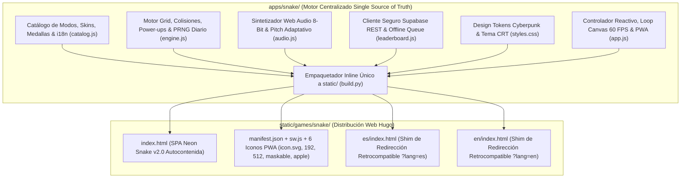

# SPEC-APP-SNAKE: Neon Snake ("Cyberpunk Overdrive v2.3")

> **Identificador:** `SPEC-APP-SNAKE`  
> **Versión:** `v2.3.0` (Estado: `active`)  
> **Fecha:** `2026-11-07`  
> **Clasificación:** Tier `lab` | Arcade & Client-Side GameDev  
> **Ruta Canónica:** `https://datalaria.com/games/snake/`  
> **Ficha Técnica:** `https://datalaria.com/es/apps/snake/` (EN: `/en/apps/snake/`)  
> **Especificación de Diseño:** [`specs/apps/snake/design.md`](file:///c:/Users/dalae/OneDrive/Emprendiendo/datalaria/specs/apps/snake/design.md)  
> **Aislamiento de Excepción (`[SCOPE-ISOLATION: ARCADE-GAME]`):** Esta especificación y su diseño asociado representan un videojuego arcade lúdico de alta estimulación. Sus mecánicas de combo, skins y estética neón están formalmente aisladas para que no contaminen los estándares de aplicaciones B2B de Datalaria.

---

## 1. RESUMEN EJECUTIVO Y PROPÓSITO

**Neon Snake ("Cyberpunk Overdrive v2.0")** es la evolución integral del clásico juego arcade web de Datalaria. Nacido originalmente como un prototipo formativo de desarrollo web en HTML5 Canvas con Supabase, la versión 2.0 supera el estado *frozen* erradicando las brechas históricas de contrato, reforzando la seguridad contra inyecciones XSS y transformando la experiencia en un arcade frenético, adictivo y de alta rejugabilidad ("Game Feel / Juice") tanto en móviles como en computadoras de escritorio.

### 1.1 Objetivos Clave de la Versión 2.0.0:
1. **Adrenalina y Game Feel (Juice):**
   - Sistema de Combo *Overclock* (`🔥 x2, x3, x5, x8`) con temporizador de enfriamiento de 4s y arpegios musicales dinámicos.
   - Mecánica activa de *Hyper-Dash* (`Espacio` / `Shift` / `⚡ BOOST`) para aceleración manual y doble puntuación.
   - 4 tipos de nodos cibernéticos: *Data Node* estándar, *Golden Cyber-Core* fugaz (50 pts), *Cryo-Pulse* (ralentización táctica) y *Ghost Protocol* (modo fantasma con wrap-around toroidal y atravesar colas/muros).
   - *Telegraphing* justo de firewalls rojos: parpadeo preventivo de 2 ticks con icono de aviso `⚠️` para erradicar muertes injustas por generación instantánea.
2. **4 Modos de Juego para Retención:**
   - **Arcade Overdrive:** 10 niveles progresivos con dificultad creciente más nivel infinito.
   - **Reto Diario Wordle (*Daily Cyber-Grid*):** Secuencia pseudoaleatoria idéntica a nivel mundial generada mediante semilla por fecha `YYYY-MM-DD` (PRNG Mulberry32), con resumen de emojis compartible en 1 clic.
   - **Contrarreloj 90s (*Time Attack*):** Partida a reloj continuo con bordes abiertos donde los choques recortan longitud y tiempo en lugar de matar.
   - **Zen / Cyber-Chill:** Modo relajado sin firewalls y con bordes abiertos para juego libre.
3. **Progresión Persistente y Gamificación Local:**
   - Hangar de 5 *Cyber-Skins* desbloqueables por mérito (Cyan Viper, Gold Sovereign, Matrix Operator, Akira Plasma, Glitch Phantom).
   - 6 medallas coleccionables y soporte para 3 perfiles locales aislados (`👾 Hacker 1`, `🤖 Hacker 2`, `⚡ Pro`).
   - Generador en 1 clic de **«Cyber-Agent Record Card» en PNG** (1200×630 px) con `<canvas>` nativo.
4. **Seguridad y Resiliencia 100% Offline (PWA):**
   - Erradicación de vulnerabilidades XSS en el ranking de Supabase (renderizado seguro con `textContent` y validación estricta de alias).
   - Cliente Supabase ligero nativo por `fetch` con fallback offline determinista (la app corre a 60 FPS sin conexión a internet y sin bloqueos de CDNs externos).
   - Manifiesto PWA, Service Worker Cache-First / Stale-While-Revalidate, suite de 6 iconos maskables y actualización in-app sin fricción.
5. **Arquitectura Single-Source-of-Truth:**
   - Unificación del código fuente en `/apps/snake/` compilando a `static/games/snake/index.html` sin pantallas intermedias ni código duplicado, manteniendo shims retrocompatibles en `/es/` y `/en/`.

---

## 2. ARQUITECTURA DEL SISTEMA

### Componentes Principales:
- **`catalog.js`:** Definición de los 4 modos de juego, las 5 skins cibernéticas, las 6 medallas, las constantes de configuración y el diccionario bilingüe `ES / EN`.
- **`engine.js`:** Lógica de movimiento en rejilla (20×20), detección de colisiones, generador PRNG pseudoaleatorio Mulberry32 por semilla diaria, ciclo de vida de nodos y power-ups, colas de entrada direccional y control de combo.
- **`audio.js`:** Sintetizador procedural nativo con Web Audio API (ondas cuadradas y sinusoidales con modulación de ganancia y frecuencias dinámicas según multiplicador de combo).
- **`leaderboard.js`:** Conector ligero y seguro a Supabase PostgREST (cero librerías CDN pesadas), sanitización estricta de nombres anti-XSS y almacenamiento en cola local (`localStorage`) cuando el dispositivo está offline.
- **`app.js`:** Controlador principal de interfaz, *Game Loop* a 60 FPS con interpolación de tiempo (`requestAnimationFrame`), gestión de controles híbridos (`WASD`, flechas, `Espacio`, `P`, `M`, `T`, swipe táctil y D-Pad virtual), banner de actualización PWA y generador de tarjeta en PNG.
- **`build.py`:** Generador del bundle inline autocontenido en `static/games/snake/index.html` y creación de shims de redirección SEO en `static/games/snake/es/` y `static/games/snake/en/`.

---

## 3. CATÁLOGO DE MODOS, NODOS, SKINS Y MEDALLAS

### 3.1 Modos de Juego
1. **🕹️ Arcade Overdrive:** Modo principal de 10 niveles con aceleración progresiva, firewalls dinámicos y tabla de clasificación global.
2. **📅 Reto Diario (*Daily Cyber-Grid*):** Secuencia de 100 pasos idéntica para todos los jugadores según la fecha (`YYYY-MM-DD`). Generación de mosaico de emojis (`🟩🟡🟦🔥🟥`) para compartir en redes o portapapeles.
3. **⏱️ Contrarreloj 90s (*Time Attack*):** Reloj dinámico de 90 segundos con bordes abiertos. Los choques recortan longitud y penalizan con `-5s`; los nodos dorados otorgan `+4s`.
4. **🧘 Zen / Cyber-Chill:** Sin obstáculos, sin colisión de paredes y velocidad placentera constante para aprendizaje y relajación.

### 3.2 Nodos Cibernéticos y Power-Ups
- **🟣 Data Node (Común):** Alimento básico. Otorga `10 × level` puntos, añade 1 segmento a la serpiente y reinicia la barra de combo de 4s.
- **🟡 Golden Cyber-Core (Raro · 6s de vida):** Otorga `50 × combo` puntos, dispara partículas doradas y aumenta en `+2` el multiplicador de combo.
- **🔵 Cryo-Pulse (Especial · 5s de duración):** Ralentiza la serpiente un 30% para maniobrar en rejillas saturadas sin perder el multiplicador de puntos.
- **🟢 Ghost Protocol (Defensivo · 6s de duración):** Vuelve translúcida a la serpiente; permite atravesar los límites de la pantalla (wrap-around) y cruzar su propia cola o firewalls sin morir.

### 3.3 Hangar de 5 Cyber-Skins
1. **🐍 Cyan Viper:** Skin clásica de neón cian y verde agua (Desbloqueada por defecto).
2. **⚡ Gold Sovereign:** Tonalidades doradas y amarillas (Desbloqueo: Alcanzar 500 puntos en cualquier modo).
3. **🟢 Matrix Operator:** Estilo terminal hacker con verde monocromo (Desbloqueo: Alcanzar el Nivel 5 en modo Arcade).
4. **🔥 Akira Plasma:** Neón rojo carmesí y fucsia intenso (Desbloqueo: Lograr un Combo `x5` activo).
5. **👾 Glitch Phantom:** Piel holográfica violeta y cian con parpadeo cuántico (Desbloqueo: Completar un Reto Diario o conseguir 4 medallas).

### 3.4 Las 6 Medallas Coleccionables
1. **⚡ First Hack:** Come tu primer nodo cibernético.
2. **🔥 Overclock Master:** Alcanza un multiplicador de combo `x5`.
3. **🛡️ Firewall Breaker:** Supera con vida el Nivel 5 del modo Arcade.
4. **👻 Ghost Protocol:** Sobrevive atravesando un firewall en modo fantasma.
5. **📅 Daily Hacker:** Completa una partida del Reto Diario.
6. **👑 Cyber Legend:** Supera los 1.500 puntos en una sola partida.

---

## 4. INVARIANTES DE DOMINIO (`INV-SNAKE-*`)

- **`INV-SNAKE-1` (Determinismo Matemático de Colisiones, Puntuación y Semilla Diaria):** La detección de colisiones de pared, auto-mordedura y firewalls es exacta a nivel de celda entera `(x, y)` en rejilla $20 \times 20$. Con el modo *Ghost Protocol* activo, la colisión perimetral se resuelve como traslación toroidal (`(x + 20) % 20`). Para una misma fecha `YYYY-MM-DD`, el generador PRNG produce exactamente la misma secuencia determinista de coordenadas de nodos y tipos de power-ups.
- **`INV-SNAKE-2` (Telegraphing Seguro de Firewalls):** Ningún obstáculo generado al subir de nivel puede materializarse en las coordenadas actuales de la serpiente o de la comida activa, y debe emitir un preaviso visual de advertencia (`warningTicks >= 2`) antes de volverse letal.
- **`INV-SNAKE-3` (Cero Dependencias Externas en Runtime):** Queda terminantemente prohibido cargar librerías externas o CDNs en tiempo de ejecución (`cdn.tailwindcss.com`, fuentes web bloqueantes o el SDK de Supabase por jsDelivr). Todo el CSS, la tipografía, los iconos SVG y la síntesis de audio son 100% nativos y locales.
- **`INV-SNAKE-4` (Retrocompatibilidad 100% de Rutas `/games/snake/`):** La ruta canónica `/games/snake/` carga directamente la aplicación en `< 1` segundo sin pantallas previas de selección forzada de idioma; las rutas históricas `/games/snake/es/index.html` y `/games/snake/en/index.html` redirigen con meta-refresh a `/games/snake/?lang=es` y `?lang=en`.
- **`INV-SNAKE-5` (Inmunidad XSS y Sanitización Estricta en Leaderboard):** Las entradas de usuario y los nombres leídos desde Supabase o desde `localStorage` se insertan en el DOM única y exclusivamente mediante `textContent` o `createTextNode`, prohibiendo cualquier uso de `innerHTML` con datos de jugadores. Los nombres se restringen a un máximo de 12 caracteres alfanuméricos (`^[a-zA-Z0-9_\-\s]{1,12}$`).
- **`INV-SNAKE-6` (Paridad Bilingüe Total ES ⇔ EN):** Todos los textos del juego, botones, nombres de skins, descripciones de medallas y notificaciones existen con paridad estricta en español e inglés mediante el módulo `catalog.js`.
- **`INV-SNAKE-7` (Tríada Canónica Datalaria):** La cabecera superior integra los tres enlaces institucionales: Ficha de la App (`/apps/snake/`), Tutorial Técnico (`/posts/game_snake/`) y Recursos B2B (`/recursos/`).
- **`INV-SNAKE-8` (PWA 100% Offline, Iconos Maskables y Smart Update):** La aplicación incluye `manifest.json` con `start_url: "/games/snake/"`, una suite de 6 iconos PNG/SVG adaptativos (`any` y `maskable`), un Service Worker (`sw.js`) con estrategia Cache-First / Stale-While-Revalidate, botón de instalación `#btn-install-pwa`, botón interactivo de versión `#btn-check-update` y banner flotante de actualización en caliente `#pwa-update-banner` con soporte de `skipWaiting`.
- **`INV-SNAKE-9` (Controles Multiplataforma Completos y Fiables):** La aplicación responde a atajos de teclado (`Flechas`, `WASD`, `Espacio`/`Shift` para Hyper-Dash, `P` para pausar, `M` para silenciar, `T` para alternar tema Neón/CRT), controles táctiles mediante gestos *Swipe* sobre el Canvas y botones D-Pad táctiles en pantalla con botón de pausa funcional.
- **`INV-SNAKE-10` (Aislamiento de Perfiles, Hangar de Skins y Tarjeta PNG):** La aplicación soporta 3 perfiles locales (`👾 Hacker 1`, `🤖 Hacker 2`, `⚡ Pro`) con aislamiento estricto de récords, skins desbloqueadas y medallas en claves `datalaria_snake_v2_stats_<profileId>`, y cuenta con una función determinista `downloadCyberCard()` en `<canvas>` 2D client-side que exporta una tarjeta gráfica PNG de alta resolución (1200×630 px) con los logros del agente.
- **`INV-SNAKE-11` (Integridad de Empaquetado Inline, Cero Colisiones Sintácticas y Estándar PWA Móvil):** El bundle inlined en `static/games/snake/index.html` se genera de forma determinista mediante `apps/snake/build.py` eliminando sentencias redundantes de `import`/`export` sin colisiones en identificadores léxicos de nivel superior (`const GRID_SIZE` declarado exactamente una vez), verificable con `new Function()` sin `SyntaxError`, e incorpora `<meta name="mobile-web-app-capable" content="yes">` para compatibilidad móvil moderna sin advertencias de deprecación.
- **`INV-SNAKE-12` (Modo Juego Inmersivo Maximizado, Escalado Determinista y Hall of Fame Leaderboard):**
  1. Durante la partida activa (`body.is-playing`), la cabecera `#app-header` y la barra de pestañas `.nav-deck` se ocultan automáticamente para maximizar el área útil de juego en escritorio (hasta `720×720 px`) y móvil (`96vw`), manteniendo un botón directo `#btn-hud-pause` (`⏸ Pausa / Menú`) en el HUD para restaurar la interfaz completa en cualquier instante.
  2. La regla global `.hidden { display: none !important; }` garantiza el aislamiento estricto de vistas al cambiar entre pestañas (`Jugar`, `Ranking`, `Skins`, `Medallas`, `Ayuda`), impidiendo la superposición simultánea del tablero con paneles secundarios.
  3. Los overlays `.canvas-overlay` carecen de recortes verticales (`overflow-y: auto` + botonera 2×2 compacta), eliminan emojis duplicados en pestañas y traducen el 100% de las cadenas (`final_score_label`, modos y controles).
  4. El ranking `#ranking-panel` renderiza tarjetas cyberpunk `.ranking-row` con medallas diferenciadas para el Podio Top 3 (Oro, Plata, Bronce), resaltado del agente activo y barra de KPIs personales, con cero clases utilitarias huérfanas de Tailwind.
- **`INV-SNAKE-13` (Homologación PWA Gold, Ciclo de Actualización In-App y Ranking Offline Optimista):**
  1. **Detección Standalone & Prompt Inteligente:** `#btn-install-pwa` se oculta automáticamente si la aplicación ya se ejecuta instalada (`window.matchMedia('(display-mode: standalone)').matches` o `window.navigator.standalone === true`). El evento `appinstalled` oculta el botón y dispara un toast de confirmación bilingüe (`✓ ¡Neon Snake instalada con éxito!`). Cuando no existe prompt nativo (iOS Safari o Firefox), el botón proporciona instrucciones precisas del sistema en el idioma activo (Safari: *Compartir -> Añadir a inicio*; Android/Desktop: *Menú -> Instalar*).
  2. **Ciclo de Actualización In-App Reactivo:** El badge interactivo `#btn-check-update` (sincronizado a `v2.2.0`) y el Service Worker `sw.js` (`CACHE_NAME = 'datalaria-snake-v2.2.0'`) verifican `reg.waiting` al cargar la aplicación, revalidan al recuperar el foco de pestaña (`visibilitychange`), protegen el refresco con `swRefreshing` para evitar bucles de recarga en `controllerchange` y consultan el estado real del registro antes de emitir feedback.
  3. **Ranking Offline Optimista & Auto-Sincronización:** Al jugar sin conexión a Internet, la puntuación se guarda en la cola local (`datalaria_snake_offline_queue`) y **se inyecta inmediatamente de forma optimista** en la caché del ranking (`datalaria_snake_cached_ranking`) ordenada por puntos con la bandera `pendingSync: true`, mostrando en el Hall of Fame un badge `⏳ OFFLINE` y borde punteado en la fila del jugador. Al recuperar la conectividad (`window.addEventListener('online')`), el cliente ejecuta `flushOfflineQueue()` de forma desatendida, sincroniza con Supabase, limpia las marcas pendientes y notifica al usuario con un toast bilingüe (`🌐 Puntuaciones offline sincronizadas`).
- **`INV-SNAKE-14` (Ergonomía Móvil Full-Swipe, Vibración Háptica, Hit-Stop de Colisión y Cuenta Atrás 3-2-1):**
  1. **Conmutador D-Pad / Modo Swipe:** El jugador móvil puede alternar entre la cruceta táctil virtual y el modo *Full-Swipe* (`#btn-toggle-dpad`), persistido en `localStorage` (`datalaria_snake_dpad`). Al desactivar el D-Pad se oculta la botonera direccional dejando únicamente el botón de boost compacto, y `resizeCanvas()` recalcula el lienzo recuperando hasta ~140-160 px de alto útil en smartphone.
  2. **Vibración Háptica Nativa (`navigator.vibrate`):** En dispositivos compatibles y si el audio no está silenciado, se emiten pulsos táctiles deterministas: 15 ms al capturar un nodo, doble pulso `[30, 40, 30]` al subir de nivel y pulso de 80 ms al colisionar.
  3. **Pausa Dramática (*Hit-Stop* de 450 ms) e Inspección de Tablero:** Al ocurrir un impacto letal, el motor retiene el frame durante 450 ms destacando la casilla exacta del choque con efecto estroboscópico antes de abrir el modal de fin de partida. En `#gameover-overlay`, el botón `#btn-inspect-board` (`👁️ Ver Tablero` / `👁️ View Board`) atenúa la opacidad del modal al 15% permitiendo al usuario auditar la posición final de la serpiente.
  4. **Cuenta Atrás Animada `3 - 2 - 1 - HACK!` al Reanudar:** Al salir del menú de pausa, el juego ejecuta una transición visual sobre el Canvas con 3 pulsos sonoros sintetizados de aviso (`440 Hz`) y un pulso final agudo (`880 Hz`), impidiendo muertes injustas instantáneas en niveles de alta velocidad.

---

## 5. HISTORIAL DE VERSIONES Y EVOLUCIÓN

- **`v2.3.0` (2026-11-07) — [ESTADO: ACTIVO — "TACTILE ERGONOMICS, HIT-STOP & COUNTDOWN"]:**
  - **Modo Móvil Full-Swipe:** Conmutador para ocultar el D-Pad en móvil ganando hasta 160 px de altura adicional para el tablero.
  - **Feedback Háptico:** Micro-pulsos de vibración para capturas, subidas de nivel y choques coordinados con el mute.
  - **Hit-Stop & Ver Tablero:** Pausa dramática de 450 ms en la celda del impacto y botón para inspeccionar el tablero tras Game Over.
  - **Cuenta Atrás al Reanudar:** Animación `3-2-1-HACK!` en el Canvas con sintetizador 8-bit antes de reanudar la partida.
- **`v2.2.0` (2026-11-07) — [SUPERSEDED]:**
  - **Homologación PWA Gold:** Detección de modo `standalone`, soporte para `appinstalled`, instrucciones contextuales para iOS Safari y escritorio/Android bilingües.
  - **Actualizador In-App Reactivo:** Badge de versión interactivo `v2.2.0` con comprobación en `visibilitychange`, protección contra dobles recargas en `controllerchange` y `sw.js` actualizado a `CACHE_NAME = 'datalaria-snake-v2.2.0'`.
  - **Ranking Offline Optimista y Auto-Sincronización:** Las puntuaciones logradas sin conexión se posicionan de inmediato en la tabla local con badge `⏳ OFFLINE` y se sincronizan automáticamente con Supabase en cuanto el navegador detecta el evento `online`.
- **`v2.1.0` (2026-11-07) — [SUPERSEDED]:**
  - **Modo Juego Inmersivo (`body.is-playing`):** Ocultación automática de cabecera y pestañas durante la acción para maximizar el tablero (hasta 720×720 px en escritorio y ancho completo en móvil), con botón `#btn-hud-pause` integrado en el HUD.
  - **Encuadre Perfecto de Overlays y Textos:** Erradicación de recortes verticales en `#start-overlay` y `#gameover-overlay`, eliminación de emojis duplicados en `.nav-deck` y localización completa ES/EN (`final_score_label`, tarjetas de modo y guía de controles).
  - **Rediseño Visual del Ranking (`#ranking-panel`):** Nuevas tarjetas `.ranking-row` con Podio Top 3 (Oro, Plata, Bronce), insignia `TÚ / YOU`, tira de KPIs del jugador y eliminación de clases huérfanas de Tailwind.
- **`v2.0.1` (2026-11-07) — [SUPERSEDED]:**
  - **Resolución de Colisión de Ámbito Global:** Subsanado el bloqueo `SyntaxError: Identifier 'GRID_SIZE' has already been declared` al desacoplar la constante entre `catalog.js` y `engine.js` y eliminar los bloques `export { ... };` en el inliner de `build.py`.
  - **Meta Tag Móvil Moderno:** Añadido `<meta name="mobile-web-app-capable" content="yes">` para eliminar advertencias de deprecación en navegadores Chromium.
  - **Test de Cobertura de Sintaxis:** Incorporado `test_inv_snake_11_bundle_syntax_and_no_duplicate_declarations` en la suite determinista.
- **`v2.0.0` (2026-11-07) — [SUPERSEDED]:**
  - **Mecánicas Juice & Adrenalina:** Combo Overclock de 4s, Hyper-Dash manual con doble puntuación, 4 tipos de nodos (Data, Golden Core, Cryo, Ghost) y telegraphing preventivo de firewalls rojos.
  - **4 Modos de Juego:** Arcade Overdrive (10 niveles + endless), Reto Diario Wordle reproducible por semilla PRNG, Contrarreloj 90s y Modo Zen.
  - **Hangar de 5 Skins & 6 Medallas:** Skins desbloqueables por mérito, pasaporte de medallas y selector de 3 perfiles familiares locales.
  - **Tarjeta Coleccionable PNG (`downloadCyberCard()`):** Exportación client-side en Canvas 2D de tarjeta gráfica con estadísticas y avatar.
  - **Seguridad & PWA Offline:** Erradicación total de inyecciones XSS, desacople de CDN bloqueantes de Supabase, suite PWA completa (6 iconos maskables, `sw.js` y Smart Update in-app) y shims retrocompatibles `/es/` y `/en/`.
- **`v1.0.0` (2026-02-14) — [SUPERSEDED — LEGACY FROZEN]:**
  - Prototipo inicial de juego en Canvas 2D con Supabase Realtime, Tailwind CDN y páginas separadas en `/es/` y `/en/`.
