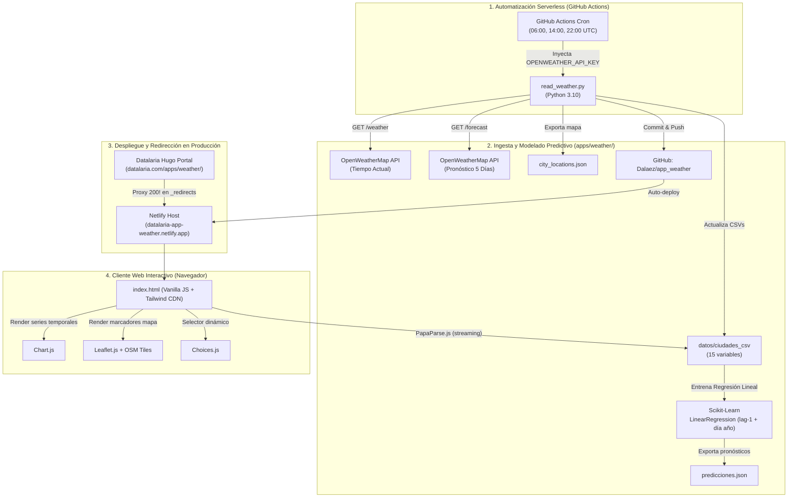

# Especificación Técnica SDD: Weather Service (`weather`)

> **ID de Especificación:** `SPEC-APP-WEATHER`  
> **Versión de la Spec:** `1.0.0` (Reverse-Spec formal a 2026-10-24)  
> **Versión de la App documentada:** `v1.0.0`  
> **Estado:** `APPROVED (Reverse-Spec)`  
> **Categoría SDD:** 🟡 Saneamiento de clones y aislamiento (App activa #3 de 7)  
> **Código fuente anterior:** `temp_app_weather/`, `github.io/app-openweather/app_weather/`, `static/apps/weather/` (3 clones redundantes con metadatos `.git` huérfanos)  
> **Código fuente consolidado objetivo (Hito 2.2):** [`apps/weather/`](file:///c:/Users/dalae/OneDrive/Emprendiendo/datalaria/apps/weather) (Dashboard Frontend + Motor ETL & ML en Python + GitHub Actions Cron)  
> **Artefacto público / Runtime:** `https://datalaria.com/apps/weather/` (Proxy transparente `200!` en `static/_redirects` hacia `https://datalaria-app-weather.netlify.app/`)  
> **Ficha pública del portal:** `/es/apps/weather/` · `/en/apps/weather/`  

---

## 1. Propósito y Contexto de Negocio

### 1.1 Problema que resuelve
El proyecto **Weather Service** es una solución meteorológica global de ingeniería de datos completa, diseñada con una arquitectura **100% Serverless de coste cero**. Demuestra cómo construir un ciclo de vida de datos de extremo a extremo:
1. **Extracción y Normalización Automatizada:** Ingesta continua de telemetría meteorológica de más de 160 ciudades globales mediante la API de OpenWeatherMap.
2. **Persistencia Histórica en CSV:** Registro de series temporales estructuradas (15 variables meteorológicas) particionadas por ciudad sin base de datos tradicional.
3. **Predicción con Machine Learning (El Músculo Determinista):** Entrenamiento diario de modelos de Regresión Lineal con `scikit-learn` para pronosticar temperaturas a 24 horas y contrastarlas contra el pronóstico oficial a 5 días de OpenWeatherMap.
4. **Visualización y UX Avanzada:** Dashboard interactivo cliente con series temporales multivariables (Chart.js), mapa geográfico interactivo (Leaflet), selector inteligente de ciudades (Choices.js) y lectura optimizada de datos en streaming cliente (PapaParse).

### 1.2 Público objetivo y Valor en Datalaria
* **Lectores técnicos y estudiantes de Ciencia de Datos / Data Engineering:** Caso de estudio real de automatización serverless con GitHub Actions, ETL en Python y machine learning aplicado.
* **Escaparate de Ingeniería Cuantitativa:** Demuestra el dominio de pipelines de datos, predicción estadística determinista y visualizaciones web ágiles.
* **Generación de Tráfico Orgánico y Leads:** Actúa como "Lead Magnet" técnico de alta retención respaldado por una serie técnica de 4 publicaciones exhaustivas.

### 1.3 Respaldo editorial (Invariante `App ⇔ Post`, Constitución Art. 7)
Respaldada por una serie de 4 entregas técnicas publicadas en español e inglés:

| Parte | Slug ES | Slug EN | Fecha | Tema |
| :-: | :--- | :--- | :--- | :--- |
| 1 | `app-openweather_part1_backend` | `app_openweather_part1_backend` | 2025-10-31 | Recolector de datos backend con Python y automatización 24/7 con GitHub Actions. |
| 2 | `app_openweather_part2_frontend` | `app_openweather_part2_frontend` | 2025-11-08 | Frontend interactivo serverless: JavaScript Vanilla, PapaParse.js y Chart.js. |
| 3 | `app_openweather_part3_ai_prediction` | `app_openweather_part3_ai_prediction` | 2025-11-15 | Predicción del tiempo con IA: Regresión Lineal con Scikit-Learn vs OpenWeatherMap 5D. |
| 4 | `app_openweather_part4_extras_ux` | `app_openweather_part4_extras_ux` | 2025-12-06 | Extras y robustez: Mapa Leaflet, i18n multilingüe, filtrado dinámico y UI/UX de producción. |

### 1.4 Estrategia de Ejecución y Despliegue (Constitución Art. 2 y 3)

| Componente | Implementación |
| :--- | :--- |
| **Arquitectura de Runtime** | Despliegue CI/CD continuo en Netlify (`datalaria-app-weather.netlify.app`), conectado al repositorio upstream `https://github.com/Dalaez/app_weather.git`. |
| **Proxy Netlify (Constitución Art. 3)** | Enrutamiento transparente desde el portal Datalaria vía `static/_redirects`: `/apps/weather/* https://datalaria-app-weather.netlify.app/:splat 200!`. Preserva el dominio canónico `datalaria.com/apps/weather/`. |
| **Higiene de Seguridad (Constitución Art. 2)** | El código Python (`read_weather.py`), las dependencias y los objetos `.git` quedan aislados en [`apps/weather/`](file:///c:/Users/dalae/OneDrive/Emprendiendo/datalaria/apps/weather). Cero archivos ejecutables en `static/apps/weather/`. |

---

## 2. Arquitectura del Sistema



---

## 3. Modelo de Datos y Esquemas

### 3.1 Esquema de Serie Temporal por Ciudad (`datos/<Ciudad>.csv`)
Cada archivo CSV por ciudad registra exactamente **15 columnas normalizadas**:

```csv
fecha_hora,ciudad,temperatura_c,sensacion_c,temp_min_c,temp_max_c,humedad_porc,viento_kmh,descripcion,lat,lon,nubosidad_porc,visibilidad_m,lluvia_1h,nieve_1h
```

| Campo | Tipo | Descripción |
| :--- | :--- | :--- |
| `fecha_hora` | ISO 8601 Timestamp | Momento de la captura (`YYYY-MM-DDTHH:MM:SS.mmmmmm`). |
| `ciudad` | String | Nombre oficial de la estación meteorológica API. |
| `temperatura_c` | Float | Temperatura ambiente en grados Celsius (°C). |
| `sensacion_c` | Float | Sensación térmica (°C). |
| `temp_min_c` | Float | Temperatura mínima registrada (°C). |
| `temp_max_c` | Float | Temperatura máxima registrada (°C). |
| `humedad_porc` | Integer | Porcentaje de humedad relativa (0–100%). |
| `viento_kmh` | Float | Velocidad del viento convertida a km/h (`speed_m_s * 3.6`). |
| `descripcion` | String | Estado del cielo en español (ej. "cielo claro", "lluvia ligera"). |
| `lat`, `lon` | Float | Coordenadas geográficas WGS84. |
| `nubosidad_porc` | Integer | Porcentaje de cobertura de nubes (0–100%). |
| `visibilidad_m` | Integer | Metros de visibilidad (por defecto 10.000m). |
| `lluvia_1h` | Float | Precipitación acumulada en la última hora (mm). |
| `nieve_1h` | Float | Nieve acumulada en la última hora (mm). |

### 3.2 Esquema de Predicciones (`predicciones.json`)
Diccionario indexado por nombre de ciudad normalizado:

```json
{
  "Madrid": {
    "owm_forecast": [
      { "date": "2026-10-25", "max": 21.4, "min": 11.2, "media": 16.3 },
      { "date": "2026-10-26", "max": 20.8, "min": 10.5, "media": 15.6 }
    ],
    "ia_forecast": {
      "max": 20.9,
      "min": 11.0,
      "media": 15.9,
      "registros": 45
    }
  }
}
```

### 3.3 Esquema de Ubicaciones para Mapa (`city_locations.json`)
Lista de puntos geográficos para marcadores de Leaflet:

```json
[
  {
    "ciudad": "Madrid",
    "lat": 40.4168,
    "lon": -3.7038,
    "temp": 18.2
  }
]
```

---

## 4. Motor de Machine Learning (El Músculo Determinista)

El modelo predictivo implementado en `read_weather.py` cumple con la regla de la Constitución (Art. 1.3: *Cálculos cuantitativos deterministas sin alucinaciones de LLMs*):

1. **Requisitos de Datos:** Requiere al menos `MIN_RECORDS_FOR_IA = 10` días limpios tras resampleado diario (`df.resample('D')`).
2. **Features de Entrada (X):**
   - `temp_max_lag1`: Temperatura máxima del día anterior.
   - `temp_min_lag1`: Temperatura mínima del día anterior.
   - `temp_media_lag1`: Temperatura media del día anterior.
   - `hum_media_lag1`: Humedad media del día anterior.
   - `viento_media_lag1`: Viento medio del día anterior.
   - `dia_del_anio`: Componente de estacionalidad anual (1–366).
3. **Modelos:** Se entrenan 3 instancias independientes de `sklearn.linear_model.LinearRegression` (una para predecir `temp_max`, otra para `temp_min` y otra para `temp_media` de mañana).

---

## 5. Criterios de Aceptación y Verificación SDD

| ID | Requisito | Comando de Verificación | Criterio de Éxito |
| :--- | :--- | :--- | :--- |
| **G-01** | Eliminación de Clones Redundantes | `Test-Path temp_app_weather, github.io` | Ambas rutas deben devolver `False` (eliminadas del disco). |
| **G-02** | Saneamiento de `.git` en `static/apps/weather/` | `Get-ChildItem -Force static/apps/weather` | Cero carpetas `objects`, `refs`, `hooks`, `logs` o archivos `HEAD`, `config`, `index`. Cero archivos `.py` o `requirements.txt`. |
| **G-03** | Consolidación en `/apps/weather/` | `Test-Path apps/weather/README.md, apps/weather/read_weather.py` | Ambos archivos existen en el repositorio. |
| **G-04** | Integridad del Proxy Netlify | Lectura de `static/_redirects` | Regla `/apps/weather/* https://datalaria-app-weather.netlify.app/:splat 200!` activa. |
| **G-05** | Compilación Limpia del Portal Hugo | `hugo --renderToMemory` | Código de salida `0`, 0 errores en las fichas `/es/apps/weather/` y `/en/apps/weather/`. |
| **G-06** | Paridad Editorial y Shortcode `app-ref` | Inspección de los 8 posts de la serie | Los 8 artículos renderizan la tarjeta `app-ref slug="weather"` y enlaces bidireccionales. |
