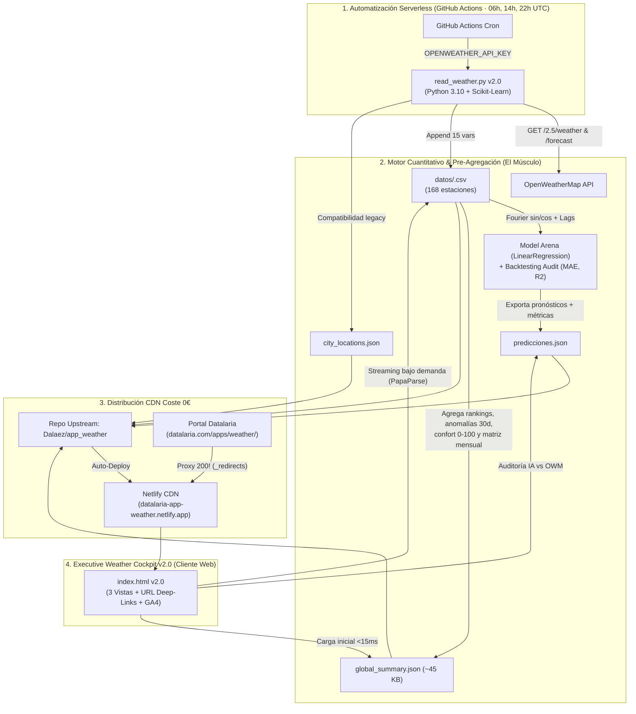

# Especificación Técnica SDD: Weather Service (`weather`)

> **ID de Especificación:** `SPEC-APP-WEATHER`  
> **Versión de la Spec:** `3.0.0-draft` (Evolución a Weather Intelligence v3.0: Data Truth Pipeline, Focus Mode y PWA — `ADR-022`)  
> **Versión de la App documentada:** `v3.0.0-beta` (En evolución desde `v2.0.0`)  
> **Contrato de Diseño Vinculado:** [`specs/apps/weather/design.md`](file:///c:/Users/dalae/OneDrive/Emprendiendo/datalaria/specs/apps/weather/design.md)  
> **Estado:** `APPROVED`  
> **Categoría SDD:** 🟢 App Flagship #3 de 7 — Observatorio Climático Serverless & Laboratorio ML  
> **Código fuente canónico:** [`apps/weather/`](file:///c:/Users/dalae/OneDrive/Emprendiendo/datalaria/apps/weather) (Cockpit Web + Motor ETL & ML en Python + GitHub Actions Cron + Suite `pytest`)  
> **Artefacto público / Runtime:** `https://datalaria.com/apps/weather/` (Proxy transparente `200!` en [`static/_redirects`](file:///c:/Users/dalae/OneDrive/Emprendiendo/datalaria/static/_redirects) hacia `https://datalaria-app-weather.netlify.app/`)  
> **Ficha pública del portal:** `/es/apps/weather/` · `/en/apps/weather/`  

---

## 1. Propósito, Contexto de Negocio y Usuario Objetivo

### 1.1 Problema que resuelve y Evolución a `v2.0.0`
El proyecto **Weather Service (`v2.0.0`)** es un observatorio climático global e infraestructura de ingeniería de datos y Machine Learning de extremo a extremo, operado bajo una arquitectura **100% Serverless de coste fijo 0,00 €/mes**. Tras superar su primer ciclo estacional completo (**>375 días ininterrumpidos**, **168 ciudades en 6 regiones** y **>192.000 registros históricos** capturados cada 8 horas), la versión `v2.0.0` transforma el visor original de CSVs en una plataforma analítica y predictiva de alto impacto con 5 pilares:

1. **Ingesta y Pre-Agregación Global Automatizada (`read_weather.py v2.0`):** Recolección desatendida 3 veces al día (`06:00`, `14:00`, `22:00 UTC`) de 15 variables meteorológicas en 168 estaciones vía OpenWeatherMap v2.5, generando tanto el dataset histórico particionado (`datos/<Ciudad>.csv`) como un índice analítico global ultraligero (`global_summary.json`, $\sim 45\text{ KB}$) para carga instantánea en cliente ($< 15\text{ ms}$).
2. **El Músculo Predictivo con Estacionalidad Cíclica de Fourier y Backtesting (`predicciones.json`):** Entrenamiento diario determinista con `scikit-learn` incorporando armónicos cíclicos anuales ($\sin/\cos$ del día del año), retardos multivariables (`lag1`, `lag2`, amplitud térmica diurna) y un **registro de auditoría empírica (*Model Arena Scorecard*)** que contrasta la predicción previa contra la observación real del día siguiente, calculando **MAE**, **Bias**, **$R^2$** y **Win-Rate IA vs. OpenWeatherMap 5D**.
3. **Índice Determinista de Confort Térmico & Ventana Outdoor (`0..100`):** Cruce matemático de temperatura, sensación térmica, humedad relativa, velocidad del viento y precipitación por franja horaria (`06h`, `14h`, `22h UTC`) para identificar las mejores ciudades y momentos del día para actividad deportiva exterior (sinergia con *LifeOps*) o trabajo remoto.
4. **Executive Weather Cockpit en 3 Vistas Conmutables (`index.html v2.0`):**
   - **Vista 1 — 🌍 Observatorio & Comparador:** Mapa Leaflet multicapa (Temperatura, Viento, Humedad, Lluvia, Confort, Anomalía) + Presets en 1 clic + Super-Cards comparativas (hasta 5 ciudades) + Series temporales de 7 métricas (incluyendo sensación térmica y visibilidad) + Matriz de Climatología Mensual / Comparativa Interanual (YoY).
   - **Vista 2 — 🤖 Laboratorio ML (IA vs. OWM Arena):** Panel de backtesting empírico, evolución del error absoluto, desglose de pesos e importancia de variables del modelo de cada ciudad.
   - **Vista 3 — 🏆 Atlas & Rankings Globales (168 Ciudades):** Explorador tabular instantáneo con filtros por región/país, radar de anomalías térmicas ($\Delta_{30\text{d}}$), extremos planetarios del día y exportación directa en CSV/JSON.
5. **Integración Bilingüe, Deep-Linking SEO y Embudo PLG:** Sincronización idiomática automática (`?lang=es|en`), enlaces profundos por escenario (`?preset=extremes&cities=Madrid,Tokyo&view=arena`), telemetría determinista **GA4** (`gtag`) y bloque de conversión hacia `/recursos/` y newsletter técnica **Brevo**.

### 1.2 Audiencia y Usuario Objetivo
- **Ingenieros de Datos, Científicos de Datos y Arquitectos Cloud:** Usuarios que buscan un caso de estudio real en producción de ETL serverless, feature engineering temporal y evaluación honesta de modelos ML frente a APIs comerciales.
- **Usuarios Ejecutivos, Deportistas (`LifeOps`) y Nómadas Digitales:** Usuarios que comparan el clima real, la amplitud térmica, las anomalías estacionales y el confort outdoor entre 168 ciudades del mundo sin anuncios ni fricción.
- **Lectores del Portal Datalaria (SEO & Lead Magnet):** Tráfico orgánico cualificado captado desde las fichas `/es/apps/weather/` y `/en/apps/weather/` y la serie técnica de 5 artículos.

### 1.3 Respaldo Editorial (`App Activa ⇔ Post Publicado`, Constitución Art. 7)

| Parte | Slug ES | Slug EN | Fecha | Estado | Tema |
| :-: | :--- | :--- | :---: | :---: | :--- |
| **1** | `app-openweather_part1_backend` | `app_openweather_part1_backend` | 2025-10-31 | Publicado | Recolector backend con Python y automatización 24/7 con GitHub Actions. |
| **2** | `app_openweather_part2_frontend` | `app_openweather_part2_frontend` | 2025-11-08 | Publicado | Frontend interactivo serverless: JavaScript Vanilla, PapaParse.js y Chart.js. |
| **3** | `app_openweather_part3_ai_prediction` | `app_openweather_part3_ai_prediction` | 2025-11-15 | Publicado | Predicción del tiempo con IA: Regresión Lineal con Scikit-Learn vs. OpenWeatherMap 5D. |
| **4** | `app_openweather_part4_extras_ux` | `app_openweather_part4_extras_ux` | 2025-12-06 | Publicado | Extras y robustez: Mapa Leaflet, i18n multilingüe, filtrado dinámico y UI/UX. |
| **5** | `app_openweather_part5_climate_intelligence_v2` | `app_openweather_part5_climate_intelligence_v2` | Hito 2.7 | Planificado | **1 Año y +200.000 Registros Después:** Estacionalidad de Fourier, Backtesting IA vs. OWM, Atlas de Anomalías y Cockpit v2.0. |

---

## 2. Límites, Prohibiciones y Fuera de Alcance (*Non-Goals*)

1. **Cero Costes Fijos de Infraestructura en Modo Público (`Non-Goal #1`):** Queda prohibido introducir servidores VPS de pago, bases de datos dedicadas con coste mensual o llamadas a APIs de pago por uso (LLMs o OpenWeatherMap OneCall 3.0 de pago) en el ciclo automático de las 168 ciudades.
2. **Prohibición de Inundar `datalaria-core` (Supabase Free Tier 500 MB) con Series Temporales Crudas (`Non-Goal #2`):** Las lecturas tri-diarias de las 168 ciudades ($\sim 184.000\text{ filas/año}$) **no** se insertan fila a fila en PostgreSQL de Supabase durante la Etapa 1/2 para no consumir la cuota gratuita de 500 MB reservada a datos transaccionales de usuarios (`lifeops`, `pulse`).
3. **Prohibición de Archivos Backend o CSVs Huérfanos en `static/apps/weather/` (`Non-Goal #3`):** Dado que el runtime público en `datalaria.com/apps/weather/*` opera vía proxy `200!` hacia `datalaria-app-weather.netlify.app`, queda prohibido almacenar `.py`, `requirements.txt`, `.git` o los 168 CSVs obsoletos dentro de `static/apps/weather/`.
4. **Cero Alucinaciones en Predicción Meteorológica (`Non-Goal #4`):** Ningún pronóstico numérico ni índice de confort puede generarse mediante prompts a un LLM; todo cálculo se ejecuta determinísticamente en Python (`scikit-learn` / `pandas`) o JavaScript matemático auditable.

---

## 3. Arquitectura del Sistema y Evolución de Almacenamiento en 3 Etapas (`ADR-021`)

### 3.1 Diagrama de Arquitectura `v2.0.0`



### 3.2 Hoja de Ruta de Persistencia de Coste Cero (Horizonte 1–3 Años)

| Etapa | Umbral de Activación | Arquitectura de Almacenamiento | Coste Mensual |
| :--- | :--- | :--- | :-: |
| **Etapa 1 (Actual — `v2.0`)** | Hasta $\sim 550.000$ registros ($\sim 3$ años de datos, $< 50\text{ MB}$ en CSV) | **Git + Netlify CDN + `global_summary.json` pre-agregado:** El cliente descarga solo `global_summary.json` ($\sim 45\text{ KB}$) al arrancar y pide por streaming únicamente los CSVs de las ciudades comparadas (máx. 5). | **0,00 €** |
| **Etapa 2 (Horizonte +12–18 meses)** | $> 550.000$ registros o expansión a $> 300$ ciudades | **Lakehouse Estático en Apache Parquet + DuckDB-Wasm:** `read_weather.py` compacta el histórico anual en ficheros `.parquet` particionados (compresión $\sim 10\times$: 1 año ocupa $< 2\text{ MB}$) alojados en GitHub Releases / Cloudflare R2 gratuito. | **0,00 €** |
| **Etapa 3 (Monetización Pro B2B/B2C)** | Activación de usuarios registrados / alertas personalizadas | **Esquema `weather` en Supabase (`datalaria-core`):** PostgreSQL almacena **solo** entidades ligeras de usuario (`weather.user_alerts`, `weather.favorite_cities`, `weather.daily_model_scores`, $< 5\text{ MB}$ con RLS `auth.uid() = user_id`), manteniendo el histórico bruto en Parquet/CDN. | **0,00 €** |

---

## 4. Contratos de Datos y Fórmulas Matemáticas ("El Músculo Determinista")

### 4.1 Esquema de Serie Temporal por Ciudad (`datos/<Ciudad>.csv`)
Cada fichero CSV conserva estrictamente las **15 columnas canónicas** por compatibilidad hacia atrás (`INV-WEATHER-1`):

```csv
fecha_hora,ciudad,temperatura_c,sensacion_c,temp_min_c,temp_max_c,humedad_porc,viento_kmh,descripcion,lat,lon,nubosidad_porc,visibilidad_m,lluvia_1h,nieve_1h
```

### 4.2 Motor de Machine Learning `v2.0` (Estacionalidad de Fourier + Backtesting)

1. **Agregación Diaria (`df_daily`):**
   Agrupación por día natural (`resample('D')`) calculando:
   - `temp_max`, `temp_min`, `temp_media`, `sensacion_media`
   - `diurnal_range = temp_max - temp_min`
   - `hum_media`, `viento_media`, `nubosidad_media`, `lluvia_total`
2. **Ingeniería de Características Cíclicas y Retardadas ($X$):**
   Para eliminar la discontinuidad lineal entre el día 365 y el día 1 y modelar la onda térmica anual, el día del año $d \in [1, 366]$ se transforma mediante armónicos de Fourier:
   $$\text{sin\_day} = \sin\left(\frac{2\pi \cdot d}{365.25}\right), \qquad \text{cos\_day} = \cos\left(\frac{2\pi \cdot d}{365.25}\right)$$
   El vector de características de entrada $X_t$ para predecir el día $t+1$ se compone de **8 variables deterministas**:
   - `temp_max_lag1`, `temp_min_lag1`, `temp_media_lag1` (estado térmico en $t$)
   - `temp_media_lag2` (inercia térmica a 48h, con fallback a `temp_media_lag1` en el primer registro)
   - `diurnal_range_lag1` (amplitud térmica en $t$: $\text{temp\_max}_t - \text{temp\_min}_t$)
   - `hum_media_lag1`, `viento_media_lag1` (convección y humedad en $t$)
   - `sin_day`, `cos_day` (fase estacional exacta del día objetivo $t+1$)
3. **Evaluación Empírica (*Walk-Forward Backtesting* sobre los últimos $N = \min(30, \text{registros}-10)$ días):**
   - Para cada ciudad con `registros >= MIN_RECORDS_FOR_IA` ($10$), `read_weather.py` calcula las métricas de calidad sobre ventana histórica y compara contra la predicción previa almacenada en `predicciones.json` si corresponde al día recién concluido:
     - $\text{MAE}_{\text{IA}}$ (°C): Error Absoluto Medio de `model_media` / `model_max` / `model_min` en validación temporal (últimos 30 días).
     - $R^2 \in (-\infty, 1.0]$: Coeficiente de determinación del modelo sobre el histórico de la ciudad (redondeado a 3 decimales).
     - `feature_weights`: Diccionario con los coeficientes normalizados de la regresión para transparencia explicativa en la Vista 2 (*Laboratorio ML*).

### 4.3 Fórmula Determinista del Índice de Confort Outdoor (`comfort_index` $\in [0, 100]$)

Para cada lectura o agregado de ciudad, el **Índice de Confort Datalaria (`0..100`)** evalúa la aptitud meteorológica para actividades al aire libre (running, ciclismo, paseo, terraza/trabajo remoto) mediante una función de penalización acotada:

$$\text{Comfort} = \text{clip}\Big(\text{round}\big(100 - P_{\text{temp}} - P_{\text{hum}} - P_{\text{wind}} - P_{\text{rain}} - P_{\text{clouds}}\big),\; 0,\; 100\Big)$$

Donde:
- **Penalización Térmica ($P_{\text{temp}}$):** Óptimo centrado en $T_{\text{opt}} = 21.0^\circ\text{C}$ usando la temperatura aparente $T_{\text{eff}} = 0.6 \cdot T + 0.4 \cdot T_{\text{sensacion}}$:
  $$P_{\text{temp}} = \begin{cases} 0 & \text{si } |T_{\text{eff}} - 21| \le 3 \\ 2.2 \cdot (|T_{\text{eff}} - 21| - 3) & \text{si } 3 < |T_{\text{eff}} - 21| \le 15 \\ 26.4 + 3.0 \cdot (|T_{\text{eff}} - 21| - 15) & \text{si } |T_{\text{eff}} - 21| > 15 \end{cases}$$
- **Penalización por Humedad ($P_{\text{hum}}$):** $0$ si $H \in [30\%, 65\%]$; $0.4 \cdot (H - 65)$ si $H > 65\%$; $0.3 \cdot (30 - H)$ si $H < 30\%$.
- **Penalización por Viento ($P_{\text{wind}}$):** $0$ si $V \le 15\text{ km/h}$; $0.8 \cdot (V - 15)$ si $15 < V \le 35\text{ km/h}$; $16 + 1.5 \cdot (V - 35)$ si $V > 35\text{ km/h}$.
- **Penalización por Precipitación ($P_{\text{rain}}$):** $0$ si $\text{lluvia\_1h} = 0$ y $\text{nieve\_1h} = 0$; $\min(35,\; 12 + 8 \cdot (\text{lluvia\_1h} + \text{nieve\_1h}))$ si hay precipitación activa.
- **Penalización por Nubosidad/Visibilidad ($P_{\text{clouds}}$):** $0.05 \cdot \max(0, \text{nubosidad} - 50) + (5 \text{ si } \text{visibilidad} < 3000\text{ m sino } 0)$.

### 4.4 Contrato JSON: `predicciones.json` (`v2.0` — Retrocompatible)

Mantiene las claves `pred_owm_5day` y `pred_ia` (`max`, `min`, `media`, `registros`) para no romper integraciones previas (`INV-WEATHER-2`), añadiendo `model_metrics` y `backtest_log`:

```json
{
  "Madrid": {
    "pred_owm_5day": [
      { "date": "2026-11-09", "max": 17.0, "min": 11.8, "media": 14.1 }
    ],
    "pred_ia": {
      "max": 15.8,
      "min": 9.4,
      "media": 12.6,
      "registros": 377
    },
    "model_metrics": {
      "r2_media": 0.892,
      "mae_30d_c": 1.64,
      "bias_30d_c": -0.12,
      "owm_mae_est_c": 1.45,
      "ia_win_rate_pct": 46.7,
      "top_features": {
        "temp_media_lag1": 0.68,
        "seasonality_fourier": 0.21,
        "hum_media_lag1": -0.06,
        "diurnal_range_lag1": 0.05
      }
    }
  }
}
```

### 4.5 Contrato JSON: `global_summary.json` (Nuevo en `v2.0`)

Generado por `read_weather.py` en cada ejecución para alimentar instantáneamente el Mapa Multicapa, la barra de extremos y la Vista 3 (*Atlas Global de 168 Ciudades*):

```json
{
  "generated_at": "2026-11-08T14:00:00Z",
  "total_cities": 168,
  "total_records": 192360,
  "global_extremes": {
    "hottest": { "ciudad": "Bangkok", "country": "TH", "val": 35.7 },
    "coldest": { "ciudad": "Ulaanbaatar", "country": "MN", "val": -30.0 },
    "windiest": { "ciudad": "Wellington", "country": "NZ", "val": 42.5 },
    "wettest": { "ciudad": "Bogota", "country": "CO", "val": 4.2 },
    "top_positive_anomaly": { "ciudad": "Gijón", "country": "ES", "val": 4.8 },
    "top_negative_anomaly": { "ciudad": "Warsaw", "country": "PL", "val": -6.3 },
    "best_comfort": { "ciudad": "Santa Cruz de Tenerife", "country": "ES", "val": 94 }
  },
  "cities": [
    {
      "ciudad": "Madrid",
      "query": "Madrid,ES",
      "country": "ES",
      "region": "spain",
      "lat": 40.4168,
      "lon": -3.7038,
      "latest": {
        "fecha_hora": "2026-11-08T06:00:00Z",
        "temp": 10.2,
        "feels_like": 9.4,
        "humidity": 80,
        "wind_kmh": 3.7,
        "clouds": 0,
        "visibility_km": 10.0,
        "rain_1h": 0.0,
        "snow_1h": 0.0,
        "description": "cielo claro"
      },
      "stats": {
        "records": 1145,
        "days": 377,
        "mean_30d_temp": 13.8,
        "anomaly_30d_c": -3.6,
        "all_time_max_c": 40.4,
        "all_time_min_c": -2.1,
        "avg_diurnal_range_c": 9.2,
        "rainy_days_30d": 6,
        "comfort_index": 76,
        "best_hour_utc": 14
      }
    }
  ]
}
```

### 4.6 Contratos de Archivos Derivados Compactos (`derived/`) — Data Truth Pipeline (`v3.0`)

Para garantizar tiempos de carga sub-segundo, eliminar la descarga masiva de CSVs de 130 KB por ciudad y desacoplar el frontend del esquema plano de disco (preparando la transición a Supabase/Parquet), la infraestructura upstream de GitHub Actions genera en cada ejecución nocturna (`22:00 UTC`) o bajo demanda cuatro artefactos JSON/CSV minificados:

1. **Serie Diaria Compactada (`derived/daily/<slug>.json`):**
   ```json
   {
     "slug": "madrid",
     "name": "Madrid",
     "country": "ES",
     "region": "spain",
     "lat": 40.4168,
     "lon": -3.7038,
     "generated_at": "2026-11-08T22:00:00Z",
     "first_date": "2025-10-27",
     "last_date": "2026-11-08",
     "columns": ["date", "tmin", "tmax", "tmean", "amp", "feels", "hum", "wind", "rain", "clouds", "n"],
     "rows": [
       ["2025-10-27", 2.5, 6.6, 4.2, 4.1, 3.0, 93.0, 1.5, 0.0, 0.0, 3]
     ]
   }
   ```
   - Peso por ciudad y año: $\sim 15\text{ KB}$ (frente a $130\text{ KB}$ en CSV crudo).
   - Cálculo de amplitud diurna: `amp = tmax - tmin` si `n >= 2`; si `n < 2`, `amp = null`.
2. **Climatología Normalizada de 168 Estaciones (`derived/climatology.json`):**
   ```json
   {
     "generated_at": "2026-11-08T22:00:00Z",
     "cities": {
       "madrid": {
         "months": {
           "1": { "tmin": 2.1, "tmax": 11.2, "tmean": 6.4, "rain_days": 5, "comfort": 48, "n_days": 31 },
           "11": { "tmin": 5.4, "tmax": 14.8, "tmean": 9.8, "rain_days": 4, "comfort": 68, "n_days": 38 }
         },
         "fourier": { "a0": 15.2, "a1": -8.4, "b1": -4.2, "a2": 0.8, "b2": -0.3 },
         "baseline_days": 377
       }
     }
   }
   ```
   - Si `n_days < 10` para un mes determinado, la entrada mensual es `null`.
3. **Índice Rápido del Atlas (`derived/index.json`):**
   ```json
   {
     "generated_at": "2026-11-08T22:00:00Z",
     "cities": [
       { "slug": "madrid", "name": "Madrid", "region": "spain", "last_date": "2026-11-08", "days": 377 }
     ]
   }
   ```
4. **Registro Histórico de Auditoría Predictiva (`derived/forecast_log/AAAA-MM.csv`):**
   - Columnas: `fecha_emision,slug,ia_d1,ia_d2,ia_d3,ia_d4,ia_d5,owm_d1,owm_d2,owm_d3,owm_d4,owm_d5`.
   - Ingesta idempotente: no duplica registros si ya existen para esa fecha y slug.

### 4.7 Estrategia de Ingesta "Remote-First" en el Cliente Web

El frontend opera bajo el patrón **Remote-First con Fallback en Cascada**:
- Constantes: `REMOTE_BASE = 'https://datalaria-app-weather.netlify.app/'` y `LOCAL_BASE = '/apps/weather/'`.
- Función de transporte: `fetchJSONRemoteFirst(path, {timeoutMs = 6000})`:
  1. Intenta `REMOTE_BASE + path` con timeout de 6 segundos y cabeceras de cache busting.
  2. Si falla por red o responde `404/5xx`, recurre a `LOCAL_BASE + path`.
  3. Si ambos fallan, retorna `null` y activa el estado de contingencia en memoria.
- Serie temporal de ciudad:
  1. Si `derived/daily/<slug>.json` existe en remoto o local, lo consume directamente.
  2. Si aún no está desplegado, recurre a `REMOTE_BASE + 'datos/' + Ciudad + '.csv'` y lo pre-agrega en cliente con el mismo algoritmo determinista.
  3. Si la red está desconectada, recurre al almacenamiento offline (PWA / `sw.js`).
- Anclaje temporal: La ventana por defecto (`30D`) se ancla al `last_date` real reportado en los datos y no a la fecha del navegador (`new Date()`).

---

## 5. Invariantes de Dominio (`INV-WEATHER-*`)

1. **`INV-WEATHER-1` (Integridad de Esquema CSV de 15 Columnas):** Todo archivo `datos/<Ciudad>.csv` DEBE mantener exactamente las 15 columnas canónicas en el orden definido en §4.1, sin pérdida de registros previos durante actualizaciones o migraciones.
2. **`INV-WEATHER-2` (Retrocompatibilidad de `predicciones.json` y `city_locations.json`):** El generador Python DEBE seguir emitiendo las claves `pred_owm_5day` y `pred_ia` (`max`, `min`, `media`, `registros`) en `predicciones.json` y la lista `[{ciudad, lat, lon, temp}]` en `city_locations.json`.
3. **`INV-WEATHER-3` (Estacionalidad Cíclica Acotada y Determinismo ML):** Las features estacionales `sin_day` y `cos_day` deben pertenecer estrictamente al intervalo $[-1.0, 1.0]$, y toda predicción con `registros >= 10` debe producir valores finitos (`not NaN`, `not null`) con $\text{pred\_min} \le \text{pred\_media} \le \text{pred\_max}$ (aplicando ordenación/ajuste de coherencia física si las regresiones independientes se cruzan).
4. **`INV-WEATHER-4` (Acotación del Índice de Confort y Resumen Global):** Para toda ciudad en `global_summary.json`, `comfort_index` debe ser un entero en $[0, 100]$, `region` debe pertenecer a `{"spain", "europe", "asia", "oceania", "americas", "africa"}` y `global_extremes` no puede contener valores nulos si hay al menos 1 ciudad procesada.
5. **`INV-WEATHER-5` (Paridad Bilingüe `ES ⇔ EN` y Deep-Linking):** El 100% de las claves de traducción del frontend deben existir en `translations.es` y `translations.en`. La aplicación DEBE respetar los parámetros URL `?lang=es|en`, `?preset=<id>`, `?cities=<c1,c2>` y `?view=observatory|arena|atlas`.
6. **`INV-WEATHER-6` (Firewall de `/static/`):** El directorio `static/apps/weather/` del monorepo de Hugo no debe contener archivos `.py`, `.sql`, `.env`, `.git` ni copias redundantes de los 168 CSVs servidos por el proxy externo.
7. **`INV-WEATHER-7` (Frescura de Datos y Telemetría de Generación):** Los ficheros de estado ligero (`global_summary.json`, `city_locations.json`, `predicciones.json`) deben tener `generated_at <= 9h` en producción (ciclo de 8 horas) y los derivados compactos (`derived/*.json`) `<= 26h` (ciclo nocturno de 24h). La interfaz debe presentar un badge de frescura contextual calculado respecto a `generated_at` ("Datos de hace X h").
8. **`INV-WEATHER-8` (Puerta de Suficiencia de Datos en Gráficas):** Ninguna gráfica analítica puede renderizarse con lienzos vacíos. Toda sección visual evalúa `hasEnoughData(kind, series)`:
   - Serie temporal de evolución: $\ge 7\text{ días}$.
   - Amplitud térmica diurna: $\ge 7\text{ días}$ con $\text{amp} \ne \text{null}$.
   - Perfil estacional mensual: $\ge 2\text{ meses}$ con datos no nulos.
   - Auditoría y métricas de IA: presencia de `model_metrics` válido.
   Si una estación no cumple el umbral, el contenedor se renderiza colapsado con badge informativo ("Disponible cuando haya más histórico (X/Y días)").
9. **`INV-WEATHER-9` (Clave Canónica por Slug Inmutable):** El identificador unívoco de estación y el nombre de archivo derivado (`<slug>.json`) DEBE calcularse a partir de las entradas oficiales de `ciudades.txt` mediante normalización (`slugify(name)`). Queda terminantemente prohibido utilizar el texto volátil de la columna `ciudad` devuelto por OpenWeatherMap para generar claves o particiones.
10. **`INV-WEATHER-10` (PWA Offline y Aislamiento de Caché):** El Service Worker (`sw.js`) opera exclusivamente dentro del ámbito `scope: /apps/weather/`. Implementa estrategia `stale-while-revalidate` para ficheros `.json` y `derived/**`, `cache-first` para assets estáticos y fuentes, y tiene terminantemente prohibido cachear archivos `.csv` planos en la caché del navegador para proteger la memoria del dispositivo.

---

## 6. Criterios de Aceptación y Comandos del Verification Gate

| ID | Requisito | Comando de Verificación Determinista | Criterio de Éxito |
| :--- | :--- | :--- | :--- |
| **G-01** | Calidad de Especificación SDD | `python -m ops.helix.cli verify --spec specs/apps/weather/spec.md` | `SpecQualityScore` $\ge 90/100$ (Objetivo: `100/100`) y código `0`. |
| **G-02** | Higiene de `/static/apps/weather/` (`INV-WEATHER-6`) | `python -m pytest ops/helix/tests -v` | Cero archivos `.py`/`.env`/`.git` y cero CSVs obsoletos en `static/apps/weather/datos/`. |
| **G-03** | Suite Unitaria del Motor Cuantitativo (`INV-WEATHER-1..4`) | `python -m pytest apps/weather/tests -v` | 100% de tests en verde validando Fourier, coherencia $\min \le \text{media} \le \max$, `comfort_index` $\in [0,100]$ y `global_summary.json`. |
| **G-04** | Integridad de UI, i18n y GA4 (`INV-WEATHER-5`) | `python -m pytest apps/weather/tests -v` | Paridad 100% de claves `es`/`en`, presencia de los 5 Presets, 3 Vistas, deep-links y eventos `gtag`. |
| **G-05** | Compilación del Portal Hugo y Fichas ES/EN | `hugo --renderToMemory` | Código de salida `0`, fichas `/es/apps/weather/` y `/en/apps/weather/` compiladas sin errores. |
| **G-06** | Gobernanza Editorial Datalaria Pulse | `python -m ops.pulse.build_index` y `python -m ops.pulse.publish_public` | Sincronización al 100% del catálogo de apps y posts sin violar `INV-PULSE-1..2`. |

---

## 7. Blueprint de Ejecución Hito a Hito (Guía para Ejecución Ágil con Gemini 3.8 Flash)

Para maximizar la velocidad y eficiencia de tokens, los hitos de implementación están acotados con contratos cerrados:

### Hito 2.4 (`L` — Backend Python + Datos + Pytest)
1. **En [`apps/weather/read_weather.py`](file:///c:/Users/dalae/OneDrive/Emprendiendo/datalaria/apps/weather/read_weather.py):**
   - Añadir funciones puras exportables y testeables sin requerir red ni `OPENWEATHER_API_KEY` en importación (mover la validación obligatoria de `API_KEY` dentro de `main()`):
     - `compute_comfort_index(temp_c, feels_c, humidity, wind_kmh, clouds, visibility_m=10000, rain_1h=0.0, snow_1h=0.0) -> int` (aplicando la fórmula de §4.3).
     - `infer_region(city_query: str, lat: float, lon: float) -> str` (clasificando en `spain`, `europe`, `asia`, `oceania`, `americas`, `africa` según el código de país ISO o coordenadas/bloques de `ciudades.txt`).
     - `generar_prediccion_ia_ciudad(csv_path: str) -> dict` actualizado con armónicos `sin_day`, `cos_day`, `temp_media_lag2`, `diurnal_range_lag1`, garantía de coherencia física `min <= media <= max`, y cálculo de `model_metrics` (`r2_media`, `mae_30d_c`, `bias_30d_c`, `top_features`).
     - `build_city_summary(ciudad_query: str, csv_path: str, pred_entry: dict | None = None) -> dict | None` y `build_global_summary(city_summaries: list[dict]) -> dict` que genera `global_summary.json` según §4.5.
     - Soporte de flag CLI `--offline-rebuild`: permite regenerar `predicciones.json`, `city_locations.json` y `global_summary.json` a partir de los CSVs existentes en `datos/` sin llamar a la API de OpenWeatherMap.
2. **En `apps/weather/tests/test_weather_engine.py`:**
   - Crear suite `pytest` con al menos 8 tests deterministas verificando `INV-WEATHER-1` a `INV-WEATHER-4` y el modo `--offline-rebuild`.

### Hito 2.5 (`L` — Frontend Executive Cockpit `apps/weather/index.html`)
1. Implementar los tokens CSS y estructura de [`specs/apps/weather/design.md`](file:///c:/Users/dalae/OneDrive/Emprendiendo/datalaria/specs/apps/weather/design.md) en `apps/weather/index.html`.
2. Conectar `global_summary.json` (con fallback automático a `city_locations.json` + CSVs si aún no está desplegado en el CDN remoto), añadir la barra de 5 Presets en 1 clic, el conmutador de 3 Vistas (`Observatorio`, `Laboratorio ML`, `Atlas 168 Ciudades`), selector de capas en el mapa Leaflet, gráficos de sensación térmica y visibilidad, exportación CSV/JSON, deep-linking por URL y eventos GA4.

### Hito 2.6 (`M` — Fichas `/es/` y `/en/apps/weather/`, `weather.yaml` y Sync Upstream)
1. Actualizar `data/apps/weather.yaml` a `v2.0.0`, enriquecer `content/{es,en}/apps/weather/index.md` con el Anuario Climático SEO y Deep-Links, actualizar `cover.png` y preparar el script de sincronización hacia `Dalaez/app_weather`.

### Hito 2.7 (`M` — Artículo Parte 5 ES/EN)
1. Publicar `content/{es,en}/posts/app_openweather_part5_climate_intelligence_v2/index.md` ($\ge 1.850$ palabras, paridad 100%, diagramas Mermaid seguros, `app-ref slug="weather"`) y actualizar `data/apps/weather.yaml`.

---

## 8. Historial Evolutivo (Changelog SemVer)

| Versión | Fecha | Tipo | Resumen de Cambios |
| :-: | :-: | :-: | :--- |
| **`v3.0.0`** | 2026-11-08 | `pre-release` | Weather Intelligence v3.0: Data Truth Pipeline con derivados compactos en upstream (daily, climatology, index, forecast_log), ingesta remote-first, Focus Mode con Tarjeta Respuesta y acordeones de divulgación progresiva, puerta de suficiencia de datos (INV-WEATHER-8) y PWA instalable offline con Service Worker (stale-while-revalidate). |
| **`v2.0.0`** | 2026-11-08 | `release` | Release oficial de Weather Intelligence v2.0: estacionalidad armónica de Fourier (sin/cos), walk-forward backtesting IA vs. OWM con R² y MAE, Índice de Confort Outdoor (0–100), Cockpit en 3 vistas (Observatorio, ML Arena, Atlas 168), 5 Presets en 1 clic, Deep-Linking, exportación CSV/JSON y contrato global_summary.json. |
| **`v1.0.0`** | 2025-12-06 | `release` | Lanzamiento con mapa interactivo Leaflet, soporte bilingüe ES/EN, selector Choices.js (168 estaciones) y streaming PapaParse. |
| **`v0.3.0`** | 2025-11-15 | `feature` | Módulo de Machine Learning con Scikit-Learn (`LinearRegression` lag-1) y comparativa vs. OpenWeatherMap 5D. |
| **`v0.2.0`** | 2025-11-08 | `feature` | Dashboard interactivo frontend con Chart.js y PapaParse. |
| **`v0.1.0`** | 2025-10-31 | `feature` | Motor recolector backend en Python (`read_weather.py`) y pipeline automatizado en GitHub Actions (3x/día). |
