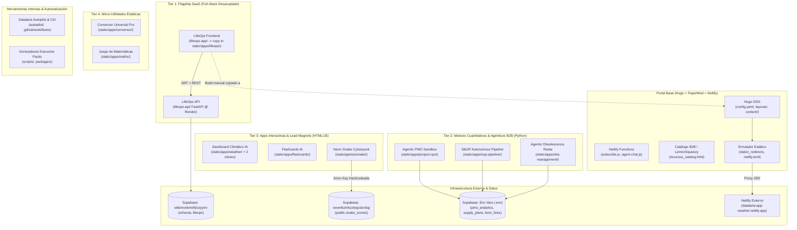
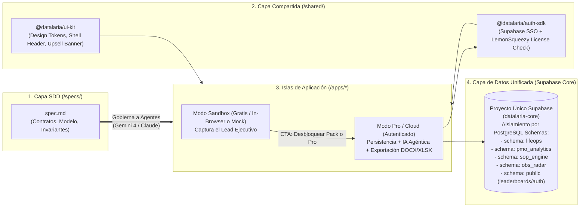

# 00 — Auditoría de Ecosistema y Plan de Modernización SDD (Datalaria)

> **Fecha de Auditoría:** 2026-10-20  
> **Rol:** Principal Software Architect (Spec-Driven Development & Modular Modernization)  
> **Estado del Código de Producción:** INTACTO (Auditoría 100% Estática / Modo Lectura)  
> **Objetivo:** Transformar el repositorio híbrido de Datalaria en una arquitectura modular gobernada por especificaciones formales (`spec.md`), agnóstica del modelo (Google Antigravity / Gemini 4 Argon y agentes Claude) y orientada a la monetización B2B/SaaS.

---

## 1. INVENTARIO Y MAPA DEL ECOSISTEMA

El repositorio actual (`datalaria`) ha evolucionado orgánicamente desde un generador de sitios estáticos en **Hugo** hasta convertirse en un "monorepo accidental" que mezcla contenido editorial, productos digitales B2B (Executive Decision Packs), aplicaciones web interactivas, sandboxes de ingeniería de operaciones y automatizaciones agénticas.

### 1.1 Mapa Visual de la Topología Actual



---

### 1.2 Inventario Completo de Componentes y Aplicaciones

| ID | Nombre / Componente | Ubicación en Repositorio | Ruta Pública (URL) | Stack Tecnológico | Propósito / Estado Actual |
| :--- | :--- | :--- | :--- | :--- | :--- |
| **CORE** | **Portal Editorial & Catálogo B2B** | [config.yaml](file:///c:/Users/dalae/OneDrive/Emprendiendo/datalaria/config.yaml), [layouts/](file:///c:/Users/dalae/OneDrive/Emprendiendo/datalaria/layouts), [content/](file:///c:/Users/dalae/OneDrive/Emprendiendo/datalaria/content) | `/es/`, `/en/`, `/es/recursos/`, `/es/apps/` | Hugo SSG, Go Templates, PaperMod (Submodule), Vanilla JS, CSS Variables | Portal principal bilingüe, blog técnico C-Level y tienda integrada con Lemon Squeezy Checkout Overlay + GA4 Telemetry. |
| **EDGE** | **Portal Serverless Functions** | [netlify/functions/agent-chat.js](file:///c:/Users/dalae/OneDrive/Emprendiendo/datalaria/netlify/functions/agent-chat.js), [subscribe.js](file:///c:/Users/dalae/OneDrive/Emprendiendo/datalaria/netlify/functions/subscribe.js) | `/.netlify/functions/*` | Node.js (CommonJS, native `fetch`) | Proxy CORS para el copiloto de Algolia Agent Studio (con fallback a búsqueda) e integración de alta de suscriptores en Brevo API (listas ES/EN). |
| **APP-01** | **LifeOps (Frontend + API)** | [lifeops-app/](file:///c:/Users/dalae/OneDrive/Emprendiendo/datalaria/lifeops-app), [lifeops-api/](file:///c:/Users/dalae/OneDrive/Emprendiendo/datalaria/lifeops-api), [static/apps/lifeops/](file:///c:/Users/dalae/OneDrive/Emprendiendo/datalaria/static/apps/lifeops) | `/apps/lifeops/` | **FE:** React 19.2, Vite 8.2, React Router 7, Recharts, Lucide, Oxlint.<br>**BE:** FastAPI 0.115, Pydantic v2, SlowAPI, python-docx, openpyxl, Supabase. | Sistema operativo integral personal (deporte, libros, series) y profesional (proyectos, Kanban con bitácora JSONB, alertas y reportes Word/Excel). |
| **APP-02** | **Agentic PMO Sandbox (`project-ops`)** | [static/apps/project-ops/](file:///c:/Users/dalae/OneDrive/Emprendiendo/datalaria/static/apps/project-ops) | *Sin UI pública expuesta* (Código Python en `/static/`) | FastAPI, Pandas, NumPy, OpenPyXL, Pydantic v2, Supabase (`pmo_analytics`), Streamlit (declarado). | Motor cuantitativo de Earned Value Management (CPI/SPI) y simulación Monte Carlo (PERT 10k iteraciones) con ingesta transaccional en 2 pasos desde Excel. Posee [TECH_SPEC.md](file:///c:/Users/dalae/OneDrive/Emprendiendo/datalaria/static/apps/project-ops/TECH_SPEC.md). |
| **APP-03** | **S&OP Autonomous Pipeline (`sop-pipeline`)** | [static/apps/sop-pipeline/](file:///c:/Users/dalae/OneDrive/Emprendiendo/datalaria/static/apps/sop-pipeline) | *Sin UI pública expuesta* (Scripts en `/static/`) | Python, Pandas, SciPy, Prophet, PuLP, Plotly, CrewAI, Gemini 2.0 Flash, Supabase. | Pipeline industrial en 4 fases: higiene de datos, forecasting (Prophet), optimización lineal (PuLP) y deliberación multi-agente (CrewAI). |
| **APP-04** | **Radar de Obsolescencia (`obs-management`)** | [static/apps/obs-management/](file:///c:/Users/dalae/OneDrive/Emprendiendo/datalaria/static/apps/obs-management) | `/apps/obs-management/` | **FE:** HTML5 + Tailwind CDN.<br>**BE:** FastAPI (`main.py`, `dashboard_api.py`), CrewAI, LangChain, Gemini 2.5 Flash, Supabase. | Dashboard ejecutivo y webhook receptor de notificaciones EOL/PDN que cruza la estructura BOM recursiva en Supabase para calcular el margen en riesgo (P&L). |
| **APP-05** | **Dashboard Climático (`weather`)** | [static/apps/weather/](file:///c:/Users/dalae/OneDrive/Emprendiendo/datalaria/static/apps/weather), [temp_app_weather/](file:///c:/Users/dalae/OneDrive/Emprendiendo/datalaria/temp_app_weather), [github.io/app-openweather/](file:///c:/Users/dalae/OneDrive/Emprendiendo/datalaria/github.io/app-openweather) | `/apps/weather/` (Proxy `200!` a Netlify externo) | **FE:** HTML5 monolítico (1.864 líneas), Chart.js, Leaflet, PapaParse, Choices.js.<br>**BE/Batch:** Python (`read_weather.py`), Scikit-Learn, Pandas, GitHub Actions cron. | Visualizador climático global (+100 ciudades) con mapas interactivos, series históricas en CSV y predicción meteorológica por Machine Learning. |
| **APP-06** | **Flashcards IA (`flashcards`)** | [static/apps/flashcards/](file:///c:/Users/dalae/OneDrive/Emprendiendo/datalaria/static/apps/flashcards) | `/apps/flashcards/` (`es` y `en`) | HTML5, Vanilla JS, Tailwind CDN, Google Gemini REST API directa (BYOK). | Aplicación de estudio con tarjetas interactivas 3D, importación CSV y modo de generación automática de traducciones/definiciones con Gemini. |
| **APP-07** | **Neon Snake (`snake`)** | [static/games/snake/](file:///c:/Users/dalae/OneDrive/Emprendiendo/datalaria/static/games/snake) | `/games/snake/` (`es` y `en`) | HTML5 Canvas, Web Audio API (sintetizador retro), Tailwind CDN, Supabase Realtime (ESM CDN). | Videojuego arcade cyberpunk con controles táctiles/teclado, audio procedural y tabla de clasificación mundial en tiempo real. |
| **APP-08** | **Conversor Universal Pro (`conversor`)** | [static/apps/conversor/](file:///c:/Users/dalae/OneDrive/Emprendiendo/datalaria/static/apps/conversor) | `/apps/conversor/` (`es` y `en`) | HTML5 multipágina (14 archivos `.html`), Vanilla JS, Tailwind CDN. | Suite de conversión de unidades técnicas (dimensión, energía, informática, mecánica, RF, tiempo) y formateador masivo de separadores numéricos. |
| **APP-09** | **Juego de Matemáticas (`maths`)** | [static/apps/maths/](file:///c:/Users/dalae/OneDrive/Emprendiendo/datalaria/static/apps/maths) | `/apps/maths/` (`es` y `en`) | HTML5, Vanilla JS, Tailwind CDN. | Juego educativo infantil (5-7 años) para practicar las 4 operaciones aritméticas con temporizador y niveles. |
| **OPS-01** | **Datalaria Autopilot & Autopilot-Ctrl** | [autopilot/](file:///c:/Users/dalae/OneDrive/Emprendiendo/datalaria/autopilot), [.github/workflows/autopilot.yml](file:///c:/Users/dalae/OneDrive/Emprendiendo/datalaria/.github/workflows/autopilot.yml) | *Interno (CI/CD)* | Python 3.11, CrewAI, Google GenAI, Tweepy, Brevo, Dev.to, GitHub Copilot CLI (`ctrl`). | Orquestador de marketing de contenidos que transforma nuevos posts de Hugo en hilos de X, posts de LinkedIn, artículos de Dev.to y campañas de Newsletter. |
| **OPS-02** | **Suite Builders & Algolia Sync** | [scripts/](file:///c:/Users/dalae/OneDrive/Emprendiendo/datalaria/scripts), [packages/](file:///c:/Users/dalae/OneDrive/Emprendiendo/datalaria/packages) | *Interno (Build/Pack)* | Python 3.13, OpenPyXL, ReportLab, Python-PPTX, Algolia Search SDK. | Generación programática de modelos financieros Excel protegidos, presentaciones ejecutivas, portadas y sincronización del índice de búsqueda de Algolia. |

---

## 2. AUDITORÍA DE DEUDA TÉCNICA, SEGURIDAD Y ACOPLAMIENTO

### 2.1 Hallazgos Críticos de Seguridad e Higiene de Repositorio (Blocker Risk)

> [!CAUTION]
> **Riesgo de Exposición de Código Backend y Secretos en `/static/`:**
> En Hugo, **todo archivo ubicado dentro del directorio `static/` se copia literalmente a la raíz de `public/` durante el build** (`hugo`) y se despliega en el CDN de Netlify, a menos que esté explícitamente excluido en `.gitignore` y no exista en el árbol de Git del servidor de build.
> Actualmente residen en `static/apps/` tres proyectos backend en Python completos:
> - `static/apps/obs-management/.env`, `main.py`, `supabase_schema.sql`, `supabase_tools.py`
> - `static/apps/project-ops/.env`, `main.py`, `db_tools.py`, `evm_engine.py`
> - `static/apps/sop-pipeline/.env`, `agent_brain.py`, `db_tools.py`, `optimization_engine_v2.py`
>
> Aunque `.gitignore` ignora `.env` en la raíz, si Netlify o un despliegue manual empaqueta `static/`, el código fuente de tus motores cuantitativos y esquemas SQL queda expuesto públicamente bajo `https://datalaria.com/apps/project-ops/main.py` o `https://datalaria.com/apps/obs-management/supabase_schema.sql`.

1. **Fragmentación de Instancias de Supabase y Claves Hardcodeadas:**
   - [lifeops-app/src/lib/supabase.js](file:///c:/Users/dalae/OneDrive/Emprendiendo/datalaria/lifeops-app/src/lib/supabase.js#L3) apunta como fallback a `https://wkbmxekmofrjtcsyytrv.supabase.co`.
   - [static/games/snake/es/index.html](file:///c:/Users/dalae/OneDrive/Emprendiendo/datalaria/static/games/snake/es/index.html#L199-L200) apunta a una instancia distinta (`https://wxwnbzmbzztegcdzrxbg.supabase.co`) con una clave pública hardcodeada en el HTML (`sb_publishable_hAEvRnntjRnk11ps4n1yVw__PwZYoSy`).
   - [netlify/functions/agent-chat.js](file:///c:/Users/dalae/OneDrive/Emprendiendo/datalaria/netlify/functions/agent-chat.js#L8-L10) tiene hardcodeados como fallback el `ALGOLIA_APP_ID`, `ALGOLIA_SEARCH_KEY` y `ALGOLIA_AGENT_ID`.
2. **Triplicación y Corrupción Git en `weather`:**
   - La app del clima existe simultáneamente en tres rutas del workspace: `static/apps/weather/`, `temp_app_weather/` y `github.io/app-openweather/app_weather/`.
   - Además, `static/apps/weather/` contiene los archivos internos de un repositorio Git bare/desempaquetado (`HEAD`, `config`, `objects/pack/*`, `refs/`, `logs/`) mezclados con los archivos de la aplicación.
3. **Doble Build Manual en `lifeops-app`:**
   - El código fuente vive en `lifeops-app/`, se compila en `lifeops-app/dist/` y luego se copia manualmente a `static/apps/lifeops/` (ambos directorios contienen exactamente los mismos hashes de bundle JS/CSS como `index-BZYsjzT8.js`).
4. **Proliferación de Versiones Muertas (`_v2`, `_OLD_DEPRECATED`, `scratch/`):**
   - En `static/apps/sop-pipeline/` coexisten todos los módulos por duplicado (`data_hygiene.py` y `data_hygiene_v2.py`, `forecast_manager.py` y `forecast_manager_v2.py`, `optimization_engine.py` y `optimization_engine_v2.py`).
   - En `autopilot/` existen `main_OLD_DEPRECATED.py`, `agents_OLD_DEPRECATED.py`, `tasks_OLD_DEPRECATED.py`.
   - En la raíz del proyecto hay 6 archivos `mockup_*.html`, 3 archivos `extracted*.txt` de ~140KB y scripts sueltos (`copy_images.py`, `extract.py`, `test_chars.pdf`).

---

### 2.2 Evaluación Detallada por Aplicación

#### 1. **LifeOps (`lifeops-app` + `lifeops-api`)**
- **Acoplamiento con el Portal:** **Bajo/Medio.** No comparte estado ni estilos con Hugo (usa su propio sistema de tokens CSS Glassmorphism y autenticación propia con Supabase Auth + JWT). Su único acoplamiento es el artefacto compilado depositado en `static/apps/lifeops/` y su enlace en el catálogo. Dispone de un "Modo Demo/Mock" (`?mock=true`) excelente para visitantes del blog sin cuenta.
- **Cobertura de Tests y Verificación Automatizada:** **Baja (0% tests unitarios/E2E), Media en Linting/Tipado.** `lifeops-app` cuenta con `oxlint` configurado ([.oxlintrc.json](file:///c:/Users/dalae/OneDrive/Emprendiendo/datalaria/lifeops-app/.oxlintrc.json)), pero está escrito en `.jsx`/`.js` sin TypeScript (`tsconfig.json` ausente). `lifeops-api` usa validación estricta con Pydantic v2, pero carece de suite `pytest`.
- **Dependencias:** Modernas en general (`react@^19.2.8`, `vite@^8.2.0`, `fastapi==0.115.12`), pero `lifeops-api` utiliza `python-jose[cryptography]==3.4.0` (librería sin mantenimiento activo y con vulnerabilidades conocidas frente a `PyJWT`). Además, `main.py` incluye un monkey-patch global de `socket.getaddrinfo` para forzar IPv4 en Windows.
- **Valor de Negocio (Datalaria):** **Alto (B2C Prosumer / Portfolio Flagship).** Demuestra capacidad de ingeniería Full-Stack real en producción (series de 5 posts técnicos), aunque su temática es más "Productividad Personal/Profesional" que el core C-Level industrial de Datalaria. Potencial como SaaS freemium o plantilla integrable.

#### 2. **Agentic PMO Sandbox (`project-ops`)**
- **Acoplamiento con el Portal:** **Nulo en runtime, Crítico en ubicación física.** Vive erróneamente dentro de `static/apps/project-ops/`, pero es un backend puro en FastAPI (`port 8001`). No tiene interfaz web conectada en el portal (la Fase 4a con Streamlit está declarada en `requirements.txt` pero aún no implementada).
- **Cobertura de Tests y Verificación Automatizada:** **Media.** Es la única app que ya posee una especificación técnica formal ejemplar ([TECH_SPEC.md](file:///c:/Users/dalae/OneDrive/Emprendiendo/datalaria/static/apps/project-ops/TECH_SPEC.md)) y contratos estrictos en Pydantic v2 ([models.py](file:///c:/Users/dalae/OneDrive/Emprendiendo/datalaria/static/apps/project-ops/models.py)). Le falta suite `pytest` automatizada que verifique las invariantes matemáticas de `evm_engine.py`.
- **Dependencias:** Limpias (`fastapi`, `pandas`, `numpy`, `openpyxl`, `pydantic>=2.0.0`, `supabase>=2.0.0`), pero con rangos abiertos (`>=`) en lugar de versiones fijadas con lockfile.
- **Valor de Negocio (Datalaria):** **Muy Alto (Core B2B / Upsell Directo).** Conecta directamente con la **Suite 03: Control Operativo (PERT y Cuadro EVM)** que vendes en Lemon Squeezy. Es el puente perfecto entre tus plantillas Excel de pago y un SaaS B2B o servicio de consultoría ejecutiva.

#### 3. **S&OP Autonomous Pipeline (`sop-pipeline`)**
- **Acoplamiento con el Portal:** **Nulo en runtime, Crítico en ubicación física.** Alojado en `static/apps/sop-pipeline/`. Ni siquiera aparece listado en `/es/apps/_index.md`, sino que sirve como código de respaldo de la serie de posts sobre S&OP e IA Agéntica.
- **Cobertura de Tests y Verificación Automatizada:** **Muy Baja.** Contiene 3 scripts sueltos (`test_gemini.py`, `test_genai.py`, `test_models.py`) que son pruebas de humo manuales contra la API de Gemini, no tests unitarios de los motores matemáticos (`forecasting_engine_v2.py` y `optimization_engine_v2.py`).
- **Dependencias:** Pesadas (`prophet`, `pulp`, `scipy`, `plotly`, `crewai` sin declarar en `requirements.txt` aunque se usa en `agent_brain.py`). Gran deuda interna por duplicidad de archivos `v1` y `v2`.
- **Valor de Negocio (Datalaria):** **Muy Alto (Core B2B / Consultoría C-Level).** Representa exactamente la propuesta de valor diferencial de Datalaria ("Ingeniería de Operaciones, Modelos Cuantitativos e IA Aplicada"). Convertirlo en una app interactiva (Sandbox S&OP donde el usuario sube su CSV o juega con restricciones de capacidad) dispararía la conversión de leads ejecutivos.

#### 4. **Radar de Obsolescencia (`obs-management`)**
- **Acoplamiento con el Portal:** **Alto riesgo de experiencia rota en producción.** Está enlazado en `/es/apps/` hacia `/apps/obs-management/`, lo que sirve `static/apps/obs-management/index.html`. Sin embargo, ese HTML hace un `fetch("http://localhost:8001/api/v1/dashboard/risk-metrics")` en la línea 112. Cuando un visitante entra desde `datalaria.com`, la llamada a `localhost:8001` falla siempre y el dashboard muestra permanentemente: `> OFFLINE. Cannot connect to Analytics API on port 8001.`
- **Cobertura de Tests y Verificación Automatizada:** **Nula (0%).** Sin tests ni linters. Además, tiene dos entrypoints FastAPI separados (`main.py` en puerto 8000 para webhooks y `dashboard_api.py` en puerto 8001 con datos mockeados).
- **Dependencias:** Usa `tailwindcss` vía CDN en el navegador, y en Python mezcla `langchain>=0.1.0`, `langchain-google-genai>=0.0.9` y `crewai>=0.11.0` (versiones antiguas).
- **Valor de Negocio (Datalaria):** **Muy Alto (Core B2B / Supply Chain Risk).** Es un caso de uso ejecutivo brillante (calcular el impacto en P&L de un componente EOL recorriendo el árbol BOM). Arreglar su modo demo/interactivo en web es prioritario para la imagen de marca.

#### 5. **Dashboard Climático (`weather`)**
- **Acoplamiento con el Portal:** **Bajo (Desacoplado por Proxy).** Aunque hay copias locales en `static/apps/weather/` y `temp_app_weather/`, en producción `static/_redirects` redirige `/apps/weather/*` mediante un proxy `200!` hacia `https://datalaria-app-weather.netlify.app/`.
- **Cobertura de Tests y Verificación Automatizada:** **Nula.** Es un único archivo `index.html` de 1.864 líneas que mezcla estilos CSS, marcado HTML, traducciones ES/EN y lógica de Chart.js/Leaflet, acompañado de un script monolítico `read_weather.py` (19 KB).
- **Dependencias:** Múltiples librerías cargadas por CDN (`PapaParse`, `Chart.js`, `date-fns`, `Choices.js`, `Leaflet`, `Feather Icons`).
- **Valor de Negocio (Datalaria):** **Medio (Portfolio / Tráfico SEO).** Es un buen escaparate de visualización de datos y ML ligero respaldado por una serie de 4 posts, pero no monetiza directamente en el segmento C-Level.

#### 6. **Flashcards IA (`flashcards`), Neon Snake (`snake`), Conversor (`conversor`) y Matemáticas (`maths`)**
- **Acoplamiento con el Portal:** **Bajo en código, Alto en duplicación por idioma.** En lugar de usar internacionalización (i18n) basada en diccionarios JSON, estas 4 aplicaciones duplican sus archivos HTML enteros en subcarpetas `/es/` y `/en/` (en el caso de `conversor`, son 7 archivos HTML en `/es/` y 7 archivos HTML idénticos traducidos en `/en/`). Cualquier cambio funcional obliga a editar el código por duplicado.
- **Seguridad y Dependencias:**
  - Todas usan `<script src="https://cdn.tailwindcss.com"></script>` en producción (desaconsejado por rendimiento y estabilidad visual).
  - `flashcards` pide al usuario su `GEMINI_API_KEY` en el cliente (patrón BYOK válido para demos gratuitas, pero llama a modelos/endpoints que pueden quedar deprecados si están hardcodeados en los archivos HTML).
  - `snake` expone la URL y Anon Key de un proyecto Supabase secundario directamente en el HTML.
- **Valor de Negocio (Datalaria):** **Bajo (Experimentos de etapas iniciales del blog).** Cumplen una función simpática de entretenimiento o curiosidad ("Lead Magnets blandos"), pero diluyen el posicionamiento ejecutivo C-Level de Datalaria si ocupan el mismo nivel jerárquico que `Agentic Radar` o `LifeOps`.

---

### 2.3 Matriz Resumen de Auditoría (Estado Actual)

| Aplicación | Acoplamiento Portal | Deuda / Riesgo Técnico | Tests / Verificación | Alineación B2B / Monetización |
| :--- | :---: | :--- | :---: | :---: |
| **1. LifeOps (`lifeops`)** | Bajo (Build copiado a `static/`) | Media (JS sin TS, copia manual de `dist/`, `python-jose`) | Oxlint + Pydantic (0% Tests) | ⭐⭐⭐⭐ (Potencial SaaS Prosumer / Flagship) |
| **2. Agentic PMO (`project-ops`)** | Crítico (Código Python en `static/`) | Baja en código, Alta por falta de UI y ubicación | `TECH_SPEC.md` + Pydantic (0% Tests) | ⭐⭐⭐⭐⭐ (Upsell directo de Suite 03 PMBOK) |
| **3. S&OP Pipeline (`sop-pipeline`)** | Crítico (Código Python en `static/`) | Alta (Archivos `v1`/`v2` duplicados, sin API/UI web) | Humo manual (0% Tests) | ⭐⭐⭐⭐⭐ (Core Operations Engineering B2B) |
| **4. Obsolescence Radar (`obs-management`)** | Crítico (UI en `static/` apunta a `localhost:8001` roto) | Alta (UI rota en prod, código Python en `static/`) | 0% Tests / Sin Linter | ⭐⭐⭐⭐⭐ (Caso ejecutivo estrella para CFO/COO) |
| **5. Weather (`weather`)** | Bajo (Proxy Netlify externo) | Alta (3 copias en repo, `.git` corrupto, HTML 1.8k LOC) | 0% Tests / Sin Linter | ⭐⭐⭐ (Demostrador técnico Data/ML) |
| **6. Neon Snake (`snake`)** | Bajo (Estático en `static/games/`) | Media (HTML duplicado ES/EN, Supabase hardcodeado) | 0% Tests | ⭐⭐ (Engagement / Gamificación) |
| **7. Flashcards (`flashcards`)** | Bajo (Estático en `static/apps/`) | Media (HTML duplicado ES/EN, Tailwind CDN) | 0% Tests | ⭐⭐ (experimento IA BYOK) |
| **8. Conversor (`conversor`)** | Bajo (Estático en `static/apps/`) | Alta (14 HTMLs duplicados ES/EN, Tailwind CDN) | 0% Tests | ⭐ (Commodity sin retorno B2B) |
| **9. Matemáticas (`maths`)** | Bajo (Estático en `static/apps/`) | Media (HTML duplicado ES/EN, fuera de nicho) | 0% Tests | ⭐ (Fuera del target ejecutivo de Datalaria) |

---

## 3. PROPUESTA DE ARQUITECTURA DEL PORTAL (VISIÓN A FUTURO SDD)

Para que Datalaria escale con nuevas aplicaciones rentables, mantenibles a largo plazo y **100% gobernables mediante Spec-Driven Development (SDD)** tanto por **Google Antigravity (Gemini 4 Argon)** como por **agentes basados en Claude**, debemos erradicar el patrón de "meter scripts y HTMLs sueltos dentro de `static/`" y adoptar una arquitectura de **Monorepo Políglota Orientado a Especificaciones (Spec-First Modular Monorepo)**.

### 3.1 Estructura de Directorios Objetivo

```text
datalaria/
├── AGENTS.md                        # Punto de entrada universal agnóstico del modelo (Antigravity + Claude)
├── CLAUDE.md                        # Puntero ligero a AGENTS.md para compatibilidad nativa con Claude Code
├── package.json                     # Workspace JS/TS raíz (pnpm/npm workspaces: apps/* y shared/*)
├── pyproject.toml                   # Workspace Python raíz (uv / ruff / pytest unificados)
│
├── specs/                           # 🏛️ EL CORAZÓN SDD (Fuente Única de Verdad)
│   ├── _constitution.md             # Principios innegociables de arquitectura, seguridad, UI y testing
│   ├── _templates/                  # Plantillas formales para nuevas apps (spec.md, plan.md, tasks.md)
│   ├── audit/
│   │   └── 00-ecosystem-audit.md    # Este informe
│   ├── portal/                      # Especificaciones del portal Hugo, Catálogo LemonSqueezy y Edge Functions
│   └── apps/                        # 1 carpeta por App con su contrato formal antes de tocar código
│       ├── lifeops/                 # spec.md, api-contract.openapi.yaml, data-model.sql
│       ├── project-ops/             # Evolución de su actual TECH_SPEC.md
│       ├── sop-pipeline/            # spec.md
│       ├── obs-management/          # spec.md
│       └── weather/                 # spec.md
│
├── portal/ (o raíz limpia para Hugo)# El generador estático Hugo (content/, layouts/, themes/, config.yaml)
│   └── static/                      # EXCLUSIVAMENTE assets estáticos reales y builds compilados por CI/CD
│
├── apps/                            # 🚀 CÓDIGO FUENTE DE LAS APLICACIONES (Fuera de static/)
│   ├── lifeops-web/                 # React + Vite + TypeScript (migrar progresivamente a TS)
│   ├── lifeops-api/                 # FastAPI + Pydantic v2 + Pytest
│   ├── project-ops/                 # FastAPI + Motor EVM/MonteCarlo + UI Sandbox Interactiva
│   ├── sop-pipeline/                # Motor S&OP v2 limpio + API/Sandbox interactivo
│   ├── obs-management/              # Radar de Obsolescencia (FastAPI + UI con Fallback Mock en prod)
│   ├── weather/                     # Instancia única limpia del Dashboard Climático
│   └── legacy-static/               # Contenedor congelado para flashcards, snake, conversor, maths
│
├── shared/                          # 🧩 PAQUETES COMPARTIDOS DEL ECOSISTEMA
│   ├── ui-kit/                      # Tokens CSS corporativos Datalaria, cabecera "Volver al Portal", CTA Upsell
│   ├── auth-sdk/                    # Cliente unificado de Supabase Auth + Gatekeeper de Licencias LemonSqueezy
│   └── py-core/                     # Utilidades compartidas Python (cliente Supabase, logging, LLM wrappers)
│
└── ops/                             # 🤖 AUTOMATIZACIÓN INTERNA (Fuera del runtime de usuario)
    ├── autopilot/                   # Orquestador de RRSS y Autopilot-Ctrl
    └── pack-builders/               # Scripts generadores de los Executive Decision Packs (Excel/PPTX/PDF)
```

---

### 3.2 Cómo Compartirán UI, Autenticación, Datos y Monetización



1. **Integración de UI y Experiencia de Marca (`@datalaria/ui-kit`):**
   - **Problema actual:** Cada app tiene un diseño inconexo (LifeOps es dark emerald glassmorphism, Obsolescence Radar es azul táctico, Flashcards es blanco celeste, Conversor es gris oscuro, el Portal es PaperMod). Además, varias apps carecen de barra de navegación de retorno al portal o de enlaces a los Executive Packs relacionados.
   - **Solución:** Definir un archivo ligero de Design Tokens CSS (`datalaria-tokens.css`) y un Web Component o Partial compartido (`<datalaria-app-shell>`) que inyecte automáticamente en todas las apps:
     1. Cabecera compacta con logo de Datalaria, selector de idioma (`ES`/`EN`) y botón de retorno al portal.
     2. **Banner Contextual de Monetización (Upsell):** Si el usuario está en el sandbox de `project-ops`, el shell muestra un CTA directo al *Executive Pack de EVM / PERT* o a la *Suite 03 en Lemon Squeezy*.
2. **Unificación de Datos en un Único Proyecto Supabase Multi-Esquema:**
   - **Problema actual:** Tienes múltiples proyectos de Supabase dispersos (`wkbmxekmofrjtcsyytrv`, `wxwnbzmbzztegcdzrxbg`, etc.) que en el plan gratuito de Supabase se pausan por inactividad o agotan el límite de proyectos activos.
   - **Solución:** Consolidar toda la persistencia en **un único cluster de Supabase (`datalaria-core`)** separado estrictamente por **Esquemas PostgreSQL (`schemas`)** con Row-Level Security (RLS) activado, exactamente como ya empezaste a hacer en `lifeops` (`schema: lifeops`) y `project-ops` (`schema: pmo_analytics`).
     - `schema: auth` (Gestionado por Supabase para SSO único en todas las apps de Datalaria).
     - `schema: lifeops` (Tablas de LifeOps).
     - `schema: pmo_analytics` (Tablas de Project-Ops).
     - `schema: sop_engine` (Tablas de S&OP Pipeline).
     - `schema: obs_radar` (Tablas BOM/AML de Obsolescence Management).
     - `schema: arcade` (Tabla `snake_scores` con políticas RLS de solo inserción acotada).
3. **Autenticación y Monetización "Dual-Mode" (Sandbox Gratis + Pro/Pack):**
   - **Regla de Oro para Datalaria:** Ninguna aplicación publicada en `/apps/` puede fallar con un error de conexión a `localhost` (como ocurre hoy en `obs-management`) ni exigir login obligatorio antes de mostrar valor.
   - **Patrón "Offline-First / Mock-First Sandbox":** Siguiendo el excelente patrón que implementaste en [lifeops-app/src/lib/api.js](file:///c:/Users/dalae/OneDrive/Emprendiendo/datalaria/lifeops-app/src/lib/api.js#L10-L15) (`mock=true`), **todas las apps B2B tendrán un modo interactivo determinista en el navegador** (usando datasets precargados o cálculo en cliente/Edge) para que cualquier ejecutivo pueda probar el dashboard al instante.
   - **Desbloqueo de Valor (Monetización):** Cuando el usuario quiera (a) subir su propio Excel/CSV corporativo, (b) ejecutar el agente de IA sobre sus datos o (c) descargar el modelo financiero desbloqueado, la app verifica su sesión de Supabase Auth o valida una **Clave de Licencia de Lemon Squeezy** para habilitar el backend FastAPI.
4. **Compatibilidad 100% Agnóstica del Modelo (Antigravity Gemini 4 Argon + Agentes Claude):**
   - El estándar común será un archivo raíz **`AGENTS.md`** (leído nativamente por agentes modernos y referenciado desde `CLAUDE.md`) junto con el árbol **`/specs/`**.
   - Ningún agente tendrá permitido escribir código en `/apps/` sin antes leer y actualizar el archivo `/specs/apps/<app-name>/spec.md`, donde estarán definidos en Markdown puro y Mermaid: (1) Contexto de negocio y vínculo con Lemon Squeezy, (2) Contratos de entrada/salida (Pydantic / JSON Schema), (3) Esquema de base de datos, (4) Invariantes matemáticas y (5) Comandos exactos de verificación automatizada (`pytest`, `oxlint`, `tsc`).

---

## 4. PLAN DE EXTRACCIÓN SDD (MATRIZ DE MIGRACIÓN / REVERSE-SPECCING)

Clasificamos las aplicaciones existentes en las 3 categorías solicitadas según su madurez arquitectónica, acoplamiento y retorno de inversión (ROI) para Datalaria:

### Categoría A: "Listas para documentar" (Reverse-Speccing Directo)
*Apps con arquitectura bien delimitada, alto valor estratégico o contratos claros de las que podemos extraer su `spec.md` de inmediato sin refactorizar su lógica interna.*

| Aplicación | Estado Actual | Acción de Extracción SDD | Valor de Negocio |
| :--- | :--- | :--- | :--- |
| **1. `project-ops` (Agentic PMO Sandbox)** | **90% SDD-Ready.** Ya cuenta con un excelente [TECH_SPEC.md](file:///c:/Users/dalae/OneDrive/Emprendiendo/datalaria/static/apps/project-ops/TECH_SPEC.md), modelos Pydantic v2 estrictos y separación clara entre `ingest_service.py`, `db_tools.py` y `evm_engine.py`. | 1. Promover `TECH_SPEC.md` al formato estándar `/specs/apps/project-ops/spec.md`.<br>2. Añadir la sección de invariantes de test (`pytest`) y la especificación de su futura UI Sandbox conectada a la Suite 03 (PERT/EVM).<br>3. Mover su código fuera de `static/` en la fase de ejecución. | **Crítico (B2B).** Monetización directa cruzada con los Executive Packs de PERT y Valor Ganado (EVM). |
| **2. `lifeops` (`lifeops-app` + `lifeops-api`)** | **80% SDD-Ready.** Arquitectura cliente-servidor limpia, routers FastAPI modulares, autenticación JWT + RLS en esquema propio (`lifeops`) y modo demo funcional (`mock=true`). | 1. Extraer `/specs/apps/lifeops/spec.md` documentando sus 5 dominios (Activities, Projects/Kanban, Stats, Alerts, DOCX/XLSX Reports) y su contrato OpenAPI.<br>2. Definir el pipeline de build para eliminar la copia manual de `dist/` a `static/apps/lifeops/`. | **Alto (Flagship SaaS).** Activo principal de ingeniería de software del portal. |

---

### Categoría B: "Requieren aislamiento previo" (Refactorización de Contorno antes de Congelar Spec)
*Apps de altísimo valor para Datalaria pero que sufren acoplamiento defectuoso, archivos duplicados (`v1`/`v2`), código backend expuesto en `static/` o dependencias rotas en producción.*

| Aplicación | Problema de Contorno / Deuda | Refactorización Previa Requerida | Valor de Negocio |
| :--- | :--- | :--- | :--- |
| **3. `obs-management` (Radar de Obsolescencia)** | 1. El frontend en `/apps/obs-management/` falla en producción porque llama a `http://localhost:8001`.<br>2. Tiene 2 servidores FastAPI separados (`main.py` y `dashboard_api.py`).<br>3. Expone `.env` y `.py` dentro de `static/`. | 1. Sacar los scripts Python de `static/apps/obs-management/` hacia `apps/obs-management/`.<br>2. Unificar los endpoints FastAPI e inyectar en el `index.html` un **Fallback de Simulación Interactiva** (para que si la API local/cloud no está activa, el ejecutivo vea la simulación de telemetría CrewAI y el cálculo BOM funcionando en vivo en el navegador).<br>3. Congelar `/specs/apps/obs-management/spec.md`. | **Crítico (B2B).** Es la primera app B2B visible en el catálogo; hoy da error `OFFLINE` a los visitantes. |
| **4. `sop-pipeline` (S&OP Autonomous Pipeline)** | 1. Duplicidad total entre archivos `v1` y `v2` (`data_hygiene_v2.py`, `forecast_manager_v2.py`, `optimization_engine_v2.py`).<br>2. Vive dentro de `static/apps/sop-pipeline/` sin interfaz web (solo scripts CLI). | 1. Purgar los scripts `v1` obsoletos y consolidar la versión `v2` fuera de `static/`.<br>2. Envolver el motor matemático (Prophet + PuLP) en un contrato limpio de entrada/salida.<br>3. Congelar `/specs/apps/sop-pipeline/spec.md` y diseñar una vista web interactiva para el portal. | **Crítico (B2B).** Pilar central de Ingeniería de Operaciones y Cadena de Suministro. |
| **5. `weather` (Dashboard Climático IA)** | 1. Triplicado en el disco (`static/apps/weather/`, `temp_app_weather/`, `github.io/app-openweather/`).<br>2. Repositorio Git corrupto incrustado dentro de `static/apps/weather/`.<br>3. Monolito `index.html` de 1.864 líneas. | 1. Eliminar las carpetas redundantes y los metadatos `.git` huérfanos.<br>2. Definir una única fuente de verdad para el pipeline `read_weather.py` y el frontend.<br>3. Extraer `/specs/apps/weather/spec.md`. | **Medio (Autoridad Data/ML).** Tráfico orgánico y demostración de predicción con ML. |
| **6. `autopilot` + `pack-builders` (Internal Ops)** | 1. En `autopilot/src/` conviven scripts activos con `*_OLD_DEPRECATED.py`.<br>2. En la raíz y `scratch/` hay decenas de scripts de prueba mezclados con los generadores oficiales de `scripts/suite_*`. | 1. Limpiar archivos deprecados y mover los generadores de productos a un contorno aislado `ops/`.<br>2. Documentar `/specs/ops/autopilot-spec.md` y `/specs/ops/pack-factory-spec.md` (vital para generar nuevos Executive Packs con agentes). | **Crítico (Motor de Ingresos Internos).** Automatiza la creación y distribución de productos de pago. |

---

### Categoría C: "No migrables" (Congelar en Modo Legacy / Sunset)
*Apps experimentales o micro-utilidades cuyo bajo valor de negocio B2B y simplicidad técnica no justifican el esfuerzo de escribir especificaciones formales, tests automatizados ni refactorizar su arquitectura.*

| Aplicación | Diagnóstico | Recomendación Arquitectónica |
| :--- | :--- | :--- |
| **7. `conversor` (Conversor de Unidades)** | 14 páginas HTML estáticas duplicadas en `/es/` y `/en/` con lógica elemental de conversión en Vanilla JS. Cero alineación con la oferta ejecutiva C-Level. | **No migrar a SDD.** Mantener congelado tal cual en `static/apps/conversor/` (por preservación de enlaces SEO de posts antiguos), pero retirarlo de la primera línea visual de `/apps/` (mover a una sección secundaria *"Laboratorio / Archivo de Experimentos"*). |
| **8. `maths` (Juego de Matemáticas Infantil)** | Juego para niños de 5 a 7 años. Desentona con el posicionamiento actual de Datalaria (*"Modelos cuantitativos, sistemas en producción y marcos de decisión para dirección ejecutiva C-Level"*). | **No migrar a SDD.** Congelar como archivo estático legacy para no romper enlaces históricos del blog, y ocultarlo o moverlo al archivo de experimentos. |
| **9. `flashcards` (Flashcards IA)** | Experimento sencillo de 1 archivo HTML por idioma con llamadas directas a Gemini usando API Key del usuario (BYOK). | **No migrar a SDD.** Mantener congelado en modo legacy dentro de la sección de experimentos. Solo requiere verificar puntualmente que el nombre del modelo Gemini invocado en su JS no haya sido retirado por Google. |
| **10. `snake` (Neon Snake)** | Juego arcade en un único HTML por idioma. Tiene valor simpático de marca ("cultura geek"), pero no valor de monetización. | **No migrar a SDD completo.** Solo aplicar un micro-parche de seguridad puntual en el futuro (verificar RLS en su tabla `snake_scores` de Supabase) y mantenerlo congelado en la sección de experimentos/arcade. |

---

## 5. HOJA DE RUTA DE EJECUCIÓN RECOMENDADA (PRÓXIMOS PASOS)

1. **Fase 0 — Validación Arquitectónica y Constitución SDD (Turno Actual -> Siguiente Turno):**
   - Acordar las decisiones estratégicas abiertas (ver resumen en el chat).
   - Generar `AGENTS.md` (y `CLAUDE.md`) en la raíz del repositorio con las reglas de gobernanza multi-modelo.
   - Crear `/specs/_constitution.md` y las plantillas base en `/specs/_templates/`.
2. **Fase 1 — Extracción SDD de Apps "Listas para Documentar":**
   - Generar `/specs/apps/project-ops/spec.md` (evolucionando su `TECH_SPEC.md` actual) y `/specs/apps/lifeops/spec.md`.
3. **Fase 2 — Saneamiento de Contorno y Seguridad (Higiene del Monorepo):**
   - Sacar el código fuente Python y archivos `.env` de `static/apps/` hacia `/apps/`.
   - Reparar el modo interactivo de `/apps/obs-management/` en producción (eliminar la dependencia dura a `localhost:8001` cuando se visita desde `datalaria.com`) y limpiar duplicados de `sop-pipeline` y `weather`.
4. **Fase 3 — Fábrica de Nuevas Apps Monetizables B2B:**
   - Reorganizar la página `/es/apps/` y `/en/apps/` en dos niveles claros: **"Executive & Operations Suites (B2B)"** (conectadas con los packs de Lemon Squeezy) y **"Open Lab & Experiments"** (apps legacy).
   - Desarrollar las nuevas aplicaciones siguiendo estrictamente el ciclo SDD: `Spec -> Test Contract -> Implementation -> Verification`.
