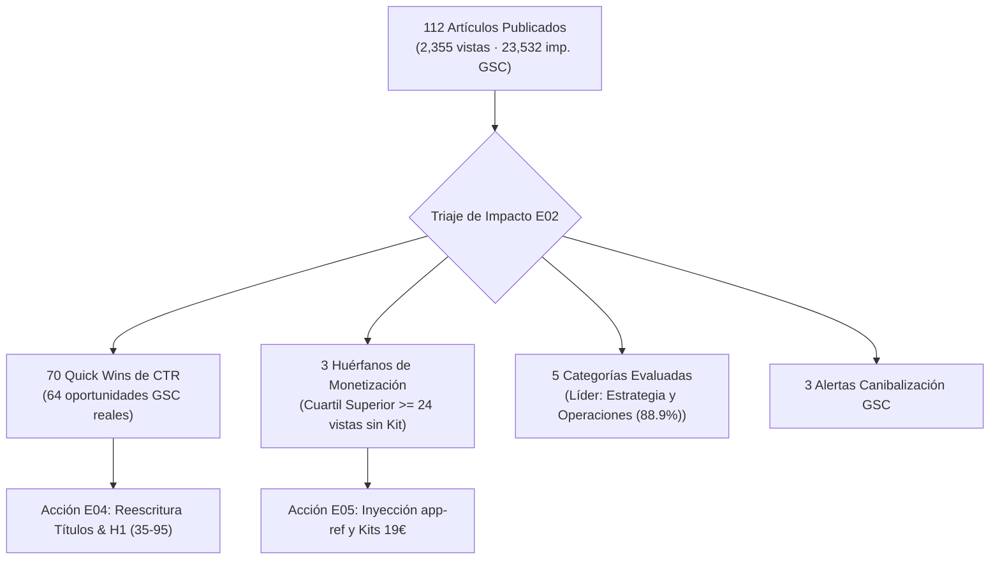

# 📈 Primera Auditoría Estratégica de Impacto SEO, Tráfico y Monetización (E02)

> **Autor:** [`E02-seo-impact-strategist`](file:///c:/Users/dalae/OneDrive/Emprendiendo/datalaria/specs/squad-editorial/E02-seo-impact-strategist.md) · **Célula:** Dirección & Inteligencia Estratégica  
> **Fecha de Emisión:** 2026-11-28 11:29 UTC  
> **Fuentes de Verdad:** `data/pulse/private/index.json` (191 activos), `metrics.json` (GA4 + GSC 30d/prev 30d), `channel_metrics.json` (GA4 Acquisition + KeyEvents), `social_metrics.json` (Dev.to + CoderLegion APIs gratuitas), `distribution_ledger.json`, `gsc_queries.json`, `monthly_metrics.json` (14 meses) y `backlog.yaml`.  
> **Invariantes:** Cumple estrictamente `INV-PULSE-6`, `INV-PULSE-11`, `INV-PULSE-12` (`ADR-033`, coste `0 €`) y Constitución Art. 1.3 (*Separación Cerebro vs. Músculo Cuantitativo*).

---

## 1. Resumen Ejecutivo y Estado del Catálogo

| Métrica Macro | Valor Cuantitativo Real | Interpretación Estratégica E02 |
| :--- | :---: | :--- |
| **Total Activos Consolidados** | **191 activos** | 125 Posts bilingües (`112` publicados, `11` programados, `2` drafts), `10` Apps base y `21` Kits/Suites. |
| **Tráfico Acumulado Posts (30d)** | **2,355 vistas** | Cuota inglés (EN): **50.2%** · Mediana: **10.0** · $P_{75}$: **24.0**. |
| **Visibilidad Orgánica GSC (30d)** | **23,532 imp. · 141 clics** | CTR medio: **0.60%** · Posición media ponderada: **10.7** · Cuota EN (imp.): **71.9%** · Prev 30d: `13,202` imp. / `72` clics · Marca (`datalaria`): `689` imp. / `0` clics. |
| **Crecimiento Interanual (YoY)** | **+2494.9%** | De 198 vistas (2025-10) a 5,138 vistas (2026-11). |
| **Quick Wins de CTR / SERP** | **70 oportunidades** | `64` con impresiones reales GSC (`pos 4..20` o `CTR < 2.5%`) + truncamientos SERP. |
| **Canibalización de Keywords** | **3 alertas** | Consultas GSC donde `>= 2` URLs del mismo idioma compiten por impresiones. |
| **Huérfanos de Monetización** | **3 posts top** | Posts en el cuartil superior ($P_{75} \ge 24$) sin enlace ni shortcode a Kit/App. |
| **Score Promedio del Backlog** | **79.1 / 100** | 6 propuestas estratégicas evaluadas por Editorial ROI Score. |
| **Lectura Doble Capa (`00B` / `ADR-035`)** | **600 ses. externas netas** | Bruto GA4 intacto: `3,540` · Asistentes IA (GEO): **26** · Ruido excluido: `localhost` `121` + spam `117` (`aocr.org`) · Marca real GSC (sin `site:`): `48` imp. / `0` clics (`site:`: `662` imp.). |

---

## 2. Rendimiento, GSC y Cobertura de Monetización por Categoría (ES vs. EN)

| Categoría Oficial | Posts | Vistas 30d | % EN (Vistas) | Imp. GSC | Clics GSC | CTR GSC | Eng. Medio | Monetizados | Cobertura % | Editorial ROI Score |
| :--- | :---: | :---: | :---: | :---: | :---: | :---: | :---: | :---: | :---: | :---: |
| **Estrategia y Operaciones** | 18 | 669 (37.2/p) | 39.9% | 1,628 | 13 | 0.80% | 15.6s | 16/18 | **88.9%** | **77.4** |
| **Pioneros y Referentes** | 14 | 358 (25.6/p) | 55.3% | 9,234 | 47 | 0.51% | 30.7s | 8/14 | **57.1%** | **66.9** |
| **IA, Ingeniería y Proyectos** | 54 | 989 (18.3/p) | 49.9% | 5,096 | 24 | 0.47% | 16.4s | 28/54 | **51.9%** | **53.3** |
| **Startups** | 14 | 199 (14.2/p) | 68.8% | 5,191 | 43 | 0.83% | 41.4s | 6/14 | **42.9%** | **53.2** |
| **Cultura Tech y Media** | 12 | 140 (11.7/p) | 61.4% | 2,383 | 14 | 0.59% | 18.0s | 5/12 | **41.7%** | **38.3** |

### Diagnóstico Estratégico de Categorías:
1. **Estrategia y Operaciones (Editorial ROI 77.4):** **37.2 vistas/post**, **1,628 impresiones GSC** (CTR **0.80%**), cuota inglés **39.9%** y **88.9%** de cobertura comercial (16/18).
2. **Pioneros y Referentes (Editorial ROI 66.9):** **25.6 vistas/post**, **9,234 impresiones GSC** (CTR **0.51%**), cuota inglés **55.3%** y **57.1%** de cobertura comercial (8/14).
3. **IA, Ingeniería y Proyectos (Editorial ROI 53.3):** **18.3 vistas/post**, **5,096 impresiones GSC** (CTR **0.47%**), cuota inglés **49.9%** y **51.9%** de cobertura comercial (28/54).

---

## 3. Matriz de Quick Wins de CTR (Top Oportunidades en Buscadores)

Artículos priorizados combinando datos reales de **Google Search Console** (impresiones, posición media y CTR) con longitud de snippet y retención en GA4:

| ID / Activo | Top Query GSC | Imp. GSC | Pos. / CTR | Vistas 30d | Tipo de Oportunidad | Título Recomendado ES (35–95 chars) |
| :--- | :--- | :---: | :---: | :---: | :--- | :--- |
| [`kantorovich`](kantorovich) | `leonid kantorovich` | **3,514** | `7.6` / `0.5%` | 50 | `gsc_position_4_20` | **Leonid Kantorovich: El Matemático que Desafió a Stalin con la Programación Lineal** |
| [`john_von_neumann`](john_von_neumann) | `john von neumann` | **1,907** | `10.0` / `0.5%` | 45 | `gsc_position_4_20` | **John von Neumann: Arquitectura de Computadores, Teoría de Juegos y Singularidad** |
| [`happyrobot`](happyrobot) | `happyrobot vs. other ai voice agents` | **1,350** | `6.9` / `0.2%` | 22 | `gsc_position_4_20` | **HappyRobot: Cómo los Agentes de Voz Autónomos Conquistaron la Logística Global** |
| [`agentes_ia_operativa_sdd`](agentes_ia_operativa_sdd) | `sdd agents` | **20** | `19.9` / `5.0%` | 63 | `serp_snippet_truncation` | **Cómo Crear Agentes de IA para la Operativa Empresarial del Día a Día: De los SOPs al** |
| [`pgvector_vs_vectordb`](pgvector_vs_vectordb) | `pgvector` | **1,666** | `12.9` / `0.5%` | 17 | `gsc_position_4_20` | **PostgreSQL con pgvector vs Vector DBs: Por Qué Casi Nadie Necesita Pinecone** |
| [`halt_and_catch_fire`](halt_and_catch_fire) | `halt and catch fire meaning` | **944** | `7.3` / `0.4%` | 8 | `gsc_position_4_20` | **Halt and Catch Fire: Significado, Historia y por Qué Clavó la Ingeniería de Software** |
| [`silicon_valley`](silicon_valley) | `pipernet` | **676** | `6.3` / `1.0%` | 27 | `gsc_position_4_20` | **Silicon Valley y el Dilema de PiperNet: La Profecía de la IA y Agentes Reales** |
| [`wallapop`](wallapop) | `wallapop` | **625** | `5.9` / `2.2%` | 20 | `gsc_position_4_20` | **Wallapop: La Ingeniería Invisible detrás del Mayor Marketplace Circular de Europa** |
| [`freepik`](freepik) | `does freepik work well for mid-market companies modernizing their operations and reducing operational costs in a competitive landscape?` | **569** | `5.9` / `0.0%` | 9 | `gsc_position_4_20` | **Freepik: El Gigante que Domó la IA y Transformó las Operaciones Creativas Globales** |
| [`ravenpack`](ravenpack) | `ravenpack vs bloomberg` | **581** | `6.2` / `0.9%` | 34 | `gsc_position_4_20` | **RavenPack: De la Analítica de Noticias en Marbella al Cerebro de Wall Street** |
| [`claude_shannon`](claude_shannon) | `claude shannon` | **997** | `12.8` / `0.7%` | 29 | `gsc_position_4_20` | **Claude Shannon: El Hombre que Convirtió el Mundo en Bits y Definió el Futuro de la IA** |
| [`the_thinking_game`](the_thinking_game) | `the thinking game` | **486** | `7.5` / `0.4%` | 10 | `gsc_position_4_20` | **The Thinking Game: El Documental de DeepMind, Demis Hassabis, AlphaFold y la AGI** |

---

## 4. Auditoría de Huérfanos de Monetización (Cuartil Superior de Tráfico)

Artículos en el cuartil superior ($P_{75} \ge 24$ vistas) que actualmente no enlazan a ningún Kit de Lemon Squeezy ni a ninguna App de Datalaria:

| ID del Post | Vistas 30d | Percentil | Tipo de Puente | Destino Asignado | Shortcode / Enlace Recomendado | Justificación Estratégica E02 |
| :--- | :---: | :---: | :---: | :--- | :--- | :--- |
| [`stack_productividad_2026`](stack_productividad_2026) | **99** | Top 2% | `helix_waitlist` | `helix` | `` | Tráfico de alta retención técnica; dirigir hacia la lista de espera de Datalaria Helix. |
| [`claude_shannon`](claude_shannon) | **29** | Top 21% | `helix_waitlist` | `helix` | `` | Tráfico de alta retención técnica; dirigir hacia la lista de espera de Datalaria Helix. |
| [`devs`](devs) | **25** | Top 24% | `app_sandbox` | `obs-management` | `` | Vincular a una aplicación interactiva del catálogo para retención y prueba de producto. |

---

## 5. Priorización del Backlog Prospectivo (`Editorial ROI Score`)

Ideas de contenido futuro en `data/editorial/backlog.yaml` ordenadas determinísticamente por la fórmula de ROI editorial de `E02`:

$$\text{Editorial ROI Score} = 0.40 \times \text{Demanda SEO} + 0.35 \times \text{Fit Monetización} + 0.25 \times \text{Sinergia Ecosistema}$$

| Pos. | ID de Idea | Título Propuesto | Categoría | Target de Negocio | SEO | Mon. | Sin. | Editorial ROI |
| :---: | :--- | :--- | :--- | :--- | :---: | :---: | :---: | :---: |
| **#1** | `idea-claude-subagents-sdd-contracts` | Anatomía de un Escuadrón de Subagentes con Derecho a Veto: De Prompts Frágiles a Contratos Pydantic | IA, Ingeniería y Proyectos | `helix` | 92 | 96 | 98 | **87.7** |
| **#2** | `idea-monte-carlo-capex-risk` | Simulación de Monte Carlo en Excel y Python para Business Cases: Más Allá del VAN Determinista | Estrategia y Operaciones | `pack-business-case` | 82 | 95 | 88 | **82.8** |
| **#3** | `idea-pareto-multiobjective-portfolio` | Frontera Eficiente de Pareto en Priorización de Producto: Combinando RICE, DAR y Presupuesto | Estrategia y Operaciones | `suite-02` | 78 | 92 | 90 | **80.8** |
| **#4** | `idea-little-law-kingman-ops` | Ley de Little y Fórmula de Kingman en Operaciones: Por Qué Tu Backlog Colapsa al 85% de Carga | Estrategia y Operaciones | `suite-03` | 75 | 88 | 85 | **77.6** |
| **#5** | `idea-edsger-dijkstra-formal-verification` | Edsger Dijkstra: La Cruzada contra el GOTO, la Verificación Formal y por qué Habría Vetado el Vibe Coding | Pioneros y Referentes | `helix` | 80 | 82 | 92 | **74.1** |
| **#6** | `idea-claude-shannon-information-theory` | Claude Shannon: El Padre de la Teoría de la Información, la Entropía en LLMs y el Malabarista del Bell Labs | Pioneros y Referentes | `flashcards` | 85 | 75 | 82 | **71.8** |

---

## 6. Impacto Editorial de Lanzamientos de Apps, Versiones y Kits B2B (Gobernanza Scriba)

> **Invariantes SDD:** Supervisión determinista de estrenos (`initial_launch`, `kit_launch`) y versiones evolutivas (`version_upgrade`, `kit_edition`).  
> **Balance General:** 66 activos evaluados · **15 alerta(s) de release silenciosa** · 5 cobertura(s) programada(s) · 44 cubierto(s) al 100%.

| Activo / ID | Tipo & Versión | Fecha Estreno | Estado Portal | Posts | Último Post | Vistas 30d | Cobertura Scriba | Acción Recomendada |
| :--- | :---: | :---: | :---: | :---: | :---: | :---: | :---: | :--- |
| `weather-v3.3.0` | `version_upgrade` (v3.3.0) | 2026-11-13 | `published` | 4 | 2025-12-06 | 43 | 🔴 Alerta Silenciosa | Alerta de release silenciosa: versión v3.3.0 (2026-11-13) posterior al último post (2025-12-06); encargar a E03 nuevo post o destacar en Brevo Newsletter 2.0. |
| `weather-v3.2.0` | `version_upgrade` (v3.2.0) | 2026-11-13 | `published` | 4 | 2025-12-06 | 43 | 🔴 Alerta Silenciosa | Alerta de release silenciosa: versión v3.2.0 (2026-11-13) posterior al último post (2025-12-06); encargar a E03 nuevo post o destacar en Brevo Newsletter 2.0. |
| `weather-v3.1.0` | `version_upgrade` (v3.1.0) | 2026-11-09 | `published` | 4 | 2025-12-06 | 43 | 🔴 Alerta Silenciosa | Alerta de release silenciosa: versión v3.1.0 (2026-11-09) posterior al último post (2025-12-06); encargar a E03 nuevo post o destacar en Brevo Newsletter 2.0. |
| `weather-v3.0.0` | `version_upgrade` (v3.0.0) | 2026-11-08 | `published` | 4 | 2025-12-06 | 43 | 🔴 Alerta Silenciosa | Alerta de release silenciosa: versión v3.0.0 (2026-11-08) posterior al último post (2025-12-06); encargar a E03 nuevo post o destacar en Brevo Newsletter 2.0. |
| `weather-v2.0.0` | `version_upgrade` (v2.0.0) | 2026-11-08 | `published` | 4 | 2025-12-06 | 43 | 🔴 Alerta Silenciosa | Alerta de release silenciosa: versión v2.0.0 (2026-11-08) posterior al último post (2025-12-06); encargar a E03 nuevo post o destacar en Brevo Newsletter 2.0. |
| `snake-v2.3.0` | `version_upgrade` (v2.3.0) | 2026-11-07 | `published` | 1 | 2026-02-14 | 24 | 🔴 Alerta Silenciosa | Alerta de release silenciosa: versión v2.3.0 (2026-11-07) posterior al último post (2026-02-14); encargar a E03 nuevo post o destacar en Brevo Newsletter 2.0. |
| `snake-v2.2.0` | `version_upgrade` (v2.2.0) | 2026-11-07 | `published` | 1 | 2026-02-14 | 24 | 🔴 Alerta Silenciosa | Alerta de release silenciosa: versión v2.2.0 (2026-11-07) posterior al último post (2026-02-14); encargar a E03 nuevo post o destacar en Brevo Newsletter 2.0. |
| `snake-v2.1.0` | `version_upgrade` (v2.1.0) | 2026-11-07 | `published` | 1 | 2026-02-14 | 24 | 🔴 Alerta Silenciosa | Alerta de release silenciosa: versión v2.1.0 (2026-11-07) posterior al último post (2026-02-14); encargar a E03 nuevo post o destacar en Brevo Newsletter 2.0. |
| `snake-v2.0.0` | `version_upgrade` (v2.0.0) | 2026-11-07 | `published` | 1 | 2026-02-14 | 24 | 🔴 Alerta Silenciosa | Alerta de release silenciosa: versión v2.0.0 (2026-11-07) posterior al último post (2026-02-14); encargar a E03 nuevo post o destacar en Brevo Newsletter 2.0. |
| `flashcards-v2.1.0` | `version_upgrade` (v2.1.0) | 2026-11-06 | `published` | 1 | 2025-10-17 | 6 | 🔴 Alerta Silenciosa | Alerta de release silenciosa: versión v2.1.0 (2026-11-06) posterior al último post (2025-10-17); encargar a E03 nuevo post o destacar en Brevo Newsletter 2.0. |
| `flashcards-v2.0.0` | `version_upgrade` (v2.0.0) | 2026-11-06 | `published` | 1 | 2025-10-17 | 6 | 🔴 Alerta Silenciosa | Alerta de release silenciosa: versión v2.0.0 (2026-11-06) posterior al último post (2025-10-17); encargar a E03 nuevo post o destacar en Brevo Newsletter 2.0. |
| `maths-v2.3.0` | `version_upgrade` (v2.3.0) | 2026-11-06 | `published` | 1 | 2025-09-11 | 0 | 🔴 Alerta Silenciosa | Alerta de release silenciosa: versión v2.3.0 (2026-11-06) posterior al último post (2025-09-11); encargar a E03 nuevo post o destacar en Brevo Newsletter 2.0. |
| `maths-v2.2.0` | `version_upgrade` (v2.2.0) | 2026-11-06 | `published` | 1 | 2025-09-11 | 0 | 🔴 Alerta Silenciosa | Alerta de release silenciosa: versión v2.2.0 (2026-11-06) posterior al último post (2025-09-11); encargar a E03 nuevo post o destacar en Brevo Newsletter 2.0. |
| `maths-v2.1.0` | `version_upgrade` (v2.1.0) | 2026-11-05 | `published` | 1 | 2025-09-11 | 0 | 🔴 Alerta Silenciosa | Alerta de release silenciosa: versión v2.1.0 (2026-11-05) posterior al último post (2025-09-11); encargar a E03 nuevo post o destacar en Brevo Newsletter 2.0. |
| `maths-v2.0.0` | `version_upgrade` (v2.0.0) | 2026-11-05 | `published` | 1 | 2025-09-11 | 0 | 🔴 Alerta Silenciosa | Alerta de release silenciosa: versión v2.0.0 (2026-11-05) posterior al último post (2025-09-11); encargar a E03 nuevo post o destacar en Brevo Newsletter 2.0. |
| `reading` | `initial_launch` (v1.1.0) | 2026-12-16 | `scheduled` | 0 | Ninguno | 0 | 🟡 Lanzamiento Pendiente | Lanzamiento programado el 2026-12-16: coordinar con E01/E03 redacción anticipada de tutorial o post guía. |
| `pack-obs` | `kit_launch` (v2.0.0) | 2026-12-09 | `scheduled` | 0 | Ninguno | 0 | 🟡 Lanzamiento Pendiente | Lanzamiento programado el 2026-12-09: coordinar con E01/E03 redacción anticipada de tutorial o post guía. |
| `pack-sdd` | `kit_launch` (v1.0.0) | 2027-01-19 | `scheduled` | 5 | 2026-11-11 | 186 | 🟢 Cobertura Programada | Campaña programada: coordinar con E06 sindicación omnicanal para el estreno el 2027-01-19. |
| `suite-sdd` | `kit_launch` (v1.0.0) | 2027-01-19 | `scheduled` | 3 | 2026-11-11 | 185 | 🟢 Cobertura Programada | Campaña programada: coordinar con E06 sindicación omnicanal para el estreno el 2027-01-19. |
| `helix` | `initial_launch` (v1.0.0) | 2027-01-19 | `scheduled` | 5 | Ninguno | 4 | 🟢 Cobertura Programada | Campaña programada: coordinar con E06 sindicación omnicanal para el estreno el 2027-01-19. |
| `mega-bundle` | `kit_launch` (v1.0.0) | 2026-12-03 | `scheduled` | 1 | Ninguno | 0 | 🟢 Cobertura Programada | Campaña programada: coordinar con E06 sindicación omnicanal para el estreno el 2026-12-03. |
| `suite-03` | `kit_launch` (v1.0.0) | 2026-11-30 | `scheduled` | 1 | Ninguno | 0 | 🟢 Cobertura Programada | Campaña programada: coordinar con E06 sindicación omnicanal para el estreno el 2026-11-30. |
| `obs-management` | `initial_launch` (v2.0.0) | 2026-05-17 | `published` | 21 | 2026-11-28 | 447 | ✅ Cubierto | Activo cubierto con 21 post(s) en producción (447 vistas/30d). |
| `obs-management-v2.0.0` | `version_upgrade` (v2.0.0) | 2026-11-22 | `published` | 21 | 2026-11-28 | 447 | ✅ Cubierto | Versión v2.0.0 respaldada por los artículos de la serie. |
| `obs-management-v1.0.1` | `version_upgrade` (v1.0.1) | 2026-10-24 | `published` | 21 | 2026-11-28 | 447 | ✅ Cubierto | Versión v1.0.1 respaldada por los artículos de la serie. |
| `pulse` | `initial_launch` (v1.6.0) | 2026-11-18 | `published` | 7 | 2026-11-25 | 354 | ✅ Cubierto | Activo cubierto con 7 post(s) en producción (354 vistas/30d). |
| `pulse-v1.6.0` | `version_upgrade` (v1.6.0) | 2026-11-24 | `published` | 7 | 2026-11-25 | 354 | ✅ Cubierto | Versión v1.6.0 respaldada por los artículos de la serie. |
| `pulse-v1.5.0` | `version_upgrade` (v1.5.0) | 2026-11-23 | `published` | 7 | 2026-11-25 | 354 | ✅ Cubierto | Versión v1.5.0 respaldada por los artículos de la serie. |
| `pack-pulse` | `kit_launch` (v1.0.0) | 2026-11-18 | `published` | 4 | 2026-11-25 | 305 | ✅ Cubierto | Activo cubierto con 4 post(s) en producción (305 vistas/30d). |
| `suite-02` | `kit_launch` (v1.0.0) | 2026-11-08 | `published` | 4 | 2026-11-08 | 171 | ✅ Cubierto | Activo cubierto con 4 post(s) en producción (171 vistas/30d). |
| `pack-business-case` | `kit_launch` (v1.0.0) | 2026-11-08 | `published` | 4 | 2026-11-21 | 145 | ✅ Cubierto | Activo cubierto con 4 post(s) en producción (145 vistas/30d). |
| `suite-01` | `kit_launch` (v1.0.0) | 2026-11-01 | `published` | 3 | 2026-11-01 | 104 | ✅ Cubierto | Activo cubierto con 3 post(s) en producción (104 vistas/30d). |
| `pack-stock` | `kit_launch` (v1.0.0) | 2026-11-26 | `published` | 1 | 2026-11-26 | 91 | ✅ Cubierto | Activo cubierto con 1 post(s) en producción (91 vistas/30d). |
| `pack-rice` | `kit_launch` (v1.0.0) | 2026-11-05 | `published` | 1 | 2026-11-05 | 76 | ✅ Cubierto | Activo cubierto con 1 post(s) en producción (76 vistas/30d). |
| `pack-dar` | `kit_launch` (v1.0.0) | 2026-11-02 | `published` | 1 | 2026-11-02 | 54 | ✅ Cubierto | Activo cubierto con 1 post(s) en producción (54 vistas/30d). |
| `weather` | `initial_launch` (v3.3.3) | 2025-10-25 | `published` | 4 | 2025-12-06 | 43 | ✅ Cubierto | Activo cubierto con 4 post(s) en producción (43 vistas/30d). |
| `weather-v1.0.0` | `version_upgrade` (v1.0.0) | 2025-12-06 | `published` | 4 | 2025-12-06 | 43 | ✅ Cubierto | Versión v1.0.0 respaldada por los artículos de la serie. |
| `weather-v0.3.0` | `version_upgrade` (v0.3.0) | 2025-11-15 | `published` | 4 | 2025-12-06 | 43 | ✅ Cubierto | Versión v0.3.0 respaldada por los artículos de la serie. |
| `weather-v0.2.0` | `version_upgrade` (v0.2.0) | 2025-11-08 | `published` | 4 | 2025-12-06 | 43 | ✅ Cubierto | Versión v0.2.0 respaldada por los artículos de la serie. |
| `weather-v0.1.0` | `version_upgrade` (v0.1.0) | 2025-10-31 | `published` | 4 | 2025-12-06 | 43 | ✅ Cubierto | Versión v0.1.0 respaldada por los artículos de la serie. |
| `pack-raci` | `kit_launch` (v1.0.0) | 2026-11-12 | `published` | 1 | 2026-11-12 | 41 | ✅ Cubierto | Activo cubierto con 1 post(s) en producción (41 vistas/30d). |
| `pack-evm` | `kit_launch` (v1.0.0) | 2026-11-23 | `published` | 1 | 2026-11-23 | 40 | ✅ Cubierto | Activo cubierto con 1 post(s) en producción (40 vistas/30d). |
| `pack-mckinsey` | `kit_launch` (v1.0.0) | 2026-10-29 | `published` | 1 | 2026-10-29 | 39 | ✅ Cubierto | Activo cubierto con 1 post(s) en producción (39 vistas/30d). |
| `pack-amfe` | `kit_launch` (v1.0.0) | 2026-11-16 | `published` | 1 | 2026-11-16 | 37 | ✅ Cubierto | Activo cubierto con 1 post(s) en producción (37 vistas/30d). |
| `lifeops` | `initial_launch` (v1.2.0) | 2026-09-19 | `published` | 6 | 2026-10-28 | 25 | ✅ Cubierto | Activo cubierto con 6 post(s) en producción (25 vistas/30d). |
| `lifeops-v1.1.1` | `version_upgrade` (v1.1.1) | 2026-10-27 | `published` | 6 | 2026-10-28 | 25 | ✅ Cubierto | Versión v1.1.1 respaldada por los artículos de la serie. |
| `lifeops-v1.1.0` | `version_upgrade` (v1.1.0) | 2026-10-27 | `published` | 6 | 2026-10-28 | 25 | ✅ Cubierto | Versión v1.1.0 cubierta con artículo propio publicado (app-lifeops_part6_analytics_dashboard_360). |
| `lifeops-v1.0.1` | `version_upgrade` (v1.0.1) | 2026-10-24 | `published` | 6 | 2026-10-28 | 25 | ✅ Cubierto | Versión v1.0.1 respaldada por los artículos de la serie. |
| `lifeops-v0.4.0` | `version_upgrade` (v0.4.0) | 2026-08-31 | `published` | 6 | 2026-10-28 | 25 | ✅ Cubierto | Versión v0.4.0 respaldada por los artículos de la serie. |
| `lifeops-v0.3.0` | `version_upgrade` (v0.3.0) | 2026-08-30 | `published` | 6 | 2026-10-28 | 25 | ✅ Cubierto | Versión v0.3.0 respaldada por los artículos de la serie. |
| `lifeops-v0.1.0` | `version_upgrade` (v0.1.0) | 2026-08-29 | `published` | 6 | 2026-10-28 | 25 | ✅ Cubierto | Versión v0.1.0 respaldada por los artículos de la serie. |
| `snake` | `initial_launch` (v2.3.1) | 2026-02-14 | `published` | 1 | 2026-02-14 | 24 | ✅ Cubierto | Activo cubierto con 1 post(s) en producción (24 vistas/30d). |
| `snake-v0.5.0` | `version_upgrade` (v0.5.0) | 2026-02-01 | `published` | 1 | 2026-02-14 | 24 | ✅ Cubierto | Versión v0.5.0 respaldada por los artículos de la serie. |
| `snake-v0.1.0` | `version_upgrade` (v0.1.0) | 2026-01-20 | `published` | 1 | 2026-02-14 | 24 | ✅ Cubierto | Versión v0.1.0 respaldada por los artículos de la serie. |
| `pack-dafo` | `kit_launch` (v1.0.0) | 2026-10-19 | `published` | 1 | 2026-10-13 | 22 | ✅ Cubierto | Activo cubierto con 1 post(s) en producción (22 vistas/30d). |
| `pack-bcg` | `kit_launch` (v1.0.0) | 2026-10-26 | `published` | 1 | 2026-10-26 | 19 | ✅ Cubierto | Activo cubierto con 1 post(s) en producción (19 vistas/30d). |
| `pack-pert` | `kit_launch` (v1.0.0) | 2026-11-19 | `published` | 1 | 2026-11-19 | 18 | ✅ Cubierto | Activo cubierto con 1 post(s) en producción (18 vistas/30d). |
| `pack-porter` | `kit_launch` (v1.0.0) | 2026-10-21 | `published` | 1 | 2026-10-19 | 14 | ✅ Cubierto | Activo cubierto con 1 post(s) en producción (14 vistas/30d). |
| `pack-pestel` | `kit_launch` (v1.0.0) | 2026-10-22 | `published` | 1 | 2026-10-22 | 9 | ✅ Cubierto | Activo cubierto con 1 post(s) en producción (9 vistas/30d). |
| `conversor` | `initial_launch` (v2.1.0) | 2025-10-04 | `published` | 1 | 2025-10-04 | 7 | ✅ Cubierto | Activo cubierto con 1 post(s) en producción (7 vistas/30d). |
| `conversor-v0.5.0` | `version_upgrade` (v0.5.0) | 2025-09-28 | `published` | 1 | 2025-10-04 | 7 | ✅ Cubierto | Versión v0.5.0 respaldada por los artículos de la serie. |
| `conversor-v0.1.0` | `version_upgrade` (v0.1.0) | 2025-09-20 | `published` | 1 | 2025-10-04 | 7 | ✅ Cubierto | Versión v0.1.0 respaldada por los artículos de la serie. |
| `flashcards` | `initial_launch` (v2.1.0) | 2025-10-17 | `published` | 1 | 2025-10-17 | 6 | ✅ Cubierto | Activo cubierto con 1 post(s) en producción (6 vistas/30d). |
| `maths` | `initial_launch` (v2.3.0) | 2025-09-11 | `published` | 1 | 2025-09-11 | 0 | ✅ Cubierto | Activo cubierto con 1 post(s) en producción (0 vistas/30d). |
| `maths-v0.5.0` | `version_upgrade` (v0.5.0) | 2025-09-05 | `published` | 1 | 2025-09-11 | 0 | ✅ Cubierto | Versión v0.5.0 respaldada por los artículos de la serie. |
| `maths-v0.1.0` | `version_upgrade` (v0.1.0) | 2025-08-28 | `published` | 1 | 2025-09-11 | 0 | ✅ Cubierto | Versión v0.1.0 respaldada por los artículos de la serie. |

---

## 7. Auditoría de Canibalización de Keywords (GSC)

Consultas reales de Search Console donde `>= 2` URLs del mismo idioma compiten por impresiones:

| Query | Idioma | Imp. Totales | Clics | URLs en Competencia (Top 3) | Acción Recomendada E02 |
| :--- | :---: | :---: | :---: | :--- | :--- |
| `grafo de conocimiento vs base de datos vectorial` | `es` | **90** | 0 | `/es/posts/graphrag` (68 imp, pos 16.1) · `/es/posts/pgvector_vs_vectordb` (22 imp, pos 7.0) | Consolidar intención en /es/posts/graphrag con enlaces internos desde las URLs secundarias o diferenciar ángulo/H1. |
| `datalaria.com` | `en` | **35** | 0 | `/en/posts/freepik` (6 imp, pos 5.0) · `/en/about` (6 imp, pos 6.0) · `/en/contact` (6 imp, pos 4.0) | Consolidar intención en /en/posts/freepik con enlaces internos desde las URLs secundarias o diferenciar ángulo/H1. |
| `rebeca minguela` | `en` | **34** | 1 | `/en/posts/clarity_ai` (33 imp, pos 10.0) · `/en` (1 imp, pos 9.0) | Consolidar intención en /en/posts/clarity_ai con enlaces internos desde las URLs secundarias o diferenciar ángulo/H1. |

---

## 8. Rendimiento por Canal de Adquisición (ES vs. EN) — Coste 0 € (`ADR-033`)

> **Política `INV-PULSE-12`:** Atribución unificada vía GA4 Acquisition + UTMs (`linkedin`, `x`, `devto`, `coderlegion`, `newsletter`, `google_organic`, `direct`). **X/Twitter nativo permanece en stand-by (coste `0 €`)**; **LinkedIn cubre exclusivamente la Página de Empresa**.

| Canal Canónico | Sesiones 30d | ES / EN | % EN | Δ 30d | Eng. Rate % | Eng. Medio | Eventos Clave | Conv. % |
| :--- | :---: | :---: | :---: | :---: | :---: | :---: | :---: | :---: |
| **`direct`** | **2,702** | 1294 / 1382 | 51.6% | +153.5% | 24.4% | 9.1s | 7 | 0.26% |
| **`other`** | **351** | 190 / 159 | 45.6% | +265.6% | 43.3% | 21.0s | 4 | 1.14% |
| **`google_organic`** | **268** | 142 / 126 | 47.0% | +95.6% | 53.0% | 40.3s | 0 | 0.00% |
| **`linkedin`** | **110** | 63 / 47 | 42.7% | +129.2% | 78.2% | 9.1s | 2 | 1.82% |
| **`x`** | **56** | 36 / 20 | 35.7% | +500.0% | 82.1% | 8.8s | 0 | 0.00% |
| **`coderlegion`** | **41** | 13 / 28 | 68.3% | +500.0% | 90.2% | 6.1s | 0 | 0.00% |
| **`newsletter`** | **11** | 10 / 1 | 9.1% | +266.7% | 54.5% | 1.8s | 0 | 0.00% |
| **`devto`** | **1** | 1 / 0 | 0.0% | +100.0% | 100.0% | 16.0s | 0 | 0.00% |

### 🏆 Ganadores Ocultos por Canal (Candidatos a Ola de Reciclaje +21d en `E06`)

| Activo / ID | Canal | Sesiones 30d | Eng. Medio | Eventos Clave | Acción Recomendada E06 |
| :--- | :---: | :---: | :---: | :---: | :--- |
| — | — | 0 | 0.0s | 0 | ✅ Sin ganadores ocultos pendientes con umbral (`>= 45s` o conv., `< 30` sesiones). |

### 🕵️ Alertas de *Dark Social* / Fuga de Atribución UTM

| Tipo Alerta | Severidad | Despacho / Canal | Direct Actual vs. Base | Pico % | Acción Recomendada |
| :--- | :---: | :--- | :---: | :---: | :--- |
| `dark_social_spike` | 🔴 Alta | `magnific-ai-2026-11-21-wave1-es-native` | 206 vs. 114.0 | **+80.7%** | Pico +81% de tráfico (direct) tras despacho 'magnific-ai-2026-11-21-wave1-es-native' con solo 3 sesiones UTM en [linkedin,x]. Verificar UTMs ADR-033 en enlaces compartidos. |
| `dark_social_spike` | 🔴 Alta | `magnific-ai-2026-11-21-wave2-en-native` | 206 vs. 114.0 | **+80.7%** | Pico +81% de tráfico (direct) tras despacho 'magnific-ai-2026-11-21-wave2-en-native' con solo 3 sesiones UTM en [linkedin,x]. Verificar UTMs ADR-033 en enlaces compartidos. |
| `dark_social_spike` | 🔴 Alta | `magnific-ai-2026-11-21-wave3a-es-devto` | 206 vs. 114.0 | **+80.7%** | Pico +81% de tráfico (direct) tras despacho 'magnific-ai-2026-11-21-wave3a-es-devto' con solo 0 sesiones UTM en [devto]. Verificar UTMs ADR-033 en enlaces compartidos. |
| `dark_social_spike` | 🔴 Alta | `magnific-ai-2026-11-21-wave3b-en-syndication` | 206 vs. 114.0 | **+80.7%** | Pico +81% de tráfico (direct) tras despacho 'magnific-ai-2026-11-21-wave3b-en-syndication' con solo 0 sesiones UTM en [devto,coderlegion]. Verificar UTMs ADR-033 en enlaces compartidos. |
| `dark_social_spike` | 🔴 Alta | `pulse-part2-2026-11-22-wave1-es-native` | 206 vs. 114.0 | **+80.7%** | Pico +81% de tráfico (direct) tras despacho 'pulse-part2-2026-11-22-wave1-es-native' con solo 2 sesiones UTM en [linkedin,x]. Verificar UTMs ADR-033 en enlaces compartidos. |
| `dark_social_spike` | 🔴 Alta | `pulse-part2-2026-11-22-wave2-en-native` | 206 vs. 114.0 | **+80.7%** | Pico +81% de tráfico (direct) tras despacho 'pulse-part2-2026-11-22-wave2-en-native' con solo 2 sesiones UTM en [linkedin,x]. Verificar UTMs ADR-033 en enlaces compartidos. |
| `dark_social_spike` | 🔴 Alta | `pulse-part2-2026-11-22-wave3a-es-devto` | 206 vs. 114.0 | **+80.7%** | Pico +81% de tráfico (direct) tras despacho 'pulse-part2-2026-11-22-wave3a-es-devto' con solo 0 sesiones UTM en [devto]. Verificar UTMs ADR-033 en enlaces compartidos. |
| `dark_social_spike` | 🔴 Alta | `pulse-part2-2026-11-22-wave3b-en-syndication` | 226 vs. 114.0 | **+98.2%** | Pico +98% de tráfico (direct) tras despacho 'pulse-part2-2026-11-22-wave3b-en-syndication' con solo 0 sesiones UTM en [devto,coderlegion]. Verificar UTMs ADR-033 en enlaces compartidos. |
| `dark_social_spike` | 🔴 Alta | `evm-2026-11-23-2026-11-23-wave2-en-native` | 226 vs. 114.0 | **+98.2%** | Pico +98% de tráfico (direct) tras despacho 'evm-2026-11-23-2026-11-23-wave2-en-native' con solo 0 sesiones UTM en [linkedin,x]. Verificar UTMs ADR-033 en enlaces compartidos. |
| `dark_social_spike` | 🔴 Alta | `evm-2026-11-23-2026-11-23-wave3a-es-devto` | 179 vs. 114.0 | **+57.0%** | Pico +57% de tráfico (direct) tras despacho 'evm-2026-11-23-2026-11-23-wave3a-es-devto' con solo 0 sesiones UTM en [devto]. Verificar UTMs ADR-033 en enlaces compartidos. |
| `dark_social_spike` | 🔴 Alta | `evm-2026-11-23-2026-11-23-wave3b-en-syndication` | 179 vs. 114.0 | **+57.0%** | Pico +57% de tráfico (direct) tras despacho 'evm-2026-11-23-2026-11-23-wave3b-en-syndication' con solo 0 sesiones UTM en [devto,coderlegion]. Verificar UTMs ADR-033 en enlaces compartidos. |
| `dark_social_spike` | 🔴 Alta | `pulse-part3-2026-11-25-wave3a-es-devto` | 438 vs. 114.0 | **+284.2%** | Pico +284% de tráfico (direct) tras despacho 'pulse-part3-2026-11-25-wave3a-es-devto' con solo 0 sesiones UTM en [devto]. Verificar UTMs ADR-033 en enlaces compartidos. |
| `dark_social_spike` | 🔴 Alta | `pulse-part3-2026-11-25-wave3b-en-syndication` | 438 vs. 114.0 | **+284.2%** | Pico +284% de tráfico (direct) tras despacho 'pulse-part3-2026-11-25-wave3b-en-syndication' con solo 0 sesiones UTM en [devto,coderlegion]. Verificar UTMs ADR-033 en enlaces compartidos. |
| `dark_social_spike` | 🔴 Alta | `stock-rop-2026-11-26-wave2-en-native` | 438 vs. 114.0 | **+284.2%** | Pico +284% de tráfico (direct) tras despacho 'stock-rop-2026-11-26-wave2-en-native' con solo 5 sesiones UTM en [linkedin,x]. Verificar UTMs ADR-033 en enlaces compartidos. |
| `dark_social_spike` | 🔴 Alta | `stock-rop-2026-11-26-wave3a-es-devto` | 421 vs. 114.0 | **+269.3%** | Pico +269% de tráfico (direct) tras despacho 'stock-rop-2026-11-26-wave3a-es-devto' con solo 0 sesiones UTM en [devto]. Verificar UTMs ADR-033 en enlaces compartidos. |
| `dark_social_spike` | 🔴 Alta | `stock-rop-2026-11-26-wave3b-en-syndication` | 421 vs. 114.0 | **+269.3%** | Pico +269% de tráfico (direct) tras despacho 'stock-rop-2026-11-26-wave3b-en-syndication' con solo 0 sesiones UTM en [devto,coderlegion]. Verificar UTMs ADR-033 en enlaces compartidos. |
| `high_direct_share` | 🟡 Media | `linkedin,x,devto,coderlegion` | 2702 vs. 1066.0 | **+153.5%** | Tráfico directo creció +154% (76.3% del total) mientras atribución social UTM es 5.9%. Auditar enlaces manuales en bio/comentarios. |

### 🌐 Embudo Nativo Comunidades Tech & PTR (Dev.to + CoderLegion + LinkedIn Empresa — Coste 0 €)

| Plataforma | Estado Conector | Publicaciones (Emparejadas) | Vistas / Impresiones | Clics / CTR Nativo | Reacciones / Coment. | Sesiones GA4 (30d) | PTR % (Traspaso) |
| :--- | :---: | :---: | :---: | :---: | :---: | :---: | :---: |
| **`devto`** | `ok` | 216 (107) | **8,993** | — | 123 / 33 | 1 | **0.01%** |
| **`coderlegion`** | `ok` | 3 (3) | **145** | — | 0 / 0 | 41 | **28.28%** |
| **`linkedin_company`** | `unavailable` | 0 (0) | **0** | — | 0 / 0 | 110 | **0.00%** |
| **`x`** | `standby_zero_cost` | — | *Stand-by 0 €* | — | — | 56 | *Solo GA4+UTM* |

*Nota LinkedIn Empresa:* Alcance exclusivo de **Página de Empresa** (`LINKEDIN_COMPANY_ID`) · **0 seguidores** · Cero perfiles personales ni scraping (`INV-PULSE-12`).
*Nota X / Twitter:* Atribución nativa en stand-by por política de coste 0 € (API de pago suspendida); tráfico medido exclusivamente vía GA4 Acquisition + UTMs (`Hito 7.11`).

### 🚨 Alertas de Fuga de Traspaso (`>= 300` vistas nativas con `PTR < 2.0%`)

| Activo / ID | Plataforma | Vistas Nativas | Reacciones / Coment. | Sesiones GA4 | PTR % | Acción Recomendada E06 |
| :--- | :---: | :---: | :---: | :---: | :---: | :--- |
| [`ia_agents_part7`](ia_agents_part7) | `devto` | **699** | 10 / 1 | 0 | **0.00%** | Fuga de traspaso en devto (699 vistas nativas, solo 0 sesiones GA4 · PTR 0.00%): insertar en el primer 25% del post sindicado un CTA interactivo al Sandbox/Calculadora en vivo (`utm_content=inline_sandbox_cta`). |
| [`ia_agents_part6`](ia_agents_part6) | `devto` | **345** | 1 / 1 | 0 | **0.00%** | Fuga de traspaso en devto (345 vistas nativas, solo 0 sesiones GA4 · PTR 0.00%): insertar en el primer 25% del post sindicado un CTA interactivo al Sandbox/Calculadora en vivo (`utm_content=inline_sandbox_cta`). |
| [`ia_agents_part9`](ia_agents_part9) | `devto` | **323** | 6 / 0 | 0 | **0.00%** | Fuga de traspaso en devto (323 vistas nativas, solo 0 sesiones GA4 · PTR 0.00%): insertar en el primer 25% del post sindicado un CTA interactivo al Sandbox/Calculadora en vivo (`utm_content=inline_sandbox_cta`). |
| [`ia_agents_part8`](ia_agents_part8) | `devto` | **313** | 11 / 0 | 0 | **0.00%** | Fuga de traspaso en devto (313 vistas nativas, solo 0 sesiones GA4 · PTR 0.00%): insertar en el primer 25% del post sindicado un CTA interactivo al Sandbox/Calculadora en vivo (`utm_content=inline_sandbox_cta`). |

### 🛡️ Escudo Anti-Canibalización Canónica (`>= 500` vistas nativas y `0` imp. GSC tras `> 21d`)

| Activo / ID | Plataforma | Vistas Nativas | Imp. GSC (30d) | Días Publicado | URL Canónica | Acción Recomendada E02 / E06 |
| :--- | :---: | :---: | :---: | :---: | :--- | :--- |
| — | — | 0 | 0 | 0d | — | ✅ Sin alertas de canibalización canónica externa (`>= 500` vistas con `0` imp. GSC). |

---

## 9. Plan de Acción Inmediato y Relevo Editorial

1. **Relevo a `E04-bilingual-seo-editor`:** Optimizar los **12 Quick Wins prioritarios** (liderados por `kantorovich` con `3,514` imp. GSC), ajustando títulos/meta-descriptions a las queries reales detectadas.
2. **Relevo a `E05-content-monetizer`:** Resolver los **3 huérfanos de monetización** actuales e impulsar la cobertura en categorías con alta tracción orgánica y bajo ratio comercial.
3. **Relevo a `E06-social-syndicator`:** Reciclar los **0 ganadores ocultos por canal**, corregir las **4 fugas de traspaso PTR**, revisar las **0 alertas del escudo canónico** y auditar las **17 alertas de Dark Social** garantizando UTMs `ADR-033`.
4. **Relevo a `E01-editorial-orchestrator` / `E03-technical-writer`:** Atender las **15 alertas de releases silenciosas** y resolver las **3 alertas de canibalización** en el calendario de las Oleadas Semanales.
5. **Priorización en Backlog (`data/editorial/backlog.yaml`):** Lanzar `idea-claude-subagents-sdd-contracts` (ROI 87.7) y `idea-monte-carlo-capex-risk` (ROI 82.8).
