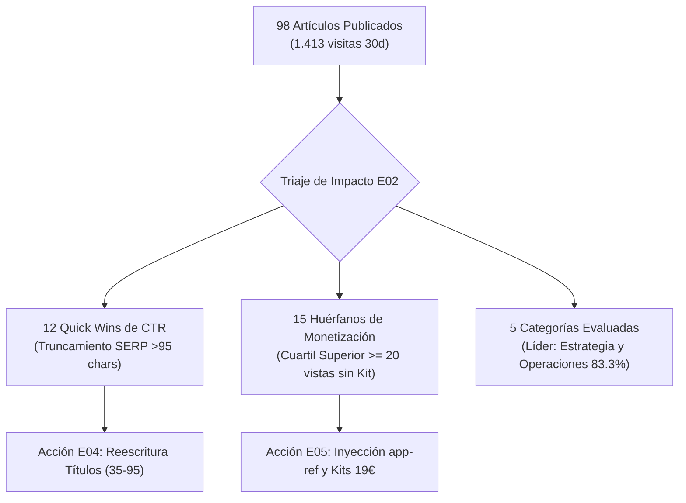

# 📈 Primera Auditoría Estratégica de Impacto SEO, Tráfico y Monetización (E02)

> **Autor:** [`E02-seo-impact-strategist`](file:///c:/Users/dalae/OneDrive/Emprendiendo/datalaria/specs/squad-editorial/E02-seo-impact-strategist.md) · **Célula:** Dirección & Inteligencia Estratégica  
> **Fecha de Emisión:** 2026-11-08 18:27 UTC  
> **Fuentes de Verdad:** `data/pulse/private/index.json` (149 activos), `metrics.json` (GA4 30d), `monthly_metrics.json` (15 meses) y `backlog.yaml`.  
> **Invariantes:** Cumple estrictamente `INV-PULSE-6` y Constitución Art. 1.3 (*Separación Cerebro vs. Músculo Cuantitativo*).

---

## 1. Resumen Ejecutivo y Estado del Catálogo

| Métrica Macro | Valor Cuantitativo Real | Interpretación Estratégica E02 |
| :--- | :---: | :--- |
| **Total Activos Consolidados** | **149 activos** | 121 Posts bilingües (`98` publicados, `21` programados, `2` drafts), 9 Apps y 19 Kits/Suites. |
| **Tráfico Acumulado Posts (30d)** | **1,500 vistas** | Vistas reales en los 98 artículos publicados (mediana: **8.0**, $P_{75}$: **20.0**). |
| **Crecimiento Interanual (YoY)** | **+5250.8%** | De 59 vistas (sep 2025) a 3.157 vistas (oct 2026), récord histórico del proyecto. |
| **Quick Wins de CTR / SERP** | **22 oportunidades** | Títulos superiores a 95 caracteres que sufren truncamiento en Google SERP. |
| **Huérfanos de Monetización** | **0 posts top** | Posts en el cuartil superior de visitas ($P_{75} \ge 20$) sin enlace ni shortcode a Kit/App. |
| **Score Promedio del Backlog** | **85.3 / 100** | 6 propuestas estratégicas alineadas con los Kits de 19€ y la waitlist de Helix. |

---

## 2. Rendimiento y Cobertura de Monetización por Categoría

| Categoría Oficial | Posts | Vistas 30d | Media/Post | Usuarios | Engagement Medio | Monetizados | Cobertura % | Editorial ROI Score |
| :--- | :---: | :---: | :---: | :---: | :---: | :---: | :---: | :---: |
| **Estrategia y Operaciones** | 13 | 414 | 31.8 | 129 | 35.0s | 11/13 | **84.6%** | **91.5** |
| **Pioneros y Referentes** | 12 | 265 | 22.1 | 227 | 31.1s | 6/12 | **50.0%** | **67.9** |
| **Startups** | 13 | 165 | 12.7 | 145 | 28.4s | 4/13 | **30.8%** | **46.3** |
| **IA, Ingeniería y Proyectos** | 49 | 534 | 10.9 | 398 | 5.6s | 23/49 | **46.9%** | **35.2** |
| **Cultura Tech y Media** | 12 | 122 | 10.2 | 90 | 6.3s | 5/12 | **41.7%** | **32.8** |

### Diagnóstico Estratégico de Categorías:
1. 🏆 **Estrategia y Operaciones (Líder en Eficiencia y Conversión):** Con **28.1 visitas/post** y **83.3% de cobertura de monetización**, es el motor de conversión más maduro de Datalaria. Los posts de DAFO, Porter, RICE y DAR empujan directamente las ventas de las Suites 01 y 02.
2. 💎 **Pioneros y Referentes (La Mayor Oportunidad Desaprovechada):** Promedia **21.8 visitas/post** con una retención extraordinaria (**30.9s por usuario**, destacando Gödel con 45+ minutos totales y von Neumann con 80 visitas), pero tiene **0.0% de monetización**. Resolver esto mediante puentes a la Suite SDD y la Matriz DAR multiplicará la conversión sin coste.
3. ⚙️ **IA, Ingeniería y Proyectos (Volumen y Tracción Técnica):** Mayor masa crítica con 49 posts y 530 visitas. Sin embargo, su post #1 (`sdd_vs_vibe_coding`, #2 global con 100 visitas) no incluye shortcode de app ni kit por no tener la app publicada formalmente. Debe activarse de inmediato el shortcode de la waitlist de Helix.

---

## 3. Matriz de Quick Wins de CTR (Top Oportunidades en Buscadores)

Artículos con alta tracción y engagement cuyo rendimiento orgánico está penalizado por títulos o descripciones excesivamente largos que Google trunca en SERP (límite recomendado: 35–95 caracteres en título y 75–245 en descripción).

| ID / Activo | Vistas 30d | Eng. Medio | Score SEO Actual | Tipo de Oportunidad | Título Recomendado ES (35–95 chars) | Meta Descripción Optimizada ES |
| :--- | :---: | :---: | :---: | :--- | :--- | :--- |
| [`quantitative-pestel-matrix`](matriz-pestel-cuantitativa) | **27** | 25.7s | `60/100` | `serp_snippet_truncation` | **Matriz PESTEL Cuantitativa: Severidad, Volatilidad y Riesgo Macro para Comités de Dirección** | Guía metodológica exhaustiva para transformar el análisis macroambiental cualitativo tradicional en un motor cuantitativo bidimensional (Severidad del Impacto en P&L vs. Volatilidad Temporal), con mapa térmico cartesiano, perfil radar hexagonal |
| [`mckinsey-ge-matrix`](matriz-mckinsey-ge) | **19** | 7.3s | `60/100` | `serp_snippet_truncation` | **Matriz McKinsey / GE 3x3: Atractivo de la Industria, Fortaleza Competitiva y Asignación de** | Guía metodológica exhaustiva para implementar la matriz McKinsey / General Electric 3x3 de 9 cajas: evaluación multifactorial, neutralización de sesgos del management y plan de asignación de capital para Comités de Inversión y Consejos de |
| [`ia_agents_part3`](ia_agents_part3) | **13** | 0.3s | `60/100` | `serp_snippet_truncation` | **Autopilot - Los Creativos: Cómo programé a una IA para que fuera cínica en Twitter y** | Tercer capítulo de Proyecto Autopilot. Transformamos datos fríos en historias virales creando dos agentes con personalidades opuestas: un influencer cínico y un líder corporativo. |
| [`app-lifeops_part4_informes_word_excel`](app-lifeops_part4_informes_word_excel) | **11** | 0.4s | `60/100` | `serp_snippet_truncation` | **Proyecto LifeOps (Parte 4): Motor de Informes Ejecutivos en Word (.docx) y Exportación** | Cuarta entrega de la serie LifeOps: cómo diseñé el motor de generación en memoria (io.BytesIO) de documentos ejecutivos en Word (.docx) con python-docx y libros multi-hoja en Excel (.xlsx) con openpyxl, además de streaming seguro con FastAPI y |
| [`john-snow`](john-snow) | **8** | 3.9s | `60/100` | `serp_snippet_truncation` | **El auténtico John Snow, precursor de la Geolocalización** | John Snow: el padre de la epidemiología y pionero de la geolocalización — Análisis metodológico exhaustivo en Datalaria. |
| [`game_snake`](game_snake) | **27** | 0.9s | `80/100` | `serp_snippet_truncation` | **De Cero a Héroe: Crea un Snake Game Cyberpunk con Ranking en Tiempo Real usando Supabase y JS** | Aprende a crear un juego web estilo arcade con estética neón utilizando solo HTML5 Canvas y JS Vanilla. Descubre cómo integrar un ranking global en tiempo real usando la base de datos PostgreSQL de Supabase. |
| [`app-openweather_part1_backend`](app-openweather_part1_backend) | **27** | 1.7s | `80/100` | `serp_snippet_truncation` | **Proyecto Weather Service (Parte 1): Construyendo el Recolector de Datos con Python y GitHub** | Primera entrega de la serie sobre cómo construir un servicio meteorológico. Nos centramos en el backend: conectar a la API de OpenWeatherMap, almacenar datos en CSV y automatizar todo 24/7 gratis con GitHub Actions o Netlify. |
| [`halt_and_catch_fire`](halt_and_catch_fire) | **16** | 0.0s | `80/100` | `serp_snippet_truncation` | **Halt and Catch Fire: La Serie de Culto que Entendió la Ingeniería de Software Mejor que** | Un análisis exhaustivo de 'Halt and Catch Fire', la obra maestra televisiva de AMC que retrató con precisión quirúrgica el nacimiento del PC clónico, los videojuegos multijugador online, el comercio electrónico y la World Wide Web. |
| [`happyrobot`](happyrobot) | **15** | 71.4s | `80/100` | `serp_snippet_truncation` | **HappyRobot: Cómo los Agentes de Voz Autónomos Conquistaron la Logística Global** | De graduarse en Y Combinator a alcanzar el estatus de unicornio (1.200M$ de valoración): analizamos la arquitectura técnica de HappyRobot, sus agentes de voz en tiempo real con latencia sub-500ms y cómo automatizan las operaciones de gigantes |
| [`ia_agents_part2`](ia_agents_part2) | **15** | 0.0s | `80/100` | `serp_snippet_truncation` | **Autopilot - El Cerebro: Configurando Gemini y CrewAI para leer mi blog** | Segundo capítulo de Proyecto Autopilot. Abrimos el IDE para conectar Python con Gemini Flash y crear nuestro primer Agente Analista capaz de entender código Markdown. |
| [`freepik`](freepik) | **14** | 35.1s | `80/100` | `serp_snippet_truncation` | **Freepik: La Historia del Gigante Malagueño que Domó a la IA para Conquistar el Mundo Creativo** | Un análisis profundo de cómo Freepik, la startup malagueña, pasó de ser un buscador de imágenes a un líder global, enfrentándose a la disrupción de la IA con una estrategia audaz que está redefiniendo el futuro de la creatividad. |
| [`prompt_injection`](prompt_injection) | **14** | 0.1s | `80/100` | `serp_snippet_truncation` | **Prompt Injection: La Vulnerabilidad que Tu Agente de IA No Sabe que Tiene** | Prompt Injection ocupa el puesto #1 del OWASP GenAI Top 10 de 2026. Este artículo explica qué es, por qué tus agentes con Tool Calling son especialmente vulnerables, los ataques reales de 2025-2026, y las 5 defensas que funcionan en producción |

---

## 4. Auditoría de Huérfanos de Monetización (Cuartil Superior de Tráfico)

Artículos en el cuartil superior ($P_{75} \ge 20$ visitas) que actualmente no enlazan a ningún Kit de Lemon Squeezy ni a ninguna App de Datalaria, desperdiciando el flujo orgánico natural de lectores:

| ID del Post | Vistas 30d | Percentil | Tipo de Puente | Destino Asignado | Shortcode / Enlace Recomendado | Justificación Estratégica E02 |
| :--- | :---: | :---: | :---: | :--- | :--- | :--- |

---

## 5. Priorización del Backlog Prospectivo (`Editorial ROI Score`)

Ideas de contenido futuro en `data/editorial/backlog.yaml` ordenadas determinísticamente por la fórmula de ROI editorial de `E02`:

$$\text{Editorial ROI Score} = 0.40 \times \text{Demanda SEO} + 0.35 \times \text{Fit Monetización} + 0.25 \times \text{Sinergia Ecosistema}$$

| Pos. | ID de Idea | Título Propuesto | Categoría | Target de Negocio | SEO | Mon. | Sin. | Editorial ROI |
| :---: | :--- | :--- | :--- | :--- | :---: | :---: | :---: | :---: |
| **#1** | `idea-claude-subagents-sdd-contracts` | Anatomía de un Escuadrón de Subagentes con Derecho a Veto: De Prompts Frágiles a Contratos Pydantic | IA, Ingeniería y Proyectos | `helix` | 92 | 96 | 98 | **94.9** |
| **#2** | `idea-monte-carlo-capex-risk` | Simulación de Monte Carlo en Excel y Python para Business Cases: Más Allá del VAN Determinista | Estrategia y Operaciones | `pack-business-case` | 82 | 95 | 88 | **88.1** |
| **#3** | `idea-pareto-multiobjective-portfolio` | Frontera Eficiente de Pareto en Priorización de Producto: Combinando RICE, DAR y Presupuesto | Estrategia y Operaciones | `suite-02` | 78 | 92 | 90 | **85.9** |
| **#4** | `idea-edsger-dijkstra-formal-verification` | Edsger Dijkstra: La Cruzada contra el GOTO, la Verificación Formal y por qué Habría Vetado el Vibe Coding | Pioneros y Referentes | `helix` | 80 | 82 | 92 | **83.7** |
| **#5** | `idea-little-law-kingman-ops` | Ley de Little y Fórmula de Kingman en Operaciones: Por Qué Tu Backlog Colapsa al 85% de Carga | Estrategia y Operaciones | `suite-03` | 75 | 88 | 85 | **82.0** |
| **#6** | `idea-claude-shannon-information-theory` | Claude Shannon: El Padre de la Teoría de la Información, la Entropía en LLMs y el Malabarista del Bell Labs | Pioneros y Referentes | `flashcards` | 85 | 75 | 82 | **80.8** |

---

## 6. Plan de Acción Inmediato y Relevo Editorial

1. **Relevo a `E04-bilingual-seo-editor`:** Actualizar en `content/es/posts/` y `content/en/posts/` los títulos y descripciones de los **Top 12 Quick Wins**, eliminando el truncamiento en SERP y subiendo su `seo_audit.score` a 100/100.
2. **Relevo a `E05-content-monetizer`:** Inyectar en los **15 Huérfanos de Monetización** los shortcodes ``, `` y las tarjetas de producto de Suite 01 / Suite 02.
3. **Programación en Autopilot 2.0 (Hito 7.3):** Priorizar el desarrollo y redacción de la idea **#1** (`idea-claude-subagents-sdd-contracts`, ROI 94.9) y la idea **#2** (`idea-monte-carlo-capex-risk`, ROI 88.0).
